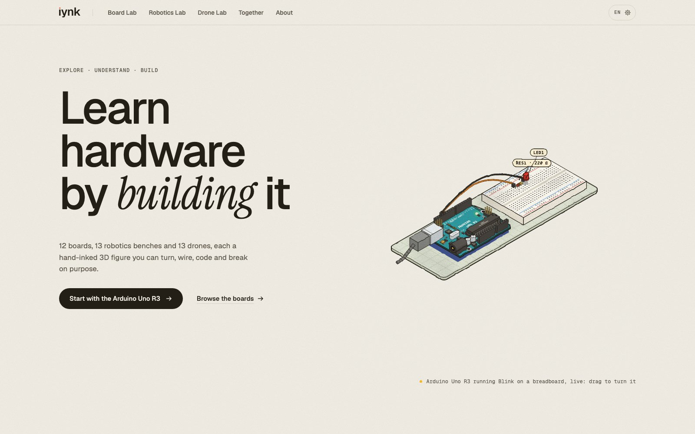
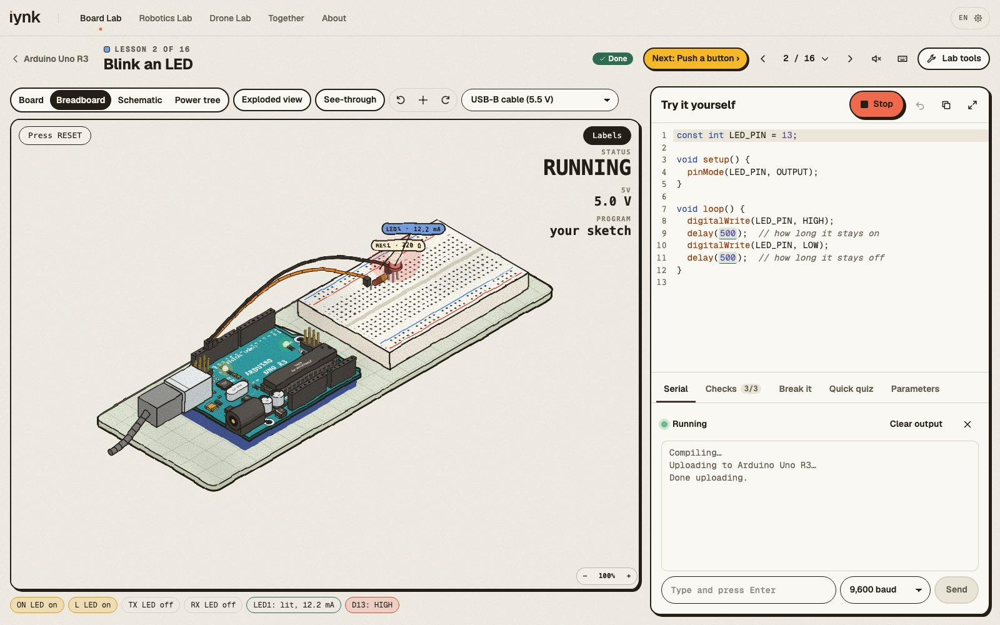
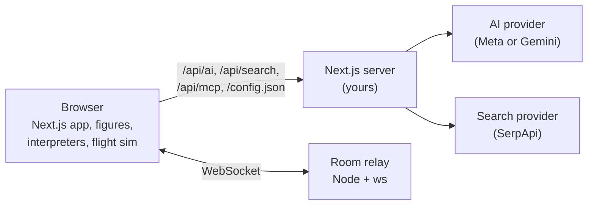

# iynk

**A free hardware lab in your browser.** Wire, code, break and fly boards, robots and drones that are modelled on real
ones, without buying a single part, in six languages.



## What it is, and what it is not

iynk teaches how parts behave. It runs your code in its own interpreter, not on a real chip. It does not replace a
bench, a compiler or a datasheet.

- Three labs hold <!--count:items-->38<!--/count--> catalogue items modelled on real boards, kits and drones:
  <!--count:boards-->12<!--/count--> boards, <!--count:robotics-->13<!--/count--> robotics benches and
  <!--count:drones-->13<!--/count--> drones. Each is a hand-inked 3D figure you can turn round, see through and take apart.
- You write code in a teaching subset of Arduino C++, MicroPython and Python, or Verilog on the FPGA boards. A built-in
  interpreter runs it on a virtual clock. It is not an emulator, and a program written for a real toolchain may not run.
- Lessons and bench tasks are marked done when your run meets their checks. The checks run in your browser.
- Breadboard faults are decided by a small DC circuit solver. Bench faults follow per-bench rules. Numbers such as the
  current through a burnt LED come from a simple pin model and are there to show the idea.
- The flight sim re-runs your flight in slow motion. A wiring mistake on the drone causes a scripted flip.



## Run it

You need Node 24 (the version in `.nvmrc`), npm and Python 3.

```bash
git clone https://github.com/kushwahaamar-dev/iynk.git
cd iynk && npm ci
npm run dev
```

Open the address `next dev` prints (http://localhost:3000 by default). The labs, the figures, the interpreters and the
flight sim work with no key and no setup, in a current Chromium browser (Firefox and Safari are not tested yet).

## AI and search

The AI lab partner and search (parts prices, nearby places, events, videos) are off until the person running the server
turns them on, and each person brings their own key. You do not put these keys in an environment file.

1. The operator sets `IYNK_AI_ENABLE=1` and `IYNK_SEARCH_ENABLE=1` and a server token. See
   [docs/SELF_HOSTING.md](docs/SELF_HOSTING.md).
2. In the app, open Settings, Keys and usage, and paste your provider key and the server token. They stay in your
   browser and travel only in the request headers.
3. The app shows what your key has used against the daily and monthly caps.

With no key, a feature says it is not set up and nothing is sent anywhere. What is stored and what leaves your device is
in [docs/DATA_HANDLING.md](docs/DATA_HANDLING.md). How the keys, the caps and `/config.json` work is in
[docs/SERVER_AND_KEYS.md](docs/SERVER_AND_KEYS.md).

Server settings, all optional, names only (values and defaults are in `.env.example` and the self-hosting page):

| Name | Turns on |
|---|---|
| `IYNK_AI_ENABLE` | the AI partner, translation and voice |
| `IYNK_SEARCH_ENABLE` | search, parts prices, nearby places |
| `IYNK_SERVER_TOKEN` | the routes that spend the provider's quota |
| `NEXT_PUBLIC_REALTIME_URL` | rooms across devices (without it, rooms work between tabs of one browser) |

## How it works



- **Frontend:** Next.js 16 (App Router), React, TypeScript, Tailwind CSS, CodeMirror. Figures are SVG drawn with
  [Colorfigures](figures/vendor/colorfigures/LICENSE), with our own engines for boards, benches and drones
  ([figures](docs/FIGURES.md), [bench engine](docs/FIGURES-BENCH.md), [drone engine](docs/FIGURES-DRONE.md)).
- **Simulation:** interpreters for a subset of Arduino C++, MicroPython, Python and Verilog, a circuit solver, a drone
  calculator and a flight model. All of it runs in the browser.
- **Server:** the same Next.js app serves the AI and search routes. They take the caller's own key, rate-limit calls per
  server instance and count spend per key.
- **Realtime:** a small Node WebSocket relay in `server/realtime`.
- **MCP:** AI assistants can search the catalogue and run the drone calculator through `/api/mcp`. Its parts price tool
  answers "not set up", because an MCP call carries no search key.

## Status

Rooms share a bench by link, for up to eight people. Anyone with the link can join, so share it with people you trust.
Rooms between devices need the relay to be running. A Studio for building your own projects is not built yet, and the
server that will carry rooms and shares in one container is planned for a later phase.

The lab partner sees your code, check results, pin states and part readouts as text, not the wiring.

## Tests

```bash
npm run typecheck   # TypeScript
npm run lint        # ESLint
npm test            # Vitest
npm run e2e         # Playwright end-to-end tests with axe checks on the app pages
```

`bash scripts/ci-local.sh` runs the same steps CI runs. [CONTRIBUTING.md](CONTRIBUTING.md) explains how to add a string
in six languages, a lesson or a part.

## Project layout

```
src/app            pages and API routes (one page per lab item, in six languages)
src/components     lab UIs, the dock (partner, rooms, parts), shell
src/content        boards, benches and drones: lessons, steps, faults, checks
src/lib            interpreters, circuit solver, drone calculator, flight model, realtime, AI, search
src/i18n           messages and lesson prose in six languages
figures            figure sources and engines (built into public/figures)
server/realtime    the room relay
e2e                Playwright tests
docs/facts         sourced fact sheets for every board and drone
```

## More

- [CONTRIBUTING.md](CONTRIBUTING.md), [SECURITY.md](SECURITY.md) and [CODE_OF_CONDUCT.md](CODE_OF_CONDUCT.md)
- [LICENSE-PENDING.md](LICENSE-PENDING.md): no licence has been chosen yet
- [docs/SELF_HOSTING.md](docs/SELF_HOSTING.md), [docs/DATA_HANDLING.md](docs/DATA_HANDLING.md),
  [docs/SERVER_AND_KEYS.md](docs/SERVER_AND_KEYS.md), [docs/PROVENANCE.md](docs/PROVENANCE.md)

## Credits

- [Colorfigures](figures/vendor/colorfigures/LICENSE) by April Zhu (MIT), built on iso-glow by April Zhu and
  iso-figure by Tolga Cohce. Our changes are in `figures/vendor/colorfigures/PATCHES.md`.
- Three teaching sites inspired iynk: Learn Arduino by Dilum Sanjaya, Robotics Engineer and Drone Engineer. Some
  constants, reference tables and the lesson structure follow them. [docs/PROVENANCE.md](docs/PROVENANCE.md) records
  where, and which rows are still open.
