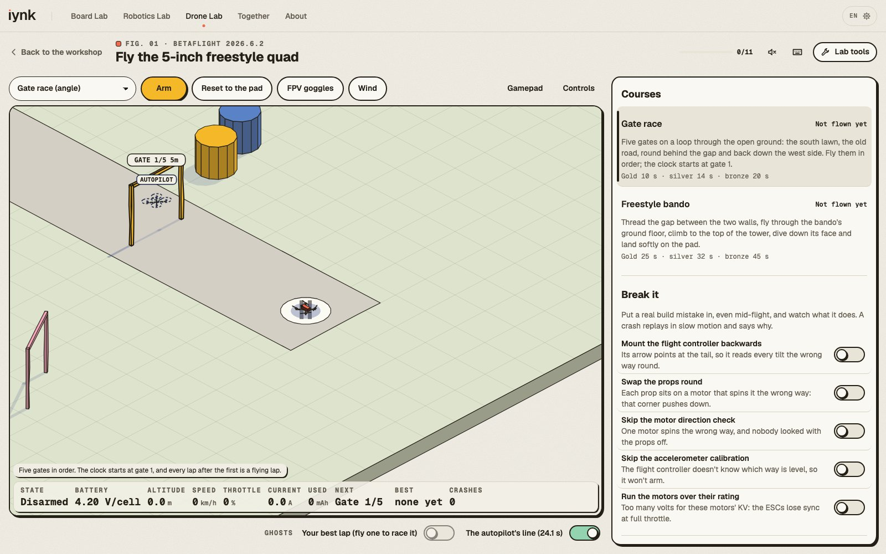
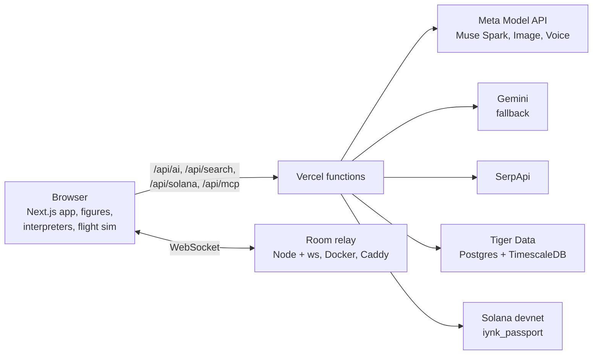

# iynk

**A free hardware lab in your browser.** Wire, code, break and fly real boards, robots and drones, without buying a
single part, in your own language, and never alone.

**Live:** [iynk.tech](https://iynk.tech) · no account, nothing to install


## Why

Learning hardware is mostly experimenting, and experimenting means breaking things. Every mistake costs a part: a
board, a sensor, a motor driver, a battery. Far from a lab, a makerspace or a well-stocked shop, that cost is where a
lot of people stop. iynk moves the experimenting into a lab that behaves like the real hardware, so the only thing you
ever have to buy is the final prototype.

## What it does

### Three labs, 38 real items

| Lab | Items |
|---|---|
| **Board Lab** | Arduino Uno R3, Arduino Nano, Arduino UNO R4 (Minima, WiFi), ESP32-DevKitC V4, ESP32-S3-DevKitC-1, NodeMCU (ESP8266), Raspberry Pi Pico (W, 2), STM32 Nucleo-F401RE, BBC micro:bit V2, Raspberry Pi 5 / Pi 4, Digilent Basys 3, Terasic DE10-Lite |
| **Robotics Lab** | Build an Arduino Uno R3, LED + resistor, transistor motor switch, build an ESP32-S3-DevKitC-1, TB6612FNG driver, L298N driver, A4988 stepper driver, PCA9685 servo arm, MPU-6050 tilt alarm, HC-SR04 parking sensor, QTR-8RC line follower, LM2596 buck converter, Raspberry Pi 5 ROS 2 brain |
| **Drone Lab** | 5-inch freestyle quad, Tiny Whoop 65 mm, 3-inch cinewhoop, 7-inch long-range quad, 5-inch racing quad, GPS camera drone, autonomous delivery quad, agricultural spray hexacopter, 900 mm FPV flying wing, VTOL tiltrotor, Crazyflie swarm drone, tricopter, heavy-lift octocopter |

Every item is a hand-inked 3D figure you can turn all the way round, see through and take apart.


- **Real code, really run.** Write Arduino C++, MicroPython, Python (with gpiozero and rclpy on the Pi) or Verilog on
  the FPGA boards and press Run. Interpreters inside the page drive the pins, the serial monitor and the figure on a
  deterministic clock. 71 board lessons and 31 bench tasks pass only when your run meets their checks.
- **Break it on purpose.** 144 board failures and 106 bench faults, decided by a circuit solver: leave the resistor off
  an LED and it flashes once and burns out (113 mA through a part rated for 20), fit a capacitor backwards and it
  smokes, put a motor on the 5 V pin and the board browns out. Each one explains what happened and how to fix it.
- **Build part by part.** Benches go together step by step (272 steps) with live status and current draw. Drones are
  assembled on a bench, sized with a drone calculator (thrust to weight, hover throttle, flight time, current) and
  checked with safety tests before the first flight.
- **Fly it.** A flight sim with gate races and freestyle courses in angle or acro mode, third person or FPV, against
  your best lap, the autopilot and your friends' ghosts. Break the drone on purpose (flight controller mounted
  backwards, props swapped round) and a slow-motion replay shows why it flipped.



### Never alone

- **Rooms.** Share a link and up to eight people build on the same bench in real time, on any device. Every shared
  action is put in one order for everyone.
- **A lab partner that finds you a friend.** The AI partner (Meta Muse Spark with tool calling) reads your bench,
  points at the broken part in the figure and gives hints before answers. If someone in your room has already passed
  that lesson, it asks them first, with a question that makes them explain it.
- **Any language.** The whole app is in English, Spanish, French, German, Chinese and Hindi, down to the labels inside
  the figures. Room chat and voice messages (Muse Voice Transcribe) are translated into each reader's language.
- **Build Night, Build Buddies, Build Stories.** Plan one project for a group with a role for each person, find people
  whose skills complement yours, and turn a session into a short story with an illustrated cover (Muse Image).

### For real

- **Build it for real.** Every parts list is priced live across Google Shopping, Amazon and eBay (SerpApi). On a drone,
  a budget optimiser re-runs the drone maths on every battery, motor and prop combination at today's prices and picks
  the build that still flies within your budget. It also finds makerspaces, electronics shops and flying fields near
  you, and tutorials on YouTube.
- **Proof of Build.** Pass a drone's bench safety checks and the server re-runs your exact run before an Anchor program
  on Solana devnet writes a credential to your wallet. Anyone can verify it straight from the chain, and sponsors can
  lock bounties that pay out in the same transaction.
- **Leaderboards.** Laps and lesson passes land in Postgres with TimescaleDB (Tiger Data), where real-time continuous
  aggregates drive the flight leaderboards.
- **An MCP server.** AI assistants can search the catalogue, run the drone calculator, price parts, plan a build night
  and open a room through `/api/mcp`.

## How it works



- **Frontend:** Next.js 16 (App Router), React, TypeScript, Tailwind CSS, CodeMirror. Figures are SVG drawn with
  [Colorfigures](figures/vendor/colorfigures/LICENSE), with our own engines for boards, benches and drones
  ([figures](docs/FIGURES.md), [bench engine](docs/FIGURES-BENCH.md), [drone engine](docs/FIGURES-DRONE.md)).
- **Simulation:** interpreters for an Arduino C++ subset, MicroPython, Python and a Verilog subset; a circuit solver;
  a drone calculator; a flight model. All in the browser.
- **Server:** Vercel functions for AI, search, data and Solana. API keys stay on the server, every call is
  rate-limited, and Gemini takes over when Meta is busy.
- **Realtime:** a small Node WebSocket relay (`server/realtime`), run in Docker behind Caddy.
- **Data:** Postgres with TimescaleDB (`db/migrations`): an events hypertable, continuous aggregates and opt-in buddy
  profiles.
- **Chain:** an Anchor program (`solana/programs/iynk_passport`), tested on a local validator.

## Run it locally

Needs Node 24 and npm.

```bash
npm ci
cp .env.example .env.local   # every key is optional; a feature without its key says it isn't set up
npm run dev                  # http://localhost:3000
```

The labs, the figures, the interpreters and the flight sim work with no keys at all. The optional keys in
`.env.example` turn on the rest:

| Variable | Turns on |
|---|---|
| `META_API_KEY` | the lab partner, translation, voice, story covers, Build Night and Build Buddies matching |
| `GEMINI_API_KEY` | the fallback model when Meta is busy |
| `SERPAPI_KEY` | live prices, places, events, videos and datasheet answers |
| `DATABASE_URL` | leaderboards and Build Buddies (run `node scripts/db-migrate.mjs` once) |
| `NEXT_PUBLIC_REALTIME_URL` | rooms across devices (without it, rooms work between tabs of one browser) |
| `SOLANA_ISSUER_KEYPAIR`, `NEXT_PUBLIC_SOLANA_PROGRAM_ID` | Proof of Build on devnet |

Rooms across devices need the relay:

```bash
cd server/realtime && npm ci && node server.js --port 43117
# then NEXT_PUBLIC_REALTIME_URL=ws://127.0.0.1:43117/ws in .env.local
```

## Tests

```bash
npm run typecheck   # TypeScript
npm run lint        # ESLint
npm test            # Vitest: about 2,800 unit tests, including every lesson's reference and starter code
npm run e2e         # Playwright end-to-end tests with axe accessibility checks
cd solana && npm test   # the Anchor program on a local validator
```

## Project layout

```
src/app            pages and API routes (one page per lab item, in six languages)
src/components     lab UIs, the dock (partner, rooms, parts), shell
src/content        boards, benches and drones: lessons, steps, faults, checks
src/lib            interpreters, circuit solver, drone calculator, flight model, realtime, AI, search, Solana
src/i18n           messages and lesson prose in six languages
figures            figure sources and engines (built into public/figures)
server/realtime    the room relay
solana             the Anchor program, its tests and deploy scripts
db/migrations      the TimescaleDB schema
e2e                Playwright tests
docs/facts         sourced fact sheets for every board and drone
```

## Credits

- [Colorfigures](figures/vendor/colorfigures/LICENSE) by April Zhu (MIT), built on iso-glow by April Zhu and
  iso-figure by Tolga Cohce. Our changes are in `figures/vendor/colorfigures/PATCHES.md`.
- Learn Arduino by Dilum Sanjaya, Robotics Engineer and Drone Engineer showed how good an interactive hardware lesson
  can be and shaped our lesson structure. We reused facts (pinouts, formulas, constants), not their code.
