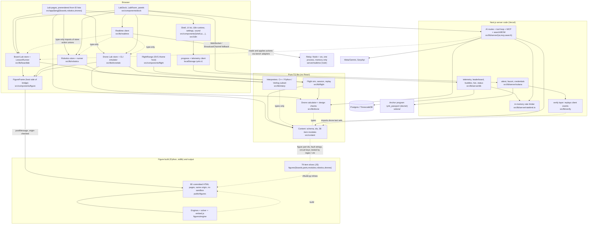

# iynk repository inventory

Audited commit `bb546d6a051f0b268576587c6f9f934dde9e766c` (branch main), 2026-10-26. This file is the synthesis of 14 per-subsystem inventories in `inventory/`. It does not re-derive them. Each digest line keeps the label the inventory gave it. Where I re-ran a command myself for this file I say so.

Labels: VERIFIED (inspected or reproduced), DOCUMENTED (a project doc says so, not tested), EXTERNAL, ESTIMATED, HYPOTHESIS, UNKNOWN.

## 0. Gaps in the evidence base

- The run reports named in the task (`runs/COMMANDS.md`, `runs/BUILD_OUTPUT.md`, `runs/E2E.md`, `runs/BROWSER_WALK.md`) and the baselines `PERFORMANCE_BASELINE.md` and `TEST_COVERAGE.md` do not exist in `docs/MASTER_PLAN/01_AUDIT/` (VERIFIED: `ls docs/MASTER_PLAN/01_AUDIT` shows only `CLAIMS.json`, `SECURITY_BASELINE.md`, `inventory/`). The run summary passed to me was `{}`. So every test result below comes from the inventory files, each of which says it ran its own commands.
- `SECURITY_BASELINE.md` exists (292 lines). I did not fold it in beyond what the inventories already say. Read it next to section 4.
- No production-side check was made by any agent: iynk.tech, rt.iynk.tech, the live database and the Vercel dashboard are UNKNOWN.
- No full `next build` was run by the audit. The shell inventory says `.next` is stale. Playwright was listed (119 tests) but not run (tooling inventory).
- Translation quality was not reviewed by anyone.

## 1. Baseline

| Item | Value | Label / command |
|---|---|---|
| Commit | `bb546d6a051f0b268576587c6f9f934dde9e766c` | VERIFIED `git rev-parse HEAD` |
| Date | 2026-10-26 | task |
| Tracked files | 1,389 | VERIFIED `git ls-files \| wc -l` |
| Test files tracked | 180 (173 under `npm test`, plus 6 relay tests and 1 Anchor test outside it) | VERIFIED `git ls-files \| grep -E '\.test\.' \| wc -l` = 180; tooling inventory |
| Node | `engines.node` 24.x, `.nvmrc` 24, local v24.8.0 | VERIFIED `node -v`, `cat .nvmrc`, `package.json` |
| Package manager | npm, 3 separate lockfiles (root, `server/realtime`, `solana`), no workspace config | VERIFIED (tooling) |
| Python | 3.12.6 used for figure build; stdlib only | VERIFIED (figure-items) |
| Rust / Solana | Anchor 0.31.1, Solana CLI 4.2.2 | VERIFIED `solana/Anchor.toml:1-3` (solana inventory) |

### 1.1 Lines of code

Counted with `find <dir> -type f \( -name '*.ts' -o -name '*.tsx' -o -name '*.js' -o -name '*.mjs' -o -name '*.py' -o -name '*.rs' -o -name '*.sql' -o -name '*.sh' \) -not -path '*/node_modules/*' -not -path '*/target/*' | xargs cat | wc -l`. I ran this for the rows below on 2026-10-26. "Test" is the same command restricted to `*.test.*` and `*.spec.*` files and is included in the total. Generated files (`index.generated.ts`, `public/figures`) are inside or outside as noted.

| Directory | Total LOC | Of which tests |
|---|---|---|
| `src/` (all TS/TSX) | 104,381 | n/a |
| `src/content` (38 item modules, schema, ids, tests) | 31,487 | 6,653 |
| `src/lib/interp` | 13,468 | 1,646 |
| `src/lib/server` | 6,942 | 2,421 |
| `src/lib/flight` | 3,869 | 967 |
| `src/lib/realtime` | 3,087 | 711 |
| `src/lib/ai` | 3,118 | 854 |
| `src/lib/hw` | 2,358 | 726 |
| `src/lib/dronelab` | 2,287 | 664 |
| `src/lib/boardlab` | 1,921 | 642 |
| `src/lib/solana` | 1,847 | 270 |
| `src/lib/robotics` | 1,429 | 412 |
| `src/lib/search` | 1,319 | 406 |
| `src/lib/drone` | 1,089 | 394 |
| `src/lib/sound` | 939 | 362 |
| `src/lib/verify` | 837 | 260 |
| `src/lib/telemetry` | 544 | 151 |
| `src/lib/progress` | 496 | 160 |
| `src/lib/settings` | 182 | 63 |
| `src/components` | 21,428 | 2,731 |
| `src/app` (pages and API routes) | 4,821 | not split |
| `src/i18n` code | 715 | 334 |
| `figures/` (all JS, Python) | 25,196 | 1,462 (engine tests) |
| `figures/engine` | 6,391 | 1,462 |
| `figures/drones` | 5,070 | 0 |
| `figures/boards` | 3,444 | 0 |
| `figures/parts` | 2,799 | 0 |
| `figures/modules` | 2,548 | 0 |
| `figures/robotics` | 2,175 | 0 |
| `figures/flight` | 1,223 | 0 |
| `figures/vendor` | 960 | 0 |
| `figures/tools` | 534 | 0 |
| `server/realtime` (relay) | 2,408 | 810 |
| `solana/` (Rust, TS tests, scripts) | 1,129 | 469 |
| `e2e/` | 1,644 | 1,574 |
| `scripts/` | 3,522 | 0 |
| `db/` (SQL) | 118 | 0 |
| `docs/` code-like files | 3,740 | n/a |
| i18n JSON under `src/i18n` | 190,627 lines | n/a |
| Markdown in the repo | 48,161 lines | VERIFIED (docs-claims-history) |
| Built figure pages `public/figures/**/*.html` | 80 files, 24,669,406 bytes (24.7 MB), max 495,777 bytes | VERIFIED `git ls-files public/figures \| wc -l` = 80 (figure-engine) |

Notes. The sum of `src/lib/*` rows is less than `src/lib` because small folders (`features`, `ai` sub-folders, etc.) are not listed. `src/components` includes component tests. Figure item slices are 16,036 LOC (boards 3,444 + parts 2,799 + modules 2,548 + robotics 2,175 + drones 5,070), matching the figure-items inventory.

### 1.2 Dependencies (root `package.json`, exact versions as pinned)

Runtime (21): `next` 16.4.3, `react` 19.3.0, `react-dom` 19.3.0, `zod` 4.6.7, `postgres` 3.4.9, `server-only` 0.0.1, `@modelcontextprotocol/sdk` 1.32.2, `@codemirror/commands` 6.11.1, `@codemirror/lang-cpp` 6.0.3, `@codemirror/lang-python` 6.2.1, `@codemirror/language` 6.13.1, `@codemirror/legacy-modes` 6.5.5, `@codemirror/state` 6.7.6, `@codemirror/view` 6.43.14, `@lezer/highlight` 1.2.5, `@coral-xyz/anchor` 0.31.1, `@solana/web3.js` 1.99.0, `@solana/wallet-adapter-base` 0.9.28, `@solana/wallet-adapter-react` 0.15.40, `@solana/wallet-adapter-react-ui` 0.9.40, `bs58` 6.0.0, `qrcode` 1.5.4.

Dev: `typescript` ^5, `eslint` ^9, `eslint-config-next` 16.4.3, `tailwindcss` ^4, `@tailwindcss/turbopack` ^4, `vitest` 5.0.3, `vite` 8.3.4, `@vitejs/plugin-react` 6.1.2, `jsdom` 30.1.2, `@testing-library/react` 16.3.3, `@testing-library/dom` 10.4.2, `@playwright/test` 1.64.0, `playwright-core` 1.64.0, `@axe-core/playwright` 4.13.0, `@types/node` 24.19.2, `@types/qrcode` 1.5.6, `@types/react` ^19, `@types/react-dom` ^19.

Relay: `ws` 8.22.0 only (VERIFIED, realtime). Anchor program: `anchor-lang =0.31.1`, `solana-sdk-ids =2.2.1`.

Findings about the list (all VERIFIED unless stated):
- `@solana/wallet-adapter-react-ui` and root `@coral-xyz/anchor` have 0 imports in `src/` (solana inventory).
- `@modelcontextprotocol/sdk` is used only in tests; the MCP server is hand-written (ai-search-mcp).
- Scripts import undeclared `playwright`, `sharp`, `acorn` (tooling): `scripts/crawl-routes.mjs:12`, `figure-thumbs.mjs:10,15`, `figure-strings.mjs:24-25`.
- `npm audit --omit=dev`: 15 findings, 2 high, 13 moderate (tooling, `scratchpad/audit/tooling/audit.json`).
- The interpreters, solver, flight sim and figure engine use no third-party runtime packages (interp, figure-engine, flight).
- No UI component library: Dialog, Popover, Tabs, focus trap are hand-written (shell-i18n).
- No AI SDK: the model client is raw `fetch` (ai-search-mcp).

### 1.3 Deploy targets

| Target | What runs | Label / source |
|---|---|---|
| Vercel project (CLI link name `simlab-hacktx`, renamed `iynk` in HANDOFF) | Next.js app, `vercel deploy --prod --yes` run by hand from a laptop; no `vercel.json`, no `.github`, no git hooks | VERIFIED no CI files (tooling); DOCUMENTED `docs/hacktx/DEPLOY.md:27` |
| `https://iynk.tech` and `iynk.vercel.app` | public site | DOCUMENTED (HANDOFF, README). Which URL is canonical differs between README, Devpost and HANDOFF (docs-claims-history) |
| `rt.iynk.tech` on a Vultr VM | Docker: `node:24.22.1-alpine` relay + `caddy:2.11.7-alpine`; 1 vCPU, 512 MB container limit | VERIFIED `deploy/realtime/*`; VM size DOCUMENTED |
| Postgres / TimescaleDB (Tiger Data) | events hypertable, 2 continuous aggregates, profiles | DOCUMENTED. Whether production has it and whether migrations ran: UNKNOWN (server-data open question) |
| Solana devnet | `iynk_passport` program, public RPC `api.devnet.solana.com` | DOCUMENTED (HANDOFF); program id and RPC default VERIFIED in code |
| Model API | Meta `api.meta.ai/v1` (muse-spark-1.3), Gemini fallback | VERIFIED code; live smoke 6 of 6 passed (ai-search-mcp) |
| SerpApi | shopping, web, videos, nearby, events | VERIFIED; key is on Free plan with 0 of 250 searches left, HTTP 429 |

## 2. System map

This is the dependency picture the inventories found, not the README's. Solid arrows are imports or runtime calls that were read in code. Dashed arrows are test-only or build-time links.

Reading the map:
- `src/lib/interp` is the only simulator for code. It imports only content types. The Board Lab and Robotics Lab are its two callers. No server code imports it (VERIFIED: `grep -rln "runChecks\|runHeadless\|evaluateChecks" src server scripts` shows client code only).
- The figure iframe is the only place where electrical state exists. The host reads it back from messages. Circuit keys and fault strings live in both `src/content` and `figures/*`, linked only by tests.
- Layering inversions found: `src/lib/dronelab/store.ts:2-3` and `fly.ts:2` import from `src/components`; `src/lib/realtime` imports `@/components/dock/types`.
- The relay imports nothing from the app (VERIFIED, realtime). The app and the relay share a protocol by hand-copying: JS validator in `server/realtime/src/protocol.js`, TS types in `src/lib/realtime/protocol.ts`.
- Solana is attached in three places only: `LabDock.tsx`, `api/status/route.ts`, MCP `get_passport` (VERIFIED, solana).

## 3. Subsystem table

LOC is non-test plus test where the inventory gave one number. Tests are the passing counts the inventory reports from its own run on this commit. "Recommendation" uses the inventory's own word.

| # | Subsystem | Paths | Purpose | LOC | State / persistence | Tests (as reported) | Recommendation | Inventory |
|---|---|---|---|---|---|---|---|---|
| 1 | Content model | `src/content/{schema,ids,index.generated}.ts`, `src/content/{boards,robotics,drones}/*.ts`, `scripts/gen-content-index.mjs`, prose `src/i18n/content/<lang>/<lab>/<id>.json` | Typed catalogue: 38 items, 71 lessons, 31 tasks, 144 failures, 106 faults, 272 robotics steps (579 build steps in all labs), 78 drone tests | 31,487 (with tests) | none at runtime; build-time generated index | 37 files, 813 tests pass, 132 s | extend; replace the id/binding layer | [content-schema.md](inventory/content-schema.md) |
| 2 | Interpreters | `src/lib/interp/**` | Arduino C++ subset, MicroPython subset, 2-state Verilog on one virtual clock; check evaluator; Web Worker front door | 13,468 | none | 9 files, 189 pass | extend; investigate a real emulator | [interp.md](inventory/interp.md) |
| 3 | Figure engine | `figures/engine/**`, `figures/vendor/colorfigures/**`, `figures/tools/**`, `src/components/figure/**` | Drawing core, bench and drone engines, DC circuit solver, postMessage bridge, Python build | 10,998 in scope | none (pages touch no storage) | 7 files, 126 pass | extend | [figure-engine.md](inventory/figure-engine.md) |
| 4 | Figure item slices | `figures/{boards,parts,modules,robotics,drones}/*.js`, `public/figures/**`, `src/i18n/figures/<lang>.json` | 79 per-item drawing and circuit data inlined into 80 committed pages | 16,036 (+24.7 MB built) | committed build output | 105 pass, 64.6 s | extend | [figure-items.md](inventory/figure-items.md) |
| 5 | Board Lab and Robotics Lab UI | `src/lib/{boardlab,robotics}/**`, `src/components/{boardlab,robotics,dock}/**`, `src/app/[lang]/{boards,robotics}/**` | Stores, runner, workspaces, code editor, dock | 9,761 | `iynk:boardlab:values`, serial height, `iynk:v1`; learner code not saved | 17 files, 120 pass | extend | [boardlab-robotics-ui.md](inventory/boardlab-robotics-ui.md) |
| 6 | Drone calculator and Drone Lab | `src/lib/{drone,dronelab}/**`, `src/components/dronelab/**`, `src/app/[lang]/drones/**` | Closed-form thrust and flight-time model, design checks, CLI emulator, assembly and tests UI | 4,919 (+9,713 fixture lines) | store in memory; progress in `iynk:v1`; sessionStorage payloads | 384 calc tests (342 golden) plus 61 CLI, store, fly | extend the shell; replace the thrust and energy model | [drone-calc-lab.md](inventory/drone-calc-lab.md) |
| 7 | Flight simulator | `src/lib/flight/**`, `src/components/flight/**`, `figures/flight/**`, `public/figures/flight/range.html`, fly page | 100 Hz arcade flight model, replay, ghosts, scoring, SVG renderer | about 6,825 | session log in memory; laps sent to telemetry | 5 files, 96 pass | extend shell; replace dynamics core if fidelity matters | [flight.md](inventory/flight.md) |
| 8 | Realtime rooms | `server/realtime/**`, `deploy/realtime/**`, `src/lib/realtime/**`, `src/components/realtime/**`, `src/app/[lang]/together/**` | Sequencing relay (Node + ws), client, snapshots, chat, presence | 7,938 | relay memory only | relay 39 pass; client 18 pass; load test 8 peers | extend | [realtime.md](inventory/realtime.md) |
| 9 | AI, search, BOM, MCP | `src/lib/{ai,search,hw}/**`, `src/components/{ai,search,hw}/**`, `src/lib/server/{ai,mcp,search}/**`, `src/app/api/{ai,search,mcp,openapi.json}/**` | Partner chat with tools, translation, voice, story, BOM and optimiser, 7-tool MCP server, Web Serial twin | 11,690 non-test (+5,211 test) | in-process counters and caches; no chat persistence | 40 files, 344 pass; live smoke 6 of 6 | extend; replace guards, catalogue-keyed BOM, stale-apply path | [ai-search-mcp.md](inventory/ai-search-mcp.md) |
| 10 | Server data layer | `src/lib/server/**` (db, http, env, ratelimit), `db/migrations/*.sql`, `scripts/db-migrate.mjs`, `src/app/api/{telemetry,leaderboard,buddies,live,status}`, `src/lib/{telemetry,progress,settings}/**` | Telemetry ingest, leaderboard, buddy pool, env and error contract, progress document | 6,942 + 1,222 | TimescaleDB events, profiles, 2 aggregates; `iynk:v1` in browser | 83 pass; Timescale DDL test skipped | extend | [server-data.md](inventory/server-data.md) |
| 11 | Solana Proof of Build | `solana/**`, `src/lib/{solana,verify}/**`, `src/lib/server/solana/**`, `src/components/solana/**`, `src/app/api/solana/**`, passport and verify pages | Devnet credentials and bounties, attest flow, faucet, wallet UI | 5,451 hand-written | on-chain PDAs; wallet in browser | 52 vitest pass; 34 on-chain tests not run | investigate; leaning detachable | [solana.md](inventory/solana.md) |
| 12 | Shell, UI kit, i18n | `src/app/[lang]/{layout,page,not-found,about,[...rest]}`, `src/components/{shell,ui,catalogue,marketing,editorial,data,settings}/**`, `src/i18n/**`, `src/lib/{sound,settings}/**`, `next.config.ts`, `globals.css` | Layout, nav, design system, 6-language runtime, settings, sound, SEO | about 7,500 | `iynk:v1` (settings share key with progress) | 24 files, 509 pass, 1 skipped | preserve and extend | [shell-i18n.md](inventory/shell-i18n.md) |
| 13 | Tooling, tests, e2e, deploy | `package.json`, configs, `e2e/`, `scripts/`, `deploy/realtime/`, `.vercelignore` | check scripts, Vitest, Playwright, crawlers, relay deploy | e2e 1,644; scripts 1,472 | none | tsc 0, eslint 0; vitest 2,794 of 2,802 pass (3 timeouts, 5 skipped); 119 e2e listed, not run | extend | [tooling-tests-e2e.md](inventory/tooling-tests-e2e.md) |
| 14 | Docs, claims, history | `README.md`, `HANDOFF.md`, `docs/**` | Build diary, decisions, fact sheets, hackathon material, claim register | 48,161 lines of Markdown | git history (792 commits) | n/a | extend; archive sales docs; resolve licence and provenance | [docs-claims-history.md](inventory/docs-claims-history.md) |

Quick find: if you know the folder, use the Paths column. If you know the symptom, section 4 is ordered the same way as this table.

## 4. Per-subsystem digest

Each block lists the strongest findings. Severity follows the inventories.

### 4.1 Content model ([content-schema.md](inventory/content-schema.md))
- VERIFIED. 38 modules (12 boards, 13 robotics benches, 13 drones). 71 lessons, 31 bench tasks, 144 board failures, 106 bench faults, 272 robotics steps, plus 134 board assembly and 173 drone build steps = 579 build steps. README counts match; "272 assembly steps" is robotics only. `node scratchpad/audit/content-schema/count.mjs`.
- VERIFIED. 0 functions in all 38 default exports. Behaviour lives in code-as-string templates and regex strings run by `src/lib/interp`. `src/content/boards/pico.ts:7-47,203-217`; `src/content/robotics/hc-sr04.ts:145-170`.
- VERIFIED, high. Failures and faults are one `FailureMode` type with a 10-way trigger union and a figure `BridgeCommand`. Figure JS interprets opaque fault strings such as `'cold:H1.20'`. Guard: per-item `vm` tests and a regex checker for drones. `src/content/schema.ts:218-253`; `src/content/boards/pico.test.ts:19-77`; `src/content/drones/_checks.ts:24-45`.
- VERIFIED, high. Ids are closed unions in `ids.ts`, repeated as a separate `BoardId` in `src/lib/interp/profiles.ts:6-18`. The generator rejects files not in `ids.ts` (`scripts/gen-content-index.mjs:65-67`). A new item needs 5+ edits and a rebuild.
- VERIFIED. `Check` is a pure predicate over a `RunTrace` with 10 kinds and one shared evaluator. Reusable, but pin names are board net strings. `schema.ts:370-381`; `src/lib/interp/checks.ts:1-4`.
- VERIFIED, medium. 813 tests pass, mostly self-consistency (reference code passes its own checks, figure ids match content). 737 pinout rows and power limits are not compared to datasheets by any test.
- VERIFIED, medium. `content:check` validates text keys against English JSON only, with a heuristic over 26 section names; `drones/_checks.ts:56-57` keeps a second key list. `TextKey` is a plain string (`schema.ts:25`).
- VERIFIED, low. Prose parity is complete: 12,311 English leaf keys, 0 missing in es/fr/de/zh/hi. Lesson code embeds demo Wi-Fi credentials (`wlan.connect HackTX/hackathon`) in `src/content/boards/pico.ts`.
- VERIFIED, medium. Drones have no failure model; they use 78 `DroneTest` entries and calculator verdicts with golden rows from the prototype.
- UNKNOWN. How much of `FailureMode.effect` (pins, damages, extraMa, serial) the host engine consumes versus the figure; `src/lib/hw/sim.ts` was not read.

### 4.2 Interpreters ([interp.md](inventory/interp.md))
- VERIFIED. No third-party runtime dependencies. C++ is lexed, parsed and compiled to typed closures (generators so `delay()` suspends). Python is a tree-walker with BigInt ints. Verilog is a 2-state cycle simulator, not synthesis. `arduino/interp.ts:15-35`; `python/runtime.ts:300`; `verilog/sim.ts:1-12,1008-1150`.
- VERIFIED. 9 files, 189 tests pass. All 102 lesson and task references pass their checks and all 102 starters fail (`lessons.test.ts`). No differential test against avr-gcc, simavr, CPython, MicroPython or Icarus.
- VERIFIED, high. No memory guards. `[0]*10**9`, a `bytearray` append loop and `int a[2000000000]` abort Node with a fatal V8 OOM (3 of 4 probes under `--max-old-space-size=1024`). `MemoryError` is declared and never raised (`python/runtime.ts:152`).
- VERIFIED, high. Check verdicts are computed in the browser only. The "verifying server" named in `check-job.ts:1-2`, `headless.ts:1-3`, `checks.ts:1-3` does not exist.
- VERIFIED, high. Any pin number works, but only 11 device kinds exist (button, switch, pot, divider, linear, tmp36, hc-sr04, mpu6050, qtr-rc, onboard, network). No netlist input. `schema.ts:304-315`; `devices.ts`.
- VERIFIED, high. Language gaps: no classes, templates, pointers, `#if`, range-for, DHT, SoftwareSerial, EEPROM, HTTPClient in C++ (`parser.ts:101,432-434,498,532,643,697,700,790`); no json, os, asyncio, generators, machine.SPI/UART in Python; no functions, tasks, generate, memories, vectors over 32 bits, `#` delays, x/z in Verilog (`verilog/sim.ts:63,80,82,231,270,346,483,640`). `SPI.transfer` always returns 0 (`libs.ts:779-790`).
- VERIFIED, medium. Time is a fixed `opUs` per statement per board (Uno 1 us, ESP32 0.1, Pico 4). Not cycle accurate. `profiles.ts`; `exec.ts:51-99`.
- VERIFIED. Deterministic: no `Math.random`, `Date.now` or `new Date` in runtime files.
- VERIFIED, medium. `while(1){}` burns 5 s of virtual time in about 6 ms. Budget check runs every 64 virtual ms; Verilog at 100 MHz overshot a 3 s budget to 4.65 s. ESP32 web-server lessons take 2.3 to 2.7 s unloaded.
- ESTIMATED, medium. The live Board Lab run is on the main thread, up to 400k statements per frame, about 27 ms. `boardlab/engine.ts:164`; `run.ts:88`.

### 4.3 Figure engine ([figure-engine.md](inventory/figure-engine.md))
- VERIFIED, high. DC-only modified nodal analysis, dense Gaussian elimination, piecewise-linear LED, diode, NPN; PWM by time slices; 12 element types. No C, L, MOSFET, PNP, op-amp, regulator or transient. `figures/engine/bench-solve.js:1-8,15-37,76-107,251-257`.
- VERIFIED, blocker. The solver cannot take an arbitrary netlist. Circuits are looked up by key in figure data compiled into the page and wired by breadboard hole names. `bench.js:479`; `bench-bb.js:136`; `bench-solve.js:44-60`.
- VERIFIED, medium. Convergence is a fixed point on device flags (40 rounds, 6 outer passes) with no residual check; non-convergence returns the last iterate silently. `bench-solve.js:11,213,264`.
- VERIFIED, medium. Regulators, brown-out and polarity faults are rule tables in the power-tree code, not circuit physics (`bench.js:225-312`; `bench-bb.js:113-116`). Constants `PIN_R=25`, `RBE=2`, `RSAT=.01`, `RAIL_R=.5` have no cited source.
- VERIFIED, blocker. The figure iframe has no `sandbox` attribute and is same-origin; the CSP only sets `frame-ancestors 'self'`; pages use inline scripts. A user-authored figure would run with app privileges. `FigureFrame.tsx:351-357`; `next.config.ts:26-30`.
- VERIFIED, info. Bridge auth is sound for same-origin (host checks source window and origin; figure checks `source===parent`). `FigureFrame.tsx:231`; `embed.js:~30-33,125`.
- VERIFIED, medium. The build is deterministic and byte-identical for the pages tested. 24,669,406 bytes in 80 pages, each repeats core and engine.
- HYPOTHESIS, medium. Vendor core is MIT, but built pages only point to `LICENSE`; `vendor.py:15` needs `~/.claude/skills/colorfigures` on one machine.
- VERIFIED, low. Solver cost 0.02 to 0.28 ms per step on current circuits; dense O(n^3) scaling for large nets is an ESTIMATE.
- VERIFIED, medium. Tests (126) are self-consistency; no SPICE or bench reference, no convergence-failure test.

### 4.4 Figure item slices ([figure-items.md](inventory/figure-items.md))
- VERIFIED, info. 79 slices: 12 boards, 29 parts, 12 modules, 13 robotics, 13 drones, 16,036 LOC. The stdlib-only Python build takes 0.06 to 0.085 s per figure and reproduces `uno-r3` byte for byte.
- VERIFIED, high. Circuits cannot be supplied at run time. `set {circuit}` accepts only a key already in the compiled object. `figures/engine/bench.js:1183,1204`.
- VERIFIED, high. Lesson ids double as circuit keys; content names figure part ids and fault strings. `figures/boards/uno-r3.js:155`; `src/content/boards/uno-r3.ts:155`.
- VERIFIED, high. Boards are declarative (outline, parts, pins, power tree, circuits); parts and drones are hand-written `draw(ctx)` SVG or 3D code. `figures/boards/uno-r3.js:35-139`; `figures/parts/ldr.js:36-112`.
- VERIFIED, high. Pinouts are duplicated between figures and content (143 pin rows in `uno-r3.ts`), linked by regex tests. `src/content/boards/uno-r3.test.ts:15-17`.
- VERIFIED, medium. Thin test coverage per item: most parts, modules, robotics benches and four boards are not named in any engine test; no pixel checks.
- VERIFIED, info. Figure pages do no network or storage access.

### 4.5 Board Lab and Robotics Lab UI ([boardlab-robotics-ui.md](inventory/boardlab-robotics-ui.md))
- VERIFIED. Board Lab store is a pure reducer with 31 action types; side effects live in `LessonRunner`. `src/lib/boardlab/store.ts:207,323`.
- VERIFIED, high. Robotics store returns `[state, effects]` but the effect handler is installed by a hook inside `BenchWorkspace.tsx` (~128-165); `send` effects are dropped when the figure handle is null.
- VERIFIED, medium. The live sketch runs on the main thread in a `requestAnimationFrame` loop (dt capped at 64 ms). Only checks and practice tasks use a Worker. `run.ts` ~237; `check-client.ts`.
- VERIFIED, high. Learner code is not persisted. Only chip values, serial monitor height and `iynk:v1` are saved. `values.ts:6`; `SerialMonitor.tsx:29-46`; `progress/storage.ts:3`.
- VERIFIED, medium. Check jobs carry live figure state (`s.figure`), so "state" verdicts depend on the iframe, contrary to the header comment.
- VERIFIED, blocker. Catalogue id is assumed in routes, `generateStaticParams`, content modules, `PROFILES` in interp, per-item figure pages, progress keys and literal `BENCH_MONTH`/`BOARD_PRODUCT` tables. `boards/_lib/load.ts:36,52`; `interp/profiles.ts:244`; `robotics/catalog.ts:13-45`; `progress/keys.ts:3-12`.
- VERIFIED, medium. `LabRoom` monkey-patches the store's `dispatch` (`dock/LabRoom.tsx` `attach()`). CodeEditor is single-document CodeMirror; robotics tasks use a plain textarea (`TasksPanel.tsx:121`).
- VERIFIED, medium. 120 tests pass in 17 files, fixtures and fake clocks. `LessonWorkspace`, `CodeEditor`, `CodePanel`, `FailurePanel` have no unit tests.
- VERIFIED, low. Duplication: `SerialLine`, `SERIAL_KEEP=200`, `isRecord`, `hydrate`, fault reducers, three phone media queries (639px, 39.99rem, 767px).

### 4.6 Drone calculator and Drone Lab ([drone-calc-lab.md](inventory/drone-calc-lab.md))
- VERIFIED, high. Closed-form model: thrust = k*pf*krpm^2, hover throttle from AUW, constant g/W for current, flight time from 80% of capacity times a per-craft factor. `src/lib/drone/calc.ts:151-230` (344 LOC, zero imports).
- VERIFIED, high. Motor, prop and battery data are generic classes copied unchanged from a third-party site; no manufacturer datasheet backs thrust or efficiency. `src/content/drones/quad5.ts:1-4,96-110`.
- VERIFIED, high. The 342 golden rows (108 + 234) were captured from the original site's own output. They prove port fidelity, not physical accuracy. `docs/research/drone-lab-b-calc-matrix.md:3`; `calc.test.ts:1-30`.
- VERIFIED, low. "445 calculator tests" in `HANDOFF.md:104` is mislabelled: calculator-only is 384, and the vitest path filter also matches `src/lib/dronelab` (61 other tests).
- VERIFIED, blocker. Users cannot define a drone outside the catalogue: `designInput` throws on unknown keys; UI offers selects of 3 batteries, 3 motors, 3 props. `src/lib/drone/design.ts:5-22`; `DesignPanel.tsx:70-99`.
- VERIFIED, high. `calc` has no input validation; zero capacity or thrust yields Infinity or NaN (`calc.ts:151-230`).
- VERIFIED, medium. Wing top speed uses static full-throttle thrust; no battery sag or internal resistance (`calc.ts` ~189, ~207). The optimiser covers at most 27 combinations (`src/lib/search/optimize.ts:59-120`).
- VERIFIED, low. CLI emulator is a hand-written reducer over per-craft tables for Betaflight, INAV, MAVProxy, cflib; tests check the repo's own strings (`dronelab/cli.ts:196-667`).
- UNKNOWN, high. Provenance and licence of inherited constants, catalogues and goldens; may interact with the HackTX rule that all code is written during the hacking period (`HANDOFF.md:51`; `__fixtures__/extract.py`).

### 4.7 Flight simulator ([flight.md](inventory/flight.md))
- VERIFIED, high. Point mass with directly-set Euler attitude, semi-implicit Euler at 100 Hz. No inertia, quaternion, PID, noise or per-motor dynamics. `src/lib/flight/sim.ts:20,496-533,630-631`.
- VERIFIED, info. Deterministic: two 60,000-step runs agree; wind is a sum of sines of the step counter. Physics costs about 2 us per step.
- VERIFIED, medium. Replay is a real re-simulation from a `{step, action}` log, used for ghosts and crash replay (`sim.ts:1008`; `ghost.ts`; `crash.ts:109`). Cross-engine bit equality is untested.
- VERIFIED, high. Faults are boolean flags injecting canned rotation rates after 0.25 s (roll 900 deg/s, pitch 500 deg/s), not simulated physics. `sim.ts:557-575`; `types.ts:25-33`.
- VERIFIED, high. Lap times are client-claimed: telemetry validates only an integer in `[LAP_MS.min, LAP_MS.max]`; the log is never re-run on the server. `src/lib/server/db/schema.ts:30-34`.
- VERIFIED, blocker. A user craft cannot fly: the only producer is `flightOf(DroneContent)`, which looks up `DRONES[content.id].palette`; the page is static from `DRONE_IDS`; classes and faults are closed enums. `registry.ts:163-212`; `types.ts:5`.
- DOCUMENTED, medium. Draw cost 1.5 ms desktop is a source comment only (`figures/flight/src/iso.js:1-4`).
- VERIFIED, medium. `sim.ts` is 1,028 lines with about 100 mutable state fields; `FlightRange.tsx` is 846 lines. 96 tests pass. No geofence: a bench craft reached x=1334 m.
- HYPOTHESIS, medium. Per-step sphere collision can tunnel thin obstacles at race speed.

### 4.8 Realtime rooms ([realtime.md](inventory/realtime.md))
- VERIFIED, high. Peer-id takeover reproduced: a joiner reusing the host's id replaced it, inherited host and kicked a peer. Room code is the only credential. `server/realtime/src/relay.js:230-257`; `src/lib/realtime/provider.tsx:160`; `scratchpad/audit/realtime/hijack.mjs`.
- VERIFIED, info. Central sequencer: the relay stamps `++seq` on each action and fans it out; clients apply in order. `relay.js:381-386`; `room.js:62-79`; `src/lib/realtime/room.ts:570-586`.
- VERIFIED, high. State is in process memory. `rooms.clear()` on shutdown, no volume, empty rooms deleted after 30 min. Every deploy drops all rooms. `relay.js:597`; `deploy/realtime/compose.yaml:9-26`.
- VERIFIED, high. No protocol versioning. The validator is JS, the types are TS, no shared schema. `protocol.ts:36-77`; `server/realtime/src/protocol.js`.
- VERIFIED, high. Bound to three labs: kebab-case itemId up to 64 chars, one lab+item per room, 64 KB action and 512 KB snapshot caps. The relay is otherwise payload-agnostic. `protocol.js:7,14,157-180`.
- VERIFIED, medium. No OT or CRDT. Code edits use a keyboard baton, enforced client-side only. Action whitelists: board 18, robotics 11, drone 11. `shared-actions.ts:56-131`; `store-sync.ts:94-138`.
- VERIFIED, medium. A frame over 64 KB blocks the client outbox; oversized snapshots are dropped silently. `room.ts:396-411,533-543`.
- VERIFIED, medium. Lobby-status joins are hidden from peer lists yet take one of 8 seats. 31^6 (about 29.8 bits) room codes, no join-attempt limit, `/metrics` public via Caddy (`Caddyfile:6`).
- ESTIMATED, medium. Load test: 8 peers, 38,400 of 38,400 delivered, p99 41.1 ms, on a 14-core Mac over loopback. 1 vCPU VM, WAN, many rooms untested. Worst-case memory can exceed the 512 MB container limit.
- VERIFIED. 39 relay and 18 client tests pass; `tsc` strict checkJs on the relay exits 0.

### 4.9 AI, search, BOM, MCP ([ai-search-mcp.md](inventory/ai-search-mcp.md))
- VERIFIED, high. SerpApi key: Free plan, 0 of 250 left, HTTP 429. Live prices, nearby, events, videos and datasheet search fail today.
- VERIFIED, high. `SERPAPI_MONTHLY_BUDGET` is a per-process counter that never resets (`serpapi.ts:138,198-201`; `env.ts:40`). One cold Real Build panel costs 32 to 54 searches for drones (quad5 42, delivery 54, whoop 36), 9 to 24 for robotics, 18 for most boards.
- VERIFIED, high. No auth; `checkOrigin` passes requests with no Origin header. Spend is bounded by per-IP in-memory limits and per-instance counters (900 AI requests per hour, 60 images per hour). One question can cause up to 16 model calls. MCP and REST are CORS `*`. `http.ts`; `ai/guard.ts:8,22`.
- VERIFIED, high. Accepting `propose_change` replays a stored full-text replacement and overwrites newer learner edits. `src/lib/ai/bench/board.ts:62-69`; `conversation.ts:220`; `boardlab/store.ts:211-214`.
- VERIFIED, medium. Prompt injection exposure: search results and page text (up to 3000 chars x 2) reach the model unfenced; peer-supplied text reaches other members' models. No injection tests. `server/ai/tools.ts:38-45`; `prompts/partner.ts:49-53`.
- VERIFIED, medium. Board and robotics adapters return `parts: []` and `nets: []`, so the model sees no part list for 25 of 38 items. `ai/bench/board.ts:47-48`.
- VERIFIED, medium. Seven MCP tools, hand-written transport, all marked `readOnlyHint` though `price_parts` and `plan_build_night` spend third-party quota.
- VERIFIED, info. Meta muse-spark-1.3 with Gemini fallback; live smoke 6 of 6 (chat 3.2 s, stream 4.7 s, tool call 3.0 s). 40 files, 344 tests pass, upstreams faked.
- ESTIMATED, medium. A typical partner round is 5.5k to 7.5k input tokens; token use is never logged server-side.
- Reusable for user projects: chat plumbing, translation masking, voice, story, free-form `price_parts`. Not reusable: BOM, plan, match, optimiser (hard-wired to the 12/13/13 ids).
- Scope note (VERIFIED): `src/lib/hw` is the Web Serial/Firmata hardware twin (Uno, Nano, Uno R4), not BOM.

### 4.10 Server data layer ([server-data.md](inventory/server-data.md))
- VERIFIED, blocker for a builder. No user project store. Tables: `events`, `profiles`, `laps_best_daily`, `activity_1m`, `simlab_migrations`. Progress is `Record<string,true>` keyed by catalogue ids.
- VERIFIED, high. Rate limiter is an in-memory `Map` per instance with a 10k key cap. `src/lib/server/ratelimit.ts:5-8,15,28`.
- VERIFIED, high. Leaderboard laps are range-checked (1 s to 60 min) with a client-chosen session id and free-text name; not replayed. `db/schema.ts:30-34`.
- VERIFIED, medium. Telemetry has no event id or dedupe; `db/migrations/0001_events.sql` has no unique key.
- VERIFIED, high. The Timescale DDL (hypertable, columnstore, aggregates, policies) is exercised by no test that ran; `timescale.test.ts:29` is skipped without Docker.
- VERIFIED, medium. `db-migrate.mjs` is manual; no hit in `package.json` or `deploy/`. A fresh deploy against an unmigrated DB returns 502.
- VERIFIED, info. Without `DATABASE_URL` the DB routes answer 503 `not_configured` and static labs still work.
- VERIFIED, medium. Telemetry is opt-out (`settings.telemetry` default true, `progress/storage.ts:38`), enforced client-side. `GET /api/buddies` is unauthenticated and returns names, interests and free text for the 50 newest profiles (`buddies/route.ts:27-39`).
- VERIFIED, medium. `laps_best_daily` has no retention or index. Only `iynk:v1` is versioned and its `MIGRATIONS` table is empty; about 8 other localStorage keys are ad hoc.
- HYPOTHESIS, medium. `clientIp` trusts `x-real-ip` and `x-forwarded-for` (`http.ts:128-132`); the Vultr proxy was not checked.
- VERIFIED. 83 tests passed.

### 4.11 Solana Proof of Build ([solana.md](inventory/solana.md))
- VERIFIED. Program has 5 instructions and 3 account types; only the configured issuer mints, one credential per learner and skill, bounties pay once. On the inventory's read the program is correct. The 34 on-chain tests were not run.
- VERIFIED, high. A 7-event hand-written drone log (4 parts, no real build) passes with score 100 (`forge.mts` on a copy of `src/lib/verify/drone-safety.ts`). The server folds client events; "re-runs your run" does not hold. `src/lib/verify/index.ts:36-62`.
- VERIFIED, high. No wallet ownership proof: the same log can be issued to unlimited wallets and sponsor bounties farmed. `src/lib/server/solana/attest.ts:10-17`.
- VERIFIED, high. One hot issuer key is issuer, fee payer and faucet treasury; no revoke instruction; upgrade authority is one key on one laptop. `server/solana/context.ts:46-56`.
- VERIFIED, medium. Only `drone-safety` is mintable; the other kinds return 422 `not_verifiable`. `verify/index.ts:11,66`.
- ESTIMATED, medium. Credential account 215 B, about 0.0024 SOL per credential, never reclaimable (no close instruction). `state.rs:11-50`.
- VERIFIED, medium. Faucet: 0.02 SOL per drip, limits in per-instance memory; abuse drains the wallet that pays rent. Everything is hard-wired to devnet.
- ESTIMATED, medium. Client bundle: web3.js plus adapters 437 KB min / 131 KB gzip (rolldown, not `next build`). `PassportPanel` is statically imported by `LabDock.tsx:11`.
- VERIFIED, low. Dead: `TipButton` and tip helpers; `@solana/wallet-adapter-react-ui`; root `@coral-xyz/anchor`.
- VERIFIED, info. Detachable behind `features.solana`; removal about 1 to 2 days (ESTIMATED by the inventory).

### 4.12 Shell, UI kit, i18n ([shell-i18n.md](inventory/shell-i18n.md))
- VERIFIED, info. 2,064 UI keys per language with 0 missing; 38 content files with 12,311 leaves per language with 0 missing; 4,087 figure strings per language. Quality unreviewed.
- ESTIMATED, info. 130 prerendered pages per language, about 780 across six. `layout.tsx:26`; `boards/_lib/load.ts:52`.
- VERIFIED, high. Routes come from compile-time ID arrays; unknown slugs are intended 404s (`index.generated.ts:55-59`; `layout.tsx:23-24`). User projects need a dynamic route and runtime content source.
- VERIFIED, high. Three labs are hard-coded in nav, redirects, 404, dashboard and `ProgressLab`: `nav.ts:8`; `next.config.ts:49-50`; `not-found.tsx:21-24`; `dashboard/labs.ts:6`; `progress/keys.ts:15`.
- VERIFIED, medium. No `sitemap.xml` or `robots.txt`. `siteUrl()` falls back to `http://localhost:3000` (`src/i18n/seo.ts:9-14`). Only `/figures/*` gets security headers (`next.config.ts:22-31`).
- VERIFIED, low. `dir="ltr"` hard-coded (`layout.tsx:57`); about 130 logical-property uses against about 12 physical. No forced-colors support. Basics present: landmarks, skip link, focus ring, reduced motion, AA text contrast.
- VERIFIED, medium. Light by default via inline boot script; settings share `iynk:v1` with progress; telemetry default true.
- VERIFIED. 509 tests pass, 1 skipped; they test parity and structure, not translation quality.

### 4.13 Tooling, tests, e2e, deploy ([tooling-tests-e2e.md](inventory/tooling-tests-e2e.md))
- VERIFIED, high. No CI, no git hooks, no `vercel.json`. Deploy is `vercel deploy --prod` from one laptop (DOCUMENTED `docs/hacktx/DEPLOY.md:27`).
- VERIFIED. 2026-10-26 results: `tsc` exit 0, `eslint` exit 0, `content:check` ok, relay 39 of 39, full vitest 173 files and 2,802 cases with 2,794 pass, 3 timeouts under load (basys3 120 s, octo, wing 40 s), 5 skipped, 225 s wall.
- VERIFIED. `playwright --list`: 119 tests in 12 specs (111 chromium, 8 phone). Not run.
- HYPOTHESIS, high. E2E depends on the developer's `.env.local` and may reach the production relay, DB or AI when keys are set (`playwright.config.ts:33`; `HANDOFF.md:181`).
- VERIFIED, medium. 15 `npm audit` findings, 2 high (`@coral-xyz/anchor` via `toml`; web3.js chain), no non-breaking fix for direct dependencies.
- VERIFIED, medium. Tests are self-consistency or regression against the team's own code; figure facts are regex-scraped from figure JS (`uno-r3.test.ts:15-25`; `drones/_checks.ts:30-45`). Nothing is compared to hardware or an independent simulator.
- VERIFIED, medium. App pages and API routes carry no CSP, HSTS or Referrer-Policy. Caddy proxies `/metrics`.
- VERIFIED, medium. 173 of 180 test files run under `npm test`; relay and Anchor tests are outside `npm run check`.
- VERIFIED, low. Undeclared script dependencies; unit tests need `python3`; Node 24 is required (content generator uses built-in type stripping).
- VERIFIED. 80 built figure pages are tracked; 3 of 3 sampled matched a fresh build; the rest are unchecked.

### 4.14 Docs, claims, history ([docs-claims-history.md](inventory/docs-claims-history.md))
- VERIFIED, info. Headline counts in README, Devpost and JUDGE-QA are correct when counted from code (12/13/13, 71 lessons, 144 failures, 272 steps, 106 faults, 31 tasks, 78 drone tests, 22 courses, 131 CLI snippets, 228 prose files, 4,087 figure strings, 7 MCP tools).
- VERIFIED, high. Git cannot prove the "all code written 11:30 Oct 24 to 11:30 Oct 25" claim. First commit `d5bdf44` adds 900 files and 310,462 lines; the first three commits share timestamp 15:30:42. The first build session began 10-23 21:48. Evidence lives in transcripts on one Mac.
- VERIFIED, info. Baseline `245763f` is not reachable from main; only 3 blobs are identical between it and `d5bdf44`.
- VERIFIED, high. No licence: GitHub `licenseInfo` is null, no `LICENSE` file, no `package.json` license field. The About copy says iynk reuses the three originals' facts, formulas, timings and lessons; 342 fixtures come from a third-party site; no permission on file.
- VERIFIED, medium. Docs contradict production: DECISIONS B21 and B30, JUDGE-QA Q15/Q16/Q25 and PITCH:24,268 say Solana is skipped or off; `DEPLOY.md` names project `simlab-hacktx` and says DB and Solana are not uploaded; HANDOFF says all flags are on.
- UNKNOWN, high. The most promoted demo beat (flight controller mounted backwards flips) was a blocker in `docs/verify/fresh-eyes.md:27-47`; no document records a verified fix.
- VERIFIED, medium. The Devpost write-up still has `[342]`, `[VIDEO_URL]` and `___`; the public URL differs across README, Devpost, HANDOFF.
- VERIFIED, low. Overstatements: "80 hand-inked 3D figures for 12 boards, 13 benches, 13 drones" (80 pages = 38 item + 12 module + 29 part + 1 flight range); "every course has gold, silver, bronze" (21 of 22).
- VERIFIED, medium. 104 request files (5,265 lines), 15 gaps files with no status; code has 0 TODO/FIXME markers, so this folder is the only debt ledger.
- VERIFIED, info. 792 commits over 19.8 h; Amar 776, Jagrati Kumari 16.
- DOCUMENTED, medium. Bus factor: transcripts, 4 GB scratch, wallet, keypair, `.env.local` and `backup/simlab-history` live on one Mac. An ElevenLabs key was pasted in chat and rotation is not recorded.
- VERIFIED, medium. No document plans user-created projects; the docs describe a fixed catalogue by design (DECISIONS B11, B13).

## 5. Cross-cutting observations

### 5.1 What is shared between the labs
- One shell and UI kit (`src/components/ui`, `src/components/shell`) and one i18n runtime for all three labs and all pages (shell-i18n).
- One figure bridge (`FigureFrame` and `embed.js`) and one build (`cfbuild.py`). All 80 pages inline the same core (figure-engine, figure-items).
- One dock (`LabDock`) hosts AI partner, Real Build, hardware twin, Solana panel and room for all labs; `LabKind` includes drone (boardlab-robotics-ui).
- One progress document `iynk:v1` with key grammar in `src/lib/progress/keys.ts`, and one telemetry client (server-data).
- One realtime client and relay; each lab store implements `sync/hydrate` (`boardlab/store.ts:307`; `robotics/store.ts:296`; `dronelab/store.ts:114`).
- One `Check` schema and one evaluator (`src/lib/interp/checks.ts`) for boards and robotics. Drones use calculator verdicts instead.
- One calculator feeds Drone Lab, flight sim (`flight/from-calc.ts`), optimiser and MCP `drone_calc`.

### 5.2 What is duplicated
- Board ids: `src/content/ids.ts` and `src/lib/interp/profiles.ts:6-18`, plus directory and figure names (content-schema).
- Pinouts: figure slices and `src/content` (143 rows in `uno-r3.ts`), with regex tests holding them together (figure-items).
- Relay protocol: JS validator in `server/realtime/src/protocol.js` and TS types in `src/lib/realtime/protocol.ts`, no shared schema (realtime).
- Two text-key validators (`gen-content-index.mjs:93-133`, `drones/_checks.ts:56-57`) with different section lists (content-schema).
- Lab store plumbing: `SerialLine`, `SERIAL_KEEP`, `isRecord`, `hydrate`, fault reducers, phone media queries, and 565/438/427-line workspace components (boardlab-robotics-ui).
- Three different designs for effects: Board reducer plus `LessonRunner`; Robotics reducer returning effects handled in a component; Drone store with its own session (boardlab-robotics-ui, drone-calc-lab).
- Whitelists of shared actions are hand-written per lab (`shared-actions.ts:56-131`).
- Rate limiters and spend counters are separate in-memory objects in `ratelimit.ts`, `ai/guard.ts`, `serpapi.ts`, `solana/faucet.ts`, each per instance.
- Docs: counts live in prose in 6+ places (docs-claims-history).

### 5.3 Where simulation is coupled to UI
- Live code runs on the main thread inside the Board Lab `requestAnimationFrame` loop (`run.ts` ~237, `engine.ts:164`). Only checks use a Worker.
- Robotics simulation glue (figure sends, markDone, recordQuiz, task run) lives in a React hook in `BenchWorkspace.tsx` ~128-165.
- Electrical state exists only inside the figure iframe. The host reads it back by message, so check verdicts for "state" checks depend on the browser iframe (`check-job.ts:15-33`; `run.ts` `startChecks({... figure: s.figure})`). The drone assembly, orientation and smoke physics also run only in `figures/drones/*.js` (5,070 lines).
- Flight rendering is an SVG iframe fed by `postMessage` every frame; the physics itself is pure TS and cleanly separated (flight).
- Layering inversions: `src/lib/dronelab/{store,fly}.ts` import from `src/components`.
- Counterpoint: `src/lib/interp`, `src/lib/drone/calc.ts`, `src/lib/flight` physics and the relay are pure and testable without React. That is the base to build on.

### 5.4 Where content is coupled to figures
- Content names figure part ids, circuit keys (lesson ids double as keys), fault strings (`'cold:H1.20'`, `'missing:X1'`, `'reverse-polarity:vsys'`), mode ids and power-source keys. Figure JS interprets them (content-schema, figure-items).
- The only link check is per-item `node:vm` tests, regex scraping of figure source, and for drones a regex checker (`_checks.ts:24-45`). Nothing is typed across the boundary.
- Circuits can only be selected by a key compiled into the page, and generic board parts have JSON-able fields while hand-drawn parts need code (figure-items).
- Prose lives in per-language JSON keyed by `TextKey` (plain string); 4,087 figure strings live separately in `src/i18n/figures/<lang>.json` (shell-i18n).
- `figures/flight/build.mjs:20,35` imports `src/content/drones/quad5` and `lib/flight`, so the flight figure also depends on content.

### 5.5 Shared weaknesses (patterns that recur across inventories)
- Trust: check verdicts, laps and Solana credentials are all computed from client-supplied data and never re-run server-side (interp, flight, solana, tooling). One underlying gap, three symptoms.
- No identity: room code, peer id, buddy token and IP are the only credentials (realtime, server-data, ai-search-mcp). No user accounts anywhere.
- Per-instance memory for every limit: rate limits, AI budget, SerpApi counter, faucet, relay rooms (server-data, ai-search-mcp, solana, realtime).
- Closed catalogues: closed id unions, compile-time routes, hard-coded lab lists, closed device and fault enums (content-schema, shell-i18n, boardlab-robotics-ui, interp, flight).
- Tests prove consistency with the team's own code, not hardware truth, in every inventory that discusses coverage. Reference values from datasheets or an independent simulator are a minority or absent (content-schema, interp, figure-engine, drone-calc-lab, flight, tooling).
- Unknown or unresolved provenance for inherited constants and lesson timings (drone-calc-lab, docs-claims-history).
- Single points of failure: one Vultr VM, one laptop for deploys, one Mac for evidence and keys, one issuer key.

## 6. Recommendations

Words are those of the inventories: preserve, extend, replace, deprecate, investigate. Where an inventory split its answer, I list one row per part.

| # | Subsystem / part | Recommendation | One-line reason |
|---|---|---|---|
| 1 | Content: catalogue data (38 items) | extend | It is the curriculum; all counts match and 813 tests pass. |
| 1 | Content: id/binding layer (closed unions, TS-only modules, figure-owned strings) | replace | A project builder needs a JSON, validated, versioned model; reuse `Check`, `WorldModel`, `CodeTemplate`, `FailureMode`, `BuildStep` unchanged. |
| 2 | Interpreters | extend | Clean, deterministic, zero-dependency; add device and library registries, memory limits, a worker for live runs and server-side verification. |
| 2 | Real emulator path (avr8js, simavr, Renode) | investigate | Needed for projects outside the subset; no differential test exists today. |
| 3 | Figure engine: protocol, build pipeline, rendering | preserve | Deterministic, versioned, origin-checked, byte-reproducible. |
| 3 | Figure engine: circuit solver | replace | DC-only, no netlist input, silent non-convergence; a pure data-driven solver is needed for user circuits. |
| 3 | Figure origin | replace | Same-origin, no sandbox attribute; user figures would run with app privileges. |
| 4 | Figure item slices | extend | Make circuits and generic parts data over the bridge; keep hand-drawn parts as a catalogue. |
| 5 | Board Lab / Robotics Lab stores, runner, check worker | extend | Reusable seams; learner code persistence and a unified effect pattern are missing. |
| 5 | Board Lab / Robotics Lab routes, content loading, figure layer | replace | Bound to catalogue ids and prerendered pages. |
| 6 | Drone Lab pure core, CLI, store, arming logic | preserve | Pure, tested, small. |
| 6 | Drone thrust and energy model | replace | Inherited per-craft constants with no datasheet basis; replace with data-driven part performance before a builder. |
| 6 | Inherited constants, catalogues, goldens | investigate | Provenance and licence need a founder decision. |
| 7 | Flight: session, log, replay, scoring, renderer | extend | Deterministic and tested; ghosts and crash replay are trustworthy. |
| 7 | Flight: dynamics core | replace | Arcade point mass; replace if predictive fidelity or user-defined craft are goals. |
| 8 | Realtime relay and client | extend | Sequencer, limits, snapshot and replay are sound; add auth, versioning, persistence, opaque document binding. |
| 9 | AI client, tool loop, translation, voice, MCP registry | extend | Tested and structurally sound; fence tool output before a public launch. |
| 9 | In-memory guards, catalogue-keyed BOM, stale-apply change path | replace | Per-instance limits, 12/13/13 hard-wiring, and overwrite of newer learner edits. |
| 9 | SerpApi pricing | investigate | Key is exhausted; decide on plan, caching and metering per learner. |
| 10 | Server data layer | extend | Small, validated, one error contract; add projects table (token-hash pattern from buddies), identity, idempotency, migration wiring. |
| 10 | Rate limiter | replace | Per-instance `Map`. |
| 11 | Solana program and wallet flow | investigate | Program looks correct, but the verify claim fails (7-event forgery); founder must say what a credential proves. Leaning detachable and frozen. |
| 11 | Faucet, `TipButton`, unused deps | deprecate | Dead or abusable code (inventory marks dead code and the unused adapter UI package; the "deprecate" label is mine, from those findings). |
| 12 | Shell, UI kit, tokens, i18n runtime, sound, settings | preserve and extend | Generic, tested, well built; add a lab registry, runtime content source, dynamic project route, sitemap, robots, RTL. |
| 13 | Tooling and tests | extend | Add CI, deterministic figure tests, runtime registry tests, keep e2e off production keys. |
| 14 | Docs: ARCHITECTURE, DECISIONS, fact-sheet standard, hand-off discipline | preserve | Genuinely strong and sourced. |
| 14 | Docs: hackathon sales material, 104 unmanaged request files | deprecate | Archive; replace the request folder with a tracker (the "deprecate" label is mine, from the inventory's "archive"). |
| 14 | Licence and provenance | investigate | Blocker for any commercial step: no LICENSE, no permission on file for derived material. |

### 6.1 Items for the founder (not engineering calls)
1. Licence and provenance of the three source sites' lessons, timings, constants and 342 fixtures (docs-claims-history, drone-calc-lab).
2. What a Solana credential must prove, and whether it stays in the product (solana).
3. SerpApi plan and per-learner spend policy (ai-search-mcp).
4. Whether iynk.tech is the canonical URL and which docs to retire (docs-claims-history).

### 6.2 Where the inventories disagree or leave gaps
- Page counts: shell-i18n estimates 130 pages per language and about 780 in all from `generateStaticParams`; it did not run a build (ESTIMATED).
- "80 figures" (README and Devpost) counts 80 pages, of which 38 are item figures; figure-items counts 79 slices (80th is the flight range). Not a conflict, but a label to keep straight.
- Test totals: tooling reports 2,802 cases in 173 files; sums of the per-subsystem numbers overlap (e.g. content 813 appears inside tooling's total) and should not be added.
- LOC for "Solana" is 5,451 in the inventory's own scope (includes `src/lib/verify`, server and pages) while `solana/` alone is 1,129 in section 1.1.
- The FailureMode effect consumption (content-schema) and the drone figure physics (drone-calc-lab) were not traced by anyone. UNKNOWN.
