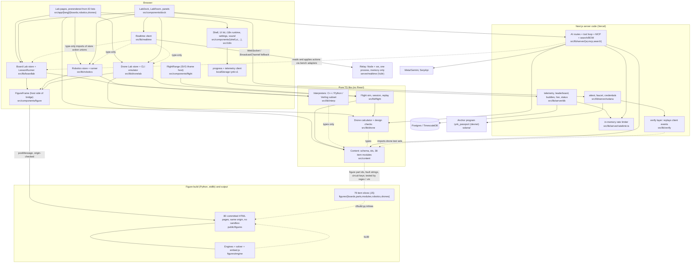

# iynk repository inventory

Audited commit `bb546d6a051f0b268576587c6f9f934dde9e766c` (branch main), 2026-10-26. Refreshed 2026-10-27 with the run reports (section 0 and the refresh log at the end). This file is the synthesis of 14 per-subsystem inventories in `inventory/` plus the run reports and baselines. It does not re-derive them. Each digest line keeps the label the inventory gave it. Lines marked "run evidence" come from `runs/*.md`, `PERFORMANCE_BASELINE.md`, `TEST_COVERAGE.md` or `SECURITY_BASELINE.md` and keep the label those files gave. Where I re-ran a command myself I say so.

Labels: VERIFIED (inspected or reproduced), DOCUMENTED (a project doc says so, not tested), EXTERNAL, ESTIMATED, HYPOTHESIS, UNKNOWN.

## 0. Evidence base and gaps (refreshed 2026-10-27)

The first version of this file was written before any run report existed. All of them now exist (VERIFIED: `ls docs/MASTER_PLAN/01_AUDIT docs/MASTER_PLAN/01_AUDIT/runs`).

| Report | What it holds | Load on the machine |
|---|---|---|
| [runs/COMMANDS.md](runs/COMMANDS.md) | typecheck, lint, full `npm test`, three slow files alone, relay tests, skipped tests | 38 to 117 (never quiet) |
| [runs/BUILD_OUTPUT.md](runs/BUILD_OUTPUT.md) | keyless `next build`, route table, first-load JS per route | 74 to 86 |
| [runs/E2E.md](runs/E2E.md) | keyless Playwright, 119 tests | about 110 |
| [runs/BROWSER_WALK.md](runs/BROWSER_WALK.md) | 16-step walk as a new user, desktop and Pixel 7, one keyed check | 2 to 4 (quiet) |
| [PERFORMANCE_BASELINE.md](PERFORMANCE_BASELINE.md) | bundle, figures, interpreter, solver, flight, page timings, memory | 3 to 7 |
| [TEST_COVERAGE.md](TEST_COVERAGE.md) | v8 line coverage, oracle taxonomy of 1,677 test declarations, gaps | 3 to 7 |
| [SECURITY_BASELINE.md](SECURITY_BASELINE.md) | threat table, route inventory, advisories, release blockers | n/a (reading) |

Facts that hold for all of them:
- Source is unchanged since the audited commit. VERIFIED: `git diff --stat bb546d6 -- src figures server` printed nothing (re-run for this refresh). The only new files are under `docs/MASTER_PLAN/`.
- Every build, server and test run was keyless (the eleven names in RESUME.md rule 9 were empty) except the one keyed Partner check in the browser walk. `/api/status` showed ai, image, voice, search, solana, db, realtime and gemini all false in the build, e2e and perf runs. So no run exercised the database, Solana, the relay or live search. Those stay as the inventories left them.
- Timings from COMMANDS.md and E2E.md were measured under heavy contention and are not floors. Timings from PERFORMANCE_BASELINE.md, TEST_COVERAGE.md and BROWSER_WALK.md were measured at load 2 to 7.

Still not known after the runs:
- Production: iynk.tech, rt.iynk.tech, the live database and the Vercel dashboard (UNKNOWN; no run touched them).
- Relay across two machines; Postgres/TimescaleDB migrations against a real database (the 4 tests skip without Docker); Solana program tests (34; `anchor test` was not run because `Anchor.toml` points at devnet); live SerpApi prices (BROWSER_WALK step 16 never reached SerpApi).
- ESLint warning count (`npm run lint` uses `--quiet`), `npm ci` from a clean checkout, e2e with coverage, Safari, Firefox, real phones, a soak test longer than 60 s, translation quality.
- A keyed e2e run. The HYPOTHESIS in the tooling inventory that e2e reads real keys from `.env.local` stands: the audit avoided it by blanking the names.

## 1. Baseline

| Item | Value | Label / command |
|---|---|---|
| Commit | `bb546d6a051f0b268576587c6f9f934dde9e766c` | VERIFIED `git rev-parse HEAD` |
| Date | Commit made 2026-10-25 11:19 CDT; the first inventories were written 2026-10-26 | VERIFIED `git log -1 --format=%ad --date=iso bb546d6` (review 2026-10-27 corrected: this row used to say only 2026-10-26, which is the audit date, not the commit date) |
| Tracked files | 1,389 at the audited commit (1,430 at HEAD; the difference is `docs/MASTER_PLAN/`) | VERIFIED `git ls-files \| wc -l`; refresh: `git ls-tree -r --name-only bb546d6 \| wc -l` = 1389 |
| Test files tracked | 180 `.test.` files (173 under `npm test`, plus 6 relay tests and 1 Anchor test outside it). 192 if the 12 Playwright `.spec.` files are counted, which is what TEST_COVERAGE.md uses | VERIFIED `git ls-files \| grep -E '\.test\.' \| wc -l` = 180; refresh: `git ls-tree -r --name-only bb546d6 \| grep -E '\.(test\|spec)\.' \| wc -l` = 192; tooling inventory |
| Node | `engines.node` 24.x, `.nvmrc` 24, local v24.8.0 | VERIFIED `node -v`, `cat .nvmrc`, `package.json` |
| Package manager | npm, 3 separate lockfiles (root, `server/realtime`, `solana`), no workspace config | VERIFIED (tooling) |
| Python | 3.12.6 used for figure build; stdlib only | VERIFIED (figure-items) |
| Rust / Solana | Anchor 0.31.1, Solana CLI 4.2.2 | VERIFIED `solana/Anchor.toml:1-3` (solana inventory) |

### 1.1 Lines of code

Counted with `find <dir> -type f \( -name '*.ts' -o -name '*.tsx' -o -name '*.js' -o -name '*.mjs' -o -name '*.py' -o -name '*.rs' -o -name '*.sql' -o -name '*.sh' \) -not -path '*/node_modules/*' -not -path '*/target/*' | xargs cat | wc -l`. I ran this for the rows below on 2026-10-26. "Test" is the same command restricted to `*.test.*` and `*.spec.*` files and is included in the total. Generated files (`index.generated.ts`, `public/figures`) are inside or outside as noted.

| Directory | Total LOC | Of which tests |
|---|---|---|
| `src/` (all TS/TSX) | 104,381 | n/a |
| `src/content` (38 item modules, schema, ids, tests) | 31,487 | 6,653 |
| `src/lib/interp` | 13,468 | 1,646 |
| `src/lib/server` | 6,942 | 2,421 |
| `src/lib/flight` | 3,869 | 967 |
| `src/lib/realtime` | 3,087 | 711 |
| `src/lib/ai` | 3,118 | 854 |
| `src/lib/hw` | 2,358 | 726 |
| `src/lib/dronelab` | 2,287 | 664 |
| `src/lib/boardlab` | 1,921 | 642 |
| `src/lib/solana` | 1,847 | 270 |
| `src/lib/robotics` | 1,429 | 412 |
| `src/lib/search` | 1,319 | 406 |
| `src/lib/drone` | 1,089 | 394 |
| `src/lib/sound` | 939 | 362 |
| `src/lib/verify` | 837 | 260 |
| `src/lib/telemetry` | 544 | 151 |
| `src/lib/progress` | 496 | 160 |
| `src/lib/settings` | 182 | 63 |
| `src/components` | 21,428 | 2,731 |
| `src/app` (pages and API routes) | 4,821 | not split |
| `src/i18n` code | 715 | 334 |
| `figures/` (all JS, Python) | 25,196 | 1,462 (engine tests) |
| `figures/engine` | 6,391 | 1,462 |
| `figures/drones` | 5,070 | 0 |
| `figures/boards` | 3,444 | 0 |
| `figures/parts` | 2,799 | 0 |
| `figures/modules` | 2,548 | 0 |
| `figures/robotics` | 2,175 | 0 |
| `figures/flight` | 1,223 | 0 |
| `figures/vendor` | 960 | 0 |
| `figures/tools` | 534 | 0 |
| `server/realtime` (relay) | 2,408 | 810 |
| `solana/` (Rust, TS tests, scripts) | 1,129 | 469 |
| `e2e/` | 1,644 | 1,574 |
| `scripts/` | 3,522 (see correction below: 1,472 once the untracked `scripts/workflows/` is left out) | 0 |
| `db/` (SQL) | 118 | 0 |
| `docs/` code-like files | 3,740 (working tree only, see below) | n/a |
| i18n JSON under `src/i18n` | 190,627 lines | n/a |
| Markdown in the working tree | 48,161 lines (docs-claims-history). Not reproduced by the reviewer; see below | VERIFIED by the inventory, REFUTED in part by the review |
| Built figure pages `public/figures/**/*.html` | 80 files, 24,669,406 bytes (24.7 MB), max 495,777 bytes | VERIFIED `git ls-files public/figures \| wc -l` = 80 (figure-engine) |

Review correction (2026-10-27). Three rows above count files that are not in git. `.gitignore:50-66` ignores `HANDOFF.md`, `CLAUDE.md`, `AGENTS.md`, `docs/handoff/`, `docs/hacktx/`, `docs/audit/`, `docs/requests/`, `docs/verify/`, `docs/research/`, `docs/design/`, `docs/ARCHITECTURE.md`, `docs/DECISIONS.md`, `docs/SPEC.md`, `scripts/workflows/` and `scripts/handoff-status.sh` (VERIFIED: `git check-ignore -v` names each; `git ls-files | grep -c '^docs/'` = 82, of which 41 are `docs/MASTER_PLAN/`). So:
- `scripts/`: tracked at `bb546d6` it is 1,435 lines in 10 files (VERIFIED: `git show bb546d6:<file> | wc -l` summed). The working tree without `scripts/workflows/` is 1,472 (adds `handoff-status.sh`; VERIFIED with `find scripts ... -not -path 'scripts/workflows/*' | xargs cat | wc -l`). The 3,522 above included the local-only workflow scripts, which keep growing (4,340 on 2026-10-27). Use 1,472, which is also what the tooling inventory and the row 13 cell in section 3 say.
- `docs/` code-like files, 3,740: reproduced on 2026-10-27 (`find docs ... -not -path 'docs/MASTER_PLAN/*' | xargs cat | wc -l` = 3740), but none of it is tracked. At `bb546d6` git holds 0 code-like lines under `docs/`.
- Markdown: 48,161 was not reproduced. Tracked at `bb546d6`: 22,573 lines in 110 `.md` files (VERIFIED: `git ls-tree -r --name-only bb546d6 | grep '\.md$'`, `git show` piped to `wc -l`). Working tree today excluding `docs/MASTER_PLAN/` and `node_modules`: 55,422 (`find . -name '*.md' ... | xargs cat | wc -l`). Which of the two 48,161 matches is UNKNOWN; it was counted on a working tree that has since changed. Any statement of the form "the repo has N lines of docs" should say "tracked" or "on Amar's machine".
- Consequence for evidence labels: every DOCUMENTED line below that cites `HANDOFF.md`, `docs/hacktx/*`, `docs/requests/*`, `docs/verify/*`, `docs/research/*`, `docs/ARCHITECTURE.md`, `docs/DECISIONS.md` cites a file that exists only on Amar's Mac (the GitHub repo is public and does not contain them). An engineer who clones the repo cannot check those lines. `HANDOFF.md` line numbers have also drifted: "445 calculator tests" is now at `HANDOFF.md:109`, not 104.

Notes. The sum of `src/lib/*` rows is less than `src/lib` because small folders (`features`, `ai` sub-folders, etc.) are not listed. `src/components` includes component tests. Figure item slices are 16,036 LOC (boards 3,444 + parts 2,799 + modules 2,548 + robotics 2,175 + drones 5,070), matching the figure-items inventory.

### 1.2 Dependencies (root `package.json`, exact versions as pinned)

Runtime (22): `next` 16.4.3, `react` 19.3.0, `react-dom` 19.3.0, `zod` 4.6.7, `postgres` 3.4.9, `server-only` 0.0.1, `@modelcontextprotocol/sdk` 1.32.2, `@codemirror/commands` 6.11.1, `@codemirror/lang-cpp` 6.0.3, `@codemirror/lang-python` 6.2.1, `@codemirror/language` 6.13.1, `@codemirror/legacy-modes` 6.5.5, `@codemirror/state` 6.7.6, `@codemirror/view` 6.43.14, `@lezer/highlight` 1.2.5, `@coral-xyz/anchor` 0.31.1, `@solana/web3.js` 1.99.0, `@solana/wallet-adapter-base` 0.9.28, `@solana/wallet-adapter-react` 0.15.40, `@solana/wallet-adapter-react-ui` 0.9.40, `bs58` 6.0.0, `qrcode` 1.5.4.

Dev: `typescript` ^5, `eslint` ^9, `eslint-config-next` 16.4.3, `tailwindcss` ^4, `@tailwindcss/turbopack` ^4, `vitest` 5.0.3, `vite` 8.3.4, `@vitejs/plugin-react` 6.1.2, `jsdom` 30.1.2, `@testing-library/react` 16.3.3, `@testing-library/dom` 10.4.2, `@playwright/test` 1.64.0, `playwright-core` 1.64.0, `@axe-core/playwright` 4.13.0, `@types/node` 24.19.2, `@types/qrcode` 1.5.6, `@types/react` ^19, `@types/react-dom` ^19.

Relay: `ws` 8.22.0 only (VERIFIED, realtime). Anchor program: `anchor-lang =0.31.1`, `solana-sdk-ids =2.2.1`.

Count check for the refresh: `node -p "const p=require('./package.json');[Object.keys(p.dependencies).length,Object.keys(p.devDependencies).length]"` prints `[ 22, 18 ]`, so the runtime list is 22, not the 21 this file first said (VERIFIED). `npm ls --depth=0` (COMMANDS.md row 2) exits 0 and also shows 6 extraneous wasm fallbacks (`@emnapi/*`, `@img/sharp-wasm32`, `@napi-rs/wasm-runtime`, `@tybys/wasm-util`) that `package.json` does not declare.

Findings about the list (all VERIFIED unless stated):
- `@solana/wallet-adapter-react-ui` and root `@coral-xyz/anchor` have 0 imports in `src/` (solana inventory). Run evidence: `grep -rln coral-xyz src` finds nothing and `grep -ao AnchorProvider` on every large built chunk gives 0, so Anchor is declared and unused (PERFORMANCE_BASELINE.md, bundle section).
- `@modelcontextprotocol/sdk` is used only in tests; the MCP server is hand-written (ai-search-mcp).
- Scripts import undeclared `playwright`, `sharp`, `acorn` (tooling): `scripts/crawl-routes.mjs:12`, `figure-thumbs.mjs:10,13` (the review corrected 15 to 13; `sharp` is loaded with `createRequire(...)("sharp")`), `figure-strings.mjs:25` (`acorn`).
- `npm audit --omit=dev`: 15 findings, 2 high, 13 moderate (tooling, `scratchpad/audit/tooling/audit.json`).
- The interpreters, solver, flight sim and figure engine use no third-party runtime packages (interp, figure-engine, flight).
- No UI component library: Dialog, Popover, Tabs, focus trap are hand-written (shell-i18n).
- No AI SDK: the model client is raw `fetch` (ai-search-mcp).

### 1.3 Deploy targets

| Target | What runs | Label / source |
|---|---|---|
| Vercel project (CLI link name `simlab-hacktx`, renamed `iynk` in HANDOFF) | Next.js app, `vercel deploy --prod --yes` run by hand from a laptop; no `vercel.json`, no `.github`, no git hooks | VERIFIED no CI files (tooling); DOCUMENTED `docs/hacktx/DEPLOY.md:27` |
| `https://iynk.tech` and `iynk.vercel.app` | public site | DOCUMENTED (HANDOFF, README). Which URL is canonical differs between README, Devpost and HANDOFF (docs-claims-history) |
| `rt.iynk.tech` on a Vultr VM | Docker: `node:24.22.1-alpine` relay + `caddy:2.11.7-alpine`; 1 vCPU, 512 MB container limit | VERIFIED `deploy/realtime/*`; VM size DOCUMENTED |
| Postgres / TimescaleDB (Tiger Data) | events hypertable, 2 continuous aggregates, profiles | DOCUMENTED. Whether production has it and whether migrations ran: UNKNOWN (server-data open question) |
| Solana devnet | `iynk_passport` program, public RPC `api.devnet.solana.com` | DOCUMENTED (HANDOFF); program id and RPC default VERIFIED in code |
| Model API | Meta `api.meta.ai/v1` (muse-spark-1.3), Gemini fallback | VERIFIED code; live smoke 6 of 6 passed (ai-search-mcp; point-in-time keyed result, not re-run by the review). Run evidence: one keyed Partner question in the browser walk was answered from the real bench state (4.9) |
| SerpApi | shopping, web, videos, nearby, events | VERIFIED on 2026-10-26 by a keyed call (a point-in-time external fact; the reviewer did not re-run it because it spends third-party quota, and a monthly plan can reset); key is on Free plan with 0 of 250 searches left, HTTP 429. Run evidence: the in-app budget (`SERPAPI_MONTHLY_BUDGET`, set to 12 for the walk) was used up by opening the Lab tools dock; see 4.9 |

### 1.4 Run results (added 2026-10-27)

Commands and numbers are quoted from the run reports. Labels are theirs.

| Run | Result | Source | Label |
|---|---|---|---|
| `npm run content:check` | exit 0, "12 boards, 13 robotics, 13 drones (unchanged)" | COMMANDS.md row 3 | VERIFIED |
| `npm run typecheck` | exit 0, 6.2 s | COMMANDS.md row 4 | VERIFIED |
| `npm run lint` (`eslint . --quiet`) | exit 0, 42.7 s; warnings hidden by `--quiet`, count UNKNOWN | COMMANDS.md row 5 | VERIFIED |
| `npm test`, loaded machine (load 38 to 117) | exit 1: 2,784 passed, 13 failed, 5 skipped of 2,802; 9 of 173 files failed; 357 s. All 13 are timing (8 vitest timeouts, 4 `still busy after 50000 ms`, 1 poll that ran out) | COMMANDS.md row 6 | VERIFIED |
| `npm test`, quiet machine (load 3 to 7), `--testTimeout=180000` | exit 0: 2,797 passed, 5 skipped, 0 failed; 144.7 s | TEST_COVERAGE.md 1.1 | VERIFIED |
| Three slow files alone | `wing.test.ts` 27 of 27 pass (38.4 s of a 40 s limit); `octo.test.ts` 30 of 31 (landing gear, `settle` budget 50 s); `basys3.test.ts` 23 of 24 (display sweep, 95 synchronous interpreter runs, timeout 120 s) | COMMANDS.md "Three files run alone" | VERIFIED |
| `server/realtime` `npm test` | exit 0, 39 of 39, 7.1 s | COMMANDS.md row 9 | VERIFIED |
| Skipped tests (5) | 4 in `src/lib/server/db/timescale.test.ts` (no Docker daemon), 1 in `src/i18n/server.test.ts` (nothing untranslated) | COMMANDS.md "Skipped tests" | VERIFIED |
| Keyless `NEXT_DIST_DIR=.next-audit npm run build` | exit 0, 72.8 s under load 74 to 86, Next.js 16.4.3 Turbopack, 827 static pages, no warnings; compile 15.9 s, TypeScript 32.8 s, static generation 18.5 s; `.next-audit` is 632 MB | BUILD_OUTPUT.md | VERIFIED |
| Keyless Playwright (`npm run e2e`) | 116 passed, 1 failed, 2 skipped of 119 in 142.7 s (chromium 108/1/2, phone 8/0/0). The failure is the `]` next-lesson shortcut, `e2e/boardlab.spec.ts:171`. By hand it works 5 of 5 at load 3 to 4 (BROWSER_WALK), so it looks like a flaky test, not a product bug (HYPOTHESIS for the cause: focus left in the code editor after Escape) | E2E.md; BROWSER_WALK.md | VERIFIED result; HYPOTHESIS cause |
| `anchor test` | not run | COMMANDS.md | n/a |

Side effect worth knowing: `next build` with `NEXT_DIST_DIR` rewrote the tracked `tsconfig.json` (3 insertions, 1 deletion: it added `.next-audit/types/**/*.ts` and `.next-audit/dev/types/**/*.ts` to `include`). It was reverted with `git checkout -- tsconfig.json`. VERIFIED (BUILD_OUTPUT.md).

#### Build route table summary

From the "Route (app)" table in the build log and `.next-audit/prerender-manifest.json` (BUILD_OUTPUT.md).

| Item | Value | Label / command |
|---|---|---|
| Static pages generated | 827 | VERIFIED, log line `Generating static pages using 13 workers (827/827) in 18.5s` |
| Routes in the prerender manifest | 791 routes, 14 dynamic routes | VERIFIED, `python3 -I` on the manifest. The 36-page gap to 827 is not explained (HYPOTHESIS: icons, not-found and image routes) |
| Top-level entries in the route table | 41: 23 dynamic `ƒ` (all under `/api/`), 3 plain static (`/_not-found`, `/apple-icon.png`, `/icon.svg`), 15 page patterns | VERIFIED, `rg -c` on the log |
| Page patterns | `/[lang]`, `/[lang]/[...rest]`, `/about`, `/boards`, `/boards/[board]` (72 = 12 x 6), `/boards/[board]/[lesson]` (the largest group, 426 shown = 71 lessons x 6), `/drones`, `/drones/[drone]` (78), `/drones/[drone]/fly` (78), `/passport`, `/robotics`, `/robotics/[bench]` (78), `/together`, `/verify`, plus `/-/opengraph-image.png` | VERIFIED from the table; the 6-locale factor is ESTIMATED from the arithmetic |
| Rendering mode | page routes print `◐` (partial prerender: static shell, dynamic content streamed); "Cache Components" and "Partial Prefetching" are on | VERIFIED |
| Relay host in the client | `rt.iynk.tech` appears in 0 of 116 built client JS files and 0 server files; in source only inside the local-only, untracked `scripts/workflows/master-plan-audit.js:28` and `master-plan-continue.js` (prompts). The host comes from `NEXT_PUBLIC_REALTIME_URL` at build time | VERIFIED (re-run by the review: `grep -rl rt.iynk.tech .next-audit/static` = 0 files, `.next-audit/server` = 0 files, `git grep -l rt.iynk.tech bb546d6` = 0 files; two files in `scripts/workflows/`, which git ignores). Note the consequence: the relay's public hostname is written in no tracked file, so the repo alone cannot say where the relay lives |

#### Bundle and performance highlights

All from PERFORMANCE_BASELINE.md unless stated. Loopback server, headless Chromium, 3 runs, median, load 3 to 7. Real-network times are ESTIMATED by that report.

| Quantity | Value | Label |
|---|---|---|
| JS in `.next-audit/static` | 116 files, 5,637,633 B raw, 1,759,063 B gzipped file by file | VERIFIED |
| First-load JS, lesson page `/[lang]/boards/[board]/[lesson]` | 2,221,388 B raw, 701,192 B gzip (ESTIMATED, level 6), 16 chunks | VERIFIED stats file |
| First-load JS, board, drone, fly, bench pages | 1.67 to 1.72 MB raw, 518 to 539 KB gzip | VERIFIED |
| First-load JS, landing | 530,074 B raw, 162,807 B gzip; the empty `/_not-found` is 457,636 B raw | VERIFIED |
| What the landing page really downloads within 3 s | 2.29 MB raw, 727 KB transferred, 23 scripts. CodeMirror, the wallet stack, zod/app code and the interpreter arrive about 255 ms after load although the first-load list omits them (cause HYPOTHESIS: `partialPrefetching: true`, `next.config.ts:6`) | MEASURED |
| Largest chunks | CodeMirror 566,690 B raw / 186,578 gzip; Solana wallet stack 467,464 / 139,467 (in the first load of 7 routes including lesson, board, drone, fly, bench; none needs a wallet; `LabDock.tsx:11` imports `PassportPanel`); one locale dictionary 284 to 402 KB raw each, lazy | VERIFIED |
| `next/dynamic` or `React.lazy` in `src/` | none | VERIFIED `grep` |
| Figure pages | 80 files, 24,669,406 B raw, 8,127,710 B gzip; median 316,478 B; largest `boards/uno-r3.html` 495,777 B (157,187 B transferred) | VERIFIED |
| Figure ready (from navigation start) | landing and Blink about 150 to 158 ms; robotics bench 144 ms; quad5 80 ms; flight range 59 ms. At 4x CPU throttle: 570 to 637 ms, 310 ms, 226 ms | MEASURED |
| Interpreter cost | 62 ns per op on Arduino C++, 93 ns per op on MicroPython; a busy loop costs 62 ms wall per virtual second (60 s virtual = 3.8 s); lessons with `delay` take under 1.6 ms per 5 s virtual | MEASURED in Node |
| Circuit solver | 0.012 to 0.065 ms median per solve; largest of 79 circuits has 9 parts and 19 wires; worst single spike 3.98 ms | MEASURED in jsdom/Node |
| Flight physics | 0.50 to 0.63 microseconds per 10 ms step | MEASURED in Node |
| Main-thread use with nobody touching the page | landing 62 %, Blink lesson 65 %, robotics bench 48 % at 1x; 100 % and 24 to 31 fps at 4x. Drone and fly pages: 1 %. Cause read in `figures/vendor/colorfigures/core.js:480,497-500` (the whole scene is rebuilt with `innerHTML` every frame while any animation is registered); which animation keeps running on the Uno figure was not traced | MEASURED; cause HYPOTHESIS |
| Flight page | 60 fps, 10 % main thread flying at 1x, 31 % at 4x | MEASURED, headless (no GPU) |
| Memory | Blink lesson heap 13.0 MB at load, 16.6 MB after 67 s; flat after 20 s; no leak seen in 60 s | MEASURED; longer soak UNKNOWN |
| Page timings, cold, 1x | `load` 59 to 158 ms on the five pages measured | MEASURED |

#### Coverage per subsystem

From TEST_COVERAGE.md. The v8 run covers only files a test loads (vitest 5 reports no others). Overall for loaded `src/` code, JSON excluded: 81.5 % lines (16,022 of 19,664), 67.1 % branches, 74.7 % functions. Adding the 8,909 LOC of `src/` files that no test loads, ESTIMATED lines fall to about 67 % outside `src/content` and `src/i18n`.

| # | Subsystem | Coverage figure | Not measured or not loaded |
|---|---|---|---|
| 1 | Content | `src/content` 99.6 % lines (declarative data; not a quality signal) | 218 of 1,677 test declarations only check that two project files agree |
| 2 | Interpreters | `src/lib/interp` 72.9 % lines, 56.3 % branches, 59.9 % functions; `arduino/libs.ts` 58.8 %, `python/modules.ts` 58.8 %, `python/runtime.ts` 62.7 %, `arduino/parser.ts` 67.3 % | no differential test against a real compiler or interpreter |
| 3, 4 | Figure engine, item slices | 0 `figures/**` files appear in the report (jsdom, canvas stubbed to null). Real coverage UNKNOWN, not 0 | about 22,125 LOC in 98 files |
| 5 | Board and Robotics UI | `lib/boardlab` 88.4 %, `lib/robotics` 96.8 %, `components/robotics` 83.8 %, `components/boardlab` 45.5 % | 19 `components/boardlab` files (2,634 LOC: `BoardWorkspace`, `LessonWorkspace`, `SerialMonitor`, `CodeEditor`) are loaded by no test; e2e only |
| 6 | Drone calculator and Lab | `lib/drone` 100 % lines, 94.3 % branches; `lib/dronelab` 87.6 %; `components/dronelab` 51.5 % | 9 `components/dronelab` files (1,569 LOC: `DroneWorkspace`, `FlyWorkspace`) unloaded |
| 7 | Flight | `lib/flight` 93.3 %; `components/flight` 72.7 % | `figures/flight` unmeasured |
| 8 | Realtime | `lib/realtime` 69.9 %, `components/realtime` 37.1 % (`ChatPanel` 2.4 %, `RoomBar` 2.5 %, `translate.ts` 10.2 %, `provider.tsx` 45.3 %) | relay (`server/realtime`, 1,598 LOC) has 39 `node:test` tests outside vitest and no coverage number; reconnect tested with fake sockets only |
| 9 | AI, search, BOM, MCP | `lib/ai` 85.9 %, `lib/hw` 98.3 %, `components/ai` 64.4 % (`story-png.ts` 23.6 %, `useVoice.ts` 34.7 %), `components/search` 82.8 % | tool loop never run against a real model in any test |
| 10 | Server data | `lib/server` 92.2 %, `app/api` 95.4 %, `scripts/db-migrate.mjs` 66.7 % | the SQL in `db/migrations/0001..0003` runs only in `timescale.test.ts`, which skipped |
| 11 | Solana | `lib/solana` 77.6 %, `components/solana` 69.1 % | 34 program tests are not in `npm test` and were not run; `VerifyApp`, `PassportApp`, `BountyForm`, `TipButton`, `useChain` unloaded |
| 12 | Shell, UI kit, i18n | `components/ui` 80.1 %, `src/i18n/*.ts` 92.6 % | 22 page files in `src/app/[lang]` (2,273 LOC) and a 29-file group (shell, solana, flight, catalogue, editorial, dock; 2,252 LOC) unloaded |
| 13 | Tooling, tests, e2e | 1 of 8 scripts is in the report (`db-migrate.mjs`); the other 7 (1,124 LOC) have no test | no CI: `.github/` does not exist (VERIFIED `ls .github`) |

Oracle taxonomy (ESTIMATED, plus or minus 10 %): of 1,677 test declarations, 81 % check a behavioural contract the author wrote, 13 % check file-to-file consistency, 1.8 % hand-derived values, 1.6 % re-run the implementation's own formulas (plus 342 generated golden rows), 0.9 % are datasheet facts typed by hand, 1.0 % are accessibility or layout. No test loads measured data or a third-party simulator's output (VERIFIED by grep in TEST_COVERAGE.md). The tests prove the simulator agrees with itself and with the authors' memory, not with hardware.

## 2. System map

This is the dependency picture the inventories found, not the README's. Solid arrows are imports or runtime calls that were read in code. Dashed arrows are test-only or build-time links.

Reading the map:
- `src/lib/interp` is the only simulator for code. It imports only content types. The Board Lab and Robotics Lab are its two callers. No server code imports it (VERIFIED: `grep -rln "runChecks\|runHeadless\|evaluateChecks" src server scripts` shows client code only).
- The figure iframe is the only place where electrical state exists. The host reads it back from messages. Circuit keys and fault strings live in both `src/content` and `figures/*`, linked only by tests.
- Layering inversions found: `src/lib/dronelab/store.ts:2-3` and `fly.ts:2` import from `src/components`; `src/lib/realtime` imports `@/components/dock/types`.
- The relay imports nothing from the app (VERIFIED, realtime). The app and the relay share a protocol by hand-copying: JS validator in `server/realtime/src/protocol.js`, TS types in `src/lib/realtime/protocol.ts`.
- Solana is attached in three places only: `LabDock.tsx`, `api/status/route.ts`, MCP `get_passport` (VERIFIED, solana).

## 3. Subsystem table

LOC is non-test plus test where the inventory gave one number. Tests are the passing counts the inventory reports from its own run on this commit. "Recommendation" uses the inventory's own word.

| # | Subsystem | Paths | Purpose | LOC | State / persistence | Tests (as reported) | Recommendation | Inventory |
|---|---|---|---|---|---|---|---|---|
| 1 | Content model | `src/content/{schema,ids,index.generated}.ts`, `src/content/{boards,robotics,drones}/*.ts`, `scripts/gen-content-index.mjs`, prose `src/i18n/content/<lang>/<lab>/<id>.json` | Typed catalogue: 38 items, 71 lessons, 31 tasks, 144 failures, 106 faults, 272 robotics steps (579 build steps in all labs), 78 drone tests | 31,487 (with tests) | none at runtime; build-time generated index | 37 files, 813 tests pass, 132 s | extend; replace the id/binding layer | [content-schema.md](inventory/content-schema.md) |
| 2 | Interpreters | `src/lib/interp/**` | Arduino C++ subset, MicroPython subset, 2-state Verilog on one virtual clock; check evaluator; Web Worker front door | 13,468 | none | 9 files, 189 pass | extend; investigate a real emulator | [interp.md](inventory/interp.md) |
| 3 | Figure engine | `figures/engine/**`, `figures/vendor/colorfigures/**`, `figures/tools/**`, `src/components/figure/**` | Drawing core, bench and drone engines, DC circuit solver, postMessage bridge, Python build | 10,998 in scope | none (pages touch no storage) | 7 files, 126 pass | extend | [figure-engine.md](inventory/figure-engine.md) |
| 4 | Figure item slices | `figures/{boards,parts,modules,robotics,drones}/*.js`, `public/figures/**`, `src/i18n/figures/<lang>.json` | 79 per-item drawing and circuit data inlined into 80 committed pages | 16,036 (+24.7 MB built) | committed build output | 105 pass, 64.6 s | extend | [figure-items.md](inventory/figure-items.md) |
| 5 | Board Lab and Robotics Lab UI | `src/lib/{boardlab,robotics}/**`, `src/components/{boardlab,robotics,dock}/**`, `src/app/[lang]/{boards,robotics}/**` | Stores, runner, workspaces, code editor, dock | 9,761 | `iynk:boardlab:values`, serial height, `iynk:v1`; learner code not saved | 17 files, 120 pass | extend | [boardlab-robotics-ui.md](inventory/boardlab-robotics-ui.md) |
| 6 | Drone calculator and Drone Lab | `src/lib/{drone,dronelab}/**`, `src/components/dronelab/**`, `src/app/[lang]/drones/**` | Closed-form thrust and flight-time model, design checks, CLI emulator, assembly and tests UI | 4,919 (+9,713 fixture lines) | store in memory; progress in `iynk:v1`; sessionStorage payloads | 384 calc tests (342 golden) plus 61 CLI, store, fly | extend the shell; replace the thrust and energy model | [drone-calc-lab.md](inventory/drone-calc-lab.md) |
| 7 | Flight simulator | `src/lib/flight/**`, `src/components/flight/**`, `figures/flight/**`, `public/figures/flight/range.html`, fly page | 100 Hz arcade flight model, replay, ghosts, scoring, SVG renderer | about 6,825 | session log in memory; laps sent to telemetry | 5 files, 96 pass | extend shell; replace dynamics core if fidelity matters | [flight.md](inventory/flight.md) |
| 8 | Realtime rooms | `server/realtime/**`, `deploy/realtime/**`, `src/lib/realtime/**`, `src/components/realtime/**`, `src/app/[lang]/together/**` | Sequencing relay (Node + ws), client, snapshots, chat, presence | 7,938 | relay memory only | relay 39 pass; client 18 pass; load test 8 peers | extend | [realtime.md](inventory/realtime.md) |
| 9 | AI, search, BOM, MCP | `src/lib/{ai,search,hw}/**`, `src/components/{ai,search,hw}/**`, `src/lib/server/{ai,mcp,search}/**`, `src/app/api/{ai,search,mcp,openapi.json}/**` | Partner chat with tools, translation, voice, story, BOM and optimiser, 7-tool MCP server, Web Serial twin | 11,690 non-test (+5,211 test) | in-process counters and caches; no chat persistence | 40 files, 344 pass; live smoke 6 of 6 | extend; replace guards, catalogue-keyed BOM, stale-apply path | [ai-search-mcp.md](inventory/ai-search-mcp.md) |
| 10 | Server data layer | `src/lib/server/**` (db, http, env, ratelimit), `db/migrations/*.sql`, `scripts/db-migrate.mjs`, `src/app/api/{telemetry,leaderboard,buddies,live,status}`, `src/lib/{telemetry,progress,settings}/**` | Telemetry ingest, leaderboard, buddy pool, env and error contract, progress document | 6,942 + 1,222 | TimescaleDB events, profiles, 2 aggregates; `iynk:v1` in browser | 83 pass; Timescale DDL test skipped | extend | [server-data.md](inventory/server-data.md) |
| 11 | Solana Proof of Build | `solana/**`, `src/lib/{solana,verify}/**`, `src/lib/server/solana/**`, `src/components/solana/**`, `src/app/api/solana/**`, passport and verify pages | Devnet credentials and bounties, attest flow, faucet, wallet UI | 5,451 hand-written | on-chain PDAs; wallet in browser | 52 vitest pass; 34 on-chain tests not run | investigate; leaning detachable | [solana.md](inventory/solana.md) |
| 12 | Shell, UI kit, i18n | `src/app/[lang]/{layout,page,not-found,about,[...rest]}`, `src/components/{shell,ui,catalogue,marketing,editorial,data,settings}/**`, `src/i18n/**`, `src/lib/{sound,settings}/**`, `next.config.ts`, `globals.css` | Layout, nav, design system, 6-language runtime, settings, sound, SEO | about 7,500 | `iynk:v1` (settings share key with progress) | 24 files, 509 pass, 1 skipped | preserve and extend | [shell-i18n.md](inventory/shell-i18n.md) |
| 13 | Tooling, tests, e2e, deploy | `package.json`, configs, `e2e/`, `scripts/`, `deploy/realtime/`, `.vercelignore` | check scripts, Vitest, Playwright, crawlers, relay deploy | e2e 1,644; scripts 1,472 | none | tsc 0, eslint 0 (`--quiet`); vitest 2,784 pass, 13 fail (timing), 5 skipped of 2,802 at load 38 to 117, and 2,797 pass, 0 fail with a 180 s timeout at load 3 to 7; e2e 116 pass, 1 fail, 2 skipped of 119 (keyless); relay 39 of 39 | extend | [tooling-tests-e2e.md](inventory/tooling-tests-e2e.md) |
| 14 | Docs, claims, history | `README.md`, `HANDOFF.md`, `docs/**` | Build diary, decisions, fact sheets, hackathon material, claim register | 48,161 lines of Markdown | git history (792 commits) | n/a | extend; archive sales docs; resolve licence and provenance | [docs-claims-history.md](inventory/docs-claims-history.md) |

Quick find: if you know the folder, use the Paths column. If you know the symptom, section 4 is ordered the same way as this table.

## 4. Per-subsystem digest

Each block lists the strongest findings. Severity follows the inventories.

### 4.1 Content model ([content-schema.md](inventory/content-schema.md))
- VERIFIED. 38 modules (12 boards, 13 robotics benches, 13 drones). 71 lessons, 31 bench tasks, 144 board failures, 106 bench faults, 272 robotics steps, plus 134 board assembly and 173 drone build steps = 579 build steps. README counts match; "272 assembly steps" is robotics only. `node scratchpad/audit/content-schema/count.mjs`.
- VERIFIED. 0 functions in all 38 default exports. Behaviour lives in code-as-string templates and regex strings run by `src/lib/interp`. `src/content/boards/pico.ts:7-47,203-217`; `src/content/robotics/hc-sr04.ts:145-170`.
- VERIFIED, high. Failures and faults are one `FailureMode` type with a 10-way trigger union and a figure `BridgeCommand`. Figure JS interprets opaque fault strings such as `'cold:H1.20'`. Guard: per-item `vm` tests and a regex checker for drones. `src/content/schema.ts:218-253`; `src/content/boards/pico.test.ts:19-77`; `src/content/drones/_checks.ts:24-45`.
- VERIFIED, high. Ids are closed unions in `ids.ts`, repeated as a separate `BoardId` in `src/lib/interp/profiles.ts:6-18`. The generator rejects files not in `ids.ts` (`scripts/gen-content-index.mjs:65-67`). A new item needs 5+ edits and a rebuild.
- VERIFIED. `Check` is a pure predicate over a `RunTrace` with 10 kinds and one shared evaluator. Reusable, but pin names are board net strings. `schema.ts:370-381`; `src/lib/interp/checks.ts:1-4`.
- VERIFIED, medium. 813 tests pass, mostly self-consistency (reference code passes its own checks, figure ids match content). 737 pinout rows and power limits are not compared to datasheets by any test.
- VERIFIED, medium. `content:check` validates text keys against English JSON only, with a heuristic over 26 section names; `drones/_checks.ts:56-57` keeps a second key list. `TextKey` is a plain string (`schema.ts:25`).
- VERIFIED, low. Prose parity is complete: 12,311 English leaf keys, 0 missing in es/fr/de/zh/hi. Lesson code embeds demo Wi-Fi credentials (`wlan.connect HackTX/hackathon`) in `src/content/boards/pico.ts`.
- VERIFIED, medium. Drones have no failure model; they use 78 `DroneTest` entries and calculator verdicts with golden rows from the prototype.
- UNKNOWN. How much of `FailureMode.effect` (pins, damages, extraMa, serial) the host engine consumes versus the figure; `src/lib/hw/sim.ts` was not read.
- VERIFIED (run evidence, COMMANDS.md). In the loaded full run, 12 of the 13 timing failures are content tests (`src/content/drones/{octo,racer,longrange,cinewhoop,whoop,vtol,wing}.test.ts` and `src/content/boards/basys3.test.ts:241`); none is a wrong-value assertion (review correction: the earlier "0 are assertion failures" was too strong, because `vtol.test.ts:245` is reported as `AssertionError: expected false to be true`; it fails because the test's own `until()` poll gave up after 60 s of wall time, COMMANDS.md "Other failures" row 7), and all of `src/content` passes on a quiet machine (TEST_COVERAGE.md). The thirteenth is `src/lib/interp/lessons.test.ts:76`.
- VERIFIED (TEST_COVERAGE.md). `src/content` is 99.6 % lines, which says nothing: importing a data module executes it. 218 of 1,677 test declarations (13 %) check that content, figure source, `ids.ts` and i18n JSON agree; 15 are datasheet facts typed by hand (for example `esp32-devkitc.test.ts:35`, `pico.test.ts:83`, `nucleo-f401re.test.ts:121`). None compare a value with a datasheet file. This confirms the unchecked pinout rows above.
- VERIFIED (BROWSER_WALK step 15). Counted in the running app, the 12 boards carry 71 lessons in total, matching the content count. Each lesson ships a fixed circuit, part list and pin map, which is what the closed-id finding above predicts.

### 4.2 Interpreters ([interp.md](inventory/interp.md))
- VERIFIED. No third-party runtime dependencies. C++ is lexed, parsed and compiled to typed closures (generators so `delay()` suspends). Python is a tree-walker with BigInt ints. Verilog is a 2-state cycle simulator, not synthesis. `arduino/interp.ts:15-35`; `python/runtime.ts:300`; `verilog/sim.ts:1-12,1008-1150`.
- VERIFIED. 9 files, 189 tests pass. All 102 lesson and task references pass their checks and all 102 starters fail (`lessons.test.ts`). No differential test against avr-gcc, simavr, CPython, MicroPython or Icarus.
- VERIFIED, high. No memory guards. `[0]*10**9`, a `bytearray` append loop and `int a[2000000000]` abort Node with a fatal V8 OOM (3 of 4 probes under `--max-old-space-size=1024`). `MemoryError` is declared and never raised (`python/runtime.ts:152`).
- VERIFIED, high. Check verdicts are computed in the browser only. The "verifying server" named in `check-job.ts:1-2`, `headless.ts:1-3`, `checks.ts:1-3` does not exist.
- VERIFIED, high. Any pin number works, but only 11 device kinds exist (button, switch, pot, divider, linear, tmp36, hc-sr04, mpu6050, qtr-rc, onboard, network). No netlist input. `schema.ts:304-315`; `devices.ts`.
- VERIFIED, high. Language gaps: no classes, templates, pointers, `#if`, range-for, DHT, SoftwareSerial, EEPROM, HTTPClient in C++ (`parser.ts:101,432-434,498,532,643,697,700,790`); no json, os, asyncio, generators, machine.SPI/UART in Python; no functions, tasks, generate, memories, vectors over 32 bits, `#` delays, x/z in Verilog (`verilog/sim.ts:63,80,82,231,270,346,483,640`). `SPI.transfer` always returns 0 (`libs.ts:779-790`).
- VERIFIED, medium. Time is a fixed `opUs` per statement per board (Uno 1 us, ESP32 0.1, Pico 4). Not cycle accurate. `profiles.ts`; `exec.ts:51-99`.
- VERIFIED. Deterministic: no `Math.random`, `Date.now` or `new Date` in runtime files.
- VERIFIED, medium. `while(1){}` burns 5 s of virtual time in about 6 ms. Budget check runs every 64 virtual ms; Verilog at 100 MHz overshot a 3 s budget to 4.65 s. ESP32 web-server lessons take 2.3 to 2.7 s unloaded.
- ESTIMATED, medium. The live Board Lab run is on the main thread, up to 400k statements per frame, about 27 ms. `boardlab/engine.ts:164`; `run.ts:88`.
- VERIFIED (run evidence, COMMANDS.md). Slow interpreter tests time out under load: `src/lib/interp/lessons.test.ts:76` (`esp32-s3-build / web-led`, 66.5 s against a 60 s limit) and the `basys3` display sweep (`basys3.test.ts:241`, 95 synchronous Verilog runs at about 0.7 s CPU each, ESTIMATED 67 s on a quiet machine against a 120 s limit). Verilog is the heavy path; Arduino and MicroPython lessons are cheap.
- MEASURED (PERFORMANCE_BASELINE.md). 62 ns per op on C++, 93 ns on MicroPython; busy loop 62 ms wall per virtual second; typical lessons under 1.6 ms for 5 s virtual; parse 0.04 to 0.17 ms. This confirms the cost model and gives the number the inventory only estimated.
- VERIFIED (BROWSER_WALK step 5). Three no-`delay()` programs (a counting `loop`, `while(true){}` in `setup`, two back-to-back `digitalWrite`s) kept the page at about 60 fps (177 to 181 frames in 3 s), longest frame gap 17 to 50 ms, Stop in 47 to 77 ms. This is a measurement for the ESTIMATED 27 ms per frame claim above: the real worst gap was 50 ms. Nothing is reported to the learner ("your loop never delays").
- VERIFIED (BROWSER_WALK step 4). 5 of 7 unsupported-code cases give a clear message with line and hint (pointers, undeclared names, type errors, missing `loop()`). Two are poor. Templates show only "This code cannot run in this build." because `src/lib/boardlab/run.ts:176` replaces any `unsupported` error with the generic `error.unsupported` string and drops the parser's reason (`parser.ts:433`). An unknown `#include <NoSuchLib.h>` runs without error, which a real compiler would reject. Strings, `Servo` and an undeclared function behave as expected. Severity medium.
- VERIFIED (TEST_COVERAGE.md). `src/lib/interp` is 72.9 % lines and 56.3 % branches, the lowest of the core libraries; no external oracle.

### 4.3 Figure engine ([figure-engine.md](inventory/figure-engine.md))
- VERIFIED, high. DC-only modified nodal analysis, dense Gaussian elimination, piecewise-linear LED, diode, NPN; PWM by time slices; 12 element types. No C, L, MOSFET, PNP, op-amp, regulator or transient. `figures/engine/bench-solve.js:1-8,15-37,76-107,251-257`.
- VERIFIED, blocker. The solver cannot take an arbitrary netlist. Circuits are looked up by key in figure data compiled into the page and wired by breadboard hole names. `bench.js:479`; `bench-bb.js:136`; `bench-solve.js:44-60`.
- VERIFIED, medium. Convergence is a fixed point on device flags (40 rounds, 6 outer passes) with no residual check; non-convergence returns the last iterate silently. `bench-solve.js:11,213,264`.
- VERIFIED, medium. Regulators, brown-out and polarity faults are rule tables in the power-tree code, not circuit physics (`bench.js:225-312`; `bench-bb.js:113-116`). Constants `PIN_R=25`, `RBE=2`, `RSAT=.01`, `RAIL_R=.5` have no cited source.
- VERIFIED, blocker. The figure iframe has no `sandbox` attribute and is same-origin; the CSP only sets `frame-ancestors 'self'`; pages use inline scripts. A user-authored figure would run with app privileges. `FigureFrame.tsx:351-357`; `next.config.ts:26-30`.
- VERIFIED, info. Bridge auth is sound for same-origin (host checks source window and origin; figure checks `source===parent`). `FigureFrame.tsx:231`; `embed.js:~30-33,125`.
- VERIFIED, medium. The build is deterministic and byte-identical for the pages tested. 24,669,406 bytes in 80 pages, each repeats core and engine.
- HYPOTHESIS, medium. Vendor core is MIT, but built pages only point to `LICENSE`; `vendor.py:15` needs `~/.claude/skills/colorfigures` on one machine.
- VERIFIED, low. Solver cost 0.02 to 0.28 ms per step on current circuits; dense O(n^3) scaling for large nets is an ESTIMATE.
- VERIFIED, medium. Tests (126) are self-consistency; no SPICE or bench reference, no convergence-failure test.
- MEASURED (PERFORMANCE_BASELINE.md). Solver cost is 0.012 to 0.065 ms median per solve on the circuits that exist (79 circuits, median 2 parts, largest 9 parts and 19 wires); worst single spike 3.98 ms. This matches the inventory's 0.02 to 0.28 ms. The dense O(n^3) scaling concern is untested beyond 9 parts (UNKNOWN).
- MEASURED, high (PERFORMANCE_BASELINE.md P1). The figure, not the simulation, is the main-thread cost: landing 62 %, Blink lesson 65 %, robotics bench 48 % of one core with nobody touching the page, and 100 % at 24 to 31 fps under a 4x CPU throttle. Read in `figures/vendor/colorfigures/core.js:480,497-500`: while any animation is registered the whole scene is rebuilt with `innerHTML` every frame. Which animation keeps running on the Uno figure is HYPOTHESIS. Drone and fly pages sit at 1 %.
- VERIFIED (COMMANDS.md). In jsdom with the canvas stubbed to null one engine frame still costs 88 to 234 ms CPU (octo gear and wing elevon probes at load 82 to 98, so inflated), and the engine advances at most 0.05 s of simulated time per frame (`core.js:497`). A 7 s animation needs 142 frames. This is why the drone figure tests run 70 to 250 s per file and time out under load. Why a frame is so costly without a canvas: HYPOTHESIS (3D projection and sorting in JS).
- VERIFIED (TEST_COVERAGE.md). No `figures/**` file appears in the coverage report and no test checks pixels. Draw bugs show only in e2e axe and layout checks.
- VERIFIED (BROWSER_WALK step 15). The blocker finding is visible to a user: there is no parts palette, no free wiring and no blank project. "Place a part" is hidden until "Strip to bare PCB". Changing the code to `LED_PIN = 12` drives D12 in the interpreter but the figure shows "LED1: not connected" because the circuit is fixed to D13.

### 4.4 Figure item slices ([figure-items.md](inventory/figure-items.md))
- VERIFIED, info. 79 slices: 12 boards, 29 parts, 12 modules, 13 robotics, 13 drones, 16,036 LOC. The stdlib-only Python build takes 0.06 to 0.085 s per figure and reproduces `uno-r3` byte for byte.
- VERIFIED, high. Circuits cannot be supplied at run time. `set {circuit}` accepts only a key already in the compiled object. `figures/engine/bench.js:1183,1204`.
- VERIFIED, high. Lesson ids double as circuit keys; content names figure part ids and fault strings. `figures/boards/uno-r3.js:155`; `src/content/boards/uno-r3.ts:155`.
- VERIFIED, high. Boards are declarative (outline, parts, pins, power tree, circuits); parts and drones are hand-written `draw(ctx)` SVG or 3D code. `figures/boards/uno-r3.js:35-139`; `figures/parts/ldr.js:36-112`.
- VERIFIED, high. Pinouts are duplicated between figures and content (143 pin rows in `uno-r3.ts`), linked by regex tests. `src/content/boards/uno-r3.test.ts:15-17`.
- VERIFIED, medium. Thin test coverage per item: most parts, modules, robotics benches and four boards are not named in any engine test; no pixel checks.
- VERIFIED, info. Figure pages do no network or storage access.
- VERIFIED (PERFORMANCE_BASELINE.md). 80 pages: 24,669,406 B raw, 8,127,710 B gzipped file by file; per folder raw parts 9.07 MB, robotics 4.61, boards 4.24, modules 3.84, drones 2.83, flight 0.07. Median 316,478 B; largest `boards/uno-r3.html` 495,777 B; smallest `flight/range.html` 70,275 B. Each page inlines the engine (in `uno-r3`: `bench.js` 100 KB, `bench-kinds.js` 33 KB, `bench-solve.js` 30 KB), so the engine is paid for in every file.
- MEASURED. Figure ready: 144 to 158 ms (Uno figures), 80 ms (quad5), 59 ms (flight range); 570 to 637 ms, 310 ms and 226 ms at 4x CPU. Each page logs two `ready` messages (cause HYPOTHESIS).
- VERIFIED (BROWSER_WALK step 11). In the Blink figure iframe 108 strings were collected in es and hi; 29 equal English, mostly board silkscreen (correct). Real leaks: the toast "Powered: Blink starts" and the colour names (mustard, tomato, mint, cobalt, blush). 12 figure-control labels in the page's "Figure controls" mirror stay English in es and hi.
- VERIFIED (BROWSER_WALK steps 3 and 6). Break-it damage is shown on the figure with a "what you see, why, fix" card: Uno "LED with no resistor" burns LED1 (banner 113 mA, prose "about 115 mA", a small hand-written versus computed mismatch, low); L298N "36 V on +12V" damages the 78M05 regulator.

### 4.5 Board Lab and Robotics Lab UI ([boardlab-robotics-ui.md](inventory/boardlab-robotics-ui.md))
- VERIFIED. Board Lab store is a pure reducer with 31 action types; side effects live in `LessonRunner`. `src/lib/boardlab/store.ts:207,323`.
- VERIFIED, high. Robotics store returns `[state, effects]` but the effect handler is installed by a hook inside `BenchWorkspace.tsx` (~128-165); `send` effects are dropped when the figure handle is null.
- VERIFIED, medium. The live sketch runs on the main thread in a `requestAnimationFrame` loop (dt capped at 64 ms). Only checks and practice tasks use a Worker. `run.ts` ~237; `check-client.ts`.
- VERIFIED, high. Learner code is not persisted. Only chip values, serial monitor height and `iynk:v1` are saved. `values.ts:6`; `SerialMonitor.tsx:29-46`; `progress/storage.ts:3`.
- VERIFIED, medium. Check jobs carry live figure state (`s.figure`), so "state" verdicts depend on the iframe, contrary to the header comment.
- VERIFIED, blocker. Catalogue id is assumed in routes, `generateStaticParams`, content modules, `PROFILES` in interp, per-item figure pages, progress keys and literal `BENCH_MONTH`/`BOARD_PRODUCT` tables. `boards/_lib/load.ts:36,52`; `interp/profiles.ts:244`; `robotics/catalog.ts:13-45`; `progress/keys.ts:3-12`.
- VERIFIED, medium. `LabRoom` monkey-patches the store's `dispatch` (`dock/LabRoom.tsx` `attach()`). CodeEditor is single-document CodeMirror; robotics tasks use a plain textarea (`TasksPanel.tsx:121`).
- VERIFIED, medium. 120 tests pass in 17 files, fixtures and fake clocks. `LessonWorkspace`, `CodeEditor`, `CodePanel`, `FailurePanel` have no unit tests.
- VERIFIED, low. Duplication: `SerialLine`, `SERIAL_KEEP=200`, `isRecord`, `hydrate`, fault reducers, three phone media queries (639px, 39.99rem, 767px).
- VERIFIED (BROWSER_WALK steps 2, 6, 13, 14). The loop from code to pin to figure to check works and is fast on a quiet machine: Blink page `load` 164 ms, editor usable 253 ms later, "Running" 1.57 s after Run, D13 and LED1 toggle every 500 ms, all three checks pass after about 8.5 s, `iynk:v1` gets `{"done":{"board:uno-r3:lesson:blink":true}}`. Zero console errors, page errors and failed requests across the keyless walk.
- VERIFIED, high. Learner work is not kept. A reload shows the starter code again (`delay(500)`) while the "Done 1/16" tick stays. `localStorage` holds only `iynk:v1` and `iynk:telemetry:v1`; `sessionStorage` is empty. There is no save, export, share of work or project list. "Copy code" and "Reset code" exist.
- VERIFIED, medium. The Blink starter already passes all three checks and the lesson has no "show solution" control (`grep -i solution src/components/boardlab/*.tsx` finds nothing). The robotics L298N task does expose "Load the reference solution".
- VERIFIED, medium. A working sketch stays "Running" forever; editing while it runs keeps the old program until Stop and Run are pressed.
- VERIFIED, low. Robotics "Do it" steps are scripted animations, not a learner build (0.5 to 25 s each). The header shows "1/30" and the tab "0/24" with no explanation of 30.
- VERIFIED (E2E.md). Board Lab, Robotics and Drone Lab flows pass keyless in 116 of 119 tests (the result). That the one failure (`]` shortcut) is a flaky test and not a product bug is HYPOTHESIS, not VERIFIED (review): evidence for is 5 of 5 by-hand passes at load 3 to 4 (BROWSER_WALK lines 70-72: one plain, one after clicking the editor, three of the exact e2e sequence) and `HANDOFF.md:186` (local-only) saying the keyless suite passed 116 with 2 skipped on 2026-10-25; evidence against is that the failing run was never repeated alone (E2E.md "Not run") and the 2026-10-25 total (118) differs from today's 119, so the suites are not identical. A load-dependent race in the shortcut handler is not ruled out.
- VERIFIED (TEST_COVERAGE.md). `components/boardlab` is 45.5 % lines and 19 of its files are loaded by no unit test.
- VERIFIED (BROWSER_WALK step 13). Pixel 7: no sideways scroll on any page walked, Run button 86 x 44, touch editing works, Break-it by tap works; the landing page has 2 unidentified targets under 44 px.

### 4.6 Drone calculator and Drone Lab ([drone-calc-lab.md](inventory/drone-calc-lab.md))
- VERIFIED, high. Closed-form model: thrust = k*pf*krpm^2, hover throttle from AUW, constant g/W for current, flight time from 80% of capacity times a per-craft factor. `src/lib/drone/calc.ts:151-230` (344 LOC, zero imports).
- VERIFIED, high. Motor, prop and battery data are generic classes copied unchanged from a third-party site; no manufacturer datasheet backs thrust or efficiency. `src/content/drones/quad5.ts:1-4,96-110`.
- VERIFIED, high. The 342 golden rows (108 + 234) were captured from the original site's own output. They prove port fidelity, not physical accuracy. `docs/research/drone-lab-b-calc-matrix.md:3`; `calc.test.ts:1-30`.
- VERIFIED, low. "445 calculator tests" in `HANDOFF.md:104` is mislabelled: calculator-only is 384, and the vitest path filter also matches `src/lib/dronelab` (61 other tests).
- VERIFIED, blocker. Users cannot define a drone outside the catalogue: `designInput` throws on unknown keys; UI offers selects of 3 batteries, 3 motors, 3 props. `src/lib/drone/design.ts:5-22`; `DesignPanel.tsx:70-99`.
- VERIFIED, high. `calc` has no input validation; zero capacity or thrust yields Infinity or NaN (`calc.ts:151-230`).
- VERIFIED, medium. Wing top speed uses static full-throttle thrust; no battery sag or internal resistance (`calc.ts` ~189, ~207). The optimiser covers at most 27 combinations (`src/lib/search/optimize.ts:59-120`).
- VERIFIED, low. CLI emulator is a hand-written reducer over per-craft tables for Betaflight, INAV, MAVProxy, cflib; tests check the repo's own strings (`dronelab/cli.ts:196-667`).
- UNKNOWN, high. Provenance and licence of inherited constants, catalogues and goldens; may interact with the HackTX rule that all code is written during the hacking period (`HANDOFF.md:51`; `__fixtures__/extract.py`).
- VERIFIED (BROWSER_WALK step 7). Quad5 default: 514 g, thrust:weight 12.5:1, hover 12.3 min, 144 A. The Design tab has three selects with three options each (battery, motors, props). Numbers move in sensible directions (6S 1800 gives 618 g and 16.8 min; 2306 2450KV gives 24.6:1 and 283 A with a Problem and a 45 A ESC Warning). Whether the model matches reality stays HYPOTHESIS.
- VERIFIED. "Build it for me" fitted 12 of 12 parts in about 4 s; 4 of 4 safety tests pass, and the motor test refuses until props are off. Keyless "Build it for real" shows the catalogue total $346.00 and the optimiser finds a cheapest safe build at $330.00.
- VERIFIED (TEST_COVERAGE.md). `src/lib/drone` is 100 % lines and 94.3 % branches, but its 342 golden rows compare with an earlier implementation of the same calculator (class C), not with measurement. `components/dronelab` is 51.5 % and `DroneWorkspace` and `FlyWorkspace` are loaded by no unit test.
- VERIFIED (COMMANDS.md). The drone figure tests are where `npm test` fails under load: `octo` (3 tests; 248 s wall alone), `racer` (2), `longrange`, `cinewhoop`, `whoop`, `vtol` (2), `wing`. None is an assertion failure.
- VERIFIED (BROWSER_WALK step 15). A learner cannot design outside the 3 x 3 x 3 choices or add a part that is not in the craft.

### 4.7 Flight simulator ([flight.md](inventory/flight.md))
- VERIFIED, high. Point mass with directly-set Euler attitude, semi-implicit Euler at 100 Hz. No inertia, quaternion, PID, noise or per-motor dynamics. `src/lib/flight/sim.ts:20,496-533,630-631`.
- VERIFIED, info. Deterministic: two 60,000-step runs agree; wind is a sum of sines of the step counter. Physics costs about 2 us per step.
- VERIFIED, medium. Replay is a real re-simulation from a `{step, action}` log, used for ghosts and crash replay (`sim.ts:1008`; `ghost.ts`; `crash.ts:109`). Cross-engine bit equality is untested.
- VERIFIED, high. Faults are boolean flags injecting canned rotation rates after 0.25 s (roll 900 deg/s, pitch 500 deg/s), not simulated physics. `sim.ts:557-575`; `types.ts:25-33`.
- VERIFIED, high. Lap times are client-claimed: telemetry validates only an integer in `[LAP_MS.min, LAP_MS.max]`; the log is never re-run on the server. `src/lib/server/db/schema.ts:30-34`.
- VERIFIED, blocker. A user craft cannot fly: the only producer is `flightOf(DroneContent)`, which looks up `DRONES[content.id].palette`; the page is static from `DRONE_IDS`; classes and faults are closed enums. `registry.ts:163-212`; `types.ts:5`.
- DOCUMENTED, medium. Draw cost 1.5 ms desktop is a source comment only (`figures/flight/src/iso.js:1-4`).
- VERIFIED, medium. `sim.ts` is 1,028 lines with about 100 mutable state fields; `FlightRange.tsx` is 846 lines. 96 tests pass. No geofence: a bench craft reached x=1334 m.
- HYPOTHESIS, medium. Per-step sphere collision can tunnel thin obstacles at race speed.
- VERIFIED (E2E.md). The demo arms, takes off and clears a first gate or checkpoint for all 13 crafts (quad5, whoop, cinewhoop, racer, gpscam, wing, agrihex, swarm, tricopter, delivery, octo, longrange, vtol).
- MEASURED (PERFORMANCE_BASELINE.md). 0.50 to 0.63 microseconds per 10 ms physics step in Node; the page holds 60 fps; main thread 10 % flying at 1x and 31 % at 4x (headless, so GPU cost is not measured); 1 % when not armed. The cost of flying is the rendering, not the model.
- VERIFIED (BROWSER_WALK step 8). 25 s flight, crash, replay and a "Here's why" card work. The 16 m "height limit" is a warning only (the phone run reached 33.6 m). Keyboard flight without a following camera is hard for a new user (flew off the field twice). The page runs about 60 requestAnimationFrame callbacks per second even when disarmed while the range iframe runs 0 (cause not traced; PERFORMANCE_BASELINE.md measured 1 % main-thread use, so the cost is small).
- VERIFIED (BROWSER_WALK step 13). On a phone the HUD shrinks to battery, altitude, speed and gate; current, used mAh and crashes are not shown; two touch sticks work.
- VERIFIED (TEST_COVERAGE.md). `lib/flight` 93.3 % lines, `components/flight` 72.7 %.

### 4.8 Realtime rooms ([realtime.md](inventory/realtime.md))
- VERIFIED, high. Peer-id takeover, reproduced locally on 2026-10-27 (first version of this line said "reproduced" with no output; it now has some). `hijack.mjs` was run with `cd server/realtime && node /Users/amar/iynk-master-plan-scratch/audit/realtime/hijack.mjs` against the test helper's throwaway relay (`server/realtime/test/helpers.js:21-32`, random port in 40000-49999, `127.0.0.1`, no production system). Output saved in `/Users/amar/iynk-master-plan-scratch/audit/inventory-fix/hijack-output.txt`: the old host's socket received `error:replaced`; the second joiner's welcome said `host=hostid` (it inherited host); the new socket then sent `kick` and the guest received `error:kicked`. Room code is the only credential. `server/realtime/src/relay.js:230-257`; `src/lib/realtime/provider.tsx:160`; `server/realtime/test/host.test.js:62` tests the same-id rejoin as intended behaviour. Not shown by this run: the script's last probe (a hidden `lobby` joiner reading chat) printed `evil sees chat: false`, so the "hidden listener" defect is not reproduced by it; the kick-evasion-by-reload defect was not run. Production relay: not contacted.
- VERIFIED, info. Central sequencer: the relay stamps `++seq` on each action and fans it out; clients apply in order. `relay.js:381-386`; `room.js:62-79`; `src/lib/realtime/room.ts:570-586`.
- VERIFIED, high. State is in process memory. `rooms.clear()` on shutdown, no volume, empty rooms deleted after 30 min. Every deploy drops all rooms. `relay.js:597`; `deploy/realtime/compose.yaml:9-26`.
- VERIFIED, high. No protocol versioning. The validator is JS, the types are TS, no shared schema. `protocol.ts:36-77`; `server/realtime/src/protocol.js`.
- VERIFIED, high. Bound to three labs: kebab-case itemId up to 64 chars, one lab+item per room, 64 KB action and 512 KB snapshot caps. The relay is otherwise payload-agnostic. `protocol.js:7,14,157-180`.
- VERIFIED, medium. No OT or CRDT. Code edits use a keyboard baton, enforced client-side only. Action whitelists: board 18, robotics 11, drone 11. `shared-actions.ts:56-131`; `store-sync.ts:94-138`.
- VERIFIED, medium. A frame over 64 KB blocks the client outbox; oversized snapshots are dropped silently. `room.ts:396-411,533-543`.
- VERIFIED, medium. Lobby-status joins are hidden from peer lists yet take one of 8 seats. 31^6 (about 29.8 bits) room codes, no join-attempt limit, `/metrics` public via Caddy (`deploy/realtime/Caddyfile:4`, review corrected from 6; the matcher is `@relay path /ws /healthz /metrics`).
- ESTIMATED, medium. Load test: 8 peers, 38,400 of 38,400 delivered, p99 41.1 ms, on a 14-core Mac over loopback. 1 vCPU VM, WAN, many rooms untested. Worst-case memory can exceed the 512 MB container limit.
- VERIFIED. 39 relay and 18 client tests pass; `tsc` strict checkJs on the relay exits 0.
- VERIFIED (COMMANDS.md row 9, TEST_COVERAGE.md). Relay: 39 of 39 `node:test` tests in 7.1 s. They are not part of `npm test` or `npm run check` and have no coverage number. Client side: `lib/realtime` 69.9 % lines, `components/realtime` 37.1 % (`ChatPanel` 2.4 %, `RoomBar` 2.5 %, `PresenceCursors` 3.8 %). Reconnection is tested only with fake sockets.
- VERIFIED (E2E.md, BROWSER_WALK step 9). With no relay configured a room is a `BroadcastChannel` inside one browser profile (`e2e/room.spec.ts:7`). Two pages in one browser stayed in sync on code, run state, serial, a fault and chat (join 2.8 s, code arrives within 1.5 s) and the keyboard baton works. The dock says "This deployment has no relay server, so rooms work between tabs of this browser only."
- VERIFIED, medium (BROWSER_WALK step 9). A non-holder who edits code without the keyboard stays local: the two screens silently diverge with no warning near the editor.
- UNKNOWN. A relay on another machine (WebSocket path through Caddy, reconnection in a real browser) was not exercised by any run. `rt.iynk.tech` is not in any built client file (BUILD_OUTPUT.md); the URL comes from `NEXT_PUBLIC_REALTIME_URL` at build time.

### 4.9 AI, search, BOM, MCP ([ai-search-mcp.md](inventory/ai-search-mcp.md))
- VERIFIED, high. SerpApi key: Free plan, 0 of 250 left, HTTP 429. Live prices, nearby, events, videos and datasheet search fail today.
- VERIFIED, high. `SERPAPI_MONTHLY_BUDGET` is a per-process counter that never resets (`serpapi.ts:138,198-201`; `env.ts:40`). One cold Real Build panel costs 32 to 54 searches for drones (quad5 42, delivery 54, whoop 36), 9 to 24 for robotics, 18 for most boards.
- VERIFIED, high. No auth; `checkOrigin` passes requests with no Origin header. Spend is bounded by per-IP in-memory limits and per-instance counters (900 AI requests per hour, 60 images per hour). One question can cause up to 16 model calls. MCP and REST are CORS `*`. `http.ts`; `ai/guard.ts:8,22`.
- VERIFIED, high. Accepting `propose_change` replays a stored full-text replacement and overwrites newer learner edits. `src/lib/ai/bench/board.ts:62-69`; `conversation.ts:220`; `boardlab/store.ts:211-214`.
- VERIFIED, medium. Prompt injection exposure: search results and page text (up to 3000 chars x 2) reach the model unfenced; peer-supplied text reaches other members' models. No injection tests. `server/ai/tools.ts:38-45`; `prompts/partner.ts:49-53`.
- VERIFIED, medium. Board and robotics adapters return `parts: []` and `nets: []`, so the model sees no part list for 25 of 38 items. `ai/bench/board.ts:47-48`.
- VERIFIED, medium. Seven MCP tools, hand-written transport, all marked `readOnlyHint` though `price_parts` and `plan_build_night` spend third-party quota.
- VERIFIED, info. Meta muse-spark-1.3 with Gemini fallback; live smoke 6 of 6 (chat 3.2 s, stream 4.7 s, tool call 3.0 s). 40 files, 344 tests pass, upstreams faked.
- ESTIMATED, medium. A typical partner round is 5.5k to 7.5k input tokens; token use is never logged server-side.
- Reusable for user projects: chat plumbing, translation masking, voice, story, free-form `price_parts`. Not reusable: BOM, plan, match, optimiser (hard-wired to the 12/13/13 ids).
- Scope note (VERIFIED): `src/lib/hw` is the Web Serial/Firmata hardware twin (Uno, Nano, Uno R4), not BOM.
- VERIFIED (keyless runs). `/api/status` showed ai, image, voice, search and gemini all false. The dock Partner tab says it is not set up and names the keys; the Together page notes that Build Buddies and the Build Night planner need the AI service; the e2e test "without the AI service, the Together lede doesn't promise translated chat" passes (`e2e/shell.spec.ts:230`).
- VERIFIED (BROWSER_WALK step 16, one keyed check). The Partner answered from the real bench state. The request body keys are `messages, lab, itemId, bench, locale, peers`, and `bench` carries the lesson id, run state, check results, the full code and the serial log. With `LED_PIN = 12` it saw D12 HIGH and LED1 at 0 mA and pointed at LED1, but stopped short of saying the lesson wires the LED to D13. 8.1 s to the full answer, two `POST /api/ai/chat` calls per question.
- VERIFIED, high. Opening Lab tools makes the page call `/api/search/offers` twice and `/api/search/videos` once without being asked. A 12-part drone needs 12 x 3 = 36 uncached searches for one price check (ESTIMATED; counter-note from the review: the earlier line in this section, computed by running `droneBom` + `offerParts`, gives 42 for quad5, which also has 12 parts, so 36 is a floor and 42 is the better figure; the two came from different methods and were never reconciled). With the budget set to 12 the server returned HTTP 429 `quota_exhausted` four times on quad5.
- VERIFIED, medium. The panel then says "Too many price checks in a row. Wait a minute, then try again." because `src/lib/search/client.ts:39` maps every HTTP 429 to `rate_limited`, including `quota_exhausted` (read again for this refresh, lines 36 to 41). Waiting a minute does not help.
- UNKNOWN. Live prices were never shown, so the claim "live prices from Google Shopping, Amazon and eBay" is neither confirmed nor refuted by the runs.
- VERIFIED (TEST_COVERAGE.md). `lib/ai` 85.9 %, `lib/hw` 98.3 %, `components/ai` 64.4 %; the tool loop is tested with scripted SSE and never against a real model in a test.
- VERIFIED (BUILD_OUTPUT.md, SECURITY_BASELINE.md). The AI, search and MCP routes are among the 23 dynamic API routes, none of which is authenticated. See SECURITY_BASELINE.md section 3 for the per-route table.

### 4.10 Server data layer ([server-data.md](inventory/server-data.md))
- VERIFIED, blocker for a builder. No user project store. Tables: `events`, `profiles`, `laps_best_daily`, `activity_1m`, `simlab_migrations`. Progress is `Record<string,true>` keyed by catalogue ids.
- VERIFIED, high. Rate limiter is an in-memory `Map` per instance with a 10k key cap. `src/lib/server/ratelimit.ts:5-8,15,28`.
- VERIFIED, high. Leaderboard laps are range-checked (1 s to 60 min) with a client-chosen session id and free-text name; not replayed. `db/schema.ts:30-34`.
- VERIFIED, medium. Telemetry has no event id or dedupe; `db/migrations/0001_events.sql` has no unique key.
- VERIFIED, high. The Timescale DDL (hypertable, columnstore, aggregates, policies) is exercised by no test that ran; `timescale.test.ts:29` is skipped without Docker.
- VERIFIED, medium. `db-migrate.mjs` is manual; no hit in `package.json` or `deploy/`. A fresh deploy against an unmigrated DB returns 502.
- VERIFIED, info. Without `DATABASE_URL` the DB routes answer 503 `not_configured` and static labs still work.
- VERIFIED, medium. Telemetry is opt-out (`settings.telemetry` default true, `progress/storage.ts:38`), enforced client-side. `GET /api/buddies` is unauthenticated and returns names, interests and free text for the 50 newest profiles (`buddies/route.ts:27-39`).
- VERIFIED, medium. `laps_best_daily` has no retention or index. Only `iynk:v1` is versioned and its `MIGRATIONS` table is empty; about 8 other localStorage keys are ad hoc.
- HYPOTHESIS, medium. `clientIp` trusts `x-real-ip` and `x-forwarded-for` (`http.ts:128-132`); the Vultr proxy was not checked.
- VERIFIED. 83 tests passed.
- VERIFIED. Keyless, `features.db` was false and the walk's network log shows no telemetry request, although `telemetry: true` is the default in `iynk:v1` (BROWSER_WALK step 14). The leaderboard and buddy routes were not exercised in a browser.
- VERIFIED (COMMANDS.md, TEST_COVERAGE.md). The 4 tests in `src/lib/server/db/timescale.test.ts` skipped (`docker info` exits 1), so the SQL in `db/migrations/0001..0003` was never run against a real database in this audit. `lib/server` is 92.2 % lines, `app/api` 95.4 %, `scripts/db-migrate.mjs` 66.7 %. The default run executes no real SQL.
- VERIFIED (BUILD_OUTPUT.md, SECURITY_BASELINE.md). 23 API routes, all dynamic, none authenticated; 2 skip the origin check (`status`, `openapi.json`).

### 4.11 Solana Proof of Build ([solana.md](inventory/solana.md))
- VERIFIED. Program has 5 instructions and 3 account types; only the configured issuer mints, one credential per learner and skill, bounties pay once. On the inventory's read the program is correct. The 34 on-chain tests were not run.
- VERIFIED, high. A 7-event hand-written drone log (4 parts, no real build) passes with score 100 (`forge.mts` on a copy of `src/lib/verify/drone-safety.ts`). The server folds client events; "re-runs your run" does not hold. `src/lib/verify/index.ts:36-62`.
- VERIFIED, high. No wallet ownership proof: the same log can be issued to unlimited wallets and sponsor bounties farmed. `src/lib/server/solana/attest.ts:10-17`.
- VERIFIED, high. One hot issuer key is issuer, fee payer and faucet treasury; no revoke instruction; upgrade authority is one key on one laptop. `server/solana/context.ts:46-56`.
- VERIFIED, medium. Only `drone-safety` is mintable; the other kinds return 422 `not_verifiable`. `verify/index.ts:11,66`.
- ESTIMATED, medium. Credential account 215 B, about 0.0024 SOL per credential, never reclaimable (no close instruction). `state.rs:11-50`.
- VERIFIED, medium. Faucet: 0.02 SOL per drip, limits in per-instance memory; abuse drains the wallet that pays rent. Everything is hard-wired to devnet.
- ESTIMATED, medium. Client bundle: web3.js plus adapters 437 KB min / 131 KB gzip (rolldown, not `next build`). `PassportPanel` is statically imported by `LabDock.tsx:11`.
- VERIFIED, low. Dead: `TipButton` and tip helpers; `@solana/wallet-adapter-react-ui`; root `@coral-xyz/anchor`.
- VERIFIED, info. Detachable behind `features.solana`; removal about 1 to 2 days (ESTIMATED by the inventory).
- VERIFIED (BROWSER_WALK step 12). Keyless `/en/passport` says "Proof of Build is not set up on this deployment" with one link back; `/en/verify` shows the same notice and does not render the "Paste a wallet or credential address" form. No wallet prompt appeared. Both are dead ends keyless, by design.
- VERIFIED, high (PERFORMANCE_BASELINE.md B2). The wallet stack is one 467,464 B raw (139,467 B gzip) chunk and sits in the first load of the lesson, board, drone, fly and bench pages as well as passport and verify, because `LabDock.tsx:11` imports `PassportPanel` and there is no dynamic import in `src/`. Solana is an optional feature (`features.solana` false here) yet its code ships on every lab page. `/passport` and `/verify` first load is about 1.0 MB raw.
- VERIFIED. `anchor test` was not run: `solana/Anchor.toml:16-17` points the provider at devnet. The toolchain is present (cargo 1.91.1, anchor-cli 0.31.1, solana-cli 4.2.2). The 34 program tests stay unrun. `lib/solana` is 77.6 % lines, `components/solana` 69.1 %.
- VERIFIED. `@coral-xyz/anchor` is unused in `src/` and absent from every built chunk.

### 4.12 Shell, UI kit, i18n ([shell-i18n.md](inventory/shell-i18n.md))
- VERIFIED, info. 2,064 UI keys per language with 0 missing; 38 content files with 12,311 leaves per language with 0 missing; 4,087 figure strings per language. Quality unreviewed.
- ESTIMATED, info. 130 prerendered pages per language, about 780 across six. `layout.tsx:26`; `boards/_lib/load.ts:52`.
- VERIFIED, high. Routes come from compile-time ID arrays; unknown slugs are intended 404s (`index.generated.ts:55-59`; `layout.tsx:23-24`). User projects need a dynamic route and runtime content source.
- VERIFIED, high. Three labs are hard-coded in nav, redirects, 404, dashboard and `ProgressLab`: `nav.ts:8`; `next.config.ts:49-50`; `not-found.tsx:21-24`; `dashboard/labs.ts:6`; `progress/keys.ts:15`.
- VERIFIED, medium. No `sitemap.xml` or `robots.txt`. `siteUrl()` falls back to `http://localhost:3000` (`src/i18n/seo.ts:9-14`). Only `/figures/*` gets security headers (`next.config.ts:22-31`).
- VERIFIED, low. `dir="ltr"` hard-coded (`layout.tsx:57`); about 130 logical-property uses against about 12 physical. No forced-colors support. Basics present: landmarks, skip link, focus ring, reduced motion, AA text contrast.
- VERIFIED, medium. Light by default via inline boot script; settings share `iynk:v1` with progress; telemetry default true.
- VERIFIED. 509 tests pass, 1 skipped; they test parity and structure, not translation quality.
- VERIFIED (BROWSER_WALK steps 1, 11, 12, 13). `/` returns 307 to `/en`; `Accept-Language: hi-IN` returns 307 to `/hi`; no cookie is set. The first visit is light (`data-theme="light"`, paper background); the headless browser reported `prefers-color-scheme: dark` false, so a dark-OS visitor was not tested. `domInteractive` 36 ms, `load` 205 ms. `<html lang>` follows the locale. Together, Passport, Verify and About load in 15 to 53 ms.
- VERIFIED. Translation is broad: no page showed a missing-key placeholder; es has 367 and hi 364 page strings on Blink. The residue is 12 English figure-control labels (Power, Upload sketch, Press RESET, Strip to bare PCB, Pick and place SMD and others), Hindi-only "ON LED (5 V)", "TX LED", "RX LED" and the baud list, and a few figure strings. Severity low, but a screen-reader user in es or hi hears English for those controls.
- VERIFIED (E2E.md). Six languages render, axe passes on the dashboard, the 404 and the lesson page, and the phone project (8 tests) passes.
- VERIFIED (PERFORMANCE_BASELINE.md). One locale dictionary is 284 to 402 KB raw (95 to 104 KB gzip), lazy, so a language switch downloads about 100 KB. A polyfill chunk (core-js, 112,594 B raw, 39,490 gzip) is a script tag on the landing page (low).
- VERIFIED (BUILD_OUTPUT.md). The JS floor is 457,636 B raw on the empty `/_not-found` page; the shell, i18n and dock code are in the shared chunks. About 130 KB gzip (ESTIMATED).
- VERIFIED. The keyless walk logged 0 page errors, 0 failed requests and 0 console errors; the one console message is a Chrome "preloaded but not used" warning for `_next/static/chunks/3ykmb02wbs_hw.css`.
- VERIFIED (BROWSER_WALK step 14). About says "Progress and settings are saved in this browser's local storage. There are no accounts", and the app matches: no account, save or export exists.

### 4.13 Tooling, tests, e2e, deploy ([tooling-tests-e2e.md](inventory/tooling-tests-e2e.md))
- VERIFIED, high. No CI, no git hooks, no `vercel.json`. Deploy is `vercel deploy --prod` from one laptop (DOCUMENTED `docs/hacktx/DEPLOY.md:27`).
- ~~2026-10-26 results: `tsc` exit 0, `eslint` exit 0, `content:check` ok, relay 39 of 39, full vitest 2,794 pass, 3 timeouts under load.~~ Superseded. Kept results from that day: `tsc` exit 0, `eslint` exit 0, `content:check` ok, relay 39 of 39. The vitest line ("2,794 pass, 3 timeouts") is replaced by the 2026-10-27 runs in the last bullet of this section: 13 timing failures under load, 2,797 pass when quiet with a 180 s timeout.
- ~~`playwright --list`: 119 tests in 12 specs. Not run.~~ Superseded: 119 listed (111 chromium, 8 phone); run keyless on 2026-10-27, 116 passed, 1 failed, 2 skipped (runs/E2E.md). VERIFIED.
- HYPOTHESIS, high. E2E depends on the developer's `.env.local` and may reach the production relay, DB or AI when keys are set (`playwright.config.ts:33`; `HANDOFF.md:181`). Review update: the dependence on keys is DOCUMENTED, not just a hypothesis, by `HANDOFF.md:186-187` (local-only file): "e2e on a keyless build 116 passed, 2 skipped (with Amar's keys, 6 tests that assume no keys fail by design)". The line numbers in the original cite (181) had drifted. Whether a keyed run touches production remains HYPOTHESIS; nobody ran one. `playwright.config.ts:33` itself only passes `NEXT_DIST_DIR`.
- VERIFIED, medium. 15 `npm audit` findings, 2 high (`@coral-xyz/anchor` via `toml`; web3.js chain), no non-breaking fix for direct dependencies.
- VERIFIED, medium. Tests are self-consistency or regression against the team's own code; figure facts are regex-scraped from figure JS (`uno-r3.test.ts:15-25`; `drones/_checks.ts:30-45`). Nothing is compared to hardware or an independent simulator.
- VERIFIED, medium. App pages and API routes carry no CSP, HSTS or Referrer-Policy. Caddy proxies `/metrics`.
- VERIFIED, medium. `npm test` runs 173 vitest files. The other tracked test files are 6 relay files (`server/realtime/test/*.test.js`), 1 Anchor file (`solana/tests/iynk_passport.test.ts`) and 12 Playwright specs (`e2e/*.spec.ts`): 173 + 6 + 1 + 12 = 192. The old "180" is `git ls-files '*.test.*' | wc -l` = 173 + 6 + 1, which leaves out the 12 specs. Relay and Anchor tests are outside `npm run check`. Table in section 8.
- VERIFIED, low. Undeclared script dependencies; unit tests need `python3`; Node 24 is required (content generator uses built-in type stripping).
- VERIFIED. 80 built figure pages are tracked; 3 of 3 sampled matched a fresh build; the rest are unchecked.
- VERIFIED (COMMANDS.md, TEST_COVERAGE.md). The 2026-10-26 result above ("3 timeouts") understated the gate problem. On a loaded machine (load 38 to 117) `npm test` exits 1 with 13 timing failures in 9 files; on a quiet machine with `--testTimeout=180000` it passes 2,797 of 2,802 with 5 skipped in 144.7 s. The 180 s override is not in the repo config (`vitest.config.mts:15` sets 60,000). The budgets are wall-clock: `settle()` waits 50,000 ms (`src/content/drones/_checks.ts:358-364`), `describe` blocks use 30,000 and 40,000 ms, octo and vtol use 300,000 ms. Severity high for any pre-merge gate; no assertion failed.
- VERIFIED (E2E.md). The line "119 e2e listed, not run" is replaced: keyless, 116 passed, 1 failed, 2 skipped in 142.7 s. The failure is a flaky-looking `]` shortcut test; the two skips are "a board whose prose is not translated yet" (nothing is untranslated).
- VERIFIED (BUILD_OUTPUT.md). The keyless build passes (827 static pages, 72.8 s under load) and rewrites the tracked `tsconfig.json`. `lint` hides warnings (`--quiet`), so the warning count is UNKNOWN. `npm ci` was not run.
- VERIFIED (TEST_COVERAGE.md). No `.github/`. `npm test` and `npm run check` omit the relay tests (39), the Anchor tests (34) and the database test (4, skipped). The suite needs `python3` (`figures/engine/testkit.mjs:22`). A missing external service turns a red gate green: the 5 skips print only a `console.info`.
- HYPOTHESIS, unchanged. E2E with real keys in `.env.local` could reach the production relay, DB or AI. The audit ran e2e only with the eleven names blanked and `/api/status` all false.

### 4.14 Docs, claims, history ([docs-claims-history.md](inventory/docs-claims-history.md))
- VERIFIED, info. Headline counts in README, Devpost and JUDGE-QA are correct when counted from code (12/13/13, 71 lessons, 144 failures, 272 steps, 106 faults, 31 tasks, 78 drone tests, 22 courses, 131 CLI snippets, 228 prose files, 4,087 figure strings, 7 MCP tools).
- VERIFIED, high. Git cannot prove the "all code written 11:30 Oct 24 to 11:30 Oct 25" claim. First commit `d5bdf44` adds 900 files and 310,462 lines; the first three commits share timestamp 15:30:42. The first build session began 10-23 21:48. Evidence lives in transcripts on one Mac.
- VERIFIED, info. Baseline `245763f` is not reachable from main; only 3 blobs are identical between it and `d5bdf44`.
- VERIFIED, high. No licence: GitHub `licenseInfo` is null, no `LICENSE` file, no `package.json` license field. The About copy says iynk reuses the three originals' facts, formulas, timings and lessons; 342 fixtures come from a third-party site; no permission on file.
- VERIFIED, medium. Docs contradict production: DECISIONS B21 and B30, JUDGE-QA Q15/Q16/Q25 and PITCH:24,268 say Solana is skipped or off; `DEPLOY.md` names project `simlab-hacktx` and says DB and Solana are not uploaded; HANDOFF says all flags are on.
- UNKNOWN, high. The most promoted demo beat (flight controller mounted backwards flips) was a blocker in `docs/verify/fresh-eyes.md:27-47`; no document records a verified fix.
- VERIFIED, medium. The Devpost write-up still has `[342]`, `[VIDEO_URL]` and `___`; the public URL differs across README, Devpost, HANDOFF.
- VERIFIED, low. Overstatements: "80 hand-inked 3D figures for 12 boards, 13 benches, 13 drones" (80 pages = 38 item + 12 module + 29 part + 1 flight range); "every course has gold, silver, bronze" (21 of 22).
- VERIFIED, medium. 104 request files (5,265 lines), 15 gaps files with no status; code has 0 TODO/FIXME markers, so this folder is the only debt ledger.
- VERIFIED, info. 792 commits over 19.8 h; Amar 776, Jagrati Kumari 16.
- DOCUMENTED, medium. Bus factor: transcripts, 4 GB scratch, wallet, keypair, `.env.local` and `backup/simlab-history` live on one Mac. An ElevenLabs key was pasted in chat and rotation is not recorded.
- VERIFIED, medium. No document plans user-created projects; the docs describe a fixed catalogue by design (DECISIONS B11, B13).
- VERIFIED (BROWSER_WALK steps 1 and 15). The counts the docs state match the running product: the landing page shows 12 boards, 13 benches, 13 drones, and the lesson counts per board are 16, 4, 7, 5, 4, 4, 6, 5, 5, 5, 5, 5, which sum to 71 (arithmetic on counted values). The live-price claim is UNKNOWN (BROWSER_WALK step 16). The "80 figures" in README and Devpost is confirmed as 80 built pages (`git ls-files public/figures | wc -l` = 80).

## 5. Cross-cutting observations

### 5.1 What is shared between the labs
- One shell and UI kit (`src/components/ui`, `src/components/shell`) and one i18n runtime for all three labs and all pages (shell-i18n).
- One figure bridge (`FigureFrame` and `embed.js`) and one build (`cfbuild.py`). All 80 pages inline the same core (figure-engine, figure-items).
- One dock (`LabDock`) hosts AI partner, Real Build, hardware twin, Solana panel and room for all labs; `LabKind` includes drone (boardlab-robotics-ui).
- One progress document `iynk:v1` with key grammar in `src/lib/progress/keys.ts`, and one telemetry client (server-data).
- One realtime client and relay; each lab store implements `sync/hydrate` (`boardlab/store.ts:307`; `robotics/store.ts:296`; `dronelab/store.ts:114`).
- One `Check` schema and one evaluator (`src/lib/interp/checks.ts`) for boards and robotics. Drones use calculator verdicts instead.
- One calculator feeds Drone Lab, flight sim (`flight/from-calc.ts`), optimiser and MCP `drone_calc`.
- One dock is mounted on every lab page and fetches on mount, so it also spends search quota and ships the wallet stack on every lab page (BROWSER_WALK step 16, PERFORMANCE_BASELINE.md B2).

### 5.2 What is duplicated
- Board ids: `src/content/ids.ts` and `src/lib/interp/profiles.ts:6-18`, plus directory and figure names (content-schema).
- Pinouts: figure slices and `src/content` (143 rows in `uno-r3.ts`), with regex tests holding them together (figure-items).
- Relay protocol: JS validator in `server/realtime/src/protocol.js` and TS types in `src/lib/realtime/protocol.ts`, no shared schema (realtime).
- Two text-key validators (`gen-content-index.mjs:93-133`, `drones/_checks.ts:56-57`) with different section lists (content-schema).
- Lab store plumbing: `SerialLine`, `SERIAL_KEEP`, `isRecord`, `hydrate`, fault reducers, phone media queries, and 565/438/427-line workspace components (boardlab-robotics-ui).
- Three different designs for effects: Board reducer plus `LessonRunner`; Robotics reducer returning effects handled in a component; Drone store with its own session (boardlab-robotics-ui, drone-calc-lab).
- Whitelists of shared actions are hand-written per lab (`shared-actions.ts:56-131`).
- Rate limiters and spend counters are separate in-memory objects in `ratelimit.ts`, `ai/guard.ts`, `serpapi.ts`, `solana/faucet.ts`, each per instance.
- Docs: counts live in prose in 6+ places (docs-claims-history).

### 5.3 Where simulation is coupled to UI
- Live code runs on the main thread inside the Board Lab `requestAnimationFrame` loop (`run.ts` ~237, `engine.ts:164`). Only checks use a Worker.
- Robotics simulation glue (figure sends, markDone, recordQuiz, task run) lives in a React hook in `BenchWorkspace.tsx` ~128-165.
- Electrical state exists only inside the figure iframe. The host reads it back by message, so check verdicts for "state" checks depend on the browser iframe (`check-job.ts:15-33`; `run.ts` `startChecks({... figure: s.figure})`). The drone assembly, orientation and smoke physics also run only in `figures/drones/*.js` (5,070 lines).
- Flight rendering is an SVG iframe fed by `postMessage` every frame; the physics itself is pure TS and cleanly separated (flight).
- Layering inversions: `src/lib/dronelab/{store,fly}.ts` import from `src/components`.
- Counterpoint: `src/lib/interp`, `src/lib/drone/calc.ts`, `src/lib/flight` physics and the relay are pure and testable without React. That is the base to build on.
- MEASURED (run evidence). The simulation is cheap and the rendering is not: interpreter 62 ns per op, solver 0.04 ms per solve, flight physics 0.6 microseconds per step, against figure rendering at 48 to 65 % of a core idle and 100 % under a 4x throttle. The coupling that matters for performance is the figure's per-frame scene rebuild, not the simulators (PERFORMANCE_BASELINE.md P1).

### 5.4 Where content is coupled to figures
- Content names figure part ids, circuit keys (lesson ids double as keys), fault strings (`'cold:H1.20'`, `'missing:X1'`, `'reverse-polarity:vsys'`), mode ids and power-source keys. Figure JS interprets them (content-schema, figure-items).
- The only link check is per-item `node:vm` tests, regex scraping of figure source, and for drones a regex checker (`_checks.ts:24-45`). Nothing is typed across the boundary.
- Circuits can only be selected by a key compiled into the page, and generic board parts have JSON-able fields while hand-drawn parts need code (figure-items).
- Prose lives in per-language JSON keyed by `TextKey` (plain string); 4,087 figure strings live separately in `src/i18n/figures/<lang>.json` (shell-i18n).
- `figures/flight/build.mjs:20,35` imports `src/content/drones/quad5` and `lib/flight`, so the flight figure also depends on content.

### 5.5 Shared weaknesses (patterns that recur across inventories)
- Trust: check verdicts, laps and Solana credentials are all computed from client-supplied data and never re-run server-side (interp, flight, solana, tooling). One underlying gap, three symptoms.
- No identity: room code, peer id, buddy token and IP are the only credentials (realtime, server-data, ai-search-mcp). No user accounts anywhere.
- Per-instance memory for every limit: rate limits, AI budget, SerpApi counter, faucet, relay rooms (server-data, ai-search-mcp, solana, realtime).
- Closed catalogues: closed id unions, compile-time routes, hard-coded lab lists, closed device and fault enums (content-schema, shell-i18n, boardlab-robotics-ui, interp, flight).
- Tests prove consistency with the team's own code, not hardware truth, in every inventory that discusses coverage. Reference values from datasheets or an independent simulator are a minority or absent (content-schema, interp, figure-engine, drone-calc-lab, flight, tooling).
- Unknown or unresolved provenance for inherited constants and lesson timings (drone-calc-lab, docs-claims-history).
- Single points of failure: one Vultr VM, one laptop for deploys, one Mac for evidence and keys, one issuer key.
- Wall-clock test budgets (run evidence). The 13 `npm test` failures under load are one pattern across drone figure tests, `basys3` and `lessons.test.ts`: fixed seconds against CPU work that grows with machine load. With no CI, nothing runs these on a known machine (COMMANDS.md, TEST_COVERAGE.md section 4).
- Learner work is not stored anywhere (run evidence). Code, designs and wiring vanish on reload; only done flags persist (BROWSER_WALK step 14).

### 5.6 What the browser walk adds (run evidence)

From [runs/BROWSER_WALK.md](runs/BROWSER_WALK.md): 16 steps by a Sonnet agent in Chromium at load 2 to 4, desktop 1440 x 900 and Pixel 7, keyless except step 16. Zero console errors, page errors or failed requests keyless. Not tested: the relay across devices, a wallet, database leaderboards, live prices, screen readers, Safari, Firefox.

| # | Finding | Evidence | Severity |
|---|---|---|---|
| W1 | The product is a guided simulator, not a workbench. No parts palette, no free wiring, no blank project, no board without lessons. The learner changes code, a few values and faults | step 15 | high (product scope) |
| W2 | Nothing the learner makes survives a reload. No save, export or share of work; a room link and "Copy code" only | step 14 | high |
| W3 | Template errors lose their reason (`src/lib/boardlab/run.ts:176`); unknown `#include` is accepted; "LED1: not connected" for a wrong pin does not say which pin the LED is on | steps 4, 15 | medium |
| W4 | Search quota is spent by opening the dock; the quota error is shown as a rate limit (`src/lib/search/client.ts:39`); one 12-part price check needs 36 searches | step 16 | high (cost) |
| W5 | A non-holder's edit in a room stays local and the screens diverge silently | step 9 | medium |
| W6 | The e2e `]` failure looks like a flaky test; by hand it passed 5 of 5. Review: cause is HYPOTHESIS (the failing run was not repeated alone), so "not a product bug" in BROWSER_WALK line 262 is stronger than the evidence | E2E.md; step 2 note | low |
| W7 | Blink's starter already passes all checks and offers no solution control; a working run never stops by itself | step 2 | medium |
| W8 | Phone is usable but not designed for flying: HUD loses current, mAh and crashes; sticks cover the scene; the 16 m height limit is only a warning | steps 8, 13 | medium |
| W9 | Failure teaching is the strongest part: Break it shows damage on the figure and a what-you-see, why, fix card on the Uno, the L298N and the flight range | steps 3, 6, 8 | info (protect it) |
| W10 | Keyless degradation is graceful: Partner, Passport, Verify and Together say what is missing and keep the rest working | steps 10, 12 | info |

## 6. Recommendations

Words are those of the inventories: preserve, extend, replace, deprecate, investigate. Where an inventory split its answer, I list one row per part.

| # | Subsystem / part | Recommendation | One-line reason |
|---|---|---|---|
| 1 | Content: catalogue data (38 items) | extend | It is the curriculum; all counts match and 813 tests pass. |
| 1 | Content: id/binding layer (closed unions, TS-only modules, figure-owned strings) | replace | A project builder needs a JSON, validated, versioned model; reuse `Check`, `WorldModel`, `CodeTemplate`, `FailureMode`, `BuildStep` unchanged. |
| 2 | Interpreters | extend | Clean, deterministic, zero-dependency; add device and library registries, memory limits, a worker for live runs and server-side verification. |
| 2 | Real emulator path (avr8js, simavr, Renode) | investigate | Needed for projects outside the subset; no differential test exists today. |
| 3 | Figure engine: protocol, build pipeline, rendering | preserve | Deterministic, versioned, origin-checked, byte-reproducible. |
| 3 | Figure engine: circuit solver | replace | DC-only, no netlist input, silent non-convergence; a pure data-driven solver is needed for user circuits. |
| 3 | Figure origin | replace | Same-origin, no sandbox attribute; user figures would run with app privileges. |
| 4 | Figure item slices | extend | Make circuits and generic parts data over the bridge; keep hand-drawn parts as a catalogue. |
| 5 | Board Lab / Robotics Lab stores, runner, check worker | extend | Reusable seams; learner code persistence and a unified effect pattern are missing. Run evidence: a reload loses the code (BROWSER_WALK step 14). |
| 5 | Board Lab / Robotics Lab routes, content loading, figure layer | replace | Bound to catalogue ids and prerendered pages. |
| 6 | Drone Lab pure core, CLI, store, arming logic | preserve | Pure, tested, small. |
| 6 | Drone thrust and energy model | replace | Inherited per-craft constants with no datasheet basis; replace with data-driven part performance before a builder. |
| 6 | Inherited constants, catalogues, goldens | investigate | Provenance and licence need a founder decision. |
| 7 | Flight: session, log, replay, scoring, renderer | extend | Deterministic and tested; ghosts and crash replay are trustworthy. |
| 7 | Flight: dynamics core | replace | Arcade point mass; replace if predictive fidelity or user-defined craft are goals. |
| 8 | Realtime relay and client | extend | Sequencer, limits, snapshot and replay are sound; add auth, versioning, persistence, opaque document binding. |
| 9 | AI client, tool loop, translation, voice, MCP registry | extend | Tested and structurally sound; fence tool output before a public launch. |
| 9 | In-memory guards, catalogue-keyed BOM, stale-apply change path | replace | Per-instance limits, 12/13/13 hard-wiring, and overwrite of newer learner edits. |
| 9 | SerpApi pricing | investigate | Key is exhausted; decide on plan, caching and metering per learner. Run evidence: opening the dock spends quota and a 12-part price check needs 36 searches. |
| 10 | Server data layer | extend | Small, validated, one error contract; add projects table (token-hash pattern from buddies), identity, idempotency, migration wiring. |
| 10 | Rate limiter | replace | Per-instance `Map`. |
| 11 | Solana program and wallet flow | investigate | Program looks correct, but the verify claim fails (7-event forgery); founder must say what a credential proves. Leaning detachable and frozen. |
| 11 | Faucet, `TipButton`, unused deps | deprecate | Dead or abusable code (inventory marks dead code and the unused adapter UI package; the "deprecate" label is mine, from those findings). |
| 12 | Shell, UI kit, tokens, i18n runtime, sound, settings | preserve and extend | Generic, tested, well built; add a lab registry, runtime content source, dynamic project route, sitemap, robots, RTL. |
| 13 | Tooling and tests | extend | Add CI, deterministic figure tests, runtime registry tests, keep e2e off production keys. Run evidence: 13 wall-clock timeouts under load, no CI, relay, Anchor and DB tests outside `npm test`. |
| 14 | Docs: ARCHITECTURE, DECISIONS, fact-sheet standard, hand-off discipline | preserve | Genuinely strong and sourced. |
| 14 | Docs: hackathon sales material, 104 unmanaged request files | deprecate | Archive; replace the request folder with a tracker (the "deprecate" label is mine, from the inventory's "archive"). |
| 14 | Licence and provenance | investigate | Blocker for any commercial step: no LICENSE, no permission on file for derived material. |

### 6.1 Items for the founder (not engineering calls)
1. Licence and provenance of the three source sites' lessons, timings, constants and 342 fixtures (docs-claims-history, drone-calc-lab).
2. What a Solana credential must prove, and whether it stays in the product (solana).
3. SerpApi plan and per-learner spend policy (ai-search-mcp).
4. Whether iynk.tech is the canonical URL and which docs to retire (docs-claims-history).

### 6.2 Where the inventories disagree or leave gaps
- Page counts: shell-i18n estimated 130 pages per language and about 780 in all from `generateStaticParams`. Closed by the build: 827 static pages generated and 791 routes in the prerender manifest (BUILD_OUTPUT.md). The estimate was close; the 36-page gap between 827 and 791 is unexplained.
- "80 figures" (README and Devpost) counts 80 pages, of which 38 are item figures; figure-items counts 79 slices (80th is the flight range). Not a conflict, but a label to keep straight.
- Test totals: tooling reports 2,802 cases in 173 files, and the runs confirm 2,802 (2,784 pass and 13 fail under load, 2,797 pass on a quiet machine, 5 skipped both times); sums of the per-subsystem numbers overlap (e.g. content 813 appears inside tooling's total) and should not be added.
- LOC for "Solana" is 5,451 in the inventory's own scope (includes `src/lib/verify`, server and pages) while `solana/` alone is 1,129 in section 1.1.
- The FailureMode effect consumption (content-schema) and the drone figure physics (drone-calc-lab) were not traced by anyone. UNKNOWN.

## 7. Environment variables (added 2026-10-27)

BRIEF section 4 asks how the system uses its environment. This section ties the schema, the greps, `.env.example` and the keyless run together. Values were never read or printed; "set" means `.env.local` has a non-empty value for the name (`grep -E "^NAME=" .env.local` then a test for an empty right-hand side, names only).

How the names were found (all VERIFIED, run 2026-10-27, output in `/Users/amar/iynk-master-plan-scratch/audit/inventory-fix/env-names.txt`):

| Source | Command | Result |
|---|---|---|
| Literal `process.env.NAME` in app, server, scripts, tests, configs | `grep -rhoE 'process\.env\.[A-Z_0-9]+' src server scripts e2e playwright.config.ts next.config.ts vitest.config.mts \| sort -u \| wc -l` | 21 names |
| The schema object in `src/lib/server/env.ts:31-49` (`readEnv(process.env)` at `:104` reads these by loop, so the grep cannot see them) | `grep -cE '^  [A-Z_]+: ' src/lib/server/env.ts` | 17 names |
| Overlap of those two sets | by hand from the two lists | 11 shared, 10 only in the grep, 6 only in the schema, union 27 |
| Computed keys | `grep -rnE 'process\.env\[' src server scripts e2e` | 4 hits, all in `scripts/smoke-ai.mjs:17-22` and `scripts/smoke-search.mjs:18-22` (a loader that copies `.env.local` lines into `process.env`) |
| Relay settings, read from a passed-in object, not `process.env.NAME` | `grep -oE '\benv\.[A-Z_]+' server/realtime/src/config.js \| sort -u`; `server/realtime/server.js:13` calls `loadConfig(process.env, values)` | 8 names |
| `.env.example` | `grep -cE '^[A-Z_]+=' .env.example` | 19 names (17 schema names, plus `VULTR_API_KEY`, `VULTR_HOST`; the rest are commented text) |
| `.env.local` | names only, `grep -oE '^[A-Z_0-9]+=' .env.local \| wc -l` | 23 names |

Server schema (the app's own settings; all optional, a bad value falls back and is listed in `envIssues`, `env.ts:68-86`):

| Name | Defined / read at | Default | Feature it switches | Public or secret | Set in `.env.local` | Blanked in keyless run |
|---|---|---|---|---|---|---|
| `META_API_KEY` | `env.ts:32`; `server/ai/provider.ts:105,432,435` | none | AI chat, vision, image, voice (`features.ai`, `image`, `voice`) | secret | yes | yes |
| `META_API_BASE` | `env.ts:33`; `provider.ts:434,512` | `https://api.meta.ai/v1` | AI endpoint | public value, server only | yes | no |
| `META_MODEL` | `env.ts:34`; `provider.ts:105` | `muse-spark-1.3` | chat model id | public value, server only | yes | no |
| `META_IMAGE_MODEL` | `env.ts:35`; `provider.ts:438` | `muse-image-1.0` | image model id | same | yes | no |
| `META_TRANSCRIBE_MODEL` | `env.ts:36`; `provider.ts:502` | `muse-voice-transcribe-1.0` | voice model id | same | yes | no |
| `GEMINI_API_KEY` | `env.ts:37`; `provider.ts:106-107` | none | text fallback when Meta fails; alone it still turns `ai` on (`env.ts:88-101`, `featuresOf`) | secret | yes | yes |
| `GEMINI_MODEL` | `env.ts:38`; `provider.ts:107` | `gemini-3.5-flash` | fallback model id | server only | yes | no |
| `SERPAPI_KEY` | `env.ts:39`; `server/search/serpapi.ts:293`; `scripts/smoke-search.mjs:38` | none | live prices, places, videos, datasheets (`features.search`) | secret | yes | yes |
| `SERPAPI_MONTHLY_BUDGET` | `env.ts:40`; `serpapi.ts:293` | 200 | uncached searches allowed per server process (a process counter, not a monthly one; the name misleads) | server only | yes | no |
| `SOLANA_RPC_URL` | `env.ts:41`; `server/solana/context.ts:26`; `solana-ready.ts:20` | devnet public RPC | server-side chain reads and writes | server only | no | no |
| `SOLANA_ISSUER_KEYPAIR` | `env.ts:42`; `server/solana/context.ts:50,52` | none | issuer, fee payer and faucet key; with the program id it turns `features.solana` on | secret (a devnet private key) | yes | yes |
| `NEXT_PUBLIC_SOLANA_CLUSTER` | `env.ts:43`; `src/lib/solana/config.ts:11` | `devnet` (only value allowed) | browser cluster check | public | yes | no |
| `NEXT_PUBLIC_SOLANA_RPC_URL` | `env.ts:44`; `src/lib/solana/config.ts:8` | devnet public RPC | browser chain reads | public (inlined at build) | no | no |
| `NEXT_PUBLIC_SOLANA_PROGRAM_ID` | `env.ts:45`; `src/lib/solana/config.ts:20` | none | passport program; null disables on-chain features | public (inlined at build) | yes | yes |
| `DATABASE_URL` | `env.ts:46`; `server/db/client.ts:17-18` | none | Postgres/Timescale for telemetry, leaderboard, buddies (`features.db`) | secret | yes | yes |
| `NEXT_PUBLIC_REALTIME_URL` | `env.ts:47`; `src/lib/realtime/config.ts:9` | none, rooms fall back to tabs in one browser (`src/lib/realtime/config.ts:18`) | live rooms over the relay (`features.realtime`) | public (inlined at build) | yes | yes |
| `NEXT_PUBLIC_SITE_URL` | `env.ts:48`; `api/openapi.json/route.ts:13`; `server/mcp/http.ts:32`; `mcp/transport.ts:127`; `realtime/config.ts:30` | `http://localhost:3000` | share links, MCP connector and OpenAPI server URL | public (inlined at build) | no | no |

Other names the code reads (not in the schema):

| Name | Read at | Default | Feature | Kind | In `.env.local` | Blanked in keyless run |
|---|---|---|---|---|---|---|
| `SITE_URL` | `src/i18n/seo.ts:9` | falls to `VERCEL_PROJECT_PRODUCTION_URL`, then localhost | canonical and hreflang links | public value | no | no |
| `VERCEL_PROJECT_PRODUCTION_URL` | `src/i18n/seo.ts:10` | none | same, set by Vercel | platform | no | no |
| `VERCEL` | `next.config.ts:12` | none | stops `IYNK_BUILD_SKIP_TYPECHECK` from working on Vercel | platform | no | no |
| `NEXT_DIST_DIR` | `next.config.ts:8`; `playwright.config.ts:9` | `.next` / `.next-e2e` | separate build folder | build | no | no (set per run) |
| `IYNK_BUILD_SKIP_TYPECHECK` | `next.config.ts:12` | unset | skip typecheck in a build (`=1`) | build | no | no |
| `E2E_PORT`, `E2E_SKIP_BUILD`, `CI` | `playwright.config.ts:5-6,12,19-21` | random port 40000-49999; build first; not CI | e2e port, reuse of a build, retries | test | no | no |
| `IYNK_TEST_DATABASE_URL` | `src/lib/server/db/timescale.test.ts:14` | unset, then a Docker container is tried; skipped if neither | DB integration test (4 tests) | test, secret if a real DB | no | no |
| `IYNK_LESSON_TABLE` | `src/lib/interp/lessons.test.ts:90` | unset | writes a Markdown table | test | no | no |
| `PORT`, `HOST`, `LOG_LEVEL`, `MAX_ROOMS`, `MAX_CONNECTIONS`, `MAX_CONNECTIONS_PER_IP`, `REALTIME_ALLOWED_ORIGINS`, `TRUST_PROXY` | `server/realtime/src/config.js:76-93` | 8787, `0.0.0.0`, `info`, library limits, localhost origins only, off | the relay process (separate package) | relay | no | not applicable |
| `REALTIME_DOMAIN`, `REALTIME_ALLOWED_ORIGINS`, `LOG_LEVEL` | `deploy/realtime/compose.yaml:14-15,34`; `scripts/realtime-deploy.sh:11-12` | compose fails if the first two are unset | relay deploy | ops | no | not applicable |
| `VULTR_HOST`, `SSH_KEY`, `SSH_USER` | `scripts/realtime-deploy.sh:8-10,30` | `~/.ssh/id_ed25519`, `root` | relay deploy | ops | `VULTR_HOST` yes | `VULTR_HOST` no |
| `VULTR_API_KEY` | `scripts/realtime-vultr-create.sh` | none | creates the VM | secret | yes | yes |

Names in `.env.local` that nothing in the repo reads (VERIFIED: `grep -rn NAME . --exclude-dir=node_modules --exclude-dir=.git --exclude-dir=MASTER_PLAN` finds no source hit): `TIMESCALE_SERVICE_URL`, `PGHOST`, `PGPASSWORD`, `PGUSER`, `PGDATABASE`, `PGPORT`, `PGSSLMODE` (7 names, all set). The app connects through `DATABASE_URL` only. The keyless run blanks `TIMESCALE_SERVICE_URL`, `PGPASSWORD` and `PGHOST` anyway (RESUME rule 9), which is harmless but shows the 11-name list is a safety list, not the list of names the app reads.

How the RESUME 11-name keyless list ties to the tables above: `NEXT_PUBLIC_SOLANA_PROGRAM_ID`, `SOLANA_ISSUER_KEYPAIR`, `META_API_KEY`, `GEMINI_API_KEY`, `SERPAPI_KEY`, `NEXT_PUBLIC_REALTIME_URL`, `DATABASE_URL` are 7 schema names that switch features (`featuresOf`, `env.ts:88-101`); `VULTR_API_KEY` is a deploy-script secret; `TIMESCALE_SERVICE_URL`, `PGPASSWORD`, `PGHOST` are unread by the repo. That is 7 + 1 + 3 = 11. Every feature switch in `featuresOf` is covered: ai, image, voice (META, GEMINI), search (SERPAPI), solana (keypair and program id), db (DATABASE_URL), realtime (URL). Remaining effects of a keyless run: `META_API_BASE`, model ids, `SERPAPI_MONTHLY_BUDGET` still come from `.env.local` but are inert without keys.

Findings from this table:

| # | Finding | Evidence | Severity |
|---|---|---|---|
| E1 | `NEXT_PUBLIC_*` values are baked in at build time. A build made on a laptop with `.env.local` carries the production relay URL and program id into the client bundle; a start-time change has no effect. | `src/lib/realtime/config.ts:7-9` comment and read; `.env.example` text | medium |
| E2 | Two different names configure the site origin: `NEXT_PUBLIC_SITE_URL` for share links, MCP and OpenAPI, `SITE_URL` or `VERCEL_PROJECT_PRODUCTION_URL` for canonical and hreflang. A deploy can set one and not the other. | `src/i18n/seo.ts:9-10`; `.env.example` text | low |
| E3 | `SERPAPI_MONTHLY_BUDGET` is a per-process counter. Each serverless instance starts at 0, so the monthly cap is not enforced (already in ai-search D1 to D4). | `serpapi.ts:293`; `.env.example` text | high (cost) |
| E4 | Seven names sit in `.env.local` that no code reads. Secrets that are not used are still secrets on disk. | grep above | low |
| E5 | `envIssues` names invalid variables but nothing surfaces it beyond that export; a malformed `DATABASE_URL` silently turns the database off. | `env.ts:68-86` | low |

Known limit: Vercel dashboard variables and the Vultr relay's `deploy/realtime/.env` were not inspected (production is off limits), so which names are set in production is UNKNOWN.

## 8. Test and file count reconciliation (added 2026-10-27)

Test files. Run 2026-10-27 from the repo root:

| Group | Command | Count |
|---|---|---|
| Vitest files (what `npm test` runs; `vitest.config.mts:12` includes `src/**`, `figures/**`, `scripts/**`) | `git ls-files 'src/*.test.*' 'figures/*.test.*' 'scripts/*.test.*' \| wc -l` | 173 |
| Relay files (`node --test`, `server/realtime/package.json`) | `git ls-files 'server/*.test.*' \| wc -l` | 6 |
| Anchor file | `git ls-files 'solana/*.test.*' \| wc -l` | 1 |
| Tracked `.test.` files, the old "180" | `git ls-files '*.test.*' \| wc -l` | 180 (173 + 6 + 1) |
| Playwright specs | `git ls-files 'e2e/*.spec.ts' \| wc -l` | 12 |
| All test files | `git ls-files '*.test.*' 'e2e/*.spec.ts' \| wc -l` | 192 (173 + 6 + 1 + 12) |

The task note that wrote "173 + 7 relay + 12" had one relay file too many: `ls server/realtime/test` shows 6 `*.test.js` files plus `helpers.js` and `load.js`, which are not tests. The Anchor file is the seventh outside-vitest test file. `src/lib/realtime/relay.integration.test.ts` is a vitest file (one of the 173) and is separate from the 6 relay files.

Test counts. The numbers differ because they count different things. VERIFIED, run 2026-10-27 unless noted:

| Number | What it counts | Command | Why it differs |
|---|---|---|---|
| 1,608 | `it(` or `test(` (optionally `.each(`) at line start, in all 180 tracked `.test.` files, so vitest + relay + Anchor, no e2e | `git ls-files '*.test.*' \| xargs grep -cE "^\s*(it\|test)(\.each)?\(" \| awk -F: '{s+=$2} END{print s}'` = 1608 | Leaves out the e2e specs; counts a looped `it(` once |
| 1,535 | same pattern, vitest files only (173) | same with `git ls-files 'src/*.test.*' 'figures/*.test.*' 'scripts/*.test.*'` = 1535 | 1,608 minus relay 39 and Anchor 34 = 1,535 |
| 1,680 | same pattern, all 192 files including e2e | `git ls-files '*.test.*' 'e2e/*.spec.ts' \| xargs grep -cE ...` = 1680 | 1,608 + 72 e2e = 1,680 |
| 1,677 | TEST_COVERAGE.md `scripts/titles.py` declarations in 192 files | DOCUMENTED (TEST_COVERAGE.md:147); not re-run | Different matcher: it reads titles, 3 fewer than the grep above (1,680) and it misses `src/lib/drone/content.test.ts` |
| 1,674 | `it(` or `test(` with no `.each`, at line start, across test and spec files | `grep -rE "^\s*(it\|test)\(" --include='*.test.*' --include='*.spec.*' src figures scripts server solana e2e --exclude-dir=node_modules \| wc -l` = 1674 | The 6 lines between 1,674 and 1,680 are the `it.each(` and `test.each(` call sites (`grep -rhE "^\s*(it|test)\.each\(" ... | wc -l` = 6) |
| 1,645 | `vitest list`, test names after collection | `npx vitest list \| wc -l` = 1645 (2.3 s) | Counts tests that exist at collection time. Loops that call `it()` inside a `for` list once per iteration only when the title is built at collection; 171 of 173 files list at least one test (not listed: `src/lib/realtime/relay.integration.test.ts` and `src/lib/server/db/timescale.test.ts`, cause not traced; the latter is the skip-when-no-Docker file). It does not include relay (39), Anchor (34) or e2e |
| 2,802 | cases in the executed vitest run | `npm test` (COMMANDS.md row 6) and `vitest run --reporter=json` | Runtime expansion: `it.each`, table loops and per-language loops. 2,802 - 1,645 = 1,157 more cases than names listed at collection (carried from the run reports; this section did not re-run the suite) |
| 119 | Playwright tests after expansion across projects | `npx playwright test --list` (tooling inventory); E2E.md | 72 static `test(` in 12 specs, 111 on chromium and 8 on phone |
| 39 and 34 | Relay `node --test` cases; Anchor `it(` | COMMANDS.md row 9; `grep -c "^  it(" solana/tests/iynk_passport.test.ts` | Outside `npm test` |

Reading the table: the static count of vitest call sites is 1,535 (grep) and the collection count is 1,645; the 110 extra are cases whose titles are generated by a loop at collection time. The run adds another 1,157 cases for a total of 2,802 (5 skipped; 2,784 passed with 13 timing failures under load, 2,797 passed when quiet). The three static figures 1,608, 1,677 and 1,680 are one quantity with three scopes or matchers, not three disagreeing measurements. The remaining 3-count difference between 1,677 and 1,680 is a matcher difference and was not chased.

## Refresh log (2026-10-27)

Every report named in the task exists on disk, so no old wording had to stay because of a missing file. No true finding was deleted. Source is unchanged from `bb546d6` (`git diff --stat bb546d6 -- src figures server` printed nothing).

| Row or section changed | Change | Run that justified it |
|---|---|---|
| Header paragraph | Added the refresh date and the "run evidence" convention | all |
| Section 0 | Replaced "the run reports do not exist" with a table of the seven reports, load conditions and the remaining unknowns | `ls` of `01_AUDIT` and `runs/`; all seven reports |
| 1 Baseline, "Tracked files" | Kept 1,389 for the audited commit, added 1,430 at HEAD | `git ls-tree -r --name-only bb546d6 \| wc -l` |
| 1 Baseline, "Test files tracked" | Kept 180; added 192 with `.spec.` files | same command with `\.(test\|spec)\.` |
| 1.2 "Runtime (21)" | Corrected to 22 | `node -p` on `package.json` (22 runtime, 18 dev); COMMANDS.md row 2 |
| 1.2 Anchor bullet, new extraneous-packages note | Added that no built chunk contains Anchor; added 6 undeclared wasm packages | PERFORMANCE_BASELINE.md bundle section; COMMANDS.md row 2 |
| 1.3 SerpApi and Model API rows | Appended the walk's quota and Partner findings | BROWSER_WALK.md step 16 |
| New 1.4 | Added command results, build route table summary, bundle and performance highlights, coverage per subsystem, oracle taxonomy | COMMANDS.md, BUILD_OUTPUT.md, E2E.md, PERFORMANCE_BASELINE.md, TEST_COVERAGE.md |
| 3 Subsystem table, row 13 tests cell | Replaced "2,794 of 2,802 pass (3 timeouts, 5 skipped); 119 e2e listed, not run" with the measured results | COMMANDS.md row 6, TEST_COVERAGE.md 1.1, E2E.md |
| 4.1 to 4.14 | Appended "run evidence" bullets to every digest. Earlier bullets are untouched; 4.2 and 4.13 say where a run refines an earlier ESTIMATE or count | 4.1 COMMANDS, TEST_COVERAGE, BROWSER_WALK. 4.2 COMMANDS, PERFORMANCE_BASELINE, BROWSER_WALK. 4.3, 4.4 PERFORMANCE_BASELINE, COMMANDS, BROWSER_WALK. 4.5 to 4.7 BROWSER_WALK, E2E, PERFORMANCE_BASELINE, TEST_COVERAGE. 4.8 COMMANDS, E2E, BROWSER_WALK, BUILD_OUTPUT. 4.9 BROWSER_WALK step 16, BUILD_OUTPUT, TEST_COVERAGE. 4.10 COMMANDS, TEST_COVERAGE, BROWSER_WALK. 4.11 BROWSER_WALK, PERFORMANCE_BASELINE, COMMANDS. 4.12 BROWSER_WALK, E2E, PERFORMANCE_BASELINE. 4.13 COMMANDS, E2E, BUILD_OUTPUT, TEST_COVERAGE. 4.14 BROWSER_WALK |
| 4.2 "ESTIMATED ... about 27 ms" bullet | Left as written; the new bullet gives the measured worst frame gap of 17 to 50 ms | BROWSER_WALK step 5 |
| 4.13 "3 timeouts" bullet | Left as written; the new bullet corrects it to 13 timing failures under load | COMMANDS.md row 6 |
| 5.1, 5.3, 5.5 | One or two bullets added to each (dock cost, simulation versus rendering cost, wall-clock tests, learner work not stored) | BROWSER_WALK, PERFORMANCE_BASELINE, COMMANDS, TEST_COVERAGE |
| New 5.6 | Browser walk findings W1 to W10 | BROWSER_WALK.md |
| 6 Recommendations, rows 5, 9, 13 | Appended a "run evidence" sentence; the recommendation words are unchanged | BROWSER_WALK, COMMANDS, TEST_COVERAGE |
| 6.2 page counts, test totals | Closed or updated | BUILD_OUTPUT.md; COMMANDS.md |

Not changed: section 1.1 (LOC counts, taken 2026-10-26 and not re-run), section 2 (system map), 6.1 (founder items), and the rest of section 3. Items still open are listed in section 0.

## Review log (2026-10-27)

Adversarial review by a Sonnet agent against source at `bb546d6` (unchanged: `git diff --stat bb546d6 HEAD -- src figures server solana db e2e deploy package.json` printed nothing). Only this file was edited. No true finding was deleted. Nothing was rebuilt; the existing `.next-audit` was read.

### Claims I tried to refute (28)

| # | Claim (section) | How checked | Result |
|---|---|---|---|
| 1 | 1,389 tracked files at `bb546d6`, 1,430 at HEAD (1) | `git ls-tree -r --name-only bb546d6 \| wc -l`, `git ls-files \| wc -l` | holds |
| 2 | 180 `.test.` files, 192 with `.spec.`; 173 under `npm test` (1) | same with grep; 169 under `src/` + 4 under `figures/`; 6 relay, 1 Anchor | holds |
| 3 | Dependencies 22 runtime, 18 dev; Node 24 (1.2) | `node -p` on `package.json`; `.nvmrc`; `node -v` | holds |
| 4 | LOC rows for `src`, `src/content`, `interp`, `server`, `flight`, `realtime`, `ai`, `hw`, `components`, `app`, `figures`, `engine`, `drones`, `server/realtime`, `solana`, `e2e`, `db` and test splits for content, interp, e2e, relay (1.1) | the section's own `find ... \| xargs cat \| wc -l` | all hold, except `scripts` (see below) |
| 5 | `scripts/` 3,522 LOC (1.1) | same command, `git show bb546d6:` sums | WRONG: 1,435 tracked at the commit, 1,472 in the working tree without `scripts/workflows/`, which git ignores. Corrected |
| 6 | Markdown 48,161 lines "in the repo", docs code-like 3,740 (1.1) | `git ls-tree`, `find` | WRONG as worded: 22,573 tracked; most of `docs/` is gitignored. 3,740 reproduces but is untracked. Corrected with a block explaining `.gitignore:50-66` |
| 7 | 80 figure pages, 24,669,406 B, per-folder counts (1.1, 4.4) | `git ls-files public/figures \| wc -l`, `cat \| wc -c`, per-folder `ls` | holds |
| 8 | No `.github`, no `vercel.json`, no git hooks (1.3, 4.13) | `ls` | holds |
| 9 | 792 commits, Amar 776, Jagrati 16, 19.8 h (4.14) | `git rev-list --count`, `git shortlog -sn`, first and last dates | holds |
| 10 | `d5bdf44` 900 files, 310,462 lines; `245763f` not reachable from main (4.14) | `git show --stat`, `merge-base --is-ancestor` | holds |
| 11 | Content counts 71 / 144 / 31 / 106 / 272 / 78 (3, 4.1) | reran `count.mjs` from the scratch folder | holds |
| 12 | `npm audit --omit=dev` 15 findings, 2 high, 13 moderate (1.2) | reran live | holds today (an advisory feed changes over time) |
| 13 | JS in `.next-audit/static`: 116 files, 5,637,633 B, 1,759,063 B gzip (1.4) | `find ... \| wc -c`, `gzip -6 -c` per file | holds exactly |
| 14 | 791 prerender routes, 14 dynamic (1.4) | `python3 -I` on `prerender-manifest.json` | holds |
| 15 | `rt.iynk.tech` in no built file and in source only at `master-plan-audit.js:28` (1.4) | `grep -rl` on `.next-audit/static`, `.next-audit/server`; `git grep` at `bb546d6` | PARTLY WRONG: also in `master-plan-continue.js`; both files are untracked. Corrected |
| 16 | `@coral-xyz/anchor`, `wallet-adapter-react-ui` 0 imports; MCP SDK used only in a test (1.2) | `grep -rn` in `src`, `server`, `scripts`, `e2e` | holds |
| 17 | Script imports of `playwright`, `sharp`, `acorn` with line numbers (1.2) | `sed`/`grep` | `figure-thumbs.mjs:15` was `:13`; `figure-strings.mjs:24-25` is `:25`. Corrected |
| 18 | No `sandbox` on the figure iframe; CSP only `frame-ancestors 'self'` (4.3) | `FigureFrame.tsx:349-358`, `next.config.ts:24-31` | holds |
| 19 | `LabDock.tsx:11` imports `PassportPanel`; no `next/dynamic` or `React.lazy` in `src/` (1.4, 4.11) | `grep` | holds |
| 20 | `run.ts:176` replaces `unsupported` errors with a generic string; `client.ts:39` maps every 429 to `rate_limited` (4.2, 4.9) | read both | hold |
| 21 | 13 timing failures in 9 files, 8 timeouts + 4 `still busy` + 1 poll (1.4, 4.1) | recounted the table in COMMANDS.md (racer 2, longrange 1, wing 1, cinewhoop 1, whoop 1, lessons 1, octo 3, basys3 1, vtol 2 = 13) | count holds; "0 assertion failures" in 4.1 was too strong. Corrected |
| 22 | `vitest.config.mts:15` sets 60,000; `settle` default 50,000 at `_checks.ts:358-364` (4.13) | `sed` | holds |
| 23 | E2E result 116 / 1 / 2 of 119, failure at `boardlab.spec.ts:171` (1.4) | E2E.md, `playwright test --list` (119 tests in 12 files), read the spec | result holds; cause label was inflated. Downgraded to HYPOTHESIS, see 4.5 and W6 |
| 24 | Relay `Caddyfile:6` publishes `/metrics` (4.8) | `grep -n metrics deploy/realtime/Caddyfile` | line is 4. Corrected |
| 25 | `mem_limit: 512m`, base images, `rooms.clear()` at `relay.js:597` (1.3, 4.8) | `compose.yaml`, `Dockerfile`, `sed` | hold ("1 vCPU" is not in the compose file; the inventory already labels VM size DOCUMENTED) |
| 26 | Quota: "12 x 3 = 36 searches" versus "quad5 42" (4.9) | compared with `inventory/ai-search-mcp.md` D3 and BROWSER_WALK step 16 | internally inconsistent; counter-note added. 36 is arithmetic, 42 is computed from code |
| 27 | "HYPOTHESIS: e2e reads real keys" (4.13) | `HANDOFF.md:186-187` | already DOCUMENTED by the local-only HANDOFF ("6 tests that assume no keys fail by design"); label upgraded for that part only |
| 28 | GitHub repo has no licence (4.14) | `gh repo view --json licenseInfo,visibility` returned `null`, `PUBLIC`; no `LICENSE*` file; no `license` in `package.json` | holds |

Also spot-checked and found correct: line cites for `ratelimit.ts:5-8`, `storage.ts:38` (telemetry default true), `http.ts:128-132`, `db/schema.ts:30-34`, `serpapi.ts:138,198-201`, `env.ts:40`, `ai/bench/board.ts:47-48`, `server/ai/guard.ts:8` (900 per hour; the doc writes `ai/guard.ts`, the full path is `src/lib/server/ai/guard.ts`), `layout.tsx:57`, `seo.ts:12`, `Anchor.toml:1-3,16-17`, `solana/tests/iynk_passport.test.ts` (34 `it(`), 23 `route.ts` files, `figure-iframe` bridge keys at `bench.js:1183,1204`, `wlan.connect("HackTX", "hackathon")` in `pico.ts:167`, `figures/flight/src/iso.js:1-4` (source comment only, DOCUMENTED is the right label).

### What was wrong or under-labelled

| Where | Problem | Change |
|---|---|---|
| 1 Baseline, Date | "2026-10-26" is the audit date, not the commit date (commit is 2026-10-25 11:19 CDT) | row rewritten |
| 1.1, `scripts/` | counted an untracked folder; 3,522 is not the repo | cell flagged; correction block added |
| 1.1, Markdown and docs | counted gitignored local files and called them "in the repo" | relabelled; correction block with tracked and working-tree numbers |
| Evidence base | Many DOCUMENTED lines cite files that are not in the public repo (`HANDOFF.md`, `docs/hacktx`, `docs/requests`, `docs/verify`, `docs/research`, `docs/DECISIONS.md`, `docs/ARCHITECTURE.md`); readers cannot check them, and `HANDOFF.md` line numbers drifted (104 is now 109; 181 is now 186) | stated in the 1.1 correction block |
| 1.2 | two script line cites off | fixed |
| 1.3 | SerpApi and model-API results are point-in-time keyed calls, not re-runnable by a reviewer | labelled as such |
| 1.4 | `rt.iynk.tech` appears in two untracked workflow scripts, not one | fixed; added that no tracked file names the relay host |
| 4.1 | "0 are assertion failures" contradicted by `vtol.test.ts:245` | reworded |
| 4.5, 5.6 W6 | "flaky test, not a product bug" stated as VERIFIED; the failing test was not repeated | cause relabelled HYPOTHESIS with evidence for and against |
| 4.8 | `Caddyfile:6` | fixed to 4 |
| 4.9 | 36 versus 42 searches for quad5 | counter-note added |
| 4.13 | e2e key dependence called a pure HYPOTHESIS | part upgraded to DOCUMENTED with the cite; production reach stays HYPOTHESIS |

### Not checked (remain as the inventory labelled them)

- The per-subsystem inventories' own claims that need a runtime (OOM probes, peer-id takeover, 7-event forgery, 3-of-3 byte-identical figure rebuild). I read the cited lines for several but did not rerun probes.
- PERFORMANCE_BASELINE.md and TEST_COVERAGE.md timings and coverage percentages: I confirmed the quoted numbers appear in those files and that the bundle sizes recompute, not that the timings reproduce. Coverage was not rerun.
- Section 1.1 rows not listed in check 4 (the `src/lib/*` rows below `hw`, `figures/*` slices): the figure slices, `boardlab`, `solana` and `components/ui` recompute at `bb546d6`; the others were not recounted.
- `solana/` shows 1,129 here; a tracked-only `.rs`/`.ts` count at `bb546d6` is 1,040. The difference is probably extra file types in the original command; not resolved.
- Anything about production, the live database, the relay on another machine, or the Vercel dashboard (UNKNOWN, unchanged).

### Counts

Statements tried for refutation: 28 (plus about 20 line cites). Found wrong or overclaimed: 10 (`scripts` LOC, Markdown and docs LOC, date row, `rt.iynk.tech` single-file claim, script line cites, `Caddyfile` line, "0 assertion failures", flaky-test label in 4.5 and W6, 36 versus 42 searches, e2e-keys label). Under-labelled (point-in-time or local-only evidence): 3. Labels changed: 3 (downgraded 1, upgraded 1, qualified 1).

## Gap fixes (2026-10-27)

| Gap | What I did | Status |
|---|---|---|
| 1. "Reproduced" label conflict for peer-id takeover | Ran `hijack.mjs` against the test helper's throwaway relay (random port 40000-49999, loopback only) and saved the output to `/Users/amar/iynk-master-plan-scratch/audit/inventory-fix/hijack-output.txt`. It shows the takeover (old host got `error:replaced`, new socket got `host=hostid`, new socket kicked the guest). The word "reproduced" at section 4.8 now stands on that output and carries the command and the date. The script's hidden-listener probe printed `evil sees chat: false`, so that defect is not reproduced; kick evasion by reload was not run. | Closed for takeover; the two other realtime defects stay source-level |
| 1b. Same word in other files | `FEATURE_VERIFICATION.md:280` can keep "reproduced" now. `TECHNICAL_DEBT.md:696` ("script exists, was not run") and `SECURITY_BASELINE.md:289` ("R4 was not reproduced", "Reproducing them needs a throwaway local relay") are now out of date for R4 and need one sentence each pointing at the saved output. I did not edit them (task limits me to this file and REVIEW_GAPS.md). | Open for the other owners |
| 2. No environment-variable inventory | Added section 7: all 27 names the code reads (21 literal `process.env.` names, 17 schema names, 11 shared), the relay and deploy names, the 7 names in `.env.local` that nothing reads (including `TIMESCALE_SERVICE_URL`), defaults, file:line, public or secret, set (yes/no only), and whether the keyless run blanks each. Tied the RESUME 11-name list to it (7 + 1 + 3). | Closed. Known limit: production variables on Vercel and the relay VM were not inspected, so which names are set in production is UNKNOWN |
| 3. Unreconciled counts | Replaced "173 of 180" with the 173 + 6 + 1 + 12 = 192 breakdown and its commands; struck the two stale bullets at section 4.13 (2,794 pass / 3 timeouts, "119 not run") and pointed them at the later runs; added section 8 reconciling 1,608 / 1,535 / 1,674 / 1,677 / 1,680 / 1,645 / 2,802 with commands. The task's "7 relay files" is 6 relay files plus 1 Anchor file. | Closed. Known limit: 1,677 (TEST_COVERAGE.md, `titles.py`) was not re-run; its 3-count gap to 1,680 is a matcher difference; the 1,157-case gap between collection and run comes from the run reports, not a new suite run |
