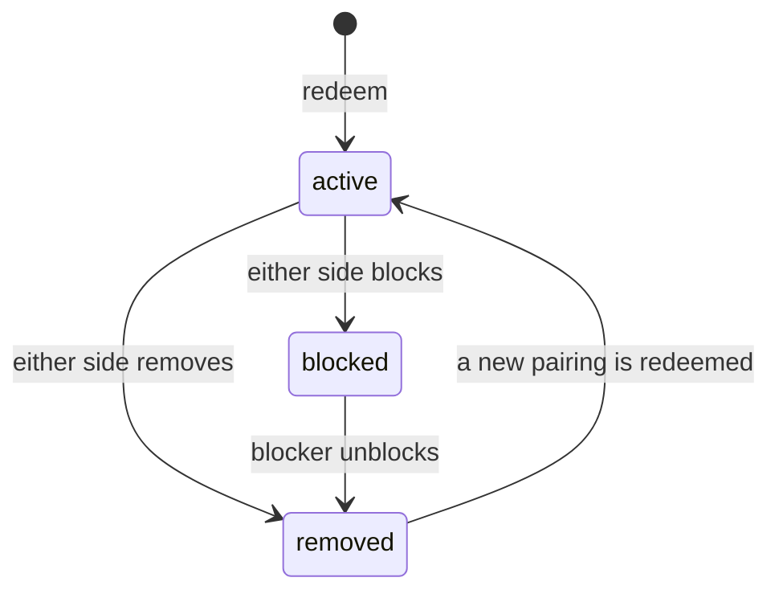
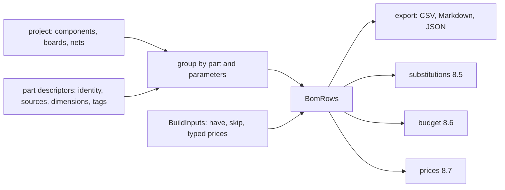

# iynk community: buddies, sharing, and the path to a real build

Status: specification, first pass, 2026-10-27. Author: product seat "community". Not committed by this pass.
ADR range used: ADR-0820 to ADR-0827 (renumbered 2026-10-27: ADR-0800 to ADR-0808 belong to STUDIO_EDITOR and ADR-0810 to ADR-0819 to API_CONTRACTS).

Upstream: `BRIEF.md` sections 16, 17 and 14 (the part that touches sharing); decisions D-013, D-014, D-015, D-016, D-017, D-007, D-010, D-011 in `00_EXECUTIVE/DECISION_REGISTER.md`; audit `01_AUDIT/SECURITY_BASELINE.md` (D1, D2, R3 to R9), `01_AUDIT/FEATURE_VERIFICATION.md` (C025 to C029, C058, C071, C078, C108), `01_AUDIT/inventory/{server-data,realtime,ai-search-mcp,solana}.md`; research `02_RESEARCH/TECHNICAL_RESEARCH.md`; spike `08_RESEARCH_SPIKES/RS-09-op-log-collab/REPORT.md` (Verdict: PASS for convergence, PASS by CPU for reconnect).
Contracts used (binding for names and fields): `04_ARCHITECTURE/PROJECT_DATA_MODEL.md` and `schemas/project.schema.json`, `COMPONENT_SCHEMA.md` and `schemas/component.schema.json`, `SIMULATION_ARCHITECTURE.md`. Product ids: `FEATURE_CATALOGUE.md`, `PRODUCT_REQUIREMENTS.md`, `FEATURE_PRIORITIZATION.md`.
Parallel documents not yet written when this file was made: `REALTIME_ARCHITECTURE.md` (rooms, ADR-0500 to 0599), `API_CONTRACTS.md`, `SYSTEM_ARCHITECTURE.md`, `USER_JOURNEYS.md`. Where this file needs them it states the rule it needs and points at the requirement that already exists (R-075 to R-098). Route names here are proposals for `API_CONTRACTS.md` to settle.
Downstream: features F-005, F-088, F-089, F-120, F-138, F-140, F-143, F-144, F-154 to F-163, F-195, F-206, F-210, F-212, F-220; requirements R-075 to R-098, R-181 to R-192 and the new community rules CM-01 to CM-72 (sections 6, 8.14 and 12); journeys J-08, J-09, J-12; ADRs in section 14.

Evidence labels: VERIFIED (I read the code or ran a command today), DOCUMENTED (a project document says so), EXTERNAL (outside fact, not checked by me), ESTIMATED (derived, assumptions named), HYPOTHESIS, UNKNOWN, PROPOSAL (a value I chose, free to change).

---

## 1. Summary

1. **Buddies are a closed circle, not a network.** Two people become buddies by exchanging a short code or a link on a server one of them runs. There is no email, no password, no search, no directory and no list of strangers. The server answers every question about a person with "not found" unless the asker is that person's buddy. This closes SECURITY_BASELINE D1 by removing the surface, not by moderating it.
2. **Everything social hangs on the project.** A buddy can open a project you share, work in it with you in a room, fork it with attribution kept in `provenance`, or run a challenge you wrote. There is no profile page, no feed, no public gallery and no discovery.
3. **The leaderboard is buddies-only and ranks personal bests of things that were built or understood**, never counts of attempts, hours or messages (section 3.10).
4. **Three hackathon features are deleted and one is rebuilt.** Build Stories, Build Night and the Solana Proof of Build go (exact paths in section 4). The buddy pool is deleted and rebuilt as the friends feature.
5. **The physical-build path is derived, not typed.** Bill of materials, wiring steps, flashing steps, assembly checklist, test procedure and reality-gap panel are all computed from the project document and the part descriptors. They stay honest: generic parts get specifications, never invented part numbers; prices exist only as typed-in numbers, dated catalogue figures for the migrated labs, or live listings fetched with a search key the user brings; there are no affiliate links, no sponsored placements and no revenue logic (section 8).
6. **Nothing here is planned around customers.** No growth loop, no sharing-to-spread button, no public counter (F-141, F-142 stay out of scope).

### Decisions this file takes

| # | Decision | Why | Where |
|---|---|---|---|
| CD-1 | Identity is a browser P-256 key pair. A person enrols once with an operator-issued one-time code, proves the key by signing a server challenge, and holds a 12-hour bearer token (API_CONTRACTS 5.2). Pairing is by link or typed code (API_CONTRACTS 5.3). | F-206, R-077, R-080: no accounts (F-169 out of scope) | 3.2 |
| CD-2 | Visibility is enforced by the server on every read from the live pair table, not by lists copied into other tables. Removing a buddy removes access at once. | Fewest places to get wrong; matches R-080 | 3.3 |
| CD-3 | A share is an immutable, signed snapshot identified by its `stateHash`. It is never a live view of someone's local project. | `stateHash` already identifies content (PROJECT_DATA_MODEL section 6.4); a live view would need the owner online | 3.5 |
| CD-4 | A fork keeps the original authors in `actors` and `provenance.contributors`; the new owner is added. The origin is `provenance.origin = {kind: "fork", project, revision, stateHash}`. | The fields exist already; no schema change | 3.7 |
| CD-5 | The leaderboard has one track per kind of effort, each counting a personal best once per subject. There is no combined score, no streak, no daily reset and no season. | Rewards building, not grinding | 3.10 |
| CD-6 | Build inputs the document cannot derive (budget, typed prices, bench measurements, chosen alternates) are stored in `ext["iynk.build"]`. Everything else on the physical-build path is recomputed. | PROJECT_DATA_MODEL principle P3 (derived data is not stored) | 8.2 |
| CD-7 | Live prices come only from a search key the user brings, only when pressed, never in a loop, and are shown as listings with a time, never as "the price". | Audit C027 CONTRADICTED; D-015 | 8.7 |
| CD-8 | No affiliate links, no sponsored placement, no referral parameters, ever. A test fails the build if one appears. | D-013; F-164 is out of scope | 8.7 |

---

## 2. Scope and what exists today

### 2.1 In scope

Buddy pairing and the buddy list; presence among buddies; sharing a project (file, room, buddies, read-only link); working together as a product rule set on top of the room requirements; forks, remixes and attribution; templates and packs between buddies; challenges among buddies; the buddies-only leaderboard; leaving, removing and blocking; the removal of Build Stories, Build Night and the Solana Proof of Build; the physical-build path (BOM, datasheets, substitutions, budget, prices, wiring, flashing, assembly checklist, test procedure, reality gap, own bench measurements).

### 2.2 Out of scope (stated so nobody builds it)

Public profiles, public galleries, public rooms, search for people, an AI matcher, free-text bios or "wants", avatars, follows, likes, comments from non-buddies, a report queue, moderators, age gates, accounts with email, a marketplace (F-103), verified provenance for a public audience (F-145), server-verified lap times (F-075, LATER), affiliate or commerce links (F-164), classes and rosters (F-124 to F-136), tokens, wallets and credentials of any kind (D-016). Reason for all of them: D-013 (a lab for Amar and his friends) and D-016.

### 2.3 What the code does today, and the verdict for each piece

Verdicts follow the audit's recommendation (`00_EXECUTIVE/council/cto-platform.md` section 3) and BRIEF 3.5: preserve until a replacement is measurably better.

| Piece | Path and lines | What it does today | Status | Verdict | Reason |
|---|---|---|---|---|---|
| Buddy pool API | `src/app/api/buddies/route.ts:27-56` (GET), `:59-72` (POST), `:75-88` (DELETE) | Returns the newest 50 live profiles (name, language, interests, built list, `wants` up to 280 chars) to any caller | VERIFIED; SECURITY_BASELINE D1 | DELETE, rebuild as the pair API | A public list of strangers with free text is the problem itself |
| Profiles table | `db/migrations/0003_profiles.sql` | 24 h profile with `interests text[]`, `built text[]`, `wants text` and a TimescaleDB expiry job | VERIFIED | DELETE (a new migration drops it; the file stays in history) | Not reusable; the new store is the SQLite store of R-083 (SQLite only; Postgres is a later could, R-083, D-019) |
| Profile queries | `src/lib/server/db/queries.ts:132-175` (`upsertProfile`, `listProfiles`, `deleteProfile`) | SQL for the pool | VERIFIED | DELETE | Same |
| Matcher | `src/app/api/ai/match/route.ts`, `src/lib/server/ai/prompts/match.ts` | AI picks compatible strangers from the pool | VERIFIED-PARTIAL (C026) | DELETE | There is no pool |
| Buddy UI | `src/app/[lang]/together/Buddies.tsx` (stores buddy id and token in plain localStorage, SECURITY_BASELINE D5) | Form, list, match | VERIFIED | DELETE; new `Buddies` view over the pair API | Credential in plain text |
| Together page shell | `src/app/[lang]/together/page.tsx`, `Lobby.tsx` (imports `Buddies` and `Planner`: `Lobby.tsx:14-15`, `:172-173`) | Start or join a room | VERIFIED | EXTEND | Keeps room start and join; loses two sections |
| Leaderboard | `src/app/api/leaderboard/route.ts:9-33`, `src/lib/server/db/queries.ts:45-87` (reads `laps_best_daily`), `src/components/data/Leaderboard.tsx`, used at `src/components/dronelab/FlyWorkspace.tsx:206` | Public best-lap board per course; `name` accepted from any caller (`src/lib/server/db/schema.ts:30-34`) | VERIFIED; D2 | REPLACE | Public, free-text names, depends on telemetry events |
| Live counter | `src/components/data/LiveCounter.tsx`, `src/app/api/live/route.ts`, `src/components/data/useFeed.ts`, `src/lib/server/db/live.ts` | Public count of events | VERIFIED | DELETE (F-141) | Public counter, out of scope |
| Realtime relay | `server/realtime/src/*` (1,243 lines in 6 files; 39 tests) | Rooms, baton, presence, chat | VERIFIED-PARTIAL | EXTEND per R-075 to R-098 | Hardening and identity are in REALTIME_ARCHITECTURE |
| Room client | `src/lib/realtime/*`, `src/components/realtime/*` | Client side of rooms | VERIFIED-PARTIAL | EXTEND (transports) / REPLACE (action layer, by the op log R-033) | TECHNICAL_DEBT D5 |
| Flight ghosts | `src/lib/flight/ghost.ts`, `src/components/flight/room-ghosts.ts` | Ghost of a best lap and of friends in a room | VERIFIED-PARTIAL (C016) | PRESERVE; fed by buddy best-lap replays (3.10) | Already built |
| Catalogue BOM | `src/lib/search/bom.ts` (parts lists for drones, robotics, boards; `estimate` at `:32`, `:247`, `:252`, `:263`, `:277`) | Hard-coded shopping queries and catalogue prices for the migrated items | VERIFIED-PARTIAL (C108) | PRESERVE for the migrated items, then REPLACE by the derived BOM when a project has components | Works today; the new BOM must match its totals on the 38 items before it replaces it |
| Offers and live prices | `src/app/api/search/offers/route.ts`, `src/lib/search/*`, `src/components/search/RealBuildPanel.tsx` | One cold view costs 32 to 54 searches; the key had 0 of 250 left and answered 429 on 2026-10-26 | CONTRADICTED (C027) | EXTEND with the user's key (F-194) and a hard cost cap | Fix cost, error text and trigger |
| Budget optimiser | `src/lib/search/optimize.ts` (186 lines, up to 27 combinations) | Drone battery, motor and prop under a budget | VERIFIED-PARTIAL (C028) | PRESERVE for drones; generalise by the rule in 8.6 | Tested, keyless |
| Hardware twin | `src/lib/hw/*`, `src/components/hw/HardwareTwinPanel.tsx` | Mirrors pins to a real Uno through Firmata | unit tests only | PRESERVE (F-159) | Not a flashing tool; stated in 8.9 |

---

## 3. Buddies

### 3.1 Entities

| Entity | Lives in | Fields | Notes |
|---|---|---|---|
| Person (identity and device) | Browser store, server `identities` | `identity.id` (`usr_` + base32 of the first 10 bytes of SHA-256 of the public key), `deviceId` (`dev_` + base32 of the first 16 bytes, both derived from the key, API_CONTRACTS 5.2 rule 2), `displayName` (1 to 24 grapheme clusters), `keyThumbprint` (base64url SHA-256 of the SPKI public key, 43 characters), `createdAt`, `lastSeen` | One browser profile is one person. Another browser is another identity that enrols with a new code and pairs again (R-077: no recovery by email). In this file "device" means the identity of one browser. The person's `actors[]` entry in a project has `id: usr_...` and the same `keyThumbprint` (PROJECT_DATA_MODEL 5.1) |
| Private key | Browser IndexedDB `keys` store, non-extractable `CryptoKey` | ECDSA P-256 | Never leaves the browser and is in no export. The access token is held in memory only |
| Pair | Server `buddies` (one row per direction, API_CONTRACTS 5.3 rule 1), browser `buddies` | `identityId` of each side, `alias?` (private to the row owner), `createdAt` | Created by one `POST /v1/pairings/redeem`; removed in one transaction, both directions |
| Pairing | Server `pairings` | `pairingId` (`pair_`), `creator`, `tokenHash` (128-bit link token), `channel` and `secretHash` (typed code `XXXX-XXXXXX`), `grant?`, `expiresAt`, `redeemedAt`, `wrongSecrets` | Neither the link token nor the code secret is stored, only SHA-256 (API_CONTRACTS 5.1) |
| Block | Browser `blocks` only. No server table and no route | `owner`, `blockedThumbprint`, `at` | Keyed by key thumbprint (`Buddy.keyThumbprint`), so a new browser with the same key stays blocked; a new key is a new person. Enforced by the blocker's own client (3.11); the server knows only remove and revoke |
| Local alias | Browser only | `thumbprint`, `alias` | A nickname only you see. Never sent to the server |
| Share | Server `shares` | see 3.5 | Immutable snapshot of a project |
| Challenge pass line | Server score row `solved.{shareId}` (`PUT /v1/scores/{key}`), plus an optional `ChallengeResult` file | see 3.9 | A buddy's report that they passed your challenge. No attestation table and no attestation route |
| Board row | Server scores (`PUT /v1/scores/{key}`, API_CONTRACTS 7) | see 3.10 | One personal best per (key, identity) |

The server store is the SQLite store of R-083 (SQLite only; Postgres is a later could, R-083, D-019). All tables above are additions to the tables R-083 lists (devices, pairs, rooms, operation logs, snapshots, share links).

### 3.2 Finding a buddy: identity and pairing

Requirements this expands: R-076, R-077, R-080, R-081; features F-206 and F-005.

**Secure context.** WebCrypto (`crypto.subtle`) exists only on HTTPS or `localhost` (EXTERNAL, browser rule). A self-hosted server on a plain-HTTP LAN address would run the app but could not make a key. The app checks `window.isSecureContext` at start and shows "Buddies need HTTPS or localhost. Setup guide: TLS" instead of failing silently. R-079 already puts Caddy in the guide; this makes it mandatory for buddies (Objection O-3).

**First visit to a server (enrolment and sign-in).** This follows API_CONTRACTS 5.2 and REALTIME_ARCHITECTURE 4 without change; this file adds no credential of its own.

1. The operator runs `iynk-server enrol` on the host. It prints a one-time enrolment code (12 Crockford base32 characters, 24 hours, one use; API_CONTRACTS 5.1) and the person is given it out of band, with the server address.
2. The browser checks `window.isSecureContext`, calls `GET /v1/server` (public) for the audience, enrolment mode and `minClient`, and makes the P-256 key pair (private key non-extractable).
3. It calls `POST /v1/auth/challenges {purpose: "register", keyThumbprint}`, signs the returned `signingInput`, and calls `POST /v1/identities {challengeId, signature, publicKey, displayName, enrollmentCode}`. The server checks the code, the signature and that the key is on the curve, derives the `usr_` and `dev_` ids from the key, stores the public key, and answers `201 {identity, accessToken}`.
4. Later visits and every 401: `POST /v1/auth/challenges {purpose: "login", identityId}`, sign, `POST /v1/auth/tokens {challengeId, signature}` for a 12-hour opaque bearer token (`iynk_at_...`, SHA-256 stored). The token lives in memory; there are no cookies and no refresh token.

Display name rules are R-080's: 1 to 24 grapheme clusters, control, zero-width and bidi-override characters stripped as `server/realtime/src/protocol.js:21-24` does for names today.

**Pairing flow.**

```mermaid
sequenceDiagram
    participant A as Amar's browser
    participant S as Self-hosted server
    participant B as Buddy's browser
    A->>S: POST /v1/pairings (bearer, Idempotency-Key)
    S-->>A: token, url, code XXXX-XXXXXX, expiresAt (shown once)
    A-->>B: link or code, said aloud, typed or sent in any chat
    B->>S: POST /v1/pairings/peek {token or code} (public)
    S-->>B: inviter display name, expiry, hasProjectGrant
    B->>S: POST /v1/pairings/redeem {pairing}
    S-->>B: buddy
    S-->>A: lobby socket frame: new buddy
    Note over A,B: the app shows the same 6-digit fingerprint on both screens; comparing it is optional
```

Rules:

| Rule | Value | Source |
|---|---|---|
| Typed code | `XXXX-XXXXXX`: a 4-character public channel plus a 6-character secret, from the Crockford base32 alphabet (0-9 and A-Z without I, L, O, U; 32 symbols; O reads as 0, I and L as 1); 30 secret bits. The channel names which pairing a wrong secret counts against, so "wrong 5 times, the code is deleted" (R-076) is countable | API_CONTRACTS 5.1 (DOCUMENTED); alphabet fixed by RC-18 |
| Link | `https://<host>/pair#<token>`; the token sits in the URL fragment, so it is not sent in the request line or logged by a proxy. The page posts it in the body of peek and redeem | API_CONTRACTS 5.1; fragment behaviour is EXTERNAL (HTTP) |
| Link token | 128 random bits, SHA-256 stored | R-076, API_CONTRACTS 5.1 |
| Expiry | Code: 10 minutes at most. Link: 24 hours by default, at most 7 days. Deleting the code after 5 wrong secrets leaves the link valid until it expires | API_CONTRACTS 5.1 and 5.3 rule 2 |
| Uses | One redemption. A second redemption of the same pairing returns the generic error | PROPOSAL |
| Wrong guesses | 5 wrong secrets on one real channel delete that code. Bucket `pairing.guess`: 10 per minute and 100 per hour per address on peek and redeem; an unknown channel counts only against the address. Lockout and 429 `rate_limited` follow API_CONTRACTS 4.3 | R-076; API_CONTRACTS 4.3 |
| Guess odds | A guesser limited to 10 guesses a minute needs about 2^20 / (live pairings) guesses to find a live channel, and then hits its 6-character secret with probability 5 in 2^30 before the code is deleted | ESTIMATED by API_CONTRACTS 5.1: uniform codes, no other leak |
| Error text | One generic "That code did not work. Ask for a new one." for wrong, expired, used and locked | R-076 |
| Added by redeem | There is no accept step: one redeem call makes the pair (both directions) in one transaction (API_CONTRACTS 5.3). The creator is told on the lobby socket and the Buddies page shows "<name> joined", with Remove as the undo. The earlier draft had a creator-accept step; the contract has no accept route, so it was dropped (Objection O-11) | API_CONTRACTS 5.3 |
| Fingerprint | The 6 digits are the first 20 bits of SHA-256(sort(thumbprintA, thumbprintB)) read as a number, zero-padded to 6 digits. Reading them aloud detects a server that swapped keys. Computed in the browser from the two stored keys; no server route | PROPOSAL; HYPOTHESIS that friends will bother, so it is optional |
| Self-pairing | Redeeming your own pairing is refused with 409 `already_paired` | API_CONTRACTS 4.2 |
| Already buddies | A redeem between two active buddies is 409 `already_paired` | API_CONTRACTS 4.2 |
| Limits | 64 buddies per identity; open pairings per identity are bounded by 409 `quota` and the `pairing.create` bucket (20 per hour per identity) | PROPOSAL; API_CONTRACTS 4.3 |
| Key proof | There is no separate pairing signature. The redeemer is a signed-in identity (or enrols in the same call), so the key was proved by the challenge of 3.2 step 3 or 4 | API_CONTRACTS 5.2 |

States of a pair:



`blocked` is kept on the blocker's side only (browser; the server has no block state); the other person sees `removed` (3.11).

### 3.3 Who can see what

The server decides on every request, from the current `pairs` rows. Nothing about a person is stored inside another person's data.

| Data | Owner | Visible to | Not visible to | Notes |
|---|---|---|---|---|
| Existence of a device | the device | its active buddies | everyone else; a lookup by id, name or key for a non-buddy returns the same `404 not_found` as an id that does not exist | Closes D1 |
| Display name | the device | active buddies | others | 1 to 24 characters; no avatar, no bio (R-080) |
| Buddy list | the device | the device only | even buddies cannot see who else is your buddy | No "friends of friends" |
| Online or offline | the device | active buddies, if the owner has `showOnline: true` (default; `PATCH /v1/identities/me`) | others | "Appear offline" hides it |
| Which project is open and which room | the device | only buddies who hold an invite to that room | other buddies | R-081: the buddy sees "invited to room", not everything you open |
| Shares | the owner | buddies in the share's audience (3.5) | others, unless the owner made a link (3.5) | |
| Board rows | the owner | active buddies, when the owner has opted in to the leaderboard | others | 3.10 |
| Block list | the device | the device only | the blocked person | They see a removal |
| Operator view | the operator | anyone with shell access to the data directory can read everything the server stores (names, pairs, shares, rows). Chat and project text in rooms are not logged (R-078) | | Stated in `docs/DATA_HANDLING.md` (F-008). End-to-end encryption is not built (HYPOTHESIS that friends who trust the operator do not need it) |

A test per row sets up three devices (A, B, C) with A and B paired, and asserts that C gets the same answer for a real and a made-up id (CM-04).

### 3.4 The Buddies page

The page shell `src/app/[lang]/together/page.tsx` is kept (F-138). It shows these states; each is a test case (CM-07).

| State | What shows |
|---|---|
| No server configured (R-012, R-079) | "Buddies need a server. Setup guide" with the link; no buddy controls |
| Not a secure context | The message in 3.2 |
| Empty | "Add a buddy" (create pairing) and "Enter a code" |
| List | Per buddy: display name (or your alias), online dot, "in a room with you" when relevant, count of new shares, a menu (Work together, Shared with me, Compare on boards, Rename, Remove, Block) |
| Pairing open | The code in large type, a copy-link button, a QR image, the expiry countdown, "Cancel pairing" (`DELETE /v1/pairings/{pairingId}`) |
| New buddy | "<name> joined" with the fingerprint and Remove |
| Server unreachable | Last known list from the browser, labelled "offline, as of <time>" (R-080); actions that need the server are disabled with a reason |
| Token revoked or unknown | "This server does not know this browser. Ask the operator for an enrolment code." with the pairing entry points; local projects are untouched |

No page lists people you have not paired with. There is no search field.

### 3.5 Sharing a project with a buddy

Routes for this section are in 3.12 and use the API_CONTRACTS share endpoints. Where the record below differs from the contract `Share` (audience values are `link` and `buddies`; default expiry is 30 days; there is no owner signature field), the contract wins until the two are reconciled (Objection O-11).

This extends R-095 (three ways) with a fourth, "Share with buddies", which is the buddies-only gallery of F-143 reduced to its working core.

| Way | Needs a server | Who can open | Runs | Editable by them | Source |
|---|---|---|---|---|---|
| Send file | no | whoever you give the file to | yes, after import | after Fork | R-095, F-201 (`.iynk`), F-089 |
| Invite to room | yes | invited buddies only | yes | by role | R-084, R-085 |
| Share with buddies | yes | all active buddies, or the chosen ones | yes, read-only copy | after Fork | this file, F-143 |
| Read-only link | yes | anyone holding the link | yes, read-only | after Fork | R-095 |

**Share record.**

| Field | Type and rule |
|---|---|
| `shareId` | `shr_` + 96 random bits |
| `owner` | device id |
| `projectId` | `prj_...` of the source project |
| `revision`, `stateHash` | the project's `revision` and `stateHash` at share time (PROJECT_DATA_MODEL 6.4). The server recomputes `stateHash` on upload and refuses a mismatch |
| `title`, `description` | copied from `meta` for the list; text only |
| `audience` | `buddies` (all active buddies at read time), or `some` with a list of buddy device ids. In the document this is `access.visibility = "buddies"`, or `"private"` plus `access.grants[]` with role `viewer` for the chosen `actors` (PROJECT_DATA_MODEL 5.1) |
| `bytes` | size of the `.iynkz` container as uploaded |
| `createdAt`, `expiresAt` | expiry: default 30 days for link and buddies audiences; owner may choose none or up to 365 days; operator maximum `IYNK_SHARE_TTL_DAYS` |
| `revokedAt` | set when the owner revokes |
| `signature` | ECDSA signature by the owner over `shareId + ":" + stateHash + ":" + createdAt`, checked by the receiving browser against the buddy's stored key. A failure shows "Could not verify who sent this" and disables Fork |
| `linkTokenHash` | present only for a link: SHA-256 of a 128-bit token (R-095) |

**Rules.**

| Rule | Value |
|---|---|
| Immutable | Sharing again makes a new share; the buddy sees the newest per project, with up to 10 older revisions kept per project, oldest pruned |
| Same limits as import | Canonical document 5 MiB; container 128 MiB ESTIMATED default (PROJECT_DATA_MODEL 9.4); the server adds a per-share cap `IYNK_MAX_SHARE_BYTES` (default 16 MiB, PROPOSAL) and a per-device quota (default 256 MiB and 200 shares, PROPOSAL). Over quota gives a named error and no partial upload |
| Validated on the server | The upload goes through the same five validation passes as a load (PROJECT_DATA_MODEL section 9) in a worker with a time limit; failure stores nothing |
| Secrets | Before upload the client runs the secret-shape scan of PROJECT_DATA_MODEL section 13 and warns. Keys are never in a document |
| Third-party content | A share that carries `provenance.thirdParty` items with `review: "unchecked"` shows a note; sharing between buddies is allowed (the D-017 publish gate is for the public repository, not for friends) |
| Revoke | The owner revokes a share or a link; the server deletes the blob on the next write (not only a flag) and keeps a tombstone row for 30 days so a buddy's list can say "withdrawn" |
| Receiving | A buddy sees "Shared with me" with title, owner, revision, size, tier summary and the "what it models" line (F-011). Open runs it from the snapshot in a read-only tab. "Make my copy" is a fork (3.7) |
| Notification | A count badge on the Buddies entry, delivered over the lobby socket (REALTIME_ARCHITECTURE 5.5). No email, no push |
| Links | Off by default per project. When on, anyone with the link can view and fork, and the dialog says so before the link is created. The operator can disable links server-wide (`IYNK_ALLOW_LINKS=0`). Q-12 of the requirements asks whether links are wanted at all |
| Without a server | "Share with buddies", rooms and links say "needs a server". Send file always works. A project is never encoded into a URL above 8 KB (R-095) |

### 3.6 Working on one project together

The mechanics (global order, snapshot plus tail, reconnect, divergence check, baton, authority fix) are specified by R-075 to R-094 and ADR-0104, and will be restated by `REALTIME_ARCHITECTURE.md`. The product rules this file adds:

| Question | Rule |
|---|---|
| How does a room start? | From a buddy's menu or the project menu: "Work together". The server creates the room, stores the project snapshot as the base (R-084) and sends an in-app invite directly to the chosen buddy's presence socket. The invite is also a 128-bit capability valid 24 hours (R-076) |
| Who may join? | Only devices holding an invite, which are active buddies of the host at join time. If the host removes the buddy, the buddy is removed from the room (R-080) |
| Roles | `access.grants[].role` is the stored mirror: `owner` (host), `editor`, `commenter`, `viewer`. In a room, viewer is "spectator". The server keeps its own ACL and checks `permission` on every operation; the document's `access` is advisory (PROJECT_DATA_MODEL 5.1). `commenter` may point and chat but not edit |
| Parts, wires, settings | Everyone with `editor` edits through operations ordered by the server. A rejected operation returns a reason and the client drops it (R-089) |
| Code | Whoever holds the baton edits; others see it read-only with the holder's name (R-094). A text CRDT is not used (ADR-0104, RS-09) |
| Run, stop, reset, speed | These are operations in the same order as edits, allowed to `editor` and `owner`. The last accepted operation wins, and every member sees who pressed it. The host can switch "run controls: host only" for a session. View settings (zoom, panel layout, which instrument is open) are local and never shared. Each peer simulates locally from the same operations and replay log; the host's state hash is the reference, and a mismatch resyncs from the host (SIMULATION_ARCHITECTURE 17.4, R-090) |
| Disagreement | Two people deleting the same part: the first accepted operation wins, the second is rejected with `not_found` and shown as a quiet notice. Two people setting the same value: the later in server order wins and both see the final value. Nobody can overwrite another person's code without the baton |
| Undo | Per author (ADR-0104). One person cannot undo another's change |
| Audit | The operation log carries `author.actor` (PROJECT_DATA_MODEL 7.1). The host can open "who changed this" per part. Retention is the ADR-0505 rule (payloads for the latest 20,000 operations; older history is summarised by checkpoints) |
| Helper joins | A buddy asked for help takes the baton for a session (F-122). Nothing else changes |
| When the room closes | The host's copy returns to the host's library. Each guest is offered "Keep a copy", which creates a **new** project id with `provenance.origin = {kind: "fork", project: <room project id>, revision: <last seq>, stateHash}`. R-085 says the guest's copy keeps the same project `id`; that collides when host and guest share one browser (two tabs through the BroadcastChannel fallback), so a new id is needed (Objection O-4) |
| Server stops | Local editing continues; banner; queue up to 1,000 operations; resume on return (R-088) |
| Chat | Text only, 500 graphemes, the last 50 lines replay to a late joiner, not stored after the room expires (R-092) |
| Host controls | Lock, kick, close, pass host, revoke invite (R-093, F-120). Kick plus the host's browser-side block list (3.11) is the whole moderation toolset |

### 3.7 Forks, remixes and attribution

Features F-088 (fork) and F-143 (buddies' gallery). The fields are in `project.schema.json`; nothing here needs a schema change.

**What a fork writes.**

| Field | On fork |
|---|---|
| `id` | new `prj_...` |
| `revision` | 0; `history` holds a single `system` operation noting the fork |
| `provenance.origin` | `{kind: "fork", project: <source id>, revision: <source revision>, stateHash: <source hash>}` |
| `provenance.createdBy` | the forker |
| `provenance.createdWith` | the forker's app version |
| `actors[]` | the source's actors are kept (names and `keyThumbprint`); the forker is added if absent |
| `provenance.contributors[]` | each source `author` and `editor` is kept with the same role; the forker is added as `editor`; the forker is the only entry in `access.owners` |
| `access` | `visibility: "private"`, `grants` reset to the forker as `owner` |
| `license` | kept from the source until the new owner changes it (PROJECT_DATA_MODEL 5.17) |
| `provenance.thirdParty[]` | kept with each item's `review` state |
| `provenance.migrations[]`, `exports[]` | migrations kept; `exports` cleared |
| `meta.title` | "Copy of <title>" unless the forker types one |
| `meta.kind` | `project` unless the source is a `template`, `lesson` or `challenge` and the forker keeps it |

**Remix chain.** A fork of a fork records its direct parent only. The full chain is followed by walking `origin.project` through shares the person can still open; if a link in the chain is gone, the card shows "an earlier version you cannot see" and keeps the names from `contributors`. No central index of lineage exists.

**What the person sees.** A card in the project info: "Fork of <title> by <name>, revision <n>". Names come from `actors[]` in the document, so they survive the original buddy being removed. If the signature check in 3.5 failed, the card says "source not verified".

**Rules.**

| Rule | Value |
|---|---|
| Forking a share | Always allowed to anyone who can open it. The owner is not told |
| Sending back | A fork can be shared back to the original owner as a normal share; the owner opens it next to their own with "Compare" (F-093, STUDIO). Merging is manual. No pull request machinery (HYPOTHESIS that friends do not need it) |
| Credit is not removable in the UI | Editing `contributors` is possible in a file by hand (the document is advisory), but the editor offers no control to delete an `author` entry |
| Counting for the leaderboard | A fork counts as a new build only after at least 20 accepted operations since the fork point (PROPOSAL), so forking a friend's finished project does not score (3.10) |
| Licence | `LicenseRef-iynk-pending` until D-017 is decided; a project from a buddy keeps what it had |

### 3.8 Templates and packs

F-084 (starter templates) and F-220 (packs for buddies). No new file format.

| Item | Rule |
|---|---|
| Template | A project with `meta.kind = "template"`. "New from template" is a fork with `provenance.origin = {kind: "template", template: <id>}` for shipped ones, or `fork` for a buddy's |
| Make a template | Menu "Save as template" sets `meta.kind` on a copy and strips history. It stays local until shared |
| Pack | A `.iynkz` container (PROJECT_DATA_MODEL format table, section 12) holding one or more projects and the embedded part descriptors (`dependencies.components[].origin = "embedded"`). It is the F-220 pack |
| Sending | A pack goes as a file, or as a share whose `kind` is `pack` (same record as 3.5) |
| Importing | Runs the hostile-zip limits (PROJECT_DATA_MODEL section 13: streaming size limits, no path traversal, no zip-slip). Code-bearing parts (F-102) arrive **disabled** with "this part runs code from <name>; enable?" and cannot be enabled until a Worker-kill sandbox prototype passes (RS-15 never ran, so the sandbox is PENDING; the prototype is an agent task in the Components phase) |
| Template library | Local only: the shipped ones, the ones you saved and the ones buddies shared and you chose to keep |

### 3.9 Challenges among buddies

F-133, F-144. A challenge is a project the author made with the "Make a challenge" command of EDUCATION 8.1: it sets `guide.kind = 'challenge'` (PROJECT_DATA_MODEL 5.13; `meta.kind` is a separate field with the value `challenge` that the fork rule in 3.7 copies, but the marker the app and this section test is `guide.kind`), writes the plan, and puts saved checks in `tests[]` (PROJECT_DATA_MODEL 5.12) with `visibility: "visible"` or `"hidden"`. There is one challenge model and one result record; EDUCATION 8 owns them and this section only says how they travel between buddies.

| Step | What happens |
|---|---|
| Send | The author shares it like any project (3.5), through a buddies-audience share or a link. The share artifact strips `x-iynk-solution` unless "Include solution" is ticked (EDUCATION 8.1). Hidden checks are in the document, so a determined buddy can read them. Among friends that is accepted; the file says so (`hidden` means "not shown in the UI", not "secret") |
| Attempt | The buddy forks it (EDUCATION 8.2), edits, and runs the checks locally |
| Report | The buddy may press "Tell <author> I passed". The app builds a `ChallengeResult` (EDUCATION 8.3, below) and does two things. (1) If every non-null gate is `true`, it calls `PUT /v1/scores/solved.{shareId}` (`submitScore`) with `value = hintsMax`, `unit: "count"`, `better: "lower"`, `projectId` = the submission project and a `note` of at most 140 characters such as `T2, 3 runs, challenge 9f3a1c07`. (2) It offers the full `ChallengeResult` as a small `.iynkresult.json` file the runner sends by any channel, or attaches to the buddies-audience share of the submission; EDUCATION 8.3 allows "a file or through the server". The author sees who passed with `GET /v1/leaderboards/solved.{shareId}` (`getLeaderboard`) and can import the file to read the details |
| Record | The score row is the contract `LeaderboardRow` (`rank`, `identityId`, `displayName`, `value`, `unit`, `submittedAt`, `verification: "claimed"`, `note`). The runner is the bearer token's identity, never a body field. `shareId` is `SharedProject.share.id` (runner) or `Share.id` (author); both are the same `shr_` id when the author shared by buddies audience. The key `solved.shr_...` fits the contract pattern `^[a-z0-9][a-z0-9._-]{0,63}$` (`shr_` plus 16 base32 characters is 20 characters, so the key is 27) |
| Trust | It is a claim by a friend, labelled "reported by <name>" (`verification: "claimed"`). The sender can re-run the original tests against the submission locally (EDUCATION 8.3, ADR-0834 in EDUCATION 8.3); the server never does (server re-run is F-132, out of scope) |
| Sharing the answer | Re-running needs the submission. The runner may share the submission project with the author as a buddies-audience share (a checkbox, default off); the `ChallengeResult.submission` field then names it. Without it the result stays an unverified claim |

`ChallengeResult` v1 is the type in EDUCATION 8.3, copied here for reading only (EDUCATION wins if they ever differ):

```ts
interface ChallengeResult {            // EDUCATION 8.3, ADR-0834
  v: 1;
  challenge: { project: string; stateHash: string };    // the challenge as received
  submission: { project: string; stateHash: string };   // the receiver's fork
  gates: Record<'checks' | 'edit' | 'quiz' | 'goal', boolean | null>;
  tier: 'T0' | 'T1' | 'T2' | 'T3';
  hintsMax: 0 | 1 | 2 | 3;
  runs: number;
  elapsedMs: number;                    // self-reported
  note?: string;                        // up to 500 chars, plain text
}
```

What the server does with a pass line: the generic `submitScore` rules of the contract. It validates the body against `ScoreSubmit` (closed schema, 8 KiB), keeps the better value (fewer hints) and never reads a `ChallengeResult`, because none is sent to it. A newer lower-hint report replaces the older; a worse one is ignored. Because no `ChallengeResult` reaches the server, the earlier envelope (`attestationId`, `challengeShareId`, `result.challenge.stateHash` check against the share) is gone, and so are `checksPassed`, `checksTotal`, `simulatorBuild` and `replayHash`. A verifier gets the same facts by re-running (DET-1: same seed and engine versions give the same verdicts).

Read access: the board follows the contract rule: the caller and the caller's buddies only. The author is the runner's buddy, so the author sees the line; a stranger never does. The `ChallengeResult` file is private to whoever the runner sends it to.

### 3.10 The buddies-only leaderboard

Feature F-140, requirement R-091, decision D-016. Q-9 is closed: laps first, tracks as below. This section lists the tracks and ships only the first with COLLAB; the others arrive when the thing they rank exists.

**Design principle (CD-5).** A rank should answer "who made the best thing" or "who understood the most", and should not answer "who spent the most time". So:

- Each track ranks one **personal best per subject** (one course, one fault item, one challenge, one project). Repeating the thing never adds anything.
- No total across tracks. No streaks, no daily or weekly reset, no season, no count of attempts, laps flown, minutes online or messages sent. The server never stores an attempt counter (the existing `laps` column of `laps_best_daily` is not exposed).
- One opt-in for the leaderboard, not one per track. A buddy who has not opted in is not on any board and is not shown as "missing".
- A tie is a tie: the same rank is shown.

| Track id | Subject | Value | Better is | Counts only if | Source of the number | Needs |
|---|---|---|---|---|---|---|
| `lap` | one flight course (`${craftId}-${courseId}`, or the challenge board id, as in `FlyWorkspace.tsx:208`) | best lap time in ms | lower | the time is between the existing floor and ceiling `LAP_MS` (`src/lib/telemetry/kinds.ts:56`: 1 s to 1 h) | The pilot's browser (claimed). Optionally the best lap's replay (at most 64 KiB) so buddies can race a ghost (F-070) | DRONE flight range, exists today |
| `diagnosis` | one fault item (`cause_id` of the D-010 diagnosis record) | the lowest `hint_level` at which the cause was named correctly (0 means no hints) | lower | the item was solved once in diagnose-first mode | The diagnosis record `{cause_id, symptom_id, evidence, hint_level}` | FAULTS (F-019, F-022) |
| `built` | one project root | the number of challenges made from the project that at least one buddy has passed | more | at least one buddy row exists on `solved.{shareId}` for a share of the project (3.9); the project has at least 1 board, 3 components and 1 net; it is not a fork with fewer than 20 operations since the fork point | The author's browser counts rows from `GET /v1/leaderboards/solved.{shareId}` for each of its shares (`listShares`) and submits the total as `PUT /v1/scores/built.{projectId}` (claimed) | STUDIO, F-221 |
| `solved` | one challenge (share id) | the fewest hints at which the runner passed, ties broken by the earlier `submittedAt` | lower | every non-null gate of the `ChallengeResult` is `true` | `PUT /v1/scores/solved.{shareId}` (3.9) | F-144 |

Why this is hard to grind, and where it still is (stated plainly):

| Habit or attack | Effect | Control |
|---|---|---|
| Fly the same course 1,000 times | Nothing changes except the best time | Only the best is stored; no count |
| Fake a lap | A friend can post 1.0 s | Accepted (friends are trusted, F-075 LATER). The floor and ceiling remove nonsense. A shared replay lets a friend watch it, which is the social check |
| Make 50 empty projects | Does not count: a project needs components and a net, and a buddy must have a `solved` line | a `solved` line from another person; structure floor |
| Fork a friend's finished project | Does not count until 20 operations differ | Rule in 3.7 |
| Ask a buddy to report a pass on everything | Possible | Friends can do this to each other; no prize exists, which is the control (HYPOTHESIS that nobody cares) |

**Server rows.** All four tracks are stored by `PUT /v1/scores/{key}` (`submitScore`, API_CONTRACTS 7, Leaderboards): one row per (key, identity) holding the best `value`, with `unit` and `better` fixed by the first submission (a later disagreement is 409 `score_key_mismatch`) and an optional `replayAssetSha256` for a ghost. The key is `{track}.{subject}` in the contract's pattern `^[a-z0-9][a-z0-9._-]{0,63}$`, for example `lap.drone.canyon-run`, `solved.shr_k3j2...`. The contract keeps the better value, so a retry or a worse value is harmless. There is no separate table for `built` and `solved`, no `board_rows` table and no `GET /boards/{track}/{subject}`: the store is the `scores` table of BACKEND_ARCHITECTURE 7.2 (columns `device_id`, `kind`, `value`, `at`, `detail`). The contract and that table differ in names (`key` against `kind`); the schema seat maps them. There is no `name` column: the name shown is the buddy's current display name (or your alias), so the free-text name of D2 cannot exist.

**Reading.** `GET /v1/leaderboards/{key}` (`getLeaderboard`) returns the caller's row and the rows of the caller's buddies, at most 65 rows. Removing a buddy removes their rows from the answer at once (R-091, API_CONTRACTS 5.3 rule 6). The contract has no per-track opt-in, so "opted into that track" is a client rule: a person who does not want a track shown simply does not submit to it, or deletes the row with `DELETE /v1/scores/{key}`. The board reads nothing from the telemetry store, so telemetry can stay off or opt-in (F-006). The old route `src/app/api/leaderboard/route.ts` and the `laps_best_daily` aggregate are deleted with the telemetry cleanup.

### 3.11 Leaving, removing and blocking

| Action | Who | Effect on the other person | Effect on shared things | Reversible |
|---|---|---|---|---|
| Remove buddy | either | Their list drops you. They are not told why. Open rooms between you close for the removed person (R-080) | Shares to the audience stop being readable by them; their forks and copies stay with them (your name stays in their `contributors`). Your board rows disappear from their view; theirs from yours | Yes, by a new pairing |
| Block | either, from the buddy menu or from the room | Same as remove, plus the blocker's client does three things on its own: it revokes every open pairing the blocker made (`listPairings`, `DELETE /v1/pairings/{pairingId}`) so the old link cannot bring the person back; it stores the thumbprint in the browser block list; and while open it removes any buddy whose `keyThumbprint` is on that list (`DELETE /v1/buddies/{identityId}`) and kicks that identity from a room the blocker hosts (a socket `member.kick`, REALTIME_ARCHITECTURE). Not told | Same as remove | Yes: Unblock in settings (deletes the local entry) |
| Leave a room | any member | The room continues | Your copy stays (3.6) | Rejoin by invite |
| Kick | host | The kicked device cannot rejoin that room with the same invite (R-093) | | Host re-invites |
| Close a room | host | Everyone is disconnected | Guests keep a fork if they accept | |
| Withdraw a share | owner | Buddies see "withdrawn" | Blob deleted (3.5) | Share again |
| Leave the server | the person | Their identity, sessions, pairings, buddy rows, shares and scores are deleted on the server after the grace period (`POST /v1/identities/me/deletion`); rooms they host close | Other people's forks stay | No; a new enrolment code and pairing |
| Revoke an identity | the operator, by `iynk-server revoke <identity>` on the host (no admin HTTP API) | As leave, with no grace period | | The operator can issue a new enrolment code |

There is no report button and no moderation queue. The tools for a friend who behaves badly are remove, block, kick and, last, the operator revoking the identity. This follows F-120 and the goals of PRODUCT_REQUIREMENTS 9.1 (Objection O-5 about R-093's wording). Block is a client-side rule, not a server rule: the server has no block list (API_CONTRACTS has no block route). Its guarantee is therefore weaker than remove: it holds while the blocker's browser runs, and a pairing the blocker made for someone else, if it was redeemed in the gap, is undone the next time the blocker's client starts. A server block list would need a new route, a table and a rule in `redeemPairing`; it is not asked for here (O-11).

### 3.12 Server surface

This section lists what the buddy features call. Names, methods and rate buckets are API_CONTRACTS section 7 and `schemas/openapi.yaml`; this file adds no route and no table to them. Base path `{origin}/v1` (API_CONTRACTS 3.1, `servers` in `openapi.yaml`; the lobby socket is `wss://host/ws`, ADR-0420).

**Authentication.** Every route needs `Authorization: Bearer <access token>` (12 hours, from the signed challenge of 3.2) except the public routes below. A missing, malformed, expired, forged or revoked token is 401 `unauthorized` with a fixed message and no detail (API_CONTRACTS 4.1 rule 5). The bearer token is not enough for the socket: the WebSocket handshake signs again (REALTIME_ARCHITECTURE 4.3).

**The public routes, exactly.** Everything not in this table needs a bearer token, so R-077 can say "every route except these returns 401". The rate limit of each is its API_CONTRACTS 4.3 bucket.

| Route | Why it has no bearer | Bucket and limit |
|---|---|---|
| `GET /healthz`, `GET /readyz` | liveness and readiness for the operator's supervisor | `public.read`, 120/min/address |
| `GET /v1/server` | the app needs `minClient`, the audience and the enrolment mode before it can sign in (R-079) | `public.read`, 120/min/address |
| `GET /v1/openapi.json` | the contract itself | `public.read`, 120/min/address |
| `POST /v1/auth/challenges` | the first half of sign-in; it returns a nonce, nothing about any identity | `auth.challenge`, 20/min/address |
| `POST /v1/auth/tokens` | the second half of sign-in; the signature is the credential | `auth.token`, 20/min/address and 5 failures/min/identity |
| `POST /v1/identities` | enrolment (the only way to get a first token): needs an operator one-time code and a valid signature | `identity.register`, 5/min/address |
| `POST /v1/pairings/peek` | a would-be buddy previews who invited them | `pairing.guess`, 10/min and 100/h per address |
| `POST /v1/pairings/redeem` | bearer token of an enrolled identity; a pairing never enrols | `pairing.guess`, 10/min and 100/h per address |
| `GET /v1/shares/{token}` and `GET /v1/shares/{token}/assets/{sha256}` | the read-only share-link view; the 128-bit token is the credential (a `buddies`-audience share still needs a signed-in buddy) | `share.read`, 120/min/address |

`POST /v1/identities` (enrol) and the share-link read are the two public routes that matter for buddies. The challenge, token and pairing routes are public because there is no other way to obtain a first credential; each is guarded by a one-time secret or a signature, a rate limit and an identical failure answer. Enrolment is closed unless the operator issues a code (`IYNK_ENROL=code`, the default; there is no open mode on a public URL without a logged warning, API_CONTRACTS 5.2 rule 4).

**Routes the buddy features use.**

| Route | Purpose | Notes |
|---|---|---|
| `POST /v1/auth/challenges`, `POST /v1/auth/tokens` | sign in (3.2) | public |
| `POST /v1/identities` | enrol with a code and a signature | public, once per browser |
| `GET /v1/identities/me`, `PATCH /v1/identities/me` | read, change `displayName`, `color`, `showOnline` (the "Appear offline" setting of 3.3) | |
| `POST /v1/identities/me/deletion`, `DELETE /v1/identities/me/deletion` | leave the server, or cancel it | grace period 24 hours by default; deletes what 3.11 lists |
| `GET /v1/auth/sessions`, `DELETE /v1/auth/sessions/{sessionId}` | see and sign out browsers | |
| `POST /v1/pairings`, `GET /v1/pairings`, `DELETE /v1/pairings/{pairingId}` | make, list and cancel a link and code | `pairing.create` 20/h/identity |
| `POST /v1/pairings/peek`, `POST /v1/pairings/redeem` | preview, then become buddies | public; lockouts in 3.2 |
| `GET /v1/buddies`, `GET /v1/buddies/{identityId}`, `PATCH /v1/buddies/{identityId}` | the paired list, one buddy, your private `alias` | the only list route for people |
| `DELETE /v1/buddies/{identityId}` | remove | removes both rows, mutual grants and room membership in one transaction |
| Lobby socket at `ServerInfo.wsUrl` (`wss://host/ws`) | online state, incoming room invites, new-share counts | REALTIME_ARCHITECTURE 5.5; there is no `GET /presence` route |
| `POST /v1/shares` (body holds the snapshot), `GET /v1/shares`, `DELETE /v1/shares/{shareId}` | make, list and revoke a share (`audience: link` or `buddies`) | owner only; `project.write` 60/min |
| `GET /v1/shares/{token}` | open a share; the fork is made locally from the opened snapshot | read is public |
| `PUT /v1/scores/{key}`, `DELETE /v1/scores/{key}`, `GET /v1/leaderboards/{key}` | personal bests (3.10) | buddies only |
| `POST /v1/rooms`, `POST /v1/rooms/{roomId}/invites`, `POST /v1/room-invites/redeem`, `POST /v1/rooms/{roomId}/invites/{inviteId}/accept` | rooms | REALTIME_ARCHITECTURE; API_CONTRACTS 7 Rooms |

Anything not in the contract or this table returns 404. No listing route over identities, shares or rows exists that is not scoped by the caller's pairs. The old `GET /api/buddies` is deleted. Bodies are validated as the existing routes are (`parseBody`, `src/lib/server/http.ts`), and origins come from `IYNK_ALLOWED_ORIGINS`.

### 3.13 Limits (all PROPOSAL, configurable)

| Limit | Default |
|---|---|
| Display name | 1 to 24 characters |
| Buddies per device | 64 |
| Pairing creation | 20 per hour per identity (`pairing.create`); 409 `quota` beyond the open-pairing cap |
| Pairing guesses | 5 wrong secrets per real channel delete the code; 10 per minute and 100 per hour per address (API_CONTRACTS 4.3) |
| Shares per device; bytes per share; quota | 200; 16 MiB; 256 MiB |
| Revisions kept per shared project | 10 |
| Link lifetime | default 30 days for link and buddies audiences; owner may choose none or up to 365 days; operator maximum `IYNK_SHARE_TTL_DAYS` |
| Pass lines per challenge per identity | 1 (the score key `solved.{shareId}`; a better value replaces the older); 8 KiB body |
| Board rows per identity per track | 200 (one per key) |
| Replay attached to a lap | 64 KiB |
| Block list | 256 (browser only) |
| Rooms, members per room live rooms 20, stored rooms 100, members 8, spectators 8 (BACKEND defaults) |

### 3.14 Failure and abuse cases

Each row is a test (CM-50 to CM-58) in the hostile-client suite (R-097).

| Case | Expected behaviour | Baseline item |
|---|---|---|
| Anonymous caller lists buddies, shares or rows | 401 on every route outside the public list in 3.12 | D1 |
| Authenticated stranger asks for a device id, a share id or a board | 404 identical to a made-up id | D1, D2 |
| Guess pairing codes | Lockouts in 3.2; the answer never says whether the code existed | R2 (room existence leak) in spirit |
| Replay an old signature or a used pairing | A challenge is single use and expires in 60 seconds; its signing input includes the audience (API_CONTRACTS 5.2 rule 1); a redeemed pairing is refused | |
| Forged `Origin` | Refused by `checkOrigin` (exists) | |
| Upload a project with an unknown operation kind or an oversize document | Refused by the five validation passes; nothing stored | R9 |
| Upload a share whose `stateHash` is wrong | Refused | |
| Share contains script in a title | Rendered as text, never HTML (R-028) | |
| Name made of bidi characters to pose as another | Stripped on registration; the list also shows the first 8 characters of the key thumbprint when two buddies have the same name | `protocol.js:21-24` |
| A buddy turns hostile | Remove, block, kick; the operator can revoke | |
| Server restarts | Pairings with unexpired codes, buddy rows, shares and scores survive (file store, R-078); sockets reconnect | |
| Clock skew | Expiry is judged by the server's clock only | |
| Flooding enrolment, pairings or shares | The per-address and per-identity buckets of API_CONTRACTS 4.3; forwarded-address headers read only when `IYNK_TRUST_PROXY=1` (R-008) | |
| Operator curious | Possible; stated in the data-handling note | |

---

## 4. What is removed, and exactly where

Feature F-195 owns the work; this section is the checked list. File and line facts below are VERIFIED by `grep` and `ls` on 2026-10-27 against `main` at `b6255ca`. Behaviour after deletion is UNKNOWN until typecheck, lint and tests run (F-195 says the same). Git history keeps all of it (D-016).

Order of work: one commit chain, the three deletes first, then the cleanups that depend on them, each step followed by `npx tsc --noEmit`, `npx eslint . --quiet` and `npx vitest run`. After the last commit run the residual grep in 4.6 and expect no hits outside `docs/MASTER_PLAN`, `docs/hacktx`, `docs/DECISIONS.md` and git history.

### 4.1 Build Stories (F-139)

| Action | Path |
|---|---|
| Delete | `src/components/ai/StoryCard.tsx`, `src/components/ai/StoryCard.test.tsx` |
| Delete | `src/app/api/ai/story/route.ts`, `src/app/api/ai/story/route.test.ts` |
| Delete | `src/app/api/ai/image/route.ts`, `src/app/api/ai/image/route.test.ts` |
| Delete | `src/lib/server/ai/prompts/story.ts`, `src/lib/server/ai/prompts/image.ts` |
| Delete | `src/lib/ai/story-png.ts` |
| Delete | `src/lib/ai/session-log.ts`, `src/lib/ai/session-log.test.ts` (the only importers found are `useBuildLog.ts` and `StoryCard.tsx`; the partner builds its history from its own turns in `src/lib/ai/conversation.ts`) |
| Delete | `src/components/ai/useBuildLog.ts` |
| Edit | `src/components/ai/index.ts:2` (export of `useBuildLog`) |
| Edit | `src/components/dock/LabDock.tsx:5` (import) and `:119` (`useBuildLog({ lab, itemId, store })`, a call that only feeds the story) |
| Edit | `src/components/ai/PartnerPanel.tsx`: imports at `:27` and `:29`; `useBuildLog` at `:37`; the `view` state `"chat" or "story"` at `:99`; `me:` at `:116`; the toggle button at `:185-192`; the story branch at `:205-207`; and `PartnerPanel.test.tsx` |
| Edit | `src/lib/ai/protocol.ts:11-21` (`StoryRequest`, `StoryResponse`, `StoryEventKind`, `StoryEvent`, `ImageResponse`), `src/lib/ai/client.ts:10-12` and `:249-262` (`writeStory`, `drawCover`), `src/lib/ai/conversation.ts` (StoryEvent mention) |
| Edit | `src/lib/server/ai/types.ts:49-61` (`StoryEvent`, `StoryRequest`, `StoryResponse`, `ImageRequest`) |
| Edit | `src/lib/server/ai/provider.ts:425-472` (`generateImage`, the Muse Image call), `src/lib/server/env.ts:35` (`META_IMAGE_MODEL`) and `:57`, `:94` (the `image` feature flag) |
| Edit | `src/lib/features.ts:17` (drop `"image"` from `FEATURE_KEYS`) and its test |
| Edit | `src/i18n/messages/{en,es,fr,de,zh,hi}/ai.json` (the `story` object, from `:108` in `en`) and the `story.me` key the panel reads; the `shell.json` string that advertises stories (`en` near `:117`) |
| Edit | `README.md` lines that advertise stories (C026, C071) |

### 4.2 Build Night (F-137)

| Action | Path |
|---|---|
| Delete | `src/app/[lang]/together/Planner.tsx` |
| Edit | `src/app/[lang]/together/Lobby.tsx:15` (import), `:173` (use), `:143` (comment) |
| Delete | `src/app/api/ai/plan/route.ts`, `route.test.ts` |
| Delete | `src/lib/server/ai/plan.ts`, `src/lib/server/ai/prompts/plan.ts` |
| Edit | `src/lib/server/mcp/tools/together.ts`: the `participant` and `planShape` schemas and `planBuildNight` (`:10-50`); keep `createRoom` |
| Edit | `src/lib/server/mcp/tools/index.ts:7`, `:10` (the `TOOLS` array), `:29` (the server description sentence about `plan_build_night`) |
| Edit | `src/lib/server/mcp/backends.ts` (the `postRoute` helper exists for `plan_build_night`; its comment says so at `:19`; delete it if no other tool uses it after the edit) |
| Edit | MCP tests: `src/lib/server/mcp/tools.test.ts`, `e2e.test.ts`, `openapi.test.ts`, `transport.test.ts` |
| Edit | `src/i18n/messages/*/together.json` (the `plan` object, from `:208` in `en`) |
| Edit | `src/lib/server/ai/catalog.ts` header comment (it says the planner and matcher use the catalogue helper; the helper stays if the partner uses it) |

### 4.3 The old buddy pool and matcher (replaced by section 3)

| Action | Path |
|---|---|
| Delete | `src/app/api/buddies/route.ts`, `route.test.ts` |
| Delete | `src/app/[lang]/together/Buddies.tsx` |
| Delete | `src/app/api/ai/match/route.ts`, `route.test.ts`, `src/lib/server/ai/prompts/match.ts` |
| Edit | `src/app/[lang]/together/Lobby.tsx:14` and `:172` |
| Edit | `src/lib/server/db/queries.ts:132-175` (profile functions), `src/lib/server/db/schema.ts:77-93` (`profile`, `buddyPost`, `buddyDelete`, `buddyQuery`) and `queries.test.ts` |
| Edit | `src/lib/telemetry/responses.ts` (`BuddyProfile`, `BuddiesResponse`, `BuddyPostResponse`) |
| New migration | A migration that drops `profiles` and `simlab_expire_profiles`. SQLite only; Postgres is a later could (R-083, D-019). `db/migrations/0003_profiles.sql` stays in history |
| Edit | `src/i18n/messages/*/together.json` (the `buddies` object, from `:181` in `en`) |

### 4.4 Public leaderboard and live counter (replaced by 3.10; F-141)

| Action | Path |
|---|---|
| Delete | `src/app/api/leaderboard/route.ts`, `route.test.ts` |
| Delete | `src/components/data/Leaderboard.tsx`, `LiveCounter.tsx`, `useFeed.ts`, and the matching parts of `components.test.tsx`, `messages.ts`, `messages/*.json`, `index.ts` |
| Delete | `src/app/api/live/route.ts`, `route.test.ts`, `src/lib/server/db/live.ts` |
| Edit | `src/components/dronelab/FlyWorkspace.tsx:5` and `:205-215` (replaced by the buddies board panel) |
| Edit | `src/lib/server/db/queries.ts:45-87` (`getLeaderboard`), `src/lib/server/db/schema.ts:30-34` (`name` in `lapPayload`) and `:69-76` (`leaderboardQuery`), `db/migrations/0002_aggregates.sql` (the `laps_best_daily` aggregate) through a new migration; `timescale.test.ts` |

### 4.5 Solana Proof of Build (F-146 to F-150)

| Action | Path |
|---|---|
| Delete directory | `solana/` (Anchor program in `solana/programs`, 34 tests in `solana/tests`, its own `package.json` and lockfile, `Anchor.toml`, `Cargo.*`, `target/`, `node_modules/`) |
| Delete | `src/app/api/solana/` (`attest/route.ts`, `credentials/route.ts`, `faucet/route.ts`, `solana-routes.test.ts`) |
| Delete | `src/lib/server/solana/` (`attest.ts`, `common.ts`, `context.ts`, `faucet.ts`), `src/lib/server/solana-ready.ts`, `solana-ready.test.ts` |
| Delete | `src/lib/solana/` (`actions.ts`, `config-ready.ts`, `config.ts`, `devnet-adapter.ts`, `devnet-wallet.ts`, `idl/`, `messages.ts`, `passport.ts`, `provider.tsx`, `reads.ts` and their tests) |
| Delete | `src/lib/verify/` (`index.ts`, `drone-recorder.ts`, `drone-safety.ts`, `hash.ts`, `runlog.ts`, `skill.ts`, `verify.test.ts`). VERIFIED importers outside the directory are only Solana files (`src/components/solana/*`, `src/lib/solana/actions.ts`, `src/lib/server/solana/attest.ts`, `src/app/api/solana/solana-routes.test.ts`) |
| Delete | `src/components/solana/` (`BountyForm`, `Confetti`, `CredentialCard`, `PassportApp`, `PassportPanel` and its test, `SkillBounties`, `SolanaText`, `SponsoredBounties`, `TipButton`, `VerifyApp`, `WalletBar`, `shared`, `useChain`) |
| Delete | `src/app/[lang]/passport/`, `src/app/[lang]/verify/` |
| Delete | `src/lib/server/mcp/tools/passport.ts` (the `get_passport` tool) |
| Edit | `src/lib/server/mcp/tools/index.ts` (`getPassport` in `TOOLS`; description sentence about Proof of Build), `registry.ts:34` (comment), `openapi.ts:27` (error text names Solana) and the MCP tests that mock `@/lib/solana/*` (`tools.test.ts:49-50`) |
| Edit | `src/components/shell/nav.ts:2,5,13,22,23,28` (`passport`, `verify`, `feature: "solana"`), `nav.test.ts`, `src/components/shell/FooterNav.tsx:11,14` |
| Edit | `src/components/dock/LabDock.tsx:11` (import), `:25-29` (`TAB_FLAG`), `:37` (tab label), `:85` (render), `:91` (comment), `LabDock.test.tsx`, and the dock tab type in `src/components/dock/types.ts` |
| Edit | `src/lib/features.ts:17,24,56` (drop `solana`), `features.test.tsx`; `src/app/api/status/route.ts:5,15` and `route.test.ts:6`; `src/lib/server/env.ts:41-45,60,66,97` (the `SOLANA_*` variables) and `env.test.ts` |
| Edit | `src/i18n/namespaces.ts:4,17`; delete `src/i18n/messages/{en,es,fr,de,zh,hi}/solana.json` |
| Edit | `package.json:33,36-39` (`@coral-xyz/anchor`, `@solana/wallet-adapter-base`, `-react`, `-react-ui`, `@solana/web3.js`) and the lockfile. F-148 lists only `@solana/*`; `@coral-xyz/anchor` must go too (SECURITY_BASELINE quick win 13 names it as the source of two high advisories) |
| Edit | `e2e/dock.spec.ts:28-34`, `e2e/dock-shared.ts:53,68` (assertions that the passport tab and nav link are absent) |
| Edit | `scripts/crawl-routes.mjs:27-28` (`BY_DESIGN` mentions `passport|verify`), `.env.example:26-33`, `README.md` (lines 65, 76, 82, 90, 95, 133, 142, 146), `docs/ARCHITECTURE.md:131` |
| Keep, note | `docs/hacktx/` is history and moves out of the front door in F-196; `docs/DECISIONS.md` lines about Solana are history |

### 4.6 Residual check

```sh
grep -rniE "solana|passport|StoryCard|useBuildLog|session-log|story-png|plan_build_night|get_passport|api/ai/(story|plan|match|image)|api/buddies|api/leaderboard|api/live|LiveCounter|Build Night|Build Story|Proof of Build" \
  src server e2e scripts db deploy README.md package.json .env.example next.config.ts
```

Expected: no hits. Allowed: `docs/hacktx`, `docs/MASTER_PLAN`, `docs/DECISIONS.md`. The words "Build Buddies" may stay as the page name until the page is renamed.

---

## 5. A friend's first run

A new buddy opens the app on Amar's server, gets a name and a key, enters a code, and lands on "Shared with me" and "Templates". With no shares yet the page offers the shipped templates (F-084) and "Start a project". There is no onboarding programme and no tutorial specific to buddies. Journeys J-08 (share with a friend) and J-09 (two buddies editing) use the screens in section 3.4.

---

## 6. Acceptance for the community part

Given/When/Then rules. Ids CM-01 to CM-58 are proposed additions to the requirements; the second column says which existing requirement each deepens.

| ID | Deepens | Rule |
|---|---|---|
| CM-01 | R-077, R-080 | Given a fresh browser on an HTTPS server and an operator enrolment code, When I open Buddies, Then a key is created, the challenge is signed, an identity is registered, and no email or password is asked |
| CM-02 | R-080 | Given a non-secure context, When I open Buddies, Then the page explains that HTTPS or localhost is needed and creates no key |
| CM-03 | R-076, R-080 | Given a pairing with a typed code, When 5 wrong secrets are sent on its channel, Then that code is deleted, the link still works until it expires, and the answer is the same generic text as for an expired code |
| CM-04 | R-081, D1 | Given devices A, B (paired) and C (stranger), When C asks for A's id, name, shares or rows, Then C gets the same 404 as for a random id |
| CM-05 | R-080 | Given a pairing link nobody redeemed, When its lifetime passes, Then redeem and peek answer the generic error and nothing is stored about the would-be redeemer |
| CM-06 | R-080 | Given two buddies, When one removes the other, Then both lists drop the pair, shares become unreadable, rooms close for the removed person, and board rows vanish from each other's view |
| CM-07 | R-012 | Given each state in 3.4, When the page renders it, Then its text and controls match the table |
| CM-08 | R-095 | Given a project, When I choose Share with buddies, Then a share is stored whose `stateHash` equals the local one and a buddy sees it in Shared with me within 5 seconds (ESTIMATED; UNKNOWN until measured on a real link) |
| CM-09 | R-095 | Given a share, When the buddy opens it, Then the project runs read-only and "Make my copy" creates a fork with the provenance of 3.7 |
| CM-10 | CD-3 | Given a share whose blob is altered on the server, When the buddy opens it, Then the signature check fails and Fork is disabled with "Could not verify who sent this" |
| CM-11 | R-095 | Given a read-only link, When I revoke it, Then the link answers 404 at once and the blob is deleted |
| CM-12 | R-081, R-084 | Given a buddy and a project, When I choose Work together, Then a room is created, the buddy gets an in-app invite, and only invited devices can join |
| CM-13 | R-085 | Given a closed room, When a guest keeps a copy, Then it has a new project id and `provenance.origin.kind = "fork"` with the room project, last `seq` and `stateHash` |
| CM-14 | CD-4 | Given a fork, When I read the document, Then the source's authors are in `actors` and `contributors` and I am the only owner |
| CM-15 | CD-4 | Given a fork of a fork whose first parent was withdrawn, When I open project info, Then it shows my direct parent and "an earlier version you cannot see" |
| CM-16 | 3.8 | Given a pack with a code-bearing part, When I import it, Then the part is disabled until I confirm and, before RS-15 has a verdict, cannot be enabled |
| CM-17 | 3.8 | Given a hostile `.iynkz` (zip bomb, `../` path), When I import, Then it is refused with the limit named and nothing is written outside the store |
| CM-18 | 3.9 | Given a challenge and a buddy who passes it, When they press "Tell <author> I passed", Then `GET /v1/leaderboards/solved.{shareId}` shows their row with `verification: "claimed"` and their hint count, and the `.iynkresult.json` file shows the `ChallengeResult` (tier, hints, runs); the server ran nothing |
| CM-20 | R-091 | Given the flight range, When a lap ends and I opted into the `lap` track, Then only my row for that course changes, and only if the time is better |
| CM-21 | R-091 | Given a stranger's device, When it asks for a board, Then it gets 404 |
| CM-22 | 3.10 | Given 1,000 laps on one course, When I read the board, Then it shows one row for me with my best time and no lap count |
| CM-23 | 3.10 | Given a fork with 5 operations since the fork point, When a buddy passes a challenge made from it, Then it does not count on the `built` track; at 20 operations it does |
| CM-24 | 3.10 | Given I remove a buddy, When I open any board, Then their rows are gone |
| CM-25 | F-070 | Given a buddy's best lap with a replay, When I fly that course, Then I can choose to race their ghost |
| CM-30 | 3.11 | Given I blocked a person, When my client next runs, Then my open pairings are revoked and `GET /v1/buddies` no longer lists them even if they redeemed an older link; When their identity joins a room I host, Then my client kicks them. A server-side refusal is not claimed |
| CM-31 | 3.11 | Given Leave server, When I confirm, Then a server-side listing of my id, pairs, shares and scores is empty after the grace period and my local projects are untouched |
| CM-40 | F-195 | Given the residual grep in 4.6, When it runs on the finished branch, Then it has no hits outside the allowed directories |
| CM-41 | F-195 | Given a clean install, When `npm ls @solana/web3.js @coral-xyz/anchor` runs, Then neither is present, and first-load JavaScript is lower than the PERFORMANCE_BASELINE value (F-195 puts the wallet stack's share at 467 KB raw; the new figure is MEASURED when done) |
| CM-50 to CM-58 | R-097 | The rows of section 3.14, as automated tests in the hostile-client suite, titled with the baseline ids |

---

## 7. Build sequence for the community part

Relative to D-014. COLLAB is one phase and stops for Amar's OK at its end.

| Step | Work | Needs | Done when |
|---|---|---|---|
| B0 | Section 4 deletions (F-195). The buddy pool and public leaderboard routes are deleted; the Together page keeps rooms behind the "off" flag (R-081 notes) | none | CM-40, CM-41 |
| COLLAB-1 | The store (R-083), enrolment, key, bearer token and pairing (F-198, F-199, F-005, F-206), buddy list, lobby presence (3.2 to 3.4) | B0 | CM-01 to CM-07 |
| COLLAB-2 | Relay authority (F-118, F-119) | COLLAB-1 | R-097 passes |
| COLLAB-3 | Rooms on projects (F-121, R-084 to R-094) | CORE operation log | M1 steps 9 to 11 |
| COLLAB-4 | Shares, forks, attribution (3.5, 3.7) | CORE fork (F-088), file format (F-201) | CM-08 to CM-15 |
| COLLAB-5 | Buddies board, `lap` track (3.10) | DRONE range (exists) | CM-20 to CM-25 |
| LATER | Challenges and pass lines (3.9), `diagnosis`, `built` and `solved` tracks, packs (3.8) | FAULTS, STUDIO F-221, PARTS | CM-16 to CM-18, CM-23 |

---

## 8. From a simulation to a real bench

BRIEF section 17, adapted to D-013. Features F-154 to F-163, F-210 to F-212, F-159 (hardware twin); requirements R-181 to R-192; journey J-12. Phase EXPORT, with the project-file export already in CORE (Objection O-3 of the requirements).

### 8.1 Principles

1. **Derive, never retype.** Every list below is computed from `components`, `nets`, `views`, `boards`, `dependencies` and the part descriptors. If the project changes, the list changes. Derived data is not stored (PROJECT_DATA_MODEL P3).
2. **Say what you do not know.** A generic part has no part number, and the BOM says "generic" and gives a specification. A missing datasheet is shown as missing. A price that was not fetched is empty.
3. **Name the source of every line.** Each step, BOM row and risk carries `source: netlist | descriptor | note | user` (R-185).
4. **The simulator is a teaching model until a bench says otherwise (D-007).** The build package carries the tier summary and the words "not modelled yet" where the registry says so; the word "validated" is never used.
5. **Nothing leaves the machine on its own.** Prices and nearby search happen only when the person presses a button and has given a key.
6. **No money motive.** No affiliate parameters, no sponsored placement, no ranking by commission. Recommendations rank by compatibility and by the person's constraints (BRIEF 17.2).

### 8.2 Where the inputs live

The document cannot derive a budget, a price someone typed, a chosen alternate or a bench measurement. They are stored in one namespaced block, `ext["iynk.build"]` (the `Ext` type allows reverse-DNS keys, up to 16; PROJECT_DATA_MODEL P7), so no schema change is needed now. Objection O-6 asks the data-model seat to promote it to `domains.build` with its own `schemaVersion` and migration chain.

```ts
type BuildInputs = {
  schemaVersion: "1.1";   // project document; domain data keeps 1.0
  currency: string;                    // ISO 4217, one per project, default "USD"
  budgetMinor?: number;                // integer minor units (cents)
  spares: { smallPassivesPercent: number }; // default 0; 10 is a suggested value, never applied silently
  region?: string;                     // ISO 3166-1 alpha-2, used only for live search
  lines: Record<string, LineInput>;    // key: bomKey, see 8.3
  measurements: BenchMeasurement[];    // up to 500
  notes?: string;                      // up to 4,000 characters
};
type LineInput = {
  chosenPart?: { ref: string; version: string };  // an accepted substitute, applied as component.swap
  priceMinor?: number;                 // a price the person typed, per unit
  priceNote?: string;                  // "bought at shop X on 2026-10-30"
  have?: number;                       // units already owned; reduces the quantity to buy
  skip?: boolean;                      // "I will not buy this"
};
```

All text in it is rendered as text. No key, token or live price is ever stored here (live results are cached in the browser's own store, 8.7).

### 8.3 The BOM



**Grouping key.** `bomKey = sha256(partRef + "@" + version + "|" + canonical(parameters that affect purchase)).slice(0, 16)`. Parameters that affect purchase come from the descriptor (`value`, `tolerance`, `package`, `color`, voltage rating). Two 10 kohm resistors with the same tolerance are one row of quantity 2. A 1 percent and a 5 percent resistor are two rows.

**Row fields.**

| Field | Source and rule |
|---|---|
| `line` | 1-based, stable sort order: category (descriptor `identity.category`), then first refdes in natural order |
| `bomKey` | as above |
| `refdes[]` | the instances' `refdes` (`Component.refdes`) |
| `partRef` | `{ref, version}` from `dependencies.components` |
| `description` | descriptor `identity.description` plus the parameter values, as text |
| `value`, `unit` | from the component parameters, with the unit of the component schema |
| `package` | descriptor `dimensions.package` |
| `manufacturer`, `model`, `mpn` | descriptor `identity`. If `generic` is true, `mpn` is empty and never invented |
| `generic` | descriptor `identity.generic` |
| `specification` | for generic parts, the list the buyer must match: value, tolerance, package, voltage and power rating (the ratings the project uses), colour |
| `quantity` | count of instances, minus `have`, plus spares when the person chose them. Spares apply to resistors, capacitors, LEDs and jumper wires only |
| `purchasable` | false for `identity.kind = "virtual"` (supplies, breadboard nets, instruments) and for parts the descriptor marks as simulated only. These rows appear in a separate "not purchasable" section |
| `datasheet` | first `sources[]` entry of kind `datasheet`, `application-note`, `product-page` or `reseller-guide`: `{title, url, retrieved, revision}` |
| `lifecycle` | descriptor `identity.lifecycle` (`active`, `nrnd`, `obsolete`, `unknown`) |
| `fidelity` | `{tier, status}` from the descriptor `simulation` block (D-007): T0 to T3 or `none`, and `modelled`, `partly-modelled` or `not-modelled-yet` |
| `hazards[]` | derived from descriptor `identity.tags` that start with `hazard:` (8.12) |
| `price` | `{amountMinor, currency, kind: user or catalogue or live, asOf, source}` or empty |
| `alternatives[]` | from 8.5 |
| `source` | `descriptor`, or `user` for fields the person edited |

**Boards.** A board is a row like any part (the Uno R3 has an MPN if its descriptor lists one). Its USB cable is not in the project; a "common companions" note lists what the descriptor `connectors[]` imply (USB-B for an Uno) as a note, not as a counted row.

**Wires.** Jumper wires in a breadboard view are counted by colour and length class if the view holds lengths, else as one row "jumper wires, N, male-to-male" with the count of wire objects in the view. A wire of another kind becomes "hookup wire" with the net name as a note. A solder or screw connection is a step in 8.8, not a part.

**Totals and checks.**

| Check | Result |
|---|---|
| Sum of quantity equals the count of purchasable instances (after `have`, spares and `skip`) | else the export fails with the difference (a test, CM-60) |
| Rows with `generic: false` and no `mpn` | warning "part number missing in the descriptor" |
| Rows with `lifecycle: nrnd` or `obsolete` | warning with the descriptor's own note |
| Rows with no datasheet | "no datasheet cited" |
| Rows with tier `none` | listed under "not modelled yet" so the buyer knows the simulation did not test them |

**Formats (the BOM line of PROJECT_DATA_MODEL section 12).**

| Format | Rules |
|---|---|
| CSV | UTF-8, no BOM, `\n` line ends, RFC 4180 quoting, fixed column order `line,refdes,quantity,description,value,package,manufacturer,mpn,generic,specification,datasheet_url,lifecycle,fidelity,hazards,price,currency,price_kind,price_as_of,notes`. A cell starting with `=`, `+`, `-` or `@` gets a leading `'` so a spreadsheet does not run it (EXTERNAL, CSV injection). Deterministic: the same project gives the same bytes |
| Markdown | A table plus sections: not purchasable, warnings, reality-gap summary, safety notes |
| JSON | The row array and totals, for tools |
| Record | an `exports[]` entry `{format: "bom.csv", at, appVersion, sha256, revision, loss[]}` (PROJECT_DATA_MODEL 5.16) |

Existing code: `src/lib/search/bom.ts` holds hand-written lists for the migrated items. During LABS the converter (F-077) turns each into components, and the derived BOM must reproduce the same quantities. The old `estimate` values become catalogue prices (8.7) for those items only.

### 8.4 Datasheets

| Rule | Value |
|---|---|
| Links, not copies | iynk cites datasheets and does not redistribute them (COMPONENT_SCHEMA 4.3). A BOM row carries `url`, `title`, `retrieved` and `revision` |
| Staleness | A link whose `retrieved` date is more than 365 days old shows "retrieved <date>, check it still matches" (PROPOSAL) |
| No link checking | The app does not fetch datasheets. A dead link is a content bug for the part owner |
| Own copy | A person may attach a PDF they downloaded as an asset with `role: "datasheet"` (up to 16 MiB, `Asset.bytes`). It stays in their project with an `origin` text and their own `license` note; it is not put in a pack unless they choose |
| Fact sheets | The per-board fact sheets (`docs/facts/*`, F-099) stay the human-readable summary; BOM links point to the primary source |
| Provenance | Datasheet numbers are facts, cited and not copied (COMPONENT_SCHEMA licensing note, ADR-0201). Whether "facts from datasheets" needs counsel is UNKNOWN and sits with D-017 |

### 8.5 Substitutions

Feature F-212 (LATER). The component schema has no `alternatives` field, so substitutes are computed from descriptors and never asserted by hand (Objection O-7).

`substitutes(part, project)` returns candidates from the pinned dependencies, the local library and the shipped parts. A candidate qualifies only if all hold:

| # | Test | Source |
|---|---|---|
| 1 | Same `identity.kind` and `category` | descriptor |
| 2 | Pin-compatible: the sets of `{designator, type, class}` match, or a `pinMap` exists that maps every connected pin | `component.swap` needs a `pinMap` (PROJECT_DATA_MODEL 7.2) |
| 3 | Every rating the project exercises (supply voltage, pin voltage, current on the net from the last solver run if any) is within the candidate's `manufacturer` rating range with a stated margin, default 20 percent | descriptor `ratings` |
| 4 | The candidate's logic-level and bus-address rules do not raise an error in the project (`compatibility.rules`) | COMPONENT_SCHEMA 4.12 |
| 5 | Same package class, or the difference is listed | `dimensions.package` |

Result classes: `drop-in` (all tests pass, no differences), `drop-in-with-changes` (pass, but values, code or libraries change; they are listed, for example "uses library X instead of Y"), `needs-rewire` (pins differ; a `pinMap` is proposed). Each result lists differences in plain words and the candidate's `fidelity`; a substitute with a lower tier is flagged, because swapping may make the simulation less trustworthy.

Applying a substitute is a reviewable proposal of operations (`component.swap`, `dep.*`) that the person accepts or rejects (ADR-0104, F-110); the BOM never rewrites the project on its own. The choice is remembered in `lines[bomKey].chosenPart` only until the swap is applied; after that the document is the truth.

What this cannot do: it cannot know that a real part is out of stock, discontinued yesterday, or has a quirk the descriptor lacks (UNKNOWN). It only compares data. Stock needs live listings (8.7).

### 8.6 Budget

Feature F-156 for drones exists. The generalisation:

| Item | Rule |
|---|---|
| Input | `budgetMinor` in the project's currency, optional |
| Prices used | In order: typed price (`user`), catalogue price (`catalogue`), live price the person fetched (`live`, newest first). The kind is shown per row. A row with no price counts as unknown, and the total reads "at least X, N lines unpriced" |
| Total | Integer minor units, summed exactly (the existing `sumMoney` in `src/lib/search/cost.ts` rounds in cents for the same reason) |
| Over budget | A banner names the amount over and the three most expensive rows |
| Optimise | "Find cheaper choices": for each purchasable row with alternatives and a price, the engine enumerates combinations (cap 5,000; above that it takes the best single swap per row, greedily) and keeps only combinations where **every saved check still passes** and the solver reports no new error (power budget, logic level). It shows at most 3 results with the saving and the differences from 8.5. It never changes the project; applying one is a proposal |
| Drones | The existing optimiser (`src/lib/search/optimize.ts`, 27 combinations, uses `calc` and `designChecks`) is preserved; the generic engine calls it for projects with a `domains.drone` block, so thrust-to-weight and flight-time checks stay the constraint |
| Runs where | In the simulation worker host (F-203), never on the main thread |
| Honesty | Savings are computed on whatever prices exist; if fewer than half the rows have a price the engine says it cannot judge |

### 8.7 Prices

The audit found live pricing CONTRADICTED (C027): the SerpApi account had 0 of 250 searches left and answered 429; a cold BOM view cost 32 to 54 searches (ai-search D3); the panel labelled a spent budget as a rate limit. The design makes those failures impossible.

| Kind | Where it comes from | When shown | Label |
|---|---|---|---|
| `user` | Typed by the person in the row | always | "your price, <date>" |
| `catalogue` | Shipped figures for the migrated items only (`src/lib/search/bom.ts` `estimate`; quad5 is $346.00, VERIFIED-PARTIAL C108). New parts have none | when the person opens Prices | "catalogue estimate, not live, <date the figure was entered>" and USD |
| `live` | A search provider, with a key the person brought (F-194) | only after pressing "Check prices" | "listing found <time> on <seller>" |

**The key.** Entered in Settings; kept in the browser's `keys` store, which is outside every export (PROJECT_DATA_MODEL 13). If the operator of the self-hosted server has set a key in the server environment, the same button works through the server (R-010 proxy path), the quota belongs to the operator, and the button says "uses the server's key". No key means the button reads "Add a search key to check live prices" and nothing else happens.

**Cost control (the fix for C027).**

| Rule | Value |
|---|---|
| Trigger | Only a button press. Never on page open, tab open or timer. The behaviour of firing when the Lab tools open (walk 16 for `VideoHelp`) is removed for every search feature |
| Cost shown first | Before the call: "This will use up to N searches", N being the ticked rows times the number of sources. One source per row by default (Google Shopping only); more sources are opt-in |
| Row selection | The person ticks rows; the default is the 12 most expensive unpriced purchasable rows (PROPOSAL; cap 24 per press) |
| Cache | Results are kept in the browser (IndexedDB `priceChecks`) for 6 hours per query and region; repeating within that time costs nothing and says "from cache" |
| History | The same store keeps the person's own earlier checks for 90 days (PROPOSAL), so "price history" means *your* checks, not scraped history. Nothing is uploaded |
| Errors | Quota gone, rate limited, invalid key and timeout are four different messages; a spent quota no longer says "rate limit" (C027 finding) |
| Result | A *listing*: `{title, seller, price, currency, shippingIfGiven, packSizeIfParsed, url, fetchedAt, sponsoredFlagIfGiven}` |
| Comparison | The panel shows the lowest listing per row as "lowest listing found", never "cheapest" or "best price". A listing whose title does not contain the MPN, or the value and package for a generic part, is dimmed with "title does not match the part" |
| Packs | The pack size is parsed from the title as `src/lib/search/cost.ts` does; the person can correct a wrong parse. The cost line uses `ceil(units / pack) * price` |
| Region | The person's `region` goes to the provider as its location parameter if it has one. Availability, stock and delivery time are UNKNOWN unless the listing states them; the panel never fills the gap |
| Currency | No conversion. A listing in another currency is shown in its own currency and left out of the total |
| Sponsored results | If a provider marks a listing as sponsored, it is labelled "ad" or dropped by default. Whether SerpApi's Shopping results carry such a flag is UNKNOWN; a fixture test checks it before the label is claimed |
| Provider | SerpApi is the existing adapter (`src/lib/server/search/serpapi.ts`). Another provider is a new adapter behind the same interface (F-194). Provider terms on storing results are UNKNOWN; the cache is the person's own browser |
| Privacy | A search sends the query text and the region to the provider. The data-handling note says so (F-008) |
| Nearby and video help | Same rules (F-157, F-158, R-191): on request only, with the person's key |

**No affiliate links, ever (CD-8).** Outbound links are the listing's URL exactly as returned, opened with `rel="noopener noreferrer"`. The code has no affiliate tag constant. A CI test greps `src` for `tag=`, `affid`, `aff=`, `ref=` and `utm_` appended by iynk, and a unit test asserts that the link rendered for a fixture listing equals its input.

### 8.8 Wiring instructions

Feature F-161, requirement R-185. The guide is computed from `nets`, `wires`, `views` and the descriptors.

```ts
type BuildStep = {
  n: number;                         // 1-based
  phase: "prepare" | "mount" | "ground" | "signal" | "power" | "program" | "check";
  text: string;                      // plain sentence, in the project's locale if translated
  from?: PinLabel; to?: PinLabel;
  wire?: { color?: WireColor; kind: "jumper" | "solder" | "screw" | "plug" };
  net?: string;                      // the net id this step realises
  expect?: string;                   // what to check after, e.g. "continuity between A and B"
  hazards?: string[];                // tags that raise a warning at this step
  source: "netlist" | "descriptor" | "note" | "user";
};
type PinLabel = { refdes: string; designator: string; connector?: string; hole?: string };
```

`designator` is the label printed on the real part (`pin.designator`, COMPONENT_SCHEMA 4.5), not the internal pin id, so the instruction reads "L298N, screw terminal OUT1" and not `pin_a1`. `connector` comes from `connectors[]`. `hole` (for example "row 12, column e") is filled only when the project has a breadboard view with placements; otherwise the guide is pin to pin.

**Ordering.**

1. `prepare`: read the safety notes (8.12); power off; gather parts.
2. `mount`: place the board and modules; seat breadboard parts.
3. `ground`: connect every ground net first.
4. `signal`: one step per wire or per net, grouped by part, in net-id order (stable).
5. `power`: connect supply nets last; for each supply the step names polarity and the voltage from the net's source, and a polarity check.
6. `program`: 8.9.
7. `check`: the checklist of 8.10.

A net with more than two members is expanded to a minimal tree of wires only if the project's wires do so; the guide never invents wires the project lacks. Where the project has a net but no drawn wire (a netlist-only project), the guide says "connect these pins together" with the pin list.

**Quality rules.** Every step has `source`. Counts match the netlist (CM-61). The guide renders as a numbered list with labelled checkboxes (accessibility), prints cleanly (A4 and Letter, no dependence on colour: the wire colour is also written as text), and exports as Markdown and plain text.

### 8.9 Flashing and programming steps

Feature F-161, R-181, R-185. The compile path for real firmware has no verdict: RS-04, RS-05 and RS-17 never ran (SIMULATION_ARCHITECTURE ADR-0306). RS-03 measured local `arduino-cli` compile at 1.17 to 1.40 s cold and 0.33 to 0.56 s warm, and found it GPL-3.0 (`08_RESEARCH_SPIKES/RS-03-avr8js-differential/REPORT.md`; the checker did not re-verify the licence statement), so a local compile is plausible but not decided. **iynk does not claim to produce a flashable binary.** The export is a sketch folder and a flashing guide: the guide produces the source and the recipe; the toolchain is the person's. A local compile timing is an agent task in the export phase; the compile route stays reversible behind an interface until then.

| Board | Source export | Recipe (EXTERNAL, check before shipping) |
|---|---|---|
| Uno R3, Nano, Mega | `.ino` per source file (F-090, R-181), banner "may not compile as exported" at tier T1 | Install Arduino IDE 2 or `arduino-cli`; install each library in `dependencies.libraries[]` with the descriptor's `install` field; select the board and port; upload |
| Uno R4, ESP32, ESP32-S3, NodeMCU, Nucleo | `.ino` or C++ | Add the board package named in the recipe; select the board; upload. Exact menu names vary and come from the board's recipe file |
| Pico family | `.py` (MicroPython) or `.ino` | Hold BOOTSEL while plugging in, copy the MicroPython UF2 once, then copy `main.py` with Thonny or `mpremote` |
| micro:bit V2 | `.py` | Use the Python editor or copy the compiled hex |
| Basys 3, DE10-Lite | `.v` plus `.xdc` or `.qsf` | Open Vivado or Quartus, add sources and constraints, program the device. No bitstream is produced or promised (PROJECT_DATA_MODEL section 12) |
| Pi 4 and 5 | `.py` | Copy the script, install the listed libraries, run |

Where the recipe lives: not in the component descriptor (it has no field for it). A companion file `parts/<id>/<version>/build.json` beside `component.json` and `tests/*.json` (COMPONENT_SCHEMA repo layout) holds `{tool, steps[], libraries[], notes, sources[]}` with its own small JSON Schema (ADR-0826). Each recipe step cites a source and a retrieval date, because vendor tool menus change (EXTERNAL).

Rules: the guide lists the exact libraries and versions from the project (`dependencies.libraries[]`); a library marked `iynk_support: unsupported` in the descriptor is called out ("the simulator did not run this library; behaviour on the bench may differ"); the first power-up uses a current-limited supply, or a USB port with no load connected, as the step before `program`.

The hardware twin (F-159, R-188) mirrors pins through Firmata; **it does not flash code** and the guide never describes it as flashing. It is Chromium only (Web Serial); other browsers get the instructions-only path.

### 8.10 Assembly checklist

Generated, in the order of 8.8, with checks the person ticks:

| Check | Source |
|---|---|
| All power off; nothing plugged in | note |
| Polarity of each polarised part (LEDs, electrolytic capacitors, diodes, batteries, supply pins): "stripe or long leg towards <net>" | descriptor `pins[].polarity` |
| No wire connects two supply nets; no supply net is shorted to ground: continuity between each supply and ground reads open | netlist |
| Each net's continuity matches the guide (a sample list of at most 20 checks, prioritising power and ground) | netlist |
| Resistor values: colour bands or multimeter reading against the BOM value | BOM |
| Current check at first power: "supply current should be below X" where X is the solver's worst-case supply current times 1.5 if the project has a solver run, else the board's descriptor limit; otherwise "unknown, watch for heat" | solver or descriptor; HYPOTHESIS that 1.5 is a sensible margin |
| No component hot after 10 seconds | note |
| Module build options (for example the L298N jumper state) | `compatibility.rules` kind `jumper_state` |

### 8.11 Test procedures

For each saved check (`tests[]`, F-221) that has a physical meaning, the guide writes the bench equivalent:

| Simulated check kind | Bench step |
|---|---|
| `pin-level`, `pin-toggles`, `pwm` | "Measure pin <designator> with a multimeter or logic probe; expect <level, period or duty> after <t>" |
| `serial` | "Open the serial monitor at <baud>; expect a line matching <pattern>" |
| `node-voltage`, `supply-current` | "Measure between <net> and ground; expect <min> to <max> V or A" |
| `servo`, `tone` | "Expect the servo at <deg>, or a tone near <hz>" |
| `code`, `runs`, `state` | not physical; omitted and counted in "N checks have no bench equivalent" |

The person can enter what they measured (8.12), and the panel shows simulated and measured side by side.

### 8.12 Reality gap and your own measurements

Features F-162 (panel, computed), F-163 (measurements, stored), F-011 (tiers). Requirement R-189.

**The panel answers BRIEF 17.1's five questions per project.**

| Question | Computed from | Shown as |
|---|---|---|
| What has been physically checked? | `BuildInputs.measurements[]` and the bench-checked marks of the fidelity registry (SIMULATION_ARCHITECTURE ADR-0302: "bench-checked" is a separate mark, never "validated") | A list: what was measured, by whom, when, simulated value, measured value, delta. Empty reads "nothing in this project has been checked against hardware" |
| What is simulated only? | Per-layer tier from the registry; the summary is the lowest tier (ADR-0302). Parts with status `not-modelled-yet` | A list: "<part>: T1 teaching model, models X, does not model Y", taken from the registry text |
| What assumptions were made? | Descriptor `simulation` slots used in the last run, with `confidence` and `rationale`; slots set by the person ("set by you, not checked against a datasheet") | One line per assumption, linking to the part |
| Which specs are uncertain? | Parts with `generic: true`; missing datasheet; no `manufacturer` slot for a rating the project uses; `lifecycle` `nrnd`, `obsolete` or `unknown`; registry entries with `unsupported` items | A list with the reason |
| What risks remain before wiring a real board? | Supply margin (solver worst-case current against the source's rating), polarity-sensitive parts, mixed logic levels (`compatibility.rules`), `hazard:` tags (below), parts not modelled, and any failed or skipped check | A list with severity `must read`, `check`, `note`; mains is refused |

The panel never says "validated", never gives a percentage of accuracy and never turns green by itself: the top line is the lowest tier and the count of unmeasured things.

**Hazard tags (R-192, F-010).** Descriptors carry `identity.tags` strings of the form `hazard:<kind>` (the schema allows 32 tags of up to 40 characters, so no change is needed): `hazard:lipo`, `hazard:motor`, `hazard:charger`, `hazard:high-current` (more than 2 A on a net), `hazard:heat`, `hazard:mains`, `hazard:laser`. A BOM or guide that contains one adds the matching safety note (storage, charging, current, enclosure, eye safety). A project with a `hazard:mains` part is **refused** with an explanation: iynk does not write build instructions for mains wiring. This matches the autonomy content rule for drones (F-010). The tag list is content, versioned with the part library.

**Own bench measurements (F-163).**

```ts
type BenchMeasurement = {
  id: string;                         // "msr_" + random
  at: string;                         // UTC timestamp, Z
  by: string;                         // actor id (usr_...)
  target: { refdes?: string; net?: string; pin?: string };
  quantity: "voltage" | "current" | "resistance" | "frequency" | "duty" | "time" | "temperature" | "other";
  value: number; unit: string;        // a unit from the component schema
  instrument?: string;                // "Fluke 117", free text, 80 characters
  conditions?: string;                // "5.02 V USB supply, room temperature"
  simulated?: { value: number; stateHash: string; at: string }; // taken from the run at that time
  note?: string; photoAsset?: string; // asset id
};
```

- The panel shows `delta = measured - simulated` and a tolerance chosen by the person (default 5 percent, PROPOSAL).
- "Promote to part" copies a measurement into a *custom part's* `measured` rating slot (COMPONENT_SCHEMA 4.6: `basis: measured`, with conditions and source "own bench"). It never edits a shipped part. This is the local answer to BRIEF 17.1's "evidence that improves models": the person improves their own models. A shared-evidence programme is out of scope.
- Measurements travel with the project (a share, a pack) as the person's own claims, labelled "measured by <name>".

### 8.13 The build package and journey J-12

One action, "Build package", writes a folder or zip with: `README.md` (what this is, the tier summary, the date, the app version), `bom.csv`, `bom.md`, `wiring.md`, `flash.md`, `checklist.md`, `tests.md`, `reality-gap.md`, `schematic.svg` and `wiring-diagram.svg` (F-210), `netlist.json`, `project.iynk`, and the source files. Every file is deterministic for a given revision. `README.md` states in its first lines: "This was produced from a simulation. It is a teaching model. Read reality-gap.md before connecting power."

Acceptance for the journey, in the terms of EXPORT's gate in the requirements: a project built from the generated guide on a real Uno works for the Blink starter and one sensor starter, and Amar's bench result is recorded in the project's `measurements`. Until then the claim is UNKNOWN.

### 8.14 Acceptance for the physical-build path

| ID | Deepens | Rule |
|---|---|---|
| CM-60 | R-182 | Given the Blink starter, When I export the BOM, Then the quantities equal a hand count (UNO 1, LED 1, resistor 1) and the totals check passes; the same for the 3 example projects of the data model |
| CM-61 | R-185 | Given a project, When the guide is generated, Then every net with two or more pins appears in exactly one signal or power step group, and every step has a `source` |
| CM-62 | R-182 | Given a generic LED, When it is exported, Then `mpn` is empty, `generic` is true and `specification` lists colour, size and the rating the project uses |
| CM-63 | R-183 | Given a migrated drone, When I open Prices without a key, Then catalogue prices show with date and "not live", no network request is made (asserted in an e2e test), and the quad5 total equals $346.00 as today |
| CM-64 | R-184 | Given a search key and 12 ticked rows, When I press Check prices, Then the dialog first says "up to 12 searches", the call count is 12 or fewer, and pressing again within 6 hours uses the cache with zero calls |
| CM-65 | R-184 | Given a provider answer of quota exhausted, When the panel shows it, Then the text says the key is out of searches and not "rate limited" |
| CM-66 | CD-8 | Given a fixture listing with a URL, When the app renders its link, Then the href equals the input and the repository contains no affiliate parameter literal |
| CM-67 | R-190 | Given a resistor with a pinned part, When I ask for substitutes, Then only candidates passing tests 1 to 5 of 8.5 appear, each with its differences and fidelity tier, and applying one creates a reviewable `component.swap` proposal |
| CM-68 | R-189 | Given any project, When I open Reality gap, Then the five sections exist, an empty measurement list reads "not checked against hardware", and the word "validated" does not appear |
| CM-69 | R-192 | Given a project with a part tagged `hazard:lipo`, When I export a BOM or guide, Then the LiPo note is present; Given `hazard:mains`, Then the export is refused with the explanation |
| CM-70 | R-181 | Given a CSV cell beginning with `=`, When it is exported, Then it is prefixed with `'` |
| CM-71 | F-163 | Given a measurement and a simulated value, When I open the comparison, Then the delta is shown and nothing is sent anywhere |
| CM-72 | D-011 | Given a project of 500 components, When the BOM is generated in the worker, Then the main thread is not blocked for more than 50 ms (PROPOSAL; MEASURE) |

---

## 9. Preserve, extend or replace (summary)

| Subsystem | Verdict | Why |
|---|---|---|
| Relay, rooms (server) | Extend | Hardening and authority per R-075; payload-agnostic framing is good |
| Room action layer (client) | Replace | By the operation log (D5) |
| Buddy pool, matcher, profiles table, leaderboard route, live counter | Delete | Public surfaces of strangers (D1, D2) |
| Together page shell | Extend | Keep start and join; replace the buddies section |
| Flight ghosts | Preserve | Used for buddy ghosts |
| Build Stories, Build Night, Solana stack | Delete | D-016 |
| `src/lib/search/bom.ts` | Preserve then replace | Until the derived BOM matches its totals |
| `src/lib/search/optimize.ts` | Preserve (drones), generalise | Tested and keyless |
| Offers route and panel | Extend | User's key, cost cap, error text |
| Hardware twin | Preserve | Not a flasher |

---

## 10. Links

Journeys (J numbers as in the catalogue section 5): J-08 Share with a friend: sections 3.2, 3.5, 3.7. J-09 Two buddies editing: 3.6. J-12 Export a physical build: 8.3 to 8.13.
Features covered: F-005, F-088, F-089, F-120, F-138, F-140, F-143, F-144, F-154 to F-163, F-195, F-206, F-210, F-212, F-220. Features this file treats as not built: F-141, F-142, F-145, F-164 (out of scope), F-075 (LATER).
Requirements deepened: R-075 to R-098, R-181 to R-192.

---

## 11. Open questions

| # | Question | Default taken | Who decides |
|---|---|---|---|
| CQ-1 | Should a person be able to back up and move their buddy identity (export the key)? Without it, clearing browser storage means re-pairing everyone (R-077 accepts this) | No export. HYPOTHESIS that a small circle can re-pair in five minutes | Amar |
| CQ-2 | Are read-only links wanted at all, since they let a non-buddy read a project (Q-12)? | Built, off by default per project, operator switch | Amar |
| CQ-3 | Are the `built`, `diagnosis` and `solved` tracks wanted, or only laps? | Q-9 is closed: laps first. This stays a For Amar question only about whether to build the other tracks later | Amar |
| CQ-4 | Is the optional fingerprint comparison worth the screen space? | Yes, collapsed | Amar |
| CQ-5 | Which search provider after SerpApi, if any? Terms for caching listings are UNKNOWN | SerpApi adapter only | Amar |
| CQ-6 | Do `identity.tags` strings of the form `hazard:` satisfy the component seat, or is a first-class field wanted? | Tags | component seat |
| CQ-7 | Who writes the first `build.json` recipes and checks the vendor menus (EXTERNAL, they change)? | One per shipped board during EXPORT | Amar |
| CQ-8 | Closed by RC-03. The migrations in 4.3 and 4.4 are written | SQLite only; Postgres is a later could (R-083, D-019) | closed |

---

## 12. New rules proposed for the requirements

CM-01 to CM-31 (community), CM-40 and CM-41 (removal), CM-50 to CM-58 (abuse) and CM-60 to CM-72 (physical build) are defined in sections 6 and 8.14. They are candidates for `PRODUCT_REQUIREMENTS.md`, whose owner can give them R-ids; they are not numbered R-xxx here to avoid collisions. Gaps in the CM numbering are intentional room for growth.

---

## 13. Risks

| Risk | Likelihood | Effect | Mitigation |
|---|---|---|---|
| WebCrypto unavailable on plain-HTTP LAN setups | high on a home LAN | buddies cannot start | TLS required in the guide; clear message (3.2) |
| Browser storage cleared, key lost | medium (EXTERNAL: Safari may evict script-written storage after inactivity; HYPOTHESIS for this app) | re-pair everyone | Persistent-storage request (F-200); CQ-1 |
| Presence sockets on a small server | low with 6 to 20 friends | none | Not a design target; the cap of 64 buddies bounds it |
| Pairing code leaked in a chat | low | a stranger becomes a buddy | 5-wrong-secret deletion, short expiry, optional fingerprint, and Remove as the undo; an accept step was dropped to match the contract (O-11) |
| BOM wrongly lists a part as purchasable | medium | a wrong purchase | `purchasable` computed from `kind`; test CM-60; the reality gap shows uncertain specs |
| Vendor tool menus change, flashing recipes go stale | high over a year | a confusing step | Recipes carry a retrieved date and source; stale flag after 365 days |
| A live price listing is a different part | high | a wrong buy | Title-match dimming; "lowest listing found"; never auto-select |
| A person trusts the guide too much | medium | a burnt part or an injury | Tier line, reality gap, hazard notes, mains refused; D-007 |

---

## 14. Decisions as ADRs (summaries)

Full ADR files are not written in this pass (the task named one output file). Each row has the content the ADR needs; the format is BRIEF 19.6.

| ADR | Title | Problem | Considered | Decision | Consequence |
|---|---|---|---|---|---|
| ADR-0820 | Buddy identity and pairing without accounts | Friends must find each other on a private server without email or a public list (D1) | (a) email magic link; (b) public handle search; (c) keypair, operator enrolment code, signed challenge and bearer, then link or typed-code pairing; (d) shared room code only | (c), as API_CONTRACTS 5 (ADR-0801 there) | Re-pair after storage loss; HTTPS required; no recovery. Closes D1 by removing the surface |
| ADR-0821 | Server-side visibility from the live pair table | Where to enforce "only buddies" | (a) audience lists copied into each record; (b) check pairs on every read; (c) encrypt per buddy | (b) | One place to test (CM-04); small read cost; the operator can read all |
| ADR-0822 | Shares are signed immutable snapshots | How a project reaches a buddy | (a) live sync of the owner's local copy; (b) immutable `.iynkz` snapshot keyed by `stateHash`; (c) git-like repository | (b); the snapshot form is API_CONTRACTS ADR-0817 | The owner need not be online; a stale view until they share again; Compare covers diffs |
| ADR-0823 | Attribution through existing provenance fields | How remixes keep credit | (a) a new `lineage` field; (b) `provenance.origin.fork`, `actors`, `contributors` | (b) | No schema change; the chain is followed only through reachable shares |
| ADR-0824 | Leaderboard counts personal bests per subject | How to reward building | (a) points and streaks; (b) a total per person; (c) per-subject personal bests per track | (c) | No engagement mechanics; weaker motivation for some (accepted) |
| ADR-0825 | Build inputs in `ext["iynk.build"]`; outputs derived | Where budget, prices and measurements live | (a) new `domains.build`; (b) `ext`; (c) a sidecar file | (b) now, (a) later | No schema change now; a migration to `domains.build` later (O-6) |
| ADR-0826 | Flashing recipes as companion files | The descriptor has no upload field | (a) add `software.environments[].upload`; (b) `build.json` beside `component.json`; (c) hard-code in the app | (b) | A second small schema; recipes are dated content |
| ADR-0827 | Live prices only with the user's key, on request, with a stated cost | The audit's C027 failure | (a) a server key and auto-refresh; (b) the user's key, button only, cost dialog, 6 h cache | (b) | No always-fresh prices; no surprise spend |

---

## 15. Objections

The documents above are followed. These are the points where I think a decision or an existing requirement is wrong or unclear, with evidence.

| # | Item | Objection and evidence | What I did |
|---|---|---|---|
| O-1 | F-140 and Q-9 (leaderboard) | Ranking only flight laps rewards repeating a course, and F-140 mentions "lesson progress", which would reward grinding lessons. The audit says laps are client-claimed (flight defect 2). Among friends that is acceptable, but the thing ranked should still be the best, once | Specified tracks with personal bests per subject (3.10) and ship only the `lap` track first |
| O-2 | R-091 | R-091 implies the board is built from `flight.lap` telemetry events (`laps_best_daily`). With telemetry off or opt-in (F-006) the board would be empty | The board reads its own table, not the events store (3.10) |
| O-3 | R-079 and F-198 (self-hosting) | WebCrypto needs a secure context (EXTERNAL). A one-command setup that serves plain HTTP on a LAN address breaks pairing, and the guide shows TLS as an option rather than part of the command | Buddies require HTTPS or localhost; the guide should make TLS part of the one command (or use a local certificate tool); the app checks `isSecureContext` |
| O-4 | R-085 (guest copy keeps the same project id) | If host and guest open the room in two tabs of one browser (the BroadcastChannel fallback R-082 keeps), two projects with one id collide in the local store | New id on keep-a-copy, fork provenance (3.6) |
| O-5 | R-093 and PRODUCT_REQUIREMENTS 9.1 ("no report-and-block workflow") vs the task's "blocking and leaving" | A buddy-level block is not a workflow for strangers: it is a one-line control that stops a person from re-pairing or entering your rooms. Without it, remove is undone by the next code | Added block (3.11); R-093's sentence should read "no report queue; a host and a buddy can block" |
| O-6 | PROJECT_DATA_MODEL 5.14 and `Domains` | The schema's `domains` allows only `robotics` and `drone`. Build inputs are not something the core needs, so `ext` fits (its description says "never used for fields the core needs"), but `ext` is capped at 16 keys and is not validated | Used `ext["iynk.build"]`; asked for a `domains.build` envelope later |
| O-7 | COMPONENT_SCHEMA (no alternatives, no upload recipe, no price) | Substitutions, flashing and prices need data the descriptor lacks. Hand-written alternatives per part would go stale and would be asserted facts | Computed substitutes (8.5), companion `build.json` (8.9) and no price in the descriptor (8.7) |
| O-8 | F-195 file list | F-148 names only `@solana/*` dependencies. `@coral-xyz/anchor` (`package.json:33`) is a root dependency too and is named in SECURITY_BASELINE quick win 13. `src/lib/verify/*` is listed as removable and VERIFIED so (only Solana files import it) | Added to 4.5 |
| O-9 | F-139 ("delete session-log unless the partner needs the log") | The partner does not read the log (`src/lib/ai/conversation.ts` builds history from turns). The only call that keeps the log running is `LabDock.tsx:119` | Delete (4.1) |
| O-10 | D-015 and F-154 | Live prices through a key held by the server operator mean the operator pays. Fine among friends, but it should be an explicit server setting and shown on the button | Shown as "uses the server's key" (8.7) |
| O-11 | API_CONTRACTS (what this file needs from it) | The contract has no accept step for pairing, no block route, no attestation route, and a `Share` record without the owner signature and `link`-only expiry rules of 3.5. "Remove" is the only server-side undo for an unwanted buddy | This file adds no route and no table. Pairing is one `redeem`; blocking is client-side (3.11); challenge passes are `solved.*` score rows plus a file (3.9). If Amar wants a server-enforced block or a server-held `ChallengeResult`, the owner of API_CONTRACTS adds `PUT/DELETE /blocks/{identityId}` or `POST /attestations` to `openapi.yaml` and a table to BACKEND_ARCHITECTURE 7.2 first, and then 3.9 and 3.11 are revised |

---

## 16. What was checked and what was not

Checked today by reading or by grep (VERIFIED): the buddy route, migration, queries and UI imports; the leaderboard route and its use in `FlyWorkspace.tsx`; every importer of `src/lib/verify`, `src/lib/solana`, `src/components/solana` and `src/lib/server/solana`; the Story and Plan code paths and their importers; the dock and nav references; the root `package.json` dependencies; the schema fields this file relies on (`Provenance.origin`, `Actor`, `Asset`, `Ext`, `Domains`, `ExportRecord`, `identity.tags`).

Not checked: whether the file list in section 4 compiles after deletion (needs `tsc`, `eslint`, `vitest`; this pass changes no code); the mock exports of the MCP tests; the i18n key names beyond those found by grep; WebCrypto behaviour on the supported browsers (EXTERNAL); search provider terms and the sponsored flag (UNKNOWN); every vendor recipe in 8.9 (EXTERNAL); real-network latency of shares and presence (UNKNOWN; RS-09 was loopback only). No physical low-end device in the D-011 sense was available.

---

## Review fixes (2026-10-27)

| # | Issue | Verdict | What I did |
|---|---|---|---|
| 1 | Pairing, enrolment and token model differs in three places; routes are `/v1/...`; R-077 public list | Applied, with one correction | Read API_CONTRACTS 5.1 to 5.3, 7 and `openapi.yaml`. Rewrote 3.1 (entities: identity ids derived from the key, `pairings` instead of `offers`, `buddies` rows in both directions), 3.2 (enrolment by operator one-time code, `POST /api/v1/auth/challenges`, signed challenge, `POST /api/v1/identities`, 12-hour bearer through `POST /api/v1/auth/tokens`; pairing through `POST /api/v1/pairings`, `peek`, `redeem`; typed code `XXXX-XXXXXX` with a public channel; state diagram without `pending`) and 3.12 (all routes renamed to the contract names under `/api/v1`; lobby socket replaces `GET /v1/presence`; `/scores` and `/leaderboards` replace `/boards`; `/pairings` replaces `/buddies/offers`). 3.12 now has an exact public-route table with each rate bucket. Also updated CD-1, 3.5 intro, 3.11, 3.13, 3.14, CM-01, CM-03, CM-05, CM-30, the risk row and ADR-0800 so nothing still describes the old model. The correction: the issue asked that enrolment and the share-link read be "the only" routes without a bearer. That cannot hold, because sign-in itself (`/auth/challenges`, `/auth/tokens`), `GET /server`, `/healthz`, `/readyz`, `/openapi.json` and pairing `peek` and `redeem` must be callable before a token exists (API_CONTRACTS 7 marks them `none` or `optional token`). The table lists the real set and says why each is public, so R-077 can cite it. PRD R-077 itself still names a shorter list and `POST /v1/identities`; its owner should copy the table in 3.12 |
| 1b | Creator-accept step | Dropped to match the contract | API_CONTRACTS 5.3 makes one `redeem` create the pair and has no accept route. I removed the accept step and the `pending` state and kept Remove as the undo. This is a weaker guard than before; recorded as O-11 |
| 2 | Challenge model conflict (`meta.kind` and an attestation record versus EDUCATION `ChallengeResult`) | Applied | Read EDUCATION 8.1 and 8.3, ADR-0834 there, and PROJECT_DATA_MODEL 5.13 (`guide.kind` has `challenge`; `meta.kind` also has `challenge`, so both exist). 3.9 now uses `guide.kind = 'challenge'` as the marker, replaces the attestation field list with the `ChallengeResult` v1 type wrapped in `{attestationId, challengeShareId, runner, reportedAt, result}`, and replaces "Nobody re-runs it" with the sender re-running the original tests locally (EDUCATION 8.3); the server only checks the envelope and that `challenge.stateHash` equals the share's `stateHash`. The `built` and `solved` tracks in 3.10 now read the same record; `lap` and `diagnosis` use `PUT /api/v1/scores/{key}`. Dropped `checksPassed`, `checksTotal`, `simulatorBuild` and `replayHash`, which `ChallengeResult` does not have |

### Second review pass (route and id consistency)

| # | Issue | Verdict | What I did |
|---|---|---|---|
| 1 | Routes and rows that are not in `openapi.yaml`, the server schema or API_CONTRACTS: `/buddies/offers`, `/buddies/pairs/{id}/accept`, `/attestations`, `/boards/{track}/{subject}`, `/presence`, `/blocks`, `/devices/me`, table `board_rows`; two spellings of accept | Applied. By the time of this pass the earlier fix had already replaced offers, accept, boards, presence and devices/me with the contract names; this pass checked every route in the file against `schemas/openapi.yaml` and finished the rest | Read `schemas/openapi.yaml` paths, API_CONTRACTS section 7 and BACKEND_ARCHITECTURE 6.4 and 7.2. Mapping: offers and accept to `POST /v1/pairings`, `POST /v1/pairings/peek`, `POST /v1/pairings/redeem` (no accept step exists in the contract); boards to `PUT /v1/scores/{key}`, `DELETE /v1/scores/{key}`, `GET /v1/leaderboards/{key}`; presence to the lobby socket (`ServerInfo.wsUrl`), no HTTP route; devices/me to `GET` and `PATCH /v1/identities/me` (the visibility setting is `showOnline`, not `presence`); `board_rows` removed in favour of the `scores` table. Base path changed from `/api/v1` to `/v1` in the whole file, as `openapi.yaml` `servers` and API_CONTRACTS 3.1 say |
| 1a | Attestations: add to the contract or delete | Deleted from this file. Adding them would mean editing `openapi.yaml`, API_CONTRACTS and the SQLite schema, which are outside this file | 3.1, 3.9, 3.10, 3.12, 3.13, CM-18, CM-31, and the build table no longer mention an attestation route or table. A pass is `PUT /v1/scores/solved.{shareId}` (`ScoreSubmit`: `value` = hints, `unit: "count"`, `better: "lower"`, `note` at most 140 characters), read with `GET /v1/leaderboards/solved.{shareId}`. The full `ChallengeResult` is a `.iynkresult.json` file or rides on the buddies-audience share of the submission, which EDUCATION 8.3 allows. `built` is computed by the author's browser from those rows and submitted as `built.{projectId}`. Cost: the author sees a hint count and a note, not the whole `ChallengeResult`, unless the runner sends the file |
| 1b | Blocks: add to the contract or delete | Deleted from the server surface; kept as a browser feature | No `/blocks` route and no server block state. 3.1, 3.3, 3.11 and CM-30 now say block = remove + revoke the blocker's open pairings + a browser block list that auto-removes and auto-kicks. 3.11 states the weaker guarantee (client-enforced) and O-11 says what to add to the contract if a server block is wanted |
| 3 | Pairing PROPOSAL rows in the 3.2 table (`Uses`, `Limits`) | Not changed | They are labelled PROPOSAL values, not routes or tables |

## Reconcile and spike fold-in (2026-10-27)

| Id | Change |
|---|---|
| RC-03 | Store is "SQLite only; Postgres is a later could (R-083, D-019)" in the profiles-table row, the store paragraph in 3.1, the 4.3 migration row, the 4.4 edit row and CQ-8 (now closed). |
| RC-06 | Audit retention cites the ADR-0505 rule (payloads for the latest 20,000 operations; checkpoints summarise older history). |
| RC-13 | Share expiry in 3.5 and the limits table: default 30 days for link and buddies audiences; none or up to 365 days by the owner; operator maximum `IYNK_SHARE_TTL_DAYS`. |
| RC-14 | `IYNK_ENROLLMENT` is `IYNK_ENROL` in 3.2 and the route notes. Only the rename was applied. RC-14 also drops the `invite` and `open` values and says a pairing never enrols; the 3.2 sentence about enrolling by pairing in `invite` mode (`registration` field) was deleted in the second pass. |
| RC-15 | `iynk-server enrol`. |
| RC-18 | Pairing code alphabet is Crockford base32; the 31-symbol string is deleted. Lines 82 and 114 only show the `XXXX-XXXXXX` shape and needed no change. |
| RC-22 | Lobby socket is `wss://host/ws` (two places: 3.12 intro and the lobby row). |
| RC-33 | Placeholder licence is `LicenseRef-iynk-pending`. |
| RC-34 | The `ext["iynk.build"]` sketch type uses `schemaVersion: "1.1"` (project document); domain data keeps 1.0. |
| RC-61 | "ADR-0804" becomes ADR-0834 in EDUCATION 8.3 (trust row and `ChallengeResult` comment). ADR-0822 cites ADR-0817 for the snapshot form. The note about 0800 to 0807 collisions is deleted. Range 0820 to 0829 kept. History rows in the review log that mention ADR-0804 are history and were left. |
| RC-65 | 3.10 now says one opt-in for the leaderboard; the visibility row for board rows follows. CD-5 (line 32) did not contain "Opt in per track", so it is unchanged. |
| RC-69 | Section 7: COLLAB-1 is store, enrolment, key, bearer token, pairing (F-198, F-199, F-005, F-206) plus buddy list and presence; COLLAB-2 is relay authority (F-118, F-119). |
| RC-71 | 3.13 limits: live rooms 20, stored rooms 100, members 8, spectators 8 (BACKEND defaults). |
| RS-04, RS-05, RS-17 (via RS-03) | F-161 build guide: still no compile verdict; local `arduino-cli` timings and GPL-3.0 noted; export is a sketch folder and flashing guide; compile route stays reversible. |
| RS-15 | Imported code-bearing parts stay disabled until a Worker-kill prototype passes (agent task, Components phase). |
| RS-09 | Already cited (header, baton row, ADR-0104). No change needed: server-ordered op log, baton-only source, no Yjs. Real-network reconnect time is UNKNOWN and is work for Amar. |
| Not applicable | RS-01, RS-03 (speed), RS-06, RS-08, RS-12, RS-13 and DP-01 do not touch this file. No wording here makes Studio wait for interviews, a pilot or Fault Lab (grep found none). |


## Reconcile, second pass (2026-10-27)

| Id | Change |
|---|---|
| RC-61 | Review log row 2: ADR-0804 now ADR-0834. The old 0800 to 0807 collision row was removed. |
| RC-14 | Deleted the 3.2 sentence on enrolling by pairing. Pairing diagram: `registration?` removed and the reply is just buddy. Route table: redeem needs a bearer token of an enrolled identity and a pairing never enrols. Log row updated. |
| RC-65 | 3.10 says Q-9 is closed (laps first). CQ-3 stays as a For Amar question, only about later tracks. |
| RC-24 | Share routes are `POST /v1/shares`, `GET /v1/shares`, `DELETE /v1/shares/{shareId}`; the fork route was dropped, the fork is made locally. |
| RC-69 | No change: section 7 order already matches. |
