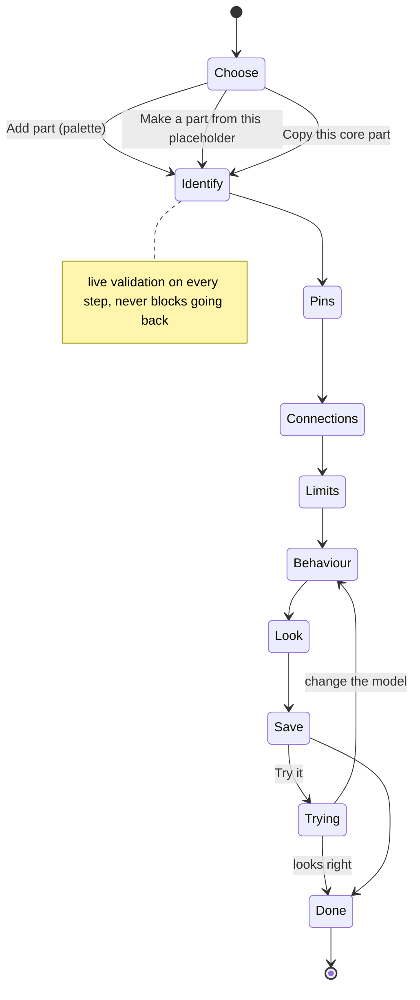
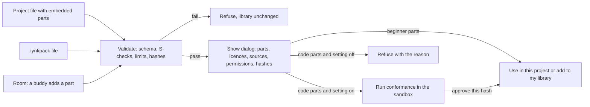

# Component ecosystem

Status: specification, first pass, 2026-10-27. Scope: BRIEF §9 (component and hardware ecosystem) and red-team question 19
(hidden licensing risk in imported component data), written for the build reframe (D-013 to D-017): a complete open-source lab
that Amar uses with his friends. Nothing here assumes customers, a store or a market.

Evidence labels follow the brief: VERIFIED (I read or counted it in this pass), DOCUMENTED (a project document says so),
EXTERNAL, ESTIMATED (with assumptions), HYPOTHESIS, UNKNOWN. A choice that waits for a spike is marked **PENDING RS-xx**.
This is a product specification. The data format, the loader checks and the sandbox ABI are defined in
[`../04_ARCHITECTURE/COMPONENT_SCHEMA.md`](../04_ARCHITECTURE/COMPONENT_SCHEMA.md) (cited below as CS) and are not repeated here.

## 1. Result in one page

The library is a set of `component.json` descriptors (CS 4). This file decides how many, which ones, in what order, how a person
makes their own, how every part says where its numbers and files came from, and how parts move between friends.

| Id | Decision | Status |
|---|---|---|
| CE-01 | The first complete library (end of the PARTS phase) is **85 descriptors**: 46 carried over from today's catalogue (VERIFIED count, section 3.3) and 39 new (PROPOSAL, section 3.5). Boards are 12 of the 46 | PROPOSAL, Amar may cut or reorder at the phase stop |
| CE-02 | A part is "supported" only when it passes the PARTS gate (section 3.1): descriptor valid, fallback art renders, at least one test against a source, licence and sources filled, status honest. A part that fails is not shown in the default palette | PROPOSAL |
| CE-03 | A part may be in the library with status `not-modelled-yet` (it places, wires and goes in the BOM, the simulator says so). 20 of the 39 new parts start there unless the simulation phase has delivered the element or protocol they need (section 3.5) | Follows R-FID-2 |
| CE-04 | The custom part editor is one tool, called **Part Maker** here, with two modes. Beginner mode is on by default and runs no code. Advanced mode (code parts) is off until the person turns on "code parts" in settings, and ships as data only (option F) until the Components-phase Worker-kill prototype passes. RS-15 never ran. Studio does not wait for it | CS 9.1, 9.6 decision; RS-15 not run |
| CE-05 | Core data is cleared before publishing, not after. The repo already contains geometry taken from manufacturer and open-hardware CAD files and board text copied from a figure (section 6.2). Each source gets a licence record, and geometry is re-derived where the licence is share-alike or unknown | Follows D-017, R-015, R-016 |
| CE-06 | No bulk import of third-party part libraries (Fritzing, KiCad, vendor SPICE models, reseller footprints) in any phase planned here. A one-off import lands as an `imported-pack`, never in `core`, with the source licence on every file | PROPOSAL |
| CE-07 | Sharing parts with buddies uses three routes that share one validation path: the project carries the descriptors it needs, a `.iynkpack` file, or a room. There is no public marketplace, no publisher verification service and no moderation queue (D-013, F-103 out of scope) | CS ADR-0207 |
| CE-08 | Quality labels are mechanical facts computed by the loader (schema valid, tests pass, code yes or no, permissions, third-party content). No label says "validated", "certified" or "verified" (D-007) | CS 9.10, R-FID-1 |
| CE-09 | Instruments that appear as panels (oscilloscope, logic analyser, serial plotter) are not parts. Only the multimeter figure is carried as a part. This differs from how the descriptor category list reads (Objection 2) | PROPOSAL |
| CE-10 | The drone and robotics part libraries are built in their own phases, from real part descriptors with datasheet sources. The 114 drone option rows copied from a third-party site are replaced, not migrated (section 6.2, row 6) | PROPOSAL |

## 2. Upstream and downstream

| Direction | Item |
|---|---|
| Brief | §9.1 library, §9.2 specifications, §9.3 custom editor, §9.4 marketplace (cut down to buddy sharing), §17 (BOM needs MPNs), question 19 |
| Decisions | D-007, D-010, D-011, D-013 to D-017 (`00_EXECUTIVE/DECISION_REGISTER.md`). Shelved and not used: D-001, D-003, D-004, D-008, D-009 |
| Contract documents | CS and `schemas/component.schema.json`; `PROJECT_DATA_MODEL.md` 5.3 and ADR-0107 (parts referenced as `{ref, version}` with a pinned interface, origins `builtin`, `library`, `embedded`); `SIMULATION_ARCHITECTURE.md` 4.1 (tiers), 9.2 (data-only devices), 16 (fidelity registry) |
| Audit | `01_AUDIT/inventory/figure-engine.md` (part contract, solver elements), `01_AUDIT/REPOSITORY_INVENTORY.md` (licence, drone constants), `01_AUDIT/TECHNICAL_DEBT.md` B2-08, B3-02, `01_AUDIT/SECURITY_BASELINE.md` X3 |
| Research | `02_RESEARCH/COMPETITOR_LANDSCAPE.md` section 5 (licence-checked open source), `02_RESEARCH/tech/platform-options.md` section 5 (sandboxes), `02_RESEARCH/TECHNICAL_RESEARCH.md` D8, section 6 row 16 |
| Spikes | RS-08 (solver DC only; realistic devices off by 7 to 230 percent in places), RS-13 PASS, RS-03 PASS, RS-06 pass clause not met, fail clause not triggered. RS-15 has no `REPORT.md` (checked: `08_RESEARCH_SPIKES/` holds RS-01, 03, 06, 08, 09, 12, 13) |
| Features | F-096, F-097, F-098, F-099, F-101, F-102, F-104, F-220 (this phase); F-103 and F-100 out of scope; F-076, F-083, F-089, F-090, F-160, F-162, F-197 (neighbours); F-213, F-216 (later part libraries) |
| Requirements | R-028, R-029, R-030, R-072, R-131 to R-138, R-014 (CONTRIBUTING "how to add a part"), R-015, R-016, R-FID-1 to R-FID-3 |
| Journeys | J-04 add and wire components, J-08 share with a friend, J-11 import, J-06 meet a simulated fault (failure modes come from descriptors). J-14 "Make and use a custom part" (`USER_JOURNEYS.md`) is the journey for "make a part"; section 5.2 is its walk |
| Priority classes (`FEATURE_PRIORITIZATION.md`) | F-097 REQUIRED FOUNDATION; F-098 CORE WORKFLOW; F-096, F-101, F-104 NEAR-TERM; F-220 LATER; F-102 LONG-TERM RESEARCH. This file does not move any of them |
| Downstream | Studio palette and inspector, BOM export, the AI partner's `find_parts`, the robot and drone builders, the PARTS gate in the roadmap |

## 3. Library scope

### 3.1 What "a supported part" means

The unit of scope is the descriptor, not the drawing. A part is **supported** when all of these hold. The same list is the PARTS
gate (R-131 to R-138) and the review checklist for a pull request that adds a part.

| # | Check | Source of the rule |
|---|---|---|
| 1 | Descriptor validates against the schema and passes S-01 to S-09, S-11, S-13, S-14 | CS 6.1, 6.2 |
| 2 | `visual.fallback` is present, and the fallback render covers every pin | CS 4.13 (the render test is "a test to write; not run") |
| 3 | `simulation.status` is set; if not `not-modelled-yet`, `what_it_models` and at least one test exist, none `to-write` | CS 4.11, R-131 gate |
| 4 | At least one test against a source: `datasheet-point`, `ngspice-comparison`, `bench-measurement` or `golden-trace` (REF-6). If none can exist yet, the part is `partly-modelled` and the gap is stated | `PRODUCT_REQUIREMENTS.md` PARTS gate |
| 5 | `sources[]` has an entry for every number a user can see; a non-generic part has a datasheet, schematic, product page or reseller guide | CS 4.3 |
| 6 | `provenance.license` set, `third_party_content` set, every `sources[].license` filled when the source gave files or text (this file, 6.3) | R-138, D-017 |
| 7 | Copy check passes: none of the banned words in `what_it_models` and `not_modelled` | R-FID-1 |
| 8 | Name, description and every pin name have an `i18n_key` and `en` text. Core parts carry keys for the six languages | K-I18N |

A part that fails 1 to 7 loads (so old projects open) but is hidden from the default palette and shown under a "Needs work"
filter in a maintainer build. This is a rule for core parts. A person's own parts are never hidden from them.

### 3.2 Waves

The waves follow the D-014 order. A wave ends at a phase stop where Amar can cut or reorder.

| Wave | Phase (D-014) | Contents | Count |
|---|---|---|---|
| W0 Seed | Project core (M1) | The parts R-029 names for the first Studio: Uno R3, LED, resistor, push button, piezo buzzer, potentiometer, one I2C display (SSD1306 or 1602, chosen at phase start), plus the breadboard (R-055 and `PRODUCT_REQUIREMENTS.md` line 653 make it a part whose `groups[]` give strip connectivity) | 8 |
| W1 Boards | Studio editor | The other 11 board profiles (R-072 order: Nano, Uno R4, Pico, ESP32 DevKitC, ESP32-S3, NodeMCU, micro:bit V2, Nucleo F401RE, Pi 4/5, Basys 3, DE10-Lite) | 11 |
| W2 Carry-over | Components (PARTS) | Everything else the existing labs use: the 16 other part figures and the 11 other module pages (the 46 in section 3.3 less W0 and W1) | 27 |
| W3 New | Components (PARTS) | The 39 new parts in section 3.5, in three batches (3.8) | 39 |
| W4 Phase-bound | Robotics, Drones | Section 3.7 | not counted yet |
| W5 On demand | After | Anything Amar's own builds need (R-136 checklist, issue template for "request a part") | open |

W0 + W1 + W2 = 8 + 11 + 27 = 46, which is the carry-over total. W3 adds 39, so the PARTS release holds 85 descriptors.

#### 3.2.1 Canonical ids for W0 and W1

This is the one place the first-wave ids are fixed. `PROJECT_DATA_MODEL.md` 5.3, ADR-0107 and the files in `schemas/examples/` must use exactly
these ids (the rule is `core.<slug>`, lower case, hyphens). Only `core.led-5mm` exists as a descriptor today
(`04_ARCHITECTURE/schemas/examples/components/led-5mm.component.json`); the rest are PROPOSAL until their descriptors land.

| Wave | Part | Canonical id | Notes |
|---|---|---|---|
| W0 | Arduino Uno R3 | core.uno-r3 | Same as the examples. |
| W0 | 5 mm LED | core.led-5mm | Descriptor exists. |
| W0 | Resistor | core.resistor | One descriptor; `ohms` is a `parameter` (as `lesson-uno-r3-button.project.json` and `env-monitor-esp32.project.json` already use it). |
| W0 | Push button | core.push-button-6mm | As the examples. |
| W0 | Piezo buzzer | core.buzzer-piezo | PROPOSAL; row 23 (`core.buzzer-active`) is a different part. |
| W0 | Potentiometer | core.potentiometer | PROPOSAL. |
| W0 | I2C display | core.ssd1306-i2c-128x64 | Decided here: SSD1306 128x64 I2C, so the "SSD1306 or 1602" choice in 3.2 is closed. The 1602 stays row 31 (`core.lcd-1602`). |
| W0 | Half breadboard | core.breadboard-half | As the examples. |
| W1 | ESP32 DevKitC | core.esp32-devkitc | As the examples; board `figures/boards/esp32-devkitc.js`. |
| W1 | Nano | core.nano | PROPOSAL. |
| W1 | Uno R4 | core.uno-r4 | Minima and WiFi: descriptor or `parameter` is UNKNOWN (3.3). |
| W1 | Pico | core.pico | Same note for Pico W and 2. |
| W1 | ESP32-S3 DevKitC-1 | core.esp32-s3-devkitc-1 | |
| W1 | NodeMCU | core.nodemcu | |
| W1 | micro:bit V2 | core.microbit-v2 | |
| W1 | Nucleo F401RE | core.nucleo-f401re | |
| W1 | Raspberry Pi 4 and 5 | core.pi4-pi5 | |
| W1 | Basys 3 | core.basys3 | |
| W1 | DE10-Lite | core.de10-lite | |

The W3 ids that examples touch are fixed by the same rule: the BME280 I2C module is `core.bme280-module` (row 16) and the bench DC supply is
`core.supply-bench-dc` (row 37). The examples currently say `core.bme280-breakout` and `core.bench-supply`; they must change to these, not the
other way round, because the rows here carry the model route and the fidelity status. The canonical ids are also the `Id` column of 3.5.

### 3.3 What carries over (VERIFIED by listing `figures/`, `src/content/ids.ts`)

| Source | Count | Items |
|---|---|---|
| `figures/boards/*.js` | 12 | uno-r3, nano, uno-r4, esp32-devkitc, esp32-s3-devkitc-1, nodemcu, pico, nucleo-f401re, microbit-v2, pi4-pi5, basys3, de10-lite (`BOARD_IDS`, `src/content/ids.ts:8-21`) |
| `figures/parts/*.js` | 29 files | 21 in `PART_IDS` (`ids.ts:76-98`), plus `breadboard`, `wire`, and six files that share an id with a module page: `hc-sr04`, `mpu6050`, `soil-moisture`, `ssd1306`, `traffic-light`, `uln2003` |
| `figures/modules/*.js` | 12 | tb6612fng, l298n, a4988, pca9685, mpu6050, hc-sr04, qtr-8rc, lm2596, uln2003, ssd1306, traffic-light, soil-moisture (`MODULE_IDS`, `ids.ts:59-72`) |
| Register-level device models | 6 classes | `Mpu6050`, `Pca9685`, `Ssd1306`, `Lcd1602`, `GenericI2C`, `HcSr04` in `src/lib/interp/devices.ts` (lines 21, 104, 173, 212, 242, 261). `Lcd1602` has a model and no figure |
| Drone options | 38 + 38 + 38 labels | Distinct `label` strings of batteries, motors and props across the 13 files in `src/content/drones/` (my count; one label can hide different numbers in two craft). Plus 9 fixed part types per craft (FRAME, ESC, FC, CAM, VTX, RX, XT60, TOP, STRAP, `quad5.ts:92-102`) |

Distinct physical items = 12 boards + 21 parts + `breadboard` + 12 modules = **46**. `wire` is not a part: a wire is a project object, not a
descriptor. The six duplicated files are the same physical item drawn twice (one for the breadboard, one as a module page), so they
count once. Which of the two figures a descriptor's `visual.breadboard.figure` names is open (the MPU-6050 example names the module page,
`schemas/examples/components/mpu6050-gy521.component.json`, while `figures/parts/mpu6050.js` also exists). One descriptor needs two
figure references, or a rule for which one the palette uses. See Objection 3.

By category (the §9.1 list). "Carry-over" is VERIFIED; "new" is the proposal in 3.5; "later" is a direction, not a plan.

| §9.1 category | Schema `category` | Carry-over | New in PARTS | Later | Notes |
|---|---|---|---|---|---|
| Microcontrollers (bare chips) | microcontroller | 0 | 0 | 1 to 2 on demand | A bare ATmega328P on a breadboard is the likely first one (the T3 engine models that chip, RS-03). HYPOTHESIS that Amar wants it |
| Development boards | dev-board | 10 | 0 | on request (R-136) | uno-r3, nano, uno-r4, esp32-devkitc, esp32-s3, nodemcu, pico, nucleo-f401re, microbit-v2, pi4-pi5. Variants (R4 Minima and WiFi, Pico, W and 2, Pi 4 and 5) are profiles in `src/lib/interp/profiles.ts`; whether each is its own descriptor or a `parameter` is UNKNOWN (CS section 14: "whether the 11 board descriptors need a `base` or `family` mechanism") |
| Basic electronic components | passive, semiconductor | 8 (3 + 5) | 14 (5 + 9) | grows with builds | Carry-over: resistor, potentiometer, push-button; led, rgb-led, diode-1n4007, npn-2n2222, tip120 |
| Sensors | sensor | 7 | 6 | grows with builds | ldr, tmp36, fsr402, hc-sr04, mpu6050, qtr-8rc, soil-moisture |
| Actuators | actuator | 7 | 3 | grows | piezo-buzzer, dc-motor, fan, servo-sg90, stepper-28byj48, nema17, tt-motor |
| Motor drivers | motor-driver | 5 | 2 | few | tb6612fng, l298n, a4988, uln2003, pca9685 (a PWM servo driver, filed here because the benches use it that way) |
| Power components | power | 3 | 5 | few | lm2596, lipo-2s, aa-holder-4 |
| Displays | display | 2 | 4 | few | ssd1306, traffic-light (three LEDs; filed under display for lack of a better category) |
| Communication modules | communication | 0 | 2 | few | Both new ones are placeable but not simulated at first |
| Mechanical assemblies | mechanical | 1 | 0 | with ROBOT | breadboard. Chassis, brackets, wheels belong to robotics |
| Robotics parts | robotics | 0 | 0 | about 10 (ESTIMATED, 3.7) | Phase-bound |
| Drone components | drone | 0 | 0 | see 3.7 | Phase-bound |
| FPGA-related | fpga | 2 | 0 | on request | basys3, de10-lite (boards with their own switches, LEDs and displays; those are board features, not separate parts) |
| Measurement instruments | instrument | 1 | 0 | none as parts | multimeter. See CE-09 and Objection 2 |
| Custom virtual components | virtual | 0 | 3 | unlimited, local | Bench DC supply, USB 5 V supply, pulse generator. Everything a person makes in Part Maker is also "virtual" in the sense of having no real part behind it unless they fill `identity.mpn` |
| **Total** | | **46** | **39** | | **85 at the PARTS release** |

### 3.4 Carry-over disposition: preserve, extend or replace

Per BRIEF §3.5 and the audit. Nothing is deleted until a replacement is measurably better.

| Subsystem | Verdict | Why |
|---|---|---|
| The 80 built figure pages (38 item, 12 module, 29 part, 1 flight range) and the hand-inked art | **Preserve** | Deterministic build, working, byte-identical rebuilds (`figure-engine.md`). Descriptors point at them. Only core parts may point at a figure page (CS 4.13) |
| `elec(p)`, `model`, `step` inside `figures/parts/*.js` | **Extend** | Parameters move into the descriptor with sources; the solver and its 126 tests stay (CS section 3) |
| Pin geometry repeated in figure code and docs | **Extend** | The descriptor owns pins and positions; `cfbuild.py` already has a `@cf data` directive to inline JSON, so a figure reads its pins from the descriptor |
| `docs/facts/*.md` (35 files) | **Preserve** | Long-form evidence. Descriptor `sources[]` cite them with sections (F-099) |
| Register-level device classes in `devices.ts` | **Preserve and reference** | They become `builtin` models (`device:i2c/mpu6050@1`); constants move to descriptor parameters |
| Closed id unions (`BoardId`, `PartId`, `ModuleId`) | **Replace** (R-030) | Ids become registry strings; the unions stay only for catalogue items bound to figure files until LABS moves them |
| The 3 x 3 x 3 drone dropdowns (`src/lib/drone/design.ts:5-31`, `designInput` throws on unknown keys) | **Replace in DRONE** | F-216 and F-073 need real descriptors for motors, props, batteries |
| Palette search over the closed catalogue | **Replace** | A generated `public/parts/index.json` (id, version, name, category, tier, status, bytes, sha256) lets the palette search without loading descriptors (CS 4.1) |

### 3.5 The 39 new parts (PROPOSAL)

Selection rule: a part is on the list if (a) it is common in beginner and intermediate Uno, ESP32 and Pico projects of the kind the existing
lessons teach, (b) it is needed beside a part already in the catalogue (a Schottky or signal diode beside a motor driver, a regulator beside the
LM2596 module), or (c) it exercises a solver element or a protocol the simulation phase adds, so the new element has a user.
Nothing here comes from demand data. No user has been interviewed, so the list is a HYPOTHESIS about what Amar and his friends build; the
issue template "request a part" (R-014) is how the list changes. Ids are proposals.

"Needs" is the solver element (CS 4.9 enum: the first twelve exist today, the rest are planned) or the protocol the part needs. "Status if
missing" is what the part shows when the simulation phase has not delivered it. It is always an allowed state. "n/a" means the part is ready and nothing is missing.

| # | Id | Part | Category | Model route | Needs | Status when ready | Status if missing |
|---|---|---|---|---|---|---|---|
| 1 | core.capacitor-ceramic | Ceramic capacitor | passive | element | `capacitor` (planned) | T1 partly-modelled | not-modelled-yet |
| 2 | core.capacitor-electrolytic | Electrolytic capacitor | passive | element plus scripted failure | `capacitor`; reversed-polarity rule exists as a rule (`bench.js` about line 295) | T1, polarity failure `scripted` | not-modelled-yet |
| 3 | core.inductor | Inductor | passive | element | `inductor` (planned) | T1 | not-modelled-yet |
| 4 | core.switch-slide | Slide or toggle switch | passive | element | `switch` (planned) | T1 | not-modelled-yet |
| 5 | core.thermistor-ntc-10k | 10 k NTC thermistor | passive | element `sensor` plus `physical_input` | `sensor` (exists), channel `temp_c` | T1 | n/a |
| 6 | core.diode-1n4148 | Signal diode | semiconductor | element `diode` | exists | T1 | n/a |
| 7 | core.diode-1n5819 | Schottky diode | semiconductor | element `diode` | exists | T1 | n/a |
| 8 | core.zener-1n4733a | 5.1 V Zener | semiconductor | element | `zener` (planned) | T1 | not-modelled-yet |
| 9 | core.pnp-2n2907 | PNP transistor | semiconductor | element | `pnp` (planned) | T1 | not-modelled-yet |
| 10 | core.mosfet-irlz44n | Logic-level N-MOSFET | semiconductor | element | `mosfet_n` (planned) | T1 | not-modelled-yet |
| 11 | core.opamp-lm358 | Op-amp | semiconductor | element | `opamp` (planned) | T1 | not-modelled-yet |
| 12 | core.timer-ne555 | 555 timer | semiconductor | builtin or subcircuit | transient and comparators | not decided | not-modelled-yet |
| 13 | core.optocoupler-pc817 | Optocoupler | semiconductor | subcircuit (LED, current-controlled source) | `led`, controlled source | T1 candidate (HYPOTHESIS that a current transfer ratio is enough for teaching) | not-modelled-yet |
| 14 | core.shift-register-74hc595 | Shift register | semiconductor | builtin digital behaviour | digital signal engine (sequential logic is not a truth table, CS 9.2) | T1 | not-modelled-yet |
| 15 | core.dht22 | Temperature and humidity sensor | sensor | protocol | single-wire protocol (not modelled, `SIMULATION_ARCHITECTURE.md` 9.3 covers I2C, SPI, UART and 1-Wire "not modelled yet") | T1 if the protocol lands | not-modelled-yet |
| 16 | core.bme280-module | Pressure, temperature, humidity (I2C) | sensor | `device:i2c/bme280@1` register device | I2C data-only device route (SIM 9.2) | T1 | n/a |
| 17 | core.pir-hc-sr501 | PIR motion sensor | sensor | digital output driven by a world channel | `sensor`, channel `motion` | T1 | n/a |
| 18 | core.encoder-ky040 | Rotary encoder | sensor | digital quadrature outputs from a world input | digital engine | T1 | n/a |
| 19 | core.joystick-analog | Analog joystick | sensor | subcircuit: two `pot` and one `button` | exists | T1 | n/a |
| 20 | core.ir-obstacle-module | IR obstacle sensor | sensor | digital output from a world channel | exists | T1 | n/a |
| 21 | core.relay-module-5v | Relay module | actuator | element `switch` driven by a coil threshold | `switch` (planned) | T1 | not-modelled-yet |
| 22 | core.servo-mg996r | Large servo | actuator | element `servo` with its own parameters | exists | T1 | n/a |
| 23 | core.buzzer-active | Active buzzer | actuator | element `buzzer` | exists | T1 | n/a |
| 24 | core.drv8833-module | Dual H-bridge | motor-driver | builtin bridge, same family as the L298N | exists after the L298N load is read from the attached motor (CS 4.11) | T1 | n/a |
| 25 | core.l293d | Dual H-bridge, DIP | motor-driver | builtin bridge | same | T1 | n/a |
| 26 | core.regulator-lm7805 | 5 V linear regulator | power | builtin `power:linear-regulator@1` | exists as rules (`bench.js` about lines 225 to 290) | T1 | n/a |
| 27 | core.regulator-ams1117-3v3 | 3.3 V LDO | power | builtin `power:linear-regulator@1` | same | T1 | n/a |
| 28 | core.boost-mt3608 | Boost converter module | power | none | switching converter | none | not-modelled-yet |
| 29 | core.charger-tp4056 | LiPo charger module | power | none | charge controller | none | not-modelled-yet |
| 30 | core.battery-9v | 9 V battery | power | element `voltage_source` with internal resistance | `voltage_source` (planned; rails with `RAIL_R` exist) | T1 | not-modelled-yet |
| 31 | core.lcd-1602 | 16 x 2 character LCD | display | `device:` model that already exists (`Lcd1602`, `devices.ts:212`) | exists; no figure, so the fallback renderer is the art | T1 | n/a |
| 32 | core.seven-segment-1digit | One-digit seven-segment display | display | subcircuit of eight `led` | exists | T1 | n/a |
| 33 | core.ws2812b-ring-8 | Addressable LED ring | display | protocol | single-wire timing | T1 if it lands | not-modelled-yet |
| 34 | core.max7219-matrix | 8 x 8 LED matrix (SPI) | display | SPI device | SPI device model (SIM 9.3: "a registered device is required") | T1 | not-modelled-yet |
| 35 | core.hc-05 | Bluetooth serial module | communication | UART device | UART to one device model | T1 | not-modelled-yet |
| 36 | core.nrf24l01 | 2.4 GHz radio module | communication | SPI device | SPI device model | none (a radio link between two simulated boards is not planned) | not-modelled-yet |
| 37 | core.supply-bench-dc | Bench DC supply | virtual | element `voltage_source` with current limit | planned | T1 | not-modelled-yet |
| 38 | core.supply-usb-5v | USB 5 V supply | virtual | rail with the 500 mA limit the boards use today (`ilim`) | exists | T1 | n/a |
| 39 | core.generator-pulse | Pulse generator | virtual | digital source (frequency, duty) | digital engine | T1 | n/a |

Counts, by my reading of the CS 4.9 enum and `SIMULATION_ARCHITECTURE.md` 4.2, 9.3 (nothing was run): **18 ready** (rows 5, 6, 7, 16 to 20, 22
to 27, 31, 32, 38, 39). They use elements that exist today or the orchestrator, digital engine, I2C data-only device route and bridge-load work
that D-014 schedules before PARTS. **20 waiting** (rows 1 to 4, 8 to 12, 14, 15, 21, 28, 29, 30, 33 to 37). They need an element the enum marks
"planned" or a protocol the simulation architecture marks "not modelled yet". **1 undecided** (row 13). 18 + 20 + 1 = 39.

The 20 matter. D-014 puts simulation fidelity before components, so the transient and device slices ought to have run by then. If they have
not, the library still ships and says "not modelled yet" for those parts (R-FID-2). A library where almost half of the new parts cannot be
simulated is worse than a smaller one, so the batches in 3.8 put the simulatable parts first.

### 3.6 Boards

Twelve boards are 14 percent of the PARTS release by count and probably the most work per descriptor (HYPOTHESIS), because a board
descriptor carries a profile, a language, a starter and its fidelity entry (R-072). Rules for boards:

- A board is a descriptor with `kind: board` (CS 4.4, 10) and a `builtin` runtime ref (the interpreter, `avr8js`, the MicroPython interpreter,
  the Verilog cycle simulator). The Pico stays on the TypeScript MicroPython interpreter (RS-06 pass clause not met, fail clause not triggered) and the Pi 4 and 5
  stay labelled "Raspberry Pi API mock" (R-146).
- The Uno R3 is first. The others follow the R-072 order, each with one starter that runs.
- A board's silkscreen text and logos are art. Section 6.2 row 5 lists what the Pi 4 figure copies.

### 3.7 Robotics and drone parts (phase-bound)

| Phase | Parts | What exists | Plan |
|---|---|---|---|
| ROBOT (F-213) | Chassis (2 and 4 wheel), wheel, caster, motor mount, encoder disc and slot sensor, joint, link, gearbox, battery tray. About 10 descriptors (ESTIMATED from the F-213 text "chassis, wheels, joints, motors, drivers, controller and sensors"; no inventory was taken) | Motors (dc-motor, tt-motor, servo-sg90, stepper-28byj48, nema17), drivers and sensors from 3.3. No mass, inertia, friction or torque curve in any descriptor | Needs the `mechanics` block CS section 10 defers until RS-13 (PASS) and RS-14 settle the model forms. Add it in a minor of schema 1 |
| DRONE (F-216, F-073) | Frame, motor, propeller, ESC, flight controller, battery, GPS, camera, VTX, receiver | 38 + 38 + 38 distinct option labels and 9 fixed types, inline in TypeScript | Replace with datasheet-backed descriptors (6.2 row 6). Needs the thrust-and-current tables and the battery discharge curve block CS section 10 lists as missing |

Both phases wait on schema additions that CS names and does not specify. This file does not specify them either (UNKNOWN until RS-14 reports).

### 3.8 Build order inside the PARTS phase

| Batch | Contents | Count | Exit |
|---|---|---|---|
| 1 | Remaining carry-over (W2) | 27 | R-131 gate: each has a descriptor, figures still render, tests REF-6 |
| 2 | The 18 ready new parts (3.5) | 18 | Each passes 3.1 |
| 3 | The 20 waiting new parts, and row 13 once decided | 20 (plus row 13) | Each is added as `not-modelled-yet` first, then raised when its element lands. A raise is a minor or major version per CS 4.16 |

Effort per descriptor: UNKNOWN. The conversion pass timed three parts and did not publish a time (CS section 14: "Conversion effort for the
remaining 26 parts, 9 modules, 12 boards: UNKNOWN, time one more round with the draft tool"). Do that before planning batch dates.

### 3.9 Size and speed (D-011)

| Item | Value | Label |
|---|---|---|
| One descriptor, minified | 12.0, 24.0 and 28.8 KB for the LED, MPU-6050 module and L298N module | MEASURED (CS 4.1) |
| Whole library, 85 descriptors, raw | About 1.3 MB (85 x 15 KB average) | ESTIMATED; the average is a guess from three examples, one of them a simple part |
| `public/parts/index.json`, 85 entries | About 17 KB raw (200 bytes per entry) | ESTIMATED |
| Palette first paint | Reads only the index. A descriptor loads when its part is placed or its page opens | Rule, not measured |
| Validation of a 256 KiB descriptor | UNKNOWN. Run it in the worker host, not on the main thread, until measured | K-PERF |

## 4. Part pages, quality labels and verification

### 4.1 The part page

Every part has a page (also a panel in the inspector) that renders the descriptor and nothing else. It does not hold facts of its own.

| Block | Reads from | Shown |
|---|---|---|
| Header | `identity`, `version`, `simulation.tier`, `simulation.status` | Name, maker and model (or "generic"), version, tier chip (T0 to T3, none), status |
| What it models | `what_it_models[]`, `not_modelled[]`, `validity[]`, `known_gaps[]` | Three lists: modelled, mocked or not modelled yet, and the ranges checked. Each gap links to its evidence (file and line) |
| Ratings | `ratings` with three slots | Side by side: "Stated by the maker", "iynk's assumption", "Bench-measured", with the slot the simulation reads marked (CS 4.6, AC-CS-14) |
| Failure modes | `failure_modes[]` | Threshold, how it was derived, and whether it is computed or "scripted, not computed" (AC-CS-13) |
| Compatibility | `compatibility.rules[]` | Plain-language rules (logic level, pull-ups, address) |
| Sources | `sources[]` | Title, publisher, retrieved, reliability, licence, link. Links are shown, never fetched (CS 8 item 2) |
| Provenance and licence | `provenance` | Licence, who made it, origin (core, mine, from a buddy), third-party content yes or no, review status |
| Labels | Computed (4.2) | Mechanical facts |

### 4.2 Quality labels (computed, never typed)

| Label | Computed as | Notes |
|---|---|---|
| Schema valid | Loader result | Always true for an installed part |
| Has tests, tests pass | Count of `tests[]` and last run in the browser or CI | "passed 7 of 8" style, never "validated" |
| Has reference test | At least one test of a source-backed kind (REF-6) | |
| Tier and status | `simulation` | From CS 4.11 |
| Bench-measured | At least one `measured` slot with `method`, `samples`, `date`, or a `bench-measurement` test | Wording: "bench-measured". It says how many ratings, not that the part is right |
| Code | `behaviour` has an `extension` layer | With the permission list |
| Third-party content | `provenance.third_party_content` | Lists every part still waiting on the D-017 check |
| Reviewed | `provenance.review.status` | A statement about process only |
| Works with this solver | `solver_requires` against the running solver | If not, the part shows "not modelled yet" |

Banned words in labels and in `what_it_models`: validated, verified against hardware, certified, accurate, exact, real, safe to build (R-FID-1,
`SIMULATION_ARCHITECTURE.md` 4.1 rule 5).

### 4.3 Verification levels

Three ladders, kept apart so none can borrow the credit of another.

| Ladder | Rungs | Who moves a part up |
|---|---|---|
| Model fidelity | none, T0, T1, T2, T3 | The fidelity registry CI, from tests (CS 4.17, ADR-0208). A descriptor never states a result |
| Evidence for numbers | `unverified`, `secondary`, `primary` per source; per rating, slots filled | The author, by citing a document they read |
| Bench check | none, `measured` slots present | Amar, with a real part and a meter (R-130 does this for 10 faults on a Uno) |

A bench measurement in Part Maker is a form: the person picks a rating, enters the value, the instrument, the method, the number of samples and
the date, and may attach a photo as a `photo` source. It writes the `measured` slot and, if the person wants, a `bench-measurement` test. CS
section 10 notes that a bench-report file format is not specified. The form is the format until a need for batch import appears.

## 5. The custom component editor as a product

### 5.1 Why a person makes a part, and who

Today a new part needs a new `.js` file, a Python rebuild of a committed HTML and a redeploy (`figure-engine.md` finding 2). Amar and his
friends will meet parts the library lacks, usually a breakout board with a chip that has no model. Competitor evidence: Wokwi's custom-chip API
is for programmers (C or WebAssembly, beta) and no free no-login tool in the benchmark made custom parts easy for a beginner
(`COMPETITOR_LANDSCAPE.md` section on custom parts; the "easy for nobody" reading is a HYPOTHESIS because neither Wokwi's nor Falstad's feature was run).

### 5.2 Entry points and the journey

| Entry | What it starts from | Why |
|---|---|---|
| Add part | Blank | The base case |
| Make a part from this placeholder | An R-028 "unknown part" placeholder, whose pins already exist from the wires that touch it (ADR-0107) | A project from a buddy that lacks a part can be repaired in place |
| Copy this core part | The core descriptor copied into the `local` namespace, with its sources kept and an attribution line added | The usual need is a variant: the same chip with another pin order |

Copying needs a field the schema lacks to record where a part came from (Objection 4). Until it exists the editor writes an `attribution[]`
entry naming the source `id@version`.

### 5.3 Beginner mode, step by step

The seven steps are CS 9.2. Product details added here:

| Step | Screen | Required | Keyboard and touch path | Errors the person can hit |
|---|---|---|---|---|
| 1 Identify | Name, category (the §9.1 list in plain words), one-line description | Name | Plain form | Empty name; a slug that clashes with an installed `local.*` part |
| 2 Pins | A body preview. Presets: two-lead, DIP with N pins, header module with N pins at 2.54 mm, terminal block, box. Per pin: name, type from 13 plain-language choices, and the position | At least one pin; at most 32 | Positions can be typed (x, y in mm) as well as dragged, so a drag is never the only path (WCAG 2.5.7, K-A11Y) | Two pins with one name; pin outside the body; pin type missing |
| 3 Connections | Tick pins that are one net inside the part (a breakout's two GND pads) | None | Checkbox list | A group of one pin |
| 4 Limits | Supply range, pin voltage max, current max (only the limits that fit the pin types chosen) | None | Number fields with unit chips; base units are stored, prefixes are shown (CS 4.2) | Min above max; a value outside a sane range for the unit |
| 5 Behaviour | The four templates of CS 9.2 | One template | Radio group | Truth table over 256 rows; an input combination listed twice |
| 6 Look | Size, body colour, label, optional SVG or PNG | None (fallback is used) | File input | Art that fails the sanitiser (script, `foreignObject`, external reference, over the size cap) |
| 7 Licence and save | Licence (default `LicenseRef-local-private`), authors, sources | Licence | Plain form | Unknown SPDX string |

Rules the editor enforces, taken from CS 9.2 and 4.6 so the file it writes is honest:

- Limits the person types go into the **simulation** slot with `rationale` "set by you, not checked against a datasheet" and `confidence: low`.
- If the person ticks "this is from a datasheet", the value moves to the **manufacturer** slot and a source form opens (title, page, link, and
  one question: "Did you read the maker's own document?", which sets `reliability` to `primary` or `secondary`). No source, no manufacturer slot.
- `simulation.tier` is `T1`, `status` is `partly-modelled`, `not_modelled` is pre-filled with "everything this form does not set".
- Limits: 32 pins, 64 parameters, 256 truth-table rows. Beginner mode cannot write `builtin` or `extension` layers.

**Try it.** The CS 9.8 test format (`iynk.parttest/1`) needs a wiring and an expected value. The editor asks for one example ("with 5 V on
VCC and 1 kohm to GND, OUT should be about 4.5 V"), shows it as a live mini circuit using the normal solver, and writes it as the part's
generated golden-trace test so REF-6 holds. This is the one place the editor goes beyond CS 9.2's table; it uses the same test file, so it adds
no format. HYPOTHESIS that a worked example is the thing that makes a beginner trust the part. Test it with the first friend who makes one.

What the beginner mode cannot express, and what the person is told: sequential logic (flip-flops, counters, state machines), analog behaviour
beyond the element templates, buses. The editor says "needs advanced mode or a built-in model" and offers "Save as not modelled yet", which
still gives a placeable, wireable part with an honest label. The common missing case is a register-map I2C sensor. Simulation architecture 9.2
makes such devices data, and nothing in the descriptor lets a beginner write one (Objection 5).

### 5.4 Where custom parts live

| Place | Contents | Source |
|---|---|---|
| IndexedDB store `parts`, key `id@version` | Descriptors and art | CS 4.1 |
| `parts/` folder inside the project folder on disk | The same files, in the person's project directory | D-015, ADR-0106 |
| Project export | Embeds descriptors of non-core parts the project uses | CS 4.1; `.iynkz` keeps them under `definitions/` |

A saved version is immutable. Editing a part and saving makes a new version (patch for text, art and sources; minor for new optional data; major
for pins or anything a model reads, CS 4.16). Projects keep the version they pinned. Upgrading is an explicit action that shows the diff
and the golden-trace differences (AC-CS-06). The editor shows the right bump and does not offer a patch for a change that is a major.

### 5.5 Advanced mode (code parts)

**Status: off by default; ships as option F (data only) until the Components-phase Worker-kill prototype passes (RS-15 and RS-15b never ran, no `REPORT.md`).** A pass moves option A or B to opt-in; a fail on all options cuts F-102. Decision rule is CS 9.6 and is not restated. The rest of this section is the product around it and
holds whichever container wins.

| Piece | Product behaviour |
|---|---|
| Switch | Settings has "Code parts", off by default, with a plain warning: a code part runs code someone wrote. Turning it off keeps the parts and stops them running |
| Workspace | Two files side by side: `component.json` (form view and raw view) and `model.js`. The editor knows the ABI types from CS 9.5, completes host calls, and refuses a call whose permission or id is not declared |
| Run panel | A step control and pin traces for the part alone, on a fixed seed. Shows the work counter against `ops_per_step`, memory, and `snapshot` size |
| Conformance | One button runs T-01 to T-08 (CS 9.8) and reports "passed 7 of 8". The result does not raise `review.status` above `ci-checked` |
| Permissions | A table of permissions in the manifest and the host calls actually made. An unused or missing permission is an error (T-02) |
| Fault view | On `faulted`, the panel shows the code (`E_BUDGET`, `E_MEMORY`, `E_THROW`), the tick, and the line when the container gives one. The part's pins go hi-Z and the rest of the circuit runs (CS 9.5) |
| Language | JavaScript is the default. WebAssembly is allowed by the manifest (`language: wasm`) and needs the author's own toolchain; the editor does not build it |
| SDK | Not a package. A folder in the repo (`parts/sdk/`): `abi.d.ts`, the schema, templates (`analog-sensor`, `pulse-stretcher`, `i2c-slave-register-file`), and a Node script that runs the same T-01 to T-08. Same pattern as `schemas/tools/`. No registry, no publishing step |
| Versioning and dependencies | CS 9.9: one ABI, vendored dependencies with hashes, no load-time download, exact `id@x.y.z` for subcircuits, nesting depth 4 |
| Review | Core: pull request, CI, a human reads permissions and source. Local: the author. Received: the approval dialog in 7.3 |

If RS-15 fails every option, F-102 is cut as CS 9.6 rule 5 says. What remains is complete for most uses: beginner mode, `logic` truth tables,
and a contributor path for behaviour that needs code: write a TypeScript `builtin` model in the repo, as the six device classes in
`devices.ts` already are, and reference it from a descriptor. That path needs a pull request, which is acceptable for a project whose users are
Amar and his friends (HYPOTHESIS: none of them needs code parts the day the lab ships).

If RS-15 passes only the plain Worker option (A), code parts ship as "non-replayable": a budget fault is recorded in the operation log with its tick
and replays use the recorded fault (CS 9.6 rule 4). The part page says so.

Threats and defences are the CS 9.11 table; no code part gets network, storage, DOM, a clock, or unseeded randomness.

### 5.6 Error cases in the editor

| Case | Behaviour |
|---|---|
| Descriptor fails the schema | Live message in plain words with the field named; the JSON path is behind "details". First 20 problems at most (CS 6.4) |
| Same `id@version` saved with different bytes | Refused, both hashes shown. The editor offers "save as new version" |
| Pin deleted while wires and projects use it | Major version; the editor lists the projects (local library only) that pin the earlier version and keeps them on it |
| Art rejected | Named reason (script, external reference, size); the part is saved with the fallback |
| Storage full or blocked | Visible warning; last good copy kept; export as a file offered |
| Autosave | The editor keeps a draft per part. A draft is never installed until saved |
| Undo | Per step, within the editor session |

### 5.7 Constraints

- K-A11Y: every control reachable by keyboard, a non-drag path for pin placement, no information by colour alone (pin types have text), targets at least 24 by 24 CSS px.
- K-I18N: editor strings in six languages through the existing parity check. A person's own part text is inline translations with English required (CS 4.2).
- K-LOCAL: works with no network or server.
- K-PERF: no editor action runs more than 16 ms on the main thread without moving to a worker. The live validator is the first candidate to measure.

## 6. Provenance and licensing of component data (red-team question 19)

This section is an engineering risk review, not legal advice. Whether a use is allowed is a question for a lawyer and for the licence text of
each source. The repo has no LICENSE file (`REPOSITORY_INVENTORY.md` section 4.14) and D-017 leaves the choice to Amar.

### 6.1 The risk register

| # | Source of data | What can go wrong | Rule for this project |
|---|---|---|---|
| 1 | Datasheets: numbers | Facts like a pin count, an abs-max or a pinout are generally not owned by the maker (EXTERNAL, general view, HYPOTHESIS for each jurisdiction). Tables, graphs and text are the maker's copyright | Store the number with a citation `{src, loc}`; never copy a table, a curve, text or a package drawing. Describe in own words. `sources[]` of kind `datasheet` is a link and a revision, "cited, not redistributed" (CS 4.3) |
| 2 | Manufacturer or open-hardware CAD files used for geometry (Eagle, DXF, STEP) | The file has its own licence, which may require attribution or share-alike, or may be silent | Section 6.2 lists where the repo already does this. Pin positions and outlines are facts that can be re-measured or re-derived from a dimensioned datasheet drawing; do that where the file's licence is share-alike or unknown |
| 3 | Community part libraries (Fritzing parts, KiCad symbols and footprints, reseller and CAD-site models) | Share-alike or restrictive terms attach to the file and may attach to what is derived from it. Fritzing's docs and parts are CC BY-SA 3.0 (DOCUMENTED, `COMPETITOR_LANDSCAPE.md` 5.2). KiCad's library licence and the terms of reseller CAD sites are UNKNOWN in this plan's dossiers | CE-06: no bulk import. A one-off import is an `imported-pack`, with per-file licence and attribution, and never enters `core` |
| 4 | Vendor SPICE and IBIS models | Terms vary; many forbid redistribution or restrict use to the vendor's tools (EXTERNAL, HYPOTHESIS; not checked in this pass) | Not used. The simulator's models are iynk's own, fitted from datasheet numbers (`bench-solve.js`, CS 4.9). The schema has no SPICE layer |
| 5 | Content copied from the three third-party sites (lessons, timings, formulas, constants) | No permission on file; 342 golden rows read off one site's own calculator (`REPOSITORY_INVENTORY.md` 4.14) | R-015 register, R-016 rewrite, `third_party_content: true` until cleared |
| 6 | Names, logos, silkscreen text, trademarks on art | Reproducing a logo or a copyright mark in a figure | Nominative names to identify a part are normal use (HYPOTHESIS). Logos and "© maker year" strings are removed or reviewed |
| 7 | A buddy's part | A buddy may have pasted datasheet text or a CAD file into it | The import dialog shows licence and sources (7.3). The app cannot detect copying. The sender is a friend, so the check is human |
| 8 | AI-written descriptors | The model may reproduce a datasheet table, or invent a number | The AI partner's output is a proposal the person approves. Numbers it cites must carry a source the person opened, else they go to the simulation slot with `confidence: low`. Provider terms for generated output: UNKNOWN |
| 9 | Dependencies inside code parts | A vendored library with another licence | Each dependency has an SPDX licence in the manifest (CS 9.4); the import dialog lists them |

### 6.2 What is in the repo today (VERIFIED, read from source comments)

| # | Where | What it took | Status |
|---|---|---|---|
| 1 | `figures/boards/uno-r3.js:23` | Board geometry "from Arduino's own Eagle board file (UNO-TH_Rev3e.brd)" | File licence not read. UNKNOWN |
| 2 | `figures/boards/nano.js:7` | "Arduino's own Eagle file NanoV3.3.brd" | UNKNOWN |
| 3 | `figures/boards/esp32-devkitc.js:4`, `basys3.js:4`, `pico.js:8` | Espressif's DXF; Digilent's DXF; the published STEP files for the Pico and Pico W | UNKNOWN |
| 4 | `figures/modules/pca9685.js:4`, `tb6612fng.js:4`, `qtr-8rc.js:4` | Adafruit's Eagle file; SparkFun's Eagle file; Pololu's drill DXF | UNKNOWN here; open-hardware files often carry CC BY-SA terms (EXTERNAL, from memory, not read) |
| 5 | `figures/boards/pi4-pi5.js:8`, `:319-326`, `docs/facts/pi4-pi5.md:42` | Raspberry Pi's DXF and an official STEP model "with LICENSE.txt"; the figure also types the board's printed text, including "Raspberry Pi 4 Model B", "© Raspberry Pi 2018", "FCC ID: 2ABCB-RPI4B" | The STEP licence was not read. Remove the copyright mark and regulatory IDs from the art, or review them |
| 6 | `src/content/drones/*.ts` (114 option rows by label count) and `quad5.ts:1-4,96-110` | "Generic classes copied unchanged from a third-party site; no manufacturer datasheet backs thrust or efficiency" (`REPOSITORY_INVENTORY.md` 4.14, VERIFIED, high) | `rewrite-needed`. Replace with datasheet-backed descriptors in DRONE (CE-10) |
| 7 | `figures/modules/mpu6050.js:4` | Outline and holes "are the Fritzing part's and a measured photo's" | Fritzing parts are CC BY-SA 3.0 (DOCUMENTED). Re-measure from the datasheet drawing or the physical board |
| 8 | `docs/facts/la-components.md` and `figures/parts/led.js` header | LED brightness curve and some timings follow the Learn Arduino lesson | The example descriptor already sets `third_party_content: true` for the LED |
| 9 | `figures/vendor/colorfigures/` | MIT drawing engine, `LICENSE` and `PATCHES.md` present | Cleared for use; NOTICE must reproduce the licence (R-015) |

Which part of 1 to 5 is a fact (a hole position) and which is an expression (a drawing, a layer) is a legal question. The engineering answer
is cheap: positions come from a measurement or a dimensioned drawing, with the source recorded, so the question never has to be answered.

### 6.3 Rules

1. **Every file or text that came from outside gets a source record** in the descriptor: a `sources[]` entry with `kind`, `publisher`, `url`,
   `retrieved`, `reliability`, and `license` (the field exists in the schema). Allowed values for `license` on a source: an SPDX id, or
   `LicenseRef-cited-only` (we cite, we copy nothing), or `LicenseRef-unknown`.
2. **`LicenseRef-unknown` and any share-alike licence block `core`.** The PARTS gate fails a core descriptor with such a source unless the
   source contributed only facts and the descriptor says so in the source `note`. Share-alike material can still enter a separate `imported-pack`.
3. **Pin positions and outlines are facts with a method.** Record how: `measurement` (caliper, photo with scale, tolerance in
   `dimensions.accuracy`), `datasheet` drawing page, or `library` file with its licence. Prefer the first two.
4. **No datasheet text, table or curve is copied.** The descriptor holds the number and `{src, loc}`. A figure in a datasheet that matters is
   cited by page.
5. **Art in a descriptor needs a licence.** `visual.assets[].license` is required by the schema. Core art is the repo's own (licence decided in D-017);
   the Colorfigures engine is MIT.
6. **Descriptor licence is split.** `license_scope` gives `descriptor`, `art` and `model` separately. The D-017 decision can then license the
   data, the drawings and the models differently. Recording the input to that decision: an author may want a permissive licence for code and a
   share-alike one for art; share-alike sources in 6.2 would force the second.
7. **Defaults for a person's own parts:** `LicenseRef-local-private`. Exporting a pack asks the person to confirm or change it (7.3).
8. **Nothing is fetched at run time.** URLs in `sources` and `attribution` are links the person clicks (CS 8 item 2).

### 6.4 How it is kept honest

| Mechanism | What it does | Existing hook |
|---|---|---|
| `docs/PROVENANCE.md` parts rows | One row per descriptor with a non-`own` source, generated from descriptors by script, not typed | R-015 asks for the register; this adds a generator so the register and the files cannot disagree |
| `npm run provenance:check` | Lists descriptors with `third_party_content: true` or a source licence that is unknown or share-alike. Reports in CI now; fails once Amar sets the publish date | R-015, R-016, CS 6.5 gate |
| `NOTICE` | Reproduces what MIT and other licences require, including art and engine licences | R-015 |
| Descriptor changelog | `provenance.changelog[]` records a rewrite as a patch with `behaviour_change: false` | CS 4.14 |
| Publish gate | Repo is not published while `LicenseRef-iynk-pending` appears in any core descriptor, or the provenance check lists a row | CS objection 5 |

Order of work for clearing (cheapest first): remove copyright marks and regulatory IDs from board art (row 5); replace share-alike geometry
(row 7); re-measure or re-derive the Eagle, DXF and STEP geometry where the licence is unread (rows 1 to 5); rewrite third-party text and constants
(rows 6 and 8). Each is its own commit with the register row changed to `own`.

### 6.5 What the person sees

The part page shows the licence, the origin and the source list. A project export that embeds a non-core part shows a line "This file contains
parts by {authors} under {licence}" before it is written. Exporting a part with `LicenseRef-local-private` to a buddy asks first (7.3).
No screen states that a part is "free to use"; it states the licence text the author chose.

### 6.6 Unknowns

| Item | What closes it |
|---|---|
| Licences of the geometry source files named in 6.2 rows 1 to 5 | Read each file's header or repo licence; record it in the register |
| Whether copied geometry needs more than attribution | A lawyer, if Amar wants one before publishing. This plan does not require it |
| KiCad and reseller CAD-site terms | Read them if an import is ever built |
| Provider terms for AI-generated descriptors | Read them when the AI phase starts |

## 7. Sharing custom parts with buddies

D-013 and F-103: no public marketplace. BRIEF §9.4 asks for moderation, provenance, licensing, reporting, compatibility testing, quality
labels and publisher verification. What is kept, what is replaced and what is dropped:

| §9.4 element | In this lab |
|---|---|
| Moderation, reporting, takedown | Dropped. Sharing is between people who know each other. A buddy can be removed from the buddy list and a received part can be deleted |
| Provenance and licensing | Kept, section 6 |
| Compatibility testing | Kept: `solver_requires`, `compatibility.rules[]`, the conformance suite on import |
| Quality labels | Kept, 4.2 |
| Publisher verification | Replaced by who the sender is: a room member or a buddy, authenticated by the optional server (F-206), not the self-asserted `authors` text. UNKNOWN: how F-206 identifies a buddy over a file sent outside the server |
| Public discovery, ratings, search | Dropped (F-095, F-100, F-103 are out of scope) |

### 7.1 Three routes, one validator

| Route | Carrier | When |
|---|---|---|
| Project | `.iynk` (descriptors in `dependencies.components[].definition`, origin `embedded`) or `.iynkz` (`definitions/`) | The usual case: a buddy sends a project and it just opens (J-08) |
| Pack | `.iynkpack` (CS 9.10): `pack.json`, `components/<id>/<version>/`, art, models, tests | Sharing a part, a mechanism or a template without a project (F-220) |
| Room | An operation that adds a dependency, then the same validation on each machine | Two buddies editing the same project (J-09) |

F-220 is class LATER (2.85, below the 3.0 floor). That is consistent with this design: the project route already carries custom parts, so
nobody needs a pack file for the main case. The pack is for sharing parts on their own.

### 7.2 Rules that apply to all three

1. **Nothing runs on arrival.** A received beginner part is data and may be used at once. A received code part never runs until the
   "Code parts" setting is on and the person approves that exact hash (CS 9.10). An unapproved code part behaves as a `none` layer: its pins
   float, the project still opens, the rest runs (consistent with CS 6.4, 9.5 `faulted`).
2. **The project pins the exact version and digest** (ADR-0107). A buddy's later edit never changes my copy. A new version arrives as a
   new `id@version`, shown with a diff of descriptor, permissions and model source.
3. **Used in place or added to my library.** A part inside a received project is usable there and labelled "from {sender}". "Add to my
   library" is a separate action. The default is not to add.
4. **Atomic import.** Any failure leaves the library and the open project unchanged (R-137).
5. **Core ids cannot arrive.** A pack or project that uses `core.*` with different bytes is refused (S-15); one that uses an installed
   `core.*@version` with identical bytes is fine.
6. **Namespace collision.** Two people can each have `local.pulse-stretcher@1.0.0`. The second import is refused with both hashes (CS 6.4).
   To prevent it, exporting a pack or a project to a buddy rewrites the `local` namespace to the person's own (a handle, default their
   buddy name). The rewrite changes the id, every reference in `subcircuit` layers and the project's instances in the exported copy, and
   therefore the digest. The editor tells the person. Proposal; the schema allows other namespaces than `local` and `core` (CS 4.1), but does
   not say how a namespace is claimed (Objection 6).

### 7.3 The import dialog

One screen, one decision per pack hash.

| Row | Content |
|---|---|
| Sender | The room member or file name, not the `authors` text alone |
| Parts | Name, id and version, tier and status, pin count |
| Licence and sources | `provenance.license`, `third_party_content`, list of `sources[]` with their licences |
| Code | Yes or no. If yes: permission list, limits (memory, work per step), `bundle_size_bytes`, dependency list with licences, model hash |
| Conformance | "passed 7 of 8 checks" after the run in the sandbox, with failed checks named |
| Actions | Use in this project; Add to my library; Cancel. For code parts: Approve this hash (needs "Code parts" on) |

Pack limits are in CS 9.10 (8 MiB compressed, 32 MiB uncompressed, ratio at most 20, 200 files, no symlinks, no absolute or `..` paths, no
duplicates, every hash matches). They are proposals that nothing has tested.

### 7.4 Room specifics

The optional server only relays operations and room metadata and never runs a model (CS 9.10). When a buddy adds a part in a room, every client
validates the descriptor and shows the dialog. A descriptor can be up to 256 KiB. Whether an operation in the realtime relay may be that
large is UNKNOWN (the realtime architecture is being written in parallel); the safer shape is that the operation carries `{ref, version,
digest}` and the descriptor travels as a content-addressed blob, like assets. This needs agreement with the realtime document.

### 7.5 What a marketplace would add

Kept only so the startup question later has the list, not planned: signed publisher identity, a moderation queue and takedown, abuse reports,
a server-side re-run of the conformance suite in an isolated runner, malware scanning, per-publisher quotas and a licence audit (CS 9.10).
The pack format would not change. The "creator network effects" question (BRIEF question 17) does not apply to a lab for friends.

## 8. Acceptance criteria

Each is given, when, then. Ids `AC-CE-nn` are new here. CS has `AC-CS-01` to `AC-CS-14`; they still apply and are referenced, not repeated.

| Id | Criterion |
|---|---|
| AC-CE-01 | Given the repo at the end of W2, When the loader reads `parts/`, Then there are 46 descriptors, each passes 3.1 checks 1 to 7, and `public/parts/index.json` lists them |
| AC-CE-02 | Given the 46 carry-over parts, When each is placed in Studio, Then it shows its figure (core art) or the fallback if the figure is missing, and every pin is a wiring target (R-131, CS 4.13) |
| AC-CE-03 | Given a lesson, bench or drone configuration, When it is opened after W2, Then it loads with the same part behaviour as before (the parity test of R-141 and the 126 solver tests still pass) |
| AC-CE-04 | Given a part with `status: not-modelled-yet`, When it is on the canvas, Then it places, wires and appears in the BOM, the simulator names it "not modelled yet", and the rest of the circuit runs (AC-CS-07) |
| AC-CE-05 | Given a new part from 3.5 whose element is missing, When the solver is the old one, Then the part shows `not-modelled-yet`; Given the element lands, When the descriptor is raised, Then the version bump follows CS 4.16 and old projects keep the old version |
| AC-CE-06 | Given the part page for any part, When it opens, Then every block in 4.1 renders from the descriptor and none of its text contains a banned word (R-FID-1 copy check) |
| AC-CE-07 | Given a rating with a manufacturer and a simulation slot that differ, When the page opens, Then both show with sources and the slot the model reads is marked (AC-CS-14) |
| AC-CE-08 | Given Part Maker beginner mode, When a person finishes the seven steps with the keyboard only, Then a valid descriptor is saved, placeable and wireable, and the page says "set by you, not checked against a datasheet" (AC-CS-09, K-A11Y) |
| AC-CE-09 | Given the "Try it" example, When the part is saved, Then a golden-trace test exists, passes, and is listed on the part page |
| AC-CE-10 | Given a limit marked "from a datasheet" with no source, When the person tries to continue, Then the editor does not write a manufacturer slot |
| AC-CE-11 | Given an unknown-part placeholder, When the person chooses "Make a part from this placeholder", Then Part Maker opens with the placeholder's pins and the saved part replaces the placeholder in the project in one undo step |
| AC-CE-12 | Given a saved part and a change to a pin, When the person saves, Then the editor requires a major version and lists local projects that stay on the old version |
| AC-CE-13 | Given art with a script or an external reference, When uploaded, Then it is rejected with the reason and the part keeps the fallback |
| AC-CE-14 | Given a hostile model (infinite loop, 2 GB allocation, call flood, `fetch`) in a code part, When it runs, Then the app stays responsive, the part faults with a code, and no storage or network was touched. Verified by the Components-phase Worker-kill prototype; RS-15 never ran (AC-CS-11) |
| AC-CE-15 | Given "Code parts" off and a project with an embedded code part, When opened, Then the project opens, the part is labelled "code part not approved", its pins float, and nothing from its model ran |
| AC-CE-16 | Given a pack with a code part and the setting off, When imported, Then it is refused with that reason and the library is unchanged (AC-CS-10) |
| AC-CE-17 | Given a malformed pack, a zip bomb, a path with `..`, or a hash mismatch, When imported, Then it is refused with a message and no state changes |
| AC-CE-18 | Given two packs with the same `id@version` and different bytes, When the second is imported, Then it is refused with both hashes shown |
| AC-CE-19 | Given a received part, When it is used in a project, Then the project pins `{ref, version, digest}`; When the sender sends a new version, Then my copy does not change until I approve the diff |
| AC-CE-20 | Given any core descriptor, When `npm run provenance:check` runs, Then it lists the descriptor if `third_party_content` is true or a source licence is unknown or share-alike, and exits zero only when none are listed |
| AC-CE-21 | Given the figures for the Pi 4 and 5, When the art is audited, Then no copyright mark and no regulatory ID remains in the figure text, or each is recorded as reviewed |
| AC-CE-22 | Given the drone phase, When the 114 option rows are replaced, Then the replacement descriptors cite a datasheet or a bench measurement and the old constants are gone from `src/content/drones/` |
| AC-CE-23 | Given the app with no network, When a person places a core part, opens its page and makes a part, Then it all works (K-LOCAL) |
| AC-CE-24 | Given a descriptor over 256 KiB, a pack over its limits, or a newer `schema`, When loaded, Then the load is refused with the limit named and the original bytes kept (CS 6.4) |

## 9. Risks

| Risk | Likelihood | Effect | Mitigation |
|---|---|---|---|
| 39 new parts are more work than the three timed conversions suggest | UNKNOWN (no timing) | PARTS runs long | Batches in 3.8; time one more round first; Amar can stop after batch 2 |
| About half of the new parts ship as "not modelled yet" | Medium (depends on the simulation phase) | Library looks bigger than it is | Batch order; the part count on the library page shows modelled and not-modelled separately |
| Geometry copied from CAD files carries obligations | UNKNOWN (licences unread) | Blocks publishing | Section 6.4 order of work; re-measure |
| Beginner mode is too narrow (no registers, no sequential logic) | Medium (HYPOTHESIS) | People hit the wall at the second part they make | Objection 5; the register-device template; advanced mode if the Worker-kill prototype passes |
| A custom-part editor nobody uses | Unknown | Wasted phase | Keep the editor to the seven steps; do not build the SDK package or publishing; Amar's first real missing part is the test |
| Sandbox cannot give deterministic faults | Medium (RS-15b not run) | Code parts non-replayable or cut | CS 9.6 rules 4 and 5 |
| A friend's part contains copied datasheet text | Low | A licence problem in a private share | The dialog shows licence and sources; the app cannot detect copying |

## 10. Objections

These do not change the specification above; it follows the decided direction.

1. **Resolved (RC-70): J-14 covers making a part.** `USER_JOURNEYS.md` defines J-01 to J-17, and J-14 "Make and use a custom part" is the journey
   for "I need a part the library lacks". Section 5.2 is its walk. Check that R-134 is listed under J-14 as well as J-11.
2. **Instruments are in two places.** The schema's category list has `instrument` and the figure `multimeter` is a part; the project
   document keeps instruments as `simulation.instruments[]` with kinds `voltmeter`, `ammeter`, `oscilloscope`, `logic-analyzer`,
   `serial-monitor`, `serial-plotter`, `multimeter` (`PROJECT_DATA_MODEL.md` line 451), and the BOM section lists "instruments" among
   `not-purchasable` virtual parts (line 1103). CE-09 treats only the multimeter figure as a part and maps it to an `instruments[]` entry of
   kind `multimeter`. The data model owner should confirm.
3. **One descriptor, two figures.** Six physical items have both a part figure and a module page. `visual.breadboard.figure` holds one
   reference. Suggest allowing a second reference (`visual.detail`) or stating which one the palette uses. CS section 14 should list it.
4. **No field records that a part is a copy.** CS has `attribution[]` free text and `changelog[]`. A copied core part (5.2) and a
   renamed part (7.2 rule 6) both want `provenance.derived_from {ref, version, sha256}`. Suggest adding it in a minor of schema 1.
5. **Beginner mode cannot make a register-map I2C device**, though `SIMULATION_ARCHITECTURE.md` 9.2 makes devices data. Suggest a fifth
   template, "I2C register device", once the device spec file is real, written as a `builtin` ref to the data-only device route with the spec
   embedded. This needs a schema layer kind; CS 9.2 states beginner mode "cannot write `builtin` layers".
6. **Namespaces are not claimed anywhere.** CS 4.1 reserves `core` and describes `local`; it says nothing about how a friend's namespace is
   chosen or kept unique. For a small group a convention is enough (the handle). It should be written down.
7. **F-102 is class LONG-TERM RESEARCH and R-135 is "could", yet the editor spec is written for it.** That is right (the CS API is fixed
   and the container waits), but the PARTS gate must not depend on it. This file keeps beginner mode complete without it.
8. **The PRD and CS use different pin vocabularies** (CS Objection 1 already says so). The editor follows CS: 13 pin types plus 8 classes.

## 11. Open questions

| Question | Who or what settles it |
|---|---|
| Which RS-15 container, and RS-15b numbers | The Components-phase Worker-kill prototype (RS-15 never ran; option F ships meanwhile) |
| Time to convert one more part | Run the draft tool on one module |
| Which of the 39 new parts Amar actually wants | Amar, at the start of PARTS |
| Variants of boards: separate descriptors or a parameter | Uno R4 and Uno R3 descriptors, after they exist (CS section 14) |
| Is `instruments[]` the only home for instruments | Data model owner (Objection 2) |
| Operation size limit in the relay for descriptors | Realtime architecture document |
| Licences of the geometry source files in 6.2 | Read them (6.6) |
| The `mechanics` block for robots and drones | RS-14, then a CS minor |
| Whether a lawyer reads the register before publishing | Amar |

## 12. Files and reproduction

| Path | Use |
|---|---|
| `docs/MASTER_PLAN/03_PRODUCT/COMPONENT_ECOSYSTEM.md` | This file |
| `figures/parts/`, `figures/modules/`, `figures/boards/` | Counted with `ls`; 29, 12, 12 files |
| `src/content/ids.ts:8-98` | `BOARD_IDS` (12), `MODULE_IDS` (12), `PART_IDS` (21) |
| `src/content/drones/*.ts` | Distinct `label:` strings of `batts`, `motors`, `props` blocks: 38 each (my awk count; labels, not distinct parameter sets) |
| `src/lib/interp/devices.ts` | Six device classes |
| `docs/MASTER_PLAN/04_ARCHITECTURE/schemas/component.schema.json` | `elementKind` enum (12 existing and 11 planned), `source.license`, `provenance` |

Change log: 2026-10-27 first version.

## Review fixes (2026-10-27)

1. [medium] No canonical rows for ESP32 DevKitC, SSD1306 128x64 or resistor, and names differing from the examples. Applied: new section 3.2.1
   lists a canonical id for every W0 and W1 part, including exactly `core.esp32-devkitc`, `core.ssd1306-i2c-128x64`, `core.resistor`; rows 16 and
   37 of 3.5 already carry `core.bme280-module` and `core.supply-bench-dc`, and 3.2.1 names them as canonical. It states that examples and ADR-0107
   must use these ids. Evidence: the examples use `core.bme280-breakout` and `core.bench-supply` (grep of `04_ARCHITECTURE/schemas/examples`), so
   those files and ADR-0107 need the rename. I also closed the "SSD1306 or 1602" choice for W0 in favour of SSD1306 to match the examples. The
   review asked for a column in the W0/W1 tables; those waves are one row each in 3.2, so the column is a table in 3.2.1 instead. I did not edit
   files outside this one.

## Reconcile and spike fold-in (2026-10-27)

| Id | Change |
|---|---|
| RC-70 | Journeys row (was line 42) now names J-14; Objection 1 marked resolved, J-01 to J-17 exist (`USER_JOURNEYS.md` lines 3, 34) |
| RS-15 | CE-04, section 5.5 status, AC-CE-14, the Beginner-mode risk row and the open-questions row no longer say PENDING. Decision follows `COMPONENT_SCHEMA.md` 9.6 (line 757): ship option F, keep A, B, C swappable, test in a Components-phase Worker-kill prototype. Reversible. Changes if the prototype passes (A or B opt-in) or fails (F-102 cut). Studio does not wait |
| Line 39 spike summary | Wording corrected (RS-08 DC only, RS-13 PASS, RS-03 PASS, RS-06 pass clause not met, fail clause not triggered, RS-15 no REPORT.md). |
| Line 5, 25, 171, 534, 611 | Already reframed by D-013 and have no PENDING or wait-for-interview wording. Left as is. Line 171 says no user was interviewed, which is a statement of evidence, not a gate |
| Skipped | The section 5.6 risk row "Sandbox cannot give deterministic faults (RS-15b not run)" is accurate and unchanged |

## Reconcile, second pass (2026-10-27)

| Id | Change |
|---|---|
| RC-33 | Backticked field names now match the contract schema: `provenance.license` (lines 60, 596), `sources[].license` and `license` (487), `license_scope` (497), `source.license` (707), and `visual.assets[].license` (495, same schema spelling at `component.schema.json:1368`). Prose uses of "licence" are unchanged |
| RC-51 | Lines 39, 234 and 727 now say "RS-06 pass clause not met, fail clause not triggered". Line 727 wrongly said "Already current; left as is" in the first pass; its wording is corrected |
| RC-33, other files | Not done here: `USER_JOURNEYS.md` line 1596, ADR-0207 line 36 and ADR-0204 line 36 are outside this task's one-file edit scope. They still carry `licence` and need their owners to apply the same rename |
