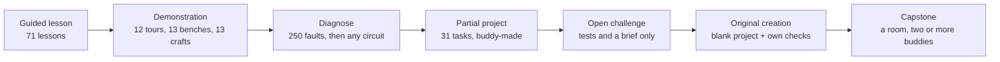
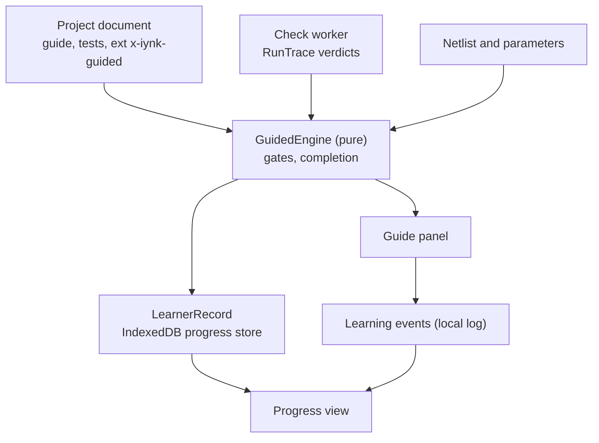
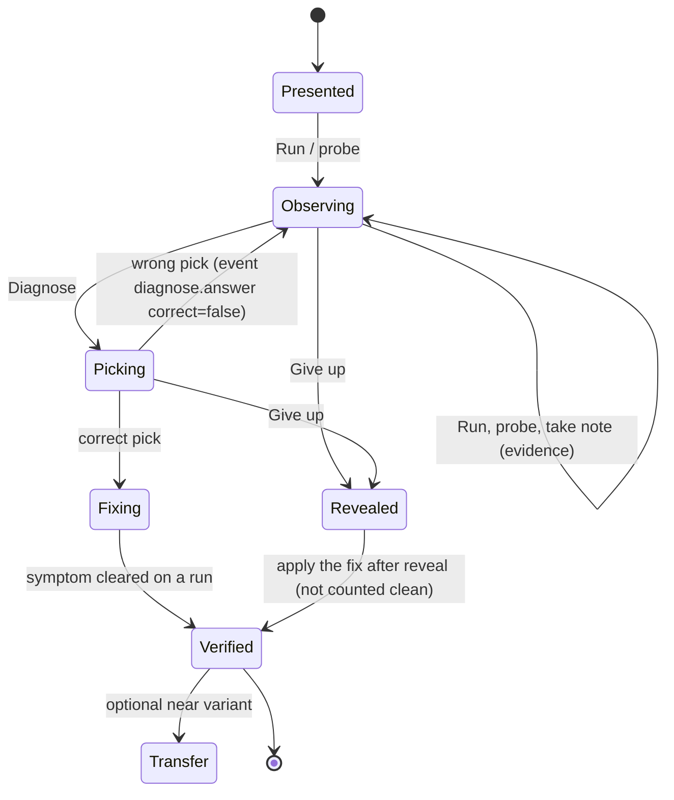
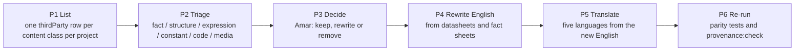

# iynk learning: guided projects, diagnose-first practice, challenges and local progress

Status: specification for the build, written 2026-10-27. Owner: the education pass of the master plan.
Upstream: BRIEF section 15 (adapted by D-013), decisions D-007, D-010, D-011, D-013 to D-017, `01_AUDIT/inventory/content-schema.md`, `01_AUDIT/inventory/boardlab-robotics-ui.md`, `01_AUDIT/FEATURE_VERIFICATION.md` (C007, C008, C042, C052, C111), `02_RESEARCH/TECHNICAL_RESEARCH.md`.
Contracts it must match: `04_ARCHITECTURE/PROJECT_DATA_MODEL.md` (5.11 to 5.13, 11, 12), `schemas/project.schema.json` (`Guide`, `TestCase`, `Check`, `Fault`, `Provenance.thirdParty`), `COMPONENT_SCHEMA.md`, `SIMULATION_ARCHITECTURE.md` (13, 14, 15).
Downstream: features F-017 to F-024, F-026, F-028 to F-030, F-032 to F-037, F-053, F-056, F-133, F-134, F-138, F-140, F-143, F-144, F-151, F-197, F-221; requirements R-118 to R-130, R-139 to R-143, R-149, R-015, R-016, R-067; journeys J-02, J-06, J-10; ADR-0830 to ADR-0835 (see section 15).

Label key: VERIFIED (I ran it or read the code and quote it), DOCUMENTED (a repo document says it), EXTERNAL (outside the repo, not re-checked), ESTIMATED (with assumptions), HYPOTHESIS, UNKNOWN. "Learner" below means Amar or one of his friends. There are no classrooms, accounts for teachers, grades or institutions in this file (D-013).

---

## 0. What this file decides, in one page

1. **The 38 catalogue items become 140 guided projects** on the project core (12 board tours, 71 lessons, 13 benches, 31 practice tasks, 13 crafts), as `PROJECT_DATA_MODEL.md` section 11 already fixes. This file says what each one needs on top of the converter's output to work as a guided project, and how much of that is automatic.
2. **Guided mode is a pure function over the project document plus the last run.** The plan (which step is done when) lives in `ext["x-iynk-guided"]` of the project (section 4). Progress never goes into the document (section 11). The solver does not read the plan.
3. **"Passes on open" is real and by construction.** All 71 board lessons ship a working sketch as the starter, so their checks pass on the first Run (section 2.2). The "meaningful pass" (F-023) therefore cannot be an audit of 71 starters; it is a rule: a lesson completes only after a real code or circuit edit, an answered quiz question, and (where authored) a goal test the untouched starter fails (section 5).
4. **Diagnose-first uses the D-010 record unchanged**: `Diagnosis {cause_id, symptom_id, evidence[], hint_level}` from `SIMULATION_ARCHITECTURE.md` 13.4. An item is a project plus one fault plus a sealed answer; two kinds, "built wrong" and "injected" (section 6). The 250 authored faults become items by a fixed mapping (section 6.6); 40 are reviewed first (F-022).
5. **Challenges are shared as project files and verified by re-running the original tests on the buddy's submission** in the receiver's own app. No server re-run, no signed results (F-132 is out of scope). Hidden checks are a courtesy, not a secret, and the UI says so (section 8).
6. **Progress, events, confidence ratings and completion records stay on the machine** (IndexedDB `progress` store plus the local event log, R-009, R-122). Only a buddies-only standing line can leave, and only to the user's own server (section 11).
7. **Third-party content is cleared by a procedure, not by hope** (section 12). Verified today: the 16 Uno R3 lessons follow the 16 lessons of Learn Arduino in order; the 13 benches and 13 crafts follow the Figs 01 to 13 of the two other sites; 176,532 English words sit in 228 content files. The publish gate is `npm run provenance:check` exiting zero (R-015, R-016).
8. **Build order** (D-014): nothing in B0 beyond the provenance rows; the progress store and the converter in CORE; the guide panel and gates in STUDIO; challenge sharing in COLLAB; diagnose-first in FAULTS; the bulk conversion, meaningful pass and authoring in LABS; tutor modes in AI; robot and flight challenges in ROBOT and DRONE; bench-check records in EXPORT (section 14).

Stance per subsystem (BRIEF 3.5): lessons, checks, quizzes, progress keys, failure text: **preserve** and convert; check engine: **preserve and extend** (new kinds, visibility); progress store: **replace** the single localStorage document for projects, **keep** it as an import source; lesson pages: **replace only on parity** (R-152); diagnosis UI, gate engine, hint ladder, learner store: **new**.

---

## 1. Purpose, principles, non-goals

### 1.1 What learning means here

The founders are makers who want to get from an idea to a working board, and to understand why a circuit that should work does not. Learning is a side effect of building, and the app helps in four ways: it tells you the next thing to do (guided), it breaks things on purpose so you can find the cause (diagnose), it sets you a goal without a recipe (challenge), and it remembers what you did (progress).

### 1.2 Principles

| # | Principle | Consequence in this file |
|---|---|---|
| E1 | Any project can be guided. A lesson is a project with a plan, not a different kind of page. | Section 4: the plan is data in the project; Studio shows the guide panel when a plan exists. |
| E2 | A pass is computed from the simulated run, never clicked. | Gates and checks are predicates over a `RunTrace`, the netlist or the source (section 4.3). |
| E3 | Doing counts. Opening does not. | Meaningful pass (section 5). |
| E4 | Help is graded and logged. | Hint ladder, three levels, each open is an event (section 7). |
| E5 | Honest about the model. | Every completion stamps the tier of the run (D-007); copy never says "validated" or "certified"; diagnose items need a detector that exists (section 6.4). |
| E6 | Local first. | Progress and events stay in IndexedDB; nothing is sent unless the user opts in and runs a server (D-015, section 11). |
| E7 | Shared content is untrusted input. | A challenge from a buddy is parsed against the schema, its code runs in the worker with caps, its text enters the AI partner fenced (section 13). |
| E8 | Preserve working content until a replacement is measurably better. | Parity test over all 71 lessons before any lesson page is removed (R-141, R-152). |

### 1.3 Non-goals (shelved by D-013, kept out of the build)

Class codes, rosters, teacher accounts, assignments with due dates, a teacher dashboard, LMS or LTI, server-signed results, school privacy compliance, sponsored seats, outcome studies and a public gallery (F-124 to F-132, F-135, F-136, F-145, F-027, F-187 are OOS in the catalogue). Nothing here depends on them, and nothing here blocks reviving them later: the challenge result format in section 8.3 and the completion record in section 11.2 are the two seams a later classroom layer would use.

---

## 2. What exists today (VERIFIED unless marked)

### 2.1 Counts

Source: `node scripts/gen-content-index.mjs --emit` over all 38 items (the run behind `PROJECT_DATA_MODEL.md` 11.1), re-tallied for this file from the emitted JSON in scratch (`/Users/amar/iynk-master-plan-scratch/design/data-model/emit/`).

| Lab | Items | Children | Steps | Faults | Quizzes | Hints | Checks |
|---|---|---|---|---|---|---|---|
| Board | 12 boards | 71 lessons (Uno R3 16, Uno R4 7, Pico 6, 9 boards with 4 or 5) | 134 assembly steps (tour); 3 to 5 prose steps per lesson (3 on 27, 4 on 42, 5 on 2) | 144 failure modes | 71 (one per lesson) | 2 hints on 33 lessons, 3 hints on 38 | 292 |
| Robotics | 13 benches | 31 practice tasks (2 to 4 per bench) | 272 build, break and test steps | 106 faults | 66 | 3 hints on 27 tasks, 4 on 2, 2 on 2 | 169 |
| Drone | 13 crafts | 22 flight courses (inside the craft, not separate projects) | 173 build steps, plus safety tests | none authored (flight faults are booleans, `SIMULATION_ARCHITECTURE.md` L10) | 49 | none | none (course goals use their own evaluator) |
| Total | 38 | 102 lessons and tasks with checks | 579 | 250 | 186 | | 461 |

461 = 292 + 169 and matches the audit's count (F-032). Check kinds across all 461: serial 119, pin-level 108, pwm 64, code 62, runs 45, responds 26, pin-toggles 20, servo 10, tone 7 (`PROJECT_DATA_MODEL.md` 11.1). No check has `visibility` today (the field is new, F-221).

Failure kinds in the 144 board failures: wrong-voltage 27, missing-part 24, reverse-polarity 20, short 17, cold-solder 17, brownout 15, reversed-part 9, boot-strap 8, level-mismatch 4, overcurrent 3. The 106 bench faults: missing-part 18, wrong-voltage 15, reverse-polarity 13, reversed-part 12, cold-solder 12, brownout 11, config 7, overcurrent 6, thermal 4, floating-input 4, short 3, boot-strap 1. Trigger kinds (board): power-input 30, remove-part 25, reverse 20, short 20, cold-joint 17, load 12, reverse-part 9, wiring 6, control 4, setting 1.

### 2.2 The pass-on-open fact

- The editor's initial text is `renderTemplate(lesson.code.source, params, defaults)` (`src/lib/boardlab/store.ts:124`, `:173`). `lesson.code.source` is the reference sketch.
- The unit test requires that reference to pass every check: `src/lib/interp/lessons.test.ts:3-4, 60-68` ("A board lesson's reference is its code with the default chips"; "the reference must pass every check"). The test's "starter" is an **empty program** (`lessons.test.ts:26`, `EMPTY[...]`, used at `:63`), so the claim in `SIMULATION_ARCHITECTURE.md` 15.3 that "the starter fails at least one check in 102 of 102" is true of the empty program, not of what the learner sees. The two uses of the word "starter" must not be confused.
- Therefore all 71 board lessons pass on the first Run with no edit (VERIFIED by code path and test; one lesson, Blink, also VERIFIED in the browser walk: "Starter code already passes all 3 checks", `runs/BROWSER_WALK.md` step 2).
- `markDone` fires when checks pass and no fault is active (`src/components/boardlab/LessonWorkspace.tsx:149-150`). So today a lesson is "done" after one click of Run. The catalogue's F-023 note "71-starter audit UNKNOWN" is resolved: the audit result is 71 of 71 pass on open, by construction.
- The 31 practice tasks are different: the test requires the **task starter** to fail at least one check (`lessons.test.ts:76-83`), and the task keeps a hidden `solution`. They are already meaningful.
- Learner code is not saved on reload today (`boardlab-robotics-ui.md`, walk 2), so the first thing a guided project gives back is persistence (F-087, F-200).

### 2.3 What a lesson is made of

`Lesson` at `src/content/schema.ts:388`: starter code (`CodeTemplate`), parameter chips (`ParamChip`: 65 number, 35 choice, 1 toggle across the 102 items), `circuit` key, `WorldModel` (inputs and a scripted event list in virtual ms), `runMs`, `checks[]`, `pins`, `callouts`, `specs`, `features`, `steps`, `hints`, `quiz`. A `PracticeTask` (`:504`) adds `solution`, `brief` and drops the prose steps. `FailureMode` (`:243`) has `trigger`, `figure` (the bridge command), `effect`, and four texts: `title`, `symptom`, `explanation`, `fix`. There are no hint texts on faults.

---

## 3. The learning ladder and where each rung lives

BRIEF 15.1 lists seven rungs. Each is a project with `guide.kind` and a plan `rung`.



| Rung | `guide.kind` | Plan `mode` / `rung` | Starting state | Completion | Source today | Phase that ships it |
|---|---|---|---|---|---|---|
| Guided lesson | `lesson` | guided / lesson | working sketch and circuit | checks + edit + quiz (+ goal) | 71 board lessons | LABS (Uno 16 earlier, as the regression corpus) |
| Demonstration | `tour`, `bench`, `craft` | guided / demo | empty bench or parts to place; steps with "Do it" | all steps gated (legacy state gate first) | 12 + 13 + 13 items, 579 steps | LABS |
| Diagnose | `challenge` | diagnose / diagnose | a circuit with a hidden cause | correct diagnosis + symptom cleared | 250 faults | FAULTS |
| Partial project | `challenge` | challenge / partial | some parts or code given, `locked` | all tests pass | 31 tasks | LABS |
| Open challenge | `challenge` | challenge / open | a brief, a board, tests | all tests pass | none today; flight courses later | STUDIO (authoring), DRONE |
| Original creation | none (no guide) | none | blank | the learner's own checks (F-221) | not present | STUDIO |
| Capstone | `challenge` | challenge / capstone | a room with shared project | tests pass in the shared project | not present | COLLAB |

`guide.kind` has the five values the schema allows (`lesson`, `bench`, `craft`, `challenge`, `tour`); diagnose items and capstones use `challenge` and are told apart by the plan, so no schema change is needed for this table.

---

## 4. Guided mode on any project

### 4.1 What the schema gives and what it lacks

`Guide` (`project.schema.json` `$defs/Guide`) carries `steps[]` and `hints[]` as plain `Text`, `quizzes[]`, `starter {source, template, splices}`, `pins`, `callouts`, `specs`, `features`, `serialSample`, `assembly[]`, `references`, `legacyFigure`. `TestCase` carries `checks[]` with `visibility`. Missing for guided mode:

| Need | Why the schema cannot hold it | Decision |
|---|---|---|
| Which condition completes which step | `steps` are `Text` without ids | A plan in `ext["x-iynk-guided"]` (ADR-0830) |
| Static conditions (two pins connected, a part present, a parameter in range) | `Check` has 12 kinds, all dynamic over a run | Gate kinds in the plan; promotion to `Check` is Objection 2 |
| The sealed answer of a diagnose item | no field | In the plan (`diagnose.answer`) while the fault itself stays in `simulation.faults` where the solver reads it |
| Reference solution | no field | `ext["x-iynk-solution"]` as `PROJECT_DATA_MODEL.md` 11.3 already says for `PracticeTask.solution` |

`Ext` rules apply: keys are namespaced, at most 16 per object, readers that do not know them keep them verbatim, and the core never needs them. A project opened by an older app simply has no guide panel behaviour; it still runs.

### 4.2 The plan

```ts
// ext["x-iynk-guided"], validated by schemas/tools (new file edu-guided.schema.json, v1)
interface GuidedPlan {
  v: 1;
  mode: 'guided' | 'diagnose' | 'challenge';
  rung: 'lesson' | 'demo' | 'diagnose' | 'partial' | 'open' | 'capstone';
  skill: string[];                       // tags for the progress view: guide.level ids, cause ids, part ids. Max 8, each 1..40 chars
  gates: StepGate[];                     // 0..64; each names the step index it completes
  complete: CompleteGate[];              // see 4.4; default by mode below
  tests: string[];                       // test ids (tests[].id) that count for completion; default: all
  goalTest?: string;                     // test id of the goal test, 5.3
  ladder?: HintLadder;                   // diagnose items and optional for lessons, 7
  diagnose?: DiagnoseSpec;               // 6
  partial?: { given: string[] };         // component/board ids that are `locked: true`; also listed here for the panel
  next?: string[];                       // template ids to suggest afterwards, max 4
}

type StepGate =
  | { step: number; kind: 'manual' }
  | { step: number; kind: 'check'; test: string; check: string }                 // last run of that test passed that check
  | { step: number; kind: 'edit'; source: string }                               // token stream of source differs from the rendered starter
  | { step: number; kind: 'param'; parameter: string }                           // value differs from default
  | { step: number; kind: 'net'; connected: [PinAddr, PinAddr] }                 // same net in the live netlist
  | { step: number; kind: 'net'; apart: [PinAddr, PinAddr] }                     // different nets
  | { step: number; kind: 'part'; definition: string; min: number }              // at least `min` instances of part ref
  | { step: number; kind: 'quiz'; quiz: string }                                 // at least one answer recorded
  | { step: number; kind: 'fault'; state: 'injected' | 'cleared' }               // legacy "break" steps and diagnose
  | { step: number; kind: 'legacy-state'; cond: StateCond };                     // figure state through the bridge, until Studio draws parts itself

type PinAddr = { c: string; p: string };                                         // PROJECT_DATA_MODEL 3.5
```

Rules:

- G1: `gates[i].step` is an index into `guide.steps`; at most one gate per index; indexes without a gate are `manual`.
- G2: a `check` gate must name an existing test id and check id; a `quiz` gate an existing quiz id; a `net` gate existing instances and pin ids. Violations are validation warnings (rule class V3), not load errors: a broken plan degrades to manual steps and says so.
- G3: `legacy-state` is allowed only while `guide.legacyFigure` is set. The converter emits it for every converted `BuildStep.done` (579 steps). When the Studio renderer draws the part, the same step gets a `net`, `part` or `check` gate, and the legacy gate is removed in the same commit as that part's figure parity (R-144, R-152).
- G4: the plan is replaced as one unit by the operation `guide.set` (already in the op vocabulary), so a buddy or the AI partner edits it through a reviewable proposal (F-110).

### 4.3 Predicates, and what each reads

Everything that decides "done" is a pure function of one of four inputs. Nothing in it uses wall time.

| Input | Predicates | Evaluated where | When |
|---|---|---|---|
| Source text (token stream after `codeOnly`, `src/lib/interp/checks.ts:72`) | `edit`, `code` check | main thread | on save, debounced 200 ms |
| Netlist and parameters (the document) | `net`, `part`, `param` | main thread, pure | on every applied op, debounced 200 ms |
| `RunTrace` of a test case | the 10 catalogue check kinds (`runs`, `serial`, `pin-level`, `pin-toggles`, `pwm`, `tone`, `servo`, `responds`, `code`, `state`) exactly as `evaluateCheck` (`checks.ts:122`) | check worker (`check.worker.ts`, 2 s kill grace) | on Run, on Stop at end of test |
| Solver readings | `node-voltage`, `supply-current` (new in the schema, `PROJECT_DATA_MODEL.md` 5.12) | check worker with the solver | after SIM; before that they evaluate to "not available at this tier" and the gate stays manual |

Checks keep the catalogue's unit rule: milliseconds in `...Ms` and `periodMs`, volts, amps, as named fields (data model 5.12). A guided check never mixes units silently.

Honesty of a check verdict: a check reads the simulated run, so its pass means "passes in the simulation at the run's tier". The panel shows the tier chip (D-007) beside the checks, and a completion stamps it (11.2). A `code` check is a text match on comment-stripped source (`checks.ts:72`); it proves the text is present, not that it is used. 62 of the 461 are `code` checks (VERIFIED, `PROJECT_DATA_MODEL.md` 11.1). They are kept (preserve) and labelled "text check" in the panel.

### 4.4 Completion gates

```ts
type CompleteGate = 'checks' | 'edit' | 'quiz' | 'goal' | 'steps' | 'diagnosis';
```

| Gate | True when | Notes |
|---|---|---|
| `checks` | every check of every test in `plan.tests` passed in its latest run, visible and hidden, and no fault is active | The "no fault active" clause is today's rule (`LessonWorkspace.tsx:149-150`, VERIFIED) |
| `edit` | the source or circuit differs from the starter in substance (5.1) | |
| `quiz` | at least one question of one quiz is answered (correct or not) | Answer recorded, correctness shown, not required |
| `goal` | the goal test passes (5.3) | only if `goalTest` is set |
| `steps` | every step has a gate that is true, or is manually ticked | |
| `diagnosis` | the correct cause was picked and the symptom is cleared (6) | |

Defaults when `complete` is absent: lesson `['checks','edit','quiz']` plus `'goal'` if `goalTest` is set; demo `['steps']`; partial and open `['checks']`; diagnose `['diagnosis']`.

### 4.5 The guide panel

Studio shows, for a project with a plan: the step list with a state per step (not started, current, done, blocked), the tests with visible checks and a count line for hidden ones, the hint ladder, the quiz, the tier chip, and a Completion line that says which gates are still open in plain words ("Change something in the sketch and answer one question to finish"). Keyboard: every control is reachable in tab order; state changes are announced in an `aria-live="polite"` region; no state is colour-only (F-177, WCAG 2.2 AA is the target, not yet claimed).

Reset restores the rendered starter (`guide.starter.template` with default splices, as today's Reset does) without touching progress. "Show solution" is a separate, logged action available on tasks, off for challenges received from a buddy unless the sender included a solution (8.2).



Module placement: `src/lib/learn/` (pure engine, no React, no DOM), `src/lib/learn/store.ts` (IndexedDB), `src/components/studio/guide/*` (panel). The robotics `useEffects` pattern that puts `markDone` and figure sends inside a React component (`BenchWorkspace.tsx`, `boardlab-robotics-ui.md` debt) is not copied: gates are evaluated outside React and the panel only renders their result.

---

## 5. A pass that needs a real edit

### 5.1 What counts as an edit

`edit` is true when, for any source the plan names or the board's firmware entry:

1. the token stream of the current text (comments and whitespace removed by `codeOnly`, string literals kept) differs from the token stream of the rendered starter, **or**
2. a project parameter differs from its default (`Parameter.default`), **or**
3. the canonical `nets` differ from the template's canonical `nets` (different sets of pin sets), **or**
4. the set of component instances differs from the template's.

Adding a space, a comment or re-ordering nothing does not count. Changing `delay(500)` to `delay(200)` does. Resetting and re-editing counts once. The hash of the starter's token stream is stored in the plan at conversion (`starterTokensSha256`, computed by the converter) so the test does not need the template to be re-rendered.

### 5.2 The generic rule (no per-lesson authoring)

The `edit` gate is an algorithm, the same for every guided project, with no per-lesson input:

```
substanceHash(doc) = sha256(canonical(doc with history, exports, meta.updatedAt removed
                     and every source text replaced by its codeOnly token stream))   // stateHash of PROJECT_DATA_MODEL 5.x, sources normalised as in 5.1
edit(project) = substanceHash(project) != plan.starterSubstanceHash
                AND exists op in project.history since the start checkpoint where
                    op.actor is the local actor
                    AND op.kind is source.edit, component.* or net.*
```

`plan.starterSubstanceHash` is computed by the converter and stored in the plan next to `starterTokensSha256`; `start checkpoint` is the checkpoint the guided project writes when it is opened (`provenance.origin = template`). Both clauses are needed: the op clause rejects a hash change that came from a remote actor, a restore or a import; the hash clause rejects ops that cancel out (edit then undo) and whitespace or comment-only `source.edit` ops. Parameter-only changes (5.1 item 2) count through the hash clause plus the `param.set` op kind, which is added to the op list above for that case. A lesson whose starter already equals its reference solution (all 71 today, 2.2) gets no exemption: it fails `edit` until the learner makes a real change.

**Acceptance test A15** (fixtures stored under `tests/fixtures/edu-solutions/<lessonId>.ops.json`, produced by the converter and reviewed by hand): for each of the 71 converted lessons, (a) replaying zero ops gives `edit = false`; (b) replaying the stored ops gives `edit = true` and `checks = true`. A lesson whose checks cannot be passed by any small valid change (so the converter cannot find a variant) is listed in `tests/fixtures/edu-solutions/NEEDS-AUTHOR.txt` and fails CI until a fixture is written by hand; how many that is, is UNKNOWN until the converter runs. Where the plan has a goal test (5.3), the stored ops must also pass it, and the zero-op replay must fail it.

Applies to all 71 lessons from the day they convert: Run passes the checks, the panel shows "Checks pass", completion stays open until `edit` and `quiz` are true. Acceptance A3 tests exactly this on Blink.

This is deliberately modest. It stops "done after one click" (the verified defect) and costs no authoring. It does not prove understanding, and the panel says so: the completion line reads "You edited the project and answered a question", not "you know this".

### 5.3 The goal test (authored, optional per lesson)

A goal test is a normal `TestCase` (id `goal`), listed in `plan.goalTest`, whose checks the **untouched starter fails**. It asks for a change the lesson text named ("blink twice as fast", "light the LED only while the button is held"). Authoring rules:

- It uses the same check kinds, with a range the default behaviour is outside of. Blink's default period passes `pin-toggles` with `periodMs [50, 2000]`; the goal uses `[100, 300]`.
- It may set `visibility: hidden` on some checks so the learner cannot satisfy it by reading the check list. Its `script` may differ from the lesson's world script, so a hard-coded answer fails (for example a button pressed at a different time).
- CI (section 5.5) fails if the untouched starter passes the goal test, and fails if the stored solution does not.

Priority for authoring (ESTIMATED effort: one goal test is a 10 to 30 minute job per lesson once the template exists; 71 lessons is therefore about 12 to 35 hours; assumption: the author knows the lesson and uses the converted check list as a model): first the lessons with parameter chips whose change is observable by an existing check kind (101 chips across 102 items, VERIFIED count, how many are observable by a check is UNKNOWN), then the 16 Uno lessons because they come first in the template gallery, then the rest.

### 5.4 Tasks and challenges

Tasks already start failing (2.2). They need no `edit` gate: `checks` already requires a change. The reference solution moves to `ext["x-iynk-solution"]` and is never exported by default (data model 11.3).

### 5.5 The audit that replaces "UNKNOWN"

A script `scripts/learn-audit.mjs` (new, runs in CI, report only until LABS) prints for every guided project: starter verdicts (all tests), solution verdicts, `passOnOpen` (true when the untouched starter passes every test except `goal`), `hasGoal`, count of hidden checks. Expected first run: `passOnOpen = true` for 71 of 71 board lessons, 0 of 31 tasks (HYPOTHESIS from 2.2, confirmed by the first run). The pass/fail condition for each of the 71 lessons is the A15 fixture pair of 5.2, not this report. The report is the progress meter for goal-test authoring: the LABS exit criterion is `passOnOpen && !hasGoal` listed, not zero (Objection 3).

---

## 6. Diagnose-first fault practice

Upstream: F-017 to F-022, F-026, F-028 to F-030, F-053, F-056; R-118 to R-130; D-010; `SIMULATION_ARCHITECTURE.md` 13. Fidelity limits come from the solver phases; this section works at the T0/T1 fidelity that exists first.

### 6.1 Words

A **fault** is a cause (an open wire, a reversed LED). A **failure** is what the model derives (LED burnt, MCU reset). A **symptom** is what the learner can observe (LED dark, serial prints the banner again and again). Diagnose-first shows the symptom and live readings, hides the cause, and asks for the cause.

### 6.2 Two kinds of item

| | Built wrong | Injected |
|---|---|---|
| What is broken | The circuit or code itself (LED with no resistor, code drives D12 while the LED is on D13, missing ground) | A fault the model injects into a working circuit (cold joint, brown-out from a motor, reversed supply) |
| Where the cause lives | In the document: it is not a `Fault`; the answer says which rule found it | In `simulation.faults[]` as an enabled `Fault {id, cause, kind, target, params, enabled: true}` |
| How the symptom is produced | The normal run of the broken design | The solver or legacy figure applies the fault at P0 (`SIMULATION_ARCHITECTURE.md` 13.2) |
| The fix | An edit that makes the base tests pass again | A remedy choice, then Repair disables the fault; the symptom clears on the next run |
| Needs a real edit | Yes, by construction | No; the remedy choice is the action |
| Source | Rules R-124 (F-029) and F-026, and buddy-made items | The 250 catalogue faults (preserved content) |

Both use the same Diagnosis record, the same hint ladder and the same states.

### 6.3 States



Rules: the learner may run, probe (virtual multimeter, F-053), and read serial in `Observing`; edits to the circuit are allowed only in `Fixing` for built-wrong items (the editor is read-only before, so the learner diagnoses by measuring, not by rewiring until it works; Objection 5 records the cost). A wrong pick never ends the item. `Give up` reveals cause and explanation, marks the outcome `revealed`, and still lets the learner apply the fix. Switching to cause-visible mode is the same as Give up before the first pick, and is allowed at any time (R-120).

### 6.4 The item spec

```ts
interface DiagnoseSpec {
  kind: 'built-wrong' | 'injected';
  symptom: { id: string; text: Text };                       // D-010 symptom_id; text is an observation only
  answer: { cause_id: string; fault?: string /* flt_ id */; rule?: string /* R-124 rule id */ };   // sealed in the UI (6.5)
  options: { cause_id: string; label: Text }[];              // 4..6, exactly one equals answer.cause_id
  remedies?: { id: string; text: Text; correct: boolean }[]; // injected kind: 3..5, one correct
  explanation: Text;                                         // shown after the pick or reveal
  readings?: { a: PinAddr; b: PinAddr; label: Text }[];      // probe shortcuts the ladder can point to
  transfer?: { template: string; question: Text; options: Text[]; answer: number };   // F-021
  review: { status: 'draft' | 'reviewed' | 'model-only'; by?: string; source: 'own-reasoning' | 'datasheet' | 'bench'; date?: string };  // R-129
}
```

Limits: `options` 4 to 6; every distractor is a registry cause id marked `confusableWith` the answer (6.7); `symptom.text` at most 300 characters; at most 3 `hints` levels (section 7). A detector must exist for the answer's `cause_id` at the project's tier (the cause registry entry names its detector layer, `SIMULATION_ARCHITECTURE.md` 13.4); a cause whose detector is `not-modelled-yet` (for example `thermal-shutdown`, F-219 is "could") cannot be a reviewed item, only a read-only explanation.

### 6.5 Hiding the cause

The document does not keep the answer secret (anyone can open the file; Principle E6 of the data model says documents are not encrypted). Hiding is an interface rule with three enforcement points:

1. The Studio fault list, the part inspector and the history panel omit `simulation.faults[*]` and `x-iynk-guided.diagnose.answer` while the item state is not `Verified` or `Revealed`.
2. The AI partner's context builder (R-156) drops the same fields while unrevealed, and a Hint-mode partner (R-160) answers from the ladder only. The redaction is a named function with a test that feeds it an unrevealed item and asserts the answer string does not appear in the serialised context (A5).
3. Share and export of an unrevealed item go through the challenge path (8.1) which marks it `sealed` so the receiver's app applies rules 1 and 2.

Honest label: the panel says "hidden in the app, not encrypted" in the item's info line. A person who opens the JSON can read the answer; among friends that is fine and cheating only costs the cheater (D-013).

### 6.6 From the 250 catalogue faults to items

Mapping from `FailureKind` to the cause registry (`SIMULATION_ARCHITECTURE.md` 13.4 lists 18 ids; ids not in that list are requested in Objection 1 and use the `x-` prefix the registry allows until accepted):

| Catalogue kind (board / bench count) | Registry cause id | Status |
|---|---|---|
| reverse-polarity (20 / 13) | `reverse-polarity` | in registry |
| reversed-part (9 / 12) | `led-reversed` for LEDs, else `reverse-polarity` | in registry |
| brownout (15 / 11) | `brownout` | in registry |
| overcurrent (3 / 6) | `pin-overcurrent` (or `led-no-series-resistor` when the trigger is a missing resistor) | in registry |
| short (17 / 3) | `supply-shorted-to-ground` or `output-contention` by trigger | in registry |
| floating-input (0 / 4) | `floating-input` | in registry |
| missing-part (24 / 18) | `open-connection` when the part carries a signal; `x-missing-decoupling` for caps; `x-missing-part` otherwise | partly new |
| wrong-voltage (27 / 15) | `part-not-powered` below the minimum; `x-supply-overvoltage` above the maximum | partly new |
| cold-solder (17 / 12) | `x-intermittent-connection` | new |
| boot-strap (8 / 1) | `x-boot-strap-level` | new |
| level-mismatch (4 / 0) | `x-logic-level-mismatch` | new |
| config (0 / 7) | `x-wrong-config` | new |
| thermal (0 / 4) | `x-thermal-shutdown` | new, not modelled yet |

The trigger field decides ambiguous kinds; the converter writes `cause` on each materialised `Fault` and a schema test fails a fault with no `cause` (R-119). Each `FailureMode` becomes: `Fault` (cause, kind, target from `trigger`, `params` from `effect`), the symptom text as `symptom.text`, `explanation` and `fix` as `explanation` and the correct remedy. Board failures live in the **board part descriptor** (`failure_modes`, `injectable_faults`, data model 11.3), so a lesson project does not carry them; an item project materialises one fault from the descriptor. Bench faults go to `simulation.faults` plus `domains.robotics.data.faultRules` until descriptors own them (data model 11.3).

**Symptom variants are required work.** The catalogue `symptom` text often names the faulted part. Example (VERIFIED, `src/i18n/content/en/boards/uno-r3.json`, `failures.reverse-vin.symptom`): "the regulator near the jack gets hot. The capacitor beside it may bulge or smell", where the regulator and the capacitor are the parts that failed. A leak lint (6.8) rejects it; the reviewed item rewrites it as observations ("nothing runs; one component near the jack is too hot to touch").

**The first 40 (F-022).** Selection rule from the 144 board failures, by kind, so the set covers causes not boards: reverse-polarity 5, wrong-voltage 6, missing-part 6, short 4, cold-solder 4, brownout 4, reversed-part 3, boot-strap 3, level-mismatch 2, overcurrent 3 (sum 40). At most 4 from one board; Uno R3 and ESP32 DevKitC first because their lessons are the most complete. Each item: symptom variant, answer, 3 to 5 distractors, 3-level ladder, explanation, source, `review.status`. Reviewed means Amar or a buddy with electronics experience checked the cause against a datasheet, a bench result or reasoning (R-129); an item he cannot back is `model-only` and says so on screen.

**The fault-rule corpus (target of F-029, SC-J06-2).** The rules of R-124 are tested against one directory, `tests/fixtures/fault-corpus/`, with a `MANIFEST.json` that lists every file:

- `clean/`: every converted Uno circuit that is meant to work (all Uno R3 and Uno R4 lessons and their reference solutions plus the Uno-based tour steps with a netlist). Each is a project with no injected fault. The count is whatever `scripts/convert-content.mjs` emits and is written into `MANIFEST.json` as `cleanCount`. The "79 catalogue circuits" in F-029 and `SIMULATION_ARCHITECTURE.md` 13.4 is ESTIMATED: it does not follow from the counts in 2.1 (38 items, 71 lessons, 31 tasks, 13 benches) and its derivation is UNKNOWN. Treat 79 as a placeholder until the converter output exists, then replace it with `cleanCount`.
- `broken/`: 20 projects, each a `clean/` circuit with one op applied, each listing `expectedCauseId` and the `rule` that should catch it. Registry ids (`SIMULATION_ARCHITECTURE.md` 13.4) minus `bus-device-not-modelled` (a limit, not a fault) and `motor-stall` (no motor in the Uno corpus) give 16 files; four second variants of the most common user mistakes bring it to 20:

| # | expectedCauseId | # | expectedCauseId |
|---|---|---|---|
| 1 | `led-no-series-resistor` | 11 | `i2c-missing-pullup` |
| 2 | `led-reversed` | 12 | `pin-overcurrent` |
| 3 | `output-contention` | 13 | `brownout` |
| 4 | `supply-shorted-to-ground` | 14 | `reverse-polarity` |
| 5 | `floating-input` | 15 | `wrong-value` | 19 | `wrong-value` (pull-up 100 times too large) |
| 16 | `missing-ground` | 20 | `missing-ground` (sensor only) |
| 17 | `open-connection` (signal leg left off) | | |
| 18 | `swapped-pins` (two I2C lines) | | |

Rows 17 to 20 repeat ids on purpose (second variants); the manifest holds the exact op for every file. Pass condition for the gate: no rule reports any diagnosis on any `clean/` file, and the rules report the `expectedCauseId` for at least 18 of the 20 `broken/` files. A rule that reports on a clean file is disabled until fixed, as `USER_JOURNEYS.md` says. `PRODUCT_REQUIREMENTS.md` R-124 ("at least 8 rule types") is satisfied when at least 8 distinct rules each catch one file here.

**Built-wrong generator (after F-029).** One working template project, one rule from R-124 (open wire, swapped pins, wrong value, missing ground, wrong pin in code), a seed. The rule's op is applied to a copy, the base project's tests are the fix check, and the item's `answer.rule` records which rule. Items are generated on request, not stored in bulk; the seed is logged so the same item can be re-played.

### 6.7 Distractors

`confusableWith` is a field the cause registry needs for learning (Objection 1). Seed pairs from the registry list: `floating-input` with `button-no-pulldown` and `open-connection`; `led-no-series-resistor` with `pin-overcurrent`; `output-contention` with `supply-shorted-to-ground`; `part-not-powered` with `missing-ground` and `brownout`; `swapped-pins` with `open-connection`; `wrong-pin-in-code` with `open-connection`. At least two distractors per item come from this relation; the rest from the same family. A wrong pick shows why that cause does not fit the evidence, not only "wrong" (stored as `explanation.whyNot[cause_id]`, optional).

### 6.8 Quality lint for items (CI)

| Rule | Check | Fails when |
|---|---|---|
| L1 | symptom names no refdes or part name of the faulted component | `symptom.text` contains the refdes or the descriptor name of `fault.target.component` |
| L2 | symptom does not restate the cause | a word of 5 or more letters from the cause's display name appears in `symptom.text`, after removing words in a short stop list |
| L3 | symptom is an observation | it contains no observable noun from a list (LED, serial, reading, heat, smell, reset, motor, sound, display, nothing) |
| L4 | distractors are legal | any distractor is not in the registry, or not `confusableWith` the answer or in its family |
| L5 | exactly one right answer | `options` has zero or two entries with `answer.cause_id` |
| L6 | detector exists | the answer's cause has detector `not-modelled-yet` and `review.status = reviewed` |
| L7 | ladder complete | fewer than 3 levels, or level 3 contains the `fix` text |
| L8 | fix check | built-wrong: base tests do not fail on the broken state or do not pass on the stored solution |

The 20 `broken/` files of 6.6 also run through L5 and L8 (one right answer, fix check) so the same fixtures serve the rule gate and the item lint.

L1 to L3 are heuristics (HYPOTHESIS about false-positive rate: expect human review of every flagged item for the first 40); they raise the cost of a leak, they do not prove a clean item.

### 6.9 Diagnosis record and evidence

On a correct pick the app writes one record per D-010:

```ts
Diagnosis { cause_id: string; symptom_id: string; evidence: Evidence[]; hint_level: 0 | 1 | 2 | 3 }
```

- `cause_id` and `symptom_id` come from the item.
- `hint_level` is the highest ladder level opened before the correct pick (0 if none).
- `evidence` is what the **learner** collected: each probe reading the learner pinned ("Add to notes"), serial lines pinned, and pin-level observations. Each entry is the `Evidence` type of `SIMULATION_ARCHITECTURE.md` 13.4 with its `provenance` (`computed`, `approximation`, `mocked`), `tier` and `modelIds`, so a note never claims more than the instrument did. An empty list is legal and the outcome is flagged "no evidence recorded" (a guess).
- Wrong picks are **events** (`diagnose.answer`, `correct: false`), not evidence entries; Objection 1 records the one-word conflict with R-120.

Outcome class for the progress view, computed from the record and the events: `clean` (first pick right, `hint_level` 0), `assisted` (hint level 1 or 2, or at most two picks), `helped` (hint level 3 or three or more picks), `revealed`. It is a description, not a grade.

### 6.10 Break it on your own circuit, and on a buddy's (F-030)

The learner who injects a fault knows the cause, so self-injection is not diagnose-first. Two honest options, both in FAULTS:

- **Surprise me**: choose a rule family, the app picks the target with a seeded random draw (seed logged, `crypto.getRandomValues` for the seed only; the draw itself is deterministic), applies it as an undoable operation (R-125), hides the answer as in 6.5. Restore returns the exact document hash.
- **Break it for a buddy**: pick a rule and target, the app creates a sealed copy (challenge file, 8.1) with the fault applied; the buddy diagnoses; the result comes back as in 8.3. This is the bug-exchange loop among friends and needs only the file path, so it works without a server.

Own-circuit items depend on the detectors (F-029) and the multimeter (F-053); before those exist, F-030 is not offered (no silent fallback to unlabelled faults).

---

## 7. Hints

### 7.1 The ladder

```ts
interface HintLadder {
  levels: [HintLevel, HintLevel, HintLevel];       // index 0 is level 1
}
interface HintLevel {
  text: Text;
  focus?: { components?: string[]; nets?: string[] };   // level 1: what to highlight
  probe?: { a: PinAddr; b: PinAddr; expect?: { min: number; max: number; unit: 'V' | 'A' | 'ohm' } };   // level 2
}
```

| Level | Answers | May contain | Must not contain | Logged as |
|---|---|---|---|---|
| 1 | Where to look | a region, a part group, a net; highlight | the cause, a measurement value | `hint.open {level: 1}` |
| 2 | What to measure | a probe pair and the band the reading should be in, with the instrument's tier and provenance | the cause | `hint.open {level: 2}` |
| 3 | What it is | the cause category and the part involved | the fix (R-121); the lint L7 compares to the fix text | `hint.open {level: 3}` |

Levels open in order. Opening a level shows it and keeps it visible. The highest opened level is `hint_level` in the record. There is no timer and no limit (self-directed), only the log.

### 7.2 Where hint text comes from

| Content | Source | Work |
|---|---|---|
| 71 lessons (2 or 3 hints each, VERIFIED) | `Lesson.hints` | The converter maps `hints[0..2]` to levels 1 to 3 as a straight reveal, order kept. Lessons with 2 hints (33 of 71) get 2 levels. Review that each hint is progressively more specific: UNKNOWN, a read-through of 71 lessons (ESTIMATED 1 to 2 hours) |
| 31 tasks (2 to 4 hints) | `PracticeTask.hints` | Same; the 2 tasks with 4 hints keep all 4 as a scroll of level 3 |
| 250 faults | none exist | Level 1 and 2 are generated from the fault target by the cause registry template (`focus` = target component or net, `probe` = the two nets the cause family names); level 3 is authored per cause, not per fault (18 to 30 texts, not 250) |
| Built-wrong generator | the rule | Level 1 and 2 from the rule's target, level 3 from the cause template |

The generated levels are drafts: the 40 reviewed items carry reviewed text; the other 210 show generated levels labelled "generated hint".

### 7.3 Hints on a lesson versus the AI partner

The ladder is the default help and works with no key. The AI partner in Hint mode (R-160) sits above it: it may point at the next level but must not reveal an unopened level; this rule lives in the partner's system policy and is tested with the unrevealed-item redaction test (A5). Any partner message that opens information equal to a level logs `hint.open` with `via: 'partner'`.

---

## 8. Challenges, partial projects and sharing with buddies

### 8.1 Making and sending a challenge

A challenge is any project the author marks with `Make a challenge` (R-149, F-133). The command does, as one reviewable operation batch:

1. Sets `guide.kind = 'challenge'` and writes the plan (`mode: 'challenge'`, `rung: partial | open | capstone`).
2. Moves tests the author chooses into `tests[]` with visible or hidden checks (F-221).
3. For `partial`: marks given components `locked: true` and lists them in `plan.partial.given`.
4. Optionally stores a solution in `ext["x-iynk-solution"]`.
5. Produces a share artifact: a `.iynk` file (always available, F-201), or a room invite or share link when the self-hosted server exists (F-089, F-199).

What is stripped from the share artifact by default: `x-iynk-solution`, history beyond a snapshot, the author's progress record (it is not in the document), AI keys (never in a document). "Include solution" is an explicit, per-share tick.

Hidden checks stay in the file. The UI shows them as a count ("2 hidden checks, 1 passing") until the learner completes or gives up, and labels the feature "hidden in the app, not secret" (same stance as 6.5).

### 8.2 Opening a received challenge

On open the app validates the document (five passes, data model 9.1) and the plan (G1 to G4), runs nothing, shows who sent it (`provenance.createdBy` actor name if a buddy, otherwise "file"), the brief, and the tests. All text from the file is untrusted (section 13). Starting creates a **fork** (`provenance.origin.kind = fork`, `project`, `revision`, `stateHash`, F-088) so the original stays untouched and the sender's stateHash is recorded for verification.

### 8.3 Result and verification (ADR-0834)

```ts
interface ChallengeResult {            // a small JSON the receiver can send back as a file or through the server
  v: 1;
  challenge: { project: string; stateHash: string };    // the challenge as received
  submission: { project: string; stateHash: string };   // the receiver's fork
  gates: Record<'checks' | 'edit' | 'quiz' | 'goal', boolean | null>;
  tier: 'T0' | 'T1' | 'T2' | 'T3';
  hintsMax: 0 | 1 | 2 | 3;
  runs: number;
  elapsedMs: number;                    // wall time spent in the project, self-reported
  note?: string;                        // up to 500 chars, plain text
}
```

The result is a claim. Verification, when the sender wants it, is: open the receiver's submission project (a `.iynk` file or the shared link), then the app runs **the original challenge's tests** (matched by `challenge.stateHash`, taken from the sender's own copy, never from the submission's `tests`) against the submission's netlist, sources and parameters, in the sender's check worker. Same seed, same engine versions, so the verdicts are deterministic (DET-1). A submission whose own `tests` differ from the challenge's is flagged "tests changed" and the original tests still decide. No server re-run, no signature (F-132 is out of scope; trust among friends is the model).

### 8.4 Buddies and progress

| Feature | Behaviour | Uses | Phase |
|---|---|---|---|
| Send challenge | file or room link, 8.1 | F-089, F-201, F-199 | COLLAB |
| Send a sealed bug (diagnose item) | 6.10 | F-030, F-138 | FAULTS after COLLAB |
| Compare results | a list of `ChallengeResult` lines for one challenge: who passed, hints, runs | F-144 | LATER (class LATER) |
| Buddies-only standing | nothing of its own. The only numbers that leave the machine for a board are the tracks defined in `COMMUNITY.md` 3.10 (`lap`, `diagnosis`, `built`, `solved`), each a personal best per subject, opt-in per track. No lesson counts, totals, ratios or streaks are sent (CD-5) | F-140, F-199 | LATER |
| Shared guided project in a room | step and gate state are **per person, local**; the room shows "you pass / buddy passes" only for tests both run, never writes progress into the shared document | F-116, F-121 | COLLAB |
| Capstone | a challenge project opened by two or more buddies in a room; contributors are recorded in `provenance.contributors`; completion needs the tests to pass in the shared document | F-116, F-119 | COLLAB |

Client-claimed numbers are acceptable here (catalogue F-140 note: acceptable among friends).

---

## 9. Self-assessment and the learning measures that remain (BRIEF 15.4, adapted)

D-013 shelved outcome studies (F-027, F-187). What stays is a personal record the learner can read, computed only from local events. No claim of "learning outcomes" is made from it: with one to a few learners there is no statistics to report.

| BRIEF 15.4 item | What the app records | Source event | Limit |
|---|---|---|---|
| Concept comprehension | quiz answers with confidence; diagnose first-pick correctness by cause family | `quiz.answer`, `diagnose.answer` | recognition, not recall |
| Transfer to physical hardware | a **bench check** after Build it: three fields (did it power, did it do what the simulation did, what differed) and an optional photo, stored locally and linked to the project hash | `bench.check` (EXPORT, F-090, F-162) | self-reported; the only link from the simulation back to a real board; feeds the reality-gap panel (R-189) |
| Time to a working project | wall time from first edit to first all-checks-pass, per project | `code.changed`, `check.transition` | idle time is included |
| Debugging competence | `clean`/`assisted`/`helped`/`revealed` counts over time, per cause family; evidence-recorded ratio | Diagnosis records | only for items with a detector |
| Retention | the review queue (9.2): a similar item re-offered later; first-pick correctness on re-offer | `review.offer`, `diagnose.answer` | |
| Confidence | a 3-point rating (guess, think so, sure) before a diagnosis pick and before a quiz answer; the progress view shows how often "sure" was wrong | `confidence` field on the two events | self-reported |
| Drop-off, long-term completion | started-not-finished projects and age; projects reopened after 7 days | derived | |

Engagement counts (streaks, minutes) are not shown as progress (BRIEF 15.4: engagement is not education).

### 9.1 Prediction prompt (optional, authored)

A step may carry a prediction: before pressing Run the learner picks what the LED will do from 3 options (a `quiz` item with `afterStep` set, already allowed by the schema). The answer is logged with confidence; nothing else changes. Authored for the goal-test lessons first.

### 9.2 Review queue

For each diagnose outcome `assisted`, `helped` or `revealed`, the queue offers a *different* item of the same cause family after 1, 3, 7 and 21 days (the interval list is a HYPOTHESIS borrowed from common spaced-repetition practice (EXTERNAL, not checked here); it is a setting, not a claim). The queue is a list in the progress view, never a notification, and never blocks anything.

---

## 10. How the existing content moves onto the core

Upstream: `PROJECT_DATA_MODEL.md` section 11 (the type-by-type table, the 140-project target, the Uno worked example), ADR-0108, R-032, R-139 to R-143. This section adds only what is educational.

### 10.1 Automatic versus rework

| Content | Converts automatically | Needs rework | Effort |
|---|---|---|---|
| Lesson text (title, lede, steps, hints, pins, callouts, specs, features), six languages inlined | Yes (`TextKey` resolved by the converter) | Code-comment translations are lost (`{{t:}}` renders English only, loss `code-comments-en-only`); 388 tokens in starter code | accepted loss, recorded |
| Starter code and chips | Yes: `guide.starter` template + splices, `parameters` | none | |
| World model and scripted events | Yes: `simulation.world` | none | |
| 461 checks, 10 kinds | Yes, kinds unchanged, plus `id`, `visibility: visible`, text `label` | none; 62 `code` checks flagged "text check" | |
| Quizzes (186) | Yes: `guide.quizzes` | none; a "why not" note per wrong option is optional new work | |
| Circuit of a lesson (57 of 71) | Yes where the figure circuit converts by the union-find rule (data model 11.4): Uno `button` verified; 56 others not converted (UNKNOWN effort per item) | Circuits whose part has no descriptor are listed in a report, not dropped (R-032) | UNKNOWN |
| Bare-board lessons (14 of 71) | Yes: no nets | none | |
| Plan: `gates`, `complete` | Partly: the converter emits `legacy-state` gates for 579 `BuildStep.done`; `check` gates where a step's text corresponds to a check cannot be inferred | Mapping prose steps to checks for 71 lessons | ESTIMATED 5 to 15 min per lesson, 6 to 18 hours total (assumption: steps are 2 to 6 sentences) |
| Meaningful pass | Generic rule: yes (5.2) | Goal tests: authored (5.3) | ESTIMATED 12 to 35 hours |
| Hint ladder for lessons and tasks | Yes: straight reveal (7.2) | Ordering review | 1 to 2 hours |
| 250 faults | Mechanical: `Fault` + cause + texts (6.6) | Symptom variants and distractors for the first 40; generated ladders for the rest | F-022 is M-effort in the catalogue; text work ESTIMATED 20 to 40 minutes per item, 13 to 27 hours for 40 |
| 31 tasks | Yes: starter, checks, hints; solution to `x-iynk-solution` | none | |
| 13 bench `current` models and power-tree rules | Kept as `domains.robotics.data` (T0/T1) | Replaced by the solver after SIM, item by item | tied to F-045 |
| 22 drone courses and medal times | Stay in `domains.drone.data` and the native `Goal` evaluator | Become challenge projects when the DRONE architecture defines flight checks (PENDING `DRONE_ARCHITECTURE.md`) | DRONE |
| Old progress | Imported once (11.4) | none | |
| Provenance of everything | Each project gets `thirdParty` rows with `review: unchecked` | Clear or rewrite (12) | large (12.4) |

### 10.2 Per item type

| Item type (count) | Projects | `guide.kind` | Plan | Notes |
|---|---|---|---|---|
| Board tour (12) | 12 | `tour` | demo; `steps` gate; assembly steps use `legacy-state` | Break steps (`kind: 'break'`) become `fault` gates (`injected` then `cleared`) |
| Lesson (71) | 71 | `lesson` | guided / lesson; `['checks','edit','quiz']` (+ goal later) | Uno 16 first |
| Bench (13) | 13 | `bench` | guided / demo; 272 steps with build, break and test kinds | Bench quizzes at `afterStep` |
| Task (31) | 31 | `challenge` | challenge / partial | `solution` hidden, `Show solution` logged |
| Craft (13) | 13 | `craft` | guided / demo; 173 build steps; safety tests as `legacy-state` gates (DroneTest.done) | Calculator stays; flight courses later |

### 10.3 Parity and retirement

Before any lesson page is removed (R-152): (1) the 71 converted lessons return the same verdict on the reference as the old page and the empty program fails (R-141, A1); (2) every converted project validates and round-trips, nets equal the figure circuit's netlist as sets of sets of pins (REF-3, A2 of the data model); (3) accessibility and budget checks not worse than the old page (R-152). Until then the old page stays and links to the Studio project (R-151 keeps URLs working).

### 10.4 Template gallery

The gallery (F-084) groups by `guide.level` (`intro`, `io`, `input`, `analog`, `protocol`, `wireless`, `project`; the 71 lessons spread: analog 18, io 14, input 14, project 10, protocol 7, wireless 5, intro 3, VERIFIED) and by board, mirroring the old catalogue index (R-139). A template card shows rung, level, board, tier, time to first Run (not a time-to-finish claim), and its progress state from the local store.

---

## 11. Progress and events, stored locally

### 11.1 Stores

ADR-0106 already lists the IndexedDB database `iynk` with a `progress` store. This file defines its record. Events go to the local event log of R-009 and R-122 (view and clear in settings); no new store is invented here.

### 11.2 Records

```ts
interface LearnerRecord {                       // key: project id (prj_...); one per local project that has a plan
  v: 1;
  projectId: string;
  templateId?: string;                          // provenance.origin.template of a fork of a lesson
  startedAt: string;                            // ISO 8601, wall clock (progress is not simulation)
  steps: Record<string, { doneAt: string; by: 'gate' | 'manual' }>;      // key: step index as a string
  lastRun?: { at: string; tier: Tier; tests: Record<string, Record<string, boolean>> };  // testId -> checkId -> ok
  quiz: Record<string, { answers: Record<string, number>; correct: number; total: number }>;
  hintsMax: 0 | 1 | 2 | 3;
  picks: number;                                // wrong+right diagnose picks
  completion?: CompletionRecord;
  legacy?: boolean;                             // imported from iynk:v1
}
interface CompletionRecord {
  at: string;
  gates: Record<'checks' | 'edit' | 'quiz' | 'goal', boolean | null>;   // null = not part of this project's rule
  tier: Tier;                                   // lowest tier chip at the time of the run, D-007
  sourceSha256: string;
  hintsMax: 0 | 1 | 2 | 3;
  engineVersions: Record<string, string>;       // from the replay record, SIMULATION_ARCHITECTURE 6.7
  legacy: boolean;
}
type Tier = 'T0' | 'T1' | 'T2' | 'T3';
```

Rules: the completion is a local record only, no badge, no credential (R-143, F-151). Its text in the UI says "completed in simulation at {tier name}" using the registry label ("Teaching model", "Calculated model", ...; `SIMULATION_ARCHITECTURE.md` 4.4), never "certified" or "validated". Records are small and bounded: `steps` at most 64, `quiz` at most 8 quizzes.

### 11.3 Learning events

| Event | Payload | Written when | Privacy rule |
|---|---|---|---|
| `run` | `{projectId, tests: string[], tier, ms}` | a test case finishes | no code |
| `code.changed` | `{projectId}` | the `edit` gate flips | flag only, no text (F-024) |
| `check.transition` | `{projectId, test, check, from, to}` | a check changes verdict between runs | |
| `step.done` | `{projectId, step, by}` | a step completes | |
| `hint.open` | `{projectId, level, via: 'ladder' \| 'partner'}` | a level opens | |
| `diagnose.answer` | `{projectId, cause_id, correct, confidence?}` | a pick | the pick, not free text |
| `quiz.answer` | `{projectId, quiz, question, correct, confidence?}` | an answer | |
| `reveal` | `{projectId}` | Give up | |
| `complete` | `{projectId, tier}` | completion | |
| `bench.check` | `{projectId, powered, matched, note?}` | EXPORT | note stays local |
| `review.offer` | `{projectId, family}` | queue offers an item | |

Each event has `id` (random), `at` (ISO), `kind`, payload. Cap 20,000 events or the oldest dropped first (ESTIMATED: about 5 MB at 250 bytes each, to be measured); view, export and clear in settings (F-168). No project name, room code or buddy name is stamped on an event (R-009 forbids the room code).

### 11.4 Importing the old progress (R-143)

`iynk:v1` holds `{v, done: {key: true}, quiz: {key: {score, total}}, best, settings}` (`src/lib/progress/storage.ts`, `keys.ts:1-12`). One-time import, idempotent, marker `iynk:v1:imported`, old key left for one release:

| Old key | New home | Note |
|---|---|---|
| `board:<b>:lesson:<l>` | `LearnerRecord` for `prj_<b>-<l>` with `completion {legacy: true, gates: {checks: true, edit: null, quiz: null, goal: null}}` | legacy completions are shown as "done before the edit rule"; they are not deleted and not counted as meaningful |
| `board:<b>:assembly` | record for the board tour: all assembly steps `by: 'manual'` | |
| `robotics:<bench>:step:<s>` | step done in the bench project | `s` maps to the step index by id |
| `robotics:<bench>:task:<t>` | task project `prj_<bench>-<t>` completion, legacy | |
| `robotics:<bench>:quiz:<q>`, `drone:<d>:quiz:<q>` | `quiz` entry with `correct = score`, `total`, no per-question answers | |
| `drone:<d>:build`, `drone:<d>:test:<t>` | craft project steps and gate states | |
| `drone:<d>:course:<c>` | flight-course challenge record (DRONE) kept as an opaque key until then | |
| `best` | settings/flight store, not learning | |
| `settings` | stay in `iynk:v1` (data model 11.6) | |

Test: counts of imported keys by prefix equal the old counts (A8). The old document can be wrong or edited by hand ("anyone can set any `done` key", `boardlab-robotics-ui.md`); that is fine for self-directed use and is the reason a legacy completion carries no weight.

### 11.5 What leaves the machine

Nothing by default. With a self-hosted server and the buddy opt-in, a **standing line** may be sent: `{buddy, lessonsCompleted, challengesSolved, cleanRatio, updatedAt}`; and with the room, the `ChallengeResult` the user chooses to send. AI requests carry only what the user chooses, and never the learner record or event log (R-156 lists the allowed context: document, netlist, serial, diagnostics).

---

## 12. Third-party content: what to check or rewrite (D-017, F-197, R-015, R-016)

This is a content-clearance procedure, not a legal opinion. Whether a given similarity matters is Amar's decision, with counsel if he wants it before publishing. Nothing here changes licence choice (D-017: decided later).

### 12.1 What the evidence says

| Content | Relationship to a third-party site | Evidence | Label |
|---|---|---|---|
| 16 Uno R3 lessons | Same 16 lessons in the same order as Learn Arduino: board, blink, button, knob, rgb, light, sensor/distance, sound, piano, motor, heat, servo, stepper, plant, force, project/parking | `docs/research/learn-arduino.md` lists card widths in that order (line 222); iynk lesson ids in `uno-r3` are board, blink, button, knob, rgb, light, distance, sound, piano, motor, heat, servo, stepper, plant, force, parking (emit JSON) | VERIFIED (order and names); degree of text and structure reuse UNKNOWN |
| 55 lessons on the other 11 boards | Lesson ids reuse `blink`, `button`, `distance`; the rest differ by board | emit JSON | origin UNKNOWN |
| 13 benches (272 steps, 106 faults) | Follow Robotics Engineer Figs 01 to 13 | `docs/research/robotics-bench-a.md`, `-b.md` headings; C052 | DOCUMENTED |
| 13 crafts (173 steps), calculator constants, 342 golden rows | Follow Drone Engineer Figs 01 to 13; golden values read from the site's own `calc()` | `docs/research/drone-lab-a.md`, `-b.md`; C042, C080, C111; R-015 | DOCUMENTED |
| 31 practice tasks, 22 course layouts, medal times | Unknown; the research notes describe the sites' engines and figures, not task lists | | UNKNOWN |
| Figures | iynk's own hand-inked pages (F-037) but modelled on the sites' figure numbering | | UNKNOWN for artwork reuse |
| Text volume | 176,532 English words (boards 72,599; robotics 48,985; drones 54,948) in 38 items; 228 files with the six languages | `src/i18n/content/en/*/*.json`, counted for this file | VERIFIED |
| Verbatim overlap probe | 672 of 106,463 eight-word runs (0.6 percent) in 36 of 38 English items also occur in `docs/research/*.md`; highest `robotics/pi5-ros2` (99 of 2,810), `robotics/uno-r3-build` (69), `drones/quad5` (64), `robotics/tb6612fng` (59) | scratch script, 8-gram shingles | weak signal: the notes summarise the sites and may quote iynk text, so the direction is unknown and absence of overlap proves nothing |

### 12.2 Content classes and the default action

| Class | Examples | Default | Why |
|---|---|---|---|
| Fact | pinouts, datasheet numbers, Ohm's law, `V_f` of a red LED, servo pulse range | keep; cite a datasheet or a calculation in `guide.references` | facts are not expression |
| Structure | lesson order, step breakdown, which quiz question follows which step, medal times | decide per item: keep if it is the common beginner order; change if distinctive | Amar's call |
| Expression | titles, ledes, step prose, callouts, quiz wording, symptom and fix text | rewrite from facts, not from the old text | the part most likely to be someone else's |
| Constants and goldens | `calc.ts` constants, 342 rows, bench timings | replace with values from a datasheet or hand calculation; fixtures name their source (R-148) | the oracle is not independent today |
| Code | starter sketches | check each against the public Arduino examples or write fresh; keep the library shims | sketches such as Blink are common (EXTERNAL, licences of Arduino built-in examples not checked here) |
| Media | figure art, icons | confirm own work | UNKNOWN |

### 12.3 Procedure



- P1: the converter writes `provenance.thirdParty[]` for each of the 140 projects with `review: unchecked`, one row per content class present (typically 3 to 5 rows, at most the schema's 200), `source.title` set to the site it follows when DOCUMENTED, otherwise "unknown". `docs/PROVENANCE.md` (R-015) is generated from these rows plus the non-project rows (calculator, goldens, figures).
- P2: triage is mechanical for facts (a number with a unit and a datasheet) and manual for the rest.
- P3: a worksheet lists, per item, the old passage and the new passage side by side; Amar marks `cleared`, `rewritten`, `not-needed`. He signs the list (F-197). The 16 Uno lessons go first because their order and names match a site (12.1). The four distinctive project lessons (`plant`, `force`, `parking`, and the prize-wheel `stepper`) are candidates to replace with lessons designed from scratch, if he judges the topic list part of the expression.
- P4: write from `docs/facts/<part>.md` style sheets (an example exists: `docs/facts/hcsr04.md` cites the ElecFreaks datasheet and flags the sheet's own typo) rather than editing the old paragraph. The AI partner may draft from a fact sheet, never from the old text, and Amar reviews.
- P5: translations are regenerated from the new English and reviewed by a friend per language (F-172, LATER); until then the non-English text of a rewritten item is marked `needs-review` and falls back to English where a safety text is concerned (battery and polarity warnings are reviewed first).
- P6: parity tests and the quiz/check counts must still match (a rewrite must not change a check's meaning; checks and code stay), and `npm run provenance:check` exits zero.

### 12.4 Size and order (ESTIMATED)

Assumptions: review reads and compares at about 1,500 words per hour; rewrite produces about 400 words per hour of final text; the rewrite touches the expression class only, which I assume is 40 to 70 percent of the English words (HYPOTHESIS; the real share comes out of P2).

| Step | Words | Hours (ESTIMATED) |
|---|---|---|
| Review pass over all English | 176,532 | about 118 |
| Rewrite 40 to 70 percent of it | 70,600 to 123,600 | about 177 to 309 |
| Translations | machine-assisted, five languages | reviewed by friends, not estimated |

This matches the catalogue's note that the rewrite is large (F-197, "ESTIMATED"), and it is the reason the work is ordered by risk: the 16 Uno lessons (a fraction of the 72,599 board words, count by lesson UNKNOWN), then the 13 drone crafts and calculator constants, then the 13 benches, then the remaining lessons. The repo cannot be published before the list is empty (D-017, section 12.5). The learning features do not depend on the rewrite; they run on the current text.

### 12.5 Gate

Publish gate: every `thirdParty` row in every project is `cleared`, `rewritten` or `not-needed`, `docs/PROVENANCE.md` has no `rewrite-needed` row, and `npm run provenance:check` exits zero (R-015, R-016). Until Amar sets the publish date it reports and does not fail CI.

---

## 13. Security, privacy and safety of the learning layer

| Risk | Cause | Control | Label |
|---|---|---|---|
| A shared challenge carries a catastrophic regex in a `serial` check (`regex: true`) | checks accept regular expressions (`checks.ts` `serialMatches`) | evaluate in the check worker with the 2 s kill and a size cap on the pattern (200 characters, schema `match` maxLength); a timeout is a failed check labelled "check timed out" | ReDoS not tested: HYPOTHESIS; worker kill VERIFIED in inventory |
| A shared challenge's code loops or allocates | code runs in the interpreter | interpreter caps and the worker budget (R-018, D4) | DOCUMENTED |
| A buddy's guide text contains instructions aimed at the AI partner | text enters partner context | fence as untrusted data; the partner cannot call a write tool from a turn that read it without the user's confirmation (R-159) | DOCUMENTED |
| Answer leakage to the AI partner for an unrevealed item | document sent as context | redaction function and test (A5) | |
| A plan with out-of-range indexes or ids | hostile or buggy file | G2 validation warnings; the panel degrades to manual | |
| A learner record shared by mistake | records are not in the document | records never enter `.iynk` export or room snapshot; export of progress is a separate action (F-168) | |
| Real-hardware instructions in a lesson | lessons say "wire X to Y" | safety text on any lesson that touches mains, batteries or motors reuses the safety panels (R-024, R-179); battery and polarity warnings are reviewed first in translation | DOCUMENTED |
| Overclaiming | "you passed" read as "your hardware works" | tier chip, completion wording, reality-gap link (D-007, R-189) | |

Privacy: all of section 11 is local; no account, no analytics (R-009, F-006).

---

## 14. Sequence against the D-014 phases

Each phase stops for Amar's OK and he may reorder or cut. The table lists what this file adds to each phase and its exit check. Feature ids are the catalogue's; EDU items without an id are gaps (section 16).

| Phase | Adds from this file | Features | Exit check |
|---|---|---|---|
| B0 | Provenance rows for the known third-party sets (R-015); wording fixes on any learning claims; nothing else. The old lessons keep working and their progress keeps working | F-007, F-197 (start), F-193 | `docs/PROVENANCE.md` exists with the rows of 12.1; the 16 Uno lessons are listed first |
| CORE | `GuidedPlan` JSON Schema file and validator in `schemas/tools`; converter emits plans, tests with `visibility`, `thirdParty` rows for the Uno items (REF-3 corpus); `learn-audit` script in report mode; IndexedDB `progress` store and the `iynk:v1` import; learning event log; diagnosis record type defined (F-019) | F-076, F-077, F-087, F-200, F-201, F-019, F-024 (log only), F-143 not yet | Uno lessons convert, validate and give the same verdicts as the old path (A1); import counts equal (A8); audit report prints 16 of 16 pass-on-open for Uno |
| STUDIO | Guide panel; gate engine; `edit`, `quiz`, `check`, `net`, `part`, `param` gates; meaningful-pass generic rule for the Uno lessons; author-your-own checks and hidden checks; template gallery with about ten Uno lessons; hint ladder (lesson mode, straight reveal) | F-221, F-084, F-023 (generic part), F-020 (lesson ladder), F-033 | A3, A4, A10; budget A13 measured; a11y A14 for the panel |
| COLLAB | Challenge send and receive; fork on start; result and verification by re-run; shared guided project with per-person state; capstone in a room | F-089, F-116, F-121, F-138, F-144 (basic, LATER class), F-199 | A7, A9 |
| SIM | Solver-backed predicates (`node-voltage`, `supply-current`); multimeter used by ladder level 2; avr8js firmware-mode parity of check verdicts on the three differential lessons (REF-2); readings carry provenance | F-053, F-045, F-048, F-209 | check verdicts unchanged on the 71 lessons in the default mode; firmware mode agrees on blink, motor, knob (RS-03: PASS on this machine) |
| FAULTS | Diagnose-first for catalogue items on the legacy figure path first (bridge `set` and `query`), then on the solver; 40 reviewed items; ladder for faults; transfer question; Break it on your own circuit (Surprise me) and for a buddy; code-versus-wiring mismatch; review queue; evidence trace | F-017 to F-022, F-026, F-028 to F-030, F-056, F-024 | A5, A6; every fault has `cause_id` and `symptom_id` (R-119); `tests/fixtures/fault-corpus/` (6.6): zero diagnoses on every `clean/` file and the expected cause on at least 18 of the 20 `broken/` files (F-029 target; the clean count is `cleanCount`, ESTIMATED 79 until the converter runs) |
| PARTS | Each core part's `injectable_faults` and failure records feed diagnose items; part test harness checks reuse the check engine; a descriptor without fault records is not offered in Break it | F-097, F-101, F-104 | no part descriptor ships without `failure_modes` if it can fail visibly (HYPOTHESIS as a rule; Amar decides) |
| LABS | Bulk conversion of 71 lessons, 31 tasks, 13 benches, 13 crafts; meaningful pass for all (goal tests authored by priority); authoring (Make a challenge, Make a lesson), learning path, completion record, progress view; retire old pages on parity | F-031 to F-037, F-023, F-133, F-134, F-151, F-036 | A1, A2 (data model) over all 71; `learn-audit` lists remaining `passOnOpen && !hasGoal`; old pages removed only after R-152 |
| AI | Tutor modes use the ladder; Make a lesson through `guide.set` proposals; redaction tested | F-105, F-109, F-110, F-113 | A5 includes the partner |
| ROBOT | Robot challenges (a line follower finishes a lap within a time, a rover reaches a target) as tests over the physics run | F-213 to F-215 | tests deterministic across 10 runs (DET-1) |
| DRONE | 22 courses as challenge projects with par times as targets, not medals of strangers; flight goals as checks | F-068 to F-072, F-216 | course results reproduce from the replay record |
| EXPORT | Bench check record after Build it; reality-gap link | F-090, F-160 to F-162 | `bench.check` events appear in the progress view |
| LATER | Compare results, buddies-only standing, buddies' gallery, translation review | F-140, F-143, F-144, F-172 | |

Dependencies that are easy to miss: F-019's record type is needed in CORE because the project document embeds fault rules (catalogue 4.1 note); the converter for Uno items (F-077) is built in CORE and is the only way the guided engine can be tested before LABS; goal tests (LABS) can start as soon as STUDIO ships the gate engine, authored a few at a time without waiting.

---

## 15. Decisions (ADRs) and how they were reached

ADR range for this file: ADR-0830 to ADR-0835. Taken elsewhere: STUDIO_EDITOR 0800 to 0808, API_CONTRACTS 0810 to 0819, COMMUNITY 0820 to 0827, UX_DESIGN_SYSTEM 0850 to 0857.

| ADR | Decision | Alternatives rejected | Reason |
|---|---|---|---|
| ADR-0830 | The guided plan lives in `ext["x-iynk-guided"]`, evaluated by a pure engine; progress is outside the document | Add `guide.gates` to the schema now; keep the plan in TypeScript content | The schema is a contract owned by the data-model work and is stable at 1.0; `ext` is the sanctioned place for data the core does not need; promotion is Objection 2 |
| ADR-0831 | Meaningful pass = gates `edit` + `quiz` + `checks`, plus an optional goal test; legacy completions imported as `legacy` | Audit and rewrite all 71 starters to be incomplete; require a perfect quiz | All 71 starters are the solution (2.2); incomplete starters would destroy the "read the working sketch first" lesson shape; quiz correctness is recorded, not required |
| ADR-0832 | A diagnose item is a project with one materialised fault (or a built-wrong design), a sealed answer, and the D-010 record unchanged | A separate item format; free-text diagnosis graded by the AI | One document model (D-014); structured picks are testable without a key |
| ADR-0833 | Hint ladder of three levels, opened in order, logged; lessons map existing hints straight to levels | Timed hints; hint tokens | Self-directed use needs a log, not a limit |
| ADR-0834 | Challenge results are verified by re-running the original tests on the submission in the receiver's app | Server re-run and signing (F-132); trusting the claimed result | F-132 is out of scope; determinism (DET-1) makes a local re-run meaningful |
| ADR-0835 | Third-party clearance is per project `thirdParty` rows, English rewritten from fact sheets, other languages translated from the new English | Rewrite six languages in parallel; delete the content | Cost and traceability; the publish gate is the row status |

---

## 16. Features and requirements this file needs that the catalogue lacks

Local labels, to be numbered by the catalogue owner. None changes an existing id.

| Label | Gap | Closest existing | Phase |
|---|---|---|---|
| EDU-G1 | Guided plan format, validator and gate engine | F-023, F-033, F-134 | CORE (format), STUDIO (engine) |
| EDU-G2 | Learner record and completion record, progress view by skill | F-036, F-151, F-024 | CORE, LABS |
| EDU-G3 | Sealed diagnose item handling in UI, partner and share | F-018 | FAULTS |
| EDU-G4 | Bug exchange: sealed copy for a buddy | F-030, F-144 | FAULTS |
| EDU-G5 | Learn audit script (pass-on-open and goal coverage) | F-023 | CORE |
| EDU-G6 | Bench check record (transfer to hardware) | F-162, F-183 | EXPORT |
| EDU-G7 | Review queue | F-021 | FAULTS (could) |
| EDU-G8 | Cause registry fields `confusableWith` and learning names | F-019 | CORE |

---

## 17. Acceptance criteria

Numbered A1 to A15 so tests can cite them. "Corpus" means the converted 71 lessons, 31 tasks, 13 benches, 13 crafts unless a smaller set is named.

| ID | Criterion | Measured by | Phase |
|---|---|---|---|
| A1 | Verdict parity: for every converted lesson and task, the check verdicts on the reference code equal the old path's, and the empty program (lessons) or task starter fails at least one check | existing `lessons.test.ts` run on both paths, 102 of 102 | CORE (Uno 16), LABS (all) |
| A2 | Every plan validates against `edu-guided.schema.json`, and every gate resolves (G1, G2) | validator in CI | CORE |
| A3 | Opening Blink and pressing Run without an edit passes `checks` but leaves completion open; editing `delay` and answering one quiz question completes it | Playwright, one lesson per language group | STUDIO |
| A4 | A change of whitespace or comments does not set `edit`; changing a number or a pin does | unit test on token streams, at least 20 cases | STUDIO |
| A5 | Unrevealed diagnose item: the fault list, history and AI context contain no `answer.cause_id`; a wrong pick keeps the item open and logs an event; hints open only in order; the Diagnosis record validates and `cause_id` is in the registry | unit tests plus a context-builder test | FAULTS |
| A6 | The 40 reviewed items pass lint L1 to L8 and each has a `review.source` | CI over the item set | FAULTS |
| A7 | A challenge file strips `x-iynk-solution` unless included; verification runs the original tests on a submission whose own `tests` were weakened and still fails it | integration test with a tampered submission | COLLAB |
| A8 | `iynk:v1` import: keys by prefix equal the old counts; running twice changes nothing; legacy completions are marked | unit test over a captured real `iynk:v1` document (Amar's own) | CORE |
| A9 | During a full guided session (open, edit, run, hint, complete) the browser makes no request to any origin but the app's own | Playwright network assertion | COLLAB |
| A10 | A hidden check's label is not in the DOM until reveal; the count is | Playwright | STUDIO |
| A11 | Ten runs of the same guided project with the same seed give identical verdicts | DET-1 | CORE onward |
| A12 | Every one of the 140 projects has `thirdParty` rows; `provenance:check` lists the non-cleared ones | CI report | CORE (rows), publish date (gate) |
| A13 | Static gate pass (`net`, `part`, `param`) over a 500-part project completes within a budget set in STUDIO from a measurement on the 4x throttled CPU used for RS-01; the check worker's 2 s kill is unchanged | benchmark in CI (D-011). Starting budget 16 ms main-thread per pass is ESTIMATED, not measured | STUDIO |
| A15 | Edit gate per lesson: zero ops gives `edit = false`; the stored solution ops give `edit = true` and `checks = true`, for each of the 71 converted lessons (5.2) | fixtures in `tests/fixtures/edu-solutions/` replayed in CI | STUDIO (Uno 16), LABS (all 71) |
| A14 | Guide panel and diagnose view are fully operable by keyboard, announce state changes, and never use colour alone | axe plus a manual walk (F-177) | STUDIO, FAULTS |

---

## 18. Journeys

**J-02, open the app and complete a lesson (reframed).**
1. Gallery shows lessons grouped by level with progress from the local store (F-036, F-084).
2. Learner opens Blink: the project opens with its plan, the sketch shown, tier chip "Teaching model".
3. Run: the three checks pass; the panel says "Checks pass. Change something and answer a question to finish."
4. Learner changes the timing; the `edit` gate flips (event `code.changed`); autosave keeps it across a reload (F-087).
5. Learner answers a quiz question; completion is written with the tier; the next template is suggested (`plan.next`).
Failure paths: storage full (quota check, F-200) shows "not saved" and offers a file save; a hostile plan degrades to manual steps.

**J-06, meet a simulated fault.**
1. Learner picks Diagnose, an item opens with the symptom text and no fault list.
2. Run, probe with the multimeter, pin two readings to notes.
3. Learner opens hint 1 (a highlighted region), then picks a cause; wrong: the card says why that cause does not fit; right: the circuit becomes editable or the remedy list appears.
4. Fix verified by a run; explanation and the Diagnosis record are shown; an optional transfer question follows.
Failure paths: detector missing for the cause (item not offered); unrevealed answer asked for by the partner (refused with a named reason).

**J-10, author a lesson or challenge for yourself or a buddy.**
1. From any project, Make a challenge (or Make a lesson) opens the authoring panel.
2. Learner adds steps and hints, writes tests (F-221) with visible or hidden status, optionally marks parts as given.
3. A dry run: the starter must fail a test and the stored solution must pass (the same invariant as `lessons.test.ts`), or the panel says which does not hold.
4. Save as template or send as file or link; the buddy opens it as in 8.2.

---

## 19. Risks

| Risk | Likelihood and effect | Mitigation |
|---|---|---|
| Goal tests are never written, so most lessons only enforce "edit and answer" | likely (ESTIMATED 12 to 35 hours of work, low priority) | the generic rule already fixes the verified defect; `learn-audit` keeps the gap visible |
| The generic `edit` gate is gamed | certain and harmless for self-directed use | wording says what the gate proves |
| The 40 items take longer than estimated because symptoms must be rewritten and reviewed | likely | start with 10 on Uno R3; the ladder and lint work with 10 |
| Legacy-state gates linger because figure parity is slow | likely | each part's figure parity removes its gates in the same commit; the audit counts remaining legacy gates |
| Rewrite of third-party content is large | certain (12.4) | order by risk; learning features do not wait for it |
| Cause registry grows with `x-` ids nobody accepts | possible | Objection 1; an id is accepted or the item is dropped before FAULTS exits |
| Hidden answers leak through some surface (undo history, exports, the partner) | possible | redaction is one function used by every surface, with one test per surface |
| Drone courses and robot challenges need check kinds that do not exist | certain | wait for the DRONE and ROBOT architecture documents (PENDING) before committing a format |

---

## 20. Open questions

1. Does Amar want the 16 Uno lessons kept in their present order and topics, or reordered or replaced where the topic is distinctive (12.3 P3)? This decides how much of the Uno track is rewritten versus restructured.
2. Should the edit gate also require the checks to have failed at least once after the edit (a "break and fix" proof)? Not specified; it would reward real iteration but frustrate quick successes.
3. Does he want free-text diagnosis notes saved with the Diagnosis record (local only)? The record has no field for it; adding a `note` to `Evidence` is an Objection 1 item.
4. The ADR range in section 15 needs confirming.
5. Which of the 40 items does Amar want first? The proposed quota in 6.6 balances causes, not his interests.
6. Should challenge results be exchangeable through a share link only when a server exists, or is the file route enough for the first release? Spec assumes the file route is enough.
7. Whether `x-iynk-guided` should be promoted into `Guide` in schema 1.1 once STUDIO proves the shape (Objection 2).

---

## 21. Objections

**Objection 1: the diagnosis record and the cause registry.**
(a) `PRODUCT_REQUIREMENTS.md` (diagnosis block above R-118) defines `Evidence { kind: "pin"|"net"|"measurement"|"serial"|"state", ref, t, value }`; `SIMULATION_ARCHITECTURE.md` 13.4 defines `Evidence { kind: 'pin-level'|'net-voltage'|'branch-current'|'serial-line'|'state'|'timeline', ref, at, value, unit?, provenance, tier, modelIds }`. The two disagree. I followed the simulation file (richer, carries provenance). One of the two documents must be changed.
(b) R-120 says a wrong pick is recorded "as evidence". A wrong pick is an event about the learner, not evidence about the circuit; I record it as the `diagnose.answer` event and keep `evidence[]` to what the learner measured. If the requirement stands, an `Evidence.kind: 'pick'` is needed.
(c) The first-release registry has 18 cause ids; the catalogue's 12 `FailureKind`s need about 8 more (6.6). They are `x-` ids until accepted.
(d) Learning needs `confusableWith` and a display name per cause. Evidence: without them distractors cannot be generated (6.7).

**Objection 2: the schema cannot hold a guided plan.** `Guide.steps` has no ids and `Check` has no static kinds, so step completion that depends on a wire or a part has no home. I put the plan in `ext` (ADR-0830) so the 1.0 contract is not touched. Recommendation: after STUDIO, promote `x-iynk-guided` to `Guide.plan`, and add `connected`, `part-present`, `param-in-range` to `Check` as schema 1.1 (ADR-0105 says how). Cost of waiting: older readers ignore the plan and show a plain lesson.

**Objection 3: the F-023 exit criterion.** The catalogue says LABS includes "an audit of all 71 starters for pass-on-open". The audit is trivial (71 of 71 by construction, 2.2) and cannot be driven to zero by auditing: the fix is a rule plus goal tests. I changed the exit criterion to "the audit lists the remaining lessons without a goal test", and I mark the generic rule as STUDIO, not LABS, because it needs only the gate engine.

**Objection 4: priority classes.** `FEATURE_PRIORITIZATION.md` puts F-133 (authoring) and F-134 (learning path) in LATER and F-221 in NEAR-TERM. This file needs the *plan format* in CORE and the *gate engine* in STUDIO, because converted lessons are plan-bearing data from day one; it does not need the authoring UI before LABS. No class has to change, but the plan format is not listed in any feature (EDU-G1). Evidence: without it the 579 legacy-state gates have nowhere to be stored.

**Objection 5: read-only before diagnosis.** Making the circuit read-only until a pick prevents the "rewire until it works" shortcut but also blocks a learner who wants to try a measurement that needs a changed circuit (for example lifting a wire). It is the cost of a clean diagnosis and is easy to relax per item; I decided for read-only because hiding the cause is the point of the mode (F-018).

**Objection 6: the word "starter".** `SIMULATION_ARCHITECTURE.md` 15.3 ("the starter fails at least one check in 102 of 102") and `lessons.test.ts` use "starter" for the empty program (lessons) and the task starter (tasks), while the learner-visible starter of a lesson is the full solution. A reader of the 15.3 line would conclude the lessons are not pass-on-open. Suggest rewording in that file.

---

## 22. Traceability

| This file | Brief | Decision | Audit and research | Features | Requirements |
|---|---|---|---|---|---|
| 2 What exists | 15.1, 3.5 | D-014 | content-schema, boardlab-robotics-ui, BROWSER_WALK step 2 | F-032, F-033, F-036 | R-140, R-141 |
| 3 Ladder | 15.1 | D-013 | | F-134 | R-149 |
| 4 Guided mode | 15.1, 15.2 | D-010, D-015 | content-schema D1 | F-023, F-033, F-221 | R-067, R-140, R-141 |
| 5 Meaningful pass | 15.1 | D-014 | BROWSER_WALK 2, lessons.test.ts | F-023 | R-140, R-143 |
| 6 Diagnose | 15.1 | D-010, D-007 | SIMULATION_ARCHITECTURE 13 | F-017 to F-022, F-026, F-029, F-030, F-053, F-056 | R-118 to R-130 |
| 7 Hints | 15.1 | D-010 | | F-020, F-113 | R-121, R-160 |
| 8 Challenges | 15.2 (adapted), 16 | D-013, D-016 | RS-09 (op log), RS-13 | F-133, F-138, F-143, F-144, F-140 | R-149 |
| 9 Self-assessment | 15.4 | D-013 | USER_RESEARCH_PLAN (outcomes shelved) | F-024, F-151, F-162 | R-122, R-143, R-189 |
| 10 Conversion | 15.1, 8.4 | D-014 | content-schema, PROJECT_DATA_MODEL 11 | F-031 to F-037, F-077 | R-032, R-139 to R-143, R-152 |
| 11 Progress | 15.4 | D-015 | boardlab-robotics-ui | F-036, F-151, F-168, F-200 | R-009, R-035, R-143 |
| 12 Third party | 23.4 | D-017 | FEATURE_VERIFICATION C042, C052, C111; docs/research | F-007, F-197 | R-015, R-016, R-148 |
| 13 Security | 20 | D-005 | SECURITY_BASELINE | F-112 | R-018, R-159 |
| 14 Sequence | | D-014 | | catalogue 4.1 | |

Spike dependencies: RS-03 (avr8js differential: PASS on this machine) supports the claim that firmware-mode verdicts can be compared with the interpreter's on three lessons, no more. RS-06 FAILED the real-time clause for rp2040js, so Pico lesson checks stay on the TypeScript interpreter. RS-12 (Yosys) leaves Verilog checks on the TypeScript 2-state simulator (ADR-0315). RS-09 PASS supports shared rooms for capstones. None of the spikes tests anything about learning; no claim here depends on a PENDING spike except the solver-backed predicates (`node-voltage`, `supply-current`), which are marked as available only after SIM.

Evidence files written for this document (scratch, not committed): `/Users/amar/iynk-master-plan-scratch/design/education/` was created for this task; the counts in section 2 and 12 were produced by short Python scripts over the emitted catalogue JSON and the English content files, and can be re-run from the commands in section 2.1 and 12.1.

---

## Review fixes (2026-10-27)

1. Leaderboard and standing contradictions. Applied in this file: the "Buddies-only standing" row of 8.4 no longer sends lesson counts, challenge counts or a `clean` ratio; it points to the four tracks of `COMMUNITY.md` 3.10 and states that nothing else is sent (CD-5). Evidence: `COMMUNITY.md` 3.10 forbids totals, counts and streaks. Not done here because I may only edit this file: the `diagnosis` track value in `COMMUNITY.md` 3.10 (line 326, "lowest `hint_level`", four possible values, nearly all rows tie) must be changed by its owner to time-to-first-correct-pick in ms (lower is better), which is recorded in the diagnosis session alongside the D-010 record, or the track dropped. `PRODUCT_REQUIREMENTS.md` R-091 and the catalogue (laps only) are consistent with 3.10 once the later tracks ship, so I changed nothing there.
2. Untestable fault-rule targets. Applied in 6.6 and in the FAULTS row of section 14: the corpus is `tests/fixtures/fault-corpus/` with `clean/` (count from the converter, `cleanCount`) and `broken/` (20 files, expected `cause_id` listed, derived from the 18 registry ids of `SIMULATION_ARCHITECTURE.md` 13.4). The 79 figure is marked ESTIMATED with derivation UNKNOWN (it does not follow from 2.1). Still to do by the owners of the other files: `FEATURE_CATALOGUE.md` F-029, `USER_JOURNEYS.md` SC-J04-6 and SC-J06-2 and the line in `SIMULATION_ARCHITECTURE.md` 13.4 should cite this directory instead of "79" and "20 deliberately broken circuits", and `PRODUCT_REQUIREMENTS.md` R-124's gate may add the 18 of 20 clause. I did not edit them.
3. Edit gate testability. Applied in 5.2 (algorithm using a substance hash and the local actor's qualifying ops since the start checkpoint), 5.5 (pointer) and a new acceptance A15 in section 17 with fixtures in `tests/fixtures/edu-solutions/`. Decision on the issue's open question: lessons whose starter equals the solution are not exempt; they fail `edit` on zero ops by design, and each gets a stored minimal-change fixture. I used a substance hash (sources normalised through `codeOnly`, 5.1) rather than the plain `stateHash`, because the plain hash changes on a whitespace edit, which 5.1 says must not count. This keeps ADR-0831 intact: the starters are still not rewritten; only fixtures are added.

4. ADR collision. Confirmed: STUDIO_EDITOR uses ADR-0800 to 0808 and API_CONTRACTS uses ADR-0810 to 0819. The suggested ADR-0820 to 0825 would collide again, because COMMUNITY.md line 4 and its table (lines 1025 to 1032) were renumbered to ADR-0820 to 0827 on the same day. I therefore did not use 0820 to 0825. I used ADR-0830 to ADR-0835 (free; the other files hold 0800 to 0827 and 0850 to 0857). Updated: header line 6, section 8.3 title (now ADR-0834), the line 120 reference (ADR-0830), the decision table rows, Objection 2 (ADR-0830), review fix 3 (ADR-0831), and replaced the note that claimed ADR-0800 to 0809 was free with the list of ranges taken. Mapping: 0800 to 0830, 0801 to 0831, 0802 to 0832, 0803 to 0833, 0804 to 0834, 0805 to 0835. Not changed: the earlier "Review fixes" entries are kept as written apart from the renumbered id.
