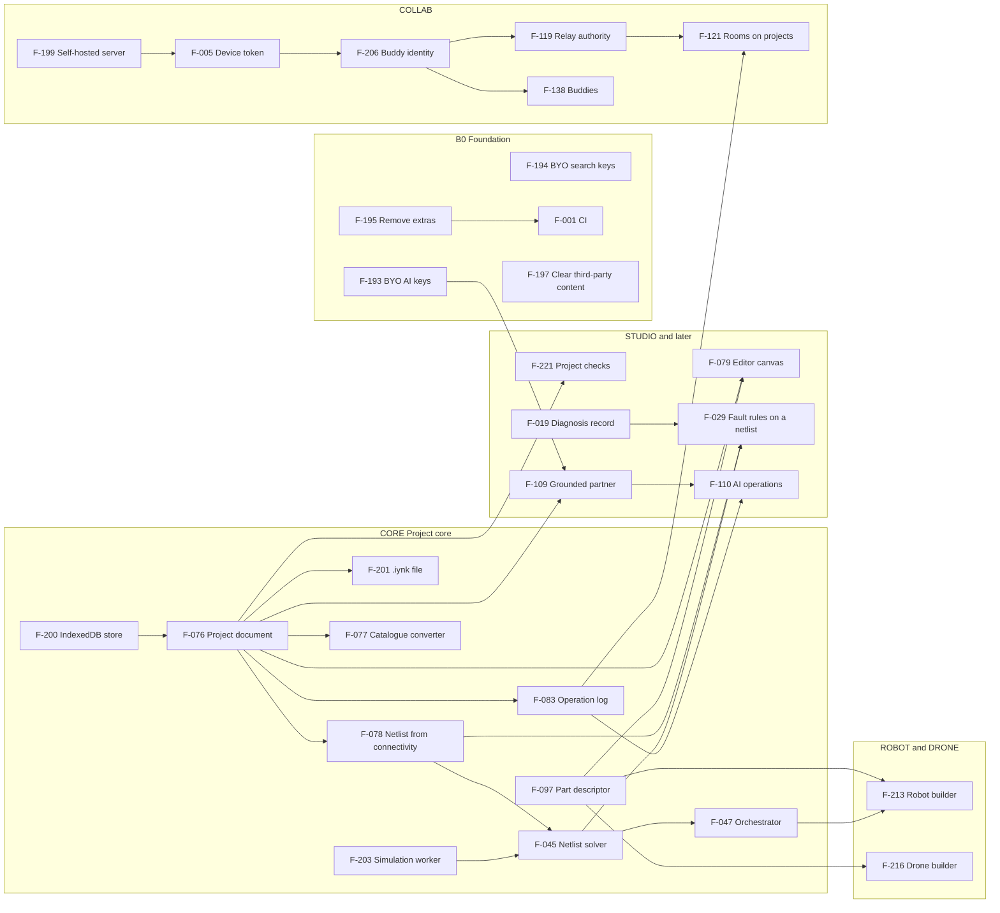

# iynk feature catalogue

Written 2026-10-27 by the product council seat (feature catalogue); revised 2026-10-27 for the build reframe (D-013 to D-017). Source: `BRIEF.md` sections 7 to 18 and 25, the decisions in `00_EXECUTIVE/DECISION_REGISTER.md` (start with "Current decisions: the build reframe"), every existing feature in `01_AUDIT/FEATURE_VERIFICATION.md`, and the spikes in `08_RESEARCH_SPIKES/`. This file lists candidates and says where each one sits in the build order. It does not score them: the scoring in BRIEF section 25 is a separate document that reads this one.

Purpose (D-013): a complete open-source hardware lab that Amar uses with his friends. Nothing here is planned around customers, markets, pricing, classrooms or institutions. Rows from the earlier strategy that serve only those are marked OOS (out of scope, shelved) and kept so ids stay stable. The end of the file lists every change ("Reframe changes").

Scope note: the security findings are not redone here. Where a feature depends on security work, the row cites `01_AUDIT/SECURITY_BASELINE.md` and D-005 and nothing more.

## 1. How to read this file

The catalogue has **221 features** in 20 domains: **75 existing** (code built in the hackathon repo, each with a verification status today) and **146 new** (proposed). The first 192 ids are unchanged from the first version; F-193 to F-221 are new. Every Studio capability is listed in full because D-014 builds it.

### Columns

| Column | Meaning |
|---|---|
| ID | Stable id `F-nnn`. Ids are never reused or renumbered; new features are appended. |
| Feature | Short name. |
| What it does | One or two sentences. |
| User value | Why Amar or a friend wants it. |
| Used by | `solo` (one person, no server), `buddies` (needs friends and the optional server), `solo, buddies` (works alone, better together), `maintainer` (people who build and run the project), or `none` for REMOVED and OOS rows. Replaces the old segment column. |
| Code today or NEW | `PRESERVE`, `EXTEND`, `REPLACE` with the path, `DELETE` for removed code, or `NEW`. The verb is the audit's verdict (`00_EXECUTIVE/council/cto-platform.md` section 3) and the reason is in the row or in section 6. |
| Status today | Verification status from `01_AUDIT/FEATURE_VERIFICATION.md`, with claim ids (C001 to C119). For new features: what is missing and the evidence for that. |
| Depends on | Other F-ids that must exist first. |
| BRIEF | Section of `BRIEF.md` the capability comes from. |
| Phase and stance (D-014) | Build phase code from the table in section 2, then a short note. |

### Evidence labels and statuses

| Label | Meaning |
|---|---|
| VERIFIED | The audit read the source or ran a command that shows it. |
| VERIFIED-PARTIAL | Part of the claim is shown; the row says which part is not. |
| DOCUMENTED | A project document says so; nobody tested it. |
| CONTRADICTED | Code or a run shows the claim is wrong as worded. |
| UNKNOWN | Cannot be checked from the repo. |
| EXTERNAL, ESTIMATED, HYPOTHESIS | As in the brief. No user has been interviewed; demand statements do not drive priorities now. |
| PENDING RS-xx | A research spike has no `Verdict` yet. The row gives the decision rule from `02_RESEARCH/TECHNICAL_RESEARCH.md` section 6. A later pass folds the result in. |

## 2. Summary

### By domain

| Domain | Features | Existing | New | First id |
|---|---|---|---|---|
| A. Foundation (B0) | 16 | 5 | 11 | F-001 |
| B. Fault Lab: diagnose and learn | 14 | 4 | 10 | F-017 |
| C. Board Lab (existing) | 7 | 7 | 0 | F-031 |
| D. Simulation and code runtimes | 17 | 8 | 9 | F-038 |
| E. Instruments and observation | 6 | 1 | 5 | F-052 |
| F. Robotics | 9 | 3 | 6 | F-057 |
| G. Drone Lab and flight | 16 | 10 | 6 | F-063 |
| H. Studio: project builder and lifecycle | 21 | 0 | 21 | F-076 |
| I. Components and parts | 10 | 2 | 8 | F-096 |
| J. AI lab partner | 11 | 5 | 6 | F-105 |
| K. Collaboration and buddies | 9 | 3 | 6 | F-116 |
| L. Learning paths and authoring | 13 | 0 | 13 | F-124 |
| M. Community and buddies | 9 | 6 | 3 | F-137 |
| N. Credentials and Solana (removed) | 8 | 5 | 3 | F-146 |
| O. Physical build bridge | 14 | 6 | 8 | F-154 |
| P. Platform, data and integrations | 6 | 3 | 3 | F-165 |
| Q. Experience, access and language | 9 | 5 | 4 | F-171 |
| R. Quality and fidelity validation | 8 | 2 | 6 | F-180 |
| S. Commercial (out of scope) | 5 | 0 | 5 | F-188 |
| T. Local-first, self-hosting, open source | 13 | 0 | 13 | F-193 |
| **Total** | **221** | **75** | **146** | |

### By build phase

Phases follow D-014. Each build phase stops for Amar's OK.

| Phase | Features | Meaning |
|---|---|---|
| B0 | 23 | Foundation: security fixes, CI, open-source basics, bring-your-own keys, extras removed |
| CORE | 21 | Project core: canonical document, netlist, solver and runtime in a worker, local save and load |
| STUDIO | 9 | Studio editor: Uno first, then all boards |
| COLLAB | 16 | Collaboration with buddies on an optional self-hosted server |
| SIM | 18 | Simulation fidelity: real-chip engines where the spikes say so, debugger, replay |
| FAULTS | 13 | Faults and diagnose-first on any circuit |
| PARTS | 5 | Components and custom parts |
| LABS | 20 | Existing Board, Robotics and Drone labs moved into Studio as projects and templates |
| AI | 9 | AI partner working on the project through reviewable operations |
| ROBOT | 6 | Robotics creation (physics) |
| DRONE | 11 | Drone creation, design to flight |
| EXPORT | 11 | Export and physical build |
| KEEP | 6 | Preserved as is; no scheduled work |
| LATER | 16 | Proposed, unscheduled; a trigger is in the row |
| REMOVED | 8 | Deleted in B0 (D-016) |
| OOS | 29 | Out of scope: shelved, kept so ids stay stable (D-013) |

### Verification status of the existing features

The status is the first label that appears in the row's Status cell, so a row such as `VERIFIED-PARTIAL (C009); VERIFIED (C010)` counts once as VERIFIED-PARTIAL. Section 1 of `FEATURE_VERIFICATION.md` has the claim-level view (119 claims: 39 VERIFIED, 55 VERIFIED-PARTIAL, 5 DOCUMENTED, 8 CONTRADICTED, 12 UNKNOWN).

| First status label | Existing features |
|---|---|
| VERIFIED | 29 |
| VERIFIED-PARTIAL | 40 |
| DOCUMENTED | 0 |
| CONTRADICTED | 3 |
| UNKNOWN | 0 |
| other (qualitative, see row) | 3 |

Existing features that carry a CONTRADICTED claim anywhere in the row: F-009, F-037, F-064, F-071, F-147, F-154. The wording of those claims must change in the public copy (F-009) before the repository is published.

## 3. Catalogue by domain

### 3.1 Domain A: Foundation (build phase B0)

Build phase B0 (D-005 reframed by D-014). Security detail lives in `01_AUDIT/SECURITY_BASELINE.md`; this domain lists the capabilities. Items that belong to local-first storage, the self-hosted server and open-source housekeeping are in Domain T.
| ID | Feature | What it does | User value | Used by | Code today or NEW | Status today | Depends on | BRIEF | Phase and stance (D-014) |
|---|---|---|---|---|---|---|---|---|---|
| F-001 | **CI on every push** | Runs typecheck, eslint, content check, unit tests, relay tests and a figure rebuild diff on every push, plus secret and dependency scanning. Includes making the unit gate deterministic (the 13 wall-clock timeouts). The Solana test job goes away with F-195. Deploys nothing to a paid host. | Every later change ships with a safety net, and outside contributors get the same checks. | maintainer | NEW. Commands exist in `package.json`; unit failures sit in `src/content/boards/basys3.test.ts`, `src/content/drones/octo.test.ts`, `src/content/drones/wing.test.ts`. | Absence VERIFIED (FV section 5). Unit suite VERIFIED-PARTIAL (C039). | none | §20.1, §22.1 | B0: D-005, D-014. Add secret and dependency scanning; drop the Solana test job with F-195 |
| F-002 | **Security headers and CSP** | Global security headers, a content security policy and `poweredByHeader: false`. | Closes the cheapest class of browser attacks; the code is public and runs for friends. | solo, buddies | NEW. `next.config.ts` has headers for `/figures` only. | Absence VERIFIED (SECURITY_BASELINE X4). | none | §21 | B0: D-005. Self-host operators set the origin list in one place |
| F-003 | **Local usage meter, rate limits and kill switch** | Per-route rate limits on the self-hosted server, a per-provider usage counter and a daily cap the owner of the key sets, and a kill switch in settings. One process, so in-memory counters are acceptable if they are documented as such. | A runaway loop in the AI partner cannot burn the key of the person who brought it. | maintainer | EXTEND `src/lib/server/ratelimit.ts` (41 lines) and the per-instance AI and search counters. REPLACE is no longer needed: multi-instance hosting is not a goal (D-015). | In-memory design VERIFIED (SECURITY_BASELINE; ai-search D1 to D4). | F-193 | §21, §22 | B0: D-005, D-015. Smaller than first written: keys are the user's own |
| F-004 | **Closed or keyed server routes** | Every API route on the self-hosted server needs a device bearer token (B0 interim: IYNK_SERVER_TOKEN, BE-0 only, BE 13.1; from COLLAB: device bearer token) or a buddy signature (F-206). Unauthenticated direct-to-model paths are removed, MCP is key-gated and CORS is closed to the configured origins. | A public repo plus a public URL must not mean a free model endpoint for strangers. | maintainer | EXTEND `src/app/api/ai/*`, `src/app/api/search/*`, `src/app/api/mcp/*` (23 routes, none authenticated). | No authentication on 23 of 23 routes VERIFIED (SECURITY_BASELINE section 1). | F-003, F-193, F-199 | §13.5, §21 | B0: D-005, D-015 |
| F-005 | **Anonymous device token on the server** | An opaque bearer token (256-bit random, stored as SHA-256, 12 hours) issued by the self-hosted server to a browser after a signed challenge, stored by hash, used to own a share link or a room slot before the person has paired with buddies. Not needed when the app runs with no server. | Gives the server something to own data by without an account. | solo, buddies | NEW. Pattern to reuse: token-hash ownership in `db/migrations/0003_profiles.sql`. | Pattern VERIFIED (server-data inventory); no identity today (FV section 6). | none | §8.1, §21 | COLLAB: was Step 0 (D-005); needed only once the optional server exists (D-015) |
| F-006 | **Telemetry removed or opt-in, events stay local** | Default off. If kept, events go to a local store the user can read and wipe, with an idempotency key. Delete the public counter that reads the events store: `src/components/data/LiveCounter.tsx`, `src/app/api/live/route.ts`, `src/components/data/useFeed.ts`. No persistent id without consent. | Nothing about the user's work leaves the machine unless they turn it on. | solo, buddies | EXTEND `src/lib/telemetry/*`, `src/app/api/telemetry/route.ts`. Default is on at `src/lib/progress/storage.ts:38`. | On by default VERIFIED (walk 14); "never your name or your code" VERIFIED-PARTIAL (C054). | none | §21, §24.2 | B0: D-005 reframed: removed or opt-in, local first |
| F-007 | **Licence placeholder and content provenance record** | A clearly marked placeholder file (`LICENSE-PENDING.md`, not an SPDX licence) that says no licence has been chosen, a PROVENANCE note listing every place where lesson structure, timings, formulas or constants follow the three third-party sites, and a rule that no source file gets an SPDX header until Amar decides (D-017). | Contributors and readers know the legal state of the code; nobody assumes a licence that is not there. | solo | NEW (docs). | No LICENSE VERIFIED; "reused facts, not code" UNKNOWN (C042); "does everything they do" UNKNOWN (C052). Counsel is no longer a gate: Amar decides. | none | §19.6, §23.4 | B0: D-017: placeholder now, licence chosen later by Amar |
| F-008 | **Data-handling note** | One page in the README and the app: what stays in the browser, what the optional server stores (share links, buddy list, room state), what an AI or search call sends to the provider, and how to wipe it. Replaces the terms, 13+ statement and retention table. | A friend who joins your server can read what it keeps. | solo | NEW (docs). No privacy or terms page under `src/app` today. | Absence VERIFIED. | F-199 | §15.3, §21 | B0: D-005 reframed: a data-handling note, not a terms-of-service exercise |
| F-009 | **Public copy that matches verified claims** | Rewrites README, About and UI strings so the CONTRADICTED claims (priced live, server re-run, 80 figures, every course medals, 445 tests, [342], all sponsors live, Solana UI text) say what the code does, and removes hackathon, sponsor and pitch language. | Anyone who reads the repo or the app finds no claim the code cannot meet. | solo, buddies | EXTEND `src/i18n/messages/en/*.json`, `README.md`. | 8 CONTRADICTED VERIFIED (FV section 1 and 7). | none | §2.2, §5.4 | B0: D-005 |
| F-010 | **Safety panels and autonomy content rule** | A LiPo and prop panel, a before-you-fly panel, a content rule that bars payload release, target tracking and weaponisation, and a calculator disclaimer. | Prevents harm on drone and robotics content; stays in the code that is public. | solo | NEW copy over `src/components/dronelab/*`. | Absence VERIFIED (robotics-aero memo); legal sources partly UNKNOWN. | none | §12.2 | B0: D-005; content rule applies to the DRONE and ROBOT phases |
| F-011 | **"What it models" panel and tier label** | Every Studio project and every migrated lab shows a tier (T0 illustrative, T1 teaching model, ...) and lists what is and is not modelled. Never the word "validated". | You see the limits before you trust a result on the bench. | solo | NEW. Tier model in `00_EXECUTIVE/council/fidelity.md` section 7. | Absence VERIFIED. | none | §10.2, §17.1, §20.3 | SIM: D-007; label shown on every Studio project and every migrated lab |
| F-012 | **Feature flags: run with no server, no AI, no search** | One configuration, read at start, that turns off server-backed features (rooms, share links, buddies), AI and search, so the app runs fully in the browser (D-015). Replaces the classroom flag. | The default experience needs nothing but a browser. | solo | EXTEND `src/lib/features.ts` (flags ai, image, voice, search, solana, db, realtime, gemini, hw) and `src/lib/server/env.ts`. Remove the `solana` and `image` flags with F-195. | Flags VERIFIED (C037, C038). | none | §21 | B0: D-015: app must run with no server, no AI and no search |
| F-013 | **North-star analytics: weekly learners with a verified diagnosis** | Counts distinct anonymous sessions per week with a verified diagnosis. Shelved with D-009; nothing in the build reads it. | Tells the team whether the product teaches, not just whether it is opened. | none (out of scope) | NEW. Events in F-024; storage via F-165. | Not built. Events exist only in part (attempt, pass). | F-024, F-006, F-165 | §24.2 | OOS: D-009 shelved: north-star analytics served the startup question |
| F-014 | **Lighter first load and idle CPU** | Lazy-load CodeMirror, delete the wallet stack with F-195, find and fix the 48 to 65 percent idle CPU of figure pages. | The app opens fast on a Chromebook or a slow link; D-011 as an engineering target. Dropping the Solana stack is most of the win (PERFORMANCE_BASELINE P1). | solo | EXTEND lesson pages; suspect `figures/vendor/colorfigures/core.js:480` (HYPOTHESIS). | 701 KB gzip lesson load and idle CPU VERIFIED (PERFORMANCE_BASELINE P1). | none | §18.3, §22 | B0: D-011 as an engineering budget |
| F-015 | **Low-end device and slow-connection test protocol** | A repeatable test on a throttled CPU and link, in a non-English interface, with time to first working run as the measure. A real low-cost phone and Chromebook when Amar has them. | Keeps the performance budget honest. | solo | NEW (process plus script). | No real low-end device tested (PERFORMANCE_BASELINE used CPU throttling). | none | §18.3, §22.2 | B0: D-011; measured by F-204 |
| F-016 | **Local error log and uptime check** | Client and server errors written to a local log the user can copy into an issue; an uptime probe for self-hosters. No third-party error service by default. | Bugs are reportable without sending data anywhere automatically. | maintainer | NEW. Relay has `/metrics` (realtime inventory). | Absence VERIFIED (tooling inventory). | F-001 | §22.1 | B0: opt-in, local log first |

### 3.2 Domain B: Fault Lab: diagnose and learn

Faults and diagnose-first (D-014 phase FAULTS). Catalogue items first, then any circuit (F-028 to F-030). The shared diagnosis record is D-010.
| ID | Feature | What it does | User value | Used by | Code today or NEW | Status today | Depends on | BRIEF | Phase and stance (D-014) |
|---|---|---|---|---|---|---|---|---|---|
| F-017 | **Break it (trigger and explain)** | A learner presses a fault, the circuit misbehaves, a card gives symptom, why and fix, and Repair restores it. 144 board failures and 106 bench faults carry the text. | You see what a wiring mistake does without burning a part. | solo | PRESERVE. `src/components/boardlab/FailurePanel.tsx`, `FailureMode` at `src/content/schema.ts:243`, `src/components/robotics/FaultsPanel.tsx`. | VERIFIED-PARTIAL (C009); LED-without-resistor 113 mA VERIFIED (C010, C049). | none | §3.4, §15.1 | FAULTS: base for diagnose-first; content moves with LABS |
| F-018 | **Diagnose-first mode (cause hidden)** | Shows the symptom and live readings with the trigger hidden. The learner picks or writes a diagnosis from structured choices drawn from the fault's data, then fixes it and sees the symptom clear. | Turns a worked example into a prediction task, the skill a bench needs. | solo | NEW over `FailureMode`; uses figure bridge `set` and `query` messages (`src/components/figure/protocol.ts`). | Absence VERIFIED (today the learner presses the trigger). | F-017, F-019 | §6.2, §15.1 | FAULTS: D-010, D-014; record type defined in CORE |
| F-019 | **Shared diagnosis record and cause ids** | One record `{cause_id, symptom_id, evidence, hint_level}` with a closed list of electrical cause ids, tagged onto every catalogue fault now and emitted by netlist fault rules later. | The fault corpus stops being bound to 38 figures and carries over to Studio. | maintainer | NEW type; seeds from `FailureMode` fields. | Not built. | F-017 | §8.3, §10.1 | FAULTS: D-010, D-014; record type defined in CORE |
| F-020 | **Three-step logged hint ladder** | Hint 1 where to look, hint 2 which measurement, hint 3 the cause; each open is logged with its level. | Help without giving the answer away; the log shows which items are hard. | solo | NEW UI; `hints: TextKey[]` already in `src/content/schema.ts:415`. | Data field VERIFIED; ladder absent. | F-019, F-024 | §15.1 | FAULTS: D-010, D-014; record type defined in CORE |
| F-021 | **Transfer question on a similar circuit** | After the fix, one question on a near variant of the same fault. | Checks the idea moved beyond the one circuit. | solo | NEW content plus UI. | Not built. | F-018 | §15.1, §15.4 | FAULTS: D-010, D-014; record type defined in CORE |
| F-022 | **40 reviewed diagnose items (English)** | Symptom variants, wrong-cause distractors and hints for 40 items built from the 144 board failures, checked by Amar or a buddy with electronics experience. | Enough exercises to practise diagnosis for weeks. | solo | NEW content from `src/content/boards/uno-r3.ts` and siblings. | Source text VERIFIED; distractors and hints new. | F-019, F-020, F-018 | §15.1 | FAULTS: D-010, D-014; record type defined in CORE |
| F-023 | **Meaningful pass** | A lesson passes only after one real edit to the starter and one quiz answer. Includes an audit of all 71 starters for pass-on-open. | "Done" means you did something. | solo | EXTEND `src/lib/interp/checks.ts`, `src/components/boardlab/LessonWorkspace.tsx`. | Blink starter passes untouched VERIFIED (walk 2); 71-starter audit UNKNOWN. | F-024 | §15.1, §25 | LABS: audit of the 71 starters runs as the labs move |
| F-024 | **Learning events (local)** | Events `code.changed` (flag only), `check.transition`, `hint.open`, `diagnose.answer` with a correct flag, stored in the local event log and shown in a personal progress view. | Your own record of what you tried and where you needed hints. | maintainer | EXTEND `src/lib/telemetry/kinds.ts`. | Attempt and pass events exist; the four new ones do not. | F-006 | §15.4, §24.2 | FAULTS: local event log only (see F-006) |
| F-025 | **Loud, specific code feedback** | Show the real reason for unsupported constructs, reject unknown `#include`, name the pin in "not connected", make a Run after edit restart or say it did not. | Stops the simulator teaching wrong lessons. | solo | EXTEND `src/lib/boardlab/run.ts:176`, `src/components/boardlab/CodePanel.tsx:79`, `src/lib/interp/arduino/parser.ts:433`. | 5 of 7 failure cases gave a good message VERIFIED (walk 4, 15). | none | §10.5 | SIM |
| F-026 | **Code versus wiring mismatch diagnosis** | Detects "LED is on D13, code drives D12" and explains it as a diagnosis item. | The most common beginner mistake becomes a teachable moment. | solo | NEW rule over world and wiring data. | Absence VERIFIED (walk 15). | F-019 | §13.2 | FAULTS |
| F-027 | **Correct-first option for the outcome study** | A build mode that hides the trigger, so two groups can be compared. Shelved; no study is planned. | Lets the team test whether diagnosing first improves far transfer. | none (out of scope) | NEW. | Not built; effort UNKNOWN (USER_RESEARCH_PLAN M7). | F-018 | §15.4 | OOS: outcome-study mode; shelved with D-009 |
| F-028 | **Electrical rules check with plain-language warnings** | Static checks before a run: LED without resistor, reversed LED, 5 V to GND, floating input, part not powered, button without pull-up. | A warning before the run, in words a beginner can act on. | solo | NEW over the netlist. | Not built. Velxio warns before a run (TESTED, WORKFLOW_BENCHMARK). | F-078, F-019 | §8.2, §10.4 | FAULTS: D-010, D-014 faults on any circuit |
| F-029 | **Generic fault rules on a netlist** | At least 8 distinct rules that emit the same diagnosis record on any user circuit; target zero false alarms on every file in `tests/fixtures/fault-corpus/clean/` and at least 18 of the 20 in `broken/` caught (corpus owned by EDUCATION 6.6; not yet created). | The differentiator carries over to circuits the authors never saw. | solo | NEW. Seeds from the 250 authored faults. | Not built. | F-078, F-019, F-045 | §10.1, §10.4 | FAULTS: D-010, D-014 faults on any circuit |
| F-030 | **Break it on the learner's own circuit** | Pick a fault to inject into the learner's project, then diagnose it. | Faults stop being a catalogue and become a debugging gym. | solo | NEW. | Not built. | F-029 | §7, §15.1 | FAULTS: D-010, D-014 faults on any circuit |

### 3.3 Domain C: Board Lab (existing)

Twelve boards, 71 lessons, moved into Studio as projects and templates in phase LABS. Counts re-verified in FV section 2.
| ID | Feature | What it does | User value | Used by | Code today or NEW | Status today | Depends on | BRIEF | Phase and stance (D-014) |
|---|---|---|---|---|---|---|---|---|---|
| F-031 | **Board catalogue and browse pages** | 12 boards (Uno R3, Nano, Uno R4 Minima and WiFi, ESP32, ESP32-S3, NodeMCU, Pico family, Nucleo, micro:bit V2, Pi 4 and 5, Basys 3, DE10-Lite) with catalogue pages in six languages. | A learner finds the board they own or want. | solo | PRESERVE. `src/content/boards/*.ts`, `src/components/catalogue/Catalogue.tsx`. | VERIFIED (C003, C060) | none | §3.1 | LABS: moves into Studio as projects and templates |
| F-032 | **71 board lessons with checks** | Lessons with starter code, hints, quizzes and 461 checks that must pass. | Guided practice from blink to sensors. | solo | PRESERVE. `src/content/boards/*.ts`, `src/lib/interp/lessons.test.ts`. | VERIFIED (C007, C061); pass semantics VERIFIED-PARTIAL (C008). | none | §15.1 | LABS: moves into Studio as projects and templates |
| F-033 | **Check engine and quizzes** | Ten check kinds evaluated in a Web Worker with a time budget; quizzes after lessons and steps. | A pass is computed, not clicked. | solo | PRESERVE. `src/lib/interp/checks.ts`, `check-job.ts`, `check.worker.ts`. | VERIFIED-PARTIAL (C075, C079). | none | §15.2 | LABS: moves into Studio as projects and templates |
| F-034 | **Code editor with Run, Stop, Reset, Copy and shortcuts** | CodeMirror editor, Run, Stop, Reset, Copy code, a shortcuts dialog. | Edit and run in the page with no install. | solo, buddies | PRESERVE. `src/components/boardlab/CodeEditor.tsx`, `CodePanel.tsx`, `ShortcutsDialog.tsx`. | VERIFIED (C048); one flaky shortcut test under load. | none | §10.5, §18.1 | LABS: moves into Studio as projects and templates |
| F-035 | **Workspace readouts and inputs** | Board, breadboard and schematic views, pin readout, pinout table, world panel (buttons, potentiometer, sensors), parameter chips, assembly panel. | See and poke the circuit while the code runs. | solo | PRESERVE. `ViewBar.tsx`, `PinReadout.tsx`, `PinoutTable.tsx`, `WorldPanel.tsx`, `ParamPanel.tsx`, `AssemblyPanel.tsx`. | VERIFIED-PARTIAL (C044); assembly panel UNKNOWN (no claim row). | none | §8.2 | LABS: moves into Studio as projects and templates |
| F-036 | **Progress storage and home dashboard** | Done flags and settings in one `iynk:v1` localStorage document; a home progress view. | Learners return to where they stopped. | solo, buddies | PRESERVE. `src/lib/progress/*`, `src/components/shell/dashboard/*`. Work itself is not stored. | VERIFIED (C053). | none | §8.1 | LABS: moves into Studio as projects and templates |
| F-037 | **Hand-inked 3D figures with see-through and bridge** | 80 figure pages (38 items plus 42 part, module and range pages) with turn, see-through and labels; a versioned bridge protocol `{source:'iynk', v:1}` connects page and figure. | The visual identity; learners see the mechanism. | solo, buddies | PRESERVE. `figures/**`, `src/components/figure/*`. Committed build output, 24 MB. | VERIFIED-PARTIAL (C004, C047, C066); "80 figures" for 38 items CONTRADICTED (C067). | none | §18, §19.6 | LABS: figures stay the visual library for PARTS |

### 3.4 Domain D: Simulation and code runtimes

Layers from BRIEF §10.1. The project core (CORE) needs F-044, F-045, F-047 and F-203; fidelity work (SIM) follows. Spike results are folded in only where a REPORT.md has a Verdict.
| ID | Feature | What it does | User value | Used by | Code today or NEW | Status today | Depends on | BRIEF | Phase and stance (D-014) |
|---|---|---|---|---|---|---|---|---|---|
| F-038 | **Arduino C++ subset interpreter** | From-scratch parser and interpreter that drives pins, serial and the figure, with 189 interpreter tests. | Instant offline run of beginner sketches. | solo | PRESERVE. `src/lib/interp/arduino/*`. | VERIFIED (C006); subset, not a toolchain (C005 VERIFIED-PARTIAL). | none | §10.5 | CORE: runs in the simulation worker (F-203) |
| F-039 | **MicroPython and Python (gpiozero, rclpy, micro:bit)** | Python subset runtime with hand-written modules for Pi and micro:bit. | Python learners and Pi owners can run lessons. | solo | PRESERVE. `src/lib/interp/python/*`. | VERIFIED-PARTIAL (C005). | none | §10.5 | CORE: runs in the simulation worker (F-203) |
| F-040 | **Verilog 2-state cycle simulator** | Verilog subset simulation for Basys 3 and DE10-Lite lessons. | FPGA lessons run without a vendor tool. | solo | PRESERVE. `src/lib/interp/verilog/*`. | VERIFIED-PARTIAL (C005); not hardware-equivalent. | none | §10.5 | CORE: runs in the simulation worker (F-203) |
| F-041 | **Virtual clock, World and device models** | Deterministic virtual clock, the `World` pin state, and 11 device kinds (LCD, OLED, MPU6050, PCA9685 and others). | Repeatable runs and sensor behaviour. | solo, buddies | PRESERVE. `src/lib/interp/clock.ts`, `world.ts`, `devices.ts`. | VERIFIED (interp inventory); SPI returns 0 silently (interp D4). | none | §10.3 | SIM: extend with protocol models (F-208) |
| F-042 | **DC nodal circuit solver and simulated damage** | A DC solver for breadboard circuits that reports burnt LEDs, brown-outs and regulator damage. | The reason a fault looks real. | solo | PRESERVE for catalogue figures. `figures/engine/bench-solve.js` (126 figure-engine tests). | VERIFIED (C112); 113 mA VERIFIED (C010); constants and silent non-convergence are defects. | none | §10.4 | SIM: frozen for catalogue figures until F-045 passes RS-08 |
| F-043 | **Honest solver and "not modelled yet" states** | Convergence flag, per-board pin resistance, seeded tolerance bands (ranges, not single numbers), and a visible "not modelled yet" state for SPI, unsupported constructs and unmodelled parts. | The tool says when it does not know instead of guessing. | solo | EXTEND `figures/engine/bench-solve.js`, `src/lib/interp/*`. | Defects VERIFIED (figure-engine 1 to 3; interp D4). RS-08: the fixed-Vf LED, single-slope diode, saturating-switch BJT and motor stall model are why 10 of 20 realistic circuits miss 2 percent (6 by more than 10 percent), so the "not modelled yet" and tolerance states carry real weight. | F-042, F-041 | §10.2, §10.4 | SIM: D-007 |
| F-044 | **Run limits and Worker execution** | Heap, step and output caps; run in a Worker; loud failure on overrun. | A runaway sketch cannot hang the tab; the simulation worker kills it (F-203). | maintainer | EXTEND `src/lib/interp/run.ts`, `check-client.ts`. | 3 of 4 allocation probes aborted Node VERIFIED (interp D1). | none | §10.5 | CORE |
| F-045 | **Pure data-driven DC solver for netlists** | `solve({nodes, elements, sources})` with structured results, no globals, per-part constants from data, running in the simulation worker. | Solves circuits a learner drew. | solo | REPLACE for user circuits; seed from union-find and `linsolve` in `bench-solve.js`. | RS-08(a) Verdict: mixed. Linear solve PASS (20 of 20 within 2 percent against matched piecewise-linear models, worst 0.26 percent; 60 random networks, 0 mismatches). Device-model fidelity against realistic SPICE models FAIL under the rule (10 of 20 within 2 percent, more than 5 disagree). Decision (ADR-0304): keep and extract the MNA core; add Newton diode, LED and BJT devices before calling those parts T2; ngspice-WASM is the oracle and an on-demand "analyse" button, not the live engine. Cost 0.04 ms per solve on the largest catalogue circuit; phones untested. | F-078, F-203 | §10.4 | CORE: decided ADR-0304; devices need Newton models |
| F-046 | **Transient analysis and ngspice option** | Trapezoidal companion models for C and L; ngspice-WASM behind an "analyse" button if the in-house engine misses. | RC filters, buck converters and motors with real waveforms. | solo | NEW. | RS-08(b) was NOT RUN (INCONCLUSIVE; no transient script exists, `08_RESEARCH_SPIKES/RS-08-mna-vs-ngspice/REPORT.md`); RS-07 never ran (no folder). Rule: within 1 percent of ngspice and under 16 ms per frame on a phone. DECIDED: build the `AnalogBackend` interface (ADR-0304), add trapezoidal transient to the in-house engine, and run RS-07 and RS-08(b)-style checks against ngspice-WASM as a SIM-phase task (the largest DC circuit solves in 0.45 ms at 6x throttle, so frame cost is not the worry). Until that task passes, ngspice-WASM is the only transient path (analyse button) and no transient accuracy is claimed. Reversible behind the interface. | F-045 | §10.4 | SIM: RS-08(b) not run, RS-07 never ran; build and verification task in SIM |
| F-047 | **Simulation orchestrator** | One deterministic step loop: firmware pin writes become solver source changes, solver node voltages become ADC and digital reads. Integer-ns clock, seed, no wall clock. | Code and circuit affect each other correctly. | maintainer | NEW headless core (CTO package F). | Not built. | F-045, F-038, F-078, F-203 | §10.1, §10.3 | CORE |
| F-048 | **Real compiled firmware mode (avr8js)** | Run a compiled Uno hex in a Worker, with an adapter from pin edges to `World` snapshots; the interpreter stays the default instant path. | Libraries and sketches outside the subset run for real. | solo | NEW adapter; engine EXTERNAL (avr8js). | RS-03 Verdict: PASS for correctness and desktop speed (80 of 80 serial lines equal, PWM within 0.4 points, 6.1 to 7.5x real time); INCONCLUSIVE on phone and Chromebook (about 1.7x at 4x throttle, 1.1x at 6x, main-thread proxy, HYPOTHESIS). Keep reversible: interpreter remains the default. | F-049, F-041 | §10.2, §10.5 | SIM: RS-03 PASS (desktop); devices INCONCLUSIVE; decided ADR-0305 |
| F-049 | **Sketch compile service** | Browser WASM, or a compile process on the user's own self-hosted server (arduino-cli, avr-gcc), producing hex for F-048. Decision rule and licence check unchanged. | Real library support and `.hex` export without a vendor tool. | solo | NEW. | Partly answered by RS-03 (`08_RESEARCH_SPIKES/RS-03-avr8js-differential/REPORT.md`): arduino-cli compile took 1.17 to 1.40 s cold and 0.33 to 0.56 s warm on a desktop, and arduino-cli is GPL-3.0 (the checker did not re-verify the licence statement). RS-04, RS-05 and RS-17 never ran. DECIDED: compile runs on the user's own self-hosted server behind the compile slot (ADR-0013, ADR-0427) so the GPL tool is run, not shipped. RS-04 becomes a local compile timing task; its '4G phone' clause and RS-05's managed-sandbox cost clause assume scale this app does not have. Licence review is For Amar (D-017, RS-17). | none | §10.5 | SIM: RS-03 timings only; RS-04 local timing task; RS-05 and RS-17 not run (RS-17 For Amar) |
| F-050 | **Other real-engine options** | rp2040js with stock MicroPython, YoWASP Yosys with DigitalJS for Verilog, a self-hosted micro:bit simulator embed. | Higher fidelity for Pico, FPGA and micro:bit lessons. | solo | NEW. | RS-06 Verdict: pass clause NOT MET (rp2040js runs MicroPython at 0.54 to 0.79x real time using 100 percent of a core on an M4 Pro, 0.13 to 0.19x under 4x to 6x throttle); fail clause not triggered (boot, blink, ADC, filesystem and I2C work after about 90 lines of additions); idle-skip untested. Decision (ADR-0305): rp2040js is a test oracle for the Pico interpreter, not a user mode in the first release. RS-12 Verdict: PASS on the exit condition (10 of 10 shipped Verilog lessons elaborate), desktop only, memory 662 to 725 MB renderer against 1 GB, first load under 15 s only above about 8 Mbps, DigitalJS needed hand-set initial values; decision (ADR-0315): optional "Inspect" mode on request, desktop first. RS-18 never ran (pass rule: 90 percent of micro:bit lessons); the micro:bit embed stays out until a check task runs it. | none | §10.5 | SIM: RS-06 FAIL on CPU clause (oracle only); RS-12 PASS (Inspect mode); RS-18 never ran |
| F-051 | **Snapshots, pause, step, replay and speed control for circuits** | State snapshots, pause and step, replay from a log, simulation speed control and a "running slower than real time" flag. | Learners and checkers can inspect and reproduce a run. | solo | NEW for circuits; flight replay exists (`src/lib/flight/session.ts`). | Flight replay VERIFIED (C017); circuits absent. | F-047 | §10.3 | SIM |
| F-208 | **Peripheral protocol models** | I2C, SPI, UART, 1-Wire and PWM as modelled buses with address, timing and error states, so a sensor on a bus is a model attached to a bus and not a special case. Fixes SPI returning 0 silently (interp D4). | Sensors and displays behave like the datasheet bus, and a wrong address is a fault. | solo | EXTEND `src/lib/interp/devices.ts` (11 fixed device kinds). | SPI returns 0; device list closed (interp inventory VERIFIED). | F-041 | §10.1 | SIM |
| F-209 | **Sensor and environment models** | Models for light, temperature, distance, motion and magnetic inputs with noise and range limits, and an environment object (surface, obstacles, wind, ambient light) that the robot and drone phases reuse. | Sensors respond to something, with noise a program must handle. | solo | NEW; extends the `WorldModel` in `src/content/schema.ts`. | Fixed world knobs exist for lessons; no environment model. | F-041 | §10.1, §11.1 | SIM |
| F-219 | **Thermal and power-derating model** | Heat in resistors, regulators and motor drivers, with derating and thermal shutdown as faults. | Explains why a part got hot. | solo | NEW. | Absent. Feasibility UNKNOWN. | F-045 | §10.4 | LATER |

### 3.5 Domain E: Instruments and observation

BRIEF §10.6. Each reading must state whether a physical model or an approximation produced it.
| ID | Feature | What it does | User value | Used by | Code today or NEW | Status today | Depends on | BRIEF | Phase and stance (D-014) |
|---|---|---|---|---|---|---|---|---|---|
| F-052 | **Live status and current draw** | Bench status panel with current draw and brown-out state. | Shows why a supply fails. | solo | PRESERVE. `src/components/robotics/StatusPanel.tsx`, `src/lib/robotics/current.ts`. | VERIFIED-PARTIAL (C012). | none | §10.6 | LABS |
| F-053 | **Virtual multimeter** | Probe two nodes of a circuit and read volts or amps from the solver; doubles as hint-ladder step 2 ("which measurement"). | Teaches measuring, the move from symptom to cause. | solo | NEW. Catalogue: read figure state. Studio: read solver. | Not built. | F-042 | §10.6 | SIM |
| F-054 | **Oscilloscope, logic analyzer and event timeline** | Trace pin edges and signals over simulated time with zoom and cursors. | See PWM, I2C and timing instead of imagining them. | solo | NEW; edge trace exists in the run trace (`src/lib/interp/run.ts`). | Not built; truncation warns not at all (interp). | F-047 | §10.6 | SIM |
| F-055 | **Breakpoints and variable inspector** | Pause at a source line, step and inspect variables. | Debugging skill for code, not just wiring. | solo | NEW. Needs source maps. | Not built. | F-038 | §10.5, §10.6 | SIM |
| F-056 | **Fault evidence trace** | A short record of the measurements and states that justify a diagnosis (the `evidence` field). | A hint and a grade can point to proof. | solo | NEW. | Not built. | F-019, F-053 | §10.6, §13.1 | FAULTS: D-010 evidence field |
| F-207 | **Serial monitor and plotter** | A serial console with send and receive, baud setting and a live plot of numeric lines, fed by the interpreter's serial output or by avr8js. | The first debugging tool every Arduino user reaches for. | solo | EXTEND the serial output already produced by `src/lib/interp/run.ts`. | Output is captured; no interactive monitor UI (interp inventory). | F-038 | §10.5, §10.6 | SIM |

### 3.6 Domain F: Robotics Lab (existing and proposed)

Robotics creation is a build phase (ROBOT, D-014), no longer frozen. The 13 existing benches move to Studio as templates in LABS.
| ID | Feature | What it does | User value | Used by | Code today or NEW | Status today | Depends on | BRIEF | Phase and stance (D-014) |
|---|---|---|---|---|---|---|---|---|---|
| F-057 | **13 robotics benches** | Benches (L298N, A4988, TB6612, HC-SR04, MPU6050, PCA9685, QTR-8RC, LM2596, transistor switch, LED and resistor, Uno and ESP32-S3 builds, Pi 5 ROS 2 concept) with 272 build steps, live status, 31 practice tasks and quizzes. | Part-by-part learning of motor drivers, sensors and power stages. | solo | PRESERVE. `src/content/robotics/*.ts`, `src/lib/robotics/*`, `src/components/robotics/*`. | VERIFIED (C003, C062, C007); steps VERIFIED-PARTIAL (C012); "Do it" is a scripted animation. | none | §3.2 | LABS: bench becomes a Studio project template |
| F-058 | **106 bench faults with Repair** | Fault list and repair per bench; solver decides damage. | Same teaching move as Break it on parts a club uses. | solo | PRESERVE. `src/components/robotics/FaultsPanel.tsx`. | VERIFIED-PARTIAL (C009; walk 6). | none | §3.2, §15.1 | LABS: bench becomes a Studio project template |
| F-059 | **Raspberry Pi 5 ROS 2 concept bench** | Power and terminal text for a Pi 5 and ROS 2 graph; no real ROS nodes. | Introduces the vocabulary. | solo | PRESERVE. `src/content/robotics/pi5-ros2.ts`. | VERIFIED-PARTIAL; label as "ROS-like" until a real bridge exists. | none | §11.1 | LABS: bench becomes a Studio project template |
| F-060 | **Robot project slice (first robotics project)** | A 2D wheeled robot assembly with power and wiring checks, motion-control code, line-follower and obstacle-avoidance templates, replay and BOM export. Built on F-213 to F-215. | Gives "original robot" a meaning in the Studio. | solo | NEW. Needs a project document and a generic parts renderer. | Absent: 13 benches are electronics, not robots (robotics-aero memo, VERIFIED grep). | F-076, F-097, F-047, F-213 | §11, §11.2 | ROBOT: D-014; replaces the old freeze |
| F-061 | **Rigid-body physics, arms and legged robots** | Rapier contact physics (split build, behind `PhysicsBackend`; Jolt is the named fallback); arms and inverse kinematics. | Pushing, ramps, stacking. | solo | NEW. | RS-13 Verdict: PASS. Identical snapshot hash after 10,000 steps in Node, Chromium and WebKit for both engines, also under 4x and 6x CPU throttle; step mean 0.07 to 0.09 ms at 20 bodies, 0.44 to 0.54 ms at 6x throttle (worst single steps 1 to 5 ms). One CPU architecture, no Firefox, no phone. Rapier split build about 0.88 MB brotli fits the proposed 1.0 MB budget (HYPOTHESIS); the single-file build (1.20 MB) does not. Decision: ADR-0700, Rapier deterministic build behind `PhysicsBackend`. | F-213 | §11.1 | ROBOT: decided ADR-0700 (RS-13 PASS) |
| F-062 | **URDF import and a real ROS 2 bridge** | Import robot descriptions (URDF) and, later, connect real nodes. | Interop with the robotics toolchain. | solo | NEW. | rclpy and DDS do not run in a browser (TECHNICAL_RESEARCH D6). | F-060 | §11.1 | ROBOT: late in the phase; browser cannot run rclpy (TECHNICAL_RESEARCH D6) |
| F-213 | **Robot builder** | Assemble a robot from chassis, wheels, joints, motors, drivers, controller and sensors; a kinematic tree with masses, dimensions and joint limits; power and torque checks that name the limiting part. | Design a robot, not only wire a driver. | solo | NEW over F-076 and F-097. | Absent: the 13 benches are electronics, not robots (robotics-aero memo, VERIFIED grep). | F-076, F-097, F-209 | §11, §11.1 | ROBOT |
| F-214 | **Robot control and navigation** | Control-loop timing, PID blocks, odometry, line following and obstacle avoidance, with the controller running the user's code in the simulation worker. | Make the robot do something on purpose. | solo | NEW. | Absent. | F-213, F-203 | §11.1 | ROBOT |
| F-215 | **Robot templates** | Line follower, obstacle avoider, differential-drive rover, a simple arm and a sensor-guided vehicle, each a Studio project. | Start from a robot that works. | solo | NEW. | Absent. | F-213, F-214, F-084 | §11.2 | ROBOT |

### 3.7 Domain G: Drone Lab and flight (existing and proposed)

Drone creation is a build phase (DRONE, D-014), no longer frozen. The content rule in F-010 applies to every craft and course.
| ID | Feature | What it does | User value | Used by | Code today or NEW | Status today | Depends on | BRIEF | Phase and stance (D-014) |
|---|---|---|---|---|---|---|---|---|---|
| F-063 | **13 drone configurations** | Whoop, cinewhoop, racer, quad5, tricopter, octo, wing, VTOL, long-range, GPS camera, delivery, agrihex, swarm. | A range of builds to size and fly. | solo | PRESERVE. `src/content/drones/*.ts`. | VERIFIED (C003); review swarm, delivery, agrihex, longrange and vtol against the autonomy content rule (F-010). | none | §3.3 | LABS: craft becomes a Studio project template; DRONE phase extends |
| F-064 | **Drone calculator** | Thrust to weight, hover throttle, flight time, current, checked against 342 reference rows. | Sizing a drone before buying parts. | solo | PRESERVE. `src/lib/drone/calc.ts`. | VERIFIED (C013, C106); "[342]" and "445 of 445" wording CONTRADICTED (C080, C107); constants follow a third-party site (provenance UNKNOWN). | F-007 | §12 | LABS: craft becomes a Studio project template; DRONE phase extends |
| F-065 | **Design, build and wiring panels** | Part dropdowns (3 batteries, 3 motors, 3 props), part-by-part build, wiring sheet, quiz. | Learn how the parts fit. | solo | PRESERVE. `src/components/dronelab/DesignPanel.tsx`, `BuildPanel.tsx`, `WiringPanel.tsx`, `QuizPanel.tsx`. | VERIFIED-PARTIAL (C046). | none | §12 | LABS: craft becomes a Studio project template; DRONE phase extends |
| F-066 | **Bench safety tests and arming rules** | Smoke stopper, motor direction check, arming logic: 78 tests. | Safe habits before a first flight. | solo | PRESERVE. `src/components/dronelab/TestsPanel.tsx`, `src/lib/dronelab/*`. | VERIFIED-PARTIAL (C014); 78 tests VERIFIED (C063). | none | §12.2 | LABS: craft becomes a Studio project template; DRONE phase extends |
| F-067 | **Flight-controller CLI console** | Betaflight, INAV and ArduPilot CLI snippets and a reducer. | Learn the settings language of real firmware. | solo | PRESERVE. `src/components/dronelab/CliConsole.tsx`, `src/lib/dronelab/cli.ts`. | VERIFIED-PARTIAL (C065); 131 snippets VERIFIED (C105). | none | §12 | LABS: craft becomes a Studio project template; DRONE phase extends |
| F-068 | **Flight range** | 22 courses (gates, checkpoints, delivery and spray missions), angle and acro modes, third person and FPV, in-flight faults. | Fly the drone you designed. | solo | PRESERVE. `src/lib/flight/*`, `src/components/flight/FlightRange.tsx`, `BreakIt.tsx`. | VERIFIED-PARTIAL (C015, C064); arcade point mass; 16 m limit is a warning only. | F-064 | §12 | DRONE: flight range kept; builds on the drone builder |
| F-069 | **Slow-motion crash replay** | Deterministic re-simulation from the action log with a "Here's why" card. | Learn why a design flipped. | solo | PRESERVE. `src/lib/flight/crash.ts`, `session.ts`. | VERIFIED (C017). Replay of the rigid-body robot side rests on the RS-13 hash result (PASS, one CPU architecture); drone flight models wait on RS-14. | F-068 | §12.1 | DRONE: flight range kept; builds on the drone builder |
| F-070 | **Autopilot lap and ghosts** | A demo autopilot lap for every course; ghost of your best lap and of friends. | Targets to beat; proves a course is flyable. | solo, buddies | PRESERVE. `src/lib/flight/ghost.ts`, `src/components/flight/room-ghosts.ts`. | VERIFIED-PARTIAL (C016); autopilot lap per course VERIFIED (flight tests). | F-068 | §12 | DRONE: flight range kept; builds on the drone builder |
| F-071 | **Medal times and daily challenge** | Gold, silver, bronze times (21 of 22 courses) and a UTC-day challenge with a share link. | A reason to come back. | solo | PRESERVE. `src/lib/flight/challenge.ts`, `src/components/flight/DailyChallenge.tsx`. | Daily pick VERIFIED; "every course has medals" CONTRADICTED (C095). | F-068 | §16 | DRONE: flight range kept; builds on the drone builder |
| F-072 | **Touch sticks and gamepad** | On-screen sticks, gamepad panel, keyboard flight. | Fly on a phone or with a controller. | solo | PRESERVE. `src/components/flight/TouchSticks.tsx`, `GamepadPanel.tsx`. | VERIFIED-PARTIAL (walk 8, 13); phone HUD drops values. | F-068 | §18.3 | DRONE: flight range kept; builds on the drone builder |
| F-073 | **User-entered drone parts and design comparison** | Parts as data with thrust, current, battery internal resistance and an error band; compare configurations; trace analysis. | Design a drone not in the catalogue. | solo | NEW. `designInput` throws on unknown keys today. | Absent (drone-calc inventory). | F-097, F-216 | §12 | DRONE |
| F-074 | **Deeper flight models** | 6-DOF rigid-body model with PID tuning; PX4 or ArduPilot SITL. | Tune a controller, not just fly. | solo | NEW. | RS-14 never ran (rise time and overshoot within 15 percent; SITL under 50 percent of a vCPU); DP-01 is an author-run prototype, not a spike verdict. Becomes an offline PX4 SIH comparison task in DRONE; no SITL in the app until it passes. | F-073 | §12.1 | DRONE: RS-14 never ran; offline comparison task |
| F-075 | **Server-verified lap times from replay** | Re-simulate the action log on the self-hosted server and store a verified time. Not needed among friends; kept as a later option. | Leaderboards that cannot be faked if a friend group ever wants that. | solo | NEW. Replay is pure TypeScript with no DOM (flight inventory). | Lap times are client-claimed VERIFIED (flight defect 2); cross-browser determinism UNKNOWN (REVIEW_GAPS row 11). | F-069, F-186 | §16 | LATER: friends are trusted; trigger: someone cheats and it matters |
| F-216 | **Drone builder** | Choose frame size, motors, props, ESCs and battery from part descriptors, set flight-controller parameters, see mass, centre of mass, thrust and current, then fly the result. Replaces the 3 x 3 x 3 dropdowns. | Design the drone you want and fly it. | solo | EXTEND `src/lib/drone/calc.ts`, `src/components/dronelab/DesignPanel.tsx`. | Dropdowns and a calculator exist; `designInput` throws on unknown keys (drone-calc inventory). | F-097, F-073 | §12 | DRONE |
| F-217 | **Flight traces and configuration comparison** | Record and plot a flight (attitude, motor outputs, battery sag) and compare two builds side by side. | See why one design flies better. | solo | EXTEND `src/lib/flight/session.ts`. | Replay exists (C017); no trace analysis. | F-068, F-216 | §12 | DRONE |
| F-218 | **Flight environment and failure models** | Wind, gusts, GPS and IMU noise and sensor failures as seeded environment settings. | Practise failures before a real flight. | solo | NEW over F-209. | Absent; arcade point mass (C015). | F-209, F-068 | §12.1 | DRONE |

### 3.8 Domain H: Studio: project builder and lifecycle

Project core (CORE) and Studio editor (STUDIO). Designed in full; the editor renderer waits on RS-01 (INCONCLUSIVE) and stays swappable.
| ID | Feature | What it does | User value | Used by | Code today or NEW | Status today | Depends on | BRIEF | Phase and stance (D-014) |
|---|---|---|---|---|---|---|---|---|---|
| F-076 | **Canonical project document** | A versioned JSON document: identity and schema version, board and part instances, pins, nets, layout, source files (more than one), simulation configuration, assets, saved checks, dependencies, provenance, licence field. Open string ids behind a registry; deterministic serialisation; migration rules; the `.iynk` file (F-201) is this document plus assets. | One format underneath every view, save, share and export. | solo | NEW. Reuse unchanged: `Check`, `WorldModel`, `CodeTemplate`, `FailureMode`, `BuildStep` in `src/content/schema.ts` (D1). | Not built. No project object exists (FV section 6). | none | §8.3, §19.6 | CORE: D-010, D-014 |
| F-077 | **Catalogue-to-project converter** | Converts the 38 items to valid projects; they become templates and the regression corpus. | Free regression tests and starter templates. | maintainer | NEW. `scripts/gen-content-index.mjs` already emits JSON per item. | Not built. | F-076 | §8.4 | CORE: D-010, D-014 |
| F-078 | **Netlist derived from connectivity** | Nets and pin maps derive from stored connections; layout (x, y, rotation) is stored separately and never read by the solver. | A rendered wire always means a modelled connection. | maintainer | NEW (CTO package C). | Not built. Circuits are baked into figures at build time. | F-076 | §8.3 | CORE: D-010, D-014 |
| F-079 | **Editor canvas** | Pan and zoom, select, place, rotate, snap, drag and drop, touch gestures, keyboard shortcuts. Renderer sits behind an interface so SVG, level-of-detail SVG and Canvas can be swapped. | Draw a circuit in the browser on a phone or Chromebook. | solo | NEW. | RS-01 Verdict: INCONCLUSIVE (no phone or Chromebook). Desktop Chromium at 1x: SVG p95 8.5 to 9.0 ms for pan, drag and hover; plain SVG misses 20 ms in fit-everything and zoom (25 ms); level-of-detail SVG holds p95 about 10 ms at 1x and under 20 ms at 4x CPU throttle except zoom (34 ms); Canvas 2D as built was worse in fit and zoom; WebKit plain SVG p95 63 ms in fit. Source: `08_RESEARCH_SPIKES/RS-01-editor-rendering/REPORT.md`. 4x CPU throttle: LOD zoom 34.1 ms, 58 ms at 6x. The independent check reproduced the 1x numbers in all 30 cells and says full-art SVG without LOD is likely to fail on real devices; only LOD is a plausible pass. The hand-drawn SVG filter was not tested. DECIDED (ADR-0403, ADR-0801): SVG scene core behind an `EditorEngine`/`Renderer` interface, with level of detail and culling built in from the first task, no hand-drawn filter on the canvas, and the drawn-element count as the budget. Reversible: a Canvas or hybrid renderer swaps in if a device run fails. Studio does not wait for the device run. For Amar: run p95 under 20 ms at 500 parts and 1,000 wires on a phone and a Chromebook and record it in `docs/device-results.md` (Q-2). | F-076, F-097 | §8.2 | STUDIO: DECIDED with LOD (RS-01 INCONCLUSIVE on devices; device run is For Amar) |
| F-080 | **Wiring with pointer, touch and keyboard** | Pin-to-pin wires, valid and invalid connection feedback, wire routing, and a non-drag way to wire two pins and place a part. | Wiring that works for keyboard and screen-reader users. | solo | NEW. | PENDING RS-16 (place and wire without a pointer; targets meet WCAG 2.5.8). | F-079, F-078 | §8.2, §18.3 | STUDIO: PENDING RS-16 |
| F-081 | **Breadboard, schematic and board views with overlays** | Views generated from the net graph; simulation overlays and error highlighting on the canvas. | See the same circuit the way a textbook or a bench shows it. | solo | NEW. Catalogue figures stay for lessons. | Not built. | F-078, F-079 | §8.2 | STUDIO |
| F-082 | **Inspector, palette, multiselect and copy-paste** | Properties inspector, component search, multiselect, grouping, copy and paste. | Edit parts quickly. | solo | NEW. | Not built. | F-079, F-097 | §8.2 | STUDIO |
| F-083 | **Revision-safe operation log with undo and redo** | Every change is a serialisable operation with a base revision; undo, autosave, rooms and AI proposals share it. | Lost work and stale AI edits stop being possible. | solo | NEW (TECHNICAL_DEBT D5). | Four incompatible change paths today (D5). | F-076 | §8.1, §13.3, §14 | CORE: D-010 |
| F-084 | **Starter templates** | Open a blank project or one of about ten Uno lessons as a template. | Start from something that works. | solo | NEW from F-077. | Not built. | F-077 | §7 | STUDIO |
| F-085 | **Kit sandbox** | A blank Uno with one fixed, richly wired kit and free code. Superseded by the blank-project Studio (D-014); kept only as a fallback if the editor slips. | Original code on real parts without the full part graph. | solo | NEW. Needs only persistence plus a richer fixed figure. | HYPOTHESIS that it meets most novice "make my own" need (product-learning opportunity 4). | F-087 | §7 | LATER: superseded: D-014 builds the blank-project Studio directly |
| F-086 | **2D and 3D mechanical placement** | Mechanical assemblies and a 3D view. | Fit parts into a case or chassis. | solo | NEW. | Not built. | F-076 | §8.2 | LATER: WebGPU off in Firefox (TECHNICAL_RESEARCH F8); ROBOT needs 2D placement first |
| F-087 | **Autosave of edited code and parameters** | Edited code and chip values saved locally (IndexedDB journal) and restored on reload; becomes the project autosave for Studio projects. | Work survives a reload. | solo, buddies | NEW over `src/lib/progress/*`. | Edits are lost on reload VERIFIED (walk 14). | none | §8.1 | CORE |
| F-088 | **Fork** | Copy a catalogue item or a project, with its edits, into a new local project. | Try a variation without losing the original. | solo | NEW. | Not built. | F-087 | §8.1 | CORE |
| F-089 | **Share link and share file** | With the self-hosted server: a link that opens a runnable copy of the project. Without it: a `.iynk` file, or a URL payload for small projects. Encoding is an ADR choice; see Objections. | A friend sees the exact work. | solo, buddies | NEW. Today a room link or daily-challenge text only. | Absent VERIFIED (walk 14). | F-087, F-199 | §8.1, §14 | COLLAB: link needs the self-hosted server; a file or URL payload works without it |
| F-090 | **Export: .ino, wiring table, project file** | Download the sketch, a wiring table and the project file. At tier T1 the file carries a banner that it may not compile as exported. | Take the work to a real bench or another tool. | solo | NEW. Only download today is a story PNG (`StoryCard.tsx:172`). | Absent VERIFIED (FV section 6). | F-087 | §8.4, §17 | EXPORT: first .ino and project-file export ships with CORE tests |
| F-091 | **Import project file or .ino** | Open a saved project or a sketch; report fidelity losses and unsupported constructs. | Bring existing work in. | solo | NEW. | Not built; coverage depends on the 50-sketch test. | F-076, F-038 | §8.4 | EXPORT: first .ino and project-file export ships with CORE tests |
| F-092 | **Local project library and housekeeping** | List, search, duplicate, rename, archive, delete and restore (a trash with 30-day retention) over the IndexedDB store (F-200). | Everything you have made is in one place on your machine. | solo | NEW. No project table exists; `db/migrations` supports the optional server side. | No project table VERIFIED. | F-076, F-200 | §8.1, §19.4 | CORE: local project library; no server sync (RC-24) |
| F-093 | **Revision history and compare** | Named versions and a diff between two revisions, kept in the project. | See what changed and roll back. | solo | NEW. | Not built. | F-083, F-092 | §8.1, §7 | STUDIO |
| F-094 | **Offline use** | Service worker caches the app shell, catalogue and figures so the whole lab runs with no connection. | Works on a train; D-011. | solo | NEW (service worker). | Absent; static labs already work without keys (C037). | F-200 | §18.3 | CORE: local-first makes this core, not optional |
| F-095 | **Publish to a community catalogue** | List a project publicly. Out of scope: replaced by sharing with buddies. | Discovery and attribution. | none (out of scope) | NEW. | Not built. | F-092, F-120 | §8.1, §16 | OOS: public catalogue; replaced by buddy sharing (F-089, F-143) |
| F-221 | **Author checks on your own project** | Add saved test cases to any project: pin conditions over time, serial output, node voltages, with visible or hidden status. Reuses the ten check kinds and the check worker. | Know your own project still works after a change. | solo | EXTEND `src/lib/interp/checks.ts` (types stay, D-010). | Check engine VERIFIED-PARTIAL (C075, C079); not attachable to user projects. | F-076, F-033 | §8.3, §15.2 | STUDIO |

### 3.9 Domain I: Components and parts

BRIEF §9. The part descriptor is the seam for Studio, drones and robotics. Public marketplace features are out of scope; packs travel between buddies.
| ID | Feature | What it does | User value | Used by | Code today or NEW | Status today | Depends on | BRIEF | Phase and stance (D-014) |
|---|---|---|---|---|---|---|---|---|---|
| F-096 | **Part and module figures** | 29 part figures and 12 module pages with hand-inked art. | Visual library for the editor and lessons. | solo, buddies | PRESERVE. `figures/parts/` (29 files), `figures/modules/` (12 files). | VERIFIED (counted). | none | §9.1 | KEEP |
| F-097 | **Part descriptor** | Machine-readable part: id, version, pins and types, ratings, electrical model (built-in element or subcircuit), symbol, device behaviour by registry reference, fault rules, licence field. | One format for every part, board and later drone motor. | maintainer | NEW (CTO package E). Draw fallback for the 29 art parts. | Not built; parts are JS beside the drawing (figure-engine). | F-076 | §9.2 | CORE: format in CORE; library grows in PARTS |
| F-098 | **Fidelity and provenance declaration per part** | Separates manufacturer-stated ratings, simulation assumptions and measured behaviour, with tier and source. | You can see what is a datasheet figure and what is a guess. | solo | NEW. | Not built. | F-097 | §9.2, §20.3 | PARTS: D-007 |
| F-099 | **Fact sheets with sources** | Per board and drone fact sheet with datasheet links. | Check a claim against its source. | solo, buddies | PRESERVE. `Source` in `src/content/schema.ts`. | VERIFIED-PARTIAL (C114). | none | §9.2 | KEEP |
| F-100 | **Request-a-part control** | A button that collects which parts people want. Out of scope; a GitHub issue template covers it. | The only demand signal for new parts. | none (out of scope) | NEW. | Not built. | F-097 | §9.4 | OOS: demand signal for a market; use an issue template |
| F-101 | **Custom component editor, beginner mode** | Define pins, labels, voltage limits, dimensions and art with no code (data-only part). | Add a part the catalogue lacks. | solo | NEW. | Not built. | F-097 | §9.3 | PARTS |
| F-102 | **Code-bearing parts, SDK and sandbox** | Deterministic behaviour models in a WASM sandbox, a manifest, a permission model and a test harness. For parts you write or a buddy sends you. | Third-party hardware models. | solo | NEW. | PENDING RS-15 (host stays responsive; worker killed in under 2 s). Not run. | F-101 | §9.3 | PARTS: late in the phase; PENDING RS-15 |
| F-103 | **Component marketplace** | Publish and discover parts publicly with moderation. Out of scope; F-220 shares parts with buddies instead. | A creator economy. | none (out of scope) | NEW. | Not built. | F-102, F-120 | §9.4, §16 | OOS: public marketplace; replaced by F-220 |
| F-104 | **New boards, benches, drones and languages** | More catalogue items; more interface languages. | More boards, benches and drones as the user needs them. | solo | NEW content. | Each costs six translations and a figure (CTO memo). | none | §9.1 | PARTS: new boards and parts; languages stay at six until Amar decides |
| F-220 | **Part and template packs for buddies** | Export a custom part, a mechanism or a template as a pack file and import a pack a buddy sends. Replaces the marketplace. | Share parts without a public store. | solo, buddies | NEW. | Absent. | F-101, F-201 | §9.4 | PARTS |

### 3.10 Domain J: AI lab partner

Phase AI. Every AI feature uses a key the user brings (F-193) and works through reviewable operations (F-110). The existing partner stays in code but is not extended until CORE exists.
| ID | Feature | What it does | User value | Used by | Code today or NEW | Status today | Depends on | BRIEF | Phase and stance (D-014) |
|---|---|---|---|---|---|---|---|---|---|
| F-105 | **Lab partner chat with tool calling** | Provider adapter with the user's own key (F-193); tools search_datasheet, find_parts, highlight_part, propose_change, ask_peer, open_panel; up to four tool rounds. Today it uses Meta Muse Spark with a Gemini fallback on Amar's keys, which must go. | Answers about your own bench. | solo, buddies | EXTEND `src/app/api/ai/chat/route.ts`, `src/lib/ai/*`, `src/lib/server/ai/*`, `src/components/ai/PartnerPanel.tsx`. PartnerPanel imports StoryCard and useBuildLog (F-139): edit it when deleting them. | VERIFIED-PARTIAL (C020, C021, C036, C074); live Meta smoke 6 of 6; wiring is not sent to the model. | none | §13 | AI: bring-your-own key (F-193) |
| F-106 | **Proposed change as a diff card** | The partner proposes a code edit the learner accepts or rejects. | Reviewable AI edits. | solo, buddies | EXTEND later. `src/components/ai/ChangeCard.tsx`, `src/lib/ai/diff.ts`. | VERIFIED-PARTIAL (C069); accepted changes overwrite newer edits (ai-search D5). | F-083 | §13.3 | AI: bring-your-own key (F-193) |
| F-107 | **Partner drafts a message to a buddy** | The partner suggests asking a buddy and drafts the message; nothing is sent without confirmation. Replaces the teach-back to a classmate. | Asking a friend is a normal way to get unstuck. | buddies | PRESERVE, OFF. `ask_peer` in `src/lib/ai/tools.ts`. | VERIFIED (C113); effect UNKNOWN (C115); posts without confirmation. | F-117, F-206 | §13.4 | LATER: reframed: the partner drafts a message to a buddy |
| F-108 | **Voice messages and chat translation** | Push-to-talk with Muse Voice Transcribe; room chat translated per reader with numbers and code protected. | Push-to-talk and room chat translated per reader for buddies who share no language. | buddies | PRESERVE, OFF. `src/components/ai/MicButton.tsx`, `src/app/api/ai/transcribe/route.ts`, `src/app/api/ai/translate/route.ts`, `src/lib/realtime/translate.ts`. | VERIFIED (C070, C097); chat translation VERIFIED-PARTIAL (C024); live translation not run. | F-116 | §13.2, §18.3 | LATER: voice and translation, after rooms exist |
| F-109 | **Project-grounded read-only partner** | The partner reads the project document (parts, wiring, code, run state) and explains faults; no write operations. | Explain this fault; why does this pin read 0. | solo | NEW. | Not built. Partner guesses key names today (B6-05). | F-076, F-111, F-112, F-193 | §13.1 | AI: D-014 |
| F-110 | **AI operation proposals** | Schema-validated, permission-checked, logged, attributed, previewable and reversible operations instead of full-text replacement. | AI edits cannot silently damage a project. | solo | NEW. | Not built. | F-083, F-109 | §13.3 | AI: D-014 |
| F-111 | **Provider adapter and evaluation set** | A routing table and startup model check; a 40 to 60 case set (safety, injection, Socratic, invented pins, language) run on every prompt change; shows which provider the user's key can reach. Cheapest-passing-model rule from RS-11. | Quality and cost of the partner become measurable. | maintainer | NEW. | PENDING RS-11 (cheapest model with 90 percent of top score; 80 percent cache reads). Not run. | F-193 | §13.5 | AI: PENDING RS-11 |
| F-112 | **Prompt-injection hardening** | Fence untrusted text (search results, peer names, bench text), make `ask_peer` a draft, cap `find_parts`. | Hostile text cannot steer the model. | maintainer | EXTEND `src/lib/ai/tools.ts`, prompts. | Exposure VERIFIED (ai.md section 3.3). | F-105 | §13.5 | AI: needed before the partner reads untrusted text |
| F-113 | **Learning modes** | Socratic, beginner, direct, debug and advanced modes. | Help at the level you choose. | solo | NEW. Hints-before-answers partly present. | Hints before answers VERIFIED-PARTIAL (C021). | F-111 | §13.4 | AI |
| F-114 | **Scaffold and circuit generation from a prompt** | Build a project scaffold or a whole circuit from a prompt through reviewable operations (F-110). | Fast start for makers. | solo | NEW. | Not built. Competitors' users report loops and billed failures (ai-hardware dossier). | F-110 | §13.2 | AI |
| F-115 | **Learner memory and on-device model** | Cross-session memory; a browser-side model. | Personalisation; offline help. | solo | NEW. | Firefox desktop WebGPU is off by default (AI memo). | F-200 | §13.1 | LATER: memory stays on the device |

### 3.11 Domain K: Collaboration and rooms

Phase COLLAB. Rooms are invite-only among buddies on a self-hosted server. The relay-authority fix (F-119) comes first because host takeover and flooding are reproduced today.
| ID | Feature | What it does | User value | Used by | Code today or NEW | Status today | Depends on | BRIEF | Phase and stance (D-014) |
|---|---|---|---|---|---|---|---|---|---|
| F-116 | **Shared rooms** | Up to eight people on one bench, invite-only: one global action order, keyboard baton, presence avatars, pointing cursors, invite dialog, BroadcastChannel fallback between tabs. Today it works on lesson benches; it moves to projects in F-121. | Learn together on any device. | buddies | PRESERVE, OFF. `src/lib/realtime/*`, `src/components/realtime/*`, `src/components/dock/*`. | VERIFIED-PARTIAL (C018, C019, C068, C073); only one-browser transport walked; presence cursors UNKNOWN. | F-118 | §14 | COLLAB: invite-only |
| F-117 | **Room chat** | Text chat in a room with per-reader translation. | Talk without leaving the bench. | buddies | PRESERVE, OFF. `src/components/realtime/ChatPanel.tsx`. | VERIFIED (C056). | F-116 | §14 | COLLAB: invite-only |
| F-118 | **Realtime relay server** | Node WebSocket relay (about 39 tests); rooms close 30 minutes after the last person leaves. Becomes part of the single self-hostable server (F-199); the Caddy and Vultr scripts become one documented setup (F-198). | The server that makes rooms real-time. | maintainer | EXTEND `server/realtime/*`, `deploy/realtime/*` (Dockerfile, compose.yaml, Caddyfile). | VERIFIED-PARTIAL (39 of 39 tests); Vultr deployment DOCUMENTED only (C093); state lost on restart; `scripts/realtime-deploy.sh` and `.env.example` mention Vercel. | none | §14, §19 | COLLAB: self-hosted (F-199) |
| F-119 | **Relay authority** | Server-issued peer ids with resume secrets, host and baton enforced by the relay, server-set chat kind, per-socket limits. | Stops host takeover and room exhaustion before anyone else connects. | maintainer | NEW in `server/realtime/src/*`. | Host takeover reproduced (realtime defect 1). | F-005, F-206 | §14, §21 | COLLAB: first item of the phase: fixes host takeover and flooding |
| F-120 | **Room host controls** | Host can remove a person, lock the room and mute chat; a block list kept locally. Replaces the public report and moderation workflow. | An invite-only room still needs a way to get out of a bad session. | buddies | NEW in `server/realtime/src/*` and the room UI. | Absent (SECURITY_BASELINE). | F-119 | §16 | COLLAB: host controls, not public moderation |
| F-121 | **Rooms on user projects** | Shared canvas and code editing, roles (host, editor, spectator), synchronised simulator controls, one authoritative runner, audit history, reconnection. | You and a buddy build one original project. | buddies | NEW over F-083. | Not built. Relay payload is agnostic (VERIFIED). | F-083, F-118, F-119 | §14 | COLLAB |
| F-122 | **Helper joins your bench** | A buddy opens your project and takes the baton to debug it with you. | Remote help on the exact circuit. | buddies | NEW; baton is correct for this (TECHNICAL_DEBT Part C). | Not built. | F-116, F-206 | §14, §15.2 | COLLAB: reframed |
| F-123 | **CRDT or operational transform** | Yjs or similar for offline multi-user merge. | Offline team editing. | buddies | NEW. | RS-09 Verdict: PASS for convergence (no divergence in 40 randomised runs of about 10,900 ops each) and PASS-by-CPU for reconnect (22 ms for a 10,000-op tail on localhost; over the 2 s budget on a 5 Mbit/s link unless gzip or snapshot-plus-tail is used). The server-ordered op log is the chosen design (ADR-0500); Source code is baton-only (one writer) in M1; a text CRDT for code files is a later option. Yjs lost a move, left a dangling wire and overwrote a duplicate id in the spike, so it is added only if RS-20 (never run) shows a need for offline multi-user merge. Reconnect on a real home network is UNKNOWN (For Amar). Report: `08_RESEARCH_SPIKES/RS-09-op-log-collab/REPORT.md`. | F-083 | §14 | COLLAB: RS-09 PASS (op log decided); RS-20 never ran |
| F-206 | **Buddy identity and pairing** | A keypair made in the browser (WebCrypto ECDSA P-256) identifies a person. Two people pair by exchanging an invite link or short code; the server stores the public keys and the pairing, never a password or email. The buddy list is kept locally and mirrored on the server. Revoking a buddy removes the pairing. | Friends find each other without accounts. | buddies | NEW; builds on F-005. | No identity exists; peer ids are self-asserted (realtime defect 1, SECURITY_BASELINE). | F-005, F-199 | §14, D-016 | COLLAB: D-016 |

### 3.12 Domain L: Learning paths and authoring (classroom rows out of scope)

The classroom, assignment, roster, LMS and compliance rows (F-124 to F-132, F-135, F-136) are OUT OF SCOPE (shelved, D-013) and kept for the later startup question. F-133 and F-134 are reframed for one person authoring and progressing.
| ID | Feature | What it does | User value | Used by | Code today or NEW | Status today | Depends on | BRIEF | Phase and stance (D-014) |
|---|---|---|---|---|---|---|---|---|---|
| F-124 | **Class code with pseudonym picker** | A lecturer creates a class code; a student enters it and picks a pseudonym from a fixed list; no email, no free text. | A lecturer can count a class without student accounts. | none (out of scope) | NEW. Needs F-005 and a small table. | Not built. | F-005, F-003 | §15.2, §15.3 | OOS: classroom, shelved with D-001 and D-004 |
| F-125 | **Result CSV and wrong-diagnosis table** | After the deadline the lecturer copies a CSV per exercise by pseudonym and an aggregate "most common wrong diagnosis" table. | Shows what the class misunderstood. | none (out of scope) | NEW. | Not built. | F-124, F-019, F-024 | §15.2 | OOS: classroom, shelved with D-001 and D-004 |
| F-126 | **Exercise packs and lecturer guide** | A pack of 8 to 10 exercises on a link, with a one-page lecturer guide mapped to a syllabus. | A lecturer can use it next week. | none (out of scope) | NEW (content). | Not built. | F-022, F-124 | §15.2 | OOS: classroom, shelved with D-001 and D-004 |
| F-127 | **Privacy contract and class deletion** | Delete a class and its data in one action; a data processing agreement and subprocessor list. | An IT officer can say yes. | none (out of scope) | NEW. | Not built; deletion path is OPEN for the thin class code. | F-124, F-008 | §15.3 | OOS: classroom, shelved with D-001 and D-004 |
| F-128 | **Teacher accounts** | Email magic link or Google sign-in for adults. | Persistent classes and rosters. | none (out of scope) | NEW. | No sign-in anywhere VERIFIED. | F-005 | §15.2 | OOS: classroom, shelved with D-001 and D-004 |
| F-129 | **Rosters, assignments and due dates** | Pick one to eight items, set due date and hints on or off. | Structured assignments. | none (out of scope) | NEW. | Not built. | F-128, F-124 | §15.2 | OOS: classroom, shelved with D-001 and D-004 |
| F-130 | **Teacher dashboard** | Matrix of students by item (not started, ran, passing, diagnosed correctly), student code and check trace, CSV. | See where a class is stuck. | none (out of scope) | NEW. | Not built; a dashboard over pass-on-open lessons shows hollow green boxes (D-002). | F-129, F-132 | §15.2 | OOS: classroom, shelved with D-001 and D-004 |
| F-131 | **LMS and LTI 1.3** | Roster and grade exchange with an LMS. | Fits into the university stack. | none (out of scope) | NEW. | UNKNOWN effort (4 to 8 weeks, ESTIMATED by compliance dossier). | F-130 | §15.2 | OOS: classroom, shelved with D-001 and D-004 |
| F-132 | **Server-side re-run of checks** | Re-run the learner's checks in an isolated process with caps and sign the result. | Results a teacher can trust for grades. | none (out of scope) | NEW. Pure `runHeadless` exists (`src/lib/interp/headless.ts`). | Verification is client-side everywhere VERIFIED; "server re-runs" CONTRADICTED (C030). | F-044, F-005 | §15.2, §20 | OOS: classroom, shelved with D-001 and D-004 |
| F-133 | **Author your own lessons and challenges** | Write a lesson or challenge as a project with starter code, hidden and visible checks and hints, and send it to a buddy. Built on F-221. | Turn something you learned into an exercise. | solo | NEW. Needs project document and registry (content is TypeScript today). | Not possible today: content is TypeScript, not data (FV section 6). | F-076, F-221 | §15.2 | LABS: reframed: author your own lessons and challenges |
| F-134 | **Learning path and interface levels** | Guided lesson, demonstration, diagnosis, partial project, open challenge, original creation; beginner, intermediate and advanced interfaces on shared data. | You grow without abandoning work. | solo | NEW. | Not built. | F-076, F-018 | §15.1, §18.2 | LABS |
| F-135 | **Accessibility conformance report** | WCAG 2.2 AA review and VPAT for the classroom flows. | Schools ask for it. | none (out of scope) | NEW. | axe checks exist (C040); full pass is 3 to 6 weeks (ESTIMATED). | F-177 | §15.3, §18.3 | OOS: school compliance and sponsored seats, shelved |
| F-136 | **Sponsored seats** | Class codes attributed to a sponsor for Indian colleges and low-income cohorts. | Free for students, paid by a funder. | none (out of scope) | NEW. | Which fund pays is UNKNOWN. | F-124 | §23 | OOS: school compliance and sponsored seats, shelved |

### 3.13 Domain M: Community, buddies and hackathon leftovers

Hackathon features. Build Stories and Build Night are REMOVED (D-016). Build Buddies is rebuilt as the friends feature. The leaderboard is buddies-only. Public counters and share buttons are out of scope.
| ID | Feature | What it does | User value | Used by | Code today or NEW | Status today | Depends on | BRIEF | Phase and stance (D-014) |
|---|---|---|---|---|---|---|---|---|---|
| F-137 | **Build Night planner** | Removed (D-016). Delete `src/app/[lang]/together/Planner.tsx`, `src/app/api/ai/plan/route.ts` and its test, `src/lib/server/ai/plan.ts`, the `plan_build_night` MCP tool (`src/lib/server/mcp/tools/together.ts`, `tools/index.ts`, `backends.ts`) and the plan strings in `src/i18n/messages/*/together.json`. | Organise a group session. | none (removed) | DELETE. PRESERVE, OFF. `src/app/[lang]/together/Planner.tsx`, `src/app/api/ai/plan/route.ts`, `src/lib/server/ai/plan.ts`. | VERIFIED-PARTIAL (C025, C034); output limited to catalogue keys. | F-105 | §16 | REMOVED: D-016 |
| F-138 | **Build Buddies: friends who work on the same project** | Pair with a friend by invite link or code (F-206). Your buddy list shows who is online and which project they have open; you invite a buddy to a project (F-121). Replaces the free-text profile and AI matcher; the 24-hour public listing is deleted (`src/app/api/buddies/route.ts`, `src/app/[lang]/together/Buddies.tsx`, `src/app/api/ai/match/route.ts`). | Find your people and build with them. | buddies | REPLACE the profile list and matcher; keep the page shell `src/app/[lang]/together/page.tsx` and `Lobby.tsx` if they fit. | Old feature VERIFIED-PARTIAL (C026, C058, C078): public list readable by anyone. New feature not built. | F-199, F-206, F-121 | §16 | COLLAB: D-016 rebuilt as the friends feature |
| F-139 | **Build Stories** | Removed (D-016). Delete `src/components/ai/StoryCard.tsx` and its test, `src/app/api/ai/story/route.ts`, `src/app/api/ai/image/route.ts`, `src/lib/ai/story-png.ts`. Edit `src/components/ai/PartnerPanel.tsx` (imports StoryCard and useBuildLog). `src/lib/ai/session-log.ts` and `useBuildLog.ts` exist for the story: delete them unless the partner needs the log. | Shareable record of a build. | none (removed) | DELETE. PRESERVE, OFF. `src/components/ai/StoryCard.tsx`, `src/app/api/ai/story/route.ts`, `src/app/api/ai/image/route.ts`. | VERIFIED-PARTIAL (C071); no output moderation. | F-105 | §16 | REMOVED: D-016 |
| F-140 | **Buddies-only leaderboard** | Leaderboard tracks as in COMMUNITY 3.10 (lap first), shown only among buddies who opted in; no lesson counts. Read from the self-hosted server. No public board, no free-text names. | Friendly competition. | buddies | REPLACE `src/components/data/Leaderboard.tsx`, `src/app/api/leaderboard/route.ts` (public, free-text names today). | Old feature VERIFIED-PARTIAL; times are client-claimed (flight defect 2), acceptable among friends. | F-206, F-199 | §16 | COLLAB: D-016 buddies only |
| F-141 | **Live counter (public)** | Public count of learners and events. Out of scope; delete `LiveCounter.tsx` and `src/app/api/live/route.ts` with the telemetry cleanup. | Social proof. | none (out of scope) | PRESERVE. `src/components/data/LiveCounter.tsx`, `src/app/api/live/route.ts`. | VERIFIED-PARTIAL (C033). | F-165 | §24 | OOS: public counter; delete with the telemetry cleanup (F-006) |
| F-142 | **Share buttons (social)** | Facebook link share on a lesson. Out of scope; F-089 is the share path. | Distribution. | none (out of scope) | PRESERVE. Strings in `src/i18n/messages/*/shell.json`. | VERIFIED-PARTIAL (C072). | none | §24 | OOS: distribution button; sharing is F-089 |
| F-143 | **Buddies' project gallery** | See the projects your buddies chose to share, fork them (F-088) with attribution kept in the project provenance field. | Learn from friends' work. | buddies | NEW. | Not built. | F-089, F-206 | §16 | LATER: reframed: buddies-only gallery |
| F-144 | **Challenges among buddies** | Send a challenge (F-133) to a buddy and compare results. | Motivation. | buddies | NEW. | Not built. | F-133, F-206 | §16 | LATER: reframed: challenges among buddies |
| F-145 | **Verified project provenance** | A record of who built what and what was verified. | Credit for original work. | none (out of scope) | NEW. | Needs server replay. | F-132, F-092 | §16 | OOS: needs server replay and a public audience |

### 3.14 Domain N: Credentials and Solana (REMOVED, D-016)

REMOVED (D-016): wallet UI, mint and faucet routes, passport panel, the `solana/` program. Git history keeps them. Rows stay so the ids are stable and the deletion list is explicit.
| ID | Feature | What it does | User value | Used by | Code today or NEW | Status today | Depends on | BRIEF | Phase and stance (D-014) |
|---|---|---|---|---|---|---|---|---|---|
| F-146 | **Anchor credential program on devnet** | Removed (D-016). Delete the `solana/` directory (Anchor program, 34 tests, own lockfile) and the program id from docs. | On-chain record. | none (removed) | DELETE. PRESERVE, FROZEN. `solana/programs`, `solana/tests`. | VERIFIED-PARTIAL (C090); account executable on devnet VERIFIED (my RPC read, FV). | none | §16 | REMOVED: D-016 |
| F-147 | **Proof of Build issuance** | Removed (D-016). Delete `src/app/api/solana/attest/route.ts`, `src/lib/verify/*`, `src/lib/server/solana/attest.ts`. | Portable proof of a skill. | none (removed) | DELETE. PRESERVE, FROZEN. `src/app/api/solana/attest/route.ts`, `src/lib/verify/*`. | CONTRADICTED (C030, C059: server does not re-run); VERIFIED-PARTIAL (C091, C098); log forgeable. | F-132 | §16 | REMOVED: D-016 |
| F-148 | **Browser devnet wallet and faucet** | Removed (D-016). Delete `src/lib/solana/*` (devnet wallet, adapter, provider, idl), `src/app/api/solana/faucet/route.ts`, `src/lib/server/solana/faucet.ts`, and the `@solana/*` dependencies. | No wallet needed to try it. | none (removed) | DELETE. PRESERVE, FROZEN. `src/lib/solana/devnet-wallet.ts`, `src/app/api/solana/faucet/route.ts`. | VERIFIED (C092); secret in localStorage. | none | §16 | REMOVED: D-016 |
| F-149 | **Passport and Verify pages** | Removed (D-016). Delete `src/app/[lang]/passport/`, `src/app/[lang]/verify/`, `src/components/solana/*` (WalletBar, PassportApp, VerifyApp, PassportPanel, CredentialCard and the rest); remove nav entries in `src/components/shell/nav.ts` and `FooterNav.tsx`. | Show and check a credential. | none (removed) | DELETE. PRESERVE, FROZEN. `src/app/[lang]/passport/page.tsx`, `verify/page.tsx`, `src/components/solana/*`. | VERIFIED-PARTIAL (C031); dead ends keyless (walk 12). | F-147 | §16 | REMOVED: D-016 |
| F-150 | **Skill bounties, sponsored bounties and tips** | Removed (D-016). Delete `src/components/solana/BountyForm.tsx`, `SkillBounties.tsx`, `SponsoredBounties.tsx`, `TipButton.tsx`. | Incentive to teach. | none (removed) | DELETE. PRESERVE, FROZEN. `src/components/solana/BountyForm.tsx`, `SkillBounties.tsx`, `SponsoredBounties.tsx`, `TipButton.tsx`. | VERIFIED-PARTIAL (C032); bounty farming possible (solana defects). | F-146 | §16 | REMOVED: D-016 |
| F-151 | **Local completion record** | A record in your own progress view of what you completed, stamped with the tier. Replaces the Proof of Build wording; nothing leaves the machine. | An honest log of practice. | solo | NEW. | Not built. | F-023 | §16 | LABS: reframed: local completion record |
| F-152 | **Server-verified portable credential** | Out of scope; no credentials exist after D-016. | Evidence a buyer can rely on. | none (out of scope) | NEW. | No server proof of work exists. | F-132 | §15.2, §16 | OOS |
| F-153 | **Mainnet credentials, tokens and bounties** | Removed (D-016) with the rest of the Solana stack. | None shown. | none (removed) | DELETE. NEW. | Crypto rules for minors unresearched. | F-152 | §16 | REMOVED: D-016 |

### 3.15 Domain O: Physical build bridge

BRIEF §17. Every project must say what is simulated, what is validated and what is uncertain. Search-backed items use the user's own key.
| ID | Feature | What it does | User value | Used by | Code today or NEW | Status today | Depends on | BRIEF | Phase and stance (D-014) |
|---|---|---|---|---|---|---|---|---|---|
| F-154 | **Live part prices (user's own search key)** | Prices across Google Shopping, Amazon and eBay by SerpApi for a parts list, using a search key the user brings (F-194). Without a key the BOM uses labelled catalogue prices (F-155). | Know the cost before buying. | solo | PRESERVE, broken. `src/app/api/search/offers/route.ts`, `src/components/search/RealBuildPanel.tsx`, `src/lib/search/*`. | CONTRADICTED (C027): key had 0 of 250 searches left and returned 429; one view costs 32 to 54 searches. | F-194 | §17 | EXPORT: keyless catalogue prices by default; live prices need the user's own search key (F-194) |
| F-155 | **Catalogue BOM with catalogue prices** | Parts list priced from catalogue data (quad5 $346) with a "not live" label. | A rough budget that does not call a paid API. | solo | PRESERVE. `src/lib/search/bom.ts`. | VERIFIED-PARTIAL (C108). | none | §17 | EXPORT |
| F-156 | **Budget optimiser** | Re-runs the drone maths over battery, motor and prop combinations and picks the best fit under a budget. | Stay inside a budget. | solo | PRESERVE. `src/lib/search/optimize.ts`. | VERIFIED-PARTIAL (C028); found $330 build in 3.0 s keyless (walk 7). | F-064 | §17 | DRONE |
| F-157 | **Nearby makerspaces, shops, flying fields and events** | Search for places and events near the user, with the user's own search key, on request only. | Find help and parts locally. | solo | PRESERVE. `src/components/search/NearbyPanel.tsx`, `src/app/api/search/nearby/route.ts`, `src/app/api/search/events/route.ts`. | VERIFIED-PARTIAL (C029). | F-194 | §17 | LATER: bring-your-own search key; never fires unprompted |
| F-158 | **Video help** | Search videos relevant to the open item, on request only (today it fires on opening Lab tools and spends searches unprompted). | Extra explanations. | solo, buddies | PRESERVE. `src/components/search/VideoHelp.tsx`, `src/app/api/search/videos/route.ts`. | VERIFIED-PARTIAL (walk 16): spends searches unprompted. | F-194 | §17 | LATER: bring-your-own search key; never fires unprompted |
| F-159 | **Hardware twin over Web Serial and Firmata** | Mirrors pins of an Uno, Nano or Uno R4 to a real board. | Link the sim to a real board. | solo | PRESERVE. `src/lib/hw/*`, `src/components/hw/HardwareTwinPanel.tsx`. | Unit tests only (twin.test.ts, firmata.test.ts); no hardware-in-the-loop test; it does not flash code. | none | §17 | EXPORT |
| F-160 | **BOM export** | CSV with manufacturer part numbers and datasheet links where known. | Buy the right parts. | solo | NEW. | Absent VERIFIED (FV section 6). | F-097 | §17 | EXPORT |
| F-161 | **Wiring instructions, flashing steps and assembly checklist** | Printable steps from a project: wire list, flashing instructions, test procedure. | Build it on a real bench. | solo | NEW. | Not built. | F-090 | §17 | EXPORT |
| F-162 | **Reality-gap panel** | For each project: what is simulated, what is measured, assumptions, uncertain specs, remaining risks. | Stops over-trust before a physical build. | solo | NEW (extends F-011). | Not built. | F-011, F-098 | §17.1 | EXPORT |
| F-163 | **Own bench measurements** | Record values you measured on a real bench next to the simulated ones, with notes, in the project. Replaces the submission programme. | Closes the gap between model and bench for your own parts. | solo | NEW. | Not built. | F-184 | §17.1 | LATER: reframed: your own bench measurements |
| F-164 | **Affiliate or commerce links** | Sponsored or affiliate purchase links. Out of scope. | Revenue. | none (out of scope) | NEW. | About $600 a year at 10k weekly actives (ESTIMATED, business memo). | F-160 | §17.2 | OOS: revenue |
| F-210 | **Schematic, wiring diagram and netlist export** | Export the generated schematic and breadboard view as SVG and PDF, and the netlist as plain text. | Print it, put it in a notebook or a repo. | solo | NEW over F-081. | No export exists. | F-078, F-081 | §8.4, §17 | EXPORT |
| F-211 | **Interchange formats** | Import and export a KiCad netlist or a SPICE netlist, and import a Wokwi-style diagram file where the format and its licence allow. Each is its own small converter with a loss report (F-091). | Move work between tools you already use. | solo | NEW. | Formats and licences UNKNOWN; each needs a check before building. | F-078, F-091 | §8.4 | EXPORT |
| F-212 | **Compatible-substitution suggestions** | When a part is out of stock or over budget, suggest parts with the same pins and ratings from the part descriptors. | Buy what you can get. | solo | NEW over F-097. | Not built. | F-097, F-160 | §17 | EXPORT |

### 3.16 Domain P: Platform, data and integrations

Server pieces that other domains stand on. The server is optional and self-hostable (D-015).
| ID | Feature | What it does | User value | Used by | Code today or NEW | Status today | Depends on | BRIEF | Phase and stance (D-014) |
|---|---|---|---|---|---|---|---|---|---|
| F-165 | **Server store (SQLite file)** | One SQLite file (WAL) through `node:sqlite`, behind a store port, for devices, buddy pairs, rooms, the ordered op log, snapshots and share links. Migrations are new and small; the Postgres and TimescaleDB migrations are deleted with the public counter, leaderboard and buddy pool (F-006). Postgres is a could: a later adapter behind `ServerStore`, not built, not planned in any phase. | The self-hosted server remembers things across restarts. | maintainer | REPLACE the Postgres layer in `src/lib/server/db/*` and `db/migrations/0001-0003`; keep the ideas (migrations, a store port). | Existing Postgres code VERIFIED-PARTIAL (C033, C094); Timescale test skipped (Docker down). Decided: ADR-0004 (SQLite via `node:sqlite`, `better-sqlite3` as fallback). | none | §19.4 | COLLAB: decided ADR-0004 |
| F-166 | **Feature status and graceful "not set up" states** | `GET /api/status` reports feature flags; pages say plainly when a key or the server is missing. | No broken boxes when a service is off. | solo, buddies | PRESERVE. `src/app/api/status/route.ts`, `src/lib/features.ts`. | VERIFIED (C037, C038; walk 10, 12). | none | §19.5 | KEEP |
| F-167 | **MCP server and OpenAPI REST (key-gated)** | Tools over MCP and REST with OpenAPI 3.1 so the user's own AI tools can read the catalogue and, later, the project. Remove `plan_build_night` and `get_passport` with F-195; keep search_catalog, get_item, drone_calc, price_parts, create_room. | Other AI assistants can use the catalogue. | solo | PRESERVE. `src/app/api/mcp/*`, `src/lib/server/mcp/*`. | VERIFIED-PARTIAL (C034): own client tests; Muse connector never tested; open CORS. | F-004 | §19.5 | AI: key-gated; lets the user's own AI tools read the catalogue |
| F-168 | **Local data export and wipe** | One action exports everything the app holds (projects, progress, settings) as files and one action wipes it; the server side has the same two actions for the owner. | You own your data and can move machines. | solo, buddies | NEW. | Not built. | F-200 | §21 | CORE |
| F-169 | **Learner accounts** | Sign-in for learners. Out of scope: identity is a device token and buddy pairing (F-005, F-206). | Sync across devices; ownership. | none (out of scope) | NEW. | Not built. | F-005 | §8.1 | OOS: accounts; replaced by device token and buddy identity (F-005, F-206) |
| F-170 | **Public API as a product** | Keys, quotas and docs for outside developers. | Integrations. | none (out of scope) | NEW. | No demand evidence. | F-167, F-003 | §19.5 | OOS |

### 3.17 Domain Q: Experience, access and language

BRIEF §18. The interface stays at six languages until Amar decides otherwise.
| ID | Feature | What it does | User value | Used by | Code today or NEW | Status today | Depends on | BRIEF | Phase and stance (D-014) |
|---|---|---|---|---|---|---|---|---|---|
| F-171 | **Six-language interface and content** | English, Spanish, French, German, Chinese, Hindi: 2,064 UI keys, 12,311 content leaves, 4,087 figure strings, language picker, untranslated notice. | Learners work in their own language. | solo, buddies | PRESERVE. `src/i18n/*`. | VERIFIED-PARTIAL (C023); all keys present VERIFIED (C110); quality unreviewed; 12 figure labels stay English in es and hi. | none | §18.3 | KEEP: six languages kept; no new ones planned |
| F-172 | **Native-speaker review** | Review of safety text first, then the UI and lesson text in each language. | No mistranslated battery warning. | solo | NEW (process). | Absent. | F-171 | §18.3 | LATER |
| F-173 | **English term beside translated term** | Show "resistor / प्रतिरोधक" because datasheets and code stay English. | A bridge to real documents. | solo | NEW. | HYPOTHESIS (product-learning opportunity 5). | F-171 | §18.3 | LATER |
| F-174 | **Project home page** | Hero, lab cards and sections, built in six languages and prerendered (827 static pages); copy rewritten for an open-source project. | The front door for you and a friend. | solo, buddies | PRESERVE, rewrite copy. `src/components/marketing/index.tsx`, `src/app/[lang]/page.tsx`. | VERIFIED (walk 1); copy has contradicted claims (t_copy). | F-009 | §18.1 | B0: rewritten as the project home and README site |
| F-175 | **First run** | What a first-time user sees and does in the first minutes: open the app, land on a starter project, run it. | A first working run in minutes. | solo, buddies | NEW. Journey J-01. | No separate flow exists. | F-174 | §18.1 | CORE: first run opens a starter project |
| F-176 | **Theme, sound and settings** | Light and dark theme, sound effects and bench moments, reduce motion, labels, usage toggle. | Comfort and control. | solo, buddies | PRESERVE. `src/lib/settings/*`, `src/lib/sound/*`, `src/components/shell/ThemeControl.tsx`, `SettingsMenu.tsx`. | VERIFIED-PARTIAL (e2e sound.spec.ts, shell.spec.ts). | none | §18.3 | KEEP |
| F-177 | **WCAG 2.2 AA for lessons, diagnosis and editor** | Keyboard operation, screen-reader descriptions of figures and state, colour independence, reduce motion, equivalents documented where a simulation control cannot meet the criterion. | Keyboard operation, screen-reader descriptions of figures and state, colour independence, reduce motion; equivalents documented where a simulation control cannot meet the criterion. | solo, buddies | EXTEND. axe in `e2e/*.spec.ts`; accessible figure mirror exists. | VERIFIED-PARTIAL (C040); no screen-reader run. | none | §18.3 | STUDIO: D-011 |
| F-178 | **Phone layout** | Acceptable layout on a Pixel 7 emulation; flight HUD and sticks need work. | Phones are many people's only device; D-011. | solo | EXTEND. | VERIFIED-PARTIAL (walk 13); real devices not tested. | F-015 | §8.2, §18.3 | STUDIO: D-011 |
| F-179 | **Right-to-left languages** | Arabic, Hebrew and others with mirrored layout. | Reach. | solo | NEW. | Not built. | F-171 | §18.3 | LATER |

### 3.18 Domain R: Quality and fidelity validation

BRIEF §20. The suite is large and mostly proves self-consistency; nothing is compared with hardware.
| ID | Feature | What it does | User value | Used by | Code today or NEW | Status today | Depends on | BRIEF | Phase and stance (D-014) |
|---|---|---|---|---|---|---|---|---|---|
| F-180 | **Unit and e2e suites** | About 2,800 unit cases and 119 Playwright tests with axe checks. | Regression safety. | maintainer | PRESERVE. `vitest.config.mts`, `e2e/*.spec.ts`. | VERIFIED-PARTIAL (C039, C040): 2,797 of 2,802 pass on a quiet machine; 116 of 119 e2e keyless. | F-001 | §20.1 | B0 |
| F-181 | **Calculator golden fixtures** | 342 reference rows from a third-party site. | Checks the calculator against a published source. | maintainer | PRESERVE. `src/lib/drone/__fixtures__`. | VERIFIED (C106); the oracle is a third party, not a bench. | none | §20.1 | KEEP |
| F-182 | **Software oracle suite** | DC solver against ngspice on 20 circuits; avr8js differential; 50 public beginner sketches through the interpreter; Arduino corpus compile rate. | Breaks the circular-test problem at low cost; decides solver and runtime choices. | maintainer | NEW. RS-03 differential exists under `08_RESEARCH_SPIKES/RS-03-avr8js-differential/`. | RS-03 done (PASS desktop); RS-08 done (mixed, see F-045); 50-sketch coverage PENDING. | none | §10.4, §20.2 | SIM |
| F-183 | **Real-board check of 10 faults** | Ten non-destructive faults on a real Uno with a multimeter. Two or more mismatches mean the model is wrong and gets fixed before more fault content is written. | Does the symptom match the bench? | solo | NEW (process; USD small). | Not run. | F-022 | §20.2 | FAULTS |
| F-184 | **Bench validation programme** | 24 circuits measured on hardware, an error table, and a "validated" badge only where the data supports it. Amar's own bench, his own time. | Earns the word "validated". | solo | NEW. About USD 2.5k to 5k (ESTIMATED, fidelity memo). | Not run. | F-045 | §20.2 | LATER: own hardware, own time |
| F-185 | **Fidelity registry** | For each part and circuit family: tier, derivation, reference data, assumptions, validated range. | A per-item truth table behind every label. | solo | NEW. | Not built. | F-011, F-098 | §20.3 | SIM |
| F-186 | **Cross-browser determinism check** | Run the 60,000-step flight scenario and a circuit scenario in Chromium, WebKit and Firefox. | Replay and server re-run need identical results. | maintainer | NEW test. | Not run (REVIEW_GAPS row 11). | F-041 | §10.3, §20.1 | CORE: replay needs it |
| F-187 | **Outcome study and physical-transfer pilot** | M7 crossover study. Shelved; no study is planned. | Shows whether the product teaches. | none (out of scope) | NEW (study). | Not run; 51 completers detect d_z 0.4 (USER_RESEARCH_PLAN M7). | F-027, F-024 | §15.4 | OOS: study with learners; shelved |

### 3.19 Domain S: Commercial capabilities (OUT OF SCOPE, D-013)

OUT OF SCOPE (shelved, D-013 and D-008). Nothing in the build is paid. Rows stay so the ids are stable.
| ID | Feature | What it does | User value | Used by | Code today or NEW | Status today | Depends on | BRIEF | Phase and stance (D-014) |
|---|---|---|---|---|---|---|---|---|---|
| F-188 | **Priced waitlist page** | A page that shows an institution price and collects interest, with no payment taken. | Cheapest test of willingness to pay. | none (out of scope) | NEW. | Not built. | none | §23.2 | OOS: commercial, shelved (D-008) |
| F-189 | **Institution licence and billing** | Invoice, purchase order, per-course per-term licence, usage export. | A department can pay. | none (out of scope) | NEW. | No billing code exists. | F-128, F-130 | §23.1 | OOS: commercial, shelved (D-008) |
| F-190 | **Metered compute** | Paid heavier AI, server compile and storage beyond a free quota. | Covers real costs. | none (out of scope) | NEW. | Not built. | F-003, F-049 | §13.5, §23.1 | OOS: commercial, shelved (D-008) |
| F-191 | **Individual and team plans** | Subscription for makers or teams, SSO, SOC 2. | Revenue from non-institutions. | none (out of scope) | NEW. | Low revenue (about $12k a year at 10k weekly actives, ESTIMATED). | F-169 | §23.1 | OOS: commercial, shelved (D-008) |
| F-192 | **Grant and sponsorship reporting** | Usage and outcome reports for a grant funder or sponsor of seats. | Funds months 0 to 18. | none (out of scope) | NEW. | Which fund pays UNKNOWN. | F-013, F-136 | §23 | OOS: commercial, shelved (D-008) |

### 3.20 Domain T: Local-first, self-hosting and open source

What D-013, D-015 and D-017 add: projects live in the browser and on disk, an optional server anyone can run, keys the user brings, and a repository that is ready to be read. Phase B0 unless the row says otherwise.

| ID | Feature | What it does | User value | Used by | Code today or NEW | Status today | Depends on | BRIEF | Phase and stance (D-014) |
|---|---|---|---|---|---|---|---|---|---|
| F-193 | **Bring-your-own AI keys** | A settings page where the user enters a key for a provider (Gemini, an OpenAI-compatible endpoint, Anthropic, or a local Ollama URL) and picks a model. Keys live in the browser store (F-200) or in the self-hosted server's environment; nothing is sent anywhere but the provider. The shared Meta Muse Spark and Gemini keys in `src/lib/server/env.ts` are removed. Browser-to-provider calls need provider CORS support (UNKNOWN per provider), so the self-hosted server proxy is the fallback. | Nothing depends on Amar's paid keys (D-015). | solo, buddies | EXTEND `src/lib/server/env.ts`, `src/lib/server/ai/provider.ts`, `src/lib/server/ai/guard.ts`, `src/lib/ai/client.ts`. | Provider layer exists server-side on the founders' env keys only (C035 VERIFIED-PARTIAL); no key UI. | none | §13.5, §19 | B0 |
| F-194 | **Bring-your-own search keys** | Same pattern for search: a SerpApi (or other) key entered in settings; no key means search features show a plain "add a key" state and the BOM uses catalogue prices. | Search spend is the user's own; the 429 on Amar's exhausted key (C027) cannot recur. | solo, buddies | EXTEND `src/lib/server/search/serpapi.ts`, `src/lib/server/env.ts`, `src/app/api/search/*`. | Key was exhausted (0 of 250) and live search returned 429 (C027 CONTRADICTED). | none | §17 | B0 |
| F-195 | **Remove the hackathon extras** | One work item that deletes Build Stories, Build Night and the Solana Proof of Build in a single commit chain, then drops the `solana` and `image` feature flags, the `@solana/*` dependencies, the `solana` i18n namespace (`src/i18n/messages/*/solana.json`, `src/i18n/namespaces.ts`), the nav entries (`src/components/shell/nav.ts`, `FooterNav.tsx`), the dock hooks (`src/components/dock/LabDock.tsx`), the MCP tools `plan_build_night` and `get_passport`, and the e2e references (`e2e/dock*.ts`). Exact file lists are in F-137, F-139 and F-146 to F-150. Git history keeps the code (D-016). | A smaller, honest codebase; the wallet stack leaves the first load (467 KB raw, PERFORMANCE_BASELINE P1). | maintainer | DELETE; see F-137, F-139, F-146 to F-150. | Files located by grep on 2026-10-27 (VERIFIED); behaviour after deletion UNKNOWN until typecheck, lint and tests are run. | none | D-016 | B0 |
| F-196 | **Open-source repository basics** | README rewritten for the project (what it is, how to run it, what is modelled), CONTRIBUTING (setup, test commands, how to add a board, a lesson, a part), CODE_OF_CONDUCT, SECURITY.md (how to report), issue and PR templates, and a docs index. Hackathon text in `docs/hacktx/` moves out of the front door. | A friend, or a stranger later, can build and change it. | maintainer | EXTEND `README.md`; NEW files at the repo root and `.github/`. | README exists with pitch and sponsor language (FV section 7). | F-009 | §19.6 | B0 |
| F-197 | **Clear or rewrite third-party content** | Before the repository is published: list every lesson, timing, formula and constant that follows the three third-party sites (Learn Arduino, Robotics Engineer, Drone Engineer; notes in `docs/research/`), then for each either confirm it is a fact (pinout, datasheet number), rewrite the wording and structure, or remove it. Includes the 342 golden rows in `src/lib/drone/__fixtures__` and the calculator constants in `src/lib/drone/calc.ts`. Amar signs off the list (D-017). | The repo can be published without carrying someone else's material. | maintainer | REWRITE content in `src/content/**`, `src/lib/drone/*`, `src/i18n/content/**` (228 files). | Provenance UNKNOWN (C042, C052, C111); 38 items x 6 languages makes a rewrite large, ESTIMATED. | F-007 | §19.6, §23.4 | B0 |
| F-198 | **Self-hosting guide and one-command setup** | One document and one command (a compose file) that starts the server with its store, shows the URL and the token, and covers backup, upgrade and a reverse proxy. Tested on a clean machine by following only the document. | Anyone can run the server for their friends (D-015). | solo, buddies | EXTEND `deploy/realtime/{Dockerfile,compose.yaml,Caddyfile}` and `scripts/realtime-deploy.sh` (Vultr-specific today). | Deploy docs exist only for the founders' Vultr VM (C093 DOCUMENTED). | F-199 | §19, D-015 | COLLAB: D-015 |
| F-199 | **Self-hostable server** | One process or one compose stack that serves the realtime relay, share links and buddy list, with device enrolment by operator code from `iynk-server enrol` (init prints the first code), and is optional: the app works with none. Replaces the split between a Vercel-hosted API and a separate relay. | Rooms, share links and buddies work without any third-party service. | solo, buddies | EXTEND `server/realtime/*`, `src/app/api/*`, `src/lib/server/*`; ADR needed: keep Next.js API routes in the node server, or move them into the relay package. | API runs as Next.js routes; relay is a separate Node service (realtime inventory, VERIFIED). | F-004, F-005 | §19, D-015 | COLLAB: D-015 |
| F-200 | **Local project store (IndexedDB)** | Versioned IndexedDB schema for projects, assets, progress and settings, with a storage-quota check, a request for persistent storage, an autosave journal, and recovery from a corrupt record. Replaces the single `iynk:v1` localStorage document for anything bigger than settings. | Your work lives in your browser and survives reloads (D-015). | solo, buddies | REPLACE the storage layer under `src/lib/progress/storage.ts`; keep `iynk:v1` read for migration. | Work is not stored today (C053, walk 14). | none | §8.1, §18.3 | CORE: D-015 |
| F-201 | **Project files on disk** | Save and open a `.iynk` file (the project document plus assets, deterministic bytes). In Chromium use the File System Access API to keep one file in sync; elsewhere use download and upload. This is the durable copy, because browser storage can be cleared or evicted. | You can back up, version in git and move a project. | solo, buddies | NEW. | No file export exists (FV section 6). File System Access API is Chromium-only (EXTERNAL; re-check at build time). | F-076, F-200 | §8.1, §8.4 | CORE: D-015 |
| F-202 | **Remove the Vercel dependency** | Make the app build and run as a plain Node server or static export with no platform variables: replace `VERCEL_PROJECT_PRODUCTION_URL` in `src/i18n/seo.ts`, the `VERCEL` check in `next.config.ts`, the proxy-IP comment and header use in `src/lib/server/http.ts`, `.vercelignore`, `.env.example` and `scripts/realtime-deploy.sh`. Document which headers a reverse proxy must set. | Nothing depends on a paid host (D-015). | maintainer | EXTEND the files named. | Vercel references located by grep (VERIFIED). | none | §19, D-015 | B0 |
| F-203 | **Simulation worker host** | The solver, interpreters and checks run in a dedicated Worker behind one typed message protocol (start, step, set input, snapshot, cancel; events out). The main thread only renders. Message passing first; SharedArrayBuffer only if a measurement needs it (it requires COOP and COEP headers, HYPOTHESIS that this is not needed). | The editor stays responsive while a circuit and a sketch run. | solo, buddies | EXTEND `src/lib/interp/check.worker.ts`, `check-job.ts`, `run.ts`; NEW host for the solver. | Checks already run in a Worker; run and flight paths do not (interp inventory). | F-044 | §10.1, §10.3 | CORE: D-015 |
| F-204 | **Performance budgets enforced in CI** | Budgets for first-load JavaScript, idle CPU of a page and editor frame time at the RS-01 scene, checked on a throttled CPU in CI, failing the build when exceeded. Starting numbers come from PERFORMANCE_BASELINE (701 KB gzip lesson load). | D-011 stays true as the code grows. | maintainer | NEW (script plus CI job). | Baseline VERIFIED (PERFORMANCE_BASELINE); no budget gate exists. | F-001, F-014 | §18.3, §22 | B0 |
| F-205 | **Developer documentation** | Architecture overview, the project-format spec, the part-descriptor spec, how the simulation worker and operation log fit, a decision (ADR) index, and a glossary. Lives in `docs/` and is checked in CI for dead links. | Contributors, and Amar after a break, can find how things work. | maintainer | NEW docs; draws on this plan. | Not written. | F-196 | §19.6 | B0 |

## 4. Views the roadmap and feature matrix will need

### 4.1 What each build phase contains

Generated from the last column of section 3. A row appears once, under its main phase.

| Phase | Features |
|---|---|
| B0 | F-001, F-002, F-003, F-004, F-006, F-007, F-008, F-009, F-010, F-012, F-014, F-015, F-016, F-174, F-180, F-193, F-194, F-195, F-196, F-197, F-202, F-204, F-205 |
| CORE | F-038, F-039, F-040, F-044, F-045, F-047, F-076, F-077, F-078, F-083, F-087, F-088, F-092, F-094, F-097, F-168, F-175, F-186, F-200, F-201, F-203 |
| STUDIO | F-079, F-080, F-081, F-082, F-084, F-093, F-177, F-178, F-221 |
| COLLAB | F-005, F-089, F-116, F-117, F-118, F-119, F-120, F-121, F-122, F-123, F-138, F-140, F-165, F-198, F-199, F-206 |
| SIM | F-011, F-025, F-041, F-042, F-043, F-046, F-048, F-049, F-050, F-051, F-053, F-054, F-055, F-182, F-185, F-207, F-208, F-209 |
| FAULTS | F-017, F-018, F-019, F-020, F-021, F-022, F-024, F-026, F-028, F-029, F-030, F-056, F-183 |
| PARTS | F-098, F-101, F-102, F-104, F-220 |
| LABS | F-023, F-031, F-032, F-033, F-034, F-035, F-036, F-037, F-052, F-057, F-058, F-059, F-063, F-064, F-065, F-066, F-067, F-133, F-134, F-151 |
| AI | F-105, F-106, F-109, F-110, F-111, F-112, F-113, F-114, F-167 |
| ROBOT | F-060, F-061, F-062, F-213, F-214, F-215 |
| DRONE | F-068, F-069, F-070, F-071, F-072, F-073, F-074, F-156, F-216, F-217, F-218 |
| EXPORT | F-090, F-091, F-154, F-155, F-159, F-160, F-161, F-162, F-210, F-211, F-212 |
| KEEP | F-096, F-099, F-166, F-171, F-176, F-181 |
| LATER | F-075, F-085, F-086, F-107, F-108, F-115, F-143, F-144, F-157, F-158, F-163, F-172, F-173, F-179, F-184, F-219 |
| REMOVED | F-137, F-139, F-146, F-147, F-148, F-149, F-150, F-153 |
| OOS | F-013, F-027, F-095, F-100, F-103, F-124, F-125, F-126, F-127, F-128, F-129, F-130, F-131, F-132, F-135, F-136, F-141, F-142, F-145, F-152, F-164, F-169, F-170, F-187, F-188, F-189, F-190, F-191, F-192 |

Two orderings the phase list hides:

- F-019 is listed under FAULTS but its record type is defined in CORE, and F-097 is listed under CORE although its library grows in PARTS, because the project document embeds both.
- F-077 (catalogue converter) is built in CORE for the Uno items so the old lessons act as the regression corpus, while the labs themselves move in LABS.

### 4.2 Hackathon features: removed, rebuilt or kept

| Hackathon feature | Feature ids | Outcome | What happens |
|---|---|---|---|
| Solana Proof of Build, wallet, faucet, Passport, Verify, bounties, tips | F-146 to F-150, F-153 | REMOVED | Delete in B0 with F-195. Replacement for "proof of work": the local completion record F-151. |
| Build Night | F-137 | REMOVED | Delete planner page, route, server module and MCP tool. |
| Build Stories (AI story and cover image) | F-139 | REMOVED | Delete story and image routes, StoryCard, story PNG code; edit PartnerPanel. |
| Build Buddies | F-138 | Rebuilt (COLLAB) | Public 24-hour listing and AI matcher deleted. New: pair with friends by invite (F-206), work on one project (F-121). |
| Leaderboard | F-140 | Rebuilt (COLLAB) | Buddies only; no free-text public names. |
| Live counter and share buttons | F-141, F-142 | OOS | Delete with the telemetry cleanup (F-006). |
| MCP server and OpenAPI | F-167 | Kept, key-gated (AI) | Drop `plan_build_night` and `get_passport`. |
| Live component prices (SerpApi) | F-154 to F-156 | Kept, user key (EXPORT) | Catalogue prices by default; live prices need the user's own search key (F-194). |
| Rooms, chat, voice, translation | F-116, F-117, F-118, F-108 | Kept, invite-only (COLLAB) | Return only after F-119 (relay authority). |
| AI lab partner | F-105 to F-107 | Kept (AI) | User's own key (F-193); returns on top of the project core. |
| Flight range, ghosts, medals, daily challenge | F-068 to F-072 | Kept (LABS, DRONE) | Friends' ghosts come back with rooms; medal wording fixed (C095). |
| Hardware twin | F-159 | Kept (EXPORT) | Unit-tested only; add a hardware-in-the-loop test before relying on it. |
| Six-language shell | F-171 | Kept | No new languages planned. |

### 4.3 Features waiting on a spike

Seven spikes have a REPORT.md with a Verdict: RS-01 (INCONCLUSIVE), RS-03 (PASS for correctness and desktop speed, INCONCLUSIVE on devices), RS-06 (pass clause not met on CPU), RS-08 (mixed: linear PASS, realistic devices FAIL, transient INCONCLUSIVE), RS-09 (PASS, reconnect by CPU), RS-12 (PASS, desktop, narrow memory), RS-13 (PASS). All device-level results are desktop proxies; no phone or Chromebook was tested. RS-10 (Vercel WebSocket limits) no longer matters: D-015 removes Vercel. RS-02 (audience and provider terms) is shelved with D-004.

| Spike | Question | Decision rule (from `TECHNICAL_RESEARCH.md` section 6) | Features | State |
|---|---|---|---|---|
| RS-01 | Does an SVG editor hold 60 fps on a phone and a Chromebook at 500 parts and 1,000 wires? | Pass: p95 frame under 20 ms on both. Fail: Canvas hybrid, or desktop-first. | F-079, F-081, F-082 | Verdict: INCONCLUSIVE (no devices). Decided: SVG with LOD and culling behind `Renderer` (ADR-0403, ADR-0801); plain SVG fit 25.8 ms and zoom 25.0 ms miss 20 ms. Device run: For Amar (Q-2). `08_RESEARCH_SPIKES/RS-01-editor-rendering/REPORT.md`. |
| RS-03 | Can avr8js in a Worker match the interpreter on three Uno lessons? | Pass: equal serial output, PWM duty within 2 percent, 3x real time or better. | F-048 | Verdict: INCONCLUSIVE overall. Correctness PASS (80 of 80 serial lines); desktop 6.1 to 7.5x, but 1.7x at 4x throttle and 1.1x at 6x, under the 3x line. Interpreter stays default; avr8js is opt-in Firmware mode in a Worker and a differential oracle (ADR-0305). `08_RESEARCH_SPIKES/RS-03-avr8js-differential/REPORT.md`. |
| RS-04 | Can a hex be produced fast enough in the browser or on a server? | Pass: p95 click-to-running under 3 s warm and 8 s cold on 4G, no licence blocker. | F-049 | Never run. Task: time local arduino-cli compile on the self-hosted server (RS-03 saw 0.33 to 1.40 s on a desktop). Drop the 4G clause. |
| RS-05 | Real compile time, cost and isolation in a managed sandbox. | Pass: median under 30 s, isolation confirmed. With D-015 the sandbox is the user's own server; the cost clause no longer applies. | F-049 | Never run. Task: Worker-or-process isolation check on the user's own server; cost clause dropped. |
| RS-06 | Does rp2040js boot stock MicroPython with filesystem and I2C in the browser? | Pass: all four tasks work, CPU under 60 percent of a core. | F-050 | Verdict: all four tasks work, CPU clause NOT MET (0.54 to 0.79x real time at 100 percent of a core on an M4 Pro); fail clause not triggered. Oracle only (ADR-0305). Idle-skip untested. PWM, UART, PIO and Worker untested. |
| RS-07 | Stepping libngspice WASM at 1 ms slices. | Pass: within 2 percent of the analytic answer, identical across browsers. | F-046 | Never run. Task: part of the SIM-phase transient fidelity task with RS-08(b) (F-046). |
| RS-08 | Is the in-house MNA engine accurate and fast enough? | (a) Pass: within 2 percent of ngspice on 18 of 20 circuits. (b) Pass: RC, RLC and buck within 1 percent and under 16 ms per frame on a phone. Fail: use ngspice-WASM. | F-045, F-046, F-029 | Verdict: (a) linear solve PASS 20 of 20; realistic device models FAIL (10 of 20); (b) transient INCONCLUSIVE. Keep the MNA core, add Newton devices, ngspice-WASM as oracle and analyse button (ADR-0304). |
| RS-09 | Server-ordered op log for 5 editors with undo and reconnect. | Pass: no divergence after 10,000 randomised ops, reconnect under 2 s. | F-083, F-123, F-121 | Verdict: PASS for convergence; PASS-by-CPU for reconnect (needs gzip or snapshot-plus-tail on slow links). Op log chosen (ADR-0500). 40 runs, no divergence; Yjs lost a move. |
| RS-11 | Cheapest model good enough for lab tutoring. | Pass: at least 90 percent of the top score. With bring-your-own keys the question becomes "which models pass", not "which is cheapest". | F-111 | Never run. Task: run the F-111 evaluation set against each provider the user's key reaches; report which models pass. |
| RS-12 | YoWASP Yosys with DigitalJS on existing Verilog lessons. | Pass: 90 percent elaborate, first load under 15 s. | F-050 | Verdict: PASS on the exit condition (10 of 10 lessons), desktop only; memory margin 10 to 15 percent; load under 15 s above about 8 Mbps. Inspect mode (ADR-0315). |
| RS-13 | Rapier or Jolt for a line follower and a four-wheel robot. | Pass: identical hash after 10,000 steps on two browsers, under 1 ms at 20 bodies. | F-061 | Verdict: PASS (same hash in Node, Chromium and WebKit; 0.07 to 0.09 ms per step at 20 bodies). Size budget is a HYPOTHESIS; split build only. Rapier (ADR-0700). |
| RS-14 | TypeScript quadrotor against PX4 SIH. | Pass: rise time and overshoot within 15 percent; SITL under 50 percent of a vCPU. | F-074 | Never run. Task: offline PX4 SIH comparison in DRONE (F-074). |
| RS-15 | Can an opaque-origin iframe plus Worker contain a hostile extension? | Pass: host responsive, no storage access, worker killed under 2 s. | F-102 | Never run. Task: Worker-kill prototype (worker killed in under 2 s), only if F-102 is built. |
| RS-16 | Can the editor meet WCAG 2.2 AA for drag, canvas and target size? | Pass: wire two pins and place a part without a pointer, targets meet 2.5.8. | F-080 | Never run. Task: keyboard-only place-and-wire Playwright spec plus 2.5.8 target-size check (agent). Screen-reader pass: For Amar (Q-13, UXA-16). |
| RS-17 | Does server arduino-cli or shipped Pyodide and ngspice need a commercial licence? | Written answer on file. Under D-017 the check is Amar's, before publishing. | F-049, F-048 | Never run. For Amar. RS-03 only noted arduino-cli is GPL-3.0. |
| RS-18 | Does a self-hosted micro:bit simulator cover the micro:bit lessons? | Pass: 90 percent of checks pass. | F-050 | Never run. Task: micro:bit check in a later phase; no embed until it passes. |
| RS-20 | Is Yjs worth adding for offline multi-user merge? | Pass: no dangling wires after merging two offline hours. Only if offline multi-user is wanted. | F-123 | Never run. Only open question for F-123; op log is already chosen (RS-09). |

Not a spike but a gate input: the 50 public beginner sketches through the interpreter (40 of 50 must run) is part of F-182.

### 4.4 Dependency spine

An arrow means "must exist first". The diagram shows the chains that hold the most features, not every dependency.

The bridge between faults and the editor is F-019: catalogue faults emit the diagnosis record and netlist rules emit the same shape later (D-010).

## 5. Journey coverage

Journeys J-01 to J-12 are the twelve flows of BRIEF section 18.1; J-13 is added for self-hosting; J-14 to J-17 come from `USER_JOURNEYS.md` (RC-70). The list is the features a journey needs; wireframes belong to the UX specification.

| Journey | Flow | Features | Phases |
|---|---|---|---|
| J-01 | First-time visitor | F-174, F-175, F-171, F-011, F-032 | B0, CORE, KEEP |
| J-02 | Open the app and complete a lesson | F-032, F-033, F-034, F-023, F-087, F-036, F-200 | LABS, CORE |
| J-03 | Start an original project | F-084, F-076, F-079, F-092, F-200 | CORE, STUDIO |
| J-04 | Add and wire components | F-079, F-080, F-082, F-081, F-097, F-028 | STUDIO, CORE, FAULTS |
| J-05 | Write and execute code | F-034, F-038, F-039, F-040, F-044, F-025, F-203, F-207 | CORE, SIM |
| J-06 | Meet a simulated fault | F-017, F-018, F-019, F-020, F-021, F-029, F-053 | FAULTS, SIM |
| J-07 | Ask the AI partner for help | F-193, F-105, F-109, F-110, F-106, F-112 | B0, AI |
| J-08 | Share a project with a friend | F-089, F-088, F-090, F-201, F-206 | COLLAB, CORE, EXPORT |
| J-09 | Two buddies editing together | F-206, F-116, F-121, F-119, F-138 | COLLAB |
| J-10 (reframed) | Author a lesson or challenge for yourself or a buddy (classroom assignment is out of scope) | F-133, F-221, F-134, F-144 | LABS, STUDIO, LATER |
| J-11 | Import a project or sketch | F-091, F-048, F-049, F-101, F-211 | EXPORT, SIM, PARTS |
| J-12 | Export a physical build package | F-090, F-160, F-161, F-162, F-210 | EXPORT |
| J-13 (new) | Set up your own server and invite a buddy | F-198, F-199, F-206, F-138 | COLLAB |
| J-14 | Make and use a custom part | F-101, F-097, F-098, F-096 (F-102 PENDING RS-15) | PARTS, STUDIO |
| J-15 | Build and drive an original robot | F-213, F-214, F-215, F-060, F-061 | ROBOT |
| J-16 | Design and fly a drone | F-216, F-073, F-068, F-217 (F-074 PENDING RS-14) | DRONE |
| J-17 | Debug a run and replay it | F-055, F-051, F-047 | SIM |

80 of 221 features appear in at least one journey (recounted after J-14 to J-17 were added). The rest are foundations, existing content, or rows that are removed or out of scope.

## 6. Subsystem verdicts: preserve, extend, replace

Verdicts are the CTO memo's (`00_EXECUTIVE/council/cto-platform.md` section 3), checked against the audit inventories and adjusted for D-014 to D-016. BRIEF section 3.5 applies: nothing is replaced until the replacement is measurably better.

| Subsystem | Verdict | Why | Features |
|---|---|---|---|
| Interpreters (Arduino C++, Python, Verilog), about 8,800 lines | Preserve, then wrap in the simulation worker | Pure TypeScript with plain-data entry points and 189 tests. Gaps: closed 11-kind device list, SPI returns 0, unknown `#include` runs, memory aborts (VERIFIED, interp inventory). | F-038 to F-041, F-044, F-025, F-203, F-208 |
| Generic content types (`Check`, `WorldModel`, `CodeTemplate`, `FailureMode`, `BuildStep`) | Preserve; move to a neutral core | Structurally generic; Board Lab already runs them on 12 profiles (A1). | F-033, F-017, F-019, F-076, F-221 |
| Lab content shapes, closed id unions, generated registry | Replace for user content; keep for the catalogue | Closed `as const` arrays and a static import map of 38 items cannot take a user project (A1, A8). | F-076, F-077, F-031 |
| Circuit solver `figures/engine/bench-solve.js` | Replace for user circuits; freeze the old one for catalogue figures | DC only, 12 element types, hole-name connectivity, silent non-convergence. Speed is not the issue (0.04 ms per solve). RS-08 mixed (linear solve passes, device models fail). | F-042, F-043, F-045 |
| Figure engine and 80 figure pages | Preserve as catalogue and visual library; not the builder canvas | One fixed page per object; host cannot send parts or wires; idle CPU 48 to 65 percent of a core. | F-037, F-096, F-014 |
| Figure bridge protocol | Extend | Versioned, origin-checked, whitelisted; the best-defined API in the repo (A6). | F-037, F-018 |
| Progress storage (`iynk:v1` localStorage) | Replace for projects; keep for settings | One small document; work is not stored (walk 14). IndexedDB plus project files fit D-015. | F-200, F-201, F-087 |
| Lab stores | Reuse the pattern, replace the code for projects | Lesson-shaped; a project store needs revision-safe actions (D5). | F-083, F-087 |
| Flight sim, drone calculator, 13 craft | Preserve; extend in DRONE | Pure, deterministic, 96 sim tests. Constants' provenance must be cleared before publishing (F-197). | F-068, F-064, F-063, F-216, F-197 |
| Relay `server/realtime` | Extend | Payload-agnostic, gapless sequence, 39 tests; needs authority and persistence for COLLAB. | F-118, F-119, F-121, F-199 |
| Server pattern (zod routes, 502/503 contract, token-hash ownership) | Extend | Fits share links and buddies without a rewrite (A11). | F-005, F-199, F-206 |
| Rate limiter, AI budget, search counter | Extend (was Replace) | Per-instance maps are acceptable for a one-process self-hosted server if documented. | F-003 |
| AI provider layer | Extend | Server-side only on the founders' keys; becomes bring-your-own (F-193). | F-193, F-105 |
| AI bench context | Replace | Guesses key names; cannot see a user's circuit (B6-05). | F-109, F-110 |
| Build Stories, Build Night | Delete | D-016. | F-137, F-139 |
| Solana program and wallet stack | Delete | D-016; also 467 KB raw in first load of 7 route types. | F-146 to F-150, F-153 |
| Telemetry and event store | Extend or delete | Off or opt-in, local first. | F-006, F-165 |
| Tests | Preserve as regression corpus; do not read as fidelity | None compares to hardware, SPICE or a vendor simulator. | F-180, F-182, F-184 |

## 7. Objections and flags

The decisions bind this catalogue. These are places where building the decided scope hits a problem the register does not mention.

1. **Bring-your-own keys in the browser have two unresolved limits (D-015, F-193).** Calling a model provider directly from the page needs that provider to allow cross-origin calls (UNKNOWN per provider; not tested), and it puts the key in page storage. The self-hosted server proxy avoids both. Evidence: no browser-direct provider call exists today (`src/lib/server/ai/provider.ts` is server-side). Spec choice: ship the server proxy path first, add browser-direct only for providers that are tested.
2. **Browser storage is not durable (D-015, F-200, F-201).** Browsers can evict IndexedDB (EXTERNAL; behaviour differs by browser and storage mode and must be tested at build time). Evidence: the registry says projects live in "browser storage plus project files on disk", and this catalogue treats the file as the durable copy. If Amar wants the browser store to be enough, F-201 must at least warn when no file copy exists.
3. **The build order puts the editor before the converter would normally land (D-014).** F-077 turns the 38 catalogue items into projects and is the only regression corpus for the solver and netlist (F-045, F-078). It must be built in CORE, not in LABS where "existing labs moved into Studio" suggests. Cost of ignoring: the solver replaces `bench-solve.js` with no way to compare.
4. **The diagnosis record is needed before the faults phase (D-010, D-014).** The project document (F-076) embeds fault rules and the part descriptor (F-097) references them, so the record type (F-019) must exist in CORE. The feature work stays in FAULTS.
5. **Publishing is blocked on content clearance (D-017, F-197).** The repository is public-facing by D-013, yet lessons, timings and the 342 calculator rows follow third-party sites with no permission on file (C042, C111). Evidence: `01_AUDIT/inventory/docs-claims-history.md`. Nothing should be published as open source before F-197 is signed off, and the licence file stays a placeholder until Amar picks.
6. **RS-01 is INCONCLUSIVE, so the editor renderer is not decided (F-079).** Plain SVG misses 20 ms in the fit-everything and zoom views on a throttled CPU and in WebKit; level-of-detail SVG passes at 1x. Evidence: `08_RESEARCH_SPIKES/RS-01-editor-rendering/REPORT.md`. The spec requires level of detail and a renderer interface; a real phone and Chromebook run is still owed.
7. **Leaderboard among buddies keeps client-claimed times (F-140).** Acceptable between friends; flagged because the old lap-time check is a range check only (flight defect 2). F-075 (server replay) is the fix if it ever matters.
8. **Removing Solana touches shared files, not just a folder (F-195).** `PartnerPanel.tsx`, `LabDock.tsx`, `nav.ts`, `features.ts`, `env.ts`, the MCP registry and six languages of i18n reference it (grep, VERIFIED). Delete in one chain of commits, then run typecheck, eslint and the unit and e2e suites; do not trust the deletion list until they pass.
9. **Exports must not imply a bench-ready sketch (F-090).** The interpreter is not a toolchain (C005); the T1 banner is still required (fidelity.md section 7).

## 8. Upstream and downstream links

| Direction | Link |
|---|---|
| Upstream | `BRIEF.md` sections 3, 7 to 18, 25; `00_EXECUTIVE/DECISION_REGISTER.md` (build reframe D-013 to D-017; D-005, D-007, D-010, D-011 kept); `01_AUDIT/FEATURE_VERIFICATION.md`, `TECHNICAL_DEBT.md` (A1 to A13, D1 to D5), `SECURITY_BASELINE.md`, `PERFORMANCE_BASELINE.md`; `02_RESEARCH/TECHNICAL_RESEARCH.md` section 6; `08_RESEARCH_SPIKES/RS-01-editor-rendering/REPORT.md`, `RS-03-avr8js-differential/REPORT.md`. |
| Downstream | Feature scoring and the feature matrix (BRIEF section 25); the roadmap and phase plan; the Studio, simulation, AI and collaboration specifications, which cite F-ids; the atomic task list (BRIEF section 27). Requirement ids (R-nnn) and ADR ids are assigned by those documents, not here. ADRs this catalogue asks for: renderer (F-079), storage engine for the self-hosted server (F-165, decided: ADR-0004), share-link encoding (F-089), server layout (F-199), browser-direct AI calls (F-193). |

Ids are stable. A later pass adds spike results to the rows in section 4.3 and changes a LATER row's phase only after Amar decides and the decision register records it.

## Reframe changes (2026-10-27)

Why: Amar reframed the work (D-013 to D-017). The catalogue was first written for a lecturer-led launch. All 192 original ids are kept; none was renumbered or deleted.

### Removed (D-016): delete in B0 with F-195

F-137, F-139, F-146, F-147, F-148, F-149, F-150, F-153. The code to delete is named in each row's "Code today" cell: Build Night (F-137), Build Stories (F-139), and the Solana stack (F-146 to F-150, F-153: the `solana/` program, wallet, faucet, mint, passport and verify pages, bounty and tip components, `@solana/*` dependencies, `solana` i18n namespace). Git history keeps the code.

### Out of scope (shelved, D-013): kept in place, not planned

F-013, F-027, F-095, F-100, F-103, F-124, F-125, F-126, F-127, F-128, F-129, F-130, F-131, F-132, F-135, F-136, F-141, F-142, F-145, F-152, F-164, F-169, F-170, F-187, F-188, F-189, F-190, F-191, F-192. Reasons: classroom, school, billing, pricing, institution, market, compliance and study features. Each row's stance cell says "OOS" with its shelved decision. They return only if Amar reopens the startup question.

### Rewritten for the new purpose

| Feature | Change |
|---|---|
| F-138 Build Buddies | Friends pair by invite and work on the same project; the public 24-hour list and AI matcher are deleted. |
| F-140 Leaderboard | Buddies only. |
| F-143, F-144 | Gallery and challenges among buddies instead of a public community. |
| F-122 | A buddy joins your bench with the baton (was: teacher joins a student). |
| F-120 | Room host controls (was: report and block workflow). |
| F-107 | Partner drafts a message to a buddy (was: teach-back to a classmate). |
| F-133 | Author your own lessons and challenges (was: teacher-authored). |
| F-151 | Local completion record (was: practice badge for a lecturer). |
| F-163, F-184 | Own bench measurements and own validation, on Amar's schedule. |
| F-003, F-004, F-005 | Smaller: keys are the user's own; token only for the optional server. |
| F-006 | Telemetry removed or opt-in, local first; delete the public counter. |
| F-007, F-008 | Licence placeholder and provenance record; data-handling note (was: LICENSE, terms, privacy notice for minors). |
| F-012 | Flags for "no server, no AI, no search" (was: classroom flag). |
| F-087, F-089, F-092, F-094, F-168 | Local-first: IndexedDB autosave, share by link or file, local project library, offline, local export and wipe. |
| F-154, F-157, F-158, F-167 | Search and MCP use the user's own keys and never fire unprompted. |
| F-165, F-118 | Server store and relay form one self-hostable server (F-199). |
| F-174, F-175 | Project home and first run (was: landing page and cold-visitor flow). |
| F-060 to F-062, F-073, F-074 | No longer frozen; scheduled in ROBOT and DRONE. |
| F-075, F-085 | Moved to LATER (friends are trusted; Studio replaces the kit sandbox). |
| Column "Segment" | Replaced by "Used by" (solo, buddies, maintainer). |
| Column "Register stance" | Replaced by "Phase and stance (D-014)". |

### New features (F-193 to F-221)

| Id | Feature | Phase |
|---|---|---|
| F-193 | Bring-your-own AI keys | B0 |
| F-194 | Bring-your-own search keys | B0 |
| F-195 | Remove the hackathon extras | B0 |
| F-196 | Open-source repository basics | B0 |
| F-197 | Clear or rewrite third-party content | B0 |
| F-198 | Self-hosting guide and one-command setup | COLLAB |
| F-199 | Self-hostable server | COLLAB |
| F-200 | Local project store (IndexedDB) | CORE |
| F-201 | Project files on disk | CORE |
| F-202 | Remove the Vercel dependency | B0 |
| F-203 | Simulation worker host | CORE |
| F-204 | Performance budgets enforced in CI | B0 |
| F-205 | Developer documentation | B0 |
| F-206 | Buddy identity and pairing | COLLAB |
| F-207 | Serial monitor and plotter | SIM |
| F-208 | Peripheral protocol models | SIM |
| F-209 | Sensor and environment models | SIM |
| F-210 | Schematic, wiring diagram and netlist export | EXPORT |
| F-211 | Interchange formats | EXPORT |
| F-212 | Compatible-substitution suggestions | EXPORT |
| F-213 | Robot builder | ROBOT |
| F-214 | Robot control and navigation | ROBOT |
| F-215 | Robot templates | ROBOT |
| F-216 | Drone builder | DRONE |
| F-217 | Flight traces and configuration comparison | DRONE |
| F-218 | Flight environment and failure models | DRONE |
| F-219 | Thermal and power-derating model | LATER |
| F-220 | Part and template packs for buddies | PARTS |
| F-221 | Author checks on your own project | STUDIO |

### Coverage check

**Existing features.** Every feature in `01_AUDIT/FEATURE_VERIFICATION.md` section 3 maps to an id. Claims that are not product features (hackathon diary and pitch lines C081 to C089, C099 to C103, C116 to C118) have no id on purpose. Claims that did not name an id before map as follows.

| Claim | What it says | Feature |
|---|---|---|
| C002 | no account, nothing to install | F-005, F-200, F-206 |
| C011 | motor on the 5 V pin browns the board out | F-042 |
| C022 | teach-back question | F-107 |
| C035 | API keys stay on the server | F-193, F-004 |
| C041 | 34 tests on a local validator | F-146 (REMOVED) |
| C043, C045, C050, C051, C055 | lab and landing copy | F-031, F-057, F-063, F-032, F-174 |
| C057 | rooms close after 30 minutes | F-118 |
| C076, C077 | search budget guard and cache | F-154, F-194 |
| C096 | planner limited to the real catalogue | F-137 (REMOVED) |
| C104 | free in any browser; Chromium only tested | F-171, F-178 |
| C109 | 228 content files | F-171 |
| C111 | calculator follows a third-party site | F-064, F-197 |

The needs in FV section 6 map as: original projects F-076; custom components F-097, F-101; persistence F-200, F-201; accounts and identity F-005, F-206 (accounts themselves OOS, F-169); educator tools OOS; export F-090, F-210; server proof of work F-075 (LATER) and F-132 (OOS); sharing F-089; phone use F-178; fidelity F-011, F-185, F-184; licence and provenance F-007, F-197; child safety and privacy F-006, F-008 (child-specific work OOS).

**BRIEF capabilities.** Every capability listed in BRIEF sections 7 to 18 has at least one id.

| BRIEF section | Ids |
|---|---|
| §7, §8.1 lifecycle | Create F-084; duplicate, rename, archive, delete, restore F-092; edit F-079 to F-082; save and autosave F-087, F-200, F-201; undo F-083; version F-093; fork F-088; share F-089; export F-090; import F-091; publish F-095 (OOS, replaced by F-089, F-143) |
| §8.2 canvas | F-079, F-080, F-081, F-082, F-086; mobile and touch F-178 |
| §8.3 data architecture | F-076, F-077, F-078, F-098, F-221, F-093 |
| §8.4 compatibility | F-090, F-091, F-210, F-211, F-160, F-049 |
| §9 components | F-096 to F-104, F-220 |
| §10.1 to §10.4 simulation | F-041, F-042, F-043, F-045, F-046, F-047, F-051, F-186, F-203, F-208, F-209, F-219, F-011, F-185 |
| §10.5 firmware and programming | F-038, F-039, F-040, F-048, F-049, F-050, F-055, F-207, F-025 |
| §10.6 instrumentation | F-052, F-053, F-054, F-055, F-056, F-207, F-051 |
| §11 robotics | F-057 to F-062, F-213, F-214, F-215, F-209 |
| §12 drones | F-063 to F-075, F-216, F-217, F-218, F-010 |
| §13 AI partner | F-105 to F-115, F-193 |
| §14 collaboration | F-116 to F-123, F-206, F-199 |
| §15 learning | F-017 to F-030, F-133, F-134, F-221; educator rows F-124 to F-132, F-135, F-136 OOS; F-187 OOS |
| §16 community | F-137 to F-145, F-220; public parts OOS |
| §17 physical build | F-154 to F-164, F-210, F-212 |
| §18 experience | F-171 to F-179, journeys in section 5; F-134 for progressive complexity |

Gaps found and filled by new ids: serial monitor (F-207), peripheral protocols (F-208), sensor and environment models (F-209), thermal model (F-219), schematic and netlist export (F-210), interchange formats (F-211), substitutions (F-212), robot builder, control and templates (F-213 to F-215), drone builder, traces and environment (F-216 to F-218), project-level tests (F-221), buddy packs (F-220), plus the local-first and open-source rows (F-193 to F-206).

### Open items for Amar

- Whether F-141 and the telemetry events table go entirely (F-006).
- Whether F-085 is dropped for good (it is marked LATER).
- The licence (F-007); nothing else depends on it until publish.

## Change log

- 2026-10-27: first version. 192 features, RS-03 folded in, RS-06 and the other spikes marked PENDING.
- 2026-10-27: reframe revision (D-013 to D-017). 221 features. Removed and out-of-scope rows marked, buddies rebuilt, local-first and self-hosting rows added, RS-01 verdict folded in, segment column replaced.
- 2026-10-27: review fixes. F-165 renamed to the SQLite file store (ADR-0004); spike verdicts for RS-06, RS-08, RS-09, RS-12 and RS-13 folded in.

## Review fixes (2026-10-27)

| # | Issue | What I did |
|---|---|---|
| 1a | F-165 and "Open items" still said Postgres although ADR-0004 decides SQLite | Applied. F-165 is now "Server store (SQLite file)", status "decided ADR-0004", approach REPLACE of the Postgres layer, Postgres kept only as a later adapter behind the store port. Deleted the Postgres open item. Updated the ADR list in section 8. Note: ADR-0004's own header still says "proposed"; I used "decided" as the review asked and the architecture documents (ADR-0004, SYSTEM_ARCHITECTURE) treat it as settled. |
| 1b | Section 4.3 and rows F-043, F-045, F-046, F-048, F-050, F-061, F-069 listed finished spikes as pending | Applied from `08_RESEARCH_SPIKES/*/REPORT.md`. RS-13 PASS (F-061, ADR-0700). RS-06: CPU clause not met, oracle only (F-050, ADR-0305). RS-08: linear PASS, realistic devices FAIL, transient INCONCLUSIVE (F-043, F-045, F-046, ADR-0304). RS-12: PASS desktop (F-050, ADR-0315). RS-01 stays INCONCLUSIVE and ADR-0801 stays reversible (F-079 already says so). RS-03 row status aligned with ADR-0305 (F-048). F-069 note added: the replay claim rests on RS-13 for rigid bodies. |
| 1c | Not asked but stale for the same reason | RS-09 PASS folded into F-123 and 4.3 (op log chosen, ADR-0500; RS-20 still pending); F-182 now says RS-08 is done. |
| - | Still pending, left as PENDING | RS-04, RS-05, RS-07, RS-11, RS-14, RS-15, RS-16, RS-17, RS-18, RS-20 have no REPORT.md. RS-03 and RS-01 device halves remain INCONCLUSIVE. |

## Reconcile and spike fold-in (2026-10-27)

Source of the RC rows: `04_ARCHITECTURE/RECONCILIATION.md`. Spike reports: `08_RESEARCH_SPIKES/*/REPORT.md`. Seven spikes have reports (RS-01, 03, 06, 08, 09, 12, 13); DP-01 is an author-run prototype, not a verdict.

| Id | Where | Change |
|---|---|---|
| RC-02 | F-165 status; Review fixes row 1a | ADR-0422 citations replaced by ADR-0004 only. |
| RC-48 | F-029 | Corpus is every file in `tests/fixtures/fault-corpus/clean/` and at least 18 of the 20 in `broken/`; "at least 8 distinct rules". The directory does not exist yet (checked with ls); EDUCATION 6.6 owns its creation. |
| RC-50 | Section 4.3 intro; Domain F row for the circuit solver (was line 632) | "Eight" became "Seven"; "Pending RS-08" became "RS-08 mixed (linear solve passes, device models fail)". |
| RC-65 | F-140 | Leaderboard tracks follow COMMUNITY 3.10 (lap first), buddies who opted in only, no lesson counts. |
| RC-70 | Section 5 | J-14 to J-17 added from `USER_JOURNEYS.md`; the journey-coverage count recomputed (80). Phases are my reading of D-014 and USER_JOURNEYS, not stated there. |
| RS-01 | F-079, 4.3 | Decided: SVG with LOD and culling behind `Renderer` (ADR-0403, ADR-0801), no hand-drawn filter. Device run is For Amar (Q-2, `docs/device-results.md`). Reversible. |
| RS-03 | F-049, 4.3 | Verdict reworded to INCONCLUSIVE overall with throttled speeds; compile timings and GPL-3.0 note used for F-049. |
| RS-04, RS-05 | F-049, 4.3 | Never run. RS-04 becomes a local compile timing task; RS-05 an isolation check on the user's own server. |
| RS-07, RS-08(b) | F-046, 4.3 | Not measured. One SIM-phase transient fidelity task behind `AnalogBackend` (ADR-0304). |
| RS-09 | F-123, 4.3 | Op log chosen; code is baton-only; only RS-20 open. Real-network reconnect is For Amar. |
| RS-11, RS-14, RS-15 | 4.3, F-074 | Never run; each now names a build or verification task. |
| RS-16 | 4.3 | Keyboard-only spec is an agent task; screen-reader pass is For Amar (Q-13). |
| RS-17 | F-049, 4.3 | For Amar (D-017). |
| RS-18, RS-20 | F-050, 4.3 | Never run; kept PENDING with a task or condition. |
| Skipped | Fault Lab heading (line 47, 130 to 140) | No text makes Studio wait for Fault Lab or interviews: the heading is a feature domain, and every row carries a D-014 phase. The only "interviewed" hit says no user has been interviewed. No change. |
| Skipped | F-080, F-102, F-111 rows | Still PENDING RS-16, RS-15, RS-11, accurate; the tasks are in 4.3. |

## Reconcile, second pass (2026-10-27)

| Id | Change |
|---|---|
| RC-16 | F-004 now reads "a device bearer token (B0 interim: IYNK_SERVER_TOKEN, BE-0 only, BE 13.1; from COLLAB: device bearer token)". The token clause is gone from F-199. |
| RC-15 | F-199: "server token set at setup" replaced by device enrolment by operator code from `iynk-server enrol`; init prints the first code. |
| RC-24 | F-199 "project sync" struck. F-092 "With the optional server, the library syncs to it" struck, and its phase note now says no server sync. |
| RC-52 | F-061 now says Rapier contact physics (split build, behind `PhysicsBackend`; Jolt is the named fallback). RS-13 (line 514) left as history. |
| RC-17 | F-005 token is now an opaque bearer token (256-bit random, stored as SHA-256, 12 hours) issued after a signed challenge. |
| RC-03 | F-165: Postgres is a could, a later adapter behind `ServerStore`, not built, not planned in any phase. |
| Skipped | Same F-004 wording in FEATURE_PRIORITIZATION.md, SYSTEM_DIAGRAMS.md and PRODUCT_REQUIREMENTS.md, and the API_CONTRACTS line 19 headline: outside this file, which is the only one this step may edit. |
