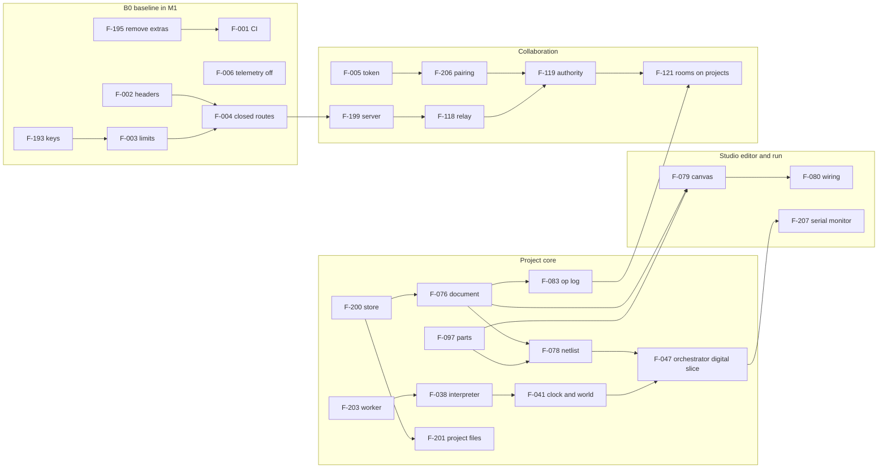

# iynk feature prioritization

Written 2026-10-27 by the product council seat (feature prioritization). Scope: BRIEF section 25, adapted to the build reframe. Reads `03_PRODUCT/FEATURE_CATALOGUE.md` (221 features) and the decisions in `00_EXECUTIVE/DECISION_REGISTER.md`, section "Current decisions: the build reframe" (D-013 to D-017), with D-005, D-007, D-010 and D-011 kept.

Purpose (D-013): a complete open-source hardware lab that Amar uses with his friends. There are no customers, markets, prices or institutions in this document. Priority comes from the workflow (imagine, design, assemble, wire, program, simulate, debug, learn, collaborate, build for real), from what other features need, and from engineering cost and risk. Build order follows D-014; this file ranks features inside that order and says which ones to leave out.

Evidence labels: VERIFIED, DOCUMENTED, EXTERNAL, ESTIMATED, HYPOTHESIS, UNKNOWN, as in the brief. No user has been interviewed, and no scoring input here comes from users. The scores are one reviewer's judgement against the evidence named in the catalogue; section 2 says how to challenge them.

## 1. Result in one page

- **221 features scored or classified.** 184 are kept and scored. 8 are REMOVED (D-016) and 29 are OUT OF SCOPE (D-013); neither group is scored.
- **Class counts (kept rows):** REQUIRED FOUNDATION 34, CORE WORKFLOW 28, NEAR-TERM 81, LATER 29, LONG-TERM RESEARCH 12.
- **Milestone 1, the smallest coherent Studio, is 51 features** (section 7). It lets Amar start a project from scratch, place an Uno and parts, wire them, write code, run it with serial output, save, close, reopen, and open the same project with a buddy. It cuts across four build phases and needs one explicit exception to the catalogue's dependency list (F-047 without F-045).
- **Sensitivity (section 8):** moving any one weight by 20 percent changes at most 9 of 184 classes, and moving the whole benefit or cost side by 20 percent changes at most 13. 168 rows never change in any of those 22 scenarios. Every change is between NEAR-TERM and LATER; no REQUIRED FOUNDATION, CORE WORKFLOW or LONG-TERM RESEARCH row moves.
- **Spike state used here:** RS-01 INCONCLUSIVE (no phone or Chromebook), RS-03 PASS for correctness and desktop speed (devices INCONCLUSIVE), RS-09 PASS with caveats (the catalogue still lists it PENDING; folded in here). RS-06, RS-08, RS-12 and RS-13 have source or data but no REPORT.md and no Verdict: those choices are marked PENDING RS-xx (section 6.2).
- **Seven objections** are in section 10. The two that change the work most: two cycles in the catalogue's "Depends on" column (F-004 with F-199, F-073 with F-216), and Milestone 1 crossing the phase gates that D-014 says stop for Amar's OK.

## 2. Method

### 2.1 Criteria, scale and weights

Every kept feature gets nine scores from 1 to 5. **Higher is always better for building it sooner**, so the cost-like criteria are scored inverted (5 = cheap or safe). The score S is the weighted mean, from 1.00 to 5.00.

| Code | Criterion | 1 means | 5 means | Weight | Why this weight |
|---|---|---|---|---|---|
| V | Value to the full workflow | Nobody would miss it | A step of the workflow (imagine, design, assemble, wire, program, simulate, debug, learn, collaborate, build for real) fails without it | 0.22 | D-013 says the workflow decides priority. Largest single weight. |
| Fd | Foundational | Nothing depends on it | 13 or more other kept features depend on it, directly or through a chain (computed, section 2.2) | 0.18 | D-014 orders the build core first. A foundation scores high even when users never see it. |
| Fe | Feasibility on this codebase | Needs technology no spike or source shows working | Exists and works, or trivial | 0.10 | Existing code with tests is cheaper and safer than new code (BRIEF 3.5). |
| Ac | Impact on simulation accuracy | No effect on what a result says | Decides whether a simulated result is right, or is labelled wrong | 0.10 | The lab is only worth using if its answers can be trusted (D-007). |
| Sp | Security and privacy (safe = high) | New untrusted code or data path with no containment shown | Removes a risk, or adds no new surface | 0.08 | The code is public, but there are no strangers' data or minors in scope. Lower than a product would set it. |
| Ef | Engineering effort (cheap = high) | More than 12 engineer-weeks | Under 1 engineer-week | 0.10 | ESTIMATED, see the effort anchors below. |
| Dc | Dependency complexity (simple = high) | Waits on several pending spikes or an outside service | No new dependency | 0.07 | Pending spikes are the main schedule risk. |
| Mb | Maintenance burden (light = high) | Tracks an outside moving target, or costs content in six languages per item | Static; little to keep up | 0.07 | Amar is the long-term maintainer. |
| Pf | Performance on low-end devices (cheap = high) | Likely to break the low-end budget (idle CPU, memory, bundle) | No cost, or it helps | 0.08 | D-011 as an engineering target. Evidence: `01_AUDIT/PERFORMANCE_BASELINE.md`. |

Weights sum to 1.00. Benefit side (V, Fd, Ac) 0.50, cost side (Fe, Ef, Dc, Mb, Pf) 0.42, risk side (Sp) 0.08. Weights are a judgement; section 8 shows the classes do not depend on them in any way that matters.

**Effort anchors (ESTIMATED).** One engineer who knows the repo, including tests and a docs page. 5 = under 1 week, 4 = 1 to 3, 3 = 3 to 6, 2 = 6 to 12, 1 = over 12. These come from code size and the catalogue's change lists, not from measured velocity. The catalogue's earlier plan-level estimates (the 27, 43 and 72 engineer-weeks for the Studio) were written for a different purpose and are not reused.

**Other anchors.**
- Fe: 5 exists and works; 4 extends existing code with tests; 3 design clear, prototype exists, not built; 2 unproven or a spike is pending; 1 no source or spike shows it working.
- Dc: 5 none; 4 one other kept feature; 3 several, or one outside library; 2 a pending spike, or a licence or format question (UNKNOWN); 1 several pending spikes or an outside service.
- Pf: 3 means measurable cost inside a budget. The budget numbers are set by F-204 from PERFORMANCE_BASELINE; this file does not invent one.

### 2.2 How Fd is computed

Fd is not scored by hand. For each kept feature I count the other kept features that depend on it, directly or through a chain, using the catalogue's "Depends on" column plus the spine edges in catalogue section 4.4 and a short list of structural edges listed below. Bins: 0 dependents = 1; 1 to 2 = 2; 3 to 5 = 3; 6 to 12 = 4; 13 or more = 5. The count is the column `dependents` in the top-dependency table (section 6.1).

Edges added to the catalogue's own list (each is stated in a catalogue phase note or a code inventory): the project document F-076 under every editor and Studio feature; the part descriptor F-097 under the editor, the builders and the BOM; the netlist F-078 under solver, rules and views; the worker host F-203 under every runtime and instrument; the orchestrator F-047 under instruments, robot and drone builders; the store F-200 under library, autosave, fork, history; the op log F-083 under AI operations and rooms on projects; the server F-199 under rooms, links, buddies; the buddy chain F-005 to F-206 to F-119 to F-121.

Three edges are removed because they distort the count: F-004 on F-199 and F-073 on F-216 (each creates a cycle with the opposite edge the catalogue also lists; objection 1), and F-064 on F-007 (a copyright check is a publish gate, not a build input). The edge F-076 on F-019 is not added: the record type is defined in CORE (catalogue section 4.1 note) but a trial run with that edge made F-017 and F-019 prerequisites of more than 80 features each, through that one edge, which overstates them.

### 2.3 Classes and the rules that assign them

Each kept row also carries a **role**, my judgement of what the row is to the project:

| Role | Meaning |
|---|---|
| B | Baseline obligation set by a binding decision (D-005 security fixes, D-015 local-first, D-016 removal, D-017 publish gates) or by a decided ADR that a foundation feature needs (F-165, ADR-0422, under F-199). Class does not depend on the score. |
| G | Gate: other features or a phase exit cannot proceed without it. |
| W | A step of the workflow chain. A hole here leaves the lab unable to do a step. |
| I | Improvement to a step that already works in some form. |

Rules, applied in order. S is the weighted score; "floor" is 3.0.

| Order | Rule | Class |
|---|---|---|
| 0 | In the catalogue's REMOVED list (D-016) | REMOVED |
| 0 | In the catalogue's OOS list (D-013) | OUT OF SCOPE |
| 1 | Role B | REQUIRED FOUNDATION |
| 2 | Fe is 1 or 2 and role is not G or B | LONG-TERM RESEARCH |
| 3 | (Role G or Fd = 5) and S at or above the floor | REQUIRED FOUNDATION |
| 4 | Role W and S at or above the floor | CORE WORKFLOW |
| 5 | S at or above the floor | NEAR-TERM |
| 6 | Otherwise | LATER |

The floor and the 1 to 2 cut for Fe were fixed before the final sensitivity run. After a first pass I changed four scores and set ten rows to role B, listed in the change log, because the first result contradicted a binding decision (for example it put the debugger that D-014 names in LATER, and it put the publish gate F-197 in LATER).

| Class | Meaning here | Rows |
|---|---|---|
| REQUIRED FOUNDATION | Other features or a publish gate cannot proceed without it. Build before the things it carries. | 34 |
| CORE WORKFLOW | A step of the workflow the lab must do end to end. Build in its D-014 phase. | 28 |
| NEAR-TERM | Worth building; improves a step. Build in its D-014 phase after the rows above. | 81 |
| LATER | In the catalogue, but below the floor or waiting for a stated trigger. Not scheduled; revisit at the next phase stop. | 29 |
| LONG-TERM RESEARCH | Feasibility is unproven (Fe 1 or 2) or waits on a pending spike. It keeps a phase, but the phase plan must not depend on it. | 12 |
| REMOVED | Deleted in B0 (D-016); git history keeps it. Not scored. | 8 |
| OUT OF SCOPE | Shelved by D-013; row kept so ids stay stable. Not scored. | 29 |

### 2.4 Uncertainty grade

| Grade | Rule |
|---|---|
| L (low) | Every score rests on code the audit read or ran (VERIFIED) or on a spike with a Verdict. |
| M (medium) | At least one of Fe, Ef, Dc or Ac rests on an unbuilt design, an ESTIMATED effort, or a spike with an INCONCLUSIVE half. |
| H (high) | A score rests on a pending spike, an UNKNOWN feasibility, or an outside licence or format question. The class of an H row follows the pending decision rule, not the number. |

Count of kept rows: L 91, M 77, H 16.

### 2.5 Limits of this method

- The inputs are judgement, not measurement. Section 8 tests the weights, the floor and noise in the scores, but not a bias shared by all scores.
- Fd depends on the catalogue's dependency data, which is incomplete (the catalogue says the spine shows "the chains that hold the most features, not every dependency"). Rows with few recorded dependents may be understated.
- Existing code scores high on Fe and Ef because it exists. That is deliberate (BRIEF 3.5: preserve working code until a replacement is measurably better), but it means PRESERVE rows rank high even when their user value is modest.

## 3. Phase assignment

Phases are D-014's twelve, in order: B0 foundation, Project core, Studio editor, Collaboration, Fidelity, Faults, Components, Labs moved in, AI partner, Robotics, Drones, Export and build. Every kept feature has exactly one. The catalogue's phase is used where it gives one. For the rows the catalogue left as KEEP or LATER I chose: F-096 and F-099 Components; F-166 B0; F-171 and F-176 Studio editor; F-181 Labs moved in; F-075 Drones; F-085, F-086, F-179 Studio editor; F-107 and F-115 AI partner; F-108, F-143, F-144 Collaboration; F-157 and F-158 Export and build; F-163, F-184, F-219 Fidelity; F-172 and F-173 Labs moved in.

Phase codes used in the tables below, as in the catalogue: B0 = B0 foundation, CORE = Project core, STUDIO = Studio editor, COLLAB = Collaboration, SIM = Fidelity, FAULTS = Faults, PARTS = Components, LABS = Labs moved in, AI = AI partner, ROBOT = Robotics, DRONE = Drones, EXPORT = Export and build. The matrix and the lists use the full names.

Note the catalogue's own caveats: F-019 is listed under Faults but its type is defined in Project core; F-097 is listed under Project core but its library grows in Components; F-077 is built in Project core even though the labs move later.

| Phase | Kept rows | Foundation | Core workflow | Near-term | Later | Research |
|---|---|---|---|---|---|---|
| B0 foundation | 24 | 14 | 1 | 8 | 1 | 0 |
| Project core | 21 | 12 | 2 | 7 | 0 | 0 |
| Studio editor | 14 | 0 | 4 | 5 | 4 | 1 |
| Collaboration | 19 | 6 | 5 | 3 | 4 | 1 |
| Fidelity | 21 | 1 | 4 | 10 | 2 | 4 |
| Faults | 13 | 1 | 5 | 6 | 1 | 0 |
| Components | 7 | 0 | 1 | 4 | 1 | 1 |
| Labs moved in | 23 | 0 | 3 | 15 | 5 | 0 |
| AI partner | 11 | 0 | 0 | 7 | 3 | 1 |
| Robotics | 6 | 0 | 0 | 3 | 1 | 2 |
| Drones | 12 | 0 | 0 | 8 | 3 | 1 |
| Export and build | 13 | 0 | 3 | 5 | 4 | 1 |
| **Total** | **184** | **34** | **28** | **81** | **29** | **12** |

### 3.1 Order inside each phase

Features sorted by S, highest first, with the class code (F foundation, W workflow, N near-term, L later, R research). This is the order to build in when a phase starts; the roadmap may move a row earlier if a later row needs it. A row marked M1 is pulled into Milestone 1 (section 7).

**B0 foundation.** F-003 F 3.99 M1, F-174 W 3.89 M1, F-006 F 3.88 M1, F-001 F 3.85 M1, F-193 F 3.78 M1, F-004 F 3.72 M1, F-195 F 3.72 M1, F-009 F 3.70 M1, F-012 F 3.56 M1, F-180 F 3.52 M1, F-014 N 3.47, F-196 F 3.45 M1, F-007 F 3.40 M1, F-204 N 3.39 M1, F-166 N 3.37 M1, F-015 N 3.35, F-002 F 3.34 M1, F-205 N 3.27, F-202 F 3.24 M1, F-008 N 3.22, F-010 N 3.22, F-194 N 3.08, F-016 L 2.95, F-197 F 2.68.

**Project core.** F-078 F 4.63 M1, F-038 F 4.60 M1, F-203 F 4.33 M1, F-097 F 4.28 M1, F-044 F 4.26 M1, F-087 W 4.25 M1, F-076 F 4.16 M1, F-200 F 4.15 M1, F-047 F 4.11 M1, F-045 F 3.99, F-077 F 3.95 M1, F-083 F 3.91 M1, F-092 W 3.89 M1, F-186 N 3.65, F-201 F 3.48 M1, F-088 N 3.44, F-039 N 3.34, F-040 N 3.24, F-168 N 3.17, F-175 N 3.17 M1, F-094 N 3.15.

**Studio editor.** F-084 N 3.57, F-171 N 3.41, F-081 W 3.29 M1, F-082 W 3.21 M1, F-221 N 3.21, F-079 W 3.15 M1, F-176 N 3.15, F-080 W 3.12 M1, F-093 N 3.07, F-177 L 2.73, F-178 L 2.57, F-085 L 2.49, F-179 L 2.22, F-086 R 1.85.

**Collaboration.** F-119 F 3.87 M1, F-199 F 3.79 M1, F-118 F 3.73 M1, F-005 F 3.66 M1, F-116 W 3.57 M1, F-206 F 3.57 M1, F-198 W 3.49 M1, F-117 N 3.39, F-121 W 3.29 M1, F-138 W 3.21, F-120 N 3.17, F-089 W 3.17 M1, F-122 N 3.09 M1, F-165 F 2.92, F-140 L 2.72, F-143 L 2.55, F-144 L 2.53, F-108 L 2.15, F-123 R 1.94.

**Fidelity.** F-041 F 4.51 M1, F-207 W 3.91 M1, F-011 W 3.87 M1, F-043 W 3.84, F-053 N 3.80, F-025 W 3.79 M1, F-042 N 3.79, F-209 N 3.74, F-182 N 3.55, F-185 N 3.47, F-208 N 3.30, F-048 N 3.16, F-055 N 3.12, F-051 N 3.09, F-054 N 3.02, F-049 R 2.91, F-184 L 2.85, F-163 L 2.74, F-046 R 2.55, F-219 R 2.39, F-050 R 2.16.

**Faults.** F-017 W 4.25, F-019 F 4.13, F-018 W 3.78, F-029 W 3.70, F-020 N 3.45, F-028 W 3.42, F-024 N 3.41, F-026 W 3.28, F-030 N 3.20, F-183 N 3.16, F-056 N 3.03, F-022 N 3.01, F-021 L 2.95.

**Components.** F-098 W 3.80 M1, F-096 N 3.51 M1, F-099 N 3.47, F-104 N 3.20, F-101 N 3.03, F-220 L 2.85, F-102 R 2.00.

**Labs moved in.** F-064 N 4.33, F-033 W 3.95, F-034 W 3.73 M1, F-052 N 3.57, F-023 N 3.45, F-035 N 3.41, F-032 W 3.37, F-036 N 3.37, F-181 N 3.35, F-066 N 3.30, F-031 N 3.29, F-037 N 3.28, F-057 N 3.22, F-058 N 3.22, F-063 N 3.22, F-065 N 3.22, F-067 N 3.20, F-151 N 3.05, F-059 L 2.98, F-133 L 2.91, F-173 L 2.73, F-134 L 2.61, F-172 L 2.56.

**AI partner.** F-112 N 3.58, F-109 N 3.24, F-105 N 3.22, F-106 N 3.21, F-110 N 3.14, F-113 N 3.09, F-111 N 3.04, F-107 L 2.65, F-167 L 2.57, F-114 L 2.55, F-115 R 1.70.

**Robotics.** F-213 N 3.18, F-060 N 3.10, F-214 N 3.10, F-215 L 2.83, F-061 R 2.60, F-062 R 1.72.

**Drones.** F-068 N 4.00, F-069 N 3.67, F-216 N 3.45, F-073 N 3.43, F-070 N 3.22, F-072 N 3.10, F-071 N 3.05, F-217 N 3.05, F-218 L 2.81, F-156 L 2.71, F-074 R 2.48, F-075 L 2.23.

**Export and build.** F-090 W 3.67, F-160 W 3.50, F-155 N 3.49, F-161 W 3.44, F-162 N 3.30, F-091 N 3.16, F-159 N 3.15, F-210 N 3.05, F-212 L 2.61, F-154 L 2.58, F-157 L 2.36, F-158 L 2.36, F-211 R 2.34.

## 4. Full matrix

One row per catalogue feature. Columns: **Phase** (D-014), **V Fd Fe Ac Sp Ef Dc Mb Pf** (scores 1 to 5, section 2.1), **S** (weighted score), **Role** (section 2.3), **Class**, **Unc** (uncertainty L, M, H), **M1** (in Milestone 1), **Why** (one line). Removed and out-of-scope rows are not scored. Source of feature names, phases and stances: the catalogue; code paths are in the catalogue row.

| ID | Feature | Phase | V | Fd | Fe | Ac | Sp | Ef | Dc | Mb | Pf | S | Role | Class | Unc | M1 | Why |
|---|---|---|---|---|---|---|---|---|---|---|---|---|---|---|---|---|---|
| F-001 | CI on every push | B0 foundation | 4 | 3 | 5 | 1 | 5 | 4 | 5 | 4 | 5 | 3.85 | G | REQUIRED FOUNDATION | L | M1 | CI |
| F-002 | Security headers and CSP | B0 foundation | 3 | 1 | 4 | 1 | 5 | 5 | 5 | 5 | 5 | 3.34 | B | REQUIRED FOUNDATION | L | M1 | Cheapest |
| F-003 | Local usage meter, rate limits and kill switch | B0 foundation | 3 | 5 | 5 | 1 | 5 | 4 | 5 | 4 | 5 | 3.99 | G | REQUIRED FOUNDATION | L | M1 | Stops |
| F-004 | Closed or keyed server routes | B0 foundation | 3 | 5 | 4 | 1 | 5 | 3 | 4 | 4 | 5 | 3.72 | B | REQUIRED FOUNDATION | M | M1 | All |
| F-005 | Anonymous device token on the server | Collaboration | 3 | 5 | 4 | 1 | 3 | 4 | 4 | 4 | 5 | 3.66 | G | REQUIRED FOUNDATION | M | M1 | Something |
| F-006 | Telemetry removed or opt-in, events stay local | B0 foundation | 3 | 4 | 5 | 1 | 5 | 4 | 5 | 5 | 5 | 3.88 | B | REQUIRED FOUNDATION | L | M1 | Telemetry |
| F-007 | Licence placeholder and content provenance record | B0 foundation | 2 | 2 | 5 | 1 | 5 | 5 | 5 | 5 | 5 | 3.40 | B | REQUIRED FOUNDATION | L | M1 | Publish |
| F-008 | Data-handling note | B0 foundation | 2 | 1 | 5 | 1 | 5 | 5 | 5 | 5 | 5 | 3.22 | I | NEAR-TERM | L |  | One |
| F-009 | Public copy that matches verified claims | B0 foundation | 3 | 3 | 5 | 1 | 5 | 4 | 5 | 5 | 5 | 3.70 | B | REQUIRED FOUNDATION | L | M1 | Publish |
| F-010 | Safety panels and autonomy content rule | B0 foundation | 2 | 1 | 5 | 1 | 5 | 5 | 5 | 5 | 5 | 3.22 | I | NEAR-TERM | L |  | Content |
| F-011 | "What it models" panel and tier label | Fidelity | 4 | 2 | 4 | 4 | 5 | 4 | 5 | 4 | 5 | 3.87 | W | CORE WORKFLOW | L | M1 | D-007 |
| F-012 | Feature flags: run with no server, no AI, no search | B0 foundation | 4 | 1 | 5 | 1 | 5 | 4 | 5 | 5 | 5 | 3.56 | B | REQUIRED FOUNDATION | L | M1 | App |
| F-013 | North-star analytics: weekly learners with a verified diagnosis | - | - | - | - | - | - | - | - | - | - | - | - | OUT OF SCOPE | - |  | Shelved by D-013: D-009 shelved: north-star analytics served the startup question |
| F-014 | Lighter first load and idle CPU | B0 foundation | 4 | 2 | 4 | 1 | 5 | 3 | 5 | 4 | 5 | 3.47 | I | NEAR-TERM | L |  | Dropping |
| F-015 | Low-end device and slow-connection test protocol | B0 foundation | 3 | 2 | 4 | 1 | 5 | 4 | 5 | 4 | 5 | 3.35 | I | NEAR-TERM | L |  | Protocol |
| F-016 | Local error log and uptime check | B0 foundation | 2 | 1 | 4 | 1 | 5 | 4 | 5 | 4 | 5 | 2.95 | I | LATER | L |  | Local |
| F-017 | Break it (trigger and explain) | Faults | 4 | 4 | 5 | 3 | 5 | 5 | 5 | 4 | 4 | 4.25 | W | CORE WORKFLOW | L |  | Exists |
| F-018 | Diagnose-first mode (cause hidden) | Faults | 4 | 3 | 4 | 3 | 5 | 3 | 4 | 4 | 5 | 3.78 | W | CORE WORKFLOW | M |  | Turns |
| F-019 | Shared diagnosis record and cause ids | Faults | 4 | 4 | 5 | 2 | 5 | 4 | 5 | 4 | 5 | 4.13 | G | REQUIRED FOUNDATION | L |  | One |
| F-020 | Three-step logged hint ladder | Faults | 3 | 2 | 4 | 2 | 5 | 4 | 5 | 4 | 5 | 3.45 | I | NEAR-TERM | L |  | Logged |
| F-021 | Transfer question on a similar circuit | Faults | 2 | 1 | 4 | 1 | 5 | 4 | 5 | 4 | 5 | 2.95 | I | LATER | L |  | Transfer |
| F-022 | 40 reviewed diagnose items (English) | Faults | 3 | 2 | 3 | 2 | 5 | 2 | 4 | 3 | 5 | 3.01 | I | NEAR-TERM | M |  | 40 |
| F-023 | Meaningful pass | Labs moved in | 3 | 2 | 4 | 2 | 5 | 4 | 5 | 4 | 5 | 3.45 | I | NEAR-TERM | L |  | Makes |
| F-024 | Learning events (local) | Faults | 2 | 3 | 5 | 1 | 5 | 4 | 5 | 4 | 5 | 3.41 | I | NEAR-TERM | L |  | Local |
| F-025 | Loud, specific code feedback | Fidelity | 4 | 1 | 5 | 4 | 5 | 4 | 5 | 4 | 5 | 3.79 | W | CORE WORKFLOW | L | M1 | Stops |
| F-026 | Code versus wiring mismatch diagnosis | Faults | 4 | 1 | 3 | 4 | 5 | 3 | 3 | 3 | 5 | 3.28 | W | CORE WORKFLOW | M |  | Commonest |
| F-027 | Correct-first option for the outcome study | - | - | - | - | - | - | - | - | - | - | - | - | OUT OF SCOPE | - |  | Shelved by D-013: outcome-study mode |
| F-028 | Electrical rules check with plain-language warnings | Faults | 5 | 1 | 3 | 4 | 5 | 3 | 3 | 3 | 4 | 3.42 | W | CORE WORKFLOW | M |  | Plain-language |
| F-029 | Generic fault rules on a netlist | Faults | 5 | 2 | 3 | 5 | 5 | 3 | 3 | 3 | 4 | 3.70 | W | CORE WORKFLOW | M |  | Faults |
| F-030 | Break it on the learner's own circuit | Faults | 4 | 1 | 3 | 4 | 5 | 3 | 3 | 3 | 4 | 3.20 | I | NEAR-TERM | M |  | Debugging |
| F-031 | Board catalogue and browse pages | Labs moved in | 3 | 1 | 5 | 1 | 5 | 5 | 5 | 4 | 4 | 3.29 | I | NEAR-TERM | L |  | Moves |
| F-032 | 71 board lessons with checks | Labs moved in | 4 | 1 | 5 | 2 | 5 | 4 | 4 | 3 | 4 | 3.37 | W | CORE WORKFLOW | L |  | 71 |
| F-033 | Check engine and quizzes | Labs moved in | 4 | 3 | 4 | 3 | 5 | 4 | 5 | 4 | 5 | 3.95 | W | CORE WORKFLOW | L |  | A |
| F-034 | Code editor with Run, Stop, Reset, Copy and shortcuts | Labs moved in | 5 | 1 | 5 | 1 | 5 | 5 | 5 | 4 | 4 | 3.73 | W | CORE WORKFLOW | L | M1 | Editor |
| F-035 | Workspace readouts and inputs | Labs moved in | 4 | 1 | 4 | 2 | 5 | 4 | 5 | 4 | 4 | 3.41 | I | NEAR-TERM | L |  | Readouts |
| F-036 | Progress storage and home dashboard | Labs moved in | 3 | 1 | 5 | 1 | 5 | 5 | 5 | 4 | 5 | 3.37 | I | NEAR-TERM | L |  | Lesson |
| F-037 | Hand-inked 3D figures with see-through and bridge | Labs moved in | 4 | 1 | 5 | 1 | 5 | 5 | 5 | 3 | 2 | 3.28 | I | NEAR-TERM | L |  | Visual |
| F-038 | Arduino C++ subset interpreter | Project core | 5 | 5 | 5 | 4 | 4 | 5 | 5 | 3 | 4 | 4.60 | G | REQUIRED FOUNDATION | L | M1 | 8,800 |
| F-039 | MicroPython and Python (gpiozero, rclpy, micro:bit) | Project core | 3 | 1 | 5 | 3 | 4 | 5 | 5 | 3 | 4 | 3.34 | I | NEAR-TERM | L |  | Python |
| F-040 | Verilog 2-state cycle simulator | Project core | 3 | 1 | 5 | 2 | 4 | 5 | 5 | 3 | 4 | 3.24 | I | NEAR-TERM | L |  | Verilog |
| F-041 | Virtual clock, World and device models | Fidelity | 4 | 5 | 5 | 4 | 5 | 4 | 5 | 4 | 5 | 4.51 | G | REQUIRED FOUNDATION | L | M1 | Virtual |
| F-042 | DC nodal circuit solver and simulated damage | Fidelity | 3 | 3 | 5 | 3 | 5 | 5 | 5 | 2 | 5 | 3.79 | I | NEAR-TERM | L |  | Frozen |
| F-043 | Honest solver and "not modelled yet" states | Fidelity | 5 | 1 | 4 | 5 | 5 | 3 | 4 | 4 | 5 | 3.84 | W | CORE WORKFLOW | M |  | D-007: |
| F-044 | Run limits and Worker execution | Project core | 5 | 5 | 4 | 2 | 5 | 3 | 4 | 4 | 5 | 4.26 | G | REQUIRED FOUNDATION | L | M1 | Run |
| F-045 | Pure data-driven DC solver for netlists | Project core | 5 | 5 | 3 | 5 | 5 | 2 | 2 | 3 | 3 | 3.99 | G | REQUIRED FOUNDATION | H |  | PENDING |
| F-046 | Transient analysis and ngspice option | Fidelity | 4 | 1 | 2 | 5 | 4 | 1 | 1 | 2 | 2 | 2.55 | I | LONG-TERM RESEARCH | H |  | PENDING |
| F-047 | Simulation orchestrator | Project core | 5 | 5 | 3 | 4 | 5 | 2 | 4 | 3 | 4 | 4.11 | G | REQUIRED FOUNDATION | M | M1 | Headless |
| F-048 | Real compiled firmware mode (avr8js) | Fidelity | 4 | 1 | 4 | 5 | 4 | 3 | 3 | 3 | 2 | 3.16 | I | NEAR-TERM | M |  | RS-03 |
| F-049 | Sketch compile service | Fidelity | 4 | 2 | 2 | 5 | 2 | 2 | 1 | 2 | 5 | 2.91 | I | LONG-TERM RESEARCH | H |  | PENDING |
| F-050 | Other real-engine options | Fidelity | 3 | 1 | 2 | 4 | 4 | 1 | 1 | 1 | 2 | 2.16 | I | LONG-TERM RESEARCH | H |  | PENDING |
| F-051 | Snapshots, pause, step, replay and speed control for circuits | Fidelity | 4 | 1 | 3 | 4 | 5 | 2 | 4 | 3 | 3 | 3.09 | I | NEAR-TERM | M |  | Pause, |
| F-052 | Live status and current draw | Labs moved in | 3 | 1 | 5 | 3 | 5 | 5 | 5 | 4 | 5 | 3.57 | I | NEAR-TERM | L |  | Current-draw |
| F-053 | Virtual multimeter | Fidelity | 4 | 2 | 4 | 4 | 5 | 4 | 4 | 4 | 5 | 3.80 | I | NEAR-TERM | M |  | Meter |
| F-054 | Oscilloscope, logic analyzer and event timeline | Fidelity | 4 | 1 | 4 | 3 | 5 | 2 | 3 | 3 | 3 | 3.02 | I | NEAR-TERM | M |  | Scope |
| F-055 | Breakpoints and variable inspector | Fidelity | 5 | 1 | 3 | 2 | 5 | 2 | 3 | 3 | 4 | 3.12 | I | NEAR-TERM | M |  | Breakpoints |
| F-056 | Fault evidence trace | Faults | 3 | 1 | 3 | 3 | 5 | 3 | 4 | 3 | 5 | 3.03 | I | NEAR-TERM | M |  | Evidence |
| F-057 | 13 robotics benches | Labs moved in | 3 | 1 | 5 | 2 | 5 | 4 | 5 | 3 | 4 | 3.22 | I | NEAR-TERM | L |  | 13 |
| F-058 | 106 bench faults with Repair | Labs moved in | 3 | 1 | 5 | 2 | 5 | 4 | 5 | 3 | 4 | 3.22 | I | NEAR-TERM | L |  | 106 |
| F-059 | Raspberry Pi 5 ROS 2 concept bench | Labs moved in | 2 | 1 | 5 | 1 | 5 | 4 | 5 | 3 | 5 | 2.98 | I | LATER | L |  | Concept |
| F-060 | Robot project slice (first robotics project) | Robotics | 4 | 2 | 3 | 3 | 5 | 2 | 3 | 3 | 3 | 3.10 | I | NEAR-TERM | M |  | First |
| F-061 | Rigid-body physics, arms and legged robots | Robotics | 4 | 1 | 2 | 4 | 5 | 1 | 2 | 2 | 2 | 2.60 | I | LONG-TERM RESEARCH | H |  | PENDING |
| F-062 | URDF import and a real ROS 2 bridge | Robotics | 2 | 1 | 1 | 2 | 4 | 1 | 1 | 1 | 3 | 1.72 | I | LONG-TERM RESEARCH | H |  | rclpy |
| F-063 | 13 drone configurations | Labs moved in | 3 | 1 | 5 | 2 | 5 | 4 | 5 | 3 | 4 | 3.22 | I | NEAR-TERM | L |  | 13 |
| F-064 | Drone calculator | Labs moved in | 4 | 4 | 5 | 3 | 5 | 5 | 5 | 4 | 5 | 4.33 | I | NEAR-TERM | L |  | Calculator |
| F-065 | Design, build and wiring panels | Labs moved in | 3 | 1 | 5 | 2 | 5 | 4 | 5 | 3 | 4 | 3.22 | I | NEAR-TERM | L |  | Design, |
| F-066 | Bench safety tests and arming rules | Labs moved in | 3 | 1 | 5 | 2 | 5 | 4 | 5 | 3 | 5 | 3.30 | I | NEAR-TERM | L |  | 78 |
| F-067 | Flight-controller CLI console | Labs moved in | 3 | 1 | 5 | 1 | 5 | 4 | 5 | 3 | 5 | 3.20 | I | NEAR-TERM | L |  | 131 |
| F-068 | Flight range | Drones | 4 | 4 | 5 | 3 | 5 | 4 | 5 | 3 | 3 | 4.00 | I | NEAR-TERM | L |  | Flight |
| F-069 | Slow-motion crash replay | Drones | 3 | 2 | 5 | 3 | 5 | 5 | 5 | 4 | 4 | 3.67 | I | NEAR-TERM | L |  | Crash |
| F-070 | Autopilot lap and ghosts | Drones | 3 | 1 | 5 | 2 | 5 | 4 | 5 | 3 | 4 | 3.22 | I | NEAR-TERM | L |  | Ghosts |
| F-071 | Medal times and daily challenge | Drones | 2 | 1 | 5 | 1 | 5 | 4 | 5 | 4 | 5 | 3.05 | I | NEAR-TERM | L |  | Daily |
| F-072 | Touch sticks and gamepad | Drones | 3 | 1 | 4 | 1 | 5 | 4 | 5 | 3 | 5 | 3.10 | I | NEAR-TERM | M |  | Touch |
| F-073 | User-entered drone parts and design comparison | Drones | 4 | 2 | 3 | 3 | 5 | 3 | 4 | 3 | 5 | 3.43 | I | NEAR-TERM | M |  | designInput |
| F-074 | Deeper flight models | Drones | 3 | 1 | 2 | 5 | 5 | 1 | 2 | 2 | 2 | 2.48 | I | LONG-TERM RESEARCH | H |  | PENDING |
| F-075 | Server-verified lap times from replay | Drones | 1 | 1 | 3 | 2 | 3 | 2 | 4 | 3 | 5 | 2.23 | I | LATER | L |  | Friends |
| F-076 | Canonical project document | Project core | 5 | 5 | 4 | 2 | 5 | 2 | 5 | 3 | 5 | 4.16 | G | REQUIRED FOUNDATION | M | M1 | Canonical |
| F-077 | Catalogue-to-project converter | Project core | 4 | 3 | 4 | 4 | 5 | 3 | 5 | 4 | 5 | 3.95 | G | REQUIRED FOUNDATION | M | M1 | Only |
| F-078 | Netlist derived from connectivity | Project core | 5 | 5 | 4 | 5 | 5 | 3 | 5 | 4 | 5 | 4.63 | G | REQUIRED FOUNDATION | M | M1 | A |
| F-079 | Editor canvas | Studio editor | 5 | 3 | 3 | 1 | 5 | 2 | 3 | 2 | 2 | 3.15 | W | CORE WORKFLOW | H | M1 | RS-01 |
| F-080 | Wiring with pointer, touch and keyboard | Studio editor | 5 | 1 | 3 | 1 | 5 | 3 | 3 | 3 | 4 | 3.12 | W | CORE WORKFLOW | M | M1 | Pointer, |
| F-081 | Breadboard, schematic and board views with overlays | Studio editor | 5 | 2 | 3 | 2 | 5 | 2 | 4 | 3 | 3 | 3.29 | W | CORE WORKFLOW | M | M1 | Breadboard, |
| F-082 | Inspector, palette, multiselect and copy-paste | Studio editor | 4 | 1 | 4 | 1 | 5 | 3 | 5 | 4 | 4 | 3.21 | W | CORE WORKFLOW | L | M1 | Inspector, |
| F-083 | Revision-safe operation log with undo and redo | Project core | 5 | 4 | 4 | 1 | 5 | 3 | 4 | 3 | 5 | 3.91 | G | REQUIRED FOUNDATION | M | M1 | RS-09 |
| F-084 | Starter templates | Studio editor | 4 | 2 | 4 | 1 | 5 | 4 | 5 | 4 | 5 | 3.57 | I | NEAR-TERM | L |  | Starter |
| F-085 | Kit sandbox | Studio editor | 1 | 1 | 4 | 1 | 5 | 3 | 4 | 3 | 5 | 2.49 | I | LATER | M |  | Superseded |
| F-086 | 2D and 3D mechanical placement | Studio editor | 2 | 1 | 2 | 1 | 5 | 1 | 3 | 2 | 1 | 1.85 | I | LONG-TERM RESEARCH | H |  | WebGPU |
| F-087 | Autosave of edited code and parameters | Project core | 5 | 4 | 5 | 1 | 5 | 4 | 5 | 4 | 5 | 4.25 | W | CORE WORKFLOW | L | M1 | Edits |
| F-088 | Fork | Project core | 3 | 1 | 5 | 1 | 5 | 5 | 5 | 5 | 5 | 3.44 | I | NEAR-TERM | L |  | Fork |
| F-089 | Share link and share file | Collaboration | 4 | 2 | 4 | 1 | 3 | 3 | 4 | 3 | 5 | 3.17 | W | CORE WORKFLOW | M | M1 | Link |
| F-090 | Export: .ino, wiring table, project file | Export and build | 4 | 2 | 4 | 2 | 5 | 4 | 5 | 4 | 5 | 3.67 | W | CORE WORKFLOW | L |  | Take |
| F-091 | Import project file or .ino | Export and build | 4 | 2 | 3 | 2 | 5 | 2 | 3 | 3 | 5 | 3.16 | I | NEAR-TERM | M |  | Import |
| F-092 | Local project library and housekeeping | Project core | 5 | 2 | 5 | 1 | 5 | 4 | 5 | 4 | 5 | 3.89 | W | CORE WORKFLOW | L | M1 | Everything |
| F-093 | Revision history and compare | Studio editor | 3 | 1 | 4 | 1 | 5 | 3 | 5 | 4 | 5 | 3.07 | I | NEAR-TERM | M |  | Compare |
| F-094 | Offline use | Project core | 4 | 1 | 4 | 1 | 5 | 3 | 4 | 3 | 5 | 3.15 | I | NEAR-TERM | M |  | Local-first |
| F-095 | Publish to a community catalogue | - | - | - | - | - | - | - | - | - | - | - | - | OUT OF SCOPE | - |  | Shelved by D-013: public catalogue |
| F-096 | Part and module figures | Components | 4 | 1 | 5 | 1 | 5 | 5 | 5 | 4 | 4 | 3.51 | I | NEAR-TERM | L | M1 | 29 |
| F-097 | Part descriptor | Project core | 5 | 5 | 4 | 4 | 4 | 2 | 5 | 3 | 5 | 4.28 | G | REQUIRED FOUNDATION | M | M1 | One |
| F-098 | Fidelity and provenance declaration per part | Components | 4 | 2 | 4 | 4 | 5 | 4 | 5 | 3 | 5 | 3.80 | W | CORE WORKFLOW | L | M1 | Shows |
| F-099 | Fact sheets with sources | Components | 3 | 1 | 5 | 2 | 5 | 5 | 5 | 4 | 5 | 3.47 | I | NEAR-TERM | L |  | Fact |
| F-100 | Request-a-part control | - | - | - | - | - | - | - | - | - | - | - | - | OUT OF SCOPE | - |  | Shelved by D-013: demand signal for a market |
| F-101 | Custom component editor, beginner mode | Components | 4 | 2 | 3 | 3 | 4 | 2 | 3 | 2 | 4 | 3.03 | I | NEAR-TERM | M |  | Add |
| F-102 | Code-bearing parts, SDK and sandbox | Components | 3 | 1 | 2 | 4 | 1 | 1 | 1 | 1 | 3 | 2.00 | I | LONG-TERM RESEARCH | H |  | PENDING |
| F-103 | Component marketplace | - | - | - | - | - | - | - | - | - | - | - | - | OUT OF SCOPE | - |  | Shelved by D-013: public marketplace |
| F-104 | New boards, benches, drones and languages | Components | 4 | 1 | 4 | 3 | 5 | 3 | 4 | 2 | 4 | 3.20 | I | NEAR-TERM | M |  | Each |
| F-105 | Lab partner chat with tool calling | AI partner | 4 | 3 | 4 | 1 | 2 | 4 | 3 | 3 | 4 | 3.22 | I | NEAR-TERM | M |  | Chat |
| F-106 | Proposed change as a diff card | AI partner | 5 | 1 | 4 | 1 | 3 | 3 | 4 | 3 | 5 | 3.21 | I | NEAR-TERM | M |  | Diff |
| F-107 | Partner drafts a message to a buddy | AI partner | 2 | 1 | 4 | 1 | 3 | 4 | 4 | 3 | 5 | 2.65 | I | LATER | L |  | Posts |
| F-108 | Voice messages and chat translation | Collaboration | 2 | 1 | 3 | 1 | 3 | 3 | 3 | 2 | 3 | 2.15 | I | LATER | M |  | Voice |
| F-109 | Project-grounded read-only partner | AI partner | 5 | 2 | 3 | 2 | 3 | 3 | 3 | 3 | 4 | 3.24 | I | NEAR-TERM | M |  | Grounded |
| F-110 | AI operation proposals | AI partner | 5 | 2 | 3 | 1 | 3 | 3 | 3 | 3 | 4 | 3.14 | I | NEAR-TERM | M |  | AI |
| F-111 | Provider adapter and evaluation set | AI partner | 3 | 3 | 3 | 1 | 4 | 3 | 3 | 3 | 5 | 3.04 | I | NEAR-TERM | M |  | PENDING |
| F-112 | Prompt-injection hardening | AI partner | 4 | 3 | 4 | 1 | 5 | 3 | 4 | 4 | 5 | 3.58 | I | NEAR-TERM | M |  | Needed |
| F-113 | Learning modes | AI partner | 3 | 1 | 4 | 1 | 4 | 4 | 5 | 4 | 5 | 3.09 | I | NEAR-TERM | L |  | Hints |
| F-114 | Scaffold and circuit generation from a prompt | AI partner | 3 | 1 | 3 | 2 | 3 | 3 | 3 | 2 | 4 | 2.55 | I | LATER | M |  | Competitors' |
| F-115 | Learner memory and on-device model | AI partner | 2 | 1 | 2 | 1 | 4 | 1 | 2 | 2 | 1 | 1.70 | I | LONG-TERM RESEARCH | H |  | WebGPU |
| F-116 | Shared rooms | Collaboration | 5 | 3 | 4 | 1 | 3 | 3 | 4 | 3 | 5 | 3.57 | W | CORE WORKFLOW | M | M1 | Rooms |
| F-117 | Room chat | Collaboration | 3 | 2 | 5 | 1 | 3 | 5 | 5 | 4 | 5 | 3.39 | I | NEAR-TERM | L |  | Chat |
| F-118 | Realtime relay server | Collaboration | 4 | 4 | 5 | 1 | 3 | 4 | 4 | 3 | 5 | 3.73 | G | REQUIRED FOUNDATION | L | M1 | 39 |
| F-119 | Relay authority | Collaboration | 5 | 3 | 4 | 1 | 5 | 3 | 5 | 4 | 5 | 3.87 | G | REQUIRED FOUNDATION | L | M1 | Fixes |
| F-120 | Room host controls | Collaboration | 3 | 1 | 4 | 1 | 5 | 4 | 5 | 4 | 5 | 3.17 | I | NEAR-TERM | L |  | Kick |
| F-121 | Rooms on user projects | Collaboration | 5 | 2 | 4 | 1 | 3 | 2 | 4 | 3 | 5 | 3.29 | W | CORE WORKFLOW | M | M1 | RS-09 |
| F-122 | Helper joins your bench | Collaboration | 3 | 1 | 4 | 1 | 4 | 4 | 5 | 4 | 5 | 3.09 | I | NEAR-TERM | L | M1 | Baton |
| F-123 | CRDT or operational transform | Collaboration | 2 | 1 | 2 | 1 | 4 | 1 | 2 | 2 | 4 | 1.94 | I | LONG-TERM RESEARCH | H |  | Yjs |
| F-124 | Class code with pseudonym picker | - | - | - | - | - | - | - | - | - | - | - | - | OUT OF SCOPE | - |  | Shelved by D-013: classroom, shelved with D-001 and D-004 |
| F-125 | Result CSV and wrong-diagnosis table | - | - | - | - | - | - | - | - | - | - | - | - | OUT OF SCOPE | - |  | Shelved by D-013: classroom, shelved with D-001 and D-004 |
| F-126 | Exercise packs and lecturer guide | - | - | - | - | - | - | - | - | - | - | - | - | OUT OF SCOPE | - |  | Shelved by D-013: classroom, shelved with D-001 and D-004 |
| F-127 | Privacy contract and class deletion | - | - | - | - | - | - | - | - | - | - | - | - | OUT OF SCOPE | - |  | Shelved by D-013: classroom, shelved with D-001 and D-004 |
| F-128 | Teacher accounts | - | - | - | - | - | - | - | - | - | - | - | - | OUT OF SCOPE | - |  | Shelved by D-013: classroom, shelved with D-001 and D-004 |
| F-129 | Rosters, assignments and due dates | - | - | - | - | - | - | - | - | - | - | - | - | OUT OF SCOPE | - |  | Shelved by D-013: classroom, shelved with D-001 and D-004 |
| F-130 | Teacher dashboard | - | - | - | - | - | - | - | - | - | - | - | - | OUT OF SCOPE | - |  | Shelved by D-013: classroom, shelved with D-001 and D-004 |
| F-131 | LMS and LTI 1.3 | - | - | - | - | - | - | - | - | - | - | - | - | OUT OF SCOPE | - |  | Shelved by D-013: classroom, shelved with D-001 and D-004 |
| F-132 | Server-side re-run of checks | - | - | - | - | - | - | - | - | - | - | - | - | OUT OF SCOPE | - |  | Shelved by D-013: classroom, shelved with D-001 and D-004 |
| F-133 | Author your own lessons and challenges | Labs moved in | 3 | 2 | 3 | 1 | 5 | 2 | 4 | 3 | 5 | 2.91 | I | LATER | M |  | Needs |
| F-134 | Learning path and interface levels | Labs moved in | 2 | 1 | 3 | 1 | 5 | 3 | 4 | 3 | 5 | 2.61 | I | LATER | M |  | Interface |
| F-135 | Accessibility conformance report | - | - | - | - | - | - | - | - | - | - | - | - | OUT OF SCOPE | - |  | Shelved by D-013: school compliance and sponsored seats, shelved |
| F-136 | Sponsored seats | - | - | - | - | - | - | - | - | - | - | - | - | OUT OF SCOPE | - |  | Shelved by D-013: school compliance and sponsored seats, shelved |
| F-137 | Build Night planner | - | - | - | - | - | - | - | - | - | - | - | - | REMOVED | - |  | Deleted in B0 with F-195 (D-016); git history keeps it |
| F-138 | Build Buddies: friends who work on the same project | Collaboration | 5 | 1 | 4 | 1 | 3 | 3 | 4 | 3 | 5 | 3.21 | W | CORE WORKFLOW | M |  | Friends |
| F-139 | Build Stories | - | - | - | - | - | - | - | - | - | - | - | - | REMOVED | - |  | Deleted in B0 with F-195 (D-016); git history keeps it |
| F-140 | Buddies-only leaderboard | Collaboration | 2 | 1 | 4 | 1 | 3 | 4 | 4 | 4 | 5 | 2.72 | I | LATER | L |  | Buddies |
| F-141 | Live counter (public) | - | - | - | - | - | - | - | - | - | - | - | - | OUT OF SCOPE | - |  | Shelved by D-013: public counter |
| F-142 | Share buttons (social) | - | - | - | - | - | - | - | - | - | - | - | - | OUT OF SCOPE | - |  | Shelved by D-013: distribution button |
| F-143 | Buddies' project gallery | Collaboration | 2 | 1 | 4 | 1 | 3 | 3 | 4 | 3 | 5 | 2.55 | I | LATER | L |  | Buddies-only |
| F-144 | Challenges among buddies | Collaboration | 2 | 1 | 3 | 1 | 4 | 3 | 4 | 3 | 5 | 2.53 | I | LATER | L |  | Challenges |
| F-145 | Verified project provenance | - | - | - | - | - | - | - | - | - | - | - | - | OUT OF SCOPE | - |  | Shelved by D-013: needs server replay and a public audience |
| F-146 | Anchor credential program on devnet | - | - | - | - | - | - | - | - | - | - | - | - | REMOVED | - |  | Deleted in B0 with F-195 (D-016); git history keeps it |
| F-147 | Proof of Build issuance | - | - | - | - | - | - | - | - | - | - | - | - | REMOVED | - |  | Deleted in B0 with F-195 (D-016); git history keeps it |
| F-148 | Browser devnet wallet and faucet | - | - | - | - | - | - | - | - | - | - | - | - | REMOVED | - |  | Deleted in B0 with F-195 (D-016); git history keeps it |
| F-149 | Passport and Verify pages | - | - | - | - | - | - | - | - | - | - | - | - | REMOVED | - |  | Deleted in B0 with F-195 (D-016); git history keeps it |
| F-150 | Skill bounties, sponsored bounties and tips | - | - | - | - | - | - | - | - | - | - | - | - | REMOVED | - |  | Deleted in B0 with F-195 (D-016); git history keeps it |
| F-151 | Local completion record | Labs moved in | 2 | 1 | 5 | 1 | 5 | 4 | 5 | 4 | 5 | 3.05 | I | NEAR-TERM | L |  | Local |
| F-152 | Server-verified portable credential | - | - | - | - | - | - | - | - | - | - | - | - | OUT OF SCOPE | - |  | Shelved by D-013: OOS |
| F-153 | Mainnet credentials, tokens and bounties | - | - | - | - | - | - | - | - | - | - | - | - | REMOVED | - |  | Deleted in B0 with F-195 (D-016); git history keeps it |
| F-154 | Live part prices (user's own search key) | Export and build | 2 | 1 | 4 | 1 | 3 | 4 | 3 | 3 | 5 | 2.58 | I | LATER | M |  | Needs |
| F-155 | Catalogue BOM with catalogue prices | Export and build | 4 | 1 | 5 | 1 | 5 | 4 | 5 | 4 | 5 | 3.49 | I | NEAR-TERM | L |  | Catalogue |
| F-156 | Budget optimiser | Drones | 2 | 1 | 4 | 1 | 5 | 3 | 4 | 3 | 5 | 2.71 | I | LATER | L |  | Budget |
| F-157 | Nearby makerspaces, shops, flying fields and events | Export and build | 1 | 1 | 4 | 1 | 3 | 4 | 3 | 3 | 5 | 2.36 | I | LATER | L |  | Search-key |
| F-158 | Video help | Export and build | 1 | 1 | 4 | 1 | 3 | 4 | 3 | 3 | 5 | 2.36 | I | LATER | L |  | Search-key |
| F-159 | Hardware twin over Web Serial and Firmata | Export and build | 4 | 1 | 3 | 5 | 3 | 3 | 3 | 2 | 5 | 3.15 | I | NEAR-TERM | M |  | Unit |
| F-160 | BOM export | Export and build | 4 | 2 | 4 | 1 | 5 | 4 | 4 | 4 | 5 | 3.50 | W | CORE WORKFLOW | L |  | Buy |
| F-161 | Wiring instructions, flashing steps and assembly checklist | Export and build | 5 | 1 | 4 | 1 | 5 | 3 | 4 | 4 | 5 | 3.44 | W | CORE WORKFLOW | M |  | Wiring |
| F-162 | Reality-gap panel | Export and build | 3 | 1 | 4 | 3 | 5 | 4 | 4 | 4 | 5 | 3.30 | I | NEAR-TERM | M |  | Over-trust |
| F-163 | Own bench measurements | Fidelity | 2 | 1 | 3 | 4 | 5 | 2 | 3 | 3 | 5 | 2.74 | I | LATER | M |  | Your |
| F-164 | Affiliate or commerce links | - | - | - | - | - | - | - | - | - | - | - | - | OUT OF SCOPE | - |  | Shelved by D-013: revenue |
| F-165 | Server store (SQLite file) | Collaboration | 4 | 1 | 4 | 1 | 4 | 3 | 3 | 3 | 4 | 2.92 | B | REQUIRED FOUNDATION | M |  | Server |
| F-166 | Feature status and graceful "not set up" states | B0 foundation | 3 | 1 | 5 | 1 | 5 | 5 | 5 | 4 | 5 | 3.37 | I | NEAR-TERM | L | M1 | "Not |
| F-167 | MCP server and OpenAPI REST (key-gated) | AI partner | 2 | 1 | 4 | 1 | 2 | 4 | 4 | 3 | 5 | 2.57 | I | LATER | M |  | MCP |
| F-168 | Local data export and wipe | Project core | 3 | 1 | 4 | 1 | 5 | 4 | 5 | 4 | 5 | 3.17 | I | NEAR-TERM | L |  | Local |
| F-169 | Learner accounts | - | - | - | - | - | - | - | - | - | - | - | - | OUT OF SCOPE | - |  | Shelved by D-013: accounts |
| F-170 | Public API as a product | - | - | - | - | - | - | - | - | - | - | - | - | OUT OF SCOPE | - |  | Shelved by D-013: OOS |
| F-171 | Six-language interface and content | Studio editor | 3 | 3 | 5 | 1 | 5 | 4 | 5 | 2 | 4 | 3.41 | I | NEAR-TERM | L |  | Six |
| F-172 | Native-speaker review | Labs moved in | 1 | 1 | 4 | 1 | 5 | 3 | 5 | 3 | 5 | 2.56 | I | LATER | L |  | Process |
| F-173 | English term beside translated term | Labs moved in | 1 | 1 | 4 | 1 | 5 | 4 | 5 | 4 | 5 | 2.73 | I | LATER | L |  | Small |
| F-174 | Project home page | B0 foundation | 5 | 2 | 5 | 1 | 5 | 4 | 5 | 4 | 5 | 3.89 | W | CORE WORKFLOW | L | M1 | Project |
| F-175 | First run | Project core | 3 | 1 | 4 | 1 | 5 | 4 | 5 | 4 | 5 | 3.17 | I | NEAR-TERM | L | M1 | First |
| F-176 | Theme, sound and settings | Studio editor | 2 | 1 | 5 | 1 | 5 | 5 | 5 | 4 | 5 | 3.15 | I | NEAR-TERM | L |  | Theme, |
| F-177 | WCAG 2.2 AA for lessons, diagnosis and editor | Studio editor | 3 | 1 | 3 | 1 | 5 | 2 | 4 | 3 | 5 | 2.73 | I | LATER | M |  | axe |
| F-178 | Phone layout | Studio editor | 3 | 1 | 3 | 1 | 5 | 2 | 4 | 3 | 3 | 2.57 | I | LATER | M |  | Phone |
| F-179 | Right-to-left languages | Studio editor | 1 | 1 | 3 | 1 | 5 | 2 | 4 | 2 | 5 | 2.22 | I | LATER | M |  | Right-to-left |
| F-180 | Unit and e2e suites | B0 foundation | 4 | 1 | 5 | 1 | 5 | 5 | 5 | 3 | 5 | 3.52 | G | REQUIRED FOUNDATION | L | M1 | 13 |
| F-181 | Calculator golden fixtures | Labs moved in | 2 | 1 | 5 | 3 | 5 | 5 | 5 | 4 | 5 | 3.35 | I | NEAR-TERM | L |  | Golden |
| F-182 | Software oracle suite | Fidelity | 4 | 1 | 4 | 5 | 5 | 3 | 4 | 3 | 5 | 3.55 | I | NEAR-TERM | M |  | Software |
| F-183 | Real-board check of 10 faults | Faults | 3 | 1 | 3 | 5 | 5 | 3 | 3 | 3 | 5 | 3.16 | I | NEAR-TERM | M |  | Needs |
| F-184 | Bench validation programme | Fidelity | 2 | 2 | 3 | 5 | 5 | 1 | 2 | 3 | 5 | 2.85 | I | LATER | H |  | Bench |
| F-185 | Fidelity registry | Fidelity | 3 | 1 | 4 | 4 | 5 | 4 | 5 | 4 | 5 | 3.47 | I | NEAR-TERM | L |  | Registry |
| F-186 | Cross-browser determinism check | Project core | 3 | 2 | 4 | 4 | 5 | 4 | 5 | 4 | 5 | 3.65 | I | NEAR-TERM | L |  | Replay |
| F-187 | Outcome study and physical-transfer pilot | - | - | - | - | - | - | - | - | - | - | - | - | OUT OF SCOPE | - |  | Shelved by D-013: study with learners |
| F-188 | Priced waitlist page | - | - | - | - | - | - | - | - | - | - | - | - | OUT OF SCOPE | - |  | Shelved by D-013: commercial, shelved (D-008) |
| F-189 | Institution licence and billing | - | - | - | - | - | - | - | - | - | - | - | - | OUT OF SCOPE | - |  | Shelved by D-013: commercial, shelved (D-008) |
| F-190 | Metered compute | - | - | - | - | - | - | - | - | - | - | - | - | OUT OF SCOPE | - |  | Shelved by D-013: commercial, shelved (D-008) |
| F-191 | Individual and team plans | - | - | - | - | - | - | - | - | - | - | - | - | OUT OF SCOPE | - |  | Shelved by D-013: commercial, shelved (D-008) |
| F-192 | Grant and sponsorship reporting | - | - | - | - | - | - | - | - | - | - | - | - | OUT OF SCOPE | - |  | Shelved by D-013: commercial, shelved (D-008) |
| F-193 | Bring-your-own AI keys | B0 foundation | 4 | 5 | 4 | 1 | 3 | 3 | 4 | 4 | 5 | 3.78 | G | REQUIRED FOUNDATION | M | M1 | Bring |
| F-194 | Bring-your-own search keys | B0 foundation | 2 | 3 | 4 | 1 | 3 | 4 | 4 | 4 | 5 | 3.08 | I | NEAR-TERM | M |  | Bring |
| F-195 | Remove the hackathon extras | B0 foundation | 4 | 3 | 4 | 1 | 5 | 3 | 5 | 5 | 5 | 3.72 | B | REQUIRED FOUNDATION | M | M1 | Removes |
| F-196 | Open-source repository basics | B0 foundation | 3 | 2 | 5 | 1 | 5 | 4 | 5 | 4 | 5 | 3.45 | B | REQUIRED FOUNDATION | L | M1 | README, |
| F-197 | Clear or rewrite third-party content | B0 foundation | 4 | 1 | 2 | 1 | 5 | 1 | 2 | 4 | 5 | 2.68 | B | REQUIRED FOUNDATION | H |  | Rewrite |
| F-198 | Self-hosting guide and one-command setup | Collaboration | 4 | 1 | 5 | 1 | 5 | 4 | 5 | 4 | 5 | 3.49 | W | CORE WORKFLOW | L | M1 | One |
| F-199 | Self-hostable server | Collaboration | 5 | 5 | 4 | 1 | 3 | 3 | 3 | 2 | 5 | 3.79 | G | REQUIRED FOUNDATION | M | M1 | Server |
| F-200 | Local project store (IndexedDB) | Project core | 5 | 5 | 4 | 1 | 5 | 3 | 5 | 4 | 4 | 4.15 | G | REQUIRED FOUNDATION | M | M1 | IndexedDB |
| F-201 | Project files on disk | Project core | 5 | 2 | 4 | 1 | 5 | 3 | 3 | 3 | 5 | 3.48 | G | REQUIRED FOUNDATION | M | M1 | File |
| F-202 | Remove the Vercel dependency | B0 foundation | 3 | 1 | 4 | 1 | 5 | 4 | 5 | 5 | 5 | 3.24 | B | REQUIRED FOUNDATION | L | M1 | Nothing |
| F-203 | Simulation worker host | Project core | 5 | 5 | 4 | 2 | 5 | 3 | 5 | 4 | 5 | 4.33 | G | REQUIRED FOUNDATION | M | M1 | Checks |
| F-204 | Performance budgets enforced in CI | B0 foundation | 4 | 1 | 4 | 1 | 5 | 4 | 5 | 4 | 5 | 3.39 | I | NEAR-TERM | L | M1 | D-011 |
| F-205 | Developer documentation | B0 foundation | 3 | 1 | 5 | 1 | 5 | 4 | 5 | 4 | 5 | 3.27 | I | NEAR-TERM | L |  | Developer |
| F-206 | Buddy identity and pairing | Collaboration | 5 | 4 | 3 | 1 | 2 | 3 | 4 | 3 | 5 | 3.57 | G | REQUIRED FOUNDATION | M | M1 | Friends |
| F-207 | Serial monitor and plotter | Fidelity | 5 | 1 | 5 | 3 | 5 | 4 | 5 | 4 | 5 | 3.91 | W | CORE WORKFLOW | L | M1 | First |
| F-208 | Peripheral protocol models | Fidelity | 4 | 1 | 4 | 5 | 5 | 2 | 4 | 2 | 4 | 3.30 | I | NEAR-TERM | M |  | Closed |
| F-209 | Sensor and environment models | Fidelity | 4 | 4 | 3 | 5 | 5 | 2 | 3 | 3 | 4 | 3.74 | I | NEAR-TERM | M |  | Sensors |
| F-210 | Schematic, wiring diagram and netlist export | Export and build | 4 | 1 | 3 | 1 | 5 | 3 | 4 | 3 | 5 | 3.05 | I | NEAR-TERM | M |  | Print |
| F-211 | Interchange formats | Export and build | 3 | 1 | 2 | 1 | 4 | 2 | 2 | 2 | 5 | 2.34 | I | LONG-TERM RESEARCH | H |  | Formats |
| F-212 | Compatible-substitution suggestions | Export and build | 2 | 1 | 3 | 1 | 5 | 3 | 4 | 3 | 5 | 2.61 | I | LATER | M |  | Substitutions |
| F-213 | Robot builder | Robotics | 4 | 3 | 3 | 3 | 5 | 1 | 3 | 3 | 3 | 3.18 | I | NEAR-TERM | M |  | Robot |
| F-214 | Robot control and navigation | Robotics | 4 | 2 | 3 | 3 | 5 | 2 | 3 | 3 | 3 | 3.10 | I | NEAR-TERM | M |  | Make |
| F-215 | Robot templates | Robotics | 3 | 1 | 3 | 1 | 5 | 3 | 4 | 3 | 5 | 2.83 | I | LATER | M |  | Robot |
| F-216 | Drone builder | Drones | 4 | 3 | 4 | 3 | 5 | 2 | 4 | 3 | 3 | 3.45 | I | NEAR-TERM | M |  | Extends |
| F-217 | Flight traces and configuration comparison | Drones | 3 | 1 | 4 | 3 | 5 | 3 | 4 | 3 | 4 | 3.05 | I | NEAR-TERM | M |  | Flight |
| F-218 | Flight environment and failure models | Drones | 3 | 1 | 3 | 4 | 5 | 2 | 3 | 2 | 4 | 2.81 | I | LATER | M |  | Failure |
| F-219 | Thermal and power-derating model | Fidelity | 2 | 1 | 2 | 4 | 5 | 1 | 3 | 2 | 4 | 2.39 | I | LONG-TERM RESEARCH | H |  | Feasibility |
| F-220 | Part and template packs for buddies | Components | 3 | 1 | 4 | 1 | 4 | 3 | 4 | 3 | 5 | 2.85 | I | LATER | L |  | Share |
| F-221 | Author checks on your own project | Studio editor | 3 | 2 | 4 | 2 | 5 | 3 | 4 | 3 | 5 | 3.21 | I | NEAR-TERM | M |  | Attach |

## 5. What the matrix says

### 5.1 Highest scores

| Rank | ID | Feature | S | Class | Phase |
|---|---|---|---|---|---|
| 1 | F-078 | Netlist derived from connectivity | 4.63 | REQUIRED FOUNDATION | Project core |
| 2 | F-038 | Arduino C++ subset interpreter | 4.60 | REQUIRED FOUNDATION | Project core |
| 3 | F-041 | Virtual clock, World and device models | 4.51 | REQUIRED FOUNDATION | Fidelity |
| 4 | F-064 | Drone calculator | 4.33 | NEAR-TERM | Labs moved in |
| 5 | F-203 | Simulation worker host | 4.33 | REQUIRED FOUNDATION | Project core |
| 6 | F-097 | Part descriptor | 4.28 | REQUIRED FOUNDATION | Project core |
| 7 | F-044 | Run limits and Worker execution | 4.26 | REQUIRED FOUNDATION | Project core |
| 8 | F-017 | Break it (trigger and explain) | 4.25 | CORE WORKFLOW | Faults |
| 9 | F-087 | Autosave of edited code and parameters | 4.25 | CORE WORKFLOW | Project core |
| 10 | F-076 | Canonical project document | 4.16 | REQUIRED FOUNDATION | Project core |
| 11 | F-200 | Local project store (IndexedDB) | 4.15 | REQUIRED FOUNDATION | Project core |
| 12 | F-019 | Shared diagnosis record and cause ids | 4.13 | REQUIRED FOUNDATION | Faults |
| 13 | F-047 | Simulation orchestrator | 4.11 | REQUIRED FOUNDATION | Project core |
| 14 | F-068 | Flight range | 4.00 | NEAR-TERM | Drones |
| 15 | F-003 | Local usage meter, rate limits and kill switch | 3.99 | REQUIRED FOUNDATION | B0 foundation |

The top of the list is the interpreter, the clock and world, the worker host, the netlist, the part descriptor and the project document: code that exists or is the next thing everything stands on. That matches D-014 (core first) and BRIEF section 25's rule to prefer a deep working builder over a wide catalogue.

## 6. Supporting views

### 6.1 Most depended-on features

| Feature | Dependents (kept rows, transitive) | Fd | Class | Phase |
|---|---|---|---|---|
| F-200 Local project store (IndexedDB) | 80 | 5 | REQUIRED FOUNDATION | Project core |
| F-076 Canonical project document | 76 | 5 | REQUIRED FOUNDATION | Project core |
| F-044 Run limits and Worker execution | 39 | 5 | REQUIRED FOUNDATION | Project core |
| F-203 Simulation worker host | 38 | 5 | REQUIRED FOUNDATION | Project core |
| F-078 Netlist derived from connectivity | 33 | 5 | REQUIRED FOUNDATION | Project core |
| F-193 Bring-your-own AI keys | 30 | 5 | REQUIRED FOUNDATION | B0 foundation |
| F-038 Arduino C++ subset interpreter | 29 | 5 | REQUIRED FOUNDATION | Project core |
| F-045 Pure data-driven DC solver for netlists | 27 | 5 | REQUIRED FOUNDATION | Project core |
| F-097 Part descriptor | 23 | 5 | REQUIRED FOUNDATION | Project core |
| F-003 Local usage meter, rate limits and kill switch | 21 | 5 | REQUIRED FOUNDATION | B0 foundation |
| F-047 Simulation orchestrator | 21 | 5 | REQUIRED FOUNDATION | Project core |
| F-004 Closed or keyed server routes | 20 | 5 | REQUIRED FOUNDATION | B0 foundation |
| F-005 Anonymous device token on the server | 19 | 5 | REQUIRED FOUNDATION | Collaboration |
| F-199 Self-hostable server | 18 | 5 | REQUIRED FOUNDATION | Collaboration |
| F-041 Virtual clock, World and device models | 15 | 5 | REQUIRED FOUNDATION | Fidelity |
| F-017 Break it (trigger and explain) | 12 | 4 | CORE WORKFLOW | Faults |
| F-019 Shared diagnosis record and cause ids | 11 | 4 | REQUIRED FOUNDATION | Faults |
| F-064 Drone calculator | 9 | 4 | NEAR-TERM | Labs moved in |

F-200 and F-076 carry the most features because the catalogue's spine puts the store under the document and the document under every editor and Studio feature. The runtime chain (F-044, F-203, F-038, F-041) comes next. F-003, F-004, F-005 and F-193 show high counts only because the catalogue lists the closed-routes and server chain under every server feature; they are real prerequisites of the buddy server, not of the editor.

### 6.2 Features waiting on a spike

State read on 2026-10-27 from `08_RESEARCH_SPIKES/*/REPORT.md`. A spike with no REPORT.md or no Verdict is PENDING; I did not read its raw data to guess a result. Rows are scored on the decision rule (`02_RESEARCH/TECHNICAL_RESEARCH.md` section 6, as copied in catalogue section 4.3) and carry uncertainty H or M.

| Spike | State | Features | Decision rule | What this document does until then |
|---|---|---|---|---|
| RS-01 editor rendering | Verdict INCONCLUSIVE: desktop only; plain SVG p95 25 ms in fit and zoom, level-of-detail SVG about 10 ms at 1x; no phone or Chromebook | F-079, F-081, F-082, F-178 | p95 under 20 ms at 500 parts and 1,000 wires on a phone and a Chromebook | F-079 scored Fe 3, Pf 2, uncertainty H. Renderer behind an interface and level of detail from the start. F-178 (phone layout) is LATER until the device run. |
| RS-03 avr8js | Verdict PASS for correctness and desktop speed (80 of 80 serial lines equal); INCONCLUSIVE on phone and Chromebook | F-048 | equal serial output, PWM within 2 percent, 3x real time or better | F-048 NEAR-TERM, uncertainty M. The interpreter stays the default engine. |
| RS-09 op log | Verdict PASS with caveats: 40 randomised runs of about 10,900 ops, no divergence; text intent only roughly kept; undo per author; memory-only server | F-083, F-121, F-123 | no divergence after 10,000 ops, reconnect under 2 s | Folded in (the catalogue still shows PENDING). F-083 and F-121 scored Fe 4. M1 uses the baton for code (F-122). F-123 stays LONG-TERM RESEARCH: a text CRDT for code files only, if simultaneous typing is wanted. |
| RS-08 MNA vs ngspice | PENDING: `data/` exists, no REPORT.md, no Verdict | F-045, F-046, F-029, F-042 | (a) within 2 percent of ngspice on 18 of 20 circuits; (b) RC, RLC, buck within 1 percent and under 16 ms per frame | F-045 is role G with Fe 3 and uncertainty H. M1 does not depend on it (section 7.4). Fallback if it fails: ngspice-WASM behind the same netlist interface. |
| RS-06 rp2040js | PENDING: source only | F-050 | all four MicroPython tasks work, CPU under 60 percent of a core | F-050 LONG-TERM RESEARCH. |
| RS-12 Yosys WASM | PENDING: source only | F-050 | 90 percent of Verilog lessons elaborate, first load under 15 s | F-050 as above. |
| RS-13 physics | PENDING: source only | F-061 | identical hash after 10,000 steps on two browsers, under 1 ms at 20 bodies | F-061 LONG-TERM RESEARCH; F-060 (first robot) is scoped to what needs no rigid-body engine. |
| RS-04, 05, 07, 11, 14, 15, 16, 17, 18, 20 | PENDING: no folder or no report | F-049, F-046, F-111, F-074, F-102, F-080, F-050, F-123 | per catalogue 4.3 | Rows scored with uncertainty H or M. F-080 keyboard path waits on RS-16; the pointer and touch path does not. |

### 6.3 Where the class differs from the catalogue's stance

The catalogue puts every kept row in a phase and marks some LATER. This list is where the score and rules disagree with that. Nothing here moves a row out of its phase; it says how hard to hold the date.

| ID | Feature | Catalogue stance | Class here | S | Why |
|---|---|---|---|---|---|
| F-016 | Local error log and uptime check | scheduled in B0 foundation | LATER | 2.95 | Local log; nothing waits on it. Score sits just under the floor (2.95). |
| F-021 | Transfer question on a similar circuit | scheduled in Faults | LATER | 2.95 | Transfer question is content plus UI with no dependants; just under the floor. |
| F-059 | Raspberry Pi 5 ROS 2 concept bench | scheduled in Labs moved in | LATER | 2.98 | A concept bench labelled "ROS-like"; the lowest-value Labs row. Moves classes in 10 of 21 sensitivity scenarios. |
| F-086 | 2D and 3D mechanical placement | LATER | LONG-TERM RESEARCH | 1.85 | Catalogue LATER; Fe 2 (WebGPU off in Firefox, TECHNICAL_RESEARCH F8) makes it research. |
| F-114 | Scaffold and circuit generation from a prompt | scheduled in AI partner | LATER | 2.55 | Prompt-to-circuit generation: Competitors report loops and billed failures (ai-hardware dossier); build after F-110 proves safe edits. |
| F-115 | Learner memory and on-device model | LATER | LONG-TERM RESEARCH | 1.70 | Catalogue LATER; Fe 2 (on-device model needs WebGPU). |
| F-133 | Author your own lessons and challenges | scheduled in Labs moved in | LATER | 2.91 | Authoring needs the project document and a registry; below the floor until those exist. |
| F-134 | Learning path and interface levels | scheduled in Labs moved in | LATER | 2.61 | Interface levels have no dependants and little value for one maker. |
| F-140 | Buddies-only leaderboard | scheduled in Collaboration | LATER | 2.72 | Buddies-only board uses client-claimed times (flight defect 2); fine, but low value. |
| F-154 | Live part prices (user's own search key) | scheduled in Export and build | LATER | 2.58 | Needs the user own search key; catalogue prices (F-155) cover the need. |
| F-156 | Budget optimiser | scheduled in Drones | LATER | 2.71 | Budget optimiser follows the drone calculator; low value for Amar. |
| F-167 | MCP server and OpenAPI REST (key-gated) | scheduled in AI partner | LATER | 2.57 | MCP and OpenAPI: Sp 2 (route surface) and V 2; only after F-004 and F-193. |
| F-177 | WCAG 2.2 AA for lessons, diagnosis and editor | scheduled in Studio editor | LATER | 2.73 | Below the floor on effort; RS-16 pending. Pointer and touch targets are built to 2.5.8 anyway through F-080. |
| F-178 | Phone layout | scheduled in Studio editor | LATER | 2.57 | Waits on the RS-01 device run. |
| F-212 | Compatible-substitution suggestions | scheduled in Export and build | LATER | 2.61 | Substitution suggestions depend on F-097 and a part library worth searching. |
| F-215 | Robot templates | scheduled in Robotics | LATER | 2.83 | Robot templates follow the builder (F-213). |
| F-218 | Flight environment and failure models | scheduled in Drones | LATER | 2.81 | Failure models follow F-209 and F-216. |
| F-219 | Thermal and power-derating model | LATER | LONG-TERM RESEARCH | 2.39 | Catalogue LATER; Fe 2 (feasibility UNKNOWN) makes it research. |
| F-220 | Part and template packs for buddies | scheduled in Components | LATER | 2.85 | Packs for buddies follow F-097 and F-101. |

## 7. Milestone 1, the smallest coherent Studio

### 7.1 Definition

Milestone 1 (M1) is the smallest set of kept features with which Amar can do this, end to end, on his own machine and with one friend:

1. start a project from scratch;
2. place an Uno and parts;
3. wire them;
4. write code;
5. run it and see serial output;
6. save, close the tab, reopen it;
7. open the same project with a buddy.

It is a cut line across the D-014 phases, not a phase. It takes the cheapest end-to-end slice from B0 (16 features), Project core (14), Studio editor (4), Collaboration (10), plus 7 pulled forward from Fidelity, Components and Labs moved in. Total 51 of 184 kept features. Of those, 23 are PRESERVE or EXTEND of code that exists today (catalogue "Code today" column); the rest are new.

### 7.2 Acceptance walk

Each step is a test in the e2e suite (F-180). "Target" numbers are targets set here, not measurements; none has been run.

| Step | What Amar does | What must be true to pass | Features | Error case that must be handled |
|---|---|---|---|---|
| 1 | Opens the app with no server, no AI key, no search key | Home lists projects and a New project button. The browser makes no request outside the app origin. | F-174, F-012, F-092, F-006 | IndexedDB unavailable: a banner says projects will not be kept and offers file save (F-201). |
| 2 | New project, board Uno | A document is created with `schemaVersion`, board `uno`, empty `parts` and `wires`, one file `main.ino`. It is in the library at once. | F-076, F-097, F-200 | A document with a newer `schemaVersion` is refused with a message and offered back as a raw file; it is never half-opened. |
| 3 | Places an LED, a resistor and a push button from the palette | Parts appear with pins; inspector shows value and pin names. Frame time stays within the RS-01 rule (p95 under 20 ms at 500 parts and 1,000 wires) measured on desktop Chromium; phone and Chromebook numbers are recorded when devices exist. | F-079, F-082, F-096, F-097 | Dropping a part outside the board area snaps it back; unknown part id in a document loads as a placeholder labelled "unknown part". |
| 4 | Wires Uno pin 13 to the LED through the resistor, button to pin 2 and ground | The netlist (F-078) lists exactly the connections drawn. Deleting a part deletes its wires; no wire ends on nothing. | F-080, F-081, F-078, F-083 | A wire from a pin to itself, or to an empty point, is refused with a reason. Undo restores part and wires together. |
| 5 | Writes a Blink sketch that prints to Serial | Editor shows errors as markers with line and message. | F-034, F-025 | An unsupported `#include` gives a named message; it must not run silently (interpreter defect, catalogue section 6). |
| 6 | Presses Run | The sketch runs in a worker. The LED part follows pin 13. Serial text appears in the monitor with virtual-time stamps. Ten runs of the same project give identical serial text. | F-203, F-038, F-041, F-047, F-044, F-207, F-011, F-098 | An endless loop or a memory blow-up is stopped by the run limits; the editor stays responsive and says which limit hit (F-044). A part with no model shows "not modelled yet". |
| 7 | Edits, undoes, reloads the tab | The reloaded project equals the one before (document hash equal). Undo and redo work across the reload point only for operations after it. | F-087, F-083, F-200 | Autosave failure (quota) shows a visible warning and keeps the last good copy. |
| 8 | Saves a `.iynk` file, closes, reopens from the library, then from the file | Both give the same document hash. | F-201, F-092, F-200 | Browsers without the File System Access API fall back to download and upload. If the IndexedDB copy is gone and no file exists, the project is lost; the warning in step 7 exists to prevent that. |
| 9 | Starts the server with the documented setup; creates an invite | The server starts from one documented command; Amar's browser gets a device token; a buddy's browser enters the invite code and is paired. | F-198, F-199, F-005, F-206, F-118 | An expired or wrong code gives one generic error. A bad token gets 401 with no detail. |
| 10 | Opens a room on the project; the buddy joins | The buddy sees the same parts and code. Part and wire edits by either side appear on both within the reconnect rule of RS-09 (under 2 s after a drop). Code is editable by whoever holds the baton; the other side sees it read-only. | F-116, F-121, F-122, F-089 | Server unreachable: local editing continues, a banner says the room is offline, and the client resumes from its last sequence number. A rejected stale op triggers a resync from snapshot plus tail. |
| 11 | Hostile client tries to take the host role or flood the room | The relay refuses both. | F-119, F-002, F-003, F-004 | Rate limit returns a clear error; room count and room size are capped by configuration. |

### 7.3 The set

Class here is the class from the matrix. NEAR-TERM rows appear in M1 only where the slice is needed by a step above; they keep their class everywhere else.

| ID | Feature | Class | Catalogue phase | Slice shipped in M1 | Left for later |
|---|---|---|---|---|---|
| F-001 | CI on every push | REQUIRED FOUNDATION | B0 foundation | CI on push: typecheck, eslint, unit tests, secret scan. | Figure rebuild diff and dependency scan can follow. |
| F-002 | Security headers and CSP | REQUIRED FOUNDATION | B0 foundation | Headers, CSP, no powered-by header; CSP checked against the figure iframes. | Per-operator origin list UI. |
| F-003 | Local usage meter, rate limits and kill switch | REQUIRED FOUNDATION | B0 foundation | In-memory rate limits on the routes the M1 server exposes. | Per-provider usage meter (no AI in M1). |
| F-004 | Closed or keyed server routes | REQUIRED FOUNDATION | B0 foundation | Close every route the M1 server does not need; remaining routes need the server token. | Keyed AI and search routes (no AI in M1). |
| F-005 | Anonymous device token on the server | REQUIRED FOUNDATION | Collaboration | Signed device token, hash stored on the server. | - |
| F-006 | Telemetry removed or opt-in, events stay local | REQUIRED FOUNDATION | B0 foundation | Telemetry off by default (storage.ts:38 flips to false); public counter deleted. | Opt-in local event viewer. |
| F-007 | Licence placeholder and content provenance record | REQUIRED FOUNDATION | B0 foundation | LICENSE-PENDING.md and a provenance file listing content copied from the three third-party sites with its check status (D-017). | Final licence choice; rewrite of flagged content. |
| F-009 | Public copy that matches verified claims | REQUIRED FOUNDATION | B0 foundation | Home page and README copy limited to verified claims. | Per-lab copy sweep (moves with LABS). |
| F-011 | "What it models" panel and tier label | CORE WORKFLOW | Fidelity | Static "What it models" panel and tier label on every project. | Registry-driven panel (F-185). |
| F-012 | Feature flags: run with no server, no AI, no search | REQUIRED FOUNDATION | B0 foundation | Flags so the app runs with no server, no AI, no search. | - |
| F-025 | Loud, specific code feedback | CORE WORKFLOW | Fidelity | Specific compile and runtime messages shown in the editor. | - |
| F-034 | Code editor with Run, Stop, Reset, Copy and shortcuts | CORE WORKFLOW | Labs moved in | Existing code editor reused: Run, Stop, Reset, shortcuts, diagnostics as markers. | Breakpoints. |
| F-038 | Arduino C++ subset interpreter | REQUIRED FOUNDATION | Project core | Arduino C++ subset interpreter run from a project document. | Real compiled firmware (F-048). |
| F-041 | Virtual clock, World and device models | REQUIRED FOUNDATION | Fidelity | Virtual clock, World and the existing I2C devices bound to pins through the netlist. | Protocol models beyond today (F-208). |
| F-044 | Run limits and Worker execution | REQUIRED FOUNDATION | Project core | Run limits: instruction budget, memory cap, time cap; worker killed on breach. | - |
| F-047 | Simulation orchestrator | REQUIRED FOUNDATION | Project core | Digital slice: pin levels and PWM duty flow through the netlist to part states; solver hook returns "not modelled yet". | Analog solve (F-045), transient (F-046). |
| F-076 | Canonical project document | REQUIRED FOUNDATION | Project core | Document with schemaVersion, parts, wires, files, board, settings; open string ids; JSON. | Lessons, checks and fault rules as document sections. |
| F-077 | Catalogue-to-project converter | REQUIRED FOUNDATION | Project core | Convert the Uno catalogue items to documents; used as regression corpus for F-078 and F-047. | Non-Uno boards, benches and craft (LABS). |
| F-078 | Netlist derived from connectivity | REQUIRED FOUNDATION | Project core | Netlist computed from parts, pins and wires only; same netlist for every view. | Electrical rules (F-028). |
| F-079 | Editor canvas | CORE WORKFLOW | Studio editor | SVG canvas behind a renderer interface, level of detail from the start; pan, zoom, select. | Canvas or hybrid renderer (RS-01 device run). |
| F-080 | Wiring with pointer, touch and keyboard | CORE WORKFLOW | Studio editor | Pointer and touch wiring; keyboard path as soon as RS-16 reports. | Full WCAG 2.2 AA pass (F-177). |
| F-081 | Breadboard, schematic and board views with overlays | CORE WORKFLOW | Studio editor | Breadboard view with the netlist overlay. | Schematic and board views (post-M1 in STUDIO). |
| F-082 | Inspector, palette, multiselect and copy-paste | CORE WORKFLOW | Studio editor | Palette, inspector for pin and value, multiselect, copy and paste. | - |
| F-083 | Revision-safe operation log with undo and redo | REQUIRED FOUNDATION | Project core | Operation log with undo and redo for parts, wires, files; revision numbers; server-ordered when in a room. | Redo across authors; history browser (F-093). |
| F-087 | Autosave of edited code and parameters | CORE WORKFLOW | Project core | Autosave of code and layout on every committed operation. | - |
| F-089 | Share link and share file | CORE WORKFLOW | Collaboration | Share a project by room invite or by .iynk file. | Public gallery (not planned). |
| F-092 | Local project library and housekeeping | CORE WORKFLOW | Project core | List, open, rename, duplicate, delete, restore from a local trash. | Archive, search, tags. |
| F-096 | Part and module figures | NEAR-TERM | Components | Existing part figures used as editor artwork, with the draw fallback. | New figures. |
| F-097 | Part descriptor | REQUIRED FOUNDATION | Project core | Descriptor for Uno and the first parts (LED, resistor, push button, buzzer, potentiometer as a knob part, one I2C display); pins, footprint, artwork reference, model kind. | Custom parts (F-101), code-bearing parts. |
| F-098 | Fidelity and provenance declaration per part | CORE WORKFLOW | Components | A model field on each part: modelled, partly modelled, not modelled yet. | Datasheet source links per figure. |
| F-116 | Shared rooms | CORE WORKFLOW | Collaboration | Invite-only room per project. | Room chat (F-117), voice (F-108). |
| F-118 | Realtime relay server | REQUIRED FOUNDATION | Collaboration | Existing relay (39 tests) behind F-199. | Persistence across restart. |
| F-119 | Relay authority | REQUIRED FOUNDATION | Collaboration | Relay authority: host cannot be taken over; rate and room limits. | Moderation tools beyond kick (F-120). |
| F-121 | Rooms on user projects | CORE WORKFLOW | Collaboration | Server-ordered operations on the project document (RS-09 pattern); late joiner gets a snapshot and the tail. | Offline multi-user merge (F-123). |
| F-122 | Helper joins your bench | NEAR-TERM | Collaboration | Baton for the code file: one writer at a time; everyone else sees it read-only. | Simultaneous code typing. |
| F-166 | Feature status and graceful "not set up" states | NEAR-TERM | B0 foundation | `GET /api/status` reports flags (F-012); the app says plainly when the server, a key or search is missing. | Per-feature setup hints for AI and search. |
| F-174 | Project home page | CORE WORKFLOW | B0 foundation | Project home: New project, Open project, Open from file, Join room. | Lesson shelf and first-run tour. |
| F-175 | First run | NEAR-TERM | Project core | First launch opens a starter project from F-077 and runs it. | Lesson shelf and guided tour. |
| F-180 | Unit and e2e suites | REQUIRED FOUNDATION | B0 foundation | Existing suites green and deterministic (13 timeouts fixed); new core tests added. | - |
| F-193 | Bring-your-own AI keys | REQUIRED FOUNDATION | B0 foundation | Settings field for a key and the server-side proxy path; nothing calls a model in M1. | Browser-direct calls; the AI features themselves. |
| F-195 | Remove the hackathon extras | REQUIRED FOUNDATION | B0 foundation | Delete Build Stories, Build Night, Solana program, wallet, mint, faucet, passport. | - |
| F-196 | Open-source repository basics | REQUIRED FOUNDATION | B0 foundation | README, CONTRIBUTING, setup steps, LICENSE-PENDING.md. | Full developer documentation (F-205). |
| F-198 | Self-hosting guide and one-command setup | CORE WORKFLOW | Collaboration | One documented setup (container or single command) and an upgrade note. | - |
| F-199 | Self-hostable server | REQUIRED FOUNDATION | Collaboration | One server process: relay, device tokens, buddy pairing, share links; SQLite file store (the M1 slice of F-165, ADR-0422). | The Postgres adapter, AI and search routes. |
| F-200 | Local project store (IndexedDB) | REQUIRED FOUNDATION | Project core | Autosave to IndexedDB, library index, schema migration hook. | Local data export and wipe (F-168). |
| F-201 | Project files on disk | REQUIRED FOUNDATION | Project core | Save to and open from a .iynk file; File System Access where it exists, download and upload elsewhere; warn when no file copy exists. | Folder-per-project layout. |
| F-202 | Remove the Vercel dependency | REQUIRED FOUNDATION | B0 foundation | Remove Vercel config, scripts and env names. | - |
| F-203 | Simulation worker host | REQUIRED FOUNDATION | Project core | Worker host for the interpreter run: start, stop, step budget, kill and restart. | Flight and solver workers. |
| F-204 | Performance budgets enforced in CI | NEAR-TERM | B0 foundation | CI job records BUD-04 to BUD-07 baselines and fails on a regression above 10 percent (R-019). | BUD-01 to BUD-03 scheduled job; BUD-08, BUD-09. |
| F-206 | Buddy identity and pairing | REQUIRED FOUNDATION | Collaboration | Pair two browsers by an invite code; buddy list kept on the server and in the browser. | Buddy leaderboard, gallery, challenges. |
| F-207 | Serial monitor and plotter | CORE WORKFLOW | Fidelity | Serial monitor (output and input line) from run.ts serial events. | Plotter, scope. |

### 7.4 Why this set is coherent

- **Every step in 7.2 is covered, and every feature in 7.3 serves a step.** There is no editor without a document, no run without a worker and limits, no reopen without a store and a file, no buddy without a server, pairing and relay authority.
- **Dependency check.** I took the catalogue's "Depends on" column plus the spine edges in section 2.2 and followed every prerequisite of the 51 features. The prerequisites outside the set are: F-045. F-045 (the netlist solver) is the one deliberate exception, see below.
- **The exception: F-047 without F-045.** The catalogue lists F-045 as a prerequisite of the orchestrator F-047. M1 uses a digital slice of F-047: pin levels and PWM duty move through the netlist to part states, and the existing World model drives sensors and I2C devices (`src/lib/interp/world.ts`, `src/lib/interp/devices.ts`). The first parts (LED, resistor, push button, buzzer, potentiometer as a knob) need no continuous solve. This keeps the pending RS-08 off the critical path. Cost: no analog divider, no brown-out, no wrong-resistor fault in M1. The solver hook exists and returns "not modelled yet". HYPOTHESIS that this slice is enough for a useful first Studio; test: build the ten starter projects from F-077 on it and see how many need a solve. If RS-08(a) passes, F-045 is the next addition, not a rewrite.
- **Nothing in M1 waits on a pending spike.** F-079 relies on RS-01 (INCONCLUSIVE) but is built to degrade: level of detail and a renderer interface, with desktop numbers as the exit test. F-080's keyboard path waits on RS-16; pointer and touch do not. F-121 stands on RS-09, which passed.
- **It preserves working code.** The interpreter, clock, world, code editor, figures, relay and test suites are reused (BRIEF 3.5). The three things replaced are storage for projects (`localStorage` key `iynk:v1` keeps settings only), the circuit model for user circuits (the netlist), and the bench context for any later AI.
- **It builds its own regression corpus.** F-077 turns the Uno catalogue items into documents; the netlist and orchestrator are checked against them from the first day, which is the only comparison available for the replaced solver path (catalogue objection 3).
- **It makes the open-source baseline true.** Security headers, closed routes, rate limits, telemetry off, the extras removed and Vercel gone (F-002, F-003, F-004, F-006, F-195, F-202) are in M1 because the buddy server is the first thing exposed to the internet.
- **It is small enough.** It leaves out AI, faults, other boards, the lessons, robotics, drones, schematic view, export, import, history, chat, voice and every real-chip engine. Each of those has its own phase.

### 7.5 What M1 cannot do

| Missing in M1 | Where it comes | First feature |
|---|---|---|
| Analog behaviour (dividers, wrong resistor, brown-out) | Project core or Fidelity once RS-08(a) reports | F-045, F-042, F-043 |
| Faults on a drawn circuit, hints, diagnosis record in use | Faults | F-028, F-029, F-018 |
| Boards other than the Uno, existing lessons, benches, craft | Studio editor (all boards) and Labs moved in | F-104, F-031 to F-036 |
| Real compiled firmware, compile service | Fidelity | F-048, F-049 |
| Schematic view, export of a sketch or a wiring table, import | Studio editor, Export and build | F-081 (rest), F-090, F-091, F-210 |
| Breakpoints, multimeter, scope, replay | Fidelity | F-055, F-053, F-054, F-051 |
| AI partner | AI partner | F-105, F-109, F-110 |
| Room chat, voice, buddy leaderboard | Collaboration (later rows) | F-117, F-108, F-140 |
| Phone layout, full accessibility pass | Studio editor, after RS-01 devices and RS-16 | F-178, F-177 |
| Persistence of rooms across a server restart | Collaboration | F-118 follow-up |

### 7.6 Build order inside M1

1. **M1-a, baseline:** F-195, F-202, F-001, F-180, F-006, F-009, F-196, F-012, F-166, F-193, F-002, F-003, F-004, F-007, F-204. Stop for Amar's OK (B0 gate).
2. **M1-b, core:** F-200, F-076, F-097, F-078, F-077, F-083, F-203, F-044, F-038, F-041, F-047, F-087, F-092, F-201, F-174, F-175. Stop for OK (Project core gate). Acceptance: steps 1, 2, 6 to 8 of 7.2 run headless in the test suite before any editor exists.
3. **M1-c, editor and run:** F-096, F-079, F-082, F-080, F-081, F-034, F-025, F-207, F-011, F-098. Stop for OK (Studio gate). Acceptance: steps 3 to 8 by hand in a browser.
4. **M1-d, buddy:** F-198, F-199, F-005, F-206, F-118, F-119, F-116, F-121, F-122, F-089. Stop for OK (Collaboration gate). Acceptance: steps 9 to 11.

The order obeys D-014 for B0, core, editor and collaboration. The seven rows out of strict phase order are F-041, F-207, F-025 and F-011 (Fidelity), F-096 and F-098 (Components) and F-034 (Labs moved in); F-041 lands in M1-b with the interpreter it belongs to, the rest in M1-c, and each is a small slice or an existing component.

## 8. Sensitivity check

Question: do the classes change if the weights move by 20 percent? Method: for each of the nine weights, multiply by 0.8 and by 1.2, renormalise to sum 1, and re-run the six rules. Then move the cost side (Fe, Ef, Dc, Mb, Pf) together, then the benefit side (V, Fd, Ac) together, then set the Fd weight to 0 as a stress test. Fd itself (the count of dependents) and the role are not changed; roles are judgement and are covered by the noise test below only through the scores.

### 8.1 Weight scenarios

| Scenario | Rows whose class changes | Which |
|---|---|---|
| V weight x0.8 | 3 | F-054, F-059, F-101 |
| V weight x1.2 | 0 | - |
| Fd weight x0.8 | 3 | F-016, F-021, F-059 |
| Fd weight x1.2 | 9 | F-022, F-054, F-056, F-071, F-093, F-101, F-151, F-210, F-217 |
| Fe weight x0.8 | 0 | - |
| Fe weight x1.2 | 1 | F-059 |
| Ac weight x0.8 | 1 | F-059 |
| Ac weight x1.2 | 1 | F-022 |
| Sp weight x0.8 | 3 | F-022, F-054, F-056 |
| Sp weight x1.2 | 1 | F-059 |
| Ef weight x0.8 | 0 | - |
| Ef weight x1.2 | 2 | F-022, F-059 |
| Dc weight x0.8 | 1 | F-022 |
| Dc weight x1.2 | 1 | F-059 |
| Mb weight x0.8 | 0 | - |
| Mb weight x1.2 | 0 | - |
| Pf weight x0.8 | 2 | F-022, F-056 |
| Pf weight x1.2 | 1 | F-059 |
| Cost side (Fe, Ef, Dc, Mb, Pf) x1.2 | 3 | F-016, F-021, F-059 |
| Cost side x0.8 | 9 | F-022, F-056, F-071, F-093, F-113, F-122, F-151, F-176, F-194 |
| Benefit side (V, Fd, Ac) x1.2 | 13 | F-022, F-054, F-056, F-071, F-072, F-093, F-113, F-122, F-151, F-176, F-194, F-210, F-217 |
| Benefit side x0.8 | 3 | F-016, F-021, F-059 |
| Fd weight set to 0 (stress) | 14 | F-016, F-021, F-059, F-107, F-133, F-140, F-156, F-163, F-173, F-177, F-184, F-215, F-218, F-220 |

**Result.** In the 22 scenarios of plus or minus 20 percent, at most 9 rows change class for a single weight and at most 13 when a whole side moves (7.1 percent of 184). Across those scenarios 16 rows change at least once and 168 (91 percent) never change. Every change is between NEAR-TERM and LATER. The stress run with the Fd weight at 0 changes 14 rows, none of them into REQUIRED FOUNDATION (F-165 is role B, so it never reacts). Foundation, workflow and research classes come from role, the Fe cut and the dependency count; only their S floor reacts to weights.

Rows that flip in any scenario including the stress run, with how many of the 23 scenarios flip them:

| ID | Feature | Class here | S | Scenarios that flip it | Moves to |
|---|---|---|---|---|---|
| F-059 | Raspberry Pi 5 ROS 2 concept bench | LATER | 2.98 | 11 | NEAR-TERM |
| F-022 | 40 reviewed diagnose items (English) | NEAR-TERM | 3.01 | 8 | LATER |
| F-056 | Fault evidence trace | NEAR-TERM | 3.03 | 5 | LATER |
| F-016 | Local error log and uptime check | LATER | 2.95 | 4 | NEAR-TERM |
| F-021 | Transfer question on a similar circuit | LATER | 2.95 | 4 | NEAR-TERM |
| F-054 | Oscilloscope, logic analyzer and event timeline | NEAR-TERM | 3.02 | 4 | LATER |
| F-071 | Medal times and daily challenge | NEAR-TERM | 3.05 | 3 | LATER |
| F-093 | Revision history and compare | NEAR-TERM | 3.07 | 3 | LATER |
| F-151 | Local completion record | NEAR-TERM | 3.05 | 3 | LATER |
| F-101 | Custom component editor, beginner mode | NEAR-TERM | 3.03 | 2 | LATER |
| F-113 | Learning modes | NEAR-TERM | 3.09 | 2 | LATER |
| F-122 | Helper joins your bench | NEAR-TERM | 3.09 | 2 | LATER |
| F-176 | Theme, sound and settings | NEAR-TERM | 3.15 | 2 | LATER |
| F-194 | Bring-your-own search keys | NEAR-TERM | 3.08 | 2 | LATER |
| F-210 | Schematic, wiring diagram and netlist export | NEAR-TERM | 3.05 | 2 | LATER |
| F-217 | Flight traces and configuration comparison | NEAR-TERM | 3.05 | 2 | LATER |
| F-072 | Touch sticks and gamepad | NEAR-TERM | 3.10 | 1 | LATER |
| F-107 | Partner drafts a message to a buddy | LATER | 2.65 | 1 | NEAR-TERM |
| F-133 | Author your own lessons and challenges | LATER | 2.91 | 1 | NEAR-TERM |
| F-140 | Buddies-only leaderboard | LATER | 2.72 | 1 | NEAR-TERM |
| F-156 | Budget optimiser | LATER | 2.71 | 1 | NEAR-TERM |
| F-163 | Own bench measurements | LATER | 2.74 | 1 | NEAR-TERM |
| F-173 | English term beside translated term | LATER | 2.73 | 1 | NEAR-TERM |
| F-177 | WCAG 2.2 AA for lessons, diagnosis and editor | LATER | 2.73 | 1 | NEAR-TERM |
| F-184 | Bench validation programme | LATER | 2.85 | 1 | NEAR-TERM |
| F-215 | Robot templates | LATER | 2.83 | 1 | NEAR-TERM |
| F-218 | Flight environment and failure models | LATER | 2.81 | 1 | NEAR-TERM |
| F-220 | Part and template packs for buddies | LATER | 2.85 | 1 | NEAR-TERM |

Treat these 29 rows (the 17 from the plus or minus 20 percent runs plus the stress run) as undecided between NEAR-TERM and LATER. The roadmap may place them last in their phase and drop them first.

### 8.2 Moving the floor

The floor of 3.0 moved to 2.9 changes 4 classes (F-016, F-021, F-059, F-133). Moved to 3.1 it changes 14 (F-022, F-051, F-054, F-056, F-071, F-093, F-101, F-111, F-113, F-122, F-151, F-194, F-210, F-217). These are mostly the rows above: the rows with S between about 2.9 and 3.1 are the whole boundary. F-165 (S 2.92) is not in this list: it is role B (the SQLite store that F-199 needs), so no floor moves it.

### 8.3 Noise in the scores

Weights are one source of error; the scores are another. I perturbed every score except Fd: each of the eight scored criteria on each row has a 20 percent chance, per trial, of moving by 1 up or down (clipped to 1 to 5), over 2000 trials with seed 20261027, and counted how often the class changed.

| Class | Rows | Changed in under 10 percent of trials | Changed in 25 percent or more |
|---|---|---|---|
| REQUIRED FOUNDATION | 34 | 34 | 0 |
| CORE WORKFLOW | 28 | 21 | 0 |
| NEAR-TERM | 81 | 50 | 11 |
| LATER | 29 | 14 | 3 |
| LONG-TERM RESEARCH | 12 | 9 | 0 |

Rows that changed class in 25 percent or more of trials: F-022 (42 percent), F-056 (42 percent), F-101 (42 percent), F-071 (39 percent), F-054 (38 percent), F-151 (38 percent), F-210 (38 percent), F-217 (38 percent), F-111 (37 percent), F-133 (33 percent), F-051 (30 percent), F-093 (30 percent), F-021 (28 percent), F-016 (26 percent).

Reading: rows with role B, G and W keep their class unless they fall under the floor, so most of the instability sits where S is near 3.0. That is the same band as 8.1. The method cannot detect a bias that moves all scores together, for example if I overrate every existing feature's feasibility.

### 8.4 What would change the plan

- If RS-08(a) fails, F-045 stays a foundation but its Fe drops to 2 and its class becomes a decision on ngspice-WASM (F-046 then moves from research toward foundation). M1 is unaffected (section 7.4).
- If the RS-01 device run fails, F-079 keeps its class (it is the editor) but the renderer ADR changes and F-178 and F-177 move later.
- If Amar wants simultaneous typing in the code editor, F-123 leaves LONG-TERM RESEARCH and the baton in F-122 stops being enough.

## 9. Preserve, extend or replace, with the priority each carries

From the catalogue (section 6, itself from the CTO memo `00_EXECUTIVE/council/cto-platform.md` section 3, checked against `01_AUDIT/TECHNICAL_DEBT.md` A1 to A13 and D1 to D5). BRIEF 3.5: nothing is replaced until the replacement is measurably better. "Measurable" here is the test in the last column.

| Subsystem | Verdict | Features and class | Replacement must beat this |
|---|---|---|---|
| Interpreters (Arduino C++, Python, Verilog) | Preserve, wrap in the worker | F-038 F, F-044 F, F-025 W, F-039 N, F-040 N | 189 existing tests still pass; identical serial text on the converted catalogue |
| Clock, World, devices | Preserve, extend | F-041 F, F-208 N | Existing lesson checks pass; SPI no longer returns 0 silently |
| Generic content types (`Check`, `WorldModel`, `CodeTemplate`, `FailureMode`) | Preserve, move to a neutral core | F-033 W, F-017 W, F-019 F, F-221 N | Board Lab runs unchanged on the new types |
| Closed lesson registry | Replace for user content, keep for catalogue | F-076 F, F-077 F, F-031 N | All 38 catalogue items convert and open (F-077) |
| Circuit solver `figures/engine/bench-solve.js` | Freeze for catalogue figures, replace for user circuits | F-042 N, F-043 W, F-045 F | Within 2 percent of ngspice on 18 of 20 circuits (RS-08, PENDING) |
| Figure engine and figures | Preserve as visual library, not the builder canvas | F-037 N, F-096 N, F-014 N | Idle CPU reduced (PERFORMANCE_BASELINE) |
| Figure bridge protocol | Extend | F-037 N, F-018 W | Versioned, origin-checked messages kept |
| Progress storage `iynk:v1` | Replace for projects; keep for settings | F-200 F, F-201 F, F-087 W, F-036 N | Reload keeps every edit (walk 14) |
| Flight sim, calculator, 13 craft | Preserve, extend later | F-068 N, F-064 N, F-063 N, F-216 N | 96 sim tests and golden fixtures pass |
| Relay `server/realtime` | Extend | F-118 F, F-119 F, F-121 W | 39 relay tests still pass; takeover and flood tests added |
| Server pattern (zod routes, token-hash ownership) | Extend | F-005 F, F-199 F, F-206 F | Existing route contract kept |
| Rate limiter, AI budget, search counter | Extend | F-003 F | Documented as per-process |
| AI provider layer | Extend | F-193 F, F-105 N | Server-side proxy first; browser-direct only per tested provider |
| AI bench context | Replace | F-109 N, F-110 N | Answers cite real project state, not guessed keys |
| Build Stories, Build Night, Solana stack | Delete | F-137, F-139, F-146 to F-150, F-153 (REMOVED) | Typecheck, lint, unit and e2e green after deletion |
| Telemetry and event store | Extend or delete | F-006 F, F-024 N | Default off |
| Tests | Preserve as regression corpus; do not read as fidelity | F-180 F, F-182 N, F-184 L | Deterministic; fidelity claims come from F-185 and F-183 only |

## 10. Objections

The decisions bind this document. These are places where the decided direction meets a problem the register does not mention.

1. **The catalogue's dependency data has two cycles.** F-004 lists F-199 as a prerequisite while F-199 lists F-004; F-073 lists F-216 while F-216 lists F-073 (`03_PRODUCT/FEATURE_CATALOGUE.md` "Depends on" column, rows F-004, F-199, F-073, F-216). A cycle makes the build order undefined. Evidence: the graph walk in section 2.2 found exactly these two. This document breaks them (F-004 before F-199; the builder F-216 before F-073) and asks the catalogue owner to split F-004 into "close the routes the app has today" (B0, needs no server) and "key the server routes" (with F-199).
2. **Milestone 1 crosses the phase gates.** D-014 says each phase stops for Amar's OK. M1 needs 16 B0 features, 14 from Project core, 4 from Studio editor, 10 from Collaboration, and 7 pulled forward from three later phases (F-041, F-207, F-025, F-011 from Fidelity; F-096, F-098 from Components; F-034 from Labs moved in). Section 7.6 keeps the four gates in order and treats the pulled-forward rows as small slices of M1-c. If Amar prefers strict phases, the cost is a Studio with no serial monitor and no code editor until Fidelity and Labs, which breaks the "write code, run it with serial output" step.
3. **The catalogue's spike table is behind the spikes.** Catalogue 4.3 lists RS-09 as PENDING; `08_RESEARCH_SPIKES/RS-09-op-log-collab/REPORT.md` has a Verdict of PASS with caveats. This document uses the verdict. The caveats matter for M1: text edits converge but intent is only roughly kept (so M1 uses the baton for code), undo is per author, and the server state was memory-only.
4. **The orchestrator's prerequisite is not needed for the first Studio.** The catalogue (F-047 "Depends on": F-045, F-038, F-078, F-203) makes the solver a prerequisite. M1 breaks that edge on purpose (section 7.4). Risk: HYPOTHESIS that a digital slice makes a useful first Studio. Test: convert the Uno catalogue items (F-077) and count those that need an analog solve.
5. **F-197 (clearing copied content) has no upper bound and nothing in the build waits for it.** Fe 2, Ef 1, Dc 2, uncertainty H. It is classed REQUIRED FOUNDATION as a publish gate under D-017, not a build gate. Evidence: 38 items in six languages follow third-party sites (catalogue F-197; `01_AUDIT/inventory/docs-claims-history.md`). Recommendation: start it in B0 as a parallel track, with a count of items cleared per week, so the publish date is known long before the core is done.
6. **Local-first storage is not durable.** IndexedDB can be evicted (EXTERNAL; differs by browser) and the File System Access API exists only in Chromium (EXTERNAL; re-check at build time). F-201 is therefore in M1, with a visible warning when no file copy exists (step 7 of 7.2) and a download fallback (step 8). Without that, "save, close, reopen" is true only until the browser decides otherwise.
7. **No phone or Chromebook number exists.** RS-01 is desktop only. D-011 asks for low-end budgets; until a device run, M1 can claim desktop numbers and throttled-CPU numbers only. F-178 stays LATER for that reason, and the Pf scores for F-079 and F-081 are 2 and 3 on that basis.

## 11. Links

| Direction | Link |
|---|---|
| Upstream | `BRIEF.md` section 25 (adapted: market, money and retention criteria removed by D-013), sections 3.5, 7 to 18; `00_EXECUTIVE/DECISION_REGISTER.md` D-005, D-007, D-010 to D-017; `03_PRODUCT/FEATURE_CATALOGUE.md` (all rows, section 4.3, section 6, section 7); `01_AUDIT/TECHNICAL_DEBT.md` A1 to A13, D1 to D5; `01_AUDIT/SECURITY_BASELINE.md`; `01_AUDIT/PERFORMANCE_BASELINE.md`; `02_RESEARCH/TECHNICAL_RESEARCH.md` section 6; `08_RESEARCH_SPIKES/RS-01`, `RS-03`, `RS-09` reports. |
| Downstream | Roadmap and phase plan (order inside phases: section 3.1; M1 cut line: section 7); Studio, simulation and collaboration specifications (cite F-ids); atomic task list (BRIEF 27). Requirement ids (R-nnn) and ADR ids are assigned elsewhere; this file defines none. |
| ADRs asked for | Renderer behind an interface (F-079); SQLite store behind the Store interface (F-199, F-165; ADR-0422, decided); share-link and share-file encoding (F-089); the M1 cut line itself (objection 2). |

### Open items for Amar

- Approve the M1 cut line (section 7.6) or ask for strict phases (objection 2).
- Confirm that the digital-slice orchestrator is acceptable for the first Studio (objection 4).
- Decide whether to start F-197 now in parallel (objection 5).
- Confirm the rows in the sensitivity band (section 8.1) as LATER or NEAR-TERM.
- Licence choice (F-007) is still open; nothing here depends on it until publishing.

## Change log

- 2026-10-27: first version. 221 features, nine criteria, six rules, Milestone 1 of 47 features, weight and noise sensitivity.
- Adjustments made after the first scoring pass, so a reader can see what moved: F-184 V 3 to 2 (a validation programme is only worth running once the engines it validates are settled; RS-08 and RS-03 devices pending); F-106 V 4 to 5 (no AI operation ships without a review surface); F-055 V 4 to 5 (D-014 names the debugger); F-054 Fe 3 to 4 (the run trace already records edges). Role B set on F-002, F-004, F-006, F-007, F-009, F-012, F-195, F-196, F-197, F-202 (binding decisions D-005, D-015, D-016, D-017). The Fd edges F-004 on F-199, F-064 on F-007 and F-216 on F-073 were removed (section 2.2).

## Review fixes (2026-10-27)

**Issue 1 [medium], M1 membership differs between the PRD and this file.** Applied, with one exception per direction. Evidence: `PRODUCT_REQUIREMENTS.md` tags R-012, R-015, R-019 and R-050 M1; R-009 and R-064 also carry the tag.

| Feature | PRD requirement | Action | Reason |
|---|---|---|---|
| F-007 | R-015 | Set M1 | F-196 already ships LICENSE-PENDING.md in M1; the provenance record is the same open-source baseline (D-017) and is REQUIRED FOUNDATION. Slice added in 7.3. |
| F-166 | R-012 | Set M1 | It is the status route behind the F-012 flags that M1 already ships (`src/app/api/status/route.ts`, `src/lib/features.ts`, PRESERVE). Slice added in 7.3. |
| F-204 | R-019 | Set M1 | R-019 asks for the BUD-04 to BUD-07 baselines in M1. Slice limited to those four budgets. |
| F-175 | R-050 | Set M1 | F-174 is already M1 and R-050 covers first run; the slice is "land on a starter project from F-077 and run it". |
| F-016 | R-009 | Not set | LATER, S 2.95, below the floor (see its row in the LATER list). R-009 is M1 through its primary feature F-006. The PRD should name only F-006 as the M1 feature. |
| F-052 | R-064 | Not set | Current draw and brown-out need the DC solver, which M1 leaves out (section 7.4). R-064 is M1 through F-044 (run controls). The PRD should drop F-052 from the M1 tag. |

Recount, from the matrix M1 column: 51 of 184 (was 47). By phase: B0 foundation 16 (was 13), Project core 14 (was 13), Studio editor 4, Collaboration 10, pulled forward 7. PRESERVE or EXTEND rows 23 (F-166 added). Updated: summary bullet, 7.1 count line, the phase lists in section 3, the 7.3 table (four rows added), 7.4 dependency count, 7.6 build order (F-007, F-166, F-204 in M1-a; F-175 in M1-b), section 9 phase-gate count, change log. No prerequisite is missing: F-175 needs F-174 (M1); F-166 needs F-012 (M1); F-007 and F-204 have none outside B0.

The other direction (matrix M1, PRD requirement not tagged): the PRD tags attach to the first feature of a requirement, so these are tagging gaps in the PRD, not matrix errors. Matrix rows stay M1. PRD owner: tag R-017 (F-001), R-030 (F-076, F-097), R-061 (F-081, M1 slice only), R-090 (F-121, M1 slice) and R-098 (F-199), and R-FID-5 (F-009). R-014 (F-196) is already tagged. I did not edit the PRD (outside my output file); its tags should be generated from the M1 column of the matrix, and its "47 of 184" in section 1 becomes 51 of 184.

## Review fixes (2026-10-27), second pass

**Issue [medium], F-165 scored as Postgres; phase names differ from catalogue codes.** Applied.

| Item | Action | Evidence |
|---|---|---|
| F-165 title | Re-titled "Server store (SQLite file)" in the matrix and removed the Postgres wording everywhere | `FEATURE_CATALOGUE.md` F-165 row; `04_ARCHITECTURE/BACKEND_ARCHITECTURE.md` ADR-0422 (SQLite through `node:sqlite` behind a `Store` interface; Postgres a later adapter) |
| F-165 class | Set role B and class REQUIRED FOUNDATION, phase Collaboration (it is the store F-199 needs). Role B text in 2.3 extended to cover a decided ADR that a foundation feature needs. Rows 33 to 34 (foundation) and 30 to 29 (later) in the summary, the 2.3 table, the section 3 table and the 8.3 table | rule 1 of 2.3 |
| Section 6.3 | Removed the F-165 row (its class now matches the catalogue's stance) | |
| Section 8 | F-165 removed from the stress list (15 to 14 rows), the floor-move list (5 to 4 classes), the changed-class table and the noise list; the claim that the stress run is the only way into REQUIRED FOUNDATION is replaced. Rows that change at least once 17 to 16; never change 167 to 168 | Role B rows do not react to weights, the floor or Fd |
| Objection 5 | Removed (Postgres versus file store). Objections 6 to 8 renumbered 5 to 7; "Eight" became "Seven" in section 1; the open item for F-197 points to objection 5 | |
| F-199 row in 7.3 | "file-backed store" replaced by "SQLite file store (the M1 slice of F-165, ADR-0422)"; the ADR line in section 11 names ADR-0422 as decided | |
| Phase names | One-line code-to-name mapping added under section 3 | catalogue phase codes (section 4 table) |

Not changed: F-165 keeps its M1 column empty and the M1 count stays 51, because its M1 slice (the single SQLite file) ships inside F-199, which is already M1. If the catalogue owner wants the slice counted separately, F-165 becomes M1 and the count 52. The noise and weight tables were computed before this change; I adjusted them by removing F-165 and did not re-run the 2000 trials.
