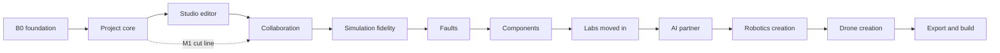

# iynk product requirements

Written 2026-10-27 by the product requirements seat. Status: draft for Amar's review. Scope: every build phase of D-014, in order. Full detail for B0 foundation, the project core, the Studio editor and collaboration with buddies. Shorter but plannable detail for the later phases.

Upstream: `BRIEF.md` (sections 7 to 21, 32), `00_EXECUTIVE/DECISION_REGISTER.md` (start with "Current decisions: the build reframe", D-013 to D-017, plus the kept D-007, D-010, D-011), `03_PRODUCT/FEATURE_CATALOGUE.md` (221 features), `03_PRODUCT/FEATURE_PRIORITIZATION.md` (phase assignment and Milestone 1), the audit in `01_AUDIT/`, the research in `02_RESEARCH/`, and the spikes in `08_RESEARCH_SPIKES/`.
Downstream: the architecture and roadmap documents read the requirement ids here. ADR ids are not assigned in this file; where a requirement needs a decision record it says "needs ADR" and names the question (section 13).

Labels: VERIFIED, DOCUMENTED, EXTERNAL, ESTIMATED, HYPOTHESIS, UNKNOWN as in the brief. Two more marks appear in tables: MEASURED (a spike or audit run produced the number, cited) and PROPOSAL (a threshold I set here, with no measurement behind it; it is a target to confirm or change at the phase start, never a result).

## Contents

1. What iynk is for
2. The phases at a glance
3. Engineering success measures
4. Constraints that apply to every requirement
5. Fidelity and honesty requirements
6. B0 foundation (R-001 to R-024)
7. Project core (R-025 to R-052)
8. Studio editor (R-053 to R-074)
9. Collaboration with buddies (R-075 to R-098)
10. Later phases: fidelity, faults, components, labs moved in, AI partner, robotics, drones, export and physical build (R-099 to R-194)
11. Release checks per milestone
12. Out of scope
13. Open questions
14. Objections
15. Links

---

## 1. What iynk is for

D-013. iynk is a complete open-source hardware lab. Amar uses it himself, with his friends, to do the whole workflow: imagine a project, design it, assemble it, wire it, program it, simulate it, debug it, learn from it, work on it together, and then build it for real.

What that means for the build:

- There is no customer, market, price, plan, classroom, school or institution in this document. Where an older document talks about one, it is shelved (D-001, D-003, D-004, D-008, D-009) and not planned here.
- Priorities come from engineering quality and from how much of the workflow a phase completes. The order is fixed by D-014 and each phase stops for Amar's OK; he may reorder or cut phases at any stop.
- The people in the user stories are two: **Amar** (the owner, runs the server, builds the project, maintains the code) and **a buddy** (a friend who works on the same project, possibly on a weaker laptop or phone, possibly in another language). A third reader, **a contributor**, appears in B0 because the repository is public.
- The code is public, so security fixes and honest copy stay in scope even though no one is paying (D-005 reframed, SECURITY_BASELINE).
- The honest-fidelity rules of D-007 hold in every phase: iynk says what a model covers and says "not modelled yet" instead of guessing. It never says "validated".

What exists today (VERIFIED, `01_AUDIT/FEATURE_VERIFICATION.md`, `runs/BROWSER_WALK.md`): a guided simulator. 12 boards, 13 robotics benches and 13 drones with hand-inked figures; an Arduino C++ subset, MicroPython/Python and Verilog interpreter set; a flight range; a room relay; AI, search and Solana features that need paid or hosted services. A user cannot add a part, rewire, start a blank project, use a 13th board, or keep edited code across a reload (walk steps 14 and 15). The build turns this guided simulator into a workbench, and keeps the guided content as templates inside it.

## 2. The phases at a glance

Phase codes follow `FEATURE_CATALOGUE.md` section 2. "Gate" is the stop for Amar's OK (D-014).

| # | Phase | Code | What it delivers | Requirement ids | Full detail here |
|---|---|---|---|---|---|
| 1 | B0 foundation | B0 | A public repository that is safe, honest, tested in CI, free of the hackathon extras and runs with no paid service | R-001 to R-024 | yes |
| 2 | Project core | CORE | One project document, a netlist derived from it, a worker that runs code, local save and load | R-025 to R-052 | yes |
| 3 | Studio editor | STUDIO | Place parts, wire, write code, run, on the Uno first, then all 12 boards | R-053 to R-074 | yes |
| 4 | Collaboration | COLLAB | Self-hosted server, buddy pairing, rooms on user projects | R-075 to R-098 | yes |
| 5 | Simulation fidelity | SIM | Analog solve, real-chip engines where spikes allow, debugger, instruments, replay | R-099 to R-117 | shorter |
| 6 | Faults | FAULTS | Diagnose-first on any circuit, shared diagnosis record, hints | R-118 to R-130 | shorter |
| 7 | Components | PARTS | Part library growth, custom parts, fidelity declarations | R-131 to R-138 | shorter |
| 8 | Labs moved in | LABS | Board, Robotics and Drone labs become Studio templates | R-139 to R-152 | shorter |
| 9 | AI partner | AI | A partner that edits the project through reviewable operations | R-153 to R-163 | shorter |
| 10 | Robotics creation | ROBOT | Build a robot, physics, control, templates | R-164 to R-171 | shorter |
| 11 | Drone creation | DRONE | Design a drone to flight, traces, comparison | R-172 to R-180, R-193, R-194 | shorter |
| 12 | Export and physical build | EXPORT | BOM, wiring, flashing, hardware twin, reality gap | R-181 to R-192 | shorter |

Milestone 1 (`FEATURE_PRIORITIZATION.md` section 7) is a cut line across phases 1 to 4: start from scratch, place an Uno and parts, wire, write code, run and see serial output, save and reopen, open the same project with a buddy. It has 47 of 184 kept features. Requirements that belong to M1 carry the tag **M1**; their M1 slice is stated in the requirement, and the rest of the feature lands in its own phase. The 11-step acceptance walk of section 7.2 of that file is reused here as the Studio and COLLAB gate checks.



Order notes. The order is Amar's. Three dependencies cut across it and are handled as slices, not reorders: faults need the netlist (CORE) and the solver (SIM) to work on any circuit; the labs moving in need the converter (CORE) and the part library (PARTS); the AI partner needs the operation log (CORE) and a provider evaluation (RS-11, PENDING). Where a later phase needs something earlier than its turn, the requirement says which slice moves up.

---

## 3. Engineering success measures

These replace market metrics. Each is something the build can measure on a laptop and in CI. Source marks say whether the number comes from a measurement (cite it) or is a PROPOSAL to confirm at the phase start. Nothing here is a benchmark invented to pass a gate (BRIEF section 32).

### 3.1 Performance budgets (D-011)

D-011 is an engineering target: performance on throttled CPUs and slow connections. The reference setup is a throttled desktop Chromium (CDP CPU throttle 4x and 6x) until real phones and Chromebooks are available; throttle is a rough stand-in that slows JS and layout but not the GPU or memory (RS-01 caveat, PERFORMANCE_BASELINE section 0). Every budget below must be re-run on at least one real low-end device once Amar has one (UNKNOWN today; no spike or audit run used a phone or Chromebook).

| ID | Quantity | Budget | Today (RS-01) | On miss | Source |
|---|---|---|---|---|---|
| BUD-01 | Editor frame time at 500 parts and 1,000 wires, pan, drag, hover, zoom, level of detail on | p95 under 20 ms on desktop Chromium at 1x and DPR 1. Today LOD gives p95 10.3 to 10.7 ms in all five interactions on an Apple M4 Pro (MEASURED, RS-01); plain SVG misses in fit view (25.8 ms) and zoom (25.0 ms). | LOD on: p95 10.3 to 10.7 ms (MEASURED). Plain SVG: pan-fit 25.8 ms at 1x and zoom 25.0 ms, which already miss (MEASURED). No phone or Chromebook run, so the verdict is INCONCLUSIVE. | Apply the R-053 decision rule in order: fewer art elements per part, then wires on one canvas layer, then Canvas or Pixi for wires only; record the miss and the action in `docs/device-results.md`. Plain SVG without LOD is not an allowed fallback. | Budget is the RS-01 exit condition; numbers MEASURED; verdict INCONCLUSIVE because no phone or Chromebook was tested |
| BUD-02 | Same scene at 4x CPU throttle | p95 under 33 ms in every interaction (the RS-01 fail trigger). Zoom is the known miss today (see the next columns). The Studio phase must fix zoom or record the miss. | LOD zoom p95 34.1 ms at 4x and 58 ms at 6x: a miss of 1.1 ms at 4x (MEASURED). | Not a pass today. Apply the R-053 decision rule in order: fewer art elements per part, then wires on one canvas layer, then Canvas or Pixi for wires only; record the miss and the action in `docs/device-results.md`; if the miss persists after the harness run, STUDIO records it with the action taken and the gate does not claim BUD-02. | RS-01 MEASURED; budget is the fail trigger |
| BUD-03 | Same scene at DPR 2 (phone-like pixel ratio) | p95 under 20 ms in pan, fit and zoom. LOD measured 9.2 ms p95 (max 24.6 ms in zoom) on desktop Chromium. WebKit pan-fit with LOD is 22 ms (MEASURED), so WebKit needs work. | Desktop Chromium p95 9.2 ms (max 24.6 ms in zoom). WebKit pan-fit with LOD 22 ms, over the 20 ms budget (MEASURED). | Apply the R-053 decision rule in order: fewer art elements per part, then wires on one canvas layer, then Canvas or Pixi for wires only; record the miss and the action in `docs/device-results.md`; WebKit is fixed or the miss is recorded by name. | RS-01 MEASURED |
| BUD-04 | Idle main-thread use on the project home and on an open Studio project with nothing running | Under 5 percent of one core at 1x, under 25 percent at 4x. Today the landing page and lessons use 62 to 65 percent at 1x and 100 percent at 4x (24 fps), cause is the figure core rebuilding the scene every frame (P1, MEASURED); the drone and fly pages idle at 1 percent. | n/a | n/a | Numbers PROPOSAL; baseline MEASURED (`PERFORMANCE_BASELINE.md` section 6) |
| BUD-05 | JavaScript transferred for the first load of the project home | At most 400 KB gzip transferred, and CI fails on a rise of more than 10 percent over the last recorded value. Today 727 KB transferred, 2.29 MB raw, 23 files; 139 KB gzip of the wallet library loads on 5 lab page types and goes away with F-195 (MEASURED / ESTIMATED saving). | n/a | n/a | PROPOSAL; baseline MEASURED |
| BUD-06 | Click Run to "Running" on an Uno sketch, desktop | Under 2 s at 1x, under 4 s at 4x. The walk measured 1.6 s today with the interpreter on the main thread; the worker start adds cost that must be measured. | n/a | n/a | PROPOSAL; baseline MEASURED (`BROWSER_WALK.md`) |
| BUD-07 | Simulation speed | A busy-loop sketch must run at least real time at 4x throttle: it costs 62 ms of wall per virtual second at 1x, about 250 ms at 4x (ESTIMATED, 62 x 4). Sketches that call `delay()` cost under 1.6 ms for 5 virtual seconds (MEASURED). | n/a | n/a | MEASURED / ESTIMATED; budget PROPOSAL |
| BUD-08 | Autosave commit | Under 50 ms p95 for a project of 500 parts and 1,000 wires, off the interaction path (no dropped frame while saving). | n/a | n/a | PROPOSAL |
| BUD-09 | Open a saved project (IndexedDB to editable canvas) | Under 1 s at 1x, under 3 s at 4x for the same project. | n/a | n/a | PROPOSAL |
| BUD-10 | Room reconnect after a dropped connection | Back in sync under 2 s. MEASURED on localhost: 2.8 ms for a 1,000-op tail and 22 ms for 10,000 ops; the 10,000-op tail is 1.4 MB raw, so snapshot plus tail (and gzip) is required on slow links. Real networks, mobile sleep and proxies are UNKNOWN. | n/a | n/a | RS-09 exit condition and MEASURED |
| BUD-11 | Tab memory for a Studio Uno project | Heap under 150 MB after 10 minutes of editing and running. Lesson pages hold 13 to 17 MB today (MEASURED, 60 s). The Yosys path needs 662 to 725 MB renderer memory (RS-12 MEASURED) so it is loaded only on request and refused when `navigator.deviceMemory` is 4 or lower (where the browser reports it). | n/a | n/a | PROPOSAL; baselines MEASURED |
| BUD-12 | Runaway code | A hostile or buggy program is stopped, and the editor is responsive again, within 2 s. | n/a | n/a | PROPOSAL (the 2 s figure is the RS-15 worker-kill criterion, borrowed) |
| BUD-13 | Physics step (ROBOT phase) | Mean under 1 ms at 20 bodies, also at 6x throttle (mean 0.44 to 0.54 ms, batch p95 at most 0.61 ms MEASURED for both engines; p99.9 not under 1 ms on a slow device). | n/a | n/a | RS-13 exit condition and MEASURED |
| BUD-14 | Lazy engine weight (ROBOT phase) | Physics engine at most 1.0 MB over the wire (brotli) and 4 MB raw WASM, loaded only on pages that need it. Jolt split build 0.61 MB, Rapier split build about 0.88 MB fit. | n/a | n/a | HYPOTHESIS budget, RS-13 |
| BUD-15 | Slow connection | Home page and an open project usable after first load with no further network (offline, R-040). First load at 3G-class bandwidth is measured and recorded, no budget until the first measurement exists. | n/a | n/a | PROPOSAL |

CI enforces what can run headless: BUD-04, BUD-05, BUD-06 (throttled), BUD-07, BUD-08 and BUD-09 (R-019). BUD-01 to BUD-03 run as a scheduled Playwright job because frame timing is noisy under load (the audit's own runs were taken at load 2 to 7 for that reason).

### 3.2 Determinism and replay

| ID | Measure | Target | Source |
|---|---|---|---|
| DET-1 | Ten runs of the same project with the same seed | Identical serial text and identical pin-trace hash | M1 step 6; target set in `FEATURE_PRIORITIZATION.md` 7.2, not yet run |
| DET-2 | The same run in Chromium and WebKit (Firefox added when installed) | Identical hashes. Flight replay is bit-identical in one engine and tested (A12); nothing has been tested across browsers. Physics: identical snapshot hash after 10,000 steps in Node, Chromium and WebKit, also under 4x and 6x throttle (RS-13 MEASURED, one CPU architecture, no Firefox). | PROPOSAL for the interpreter; MEASURED for physics |
| DET-3 | Project document round trip: save, close, reopen, and file save, reopen | Equal canonical document hash (R-026) | M1 steps 7 and 8 |
| DET-4 | Operation log replay: replaying the log from an empty or snapshot state | Gives the same document hash as the live state | RS-09 invariant (no divergence in 40 randomised runs of about 10,900 ops, MEASURED) |
| DET-5 | Clock | One virtual clock; no `Date.now()` or `Math.random()` in simulation paths; a seed in the project settings | BRIEF 10.3; the existing virtual clock is `src/lib/interp/clock.ts` |

### 3.3 Correctness against references and spikes

Correctness is stated against named references, never as "validated" (D-007). Each reference suite below is a regression suite, added to CI as it becomes available.

| ID | Reference | Pass condition | Source |
|---|---|---|---|
| REF-1a | DC solver against ngspice on the 20 canonical circuits of RS-08 | 18 of 20 within 2 percent at the gate, and no regression from today's measured 20 of 20 (worst 0.26 percent). This holds for the solver's own piecewise-linear models only: against realistic exponential LED, diode and generic BJT cards 10 of 20 are outside 2 percent and 6 are outside 5 percent (MEASURED). The tier label says so. | RS-08 (a) PASS for the linear solve on matched models; device-model fidelity FAILED against realistic models (10 of 20); (b) INCONCLUSIVE; see RS-08 REPORT, Independent check |
| REF-1b | DC solver against ngspice with realistic exponential LED, diode and generic BJT models, same 20 circuits | Realistic-model column recorded per circuit, no gate until Amar sets per-device tolerances; the tier label states the gap. Today 10 of 20 are within 2 percent and 6 are off by more than 5 percent (C16 229.6 percent, C20 41 percent, MEASURED). Each of the 6 carries a visible 'approximation' provenance in the overlay (R-099) until the model is replaced or a tolerance is set. | RS-08 (a) PASS for the linear solve on matched models; device-model fidelity FAILED against realistic models (10 of 20); (b) INCONCLUSIVE |
| REF-2 | avr8js against the TypeScript interpreter on Blink, Fade and analogRead | Equal serial text (80 of 80 lines today), PWM duty within 2 percent (max 0.4 points), toggle period within one PWM period | RS-03 MEASURED; used as a differential oracle even if avr8js is not shipped |
| REF-3 | Every Uno R3 catalogue item converted to a project document (F-077) | The converted project reproduces the catalogue item's pin behaviour and check results; used from the first day as the corpus for the netlist and orchestrator | `FEATURE_PRIORITIZATION.md` 7.4 |
| REF-4 | Operation log convergence | Zero divergence in a randomised property test with dropped connections, offline edits, resends and snapshot resume (40 runs, about 10,900 ops each today) | RS-09 PASS |
| REF-5 | Verilog elaboration | 10 of 10 reference designs and the starter elaborate in Yosys WASM | RS-12 PASS, memory risk open |
| REF-6 | Hardware oracle (every lab at least 10 class-A tests: tests that load a datasheet table, a bench measurement or a trace) | Grows with SIM, FAULTS, LABS. Zero such tests exist today; 15 of 1,677 declared tests transcribe a datasheet fact by hand (MEASURED, `TEST_COVERAGE.md` section 0) | `TEST_COVERAGE.md` section 5 item 1 |
| REF-7 | MicroPython on a real RP2040 core (rp2040js) | Not a pass: RS-06 FAILED the CPU clause (0.54x to 0.78x of real time on an M4 Pro, 100 percent of a core). rp2040js is kept for non-real-time differential tests only; the TypeScript MicroPython interpreter stays the runtime. | RS-06 MEASURED |

### 3.4 Test and accessibility pass rates

| ID | Measure | Target | Source |
|---|---|---|---|
| TST-1 | Unit suite | All pass, deterministic at any machine load. Today 2,797 passed and 5 skipped at the repo's own config; 13 wall-clock timeouts appear at load 38 to 117 | MEASURED (`TEST_COVERAGE.md` 4.1); target PROPOSAL |
| TST-2 | Relay tests (39 today) and e2e (116 of 119 pass today, keyless) | In the same CI gate as the unit suite; no silent skip when a required service is missing under `CI=true` | `TEST_COVERAGE.md` finding 6 |
| TST-3 | Line coverage per directory (floors) | Start at `src/lib/interp` 80, `src/lib/server` 90, `src/app/api` 90, `src/components` 70 percent, with unloaded files counted as 0 (today 81.5 percent lines on loaded code, about 67 percent with unloaded files, ESTIMATED) | `TEST_COVERAGE.md` section 5 item 5; floors are that file's proposal |
| TST-4 | Interpreter fuzz and corpus | A corpus of public Arduino example sketches run through the interpreter; every failure is a named, positioned message, never a silent wrong result | `TEST_COVERAGE.md` section 5 item 11 |
| ACC-1 | Automated accessibility checks | axe with zero serious or critical findings on every route and on the Studio editor in each of its views | PROPOSAL |
| ACC-2 | Keyboard-only task pass | Place a part, wire two pins, edit code, run, save and reopen, with no pointer (RS-16 exit condition; RS-16 not yet run, so PENDING RS-16) | RS-16 |
| ACC-3 | WCAG 2.2 AA criteria that bite an editor | Dragging movements 2.5.7 (a non-drag alternative), target size 2.5.8 (24 by 24 CSS px minimum), focus not obscured 2.4.11, consistent help 3.2.6 | EXTERNAL (WCAG 2.2); thresholds are the criteria |
| ACC-4 | Screen reader pass on core tasks | Recorded result per release; no screen reader has been tried (UNKNOWN) | UNKNOWN today |

---

## 4. Constraints that apply to every requirement

Each requirement lists the constraints that bite for it, by these ids. A constraint not listed means it adds nothing beyond the general rule.

| ID | Constraint | Rule |
|---|---|---|
| K-PERF | Low-end devices (D-011) | New code stays inside the budgets of section 3.1. Heavy engines load on demand. Work that can exceed 16 ms runs in a worker. No feature may raise idle CPU. |
| K-A11Y | WCAG 2.2 AA | Every control reachable and operable by keyboard; visible focus; names and roles for assistive technology; no information by colour alone; a non-drag path for every drag (WCAG 2.5.7); targets at least 24 by 24 CSS px; reduce-motion respected (the setting exists, `storage.ts`). A requirement that adds UI is not done until ACC-1 passes for it. |
| K-I18N | Six languages (F-171) | The interface stays in en, es, fr, de, hi, zh as in `src/i18n/messages/`. New strings are added to the English namespace JSON first, then all five other languages through the existing parity check (0 missing keys today, VERIFIED, `TECHNICAL_DEBT.md` A9); no string is built by concatenation; layout survives 40 percent longer text. Translation quality is unreviewed today (F-172 is LATER). No new languages are planned. |
| K-LOCAL | Local-first and offline (D-015) | The feature works with no network and no server after the first load, or says exactly why it cannot ("needs a room server"). State lives in the browser and in project files; the server is optional. |
| K-SELF | Self-hosting (D-015) | Anything the server does is run by one documented setup on a machine Amar controls. No managed service, no Vercel, no hosted database that is not documented as optional. |
| K-KEY | Bring your own keys (D-015) | AI and search keys are entered by the person, stored in their browser, sent only to the provider (or through the person's own server), never logged, never required. A feature that needs a key shows a "not set up" state with the steps, never an error. |
| K-DEV | Devices | Mouse and keyboard on a laptop first; touch and pen for editing; phone layout for viewing and light editing (F-178). Browsers: Chromium, WebKit and Firefox are the target; File System Access is Chromium-only, so every file feature has a download and upload fallback. Real phone and Chromebook results are UNKNOWN until Amar has the devices. |
| K-SAFE | Honest fidelity (D-007, BRIEF 10.2) | See section 5. |
| K-SEC | Public-code security | The SECURITY_BASELINE fixes apply to anything exposed to a network. No route, relay message or file import is trusted. |

---

## 5. Fidelity and honesty requirements

BRIEF 10.2 says to define explicit tiers, and not to call a hand-written Arduino C++ subset interpreter a full Arduino toolchain, a Raspberry Pi API mock a Raspberry Pi OS, or browser-run Verilog hardware-equivalent FPGA behaviour. BRIEF 17.1 says every project must make clear what was physically validated, what was only simulated, what was assumed, which specifications are uncertain, and what risks remain before physical deployment. D-007 turns these into rules. The requirements below apply in every phase; the phases that build the features (STUDIO, SIM, PARTS, EXPORT) refer back to them.

### Tiers

| Tier id | Label shown | Meaning | Today |
|---|---|---|---|
| T1 | Educational approximation | Simplified behaviour to explain a concept; no claim about a real part's numbers | Circuit solver with piecewise-linear parts; interpreter peripherals |
| T2 | Component behavioural model | A stated physical or logical model with stated constraints and parameters | I2C register-level devices (MPU-6050, PCA9685, SSD1306 subset), HC-SR04 timing |
| T3 | Firmware or hardware-target engine | Real compiled firmware, or behaviour compared against a reference | None shipped. avr8js is PASS for correctness (RS-03) but not wired in |
| none | Not modelled yet | The part or feature has no model; the simulator says so | SPI data, UART to a second device, 1-Wire, timer interrupts, no electrical model on most boards (`inventory/interp.md`) |

### Requirements

**R-FID-1. Every project shows its tier and what it models.** Feature F-011; priority must; **M1 slice in STUDIO, full registry version in SIM**.
Story: As a buddy opening Amar's project, I see at a glance what the simulation covers and what it does not, so I do not trust a result it cannot give.
Acceptance:
- Given any project open in Studio, When I look at the project header, Then a tier label (T1, T2, T3 or "mixed") and a "What it models" panel are one click away.
- Given a project with a part whose model field is `not-modelled-yet`, When I run, Then the part is drawn with a visible "not modelled yet" mark and the panel lists it by name. It never behaves as if modelled.
- Given the words "validated", "verified against hardware", "accurate", "exact" or "real" used about simulation output in any UI string, README or page, When CI runs the copy check (R-013), Then it fails unless the string cites a named reference suite (section 3.3) in the same sentence.
Constraints: K-I18N (all six languages carry "not modelled yet"), K-A11Y (the mark has a text alternative).

**R-FID-2. Every part declares its model.** Feature F-098; must; M1 slice (a `model` field on each part descriptor: `modelled`, `partly-modelled`, `not-modelled-yet`), full provenance in PARTS.
Acceptance: Given a part descriptor without a `model.fidelity` value, When the registry loads it, Then loading fails in CI with the part id; custom parts without it are refused with a message.

**R-FID-3. Unsupported code fails loudly.** Feature F-025; must; M1 slice.
Acceptance:
- Given a sketch with `#include <SPI.h>` and a call to `SPI.transfer`, When I run, Then a diagnostic named `spi-not-modelled` with line and column is shown in the editor and in the serial monitor, and the call does not return a silent 0 (today it prints 0 with no warning, `libs.ts:779-790`, defect D4 in `inventory/interp.md`).
- Given a construct outside the subset (a class, a template, `#ifdef`, pointer arithmetic), When I run, Then the message names the construct, the line, and the nearest supported alternative, and the run does not start (today some paths discard the reason: `run.ts:176`, `CodePanel.tsx:79`).
- Given a program that toggles a pin faster than the 20,000-edge trace cap, When the cap is reached, Then a "trace truncated at 20,000 edges" notice is shown (today edges are dropped silently, `world.ts:375`).

**R-FID-4. Reality gap panel.** Feature F-162; should; EXPORT phase, specified in R-189.

**R-FID-5. Never describe an interpreter as the real thing.** Feature F-009 and F-011; must.
Acceptance: Given the Arduino C++ subset interpreter, the Python runtime or the Verilog cycle simulator, When their names appear in UI or docs, Then they are called "Arduino C++ subset interpreter", "MicroPython-compatible interpreter" and "Verilog 2-state cycle simulator", and the "What it models" panel says the Verilog path is not synthesis and has no timing, delta cycles, X propagation or tri-state (`inventory/interp.md`).

**R-FID-6. Measurements keep their conditions.** Every number shown to the person that came from a model (current in mA, voltage, flight time) carries its tier, and where a part is outside its tested range the display says so. A burnt-LED state states the model rule behind it (today: "113 mA is far above its 20 mA", VERIFIED).

---
## 6. B0 foundation

### 6.1 Goals and non-goals

Goals. Make the repository safe to publish and honest to read. Remove the hackathon extras and everything that needs Amar's paid keys or hosting. Put a CI gate under every push so the later phases build on a green base. Set the performance and test baselines the later budgets are measured against.

Non-goals. No new editor, document or simulation feature (that is CORE and later). No accounts, no privacy-policy exercise, no counsel brief, no age gate (shelved with D-004). No server deployment from this repo (rooms stay off until COLLAB, R-022). The licence is not chosen (D-017).

### 6.2 Subsystem verdicts for B0

| Subsystem | Verdict | Why (audit) |
|---|---|---|
| Interpreters, clock, World, devices (`src/lib/interp`) | Preserve; add size caps (R-018) | Work, pure TypeScript, 62 ns per op; OOM repros are the defect (`inventory/interp.md`, X2) |
| Figures and figure bridge (`figures/`, `FigureFrame.tsx`) | Preserve; fix idle CPU (R-020) | Cause of P1 is the figure core redrawing every frame |
| Next.js shell, i18n, design system | Preserve; add headers (R-006) | Only `/figures/*` gets a security header today (`next.config.ts:22-31`) |
| API routes (23 files) | Replace the access model; delete routes that served removed features | 23 of 23 routes have no authentication (SECURITY_BASELINE section 1) |
| Realtime relay (`server/realtime`) | Preserve code, not deployed until COLLAB | Takeover (R4) and flooding (R3, R8) holes are fixed first in COLLAB (R-075) |
| Solana program, wallet UI, mint, faucet, passport, Verify | Delete (D-016) | `git` history keeps them |
| Telemetry client and route | Replace with local, opt-in event log | Default is on at `src/lib/progress/storage.ts:38` |
| Tests | Preserve; make deterministic | 13 timeouts under load; no CI (`TEST_COVERAGE.md`) |

Implementer note (from `AGENTS.md`): this repository pins a Next.js version with breaking changes. Before editing `next.config.ts` headers, routes or the boot script, read the matching guide in `node_modules/next/dist/docs/`.

### 6.3 Requirements

**R-001. CI on every push.** Feature F-001; must; M1; constraints K-SELF.
Story: As a contributor, I push a change and learn within minutes whether I broke anything, without Amar running the suite by hand.
Acceptance:
- Given a push or pull request, When CI runs, Then it runs `content:check`, typecheck, eslint, the unit suite, the relay tests (`server/realtime`, 39 today), a keyless production build, and a secret scan, and fails the check if any step fails.
- Given `CI=true` and a test that needs Docker, a local validator or the relay and the service is missing, When the test starts, Then it fails with the missing service named. It does not skip with a `console.info` (5 tests skip silently today, `TEST_COVERAGE.md` section 4).
- Given the workflow files, When I read them, Then no step needs a secret from Amar's accounts to run on a fork.
Note: dependency audit and figure-rebuild diff follow in R-017 and later; the Solana test job is not created (the program is deleted in R-004).

**R-002. Deterministic test suite.** Feature F-180; must; M1; constraints K-PERF.
Story: As Amar, I run `npm test` on a busy laptop and get the same answer.
Acceptance:
- Given the suite at machine load 40 or more (a CPU burner running beside it), When it runs three times in a row, Then all three runs pass. Today 13 tests time out at load 38 to 117 (MEASURED) because they poll `Date.now()` for 50,000 ms (`src/content/drones/_checks.ts:358-364` and six drone files).
- Given those tests, When I read them, Then they step the simulation with `SL.bench.advance(secs)` (it exists, `bench-solve.test.mjs:18`) and have one shared `testTimeout`; the 30 s `describe` timeouts that sit below the 50 s helper are gone.
- Given the e2e shortcut test for `]` on Blink (`e2e/boardlab.spec.ts:171`), When it runs, Then it passes with `retries: 0`; the race is fixed, not retried.

**R-003. Tests never touch production or third parties.** Feature F-180; must; M1.
Acceptance: Given `npm run e2e` with a developer's `.env.local`, When Playwright starts, Then `NEXT_PUBLIC_REALTIME_URL` and every provider key are blanked or pointed at a local relay or a recorded fake, and a test fails if any request leaves `localhost`. Today a plain `npm run e2e` reads `.env.local` and points rooms at the production relay (`TEST_COVERAGE.md` finding 8, VERIFIED variable present).

**R-004. Remove the hackathon extras.** Feature F-195 (also F-137, F-139, F-141, F-142, F-146 to F-150, F-153); must; M1; D-016.
Story: As a contributor reading the repo, I find no wallet, mint, faucet, story or night-planner code.
Acceptance:
- Given the repository after the change, When I search it, Then there is no `solana/` directory, no `src/app/api/solana/*`, no `src/lib/solana`, no passport or verify page, no Build Stories, no Build Night, no `@solana/*` or `@coral-xyz/anchor` in `package.json`, and no navigation entry, i18n key (all six languages) or e2e test for them.
- Given the old URLs `/passport`, `/verify`, `/together` stories and night pages, When requested, Then they return the standard not-found page. No redirect keeps a dead feature alive.
- Given `npm audit --omit=dev`, When it runs after the removal, Then the count of high advisories is 0. Today 2 high and 13 moderate; the two high come from `@coral-xyz/anchor` (SECURITY_BASELINE quick win 13; ESTIMATED that removal clears them, to be confirmed by the run).
- Given the build output, When I compare it with `PERFORMANCE_BASELINE.md`, Then the wallet library no longer loads on any page (139 KB gzip on 5 page types today).
- Given the Build Buddies code, When the extras go, Then the buddy server code and its data model are kept in place unrouted for R-081, and the public 24-hour list route is closed (R-007).

**R-005. Remove the Vercel dependency.** Feature F-202; must; M1; K-SELF.
Acceptance: Given the repo, When I search for `vercel`, Then `.vercel/`, `.vercelignore`, Vercel env names and Vercel-specific headers are gone, and `npm run build && npm start` serves the full app on any Node host. `X-Forwarded-For` handling is configured by one variable (R-008). The production hosting at iynk.tech is Amar's affair and not documented in the repo.

**R-006. Security headers and CSP.** Feature F-002; must; M1; K-SEC, K-SELF.
Acceptance:
- Given any page or route, When I read the response headers, Then it has `X-Content-Type-Options: nosniff`, `Referrer-Policy: strict-origin-when-cross-origin`, a `Permissions-Policy` limiting camera, microphone and geolocation to self, `frame-ancestors 'self'`, and a CSP; `X-Powered-By` is absent. Today only `/figures/*` sets any header (VERIFIED).
- Given the CSP, When the boot script and the figure iframes load, Then there is no CSP violation in the e2e run; the boot script is allowed by nonce or hash, and `unsafe-inline` for scripts is not used.
- Given a self-hoster who serves the app from another origin, When they set one variable (`IYNK_ALLOWED_ORIGINS`), Then that list drives CSP `connect-src`, the origin check and the relay origin list, and nothing else needs editing.

**R-007. Closed or keyed server routes.** Feature F-004; must; M1; K-SEC, K-SELF, K-KEY.
Story: As Amar, I leave my server running and no stranger can use it.
Acceptance:
- Given the 23 route files under `src/app/api` (VERIFIED count), When a test enumerates them, Then each one appears in an allow-list with a class (`removed`, `local-only`, `needs-server-token`, `needs-user-key`), and a route file not in the list fails the test.
- Given a request with no token to any `needs-server-token` route, When it arrives from curl, Then the answer is 401 with an empty detail body. A bad token and a missing token look the same.
- Given the three routes with CORS `*` today (`/api/mcp`, `/api/mcp/tools/[name]`, `/api/openapi.json`), When the change lands, Then none sends `Access-Control-Allow-Origin: *`; MCP and REST need the server token or the person's own key (F-167 in AI phase).
- Given the public buddies, leaderboard and live-counter routes, When the change lands, Then they are deleted or closed until COLLAB rebuilds them behind pairing (R-081, R-091); no route returns other people's names or free text to an anonymous caller (D1, D2 in SECURITY_BASELINE).
- Given `/metrics` on the relay, When deployed behind the documented proxy, Then it is not proxied (R10).

**R-008. Local usage meter, rate limits and kill switch.** Feature F-003; must; M1 slice (in-memory limits on the routes the M1 server exposes); K-SEC, K-KEY.
Acceptance:
- Given a request, When the limiter picks a key, Then it uses the device token when one exists (R-077) and otherwise the socket address; `X-Forwarded-For`, `x-real-ip` and `cf-connecting-ip` are read only when `IYNK_TRUST_PROXY=1` (today the first `x-forwarded-for` value is client-controlled, C7). A missing header never maps every caller to the shared key `unknown`.
- Given the AI or search proxy routes, When a person has entered a key (R-010), Then the settings page shows tokens and searches used this day and month from a local counter; a per-provider daily cap and one environment kill switch (`IYNK_DISABLE_AI=1`, `IYNK_DISABLE_SEARCH=1`) stop calls with a clear "turned off by the operator" state.
- Given the SerpApi budget, When the server restarts, Then the count does not reset to zero in a way that bypasses the cap (C3: the counter is a closure variable today); with a file-backed store it survives restart.
Not in B0: a Redis or Postgres limiter. A single process is the supported self-host shape (K-SELF); the limiter is per process and documented as such.

**R-009. Telemetry removed or opt-in, events stay local.** Feature F-006 (with F-016, F-141); must; M1; K-LOCAL.
Story: As a buddy, I open iynk and nothing about me leaves my browser unless I turn it on.
Acceptance:
- Given a first visit with empty storage, When I use the app for ten minutes, Then the browser makes no request to any origin but the app's own, and no `POST /api/telemetry`. The default `telemetry: true` at `src/lib/progress/storage.ts:38` becomes `false`.
- Given the opt-in switch, When I turn it on, Then events are written only to a local log I can read and clear in settings; nothing is sent. A later opt-in upload, if Amar wants one, needs its own requirement and ADR.
- Given a room code or a name, When an event is written, Then neither is stamped on it (`telemetry/client.ts:123` stamps the room code today).
- Given the public live counter, When the change lands, Then the counter route and its UI are deleted.
- Given an error in the app, When it happens, Then it is written to a local error log (F-016) with no network call; the log has a "copy for a bug report" button.

**R-010. Bring-your-own AI key.** Feature F-193; must; M1 slice (a settings field and the server-side proxy path; nothing calls a model in M1); K-KEY, K-LOCAL.
Acceptance:
- Given the settings page, When I paste a provider key, Then it is stored in this browser only (not in the project document, not in a project file, not in a room), shown masked, and removable. A key never appears in an export, a share link, a log line or a telemetry event.
- Given the key and a self-hosted server, When the browser calls the proxy route, Then the key travels in a request header over the server's TLS or loopback, is used for that call and is not stored on the server. Operators may instead set a server-side key in their environment; that is their choice.
- Given no key, When any AI surface is opened, Then it shows "not set up" with the steps (R-012); the rest of the app works.
Open: whether the chosen providers allow browser-direct calls (CORS) is UNKNOWN; the provider adapter and evaluation set are RS-11 (PENDING) and F-111 in the AI phase. B0 builds only storage and the proxy path.

**R-011. Bring-your-own search key.** Feature F-194; should; K-KEY.
Acceptance: Given a search key in settings, When a part search or price lookup runs, Then it runs only after the person clicks it (nothing fires on opening Lab tools; today opening Lab tools spends search quota by itself and one 12-part check used a measurable share of the plan, `BROWSER_WALK.md` step 16), results are cached for 6 hours as today, and the cache never stores coordinates (the copy "never stored" at `search.json:95` must be true or removed, D4).

**R-012. Run with no server, no AI, no search.** Features F-012 and F-166; must; M1; K-LOCAL, K-KEY.
Acceptance:
- Given a build with none of the optional services configured, When I use the whole app, Then every optional surface shows a labelled "not set up" state with the one-line fix and no console error and no failed request (the keyless walk had 0 page errors and 0 failed requests today, VERIFIED, and that stays true).
- Given feature flags, When the app starts, Then capabilities come from local configuration plus a probe of the optional server, not from a call to a hosted `/api/status`.

**R-013. Public copy that matches verified claims.** Feature F-009; must; M1; K-I18N, K-SAFE.
Story: As a contributor or a buddy, I read the README and the home page and every claim is true.
Acceptance:
- Given the eight CONTRADICTED claims (C027 live prices, C030 and C059 server re-run and Solana credentials, C067 figure counts, C080 and C107 test and calculator counts, C095 medal times, C119 all sponsor features live), When the change lands, Then none of those wordings remains in the README, the home page, any i18n JSON or any doc in the repo.
- Given a copy check in CI, When it scans README, `src/i18n/messages/*/*.json` and docs for a banned-phrase list (starting with: validated, live prices, Proof of Build, Solana, credential, sponsor, "tests pass" with a number), Then it fails on a hit that is not on a reviewed exceptions list.
- Given every number in the README (boards, benches, drones, lessons, tests), When I trace it, Then it is a generated value or has a claim id in `FEATURE_VERIFICATION.md` with status VERIFIED.
- Given a copy change, When it lands, Then all six languages are updated in the same commit (parity check, K-I18N).
Scope: the home page and README now; per-lab copy sweeps move with the LABS phase.

**R-014. Open-source repository basics.** Features F-196 and F-205; must (README, CONTRIBUTING, setup); should (the rest); M1.
Acceptance:
- Given a fresh clone on a machine with the pinned Node version (`.nvmrc`), When I follow the README, Then in at most three commands the app runs locally with no keys and the test suite runs. A CI job performs exactly those steps on a clean runner.
- Given the repo root, When I list it, Then it holds `README.md`, `CONTRIBUTING.md` (setup, tests, how to add a string in six languages, how to add a part, commit style), `SECURITY.md` (how to report a problem privately), `LICENSE-PENDING.md` (R-015), `CODE_OF_CONDUCT.md` (should), issue templates including "request a part" (replaces F-100), and `docs/ARCHITECTURE.md` describing the subsystems with the audit's inventories as the source.
- Given contributor-only files that are git-ignored today (`HANDOFF.md`, `docs/handoff/`, `docs/hacktx/`, `docs/requests/`), When the repo is published, Then a decision is recorded for each: publish, rewrite or keep private (the audit notes many cited files are not in the public repo, `TECHNICAL_DEBT.md` source note).

**R-015. Licence placeholder and content provenance record.** Feature F-007; must; M1; D-017.
Acceptance:
- Given the repo, When I open `LICENSE-PENDING.md`, Then it states in plain words that the licence has not been chosen, lists what that means for reuse (no licence is granted yet beyond what the hosting terms allow), and names Amar as the person who decides. No file claims MIT, Apache or any licence.
- Given `docs/PROVENANCE.md`, When I read it, Then it has one row per copied content set (the lessons, timings, formulas and drone constants taken from the three third-party sites, the 342 reference builds of the drone calculator whose golden values were read off the original site's own `calc()`, `calc.test.ts:20-26`), with: source, what was copied, how, current status (`cleared`, `rewrite-needed`, `own`), and the person who decided.
- Given a script `npm run provenance:check`, When it runs, Then it lists rows not `cleared` or `own` and exits non-zero; CI reports it but does not fail until Amar sets the publish date (R-016).
- Given third-party dependency licences, When I run the dependency licence listing, Then a `NOTICE` file reproduces what the licences require (for example Pyodide MPL-2.0, avr8js MIT; arduino-cli GPL-3.0 matters only if a compile service is shipped, RS-17 PENDING).

**R-016. Third-party content cleared or rewritten.** Feature F-197; should; K-I18N.
Acceptance: Given a row in the provenance record marked `rewrite-needed`, When it is rewritten, Then the new text is original, the row becomes `own`, the golden fixtures that were derived from the other site are replaced by fixtures with a datasheet or hand-calculation source (REF-6), and all six languages are updated. This is due before the repo is published as open source; the publish gate is `npm run provenance:check` exiting zero.

**R-017. Dependency and secret hygiene.** Feature F-001; must.
Acceptance: Given CI, When it runs, Then a secret scanner (full history on the first run, then the diff) finds none (history is clean today: 0 key shapes in 797 commits, VERIFIED, `SECURITY_BASELINE.md` section 9); `npm audit --omit=dev` reports 0 high or critical; `.env.example` contains only names with empty values and no name for a removed service (Solana, Vultr, Timescale). `.env.local` stays ignored.

**R-018. Interpreter size caps.** Feature F-044 (slice); must; M1; K-PERF, K-SEC.
Story: As a buddy, I type `"x" * 100000000` and get a message, not a dead tab.
Acceptance:
- Given a Python string or list repeat, a C array declaration or a growing buffer, When its size would exceed 1,000,000 elements (PROPOSAL, SECURITY_BASELINE quick win 3), Then the run stops with a `limit` error naming the construct and the limit, and the host page stays responsive. The three OOM repros from the audit (`TECHNICAL_DEBT.md` A4, X2) are now tests.
- Given serial output, When a program prints without bound, Then the buffer is capped (1 MB, PROPOSAL) with a visible "output truncated" marker.
Worker isolation and kill come in CORE (R-043).

**R-019. Performance budgets enforced in CI.** Feature F-204; must; M1 for BUD-04 to BUD-07 baselines; K-PERF.
Acceptance: Given CI, When a job measures idle main-thread use, first-load JS transferred, and Run start under 4x CPU throttle (Playwright with CDP), Then it writes the numbers to a file, compares them with the last recorded value and fails the check on a regression above 10 percent (PROPOSAL) or on a budget miss once the budget is set. The first run records the baseline; budgets in section 3.1 that are PROPOSALS are confirmed or changed by Amar at the B0 gate.

**R-020. Lighter first load and idle CPU.** Feature F-014; should; K-PERF.
Acceptance:
- Given the home page, a board lesson and a robotics bench idle for 5 s, When main-thread busy time is sampled, Then it is under 5 percent at 1x (62, 65 and 48 percent today, MEASURED). The figure core stops rebuilding the scene every frame while nothing is animating (P1; the cause is a HYPOTHESIS traced to `art.inner` rebuilds and must be confirmed first).
- Given the lesson page, When the editor and the code highlighter are not needed yet, Then CodeMirror (567 KB raw, 187 KB gzip) loads on demand, not on the landing page (the landing page fetches editor chunks today, HYPOTHESIS not traced).
- Given the drone and fly pages, When they load, Then they do not download the 1.9 MB raw JS bundle for a 65 KB figure (B2 note).

**R-021. Low-end device and slow-connection test protocol.** Feature F-015; should; K-DEV.
Acceptance: Given `docs/LOW_END_TESTING.md`, When Amar or a buddy follows it on a real device, Then it tells them which pages to open, what to time and where to record the result in `docs/device-results.md`. The first result row, once a phone or Chromebook exists, closes the "UNKNOWN" on RS-01, RS-03 and RS-12 device questions. Until then every device claim in docs says UNKNOWN.

**R-022. The social layer stays off until COLLAB.** Features F-012 and F-118 (deployment); must; M1; D-006.
Acceptance: Given a default build, When the app starts, Then the Together/rooms entry, chat and buddy pages are hidden behind a flag that is off, and no code path opens a WebSocket. The relay is not deployed from this repo. It returns when R-075 (relay authority) passes.

**R-023. Project home page and README site.** Feature F-174; must; M1 (rewrite in B0; the New and Open buttons arrive in R-050).
Acceptance: Given the root URL, When it loads, Then it shows what iynk is in two sentences, the shelf of existing labs (still working), a link to the README and the self-hosting guide placeholder, and the fidelity statement (R-FID-1). No sign-up form, no pricing, no counter, no sponsor line. The page has no horizontal scroll at 360 px width and passes ACC-1.

**R-024. Data-handling note and safety content rule.** Features F-008 and F-010; should.
Acceptance: Given `docs/DATA_HANDLING.md`, When I read it, Then it states in plain words what lives in the browser (settings, projects, keys, local logs), what the optional server stores (device token hash, buddy list, room metadata, nothing else), what is sent to AI and search providers and when, and how to wipe it (R-049). Given the drone and robotics pages, When they load, Then the existing safety panels and arming rules remain, and a written content rule says the project builds no guidance for weaponised, harmful or illegal craft and the AI partner refuses it (applies in ROBOT, DRONE and AI).

### 6.4 B0 gate checks

| Check | Pass condition |
|---|---|
| Build | CI green on `main` for 10 consecutive pushes; `npm test` green three times at load 40 or more (R-002) |
| Security | R-004, R-006, R-007, R-008, R-017 acceptance pass; the SECURITY_BASELINE release blockers 1, 5 and 6 are closed for the routes that remain; blocker 2 (rooms) is closed by not deploying them (R-022) |
| Honesty | R-013 copy check passes; no CONTRADICTED claim text remains |
| Open source | A person who has never seen the repo follows the README to a running app in three commands (R-014) |
| Performance | Baselines recorded (R-019); the wallet chunk is gone; idle CPU improvement measured (R-020) |
| Offline and keyless | The 10-minute first-run network check of R-009 shows zero outside requests |

---
## 7. Project core

### 7.1 Goals and non-goals

Goals. One canonical project document that every later feature reads and writes (D-010). A netlist computed from that document alone, never from a drawing. The interpreter and the solver running off the main thread with limits. Projects saved in the browser and in files, surviving reload, tab close and a lost IndexedDB when a file copy exists. All of it testable headless, with no editor, so the Studio phase builds on proved ground (`FEATURE_PRIORITIZATION.md` 7.6: steps 1, 2 and 6 to 8 of the acceptance walk run headless at this gate).

Non-goals. No editor canvas (STUDIO). No analog behaviour on the live path: M1 uses the digital slice of the orchestrator and the solver hook returns "not modelled yet" (R-045, R-046). No rooms, no server (COLLAB). No schematic or board views, no history browser. No AI. No real-chip engine (SIM).

### 7.2 Subsystem verdicts for CORE

| Subsystem | Verdict | Why (audit) |
|---|---|---|
| Content schema (`src/content/schema.ts`, `ids.ts`) | Extend: reuse `Check`, `WorldModel`, `CodeTemplate`, `FailureMode`, `BuildStep` unchanged; replace the closed id unions with registry-backed open strings | D1: the types are structurally generic and run on 12 profiles; ids are closed and duplicated (`BoardId` appears twice) |
| Interpreters (`src/lib/interp`) | Preserve; move the live run into a worker; add caps | D4: no DOM dependency; the check path already has a worker front door (`check-client.ts`) |
| Clock, World, devices | Preserve; bind to the netlist instead of to figure pin names | `world.ts`, `devices.ts`; the closed `DeviceModel` union becomes a registry (R-044) |
| Circuit solver (`figures/engine/bench-solve.js`, 431 lines, `B.*` globals) | Replace with a pure module seeded from it and from the RS-08 spike code; keep the old one frozen for the catalogue figures until REF-1 passes | A5, D2: connectivity comes from breadboard hole names in the figure file; RS-08 (a) PASS for the linear solve on matched models; device-model fidelity FAILED against realistic models (10 of 20); (b) INCONCLUSIVE |
| Progress store (`src/lib/progress`, localStorage `iynk:v1`) | Keep for settings and lesson progress only; projects use a new store | A11: no project store exists; edited code is lost on reload (walk step 14) |
| Realtime action protocol (`shared-actions.ts`, `store-sync.ts`) | Replace with the operation log of R-033 (used by rooms in COLLAB) | D5: four systems invent four ways to change a lab; two `dispatch` monkey-patches |
| Figures and part art | Preserve as artwork behind the part descriptor | F-096, F-037 |

### 7.3 The project document

The only definition of the document is `04_ARCHITECTURE/PROJECT_DATA_MODEL.md` and `04_ARCHITECTURE/schemas/project.schema.json`. This file does not restate its fields. The names used in the requirements below are the PDM names: `format`, `schemaVersion` (the string `"1.0"`), `id` (`prj_...`), `revision`, `meta` (with `title`), `boards[]`, `components[]`, `nets[]`, `views[]` (placements and wires are drawing only), `sources[]`, `simulation` (with the seed). Connectivity lives in `nets[]`; wires in a view never define it (R-031). STUDIO_EDITOR 4.2 uses the same names.

Limits (PROPOSAL; equal to PDM section 9.4, which is the place to change them; four times the RS-01 test scene so the editor budget has headroom):

| Limit | Value |
|---|---|
| Components | 2,000 |
| Nets | 5,000 |
| Connections per net | 2,000 |
| Wires per view | 5,000 |
| Sources | 20, each at most 262,144 bytes |
| Canonical document | 5,242,880 bytes |

### 7.4 Requirements

**R-025. Canonical project document.** Feature F-076; must; M1; K-LOCAL.
Story: As Amar, my project is one thing I can save, copy, diff and send, not scattered state.
Acceptance:
- Given a new project on the Uno, When it is created, Then the document has `format = "iynk.project"`, `schemaVersion = "1.0"`, a fresh `id` of the form `prj_...`, `meta.title` set, one entry in `boards[]` for the Uno R3, `components = []`, `nets = []`, one entry in `views[]` with no placements or wires, one entry in `sources[]` (`main.ino` with the Blink template), `simulation.seed` set, and `revision = 0` (M1 step 2).
- Given any feature that changes a project, When I read the code, Then it changes the document only through an operation (R-033). No lab store, bench store or figure keeps its own copy of project state (one source of truth).
- Given the document type, When the build runs, Then it is a zod schema and a TypeScript type derived from the one definition in PROJECT_DATA_MODEL.md and `schemas/project.schema.json`, used by the store, the file loader, the room and the tests.
Preserve: `Check`, `WorldModel`, `CodeTemplate`, `FailureMode`, `BuildStep` are reused; lessons, checks and fault rules become optional document sections in LABS and FAULTS.

**R-026. Canonical serialisation and document hash.** Feature F-076; must; M1.
Acceptance:
- Given two documents with the same content built in different key order, When each is serialised for hashing, Then both give the same bytes (keys sorted, no insignificant whitespace, numbers as integers, strings NFC-normalised) and the same SHA-256.
- Given the hash input, When it is computed, Then `updatedAt` is excluded and everything else is included; the same function is used by the store, the file format, the room snapshot and the tests (DET-3).
- Given a 500-part, 1,000-wire document, When it is hashed in a worker or the main thread, Then it takes under 20 ms (PROPOSAL).

**R-027. Schema version and migrations.** Feature F-076, F-200; must; M1.
Acceptance:
- Given a document with `schemaVersion` greater than the app knows, When I open it, Then the app refuses with a message ("made by a newer iynk, version N"), keeps the original bytes untouched in the library as an unopened item, and offers "save as raw file". It is never half-opened (M1 step 2).
- Given a document of an older version, When I open it, Then a chain of pure migration functions upgrades it in memory, the original is kept as a backup revision in the local trash until the person saves, and each migration has a fixture test from the previous version's real output.
- Given a migration, When it runs on a fixture, Then running it twice gives the same result (idempotent) and the hash after migration is stable.

**R-028. Validation, limits and recovery open.** Feature F-076; must; M1; K-SEC.
Acceptance:
- Given a file or IndexedDB record that fails the schema, When I open it, Then I get a list of the first 20 problems with paths, a "recovery view" that shows the raw JSON and the files' text, and an "export raw" button. The app does not crash and does not delete the record.
- Given a document over a limit in section 7.3 (components, nets, connections per net, wires per view, sources, document bytes), When it loads, Then the same recovery path applies; edits that would cross a limit are refused with the limit named.
- Given a component whose definition is not in the registry, When the document loads, Then the component is kept as a placeholder labelled "unknown part" with its pins taken from the `nets[]` that name it, and is preserved on save so nothing is lost (M1 step 3 error case).
- Given a wire in a view whose end names a pin or placement that does not exist, When the document loads, Then the load reports it and offers to remove the wire; the load never silently drops data.
- Given imported text from a file or a room, When it is shown, Then it is rendered as text, never as HTML (K-SEC).

**R-029. Part descriptor.** Feature F-097; must; M1 (descriptor and the first parts); K-A11Y, K-I18N.
Story: As Amar, a part is data, so adding one does not mean editing the engine.
Acceptance:
- Given a descriptor, When it is validated, Then it has: `id` and `version`; `name` as an i18n key; `pins[]` each with `id`, `name` key, `role` (`power`, `ground`, `digital`, `analog`, `passive`, `bus`), and a position in 0.01 mm; `groups[]` of pins that are internally connected (breadboard strips, the Uno's GND pins); `footprint`; `artwork` (a figure id plus a draw fallback); `model` (R-FID-2) with `kind` and parameter schema; `provenance`; and an optional datasheet URL. Pins may be generated by a pattern (a breadboard has hundreds).
- Given the first parts, When the registry loads, Then it holds the Uno R3, LED, resistor, push button, buzzer, potentiometer and one existing I2C display (SSD1306 or 1602, chosen at phase start). The other 11 board profiles (`nano`, `uno-r4`, `esp32-devkitc`, `esp32-s3-devkitc-1`, `nodemcu`, `pico`, `nucleo-f401re`, `microbit-v2`, `pi4-pi5`, `basys3`, `de10-lite`) get descriptors in STUDIO (R-072).
- Given a descriptor without `model.fidelity` or without an artwork fallback, When CI runs, Then it fails.
- Given two descriptor versions of one part, When a document pins `led@1`, Then it keeps loading with version 1 behaviour; a newer version never changes an old project silently.
Needs ADR: where descriptors live (JSON files in the repo, loaded lazily) and how a custom part (PARTS) is added without touching the engine.

**R-030. Open ids and the registry.** Feature F-076, F-097; must.
Acceptance: Given the code, When I grep for `BoardId` and the five `as const` arrays in `src/content/ids.ts`, Then board, part and device ids come from the registry as strings, there is one `BoardId` type (it is declared twice today: `profiles.ts:6-18` and `ids.ts`), and adding a part needs no change to a union type. The closed unions stay only for the catalogue items that are bound to figure files, until LABS moves them.

**R-031. Netlist derived from connectivity.** Feature F-078; must; M1; K-PERF.
Story: As Amar, the circuit means what I wired, whichever view I look at.
Acceptance:
- Given a document, When `netlist(doc)` runs, Then it returns `nets[]` of pin sets built from the document's `nets[]` and part `groups[]` only (view wires are never read), using union-find; a net id is derived from its smallest pin key so the same circuit always gets the same ids; the function reads no `views[]`, no coordinates, no route points and no DOM.
- Given a part is moved or a wire is re-routed with the same ends, When the netlist is recomputed, Then it is byte-identical (property test, 1,000 random documents).
- Given Uno pin 13 wired to an LED through a resistor, a button to pin 2 and ground, When the netlist is read, Then it lists exactly those connections (M1 step 4).
- Given a 500-part, 1,000-wire document, When the netlist is computed, Then it takes under 5 ms (PROPOSAL; the union-find is linear).
- Given the three views to come (breadboard, schematic, board), When any of them is added, Then it renders the same netlist and a test compares them.
Preserve and extend: the union-find and `linsolve` in the figure engine are the seed (A5); the 126 solver tests are reused as the first corpus.

**R-032. Catalogue-to-project converter.** Feature F-077; must; M1; REF-3.
Acceptance:
- Given every Uno R3 catalogue item, When the converter runs, Then it emits a valid project document whose netlist matches the circuit in the figure file, and the existing checks pass when run against the converted project (the converter reuses `gen-content-index.mjs --emit`, `gen-content-index.mjs:156-163`, which already emits `{meta,data,en}` per item).
- Given a catalogue item that uses a part with no descriptor, When it converts, Then it is listed in a report with the part name; the item is not dropped silently.
- Given non-Uno boards, benches and craft, When the converter meets them, Then it records them as `deferred-to-LABS`.

**R-033. Revision-safe operation log.** Feature F-083; must; M1; K-LOCAL.
Story: As Amar and a buddy, every edit is a small named change we can undo and replay, not a whole-state overwrite.
Acceptance:
- Given the operation type, When I read it, Then the envelope (`opId`, `seq`, `base`, `author.kind`, `batch`, `op.k`) and the closed list of op kinds (`meta.*`, `board.*`, `component.*`, `net.*`, `view.*`, `wire.*`, `source.*`, `sim.*`, `fault.*` and the rest) are exactly those of PROJECT_DATA_MODEL.md section 7 (opSchema 1.0), which also holds the mapping from the draft vocabulary. This file keeps no list of kinds. The one vocabulary is shared by the local store, rooms (COLLAB), AI proposals (AI), replay and the convergence property test (REF-4).
- Given an operation, When it is applied, Then the invariants hold or the operation is rejected with a reason code: no duplicate id; the part and the pin exist in its descriptor; no wire from a pin to itself; no wire to an empty point; `component.remove` removes its placements, wires and net memberships in the same revision (cascade, PDM section 7.2); limits of section 7.3; reject codes are the closed list of PDM section 7. Rejection never mutates the document (this is the RS-09 invariant: "no dangling wire" held through ~436,000 generated operations).
- Given a stale `base`, When the operation arrives at a local store, Then it applies against the current state if its targets still exist; in a room the server orders it (R-089).
- Given the log is replayed from an empty or snapshot state, When it ends, Then the document hash equals the live one (DET-4).
- Given operations from outside (a file import, a room, later an AI), When they are applied, Then they pass the same validation as local edits.
Needs ADR: text editing inside a file. RS-09 found text edits converge but lose intent when ranges overlap with concurrent edits; M1 uses a baton for code (R-094), so concurrent typing is out of scope here and `source.edit` (with `baseSeq`) is applied as sequential edits by one writer.

**R-034. Undo and redo.** Feature F-083; must; M1.
Acceptance:
- Given a sequence of edits, When I undo, Then the inverse operation is applied as a new revision; undoing `delPart` restores the part and its wires together (M1 step 4 error case).
- Given I reload the tab, When I press undo, Then only operations made after the reload can be undone (the stack is in memory; M1 step 7).
- Given redo, When I make a new edit after an undo, Then the redo stack clears.
- Known limit, from RS-09: in a room undo is per author and a move undone after another author moved the same part moves it back to the old spot; an inverse that is rejected is dropped. Redo across authors is not provided (`FEATURE_PRIORITIZATION.md` 7.3).

**R-035. Local project store (IndexedDB).** Feature F-200; must; M1; K-LOCAL, K-PERF.
Story: As Amar, closing the tab does not lose my project.
Acceptance:
- Given the app, When it starts, Then it opens an IndexedDB database named `iynk` with stores `projects` (id to `{ doc, hash, writtenAt }`), `index` (id to `{ name, updatedAt, hash, board, size, hasFileCopy }`), `trash`, and `backups` (the previous version after a migration). Settings stay in `localStorage` key `iynk:v1` (`STORAGE_VERSION`).
- Given a save, When it runs, Then the new record is written before the old one is replaced (two-slot, so a crash mid-write leaves a good copy), and the `index` row is updated in the same transaction.
- Given a write that fails (quota, private window, storage disabled), When it fails, Then a visible, persistent warning names the cause and says what to do ("save to a file now"), the last good copy is kept, and editing continues in memory (M1 step 7 error case).
- Given IndexedDB is unavailable at start, When the app opens, Then a banner says projects will not be kept and offers file save (R-037) (M1 step 1 error case).
- Given another tab has the same project open, When I edit here, Then the other tab shows "changed in another tab" and does not overwrite on its next save (the store compares `revision` and `hash` before writing).
- Given the store, When I ask `navigator.storage.estimate()`, Then the library page shows used and available space and requests persistent storage once (`navigator.storage.persist()`); the answer is shown, not assumed.
Risk: browsers may evict IndexedDB (Safari after 7 days without use under some settings; EXTERNAL, HYPOTHESIS for the exact policy). This is why files on disk (R-037) and the warning exist.

**R-036. Autosave of code and layout.** Feature F-087; must; M1.
Acceptance: Given a committed operation, When 500 ms pass without another (PROPOSAL), or the tab becomes hidden, or `pagehide` fires, Then the document is saved (BUD-08), the chip shows "saved" with the time, and a reload gives a document with an equal hash (DET-3, M1 step 7). Given the lesson pages (Board, Robotics, Drone labs) today, When the person edits code there, Then it is saved too and survives reload (walk step 14 fails today; this closes it for lessons in LABS, using the same store).

**R-037. Project files on disk.** Feature F-201; must; M1; K-DEV, K-LOCAL.
Story: As Amar, I keep my project as a file I can put in git or send to a friend.
Acceptance:
- Given Save to file, When I choose it, Then a `.iynk` file is written: JSON `{ format, schemaVersion, hash, project }` where `hash` is the R-026 hash of `project`. Open verifies the hash and warns when it does not match ("edited outside iynk"); a mismatch is a warning, not a refusal.
- Given a browser with the File System Access API (Chromium), When I save, Then I can pick a file once and later saves overwrite it with permission re-requested after a restart; given a browser without it (Firefox, Safari), When I save, Then it downloads, and Open uses a file input (M1 step 8).
- Given a project saved to the store but never to a file, When 10 minutes of editing pass, Then a quiet chip says "not saved to a file" with the action; the library list marks projects with no file copy (`hasFileCopy`) (PROPOSAL for the interval). If the IndexedDB copy is gone and there is no file, the project is lost; the chip exists to prevent that.
- Given opening from the library and then from the file, When both are compared, Then their hashes are equal (M1 step 8).
Folder-per-project layout (a directory with `project.json` and separate source files, git friendly) is a follow-up inside this phase if Amar wants it: UNKNOWN demand, listed in open questions.

**R-038. Local project library.** Feature F-092; must; M1.
Acceptance: Given the library page, When it loads, Then it lists projects by last change with name, board, size, a "saved to file" mark; Given rename, duplicate, delete: delete moves to a local trash for 30 days (PROPOSAL) from which restore works; empty-trash is explicit. Search, tags and archive are not in this phase.

**R-039. Fork.** Feature F-088; should.
Acceptance: Given any project or any template, When I choose Fork, Then a new project with a new `id`, `meta.origin` pointing at the source and its version, and `revision = 0` is created; the source is untouched.

**R-040. Offline use.** Feature F-094; must (as the app shell, a precache); K-LOCAL, K-PERF.
Acceptance: Given I have loaded the app once online, When I turn the network off and reload, Then the home page, the library, the editor and a run all work, and any feature that needs a server or a key says why it is unavailable. A service worker precaches the shell and the interpreter worker; the cache version changes with the build and old caches are removed. The heavy optional engines (Yosys, physics, ngspice) are cached only after first use.

**R-041. Simulation worker host.** Feature F-203; must; M1; K-PERF, K-SEC.
Acceptance:
- Given a Run, When it starts, Then the interpreter runs in a dedicated Web Worker, not on the main thread (the page stays responsive on busy loops today only because of the per-frame op budget `run.ts:244-256`; the worker is justified by memory caps and isolation, `TECHNICAL_DEBT.md` Part D refresh check, point 2).
- Given the host-to-worker messages `init { doc snapshot, seed }`, `run`, `pause`, `step { virtualMs }`, `input { pin, level | volts }`, `stop`, and worker-to-host `pins` (the existing `World.snapshot()`, at most 30 per simulated second and only on change), `serial { t, text }`, `diag`, `status { idle | running | paused | limit | error }`, `limit { kind }`, When the protocol is read, Then every message carries `protocol: 1` and a run id; a message with another run id is ignored.
- Given a stopped or killed worker, When I press Run again, Then a fresh worker starts from the saved document and the seed; no state leaks from the previous run.
- Given the check runner (`check-client.ts`, `check.worker.ts`), When it is reused, Then it shares the same host so lessons and projects use one path.
Preserve: `Run`, `Clock`, `World`, `snapshot()`, `PinView`, serial events; figures and checks consume `Snapshot` and `RunTrace` unchanged.

**R-042. Interpreter runs from a project document.** Feature F-038; must; M1.
Acceptance: Given a project with `main.ino` and an Uno, When I run, Then the Arduino C++ subset interpreter compiles the entry file with the board profile `uno-r3` and the World bound to the document's netlist; given an unsupported `#include` or construct, When I run, Then a named diagnostic with line and column shows and the run does not start silently (R-FID-3; M1 step 5). Real compiled firmware is SIM (R-102).

**R-043. Run limits and worker kill.** Feature F-044; must; M1; BUD-12.
Acceptance:
- Given the limits, When a program runs, Then these hold: 400,000 statements per step, call depth 100 (Python) and 120 (Arduino), 5,000,000 operations inside one expression (the existing caps, `runtime.ts`, `interp.ts`), plus an array or string cap of 1,000,000 elements (R-018), a total instruction budget per virtual second that the project settings can raise to a stated maximum, and a serial buffer of 1 MB.
- Given a breach, When it happens, Then the worker is terminated by the host when it misses a heartbeat for 2 s (BUD-12), `status` becomes `limit`, the editor stays responsive, and the message names which limit hit (M1 step 6 error case). A memory blow-up that the interpreter's own accounting does not catch is stopped by the same watchdog; JavaScript cannot cap a worker's heap, so the honest guarantee is "the tab survives", stated in the docs.
- Given the three OOM repros from the audit, When they run, Then each ends with a `limit` message and the page keeps working.

**R-044. Virtual clock, World and device binding to the netlist.** Feature F-041; must; M1 slice; DET-5.
Acceptance:
- Given the clock, When a program runs, Then time advances only by virtual cost (`opUs` per board profile) and by `delay` and timers; no wall clock or `Math.random()` enters the simulation; the seed in `settings.seed` feeds every random source (DET-1).
- Given a pin on the Uno, When the netlist connects it to a part pin, Then the World binds the existing devices (button, switch, pot, divider, tmp36, hc-sr04, mpu6050, qtr-rc, onboard) through the netlist rather than through figure pin names.
- Given the 11 device kinds in `DeviceModel` (`schema.ts:304-315`), When this phase ends, Then they are entries in a device registry; a new device is data plus an optional behaviour module, not a new union member. Protocol models beyond today (SPI data, UART, 1-Wire) are SIM (R-109).
Preserve: `clock.ts`, `world.ts`, `devices.ts`, `profiles.ts`.

**R-045. Simulation orchestrator, digital slice.** Feature F-047; must; M1.
Acceptance:
- Given a run, When the program changes a pin level or a PWM duty, Then the change flows interpreter to World to netlist to part states (LED lit and brightness from duty, buzzer on, display content) and from part inputs back to the World, in one fixed order per virtual tick so the result is deterministic (DET-1).
- Given an analog quantity, When no solver is attached, Then the solver hook answers "not modelled yet" for the part and the part shows the mark (R-FID-1). No analog divider, brown-out or wrong-resistor fault exists on the live path in M1 (stated in `FEATURE_PRIORITIZATION.md` 7.4, HYPOTHESIS that the digital slice is enough for a useful first Studio; the test is the ten starter projects of R-056 running without it).
- Given the Uno catalogue regression corpus (R-032), When it runs through the orchestrator, Then every item behaves as it does in its figure today.

**R-046. Pure DC solver module.** Feature F-045; should (in CORE, not M1); REF-1; **RS-08 (a) PASS for the linear solve on matched models; device-model fidelity FAILED against realistic models (10 of 20); (b) INCONCLUSIVE**.
Acceptance:
- Given `solve({ nodes, elements, sources }) -> { volts, currents, states, converged }`, When called, Then it has no global, no DOM and no figure dependency, constants come from part descriptors, and results are structured. It is seeded from `bench-solve.js` and from the RS-08 spike (`08_RESEARCH_SPIKES/RS-08-mna-vs-ngspice/src`).
- Given the 20 canonical circuits and 60 random resistor networks of RS-08, When the suite runs, Then at least 18 of 20 are within 2 percent of ngspice with matched models (20 of 20, worst 0.26 percent today; this gate tests the linear algebra only and would pass with physically wrong device models) and 0 of 320 random-network comparisons mismatch. The suite also runs the realistic-model column (REF-1b) and records, without failing, that 10 of 20 differ by more than 2 percent and 6 by more than 5 percent, so the limit is on record; those 6 circuits show an 'approximation' provenance in the overlay (R-099).
- Given a part the solver cannot express (MOSFET switch, buck converter, regulator, servo, stepper driver, PWM-averaged slices; not tested by RS-08), When used, Then it is "not modelled yet", not approximated.
- Decision rule for transient analysis (RS-08 (b), INCONCLUSIVE: not measured): if trapezoidal companion models reproduce RC, RLC and buck waveforms within 1 percent of ngspice and under 16 ms per frame on a phone, keep the in-house engine for transient; if either is missed, use ngspice WASM for transient (RS-07 decides the build). Design the solver interface so either engine can sit behind it.
- Speed: the audit measured about 0.04 ms per solve on the largest catalogue circuit (9 parts, 19 wires; MEASURED in jsdom), against a 16.7 ms frame. Solver cost is not the risk; reuse and test coverage are.

**R-047. Python, MicroPython and Verilog in the worker.** Features F-039 and F-040; should.
Acceptance: Given a project file with `lang: micropython`, `python` or `verilog`, When I run, Then it runs in the same worker host with the same limits; the Pico profile uses the TypeScript MicroPython interpreter (RS-06 FAILED the real-time CPU clause for rp2040js, so it is not the runtime); Verilog runs the 2-state cycle simulator and carries the R-FID-5 wording. Yosys WASM for "inspect the circuit" is SIM (R-110, RS-12 PASS).

**R-048. Cross-browser determinism check.** Feature F-186; should; DET-2.
Acceptance: Given a nightly job, When it runs the converted Uno corpus in Chromium and WebKit (Firefox when installed), Then serial text and pin-trace hashes are equal across browsers and across ten runs; a difference fails the job and prints the first differing event. Flight replay already passes in one engine (A12, MEASURED).

**R-049. Local data export and wipe.** Feature F-168; should; K-LOCAL.
Acceptance: Given settings, When I choose Export everything, Then I receive one archive of all projects as `.iynk` files plus settings; When I choose Wipe, Then after a typed confirmation all IndexedDB stores, the `iynk:v1` key, the service-worker caches and any stored keys are removed and the app reports what it removed.

**R-050. Home: new project, open project, open from file, first run.** Features F-174 and F-175; must; M1.
Acceptance: Given the home page, When it loads, Then it offers New project (board picker with Uno first), Open (library), Open from file, and Join room (hidden until COLLAB); a first visit with an empty store opens a starter Blink project on the Uno rather than an empty screen; a first-run hint appears once and can be dismissed for good.

**R-051. Export .ino and project file; import .ino.** Features F-090 and F-091 (first slice); should; the project file is R-037.
Acceptance: Given an Arduino project, When I choose Export .ino, Then I receive the entry file as `<name>.ino` (and the other `arduino-cpp` files alongside), and a wiring table CSV `part, pin, net` generated from the netlist; Given a `.ino` file, When I import it, Then a new project on the Uno is created with the sketch as `main.ino` and no parts; unsupported constructs are reported on import, not on first run. Full export (BOM, schematic) is EXPORT.

**R-052. Headless core test harness.** Feature F-180; must; M1.
Acceptance: Given the test suite, When it runs, Then steps 1, 2 and 6 to 8 of `FEATURE_PRIORITIZATION.md` 7.2 run with no editor: create a project, run a Blink sketch through the worker host in Node or a browser test, receive serial text with virtual timestamps ten times with equal hashes, reload from the store, save and reopen from a file, and compare hashes. Coverage floors of TST-3 apply to the new directories from their first commit.

### 7.5 CORE gate checks

| Check | Pass condition |
|---|---|
| Headless walk | R-052 passes in CI, including DET-1 and DET-3 |
| Document | R-026 hash stable across key order; R-027 refuses a newer version without damage; R-028 recovery view opens a corrupted record |
| Netlist | R-031 property test passes; REF-3 corpus all converts or is listed |
| Worker | R-043: all three OOM repros end in `limit`; heartbeat kill within 2 s |
| Store | R-035: quota failure shows a warning and keeps the last good copy; two tabs do not overwrite each other |
| Performance | BUD-08 and BUD-09 measured and recorded; idle CPU not worse than the B0 baseline |
| Solver | If R-046 is done: REF-1a at 18 of 20 or better, REF-1b recorded per circuit with the 6 over-5-percent circuits labelled 'approximation', and the decision rule for RS-08 (b) is written down with its measured result or "PENDING" |

---
## 8. Studio editor

### 8.1 Goals and non-goals

Goals. Amar starts from nothing, places an Uno and parts, wires them, writes code, runs it and reads the serial output, on a project that already saves (CORE). Uno first; then the other 11 boards. Pointer, touch and keyboard all work. The editor meets BUD-01 to BUD-03 on desktop and the accessibility checks of section 3.4 for the tasks of M1.

Non-goals. No faults or diagnosis on the drawn circuit (FAULTS). No analog behaviour (SIM). No AI. No export beyond R-037 and R-051. No 2D/3D mechanical placement (F-086, LATER: WebGPU is off in Firefox, `TECHNICAL_RESEARCH.md` F8). No right-to-left layout (F-179, LATER). No interface levels or learning paths (LABS).

### 8.2 Subsystem verdicts for STUDIO

| Subsystem | Verdict | Why |
|---|---|---|
| Editor canvas | New; SVG with a thin custom core behind a renderer interface | RS-01: custom core is about 1.6 KB gzip against 131 KB for xyflow with React; React SVG tracked vanilla SVG at 1x; the decision between them is team and tooling, not frame rate. Verdict INCONCLUSIVE on devices, so the renderer sits behind an interface and can be swapped |
| Code editor (`CodeEditor`, `CodePanel`, CodeMirror 567 KB raw) | Preserve and reuse; load on demand | Run, Stop, Reset, Copy, shortcuts exist and work; walk step 14 shows only that code is not saved, which CORE fixes |
| Serial monitor (`SerialMonitor`) | Preserve; feed it from the worker events | F-207 |
| Part artwork (figures, 29 hand-drawn parts) | Preserve as the artwork behind descriptors, with a draw fallback | F-096; the hand-drawn filter is not used in the editor canvas (RS-01) |
| UI kit (`src/components/ui`, 31 files, no Radix) | Preserve and extend | Dialog, Popover, Tabs, focus trap are hand-written and tested; they are the accessibility base |
| Board Lab, Robotics Lab, Drone Lab pages | Preserve untouched until LABS | They keep working beside Studio |

### 8.3 Requirements

**R-053. Editor canvas behind a renderer interface.** Feature F-079; must; M1; K-PERF, K-A11Y; **PENDING RS-01 device run**.
Story: As Amar on a modest laptop, the canvas never lags when I move parts.
Acceptance:
- Given the canvas, When I read the code, Then drawing goes through a `Renderer` interface (`mount`, `setViewport`, `draw(scene)`, `hitTest`, `dispose`) with an SVG implementation; a second implementation can replace it without touching tools or state.
- Given the RS-01 rules, When the scene is built, Then (1) the budget is the number of drawn art elements in view, not the number of parts (47,000 elements in view is what hurts in the spike); (2) level of detail is built in from the start: outline rectangles when zoomed out, plus viewport culling; (3) the hand-drawn filter is not applied on the editor canvas.
- Given a scene of 500 parts and 1,000 wires, When I pan, drag, hover and zoom, Then BUD-01 to BUD-03 hold on the Studio gate run and the numbers are recorded in `docs/device-results.md`.
Decision rule (RS-01): if, after the first real phone or Chromebook run, p95 is over 33 ms in any interaction with LOD on, then reduce the art elements per part further and move wires to a single canvas layer (Canvas or Pixi for wires only, the spike's fallback); the spike found wires are not the first cost, so expect the part art to change first. Choose the smaller of the two implementations (the custom core is). Needs ADR: renderer choice, closed only after the device run.

**R-054. Pan, zoom, select and fit.** Feature F-079; must; M1.
Acceptance: Given the canvas, When I pan by drag, wheel or arrow keys, zoom by wheel, pinch or `+`/`-`, and press `0` to fit, Then the view changes without a frame over 33 ms at 4x throttle (BUD-02), the zoom case that misses today (34.1 ms at 4x, 58 ms at 6x, MEASURED) is fixed or recorded as a known miss at the gate, and the viewport is saved in the project's local view state (not in the shared document).

**R-055. Palette, inspector, multi-select, copy and paste.** Feature F-082; must; M1; K-A11Y, K-I18N.
Acceptance:
- Given the palette, When I search or browse by category, Then each part shows its name, a figure and its model label (R-FID-2); selecting one and clicking the canvas, or dragging it, places it.
- Given a selected part, When the inspector opens, Then it shows the part's pin names, value fields from its descriptor (resistance in ohms with unit parsing: `330`, `330R`, `0.33k`), label, rotation; changing a value is one `setProp` operation.
- Given a multi-selection, When I copy and paste, Then new ids are assigned, wires between selected parts are copied with them, wires to unselected parts are not, and the paste is one undo step.
- Given a drop outside the board area, When I release, Then the part snaps back to its last valid place (M1 step 3 error case).
Constraints: every palette item and inspector field has a text label and keyboard path.

**R-056. Starter templates.** Feature F-084; should; K-I18N.
Acceptance: Given New project from template, When I choose one of ten starters made from the converted Uno catalogue (Blink, button, PWM fade, potentiometer, buzzer, serial echo, I2C display, and three more chosen at the phase start from the REF-3 corpus), Then a new project opens with parts, wires and code, a one-sentence description and `meta.origin`; each starter runs on the digital slice without the solver (the test of the HYPOTHESIS in R-045).

**R-057. Wiring with pointer and touch.** Feature F-080; must; M1; K-A11Y, K-DEV.
Story: As Amar, I drag from one pin to another and the wire is there; as a buddy on a tablet I tap one pin then the other.
Acceptance:
- Given two pins, When I drag from one to the other, or tap the first and tap the second, Then one `addWire` operation is committed and the netlist (R-031) lists the connection.
- Given a drag that ends on empty canvas, or from a pin to itself, or onto a pin that does not exist, When I release, Then no wire is made and a short message gives the reason (M1 step 4 error case); the wire in progress is cancelled with `Esc`.
- Given a part that is deleted, When the delete commits, Then its wires are deleted in the same operation and undo restores both (R-033).
- Given touch, When I use a pin, Then the hit target is at least 24 by 24 CSS px (WCAG 2.5.8) even when the drawn pin is smaller, and the view can zoom to a pin.

**R-058. Wiring and placing without a pointer.** Feature F-080; must; M1 (keyboard path as soon as RS-16 reports); K-A11Y; **PENDING RS-16**.
Acceptance: Given only a keyboard, When I use the part list and the pin list, Then I can place a part (`Enter` on a palette item, arrow keys to move in 1 mm steps, `Enter` to drop), and wire two pins (focus a pin, `W`, choose the target from a list of pins on the board, `Enter`), and edit a value, and the result is the same operations as pointer use (WCAG 2.5.7 and ACC-2). A screen reader announces: part added with name and position, wire made between named pins, and what a deletion removed. Exit measure is this file's proposal derived from WCAG; RS-16 sets the final test.

**R-059. Breadboard view with netlist overlay.** Feature F-081; must; M1.
Acceptance: Given the breadboard view, When I select a net in the overlay list, Then every pin and wire on that net is highlighted and the others dim, with a non-colour cue (outline and a label), and the overlay reads straight from `netlist(doc)` (it has no connectivity of its own). A breadboard is a part whose `groups[]` give strip connectivity (R-029).

**R-060. Schematic view.** Feature F-081; should; post-M1 in this phase.
Acceptance: Given any project, When I switch to the schematic view, Then parts appear as symbols from their descriptors with nets drawn as labelled connections, auto-placed from the netlist, with a stored per-project placement that the person can adjust; the same netlist drives it and a test compares breadboard and schematic nets for equality. Moving a part in one view does not change another view's layout and never changes the netlist.

**R-061. Board and pin-map view.** Feature F-081; should.
Acceptance: Given the active board, When I open the board view, Then I see its pins with names, roles and what each is connected to, and the current pin states while running; for FPGA boards (Basys 3, DE10-Lite) it shows ports (switches, LEDs, seven-segment) instead of pins.

**R-062. Code editor in the project.** Feature F-034; must; M1; K-I18N, K-A11Y.
Acceptance: Given the project's files, When I open the editor, Then I get tabs per file, syntax highlighting for the four languages, line and column, and errors as markers with line and message from the worker `diag` events (M1 step 5); Run, Stop, Reset, Copy and the existing keyboard shortcuts keep working; Run with unsaved edits runs the edited text. The `]` shortcut race is fixed (R-002). Breakpoints arrive in SIM (R-106). The editor has a keyboard-trap escape (`Esc` then `Tab`) and a screen-reader mode.

**R-063. Serial monitor.** Feature F-207; must; M1 slice (output and an input line); K-A11Y.
Acceptance: Given a running Blink sketch that prints, When serial text arrives, Then it shows with virtual-time stamps (`[t=1.000 s]`), keeps the last 5,000 lines (PROPOSAL) with "older lines dropped" marked, can be cleared and copied, and sends typed lines to `Serial.read()`; the output is a live region announced politely, rate-limited so a fast printer does not flood a screen reader. Plotter and scope are SIM.

**R-064. Run controls and live part state.** Features F-044 (UI), F-052; must; M1.
Acceptance: Given Run, When it starts, Then the status shows `running`, virtual time, and a limit message if one hits (R-043); LED parts light with the pin and PWM duty; a button part can be pressed with the pointer or `Space` and drives the pin; a potentiometer has a keyboard-operable slider; a part with no model shows the mark. Stop and Reset return parts to the initial state.

**R-065. Tier label and "What it models" in Studio.** Feature F-011; must; M1 slice (static); implements R-FID-1.
Acceptance: Given any Studio project, When I open it, Then the header shows the tier and the panel lists, from the registry, the parts that are modelled, partly modelled or not modelled yet, and the engine in use ("Arduino C++ subset interpreter, digital pin model"). Registry-driven version and per-claim sources are SIM (F-185, R-114).

**R-066. Revision history and compare.** Feature F-093; should.
Acceptance: Given a project, When I open History, Then I see named checkpoints (made on save-to-file, on run and on request, at most 50 kept locally, PROPOSAL) and can compare any two as a diff of parts, wires and files, and restore one as a new revision. The operation log is not persisted locally in this phase; checkpoints are snapshots.

**R-067. Author checks on your own project.** Feature F-221; could.
Acceptance: Given a project, When I add a check ("pin 13 is HIGH at 1000 ms", "serial contains 'ready'"), Then it uses the existing `Check` engine against the project and shows pass or fail on each run; saved checks live in the document's `checks` section.

**R-068. Six-language interface in Studio.** Feature F-171; must; K-I18N.
Acceptance: Given the language picker, When I change language, Then every Studio string, part name, error message and diagnostic template is localised (diagnostic text is built from a key and arguments, never English concatenation); code identifiers and serial output are never translated; the parity test reports 0 missing keys; an English term appears beside the translated term for technical words where a term list exists (F-173 is LATER, so this is not required yet).

**R-069. Theme, sound and settings.** Feature F-176; should.
Acceptance: Given the settings, When I change theme, sound, reduce-motion or label density, Then they apply to Studio and persist; Studio honours `prefers-reduced-motion` and the in-app setting; no sound plays without an action.

**R-070. WCAG 2.2 AA for the editor.** Feature F-177; must for the M1 tasks at this gate; K-A11Y.
Acceptance: Given the Studio routes, When axe runs, Then zero serious or critical findings (ACC-1); When the keyboard walk of ACC-2 runs, Then it passes; focus is never hidden under a toolbar (2.4.11); every colour-coded state has a second cue; contrast of text 4.5:1 and of graphical objects 3:1 in light and dark themes; a recorded screen-reader pass (ACC-4) is done once and its findings listed (UNKNOWN until then).

**R-071. Phone layout.** Feature F-178; should; K-DEV, K-PERF.
Acceptance: Given a 360 by 640 CSS px viewport, When I open a project, Then there is no horizontal page scroll, the canvas, code and serial panes are reachable as tabs, the palette is a sheet, and view, run and light edits (move a part, change a value, edit code) work with touch. Heavy editing on a phone is not a goal. A real phone result is recorded (R-021); until then the layout is tested only in an emulated Pixel 7 (the audit's phone walk found no sideways scroll on labs, `BROWSER_WALK.md` step 13).

**R-072. All boards.** Feature F-104; must (after the Uno gate, as its own sub-gate); K-I18N.
Acceptance: Given each of the 11 other board profiles, When it is added, Then it has: a part descriptor (pins, groups, artwork, model label); its `profiles.ts` profile bound to it; the language(s) it supports (`arduino` for Nano and Uno R4, ESP32 family and NodeMCU, Nucleo; `python` for Pico, micro:bit V2, Pi 4/5; `verilog` for Basys 3 and DE10-Lite); one starter template that runs; and its "What it models" entry (R-065) saying plainly what the interpreter does not cover on that board. Order: Nano, Uno R4, Pico, ESP32 DevKitC, ESP32-S3, NodeMCU, micro:bit V2, Nucleo F401RE, Pi 4/5, Basys 3, DE10-Lite (PROPOSAL; Amar may reorder). The Pi board is a Python API model and is labelled as that, not as a Raspberry Pi OS (BRIEF 10.2).

**R-073. Safe editing behaviour and error UX.** Features F-079, F-082; must; M1.
Acceptance: the error cases of M1 steps 2 to 7 each have a test: part dropped outside the board (snap back); unknown part id (placeholder); wire to itself, to nothing or to a missing pin (refused with a reason); delete of a part with wires (cascade, undo restores); unsupported `#include` (named message, no silent run); runaway code (limit message, editor responsive); autosave failure (visible warning, last good copy). Every message is a localised key.

**R-074. Editor performance harness.** Feature F-204 (editor part); must; BUD-01 to BUD-03.
Acceptance: Given the scene generator (500 parts, 1,000 wires, real artwork, five interactions) ported from the RS-01 spike (`08_RESEARCH_SPIKES/RS-01-editor-rendering/src`), When the scheduled job runs in Chromium and WebKit at 1x, 4x and 6x and DPR 1 and 2, Then it writes p50 and p95 per interaction to a results file and fails when a budget in section 3.1 is missed by a renderer marked as the default. WebKit pan-fit with LOD (22 ms) is the known miss to fix.

### 8.4 STUDIO gate checks

| Check | Pass condition |
|---|---|
| Walk steps 3 to 8 | Done by hand in a browser by Amar on his machine and as a Playwright test (M1 acceptance walk) |
| Budgets | BUD-01 measured on desktop Chromium at DPR 1; misses at 4x zoom and WebKit pan-fit recorded with the R-053 action taken; BUD-02 and BUD-03 results recorded with misses named; device row added to `docs/device-results.md` or marked UNKNOWN |
| Accessibility | R-070 axe zero serious and critical; keyboard path of R-058 works for place, wire, edit, run |
| Boards | Uno complete at the first sub-gate; each further board listed with pass or "limited, see What it models" |
| Honesty | Every part has a model label; R-FID-1 and R-FID-3 tests pass |
| Languages | Parity 0 missing keys in six languages |

---
## 9. Collaboration with buddies

### 9.1 Goals and non-goals

Goals. Amar runs a server with one documented setup. A buddy pairs with him by an invite. They open the same project in a room and see the same parts, wires and code, edit together, and keep working if the server drops. Build Buddies returns as friends who find each other and work on the same project (D-016). The relay's takeover and flooding holes (SECURITY_BASELINE R3, R4, R6 to R9) are fixed before any room opens.

Non-goals. No public rooms, no public list of strangers, no AI matcher, no free-text "wants" pool, no report-and-block workflow for strangers (the only moderation is host control among friends, F-120). No accounts, email or passwords (F-169 OOS). No teacher or class roles. No voice or translation (F-108, LATER). No offline multi-user merge (F-123, RS-20 conditional). No server-verified lap times (F-075 LATER: friends are trusted). No managed hosting by this project.

### 9.2 Subsystem verdicts for COLLAB

| Subsystem | Verdict | Why |
|---|---|---|
| Relay (`server/realtime/src`: `relay.js` 630 lines, `room.js`, `protocol.js`, `bucket.js`, `config.js`; 39 tests) | Extend: keep framing, token bucket, TTL and hardening; replace identity, authority and the `LABS` enum | B5, A7: the relay is payload-agnostic but binds rooms to 3 labs; peer id is client-chosen; any peer can send `room/baton` |
| Client room code (`src/lib/realtime`: `room.ts`, `store-sync.ts`, `shared-actions.ts`, transports) | Replace the action layer with the operation log (R-033); keep transports (WebSocket, BroadcastChannel) | D5: whole-text baton editing, two `dispatch` monkey-patches |
| Server store | New: one file-backed store behind an interface; SQLite file behind a port, ADR-0004 (F-165) | RS-09 server state was in memory; persistence, auth, rate limits and recovery after restart were not built in the spike |
| Op-log protocol | New, from the RS-09 prototype (about 700 lines: `doc.js`, `server.js`, `client.js`, `sim.js`) | RS-09 PASS: no divergence in 40 randomised runs, reconnect 2.8 ms at 1,000-op tail on localhost |
| Build Buddies (`/api/buddies`, pool, matcher) | Replace with pairing and a buddy list | D1: the public 24-hour pool with free text is deleted |
| Deploy files (`deploy/realtime`: Dockerfile, `compose.yaml`, Caddyfile) | Extend into the self-hosting kit | R12: non-root, read-only root, `cap_drop: ALL`, 512 MB cap, HTTPS and HSTS already there |

Decision from RS-09 (PASS with caveats): collaboration on parts, wires and settings uses the server-ordered operation log. For code files, M1 uses a single writer with a baton (R-094), because RS-09 showed text edits converge but lose intent when ranges overlap. If Amar wants simultaneous typing, the decision rule is: use a text CRDT for code files only (Yjs `Y.Text` handled the spike's scenarios), keep the operation log for parts and wires; that is a later requirement and needs ADR. RS-20 (Yjs for offline multi-user merge) runs only if offline merge is wanted.

### 9.3 Requirements

**R-075. Relay authority.** Feature F-119; must; M1; K-SEC. First item of the phase.
Story: As Amar, nobody in my room can take over my seat or flood the room.
Acceptance:
- Given a join, When the relay accepts it, Then the relay assigns the peer id and a per-peer secret; a second join that presents an existing peer id without that secret is refused (today it replaces the member and inherits the host role, R4, VERIFIED by reading `relay.js:246-258`).
- Given host rights, When a non-host sends `room/baton`, kick, lock or close, Then the relay refuses; a baton change is accepted only from the holder, or from the host when the holder has left (R6, `room.ts:589`).
- Given a chat frame, When it arrives, Then the relay sets `kind: "text"` itself; `ai` and `system` kinds can only come from the relay (R7).
- Given a hostile client that sends 600 frames in 5 s, When the bucket drops them, Then the socket is closed as today, plus a chat-specific limit of 2 lines per second per member (R8; the general bucket is 60 frames per second for all frame types today).
- Given a join to an unknown room code with no creation right, When it arrives, Then the answer is "room not found" and no room is created (R3: any join creates a room today). Room creation needs a device token (R-077), is limited per token and per address per minute (PROPOSAL: 6 per minute), and the maximum rooms and members per room are configuration (500 and 8 today).
- Given room creation, When the host opens a room on a project up to the canonical limit of 5,242,880 bytes (section 7.3), Then the project enters the room gzipped and is accepted. Given a snapshot frame that a member supplies, When it arrives, Then it is accepted only from the peer the relay asked, is validated against the project schema and the operation vocabulary before it is stored, is never executed or rendered as HTML (R9), and is refused when it exceeds the client-to-server cap. The byte caps are stated here once and come from REALTIME_ARCHITECTURE (section 7.1 and the caps table): client to server 512 KiB inflated and 128 KiB on the wire, server to client snapshot 6 MiB inflated and 1 MiB on the wire. The 512 KiB client-to-server cap covers a joiner's frames and operations; the full project goes to a joiner as a server-to-client snapshot, so a legal project between 512 KiB and 5 MiB can enter a room.
- Given the hostile-client suite (R-097), When it runs against the relay, Then it passes.

**R-076. Invites and room secrets.** Feature F-116; must; M1; K-SEC.
Acceptance:
- Given a room, When Amar invites a buddy, Then the invite is a capability: a 128-bit random token in a link, valid for a stated time (default 24 hours, PROPOSAL), single room, revocable by the host; the six-character room codes of today (about 29.7 bits, R1) are not used as the only secret.
- Given a pairing code (R-080) shown on one screen to type on another, When it is entered wrong 5 times (PROPOSAL), Then the code is deleted; it expires in 10 minutes; a wrong or expired code gives one generic error.
- Given the welcome message, When a stranger without an invite connects, Then the relay reveals nothing about the room: not the item, not the roster, not whether it exists (R2).

**R-077. Anonymous device token.** Feature F-005; must; M1; K-SEC, K-LOCAL.
Acceptance:
- Given the first visit to a server, When the person enters an operator-issued one-time enrolment code (API_CONTRACTS section 5), Then the browser has created a P-256 key pair (R-080 and COMMUNITY depend on it), signs the server challenge, and the server issues an opaque access token, stores only its hash, and the browser keeps the token in memory and the key in its own storage; there is no email, no password, no profile.
- Given a request to any route not on the public list (enrol, health, server info, share-link view by capability token), When the token is missing, expired or forged, Then the answer is 401 with no detail. The public list is exactly: `POST /v1/identities` (enrolment, guarded by R-078), `GET /server`, `GET /healthz` and the share-link view route that takes a capability token (R-095). Names follow API_CONTRACTS.
- Given the owner wants to forget a device, When they revoke it in the server admin command, Then its token stops working and it leaves rooms and buddy lists.
- Given Amar loses a browser's storage, When he returns, Then he is a new device and re-pairs with his buddies; recovery by email is not built (stated in `docs/DATA_HANDLING.md`).

**R-078. Self-hostable server.** Feature F-199; must; M1; K-SELF, K-SEC.
Acceptance:
- Given the server, When started, Then one Node process provides: the realtime relay, device tokens, buddy pairing, share links, and the file-backed store; it serves no AI or search routes unless the operator turns them on (R-010, R-011 proxy path).
- Given a restart, When the process comes back, Then rooms with unexpired invites and their project snapshots plus operation tails are restored from the store; members reconnect and resume (RS-09 left this unbuilt; this requirement builds it).
- Given configuration, When the operator sets environment variables, Then these are all that is needed: data directory, signing secret, enrolment mode (`IYNK_ENROL`), maximum data bytes, maximum devices, allowed origins (`IYNK_ALLOWED_ORIGINS`), trust-proxy flag, maximum rooms, maximum members per room, maximum project size, and log level; unknown or unsafe values (a `*` origin list) make the server refuse to start with a message.
- Given a server reachable by strangers, When someone tries to enrol, Then enrolment requires an operator-issued one-time code, or the server runs with `IYNK_ENROL=closed` and refuses all new enrolments; there is no open mode (BACKEND_ARCHITECTURE section 6.3). The server has `IYNK_MAX_DATA_BYTES` and `IYNK_MAX_DEVICES` (PROPOSAL names; defaults are set at build) and, at either cap, refuses new enrolments or uploads with a named error (`server_full` or `storage_full`, final names from API_CONTRACTS). Per-device quotas alone do not count: N devices must not be able to exhaust the disk.
- Given the process, When it runs, Then it runs as a non-root user, never logs tokens, invite secrets, project text or chat, and exposes `/metrics` only on a loopback or separate port.
Needs ADR: the store (embedded SQLite file against append-only log files plus snapshots). The requirement is the behaviour: durability across restart, one data directory to back up.

**R-079. Self-hosting guide and one-command setup.** Feature F-198; must; M1; K-SELF.
Acceptance:
- Given `docs/SELF_HOSTING.md`, When someone who has Docker (or Node) follows it on a clean machine, Then in one command (`docker compose up` or `npm run server`) the server starts with a generated secret and a data volume, and the guide shows how to put TLS in front using the Caddy file already in `deploy/realtime/Caddyfile`, how to point the app at the server (a setting in the app, not a rebuild), how to back up (copy the data directory), restore, upgrade (with a version check: the server refuses clients with an incompatible `protocol`), and uninstall.
- Given the guide, When a tester follows it on a fresh VM, Then the acceptance of R-078 and M1 step 9 pass. This test is part of the COLLAB gate.
- Given the server is not set up, When the app runs, Then Join room and Buddies show "needs a server" with a link to the guide (R-012).

**R-080. Buddy identity and pairing.** Feature F-206; must; M1; K-SEC, K-I18N.
Story: As Amar, I give a friend a code or a link and we are buddies.
Acceptance:
- Given Add buddy, When I choose it, Then the server creates a pairing offer (R-076) and I can show a code, a QR image or a link; the other browser enters it and both devices are paired.
- Given paired devices, When either sets a display name (1 to 24 chars, control and bidi characters stripped as the relay does today for chat), Then the buddy list on both sides shows it; the name is stored on the server and in the browser; there is no avatar upload and no free-text bio.
- Given I remove a buddy, When I confirm, Then neither device sees the other, and open rooms between them close for the removed person.
- Given the server is down, When I open Buddies, Then my last known buddy list shows from the browser, labelled as offline.

**R-081. Build Buddies rebuilt: friends on the same project.** Feature F-138; must; D-016.
Acceptance: Given my buddy list, When I choose a buddy and a project, Then "Work together" creates a room (R-084) and invites the buddy; the buddy's list shows who is in which room I invited them to; there is no public pool, no 24-hour list, no AI matcher and no interests or "wants" field (D1 in SECURITY_BASELINE). The old `/api/buddies` code is deleted.

**R-082. Realtime relay transport.** Feature F-118; must; M1; K-LOCAL.
Acceptance: Given the relay, When clients connect, Then it speaks WebSocket with a `protocol` version in the first frame and refuses an incompatible one with a clear close code; the document namespace is an opaque string, not the `LABS` enum (`protocol.js:7`); the BroadcastChannel fallback stays for two tabs of one browser (and for tests); the 39 relay tests plus the new authority tests pass; `server/realtime` tests join the CI gate (R-001).

**R-083. Server store.** Feature F-165; must (SQLite file, ADR-0004, with ADR-0422; Postgres out); K-SELF.
Acceptance: Given the store, When I inspect it, Then it holds: devices (token hash, created, last seen, display name), buddy pairs, rooms (id, project id, host device, invite hashes, expiry), per-room operation log with sequence numbers, periodic snapshots, and share links; it holds no chat text beyond the last 50 lines per room (today's replay, `relay.js:294`) and no keys; log retention is longer than the snapshot interval (RS-09 found a smaller retention makes a reconnect resume impossible and rejects stale text edits: 18,554 rejections at retention 150 and 400). Defaults (PROPOSAL): snapshot every 500 operations, retain 2,000. Rooms expire 30 days after last activity unless pinned by the host. Postgres and Timescale are out: ADR-0004 keeps the store behind a port, so a later Postgres implementation is possible but is not planned. The `db/migrations/0001-0003` and `src/lib/server/db/*` code served the deleted counter, leaderboard and buddy pool (D-016) and is deleted with them.

**R-084. Shared rooms, invite-only.** Feature F-116; must; M1; K-A11Y.
Acceptance: Given Open room on a project, When I confirm, Then the room is created, my project snapshot is stored on the server as the room's base, and the invite UI (R-076) opens. The room shows who is present (display names), who holds the baton, and connection state. Only invited device tokens can join. Room size and count caps come from configuration and a full server answers "server full" clearly (R3).

**R-085. Rooms on user projects.** Feature F-121; must; M1.
Acceptance: Given a buddy joins my room, When they connect, Then they receive a snapshot plus the tail of operations since it (not the whole log), see the same parts, wires and code (M1 step 10), and their local store gets a copy under the same project `id` marked as shared. If they edit, I see it. When the room closes, each side keeps its own copy and can keep editing independently (a fork at close, with `meta.origin`). The host's copy is the one that returns to their library.

**R-086. Part, wire and setting edits synchronise.** Feature F-121; must; M1.
Acceptance: Given two members, When either performs `component.add`, `view.place`, `component.set`, `component.remove`, `net.connect`, `wire.add`, `wire.remove` or `sim.set` (the PDM section 7 kinds), Then the other sees it within the reconnect rule of BUD-10 (under 2 s after a drop; in normal use within one round trip), and both documents have equal hashes (DET-3) after 1,000 random operations in the property test (REF-4).

**R-087. Late join and reconnect.** Feature F-121; must; M1; BUD-10.
Acceptance: Given a dropped connection, When the client reconnects, Then it resumes from its last acknowledged sequence number: snapshot plus tail when the tail is long (over 1,000 operations or over 200 KB, PROPOSAL), gzip on the wire, and local editing continues meanwhile. Given a resume that fails (log trimmed), When it happens, Then the client gets a fresh snapshot and re-applies its pending operations that still validate, telling the person what was dropped.

**R-088. Server unreachable.** Feature F-121; must; M1; K-LOCAL.
Acceptance: Given the server stops mid-session, When I keep editing, Then local editing continues, a banner says "room is offline, your changes are kept", pending operations queue (limit 1,000, then editing is paused in the room only, never lost locally), and on return they are sent; the document in my local store is the source of truth for my side (M1 step 10 error case).

**R-089. Server-ordered operations.** Feature F-121; must; M1; REF-4.
Acceptance: Given an operation from a client, When the server receives it, Then it assigns the next global sequence number, validates it against current state (R-033 invariants), appends it to the log and broadcasts it with the result; a rejected operation returns a reason and the client rebuilds its view without it (RS-09: confirmed state plus pending queue replayed on top, one operation in flight at a time). Given the property test of RS-09 ported to CI, When it runs with dropped connections, offline edits, resends and snapshot resume, Then there is no divergence, no lost acknowledged operation and no dangling wire, and the checker detects a missing cascade and a skipped operation (both mutants are caught today).

**R-090. Divergence detection and resync.** Feature F-121; should.
Acceptance: Given a room, When 100 operations pass or 30 s elapse (PROPOSAL), Then the server sends the document hash for its sequence number; a client whose hash differs asks for a snapshot, replaces its view and reports the event to the local error log (R-009).

**R-091. Buddies-only leaderboard.** Feature F-140; could; D-016.
Acceptance: Given the drone flight range, When a flight ends, Then the person may submit a lap to their buddies' board; only buddies see names and times; there is no public board, no names of strangers and no `name` in the stored payload beyond the display name from R-080 (`lapPayload` drops `name` today per quick win 6); laps are trusted, not verified (F-075 LATER). Deleting a buddy removes their rows from my view.

**R-092. Room chat.** Feature F-117; should.
Acceptance: Given a room, When a member sends text, Then it is capped at 500 graphemes with control and bidi characters stripped (existing rule), rate limited (R-075), rendered as text, and shown with the sender's display name; the last 50 lines replay to a late joiner; chat is not stored after the room expires.

**R-093. Room host controls.** Feature F-120; should.
Acceptance: Given the host, When they choose Lock, Kick, Close or Pass host, Then the relay enforces it (R-075); a kicked device cannot rejoin the room with the same invite; the host can revoke an invite; there is no report or block workflow.

**R-094. Baton for the code file.** Feature F-122; must; M1.
Story: As a buddy helping Amar, I can take the keyboard for the code while he watches, and give it back.
Acceptance: Given a room, When one member holds the baton, Then they edit the code and everyone else sees it read-only with the holder's name; any member may request it and the holder or host may grant it; the relay enforces it (a non-holder's `source.edit` is rejected); parts and wires remain editable by everyone. Simultaneous typing is out of scope here (section 9.2 decision rule).

**R-095. Share by room invite or by file.** Feature F-089; must; M1.
Acceptance: Given Share, When I choose Invite to room, Then R-076 applies; When I choose Send file, Then a `.iynk` file (R-037) is produced that opens on any iynk, no server needed; When I choose Share link (read-only snapshot), Then the server stores an immutable snapshot under an unguessable token (128 bits, expiry set by me, revocable) and anyone with the link can view and fork it, not edit it. A share link is never created from the browser alone without a server (it says "needs a server" instead of embedding a project in a URL over 8 KB).

**R-096. Buddies' gallery and challenges.** Features F-143 and F-144; could; LATER within the phase.
Acceptance: Given a buddy has marked a project as shared with buddies, When I open Gallery, Then I see their shared snapshots, can open or fork them; a challenge is a project with checks (R-067) that a buddy runs and reports pass or fail. No public gallery.

**R-097. Hostile-client test suite for the server.** Feature F-119; must; M1; K-SEC.
Acceptance: Given a script that plays a hostile client, When it runs in CI against a fresh server, Then each of these is refused and the room continues: take over the host's peer id; send `room/baton` as non-holder; post chat with `kind: ai`; flood 600 frames in 5 s; join 1,000 unknown codes in a minute; create 501 rooms; send a snapshot whose canonical size exceeds 5,242,880 bytes, and a snapshot frame over the client-to-server cap (REALTIME_ARCHITECTURE caps); enrol 1,000 devices without an enrolment code (all refused, R-078); send a snapshot with an unknown operation kind; use a forged, expired and revoked token; replay an old invite after expiry. The cases R3, R4, R6, R7, R8, R9 of SECURITY_BASELINE are named in the test titles.

**R-098. Operability of the server.** Feature F-199; should; K-SELF.
Acceptance: Given the server, When it runs, Then it writes structured logs (no secrets, no project text), exposes `/healthz` and an internal `/metrics` (rooms, members, frame rates, store size), shuts down gracefully by flushing logs and snapshots, passes a backup and restore drill from the guide (stop, copy data directory, start elsewhere, buddies reconnect), and an `upgrade` drill from one version to the next with a rollback note. A restart under load (5 members, 10,000 operations) restores and resumes within BUD-10.

### 9.4 COLLAB gate checks (Milestone 1 steps 9 to 11)

| Check | Pass condition |
|---|---|
| Setup | R-079: one command on a clean machine; Amar's browser gets a token; a buddy's browser pairs by code |
| Rooms | M1 step 10: same parts and code on both sides; edits arrive; the baton works; a drop and a reconnect resume under 2 s on a real home network (not just localhost; UNKNOWN until measured) |
| Hostile client | R-097 all refused |
| Convergence | REF-4 property test in CI: zero divergence |
| Offline | Server killed mid-session: local editing continues, banner shown, resume on return |
| Security | The release blockers of SECURITY_BASELINE section 8 numbers 1, 2 and 6 are closed for the self-hosted server; the others do not apply (no accounts, no minors' service, no credentials) |
| Operations | Backup and restore drill, upgrade drill and graceful shutdown pass (R-098) |

Milestone 1 is complete when the CORE, STUDIO and COLLAB gates are passed and the acceptance walk of `FEATURE_PRIORITIZATION.md` 7.2 runs end to end.

---
## 10. Later phases

The later phases are specified so each can be planned without guessing: goals, non-goals, subsystem verdicts, the pending spikes with their decision rules, one table of requirements with a Given/When/Then each, and gate checks. Each phase gets the same full-form treatment as the earlier ones at its start (a detail pass by the phase's own planner); nothing here lowers that bar. Columns: Pri is must, should or could. "Cons" lists the constraints of section 4 that bite, by short name (perf, a11y, i18n, local, self, key, dev, safe, sec).

### 10.1 Simulation fidelity (SIM)

Goals. Analog behaviour on the live path (dividers, wrong resistor, LED burn-out, brown-out); instruments; a debugger; replay; real-chip engines where the spikes allow; honest "what it models" driven by a registry.
Non-goals. No claim of hardware equivalence. No Renode, QEMU or Xyce work unless a spike passes. No thermal model before the solver is stable (R-116 is could).

Verdicts: Interpreters, clock, World, devices: preserve and extend with protocol models. Old figure solver: freeze for catalogue figures until REF-1 passes on the new module, then retire. avr8js: extend as an optional engine, kept also as the differential oracle. rp2040js: do not adopt as runtime (RS-06 FAIL on CPU). Yosys WASM: add as an on-demand inspect mode (RS-12 PASS).

Spike status that shapes the phase:

| Spike | Result | What the phase does |
|---|---|---|
| RS-03 avr8js | PASS for correctness (80 of 80 serial lines, PWM within 0.4 points); desktop speed 6.1 to 7.5x real time; under throttle 1.7x at 4x and 1.1x at 6x (main-thread proxy); phone and Chromebook INCONCLUSIVE | Build the adapter (R-102) behind an engine interface; ship avr8js as an opt-in "firmware mode" for Uno-class boards; keep the interpreter as the default and the fallback. Decision rule: if a real low-end device runs avr8js under 1x real time, keep it desktop-only and say so in the label |
| RS-04 compile speed, RS-05 compile cost and isolation, RS-17 licences | PENDING RS-04, RS-05, RS-17 | Options in R-103; the choice is PENDING. Decision rule from the register: p95 click-to-running under 3 s warm and 8 s cold on a 4G phone with no licence blocker; fail if either path is over 15 s cold or a licence blocker |
| RS-06 rp2040js | FAIL on CPU (0.54x to 0.78x real time on an M4 Pro) | Not a runtime. Use only as an offline differential oracle for MicroPython behaviour |
| RS-07 ngspice WASM, RS-08 (b) transient | PENDING RS-07; RS-08 (b) INCONCLUSIVE (not measured) | R-105: decision rule in R-046 |
| RS-12 Yosys | PASS (10 of 10 elaborate; 2.3 s first load at 50 Mbps; 662 to 725 MB renderer) | R-110, gated on device memory |
| RS-18 micro:bit simulator, RS-19 ESP32 QEMU | PENDING RS-18, RS-19 | Pass rule: RS-18 at least 90 percent of existing micro:bit lesson checks pass; RS-19 a GPIO change observable from outside QEMU |
| RS-11 | PENDING | AI phase |

| ID | Feature | Pri | Requirement and acceptance | Cons |
|---|---|---|---|---|
| R-099 | F-043 | must | Honest solver states. Given a circuit with a part the solver cannot express, When I run, Then the part is marked "not modelled yet" with the reason, the rest still solves, and no number is shown for the unmodelled part. Given a circuit among the 6 of RS-08 that are off by more than 5 percent against realistic models, Then the overlay carries a visible 'approximation' provenance on its numbers. Given a solve that fails to converge, Then the message says which net and the last state. | safe, i18n |
| R-100 | F-042, F-045, F-047 | must | Analog on the live path. Given the netlist and the solver (R-046), When I run, Then pin states and PWM duty enter the solve each tick, part currents and voltages return to part states, and a resistor-less LED burns with the message "113 mA is far above its 20 mA" as the catalogue does today (VERIFIED). Solve cost stays under 1 ms per tick on the largest corpus circuit (0.04 ms today). The REF-3 corpus still passes. | perf, safe |
| R-101 | F-053 | should | Virtual multimeter. Given a probe on two pins, When running, Then it shows volts (DC), amps (in series) and ohms (power off), each with the tier label and the solver's tolerance; reading an unmodelled node shows "not modelled yet". Keyboard-operable probe placement by pin list. | a11y, safe |
| R-102 | F-048 | should | Firmware mode with avr8js. Given an Uno project and the compile service (R-103) or an imported hex, When I choose Firmware mode, Then avr8js runs in the worker and an adapter (a) reads DDR to set pin mode, (b) turns edges into duty and frequency per pin, (c) maps analog volts onto ADC channels, (d) drives inputs with `port.setPin`, (e) emits a snapshot at 30 Hz; figures, checks and the serial monitor see the same `Snapshot` and `RunTrace`. REF-2 passes in CI. The label becomes T3 for the CPU and stays T1 for passive parts. **PENDING RS-03 device run.** | perf, safe |
| R-103 | F-049 | should | Sketch compile service. Options: (A) arduino-cli on Amar's server in a locked container; (B) avr-gcc WASM in the browser. Given a sketch, When I press Build, Then I get a hex and the compiler's real messages. Acceptance numbers from RS-04 and RS-05 (see table above). Licence: arduino-cli is GPL-3.0 or commercial; running it on a server Amar controls for his friends and publishing the server code needs a written answer (RS-17); the browser WASM option has no licence file in the repository found (S4). **PENDING RS-04, RS-05, RS-17.** | self, sec |
| R-104 | F-050 | could | Other real engines. Per spike pass rule only (RS-18, RS-19). Each engine is optional, lazy-loaded, labelled with its tier, and absent engines leave the interpreter path unchanged. **PENDING RS-18, RS-19.** | perf |
| R-105 | F-046 | should | Transient analysis. Given an RC, RLC or buck circuit, When I run a transient, Then the result is within 1 percent of ngspice and a frame costs under 16 ms on the target throttled setting, using the in-house engine if RS-08(b) passes and ngspice WASM otherwise (RS-07: bit-identical across Chrome, Firefox and Safari, and 1 s of simulation under 5 s wall, else drop). **PENDING RS-08(b), RS-07.** | perf |
| R-106 | F-055 | should | Breakpoints and variable inspector. Given a gutter click, When execution reaches the line, Then the worker pauses with virtual time frozen, locals and globals show with types, Step, Step over and Continue work, and breakpoints are keyboard-operable. | a11y |
| R-107 | F-051 | should | Pause, step, speed and replay. Given a run, When I pause, Then I can step one tick, change speed from 0.1x to 100x, take a snapshot and restore it; Given a recorded run (the seed plus input log), When I replay, Then pin traces and serial text are equal to the original (DET-1, DET-4). | local |
| R-108 | F-054, F-207 | should | Oscilloscope, logic analyser, event timeline, serial plotter. Given pins selected, When running, Then traces show virtual time, can be paused and exported as CSV; the 20,000-edge cap is shown and configurable (R-FID-3). | perf, a11y |
| R-109 | F-208 | should | Peripheral protocol models. Given SPI, UART between two devices, 1-Wire or a timer interrupt, When used, Then a device model answers with real data and cycle cost, or the call fails with a named "not modelled yet" diagnostic (never a silent 0). Start with SPI data and UART because they are the silent stubs today. | safe |
| R-110 | F-050 (RS-12) | could | Inspect Verilog as a circuit. Given a Verilog file, When I choose Inspect, Then Yosys WASM elaborates it and DigitalJS draws the netlist; first load is a request, shows size (about 12.5 MB with Brotli q9), refuses on devices that report 4 GB or less, and never loads by itself. The 2-state cycle simulator stays the way tests run. | perf |
| R-111 | F-209 | should | Sensor and environment models. Given a sensor part, When the environment changes (temperature, light, distance, acceleration), Then the sensor follows a stated transfer function with range and noise from a seed; the model panel lists the function. | safe |
| R-112 | F-207 | should | Serial plotter. Given numbers printed on a line, When I open the plotter, Then each column is a trace with a legend; no colour-only encoding. | a11y |
| R-113 | F-182 | must | Software oracle suite. Given the engines, When CI runs, Then the differential tests of REF-2 (avr8js against the interpreter) and REF-1 run on every change to the engines; a diff above tolerance fails the build. | local |
| R-114 | F-185, F-011 | must | Fidelity registry. Given every part, engine and claim, When the registry is built, Then each entry has tier, model parameters, validity range, reference suite and result date, and the "What it models" panel renders from it; claims without a reference say "not checked against a reference". | safe |
| R-115 | F-163, F-184 | could | Own bench measurements. Given Amar's own measured data for a part (CSV with source and conditions), When imported, Then a comparison view shows model against measurement and the registry entry records the date and the difference. Nothing is uploaded. | local |
| R-116 | F-219 | could | Thermal and power derating. **PENDING** solver stability; no acceptance until R-100 passes the gate. | safe |
| R-117 | F-181, F-182 | must | Hardware-oracle fixtures. Given each engine area, When the fixtures are listed, Then at least 10 tests per area load a datasheet table, bench measurement or trace with source and revision in the fixture file (REF-6); the 15 hand-transcribed datasheet tests move to fixtures. | safe |

SIM gate checks: REF-1 and REF-2 pass; DET-1 to DET-4 pass in Chromium and WebKit; the analog slice runs the ten starters plus the divider, wrong-resistor and LED-burn cases; no new "validated" wording; every spike-dependent row is either built to its rule or still marked PENDING with the date; device results recorded or UNKNOWN.

### 10.2 Faults and diagnose-first (FAULTS)

Goals. Any circuit Amar draws can be broken in a labelled way and diagnosed: the symptom is shown, the cause is hidden, evidence and hints are logged in one shared record (D-010). Diagnose-first is a mode, not the only way to use the app.
Non-goals. No classroom roles, class CSV or lecturer guide (F-124 to F-132 OOS). No outcome study (F-027, F-187 OOS). No claim that a fault matches a real board until R-130 runs.

The shared record (D-010; type defined in CORE, used here):

```
Diagnosis { cause_id: string, symptom_id: string, evidence: Evidence[], hint_level: 0|1|2|3 }
Evidence  { kind: "pin"|"net"|"measurement"|"serial"|"state", ref: string, t: number /* virtual ms */, value: string }
```

Verdicts: `FailureMode` and the 250 authored faults: preserve and extend (A1). Fault rules on the netlist: new, generic. The existing Break it content: preserve.

| ID | Feature | Pri | Requirement and acceptance | Cons |
|---|---|---|---|---|
| R-118 | F-017 | must | Break it. Given a catalogue circuit or a project, When I choose Break it, Then a fault is injected, the symptom shows, and Explain reveals the cause with the evidence trace; the existing 250 faults keep working. | i18n |
| R-119 | F-019 | must | Shared diagnosis record. Given any fault, When it is found or explained, Then one `Diagnosis` record (above) is written to the local event log; cause ids come from a closed list in the cause registry (SIMULATION_ARCHITECTURE 13.4); adding one is a code change plus a schema test; a schema test fails if a new fault lacks a `cause_id` and a `symptom_id`. | local |
| R-120 | F-018 | must | Diagnose-first mode. Given a fault with the cause hidden, When I pick a diagnosis from a list that includes plausible wrong causes, Then the app says right or wrong, logs a `diagnose.answer` event with correct=false (not an evidence entry), and lets me try again; I can switch to cause-visible at any time. | a11y |
| R-121 | F-020 | should | Hint ladder. Given a stuck diagnosis, When I ask for a hint, Then three levels appear in order (where to look, what to measure, which part), each logged as `hint_level` 1 to 3 (0 = none opened), and level 3 never names the fix directly. | i18n |
| R-122 | F-024 | should | Learning events, local only. Given any diagnosis, hint or pass, When it happens, Then an event is appended to the local log (R-009), viewable and clearable; none is sent anywhere. | local |
| R-123 | F-028 | must | Electrical rules check. Given a netlist, When I press Check, Then it lists plain-language warnings (LED with no series resistor, two outputs shorted, pin used as input and output, floating input, power and ground shorted, wrong supply voltage for a part), each with the pins involved, highlighted in the netlist overlay. Needs the solver (R-100) for current-based rules. | a11y, safe |
| R-124 | F-029 | must | Generic fault rules on a netlist. Given any project, When faults are listed, Then rules such as open wire, swapped pins, wrong value, missing ground, wrong pin number in code are generated from the netlist and part descriptors, not authored per circuit; each rule has a symptom and a cause id. | safe |
| R-125 | F-030 | should | Break it on my own circuit. Given my project, When I choose Break it, Then one rule from R-124 is applied as an operation (undoable), the symptom runs, and the cause is known to me, so it is explanation mode; sealed bugs from a buddy are the diagnose-first path (EDUCATION 6.10); Restore returns the exact document (hash equal). | local |
| R-126 | F-026 | should | Code versus wiring mismatch. Given code that drives pin 13 and a netlist where the LED is on pin 12, When I run or ask Why, Then the diagnosis names both and offers to fix either; the diagnosis uses the pin trace and the netlist only. | safe |
| R-127 | F-056 | should | Fault evidence trace. Given a diagnosis, When I open evidence, Then it shows the pin levels, net voltages (when modelled) and serial lines that point at the cause, with times; unmodelled evidence says so. | safe |
| R-128 | F-021 | could | Transfer question. Given a solved fault, When offered, Then one question about a similar circuit is asked; answering is optional and local. | local |
| R-129 | F-022 | should | Reviewed items. Given the English set of 40 reviewed diagnose items, When Amar reviews them, Then each has a cause, a symptom, an expected-evidence list and a source (his own reasoning, a datasheet or a bench result); items he cannot back with a source are marked "model-only". | safe |
| R-130 | F-183 | should | Real-board check of 10 faults. Given a real Uno and the 10 most common faults, When Amar reproduces each on the bench, Then he records the real symptom beside the simulated one in a fixtures file with date and photos; mismatches become bugs or "not modelled yet" notes. This is the first class-A test set (REF-6). | safe |

FAULTS gate checks: R-124 generates at least 8 distinct rule types that all work on the converted Uno corpus; Diagnosis schema test green; R-123 produces no false warning on the 10 starter projects; R-130 results recorded (or the gate says "not yet checked on hardware").

### 10.3 Components and custom parts (PARTS)

Goals. The part library covers what Amar actually uses and he can add a part without touching the engine. Each part states its fidelity and where its numbers came from.
Non-goals. No marketplace (F-103 OOS, replaced by buddy packs R-137). No part-request counter (F-100 OOS; an issue template exists). No new languages.

Verdicts: figures and the 29 hand-drawn parts: preserve (F-096 KEEP). Fact sheets with sources: preserve (F-099). Descriptor: built in CORE, grown here. Code-bearing parts: PENDING RS-15 (run only if code extensions are in scope).

| ID | Feature | Pri | Requirement and acceptance | Cons |
|---|---|---|---|---|
| R-131 | F-096 | must | Cover the existing parts. Given the 29 hand-drawn parts and the modules in the catalogue, When PARTS ends, Then each has a descriptor with pins, groups, artwork, model kind and fidelity, and the catalogue figures still render. | i18n |
| R-132 | F-098 | must | Full fidelity and provenance declaration. Given a part, When its page opens, Then it shows the model's equations or table, parameter values with sources (datasheet page, bench measurement or "own estimate"), validity range, and known gaps. | safe |
| R-133 | F-099 | should | Fact sheets with sources. Given a part, When the fact sheet opens, Then every number links to a source or is marked "unsourced". | safe |
| R-134 | F-101 | should | Custom part editor, beginner mode. Given Add part, When I fill pins, groups, a footprint, a name and a simple model (resistor-like, switch, LED-like, or "digital I/O with a truth table"), Then a valid descriptor is saved to my library, the editor validates it live, the part is usable in projects, and it carries `fidelity` (default "partly modelled" with the stated simplification). | a11y, i18n |
| R-135 | F-102 | could | Code-bearing parts. Only if code parts are in scope. Given a part with behaviour code, When it loads, Then it runs in an opaque-origin iframe with a Worker and no network (RS-15 red-team pass: host stays responsive, no cookie or storage access, worker killed under 2 s against infinite loop, 2 GB allocation, message flood and a parent-origin fetch). **PENDING RS-15.** | sec |
| R-136 | F-104 | should | New boards and parts beyond the 12. Given a board request from Amar, When added, Then it follows the R-072 checklist; languages stay at the three runtimes. | i18n |
| R-137 | F-220 | could | Part and template packs for buddies. Given a pack file (descriptors, artwork, templates), When a buddy imports it, Then the app validates it, shows the licence and source fields, refuses a pack with code unless R-135 is on, and never auto-updates. | sec |
| R-138 | F-097 | must | Part licence field. Given any imported part data, When it is saved, Then `provenance.licence` is required; parts copied from third-party libraries are not accepted without one (BRIEF question 19: hidden licensing risk in imported component data). | safe |

PARTS gate checks: every descriptor passes the schema test; each part has at least one model test against a source (REF-6); import of a malformed pack fails with a message and no state change.

---
### 10.4 Existing labs moved into Studio (LABS)

Goals. The Board, Robotics and Drone labs become projects and templates inside Studio, with every lesson, check, bench, fault and craft still working and still saved. After this phase one app has one document model.
Non-goals. No new lesson content except what Amar writes (R-149). No classroom features. The old lab pages are not deleted until their replacement is measurably better (BRIEF 3.5, R-152).

Verdicts: lessons, checks, quizzes, figures, calculator, flight sim: preserve. Lab pages: replace by Studio templates after parity. Progress store: extend into the project store. Bench faults: preserve as `FailureMode` data.

What exists to move (VERIFIED, `FEATURE_VERIFICATION.md` section 2, `BROWSER_WALK.md`): 12 boards, 71 board lessons with checks, 13 robotics benches with 106 faults and Repair, a Pi 5 ROS 2 concept bench, 13 drone configurations, a drone calculator with 342 golden reference builds, a flight range with 22 courses (21 have medal times).

| ID | Feature | Pri | Requirement and acceptance | Cons |
|---|---|---|---|---|
| R-139 | F-031, F-077 | must | Board catalogue as templates. Given each of the 12 boards, When the converter runs, Then every catalogue item becomes a project template with a valid document, a netlist equal to its figure circuit, and its lesson attached; the template gallery shows the same groups as the old catalogue index. | i18n |
| R-140 | F-032 | must | Lessons as guided projects. Given a lesson, When I open it in Studio, Then the steps, code templates, world model and checks work as in the old page; the copy is the same six languages; the 71 starters are audited for a meaningful pass (one real edit and one answer) as they move (F-023). | i18n, a11y |
| R-141 | F-033 | must | Check engine and quizzes. Given a project with checks, When I run, Then the existing check engine runs them in the worker host (R-041) with the same verdicts as before on every migrated item (parity test over all 71 lessons: same pass or fail as the old page). | perf |
| R-142 | F-034, F-035, F-052 | must | Workspace panels. Given a running project, When I open readouts, Then pin states, serial, inputs (button, knob, switch) and live status with current draw appear in Studio panels with the old keyboard shortcuts; every input has a keyboard path. | a11y |
| R-143 | F-036, F-151, F-023 | should | Progress and completion record. Given existing localStorage progress (`iynk:v1`, `done`, `quiz`), When Studio first opens, Then progress is imported once into the project store without loss and the home dashboard reads from the one store; completion is a local record only (no badge, no credential). | local |
| R-144 | F-037 | must | Figures stay the visual library. Given a part or board, When Studio draws it, Then it uses the hand-inked figure through the bridge when available (the `set` message, origin- and version-checked) and a draw fallback otherwise; the CSP of R-006 allows only first-party figures, and a test fails if `public/figures` holds a file the figure build did not produce (X3 quick win 2). | sec, perf |
| R-145 | F-057, F-058 | must | Robotics benches as templates. Given each of the 13 benches, When opened, Then it is a project with its parts, its faults (106 in total) and Repair behaviour intact. The bench context (effects now in a React component, A2) moves behind the orchestrator. | safe |
| R-146 | F-059 | should | Pi 5 ROS 2 concept bench. Given the bench, When opened, Then it stays labelled "concept model: Python API mock, not a Raspberry Pi OS and not a running ROS 2 graph" (BRIEF 10.2; the browser cannot run rclpy, TECHNICAL_RESEARCH D6). | safe |
| R-147 | F-063, F-065, F-066, F-067 | must | Drone configurations. Given the 13 configurations, When opened, Then each is a drone project with its design, build and wiring panels, bench safety tests with arming rules and the flight-controller CLI console. | safe |
| R-148 | F-064, F-181 | must | Drone calculator with sourced fixtures. Given the calculator, When tests run, Then the 342 golden cases still pass and each fixture file names its source; cases read from the third-party site's own `calc()` are replaced or cleared per R-016 before publishing. | safe |
| R-149 | F-133, F-134 | should | Author my own lessons and paths. Given a project, When I choose Make a lesson, Then I can add steps, hints and checks (R-067), save it as a template, and order lessons into a path stored in my library; a path can be sent to a buddy as a file. | i18n |
| R-150 | F-172, F-173 | could | Translation review and English terms. Given a native speaker among Amar's friends, When they review a namespace, Then their edits go through the same JSON and parity check; technical terms may show the English term beside the translated one. | i18n |
| R-151 | F-031, F-089 | must | URLs and links keep working. Given an old lab URL (`/en/boards/uno-r3/blink`), When requested, Then it opens the same lesson (as a Studio project or as the preserved page) with the same language, and the bookmark does not break; share links created before the move still open. | local |
| R-152 | F-031 to F-037 | must | Retire only on parity. Given an old lab page, When the Studio version passes the parity tests (R-141), the accessibility checks of section 3.4 and the budgets of 3.1 with no worse numbers than the old page, Then the old page may be removed in a separate commit; otherwise it stays. | perf, a11y |

LABS gate checks: parity of verdicts over all migrated lessons, benches and craft; BUD-04 not worse than the B0 baseline on any migrated page; no lost progress in the import test; every migrated page passes axe.

### 10.5 AI partner (AI)

Goals. A partner that reads the project, explains, and proposes changes as operations Amar reviews and applies. It works only with a key he brings (K-KEY) and never changes anything unreviewed.
Non-goals. No hosted AI, no shared key, no child-safety moderation product (shelved with D-004). No learner memory or on-device model (F-115 LATER). No model-initiated action without confirmation.

Verdicts: chat, tool calling, search tools: extend. The AI route code: replace the access model with the person's key. The accept-a-change path: replace with operations plus a stale check (A10: the AI cannot change wires at all today; code and part changes sit behind an Accept click, but a stale accept overwrites newer edits, and tool output is unfenced).

Pending: **RS-11 (PENDING)**: which model is good enough for lab tutoring (50 scripted debug conversations scored by rubric; pass: the cheapest model with at least 90 percent of the top score; at least 80 percent of prefix tokens read from cache). With bring-your-own keys the question changes from "what do we pay" to "what do we recommend": the adapter supports several providers and the evaluation set picks defaults. RS-02 (provider terms for under-18 use) is shelved; each person's key is under their own terms with the provider.

| ID | Feature | Pri | Requirement and acceptance | Cons |
|---|---|---|---|---|
| R-153 | F-111 | must | Provider adapter and evaluation set. Given the adapter, When a provider is selected, Then the request shape, tool schema and streaming are provider-neutral; given the 50-conversation evaluation set, When run by Amar with his key, Then it reports rubric scores and cache hit rates per model and writes defaults to a local file. **PENDING RS-11.** | key |
| R-154 | F-193, F-003 | must | Keys and spend. Given a key, When any AI call is made, Then it goes from the browser (or Amar's own server proxy) to the provider only; the key is never in a project, room, export, log or error report; the usage meter (R-008) counts tokens; a per-day cap stops calls with a clear message. | key, sec |
| R-155 | F-105 | must | Partner chat with tools. Given the chat, When I ask a question, Then the partner can call read tools (read file, read netlist, read serial, read diagnostics, search parts with my search key); tool output is shown to me. | a11y |
| R-156 | F-109 | must | Project-grounded read-only partner. Given a project, When I ask "why doesn't the LED blink", Then the partner receives the document, the netlist, the last run's serial and diagnostics, answers in my language (R-068) and cites the part, pin or line it refers to; it cannot change anything yet. | i18n |
| R-157 | F-110 | must | Operation proposals. Given the partner wants a change, When it proposes, Then it returns operations of the PROJECT_DATA_MODEL.md section 7 vocabulary, with `author.kind = "ai"` (not free-form edits), each validated against the invariants before I see it; invalid proposals are rejected with the reason and shown to the partner for a retry (maximum 2). | sec |
| R-158 | F-106 | must | Reviewable diff card. Given a proposal, When it shows, Then it lists parts, wires and file edits as a diff with Accept, Accept some, Reject, and a preview of the netlist change; it records the `baseRevision`; Accept after other edits re-validates and refuses when targets changed (fixes the stale-accept overwrite in A10); one Accept is one undo step. | sec, a11y |
| R-159 | F-112 | must | Prompt-injection hardening. Given text from search results, a buddy's chat, a part's fact sheet or a file comment, or any string in a project whose `provenance.origin` is not 'blank' and whose author is not the local actor (part labels, notes, `meta`, `ext`, source comments, challenge briefs), or any imported part descriptor or received `.iynkpack`, When it enters the partner's context, Then it is fenced and labelled as untrusted data; the partner cannot call a write tool from a turn that read untrusted text without my confirmation; `ask_peer` style messages to a buddy always need my confirm (A3, A4). Test set: injection strings in each source never produce an unconfirmed write. The set includes a shared project with injection text in a part label, a source comment, `meta.notes` and a descriptor `description`, and asserts that no write tool call proceeds without confirmation. A project received from a buddy is the main injection route among friends. | sec |
| R-160 | F-113 | should | Learning modes. Given a setting, When set to Hint, Explain or Do it, Then the partner behaves accordingly (Hint never gives the full fix; Explain teaches; Do it proposes operations). | i18n |
| R-161 | F-114 | should | Scaffold and circuit generation. Given a prompt such as "blink two LEDs alternately", When I accept, Then the partner proposes a complete circuit and sketch as operations that pass the invariants and the electrical rules check (R-123); the result is labelled with the tier. | safe |
| R-162 | F-107 | could | Draft a message to a buddy. Given a stuck project, When I ask, Then the partner drafts a message with a snapshot link; sending needs my confirm. | sec |
| R-163 | F-167 | could | MCP server and REST for my own tools, key-gated (R-007), read-only by default, local or on my server, never open to the internet without a token. | key, sec |

AI gate checks: injection test set passes; stale-accept test passes; with no key every surface shows "not set up"; no key appears in any export or log (a grep test over fixtures); the evaluation report exists or RS-11 is marked PENDING.

### 10.6 Robotics creation (ROBOT)

Goals. Amar builds a robot from parts, runs it in a physics world, controls it from code and watches it behave the same way every time.
Non-goals. No full ROS 2 graph in the browser. No walking or arms until the line follower works (F-061 is a research row). No server physics.

Verdicts: the 13 benches (electronics) are preserved and are not robots (council finding, VERIFIED grep); the robot builder is new. Physics engine: **RS-13 PASS for both Rapier and Jolt**: identical snapshot hash after 10,000 steps in Node, Chromium and WebKit, also under 4x and 6x throttle; step mean 0.07 to 0.09 ms unthrottled and 0.44 to 0.54 ms at 6x. The choice is open between two passes. Decision rule: build the line follower on both in a day each; pick the one whose chassis is stable at 5 cm wheel scale without hand-tuning; prefer Rapier (Apache-2.0, council lean) if it is, Jolt (smaller: 0.61 MB brotli split build against 0.88 MB) if not; a single-file Rapier build (1.20 MB brotli) fails the size budget BUD-14. The determinism result is one CPU architecture only (arm64); x86-64 and Firefox are untested (UNKNOWN).

| ID | Feature | Pri | Requirement and acceptance | Cons |
|---|---|---|---|---|
| R-164 | F-213 | must | Robot builder. Given a project with a chassis, motors, wheels and sensors from descriptors, When I place them in 2D mechanical placement, Then joints and masses derive from part properties (kg, mm, N·m) and the robot appears in the physics world; units are SI in the model and shown in the unit the person picks. | a11y |
| R-165 | F-061 | must | Physics engine integration. Given the engine (lazy, BUD-14), When a robot runs, Then fixed step 1/240 s (PROPOSAL), seeded, in a worker, step under 1 ms at 20 bodies (BUD-13); sleeping is allowed once it keeps the hash test green; the engine loads only on robot pages. Needs ADR: Rapier or Jolt. | perf |
| R-166 | F-060 | must | First robot slice. Given the line follower template (Uno, two motors, two reflectance sensors, track), When I run my code, Then it follows the line, and the same code with the same seed gives the same path hash ten times and in Chromium and WebKit (DET-2). | safe |
| R-167 | F-214 | must | Control and navigation. Given motor and sensor parts bound through the netlist, When code drives PWM and reads sensors, Then the physics world applies motor models from the part descriptors and returns sensor readings through the World; an unmodelled sensor says so. | safe |
| R-168 | F-209 | should | Robot sensors. Distance, line, IMU, encoder with noise from the seed and stated ranges. | safe |
| R-169 | F-215 | should | Robot templates. At least line follower, obstacle avoider and a four-wheel drive base, each as a project. | i18n |
| R-170 | F-061, F-186 | must | Physics determinism in CI. Given the snapshot-hash scene of RS-13 (the scene is small: no stacking, no piles, no fast projectiles, so it does not prove every scene), When CI runs it, Then hashes match across runtimes at 1x and 6x. Each new robot template adds its own hash test. | local |
| R-171 | F-062 | could | URDF import and ROS 2 bridge. Given a URDF, When imported, Then it becomes a robot project or a clear list of what could not be mapped; a real ROS 2 bridge is a local helper program on Amar's machine, not in the browser. Late in the phase. | self |

ROBOT gate checks: R-166 hashes equal across ten runs and two browsers; BUD-13 and BUD-14 measured; bench labs unchanged.

### 10.7 Drone creation (DRONE)

Goals. Amar designs a drone from parts, sees the numbers, flies it, compares builds and understands why one flies better.
Non-goals. No claim of real-world flight prediction without bench data. No autopilot SITL on the server unless RS-14 shows it is worth it. No instructions for weaponised or harmful craft (R-179).

Verdicts: calculator, flight sim, flight range, replay: preserve (pure TypeScript, bit-identical replay in one engine, A12). Drone builder, traces and environment: new.

| ID | Feature | Pri | Requirement and acceptance | Cons |
|---|---|---|---|---|
| R-172 | F-216 | must | Drone builder. Given parts from descriptors (frame, motors, props, ESC, battery, flight controller), When I assemble them, Then thrust, weight, hover throttle, flight time and amps are computed by the calculator with the tier label and the stated assumptions; incompatible combinations are flagged. | safe |
| R-173 | F-073 | must | Own parts and comparison. Given a motor or battery I enter from a datasheet, When saved, Then it carries source and uncertainty fields; two designs compare side by side with each figure's difference. | safe |
| R-174 | F-068 to F-072 | must | Flight range. Given a design, When I fly, Then the existing range, crash replay (slow motion), autopilot lap and ghosts, medal times, and touch sticks and gamepad all work with a user-built drone, and replay equals the original run (DET-4). | a11y |
| R-175 | F-217 | should | Flight traces and configuration comparison. Given two flights, When compared, Then plots overlay attitude, throttle, battery, and the first difference is marked. | a11y |
| R-193 | F-070 | should | Ghosts keyed by model. Given a course and a model id, When I fly, Then my best lap and a buddy's best lap (COMMUNITY `lap` board, replay at most 64 KiB, CM-25) are offered as ghosts only when both were flown on the same `(course, model id)`; the demo autopilot lap exists per course for the game model. Given a lap on the rigid model, When the ghost list opens, Then game-model ghosts are not offered and the screen says why (DRONE Objection 7). Given a replay whose engine versions differ from mine, Then it is offered as "different engine version, may not match" and not as a race target. | safe |
| R-194 | F-071 | could | Medals and daily challenge, game model only. Given a course flown on the game model, When I finish, Then bronze, silver and gold times (`parOf`, gold 0.85 and bronze 1.4 times silver) are shown, and the UTC-day challenge picks the same course for everyone and gives a link to it. Given a user build on the rigid model, Then no medal is shown, only my bests. Given a course with no medal table (1 of 22, C095 CONTRADICTED "every course has medals"), Then it shows bests only and does not claim medals. | a11y |
| R-176 | F-218 | should | Flight environment and failure models. Given wind, battery sag, motor failure or GPS loss, When enabled, Then they are seeded and recorded in the replay. | safe |
| R-177 | F-074 | could | Deeper flight models. **PENDING RS-14.** Pass rule: a TypeScript quadrotor model within 15 percent on rise time and overshoot of PX4 SIH on 3 craft; SITL under 50 percent of one shared vCPU if server SITL is considered. | safe |
| R-178 | F-156 | could | Budget optimiser. Given a budget and a goal, When run, Then it proposes parts from the catalogue prices (R-183), explains the trade-off and never hides a constraint. | safe |
| R-179 | F-010, F-066 | must | Safety. Given any drone page, When it loads, Then the "before you fly" panel, arming rules and bench safety tests show; the content rule of R-024 applies to the builder and to the AI partner. | safe |
| R-180 | F-069, F-186 | must | Cross-browser flight replay. Given the same design, seed and input log, When replayed in Chromium and WebKit, Then final state hashes are equal at 1x and 4x. | local |

DRONE gate checks: every migrated craft flies; R-180 passes; no "validated" claim; PENDING RS-14 either run or still marked.

### 10.8 Export and physical build (EXPORT)

Goals. A finished project becomes a real thing: a parts list, wiring steps, a flashed board, and a note of how far the simulation can be trusted. Amar can leave iynk with his work in open formats.
Non-goals. No affiliate links or revenue (F-164 OOS). No marketplace. No manufacturing files (gerber) unless Amar asks later.

Verdicts: BOM, catalogue prices, wiring tables: new on the netlist. Live prices: preserve with the person's own search key. Hardware twin: new, Chromium-only API.

| ID | Feature | Pri | Requirement and acceptance | Cons |
|---|---|---|---|---|
| R-181 | F-090, F-091 | must | Complete export and import. Given a project, When I export, Then I can get the `.iynk` file, `.ino` files, a wiring table CSV and a netlist JSON; When I import a `.ino`, Then it creates a project (R-051) and unsupported constructs are listed. Round trip of the project file keeps the hash (DET-3). | local |
| R-182 | F-160 | must | BOM export. Given a project, When I export a BOM, Then each part row has descriptor id, quantity, value, package, a datasheet link if known, and a "model fidelity" column; CSV and Markdown. | safe |
| R-183 | F-155 | should | Catalogue prices. Given the BOM, When I choose Prices, Then catalogue prices show with a date and a "not live" label; no network call happens. | local |
| R-184 | F-154 | could | Live prices with my own search key. Given a key (R-011), When I press Check prices, Then results appear with source and time, and quota use is shown; nothing fires unprompted. | key |
| R-185 | F-161 | must | Wiring instructions, flashing steps, assembly checklist. Given a project, When I open Build it, Then I get a step list generated from the netlist (pin to pin with the part and hole names), flashing steps for the board, and a checklist with power-off, polarity and current checks; every step names its source (netlist, descriptor or note). | a11y, i18n |
| R-186 | F-210 | should | Schematic, wiring diagram and netlist export. Given the schematic view (R-060), When I export, Then SVG and PDF of the schematic and a labelled wiring diagram, and the netlist as JSON. | a11y |
| R-187 | F-211 | could | Interchange formats. Research row: pick one netlist format from the open ones (a KiCad netlist is the first candidate, EXTERNAL, unchecked); acceptance when chosen: export then re-import gives the same netlist. | local |
| R-188 | F-159 | should | Hardware twin over Web Serial and Firmata. Given a real Uno with Firmata and Chromium, When I connect, Then the simulated pins and the real pins can be shown side by side and I can drive the real board from the project; Firefox and Safari show "not supported in this browser" with the instructions-only path. | dev, safe |
| R-189 | F-162, F-011 | must | Reality-gap panel. Given any project, When I open Reality gap, Then it lists (BRIEF 17.1): what has been physically validated (with the fixture file and date, e.g. R-130), what is simulated only, the assumptions, uncertain specifications, and remaining risks before wiring a real board (power, polarity, current limits). Items with no bench evidence read "not checked against hardware". | safe |
| R-190 | F-212 | could | Compatible substitutions. Given a part, When I ask, Then the app suggests pin-compatible alternatives from descriptors with the differences listed. | safe |
| R-191 | F-157, F-158 | could | Nearby makerspaces and video help via my own search key; never fires unprompted. | key |
| R-192 | F-010 | must | Physical safety notes in build packages. Given a BOM or build guide that includes a LiPo, motors, mains-adjacent parts or a charger, When exported, Then it carries the matching safety notes (storage, charging, current, no mains); mains projects are refused with an explanation. | safe |

EXPORT gate checks: a project built from the generated guide on a real Uno works for the Blink starter and one sensor starter (Amar's bench result recorded); round trip hashes equal; reality-gap panel shows "not checked" where it must.

---
## 11. Release checks per milestone

BRIEF section 32 asks for gates on product completeness, scientific correctness, reliability, security, performance, accessibility, user value, operational readiness and business readiness. For this build: user value is replaced by Amar walking the workflow himself on his own machine and with one friend (there is no pilot, D-013); business readiness does not apply (shelved). Operational readiness means a self-hosted install that someone else can set up, back up, upgrade and turn off.

Each phase ends at a gate where Amar says OK (D-014). A phase's own gate checks are listed in its section (6.4, 7.5, 8.4, 9.4 and the lists in section 10). The table below is the cumulative bar, by category. A cell says what must be true when the gate is passed; "as before" means the earlier gate's check still passes.

| Category | B0 gate | CORE gate | STUDIO gate | COLLAB gate (Milestone 1) | Each later gate |
|---|---|---|---|---|---|
| Product completeness | Repo runs from the README in 3 commands; existing labs unchanged | Headless walk steps 1, 2, 6 to 8 pass (R-052) | Walk steps 3 to 8 by hand and in Playwright | Walk steps 1 to 11 end to end (`FEATURE_PRIORITIZATION.md` 7.2) | The phase's workflow works without editing internal files; its section lists it |
| Scientific correctness | No new claims; the copy check (R-013) passes | DET-1, DET-3 pass; REF-3 corpus converts; REF-1 if R-046 is built | R-FID-1 to R-FID-3 tests pass; every part has a model label | REF-4 zero divergence | REF-1, REF-2, REF-6 as built; each pending spike either built to its rule or still marked PENDING |
| Reliability | CI green 10 pushes; `npm test` green 3 times at load 40+ | Recovery paths tested: newer schema, corrupted record, quota failure, worker kill | Error cases of R-073 each have a test | Server killed mid-session, hostile suite, restart restore | No known release-blocking defect; each new failure mode has a test |
| Security | R-004, R-006, R-007, R-008, R-017; rooms off (R-022) | Imported files never rendered as HTML; size and schema limits | CSP holds with the editor (no violations in e2e) | R-075, R-097; SECURITY_BASELINE blockers 1, 2, 6 closed for the self-hosted server | AI: injection set (R-159); parts: pack validation (R-137); no key in any export |
| Performance | Baselines recorded; wallet chunk gone; idle CPU measured | BUD-06, BUD-08, BUD-09 measured | BUD-01 measured on desktop Chromium at DPR 1; misses at 4x zoom and WebKit pan-fit recorded with the R-053 action taken; BUD-02 and BUD-03 results recorded with misses named | BUD-10 on a real home network | Phase budgets (BUD-13, BUD-14); no regression above 10 percent |
| Accessibility | Home and README site pass axe | Library and project pages pass axe | ACC-1 and ACC-2 pass for the M1 tasks; ACC-4 recorded once | Rooms UI passes axe; announcements for joins and baton | Every new surface passes ACC-1; keyboard path for every pointer action |
| Operational readiness (self-hosted) | `.env.example` clean; no Vercel | Wipe and export (R-049) work | none | One-command setup on a clean VM; backup, restore, upgrade, rollback and graceful shutdown drills (R-098); kill switches; `/healthz`; logs without secrets | Docs updated with the phase; upgrade drill repeated |
| Business readiness | not applicable | | | | |

### 11.1 Where each threshold comes from

Thresholds that come from a measurement (cited) and those that are proposals, so no one mistakes a target for a result.

| Threshold | Kind | Source |
|---|---|---|
| Editor p95 under 20 ms at 500 parts and 1,000 wires (BUD-01); 33 ms ceiling at 4x (BUD-02) | Exit condition from the spike plan; the numbers behind them are MEASURED (RS-01) | `02_RESEARCH/TECHNICAL_RESEARCH.md` section 6; `08_RESEARCH_SPIKES/RS-01-editor-rendering/REPORT.md`. Device verdict INCONCLUSIVE |
| Reconnect under 2 s (BUD-10) | Exit condition; localhost numbers MEASURED (RS-09) | RS-09 REPORT; real networks UNKNOWN |
| Physics step under 1 ms at 20 bodies; engine size (BUD-13, BUD-14) | Step MEASURED (RS-13); size budget is a HYPOTHESIS | RS-13 REPORT |
| DC solver 18 of 20 within 2 percent (REF-1) | Exit condition; 20 of 20 MEASURED only for matched piecewise-linear models (tests the linear algebra, not the device models); 10 of 20 within 2 percent for realistic models, 6 outside 5 percent | RS-08 REPORT, Independent check |
| avr8js equal serial text and PWM within 2 percent (REF-2); 3x real time | Exit condition; correctness MEASURED PASS; speed PASS on desktop, not met under throttle | RS-03 REPORT |
| Yosys 90 percent elaborate, under 15 s, under 1 GB (REF-5, R-110) | Exit condition; MEASURED PASS (10 of 10, 2.3 s at 50 Mbps, 853 to 917 MB whole browser) | RS-12 REPORT |
| rp2040js CPU under 60 percent of a core | Exit condition; FAILED | RS-06 REPORT |
| Idle CPU, first-load JS, Run start, memory, autosave, document limits, undo and trash retention, hint and rate-limit numbers, coverage floors (BUD-04, 05, 06, 08, 09, 11, 12, 15, TST-3, section 7.3) | PROPOSAL | This file. Baselines where they exist are MEASURED (`PERFORMANCE_BASELINE.md`, `TEST_COVERAGE.md`); the targets are mine. Amar confirms or changes them at each phase start |
| WCAG criteria (ACC-3) | EXTERNAL | WCAG 2.2 |
| Accessibility keyboard pass (ACC-2) | PROPOSAL derived from WCAG | RS-16 PENDING |

---

## 12. Out of scope

Shelved by D-013 or removed by D-016. Rows keep their ids in the catalogue so numbering stays stable.

| Item | Why | Catalogue rows |
|---|---|---|
| Customers, markets, pricing, paid tiers, plans, billing, sponsored seats, grant reporting | D-013, D-008 shelved | F-188 to F-192, F-136 |
| Classrooms, schools, teacher accounts, rosters, LMS, class codes, lecturer guides, teacher dashboard, school compliance, accessibility conformance reports for institutions | D-001, D-004 shelved | F-124 to F-135 |
| North-star analytics, outcome study, priced waitlist | D-009 shelved | F-013, F-027, F-187, F-188 |
| Public gallery, public marketplace, public leaderboard, public live counter, social share buttons, public API as a product | D-016, D-013 | F-095, F-103, F-141, F-142, F-170 |
| Build Stories, Build Night, Solana Proof of Build, wallet, mint, faucet, passport, verify pages, bounties, tips, credentials on any chain | D-016 removed | F-137, F-139, F-146 to F-150, F-153 |
| Accounts with email or passwords, learner accounts | Replaced by device token and buddy identity | F-169 |
| Server-verified laps and credentials | Friends are trusted | F-075, F-145, F-152 |
| Request-a-part counter, affiliate links | Demand signal and revenue for a market | F-100, F-164 |
| Child-safety and consent flows, minors' data compliance, counsel brief, age gates, content moderation product | D-004 shelved; the code is for friends | SECURITY_BASELINE items D1 to D4 reduced to the data-handling note (R-024) |
| New interface languages, right-to-left layout | Six languages kept; RTL is LATER | F-179 |
| Managed hosting or any paid service run by this project | D-015 | none |
| Native mobile apps | Not in any phase | none |
| Mains-voltage design help, manufacturing files (gerber), real ROS 2 graph in the browser, learner memory and on-device model | Safety, not requested, browser limits, LATER | F-115, F-062 (bridge only as a local helper) |
| Offline multi-user merge | RS-20 conditional | F-123 |

LATER, no requirement yet. These catalogue rows are deliberately without an R row. Each gets one when its trigger happens.

| Feature | Why later | Trigger for a requirement |
|---|---|---|
| F-085 Kit sandbox | Superseded by the blank-project Studio (D-014); fallback only | The Studio editor (R-053 onward) slips past M1 |
| F-086 2D and 3D mechanical placement | WebGPU is off in Firefox (`TECHNICAL_RESEARCH.md` F8); ROBOT needs 2D placement first | ROBOT phase plan asks for 2D placement |
| F-108 Voice messages and chat translation | Needs rooms first (F-116) | R-084 and R-085 are done |
| F-115 Learner memory and on-device model | Memory stays on the device; WebGPU gap | Amar asks for cross-session AI memory |
| F-123 CRDT for offline multi-user merge | PENDING RS-09, RS-20; the server-ordered op log (R-086) is the default | RS-20 shows offline editing is required |
| F-179 Right-to-left layout | Six languages kept | A right-to-left language is wanted |

---

## 13. Open questions

For Amar unless stated. None blocks writing the later phase plans; each blocks a named requirement.

| # | Question | Blocks | Notes |
|---|---|---|---|
| Q-1 | Which licence, and when is the publish date? | R-015, R-016 | D-017. The provenance check is advisory until the date is set |
| Q-2 | Can you get a mid-range Android phone and a school-grade Chromebook (and an iPhone if possible) for the device passes? | BUD-01 to BUD-03, BUD-11, REF-2 speed, RS-03, RS-12 | Every device claim is UNKNOWN until then |
| Q-3 | Is a code editor with simultaneous typing needed, or is the baton enough? | R-094 | If yes, a text CRDT for code files only, needs ADR (RS-09, RS-20) |
| Q-4 | Do you want a folder-per-project layout (git friendly) as well as the single `.iynk` file? | R-037 | UNKNOWN demand |
| Q-5 | Server store | R-078, R-083 | CLOSED. SQLite file behind a port, `ADR-0004` and `ADR-0422`; Postgres out; the old `db/` migrations are deleted with the counter, leaderboard and buddy pool (D-016) |
| Q-6 | Compile route for real firmware: a container with arduino-cli on your server, browser WASM, or neither for now? | R-102, R-103 | PENDING RS-04, RS-05, RS-17 |
| Q-7 | Do the AI providers you will use allow browser-direct calls? If not, the "optional" server must proxy AI | R-010, R-154 | UNKNOWN (CORS). See objection O-2 |
| Q-8 | Board order in Studio after the Uno (R-072)? | R-072 | A PROPOSAL order is given |
| Q-9 | What is on the leaderboard: flight laps only, or lesson completions too? | R-091 | Laps only is the default |
| Q-10 | Should telemetry ever have an opt-in upload to a server you run? | R-009 | Default: no |
| Q-11 | Which contributor-only files (HANDOFF, handoff notes, hackathon docs, requests) are published, rewritten or kept private? | R-014 | The audit notes many cited files are git-ignored |
| Q-12 | Are read-only share links (which need your server) acceptable, given a project in a URL is too large? | R-095 | |
| Q-13 | Who runs the screen-reader pass and with which reader? | ACC-4, R-070 | UNKNOWN today |
| Q-14 | Stored coordinates unit and rounding (0.01 mm integer): confirm at CORE start (ids are `prj_` and the vocabulary is PDM section 7, both decided) | R-025, R-033 | Needs ADR |

ADRs the requirements ask for (ids are assigned by the architecture pass): project document shape and units (R-025); part descriptor and registry location (R-029); operation vocabulary and text-edit policy (R-033; PDM section 7 is the definition); local store layout (R-035); renderer interface and choice (R-053, after the device run); server store (R-078); relay protocol version and authority model (R-075, R-082); firmware engine adapter (R-102); compile route (R-103); physics engine (R-165); solver transient route (R-105).

---

## 14. Objections

Objections to decisions, with evidence. The requirements above still follow the decided direction.

| # | Decision | Objection and evidence | What I did |
|---|---|---|---|
| O-1 | D-011 (performance on low-end devices) | The budgets cannot be verified: no spike or audit run used a phone or Chromebook. RS-01, RS-03, RS-12 and RS-13 each end with "device question open". A 4x CPU throttle does not model memory or GPU (RS-01 caveat); RS-12 notes a 700 MB renderer may be killed on a 4 GB device. D-011 is sound, but it cannot be checked until a device exists. | Wrote budgets with throttle as a stand-in, marked every device result UNKNOWN, and asked Q-2 |
| O-2 | D-015 (the server is optional; AI uses keys the user brings) | If an AI provider does not allow browser-direct calls (CORS is UNKNOWN), AI needs a proxy, so the server is optional for editing and rooms but not for AI. The Next.js app already has server routes, so a self-hoster runs a Node process either way. A purely static, serverless local-first app is not what the repository is. | Specified the proxy path (R-010) and the "not set up" state, and left the browser-direct path as an open question (Q-7) |
| O-3 | D-014 order (export last) | A local-first app that keeps projects in a browser needs a file export on day one, or an evicted IndexedDB loses work (Safari policy is EXTERNAL and HYPOTHESIS; the lost-project case is stated in the M1 walk). Waiting until the last phase for export is unsafe. | Pulled the project file (R-037), `.ino` export and import (R-051) and local data export (R-049) into CORE as slices; the rest of export stays in the last phase |
| O-4 | D-014 order (faults after fidelity, labs moved in late) | Faults on any circuit (R-123, R-124) need the netlist from CORE and the solver for current-based rules; the solver module is specified in CORE (R-046) as a should so FAULTS does not wait for the whole SIM phase. This is a slice move, not a reorder. | Marked R-046 as a CORE should; R-100 integrates it live in SIM |
| O-5 | D-010 / the technical research lean toward real-chip engines | RS-06 FAILED the CPU clause (rp2040js at 0.54x to 0.78x real time on an M4 Pro) and RS-03's speed passes only on desktop. "Real emulators where a browser-ready engine exists" holds for AVR on desktop and not for the RP2040 in the browser. | The TypeScript interpreters stay the default runtime; avr8js is optional; rp2040js is a test oracle only |
| O-6 | M1 uses the digital slice without the solver (FEATURE_PRIORITIZATION 7.4) | The cost is that no analog behaviour (divider, wrong resistor, brown-out) exists in M1, and the Studio is then close to the old lessons plus wiring. The prioritization marks "enough for a useful first Studio" as a HYPOTHESIS. | Added the test: the ten starters run on the digital slice (R-056), and R-046 is built in CORE to keep SIM short |
| O-7 | RS-01 INCONCLUSIVE and Studio is the biggest build | The editor canvas is the largest single risk to the budgets, and its device verdict is open. Starting STUDIO before a device run risks a rework of the renderer. | Put the renderer behind an interface (R-053) with a decision rule, so a swap costs one module |

---

## 15. Links

Upstream.

| Document | Used for |
|---|---|
| `BRIEF.md` sections 3.5, 7 to 12, 17.1, 18.3, 19, 20, 32 | Preserve-before-replace rule; fidelity tiers; reality gap; accessibility and i18n; release gates |
| `00_EXECUTIVE/DECISION_REGISTER.md` D-005, D-007, D-010 to D-017 | Phase order, local-first, extras removed, licence, honesty |
| `01_AUDIT/FEATURE_VERIFICATION.md` | Contradicted claims (R-013); what exists |
| `01_AUDIT/TECHNICAL_DEBT.md` A1 to A13, D1 to D5 | Subsystem verdicts, operation protocol, document, runtime |
| `01_AUDIT/SECURITY_BASELINE.md` | B0 and COLLAB security requirements (C1 to C9, R1 to R12, X1 to X4, section 8, section 10) |
| `01_AUDIT/PERFORMANCE_BASELINE.md`, `TEST_COVERAGE.md` | Baselines and test strategy (BUD, TST) |
| `01_AUDIT/inventory/*.md`, `runs/BROWSER_WALK.md` | Code facts, silent stubs, walk steps 14 and 15 |
| `02_RESEARCH/TECHNICAL_RESEARCH.md` sections 4 and 6 | Spike exit conditions and decision rules |
| `08_RESEARCH_SPIKES/RS-01, RS-03, RS-06, RS-08, RS-09, RS-12, RS-13/REPORT.md` | Measured results and verdicts |
| `03_PRODUCT/FEATURE_CATALOGUE.md`, `FEATURE_PRIORITIZATION.md` | Feature ids, phases, Milestone 1 |

Journeys to requirements (J-01 to J-13 as in the catalogue, section 5).

| Journey | Requirements |
|---|---|
| J-01 First-time visitor | R-023, R-050, R-FID-1, R-068, R-012 |
| J-02 Complete a lesson | R-140, R-141, R-143, R-036 |
| J-03 Start an original project | R-050, R-025, R-056, R-053, R-038 |
| J-04 Add and wire components | R-055, R-057, R-058, R-059, R-123 |
| J-05 Write and run code | R-062, R-041, R-042, R-043, R-063, R-106 |
| J-06 Meet a simulated fault | R-118 to R-127, R-101 |
| J-07 Ask the AI partner | R-010, R-154 to R-159 |
| J-08 Share with a friend | R-095, R-037, R-039, R-181 |
| J-09 Two buddies editing | R-080, R-084 to R-089, R-094 |
| J-10 Author a lesson | R-149, R-067 |
| J-11 Import a project or sketch | R-051, R-181, R-103, R-134 |
| J-12 Export a physical build | R-182, R-185, R-186, R-189 |
| J-13 Run your own server | R-078, R-079, R-077, R-080 |

Downstream. Feature ids F-001 to F-221 as in the catalogue (each requirement names its feature). The architecture pass assigns ADR ids to the list in section 13. The roadmap reads the phase ranges of section 2 and the gate tables of section 11. The test strategy reads section 3 and the REF, DET, TST and ACC ids. R-ids are stable: new requirements are appended, retired ones are marked, none renumbered.

Change log.

| Date | Change |
|---|---|
| 2026-10-27 | First version, written for the build reframe (D-013 to D-017) |

## Review fixes (2026-10-27)

| # | Issue | What I did |
|---|---|---|
| 1 | 7.3 project shape contradicted the PDM | Applied. Replaced the pseudo-type with a pointer to PROJECT_DATA_MODEL.md and `schemas/project.schema.json`. R-025, R-028, R-031 now use `boards`, `components`, `nets`, `views`, `sources`, `prj_` ids, `schemaVersion "1.0"` and `meta.title`. The limits table equals PDM 9.4 (the PDM also lists connections per net and wires per view, now included). Q-14 no longer lists ULIDs or the vocabulary as open. |
| 2 | R-033 vocabulary contradicted the PDM envelope | Applied. R-033 cites the PDM section 7 envelope and closed kind list and keeps no list of its own. R-086, R-094 and R-157 use PDM kinds. The issue named `component.param` for R-086; the PDM has no such kind (parameters change through `component.set` with `params`), so I used `component.set`. |
| 3 | R-077 401 rule failed its own server | Applied. Public list is enrol, `GET /server`, `GET /healthz`, share-link view by capability token. Token comes from operator-code enrolment (API_CONTRACTS section 5) with a browser P-256 key. |
| 4 | Open registration gap | Applied in R-078 and R-097. `IYNK_ENROL` is the name in BACKEND and REALTIME; API_CONTRACTS calls the same setting `IYNK_ENROLLMENT` and also has an `open` mode, which the other two forbid. I used `IYNK_ENROL` and flag the conflict as a new objection. `IYNK_MAX_DATA_BYTES` and `IYNK_MAX_DEVICES` are the names from the issue; BACKEND uses `IYNK_MAX_PROJECT_BYTES` for a different cap. Error names are left to API_CONTRACTS. |
| 5 | Snapshot cap vs document limit | Applied in R-075 and R-097 using the REALTIME_ARCHITECTURE caps. |
| 6 | Diagnosis record contradictions | Applied (a) to (d) in R-119, R-120, R-121, R-125. USER_JOURNEYS J-06 step 5 has the same "recorded as evidence" wording; it is not my file, so it needs the same change from its owner. |
| 7 | RS-08 verdict inflated | Applied in R-046, section 7.2, REF-1 (split into REF-1a and REF-1b), the section 11.1 table, the spike table and the R-099 overlay provenance. |
| 8 | AI hostile-input gap | Applied in R-159. |
| 9 | BUD-01..03 budgets | Applied. Added "Today (RS-01)" and "On miss" columns using the R-053 decision rule, and rewrote the STUDIO gate cells (8.4 and section 11). |

New objection from this pass: the three architecture files disagree on the enrolment setting (`IYNK_ENROL` with `invite` and `closed` in BACKEND and REALTIME; `IYNK_ENROLLMENT` with `code`, `invite` and `open` in API_CONTRACTS). The PRD follows the two that forbid an open mode. The architecture owners must reconcile the name and the modes.

## Review fixes (second pass, 2026-10-27)

| # | Issue | What I did |
|---|---|---|
| 1 | F-070 and F-071 had no requirement; six LATER ids had no R row; R-083 listed Postgres; Q-5 open | Applied. Added R-193 (F-070, ghosts keyed by `(course, model id)`, DRONE Objection 7, CM-25) and R-194 (F-071, medals and daily challenge for the game model only, C095 caveat) at the end of the 10.7 table, with Given/When/Then. Section 12 now has a "LATER, no requirement yet" table for F-085, F-086, F-108, F-115, F-123, F-179 with the trigger for each. R-083 now reads "SQLite file, ADR-0004; Postgres out"; the Postgres/`db/` text in R-083, the B0 `.env.example` line and the 9.x server-store row follow it. Q-5 is closed with a pointer to ADR-0004 and ADR-0422. Range references updated to R-194 (contents and section 10 title). Note: ADR-0004 is still marked "proposed" in its own header; I treated it as decided as the review states. The section 2 DRONE row now reads "R-172 to R-180, R-193, R-194" because the new ids sit after the EXPORT block. |
