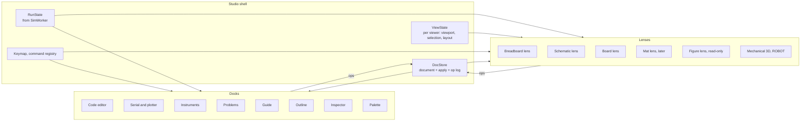
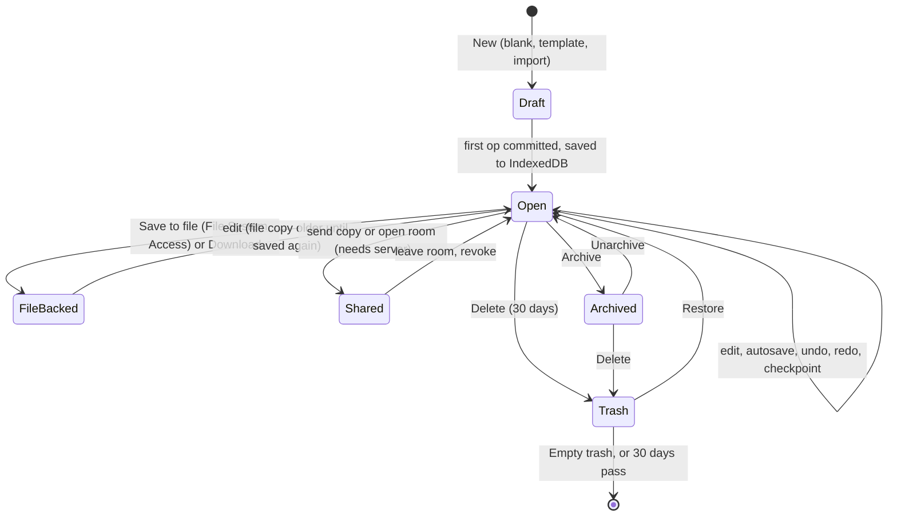
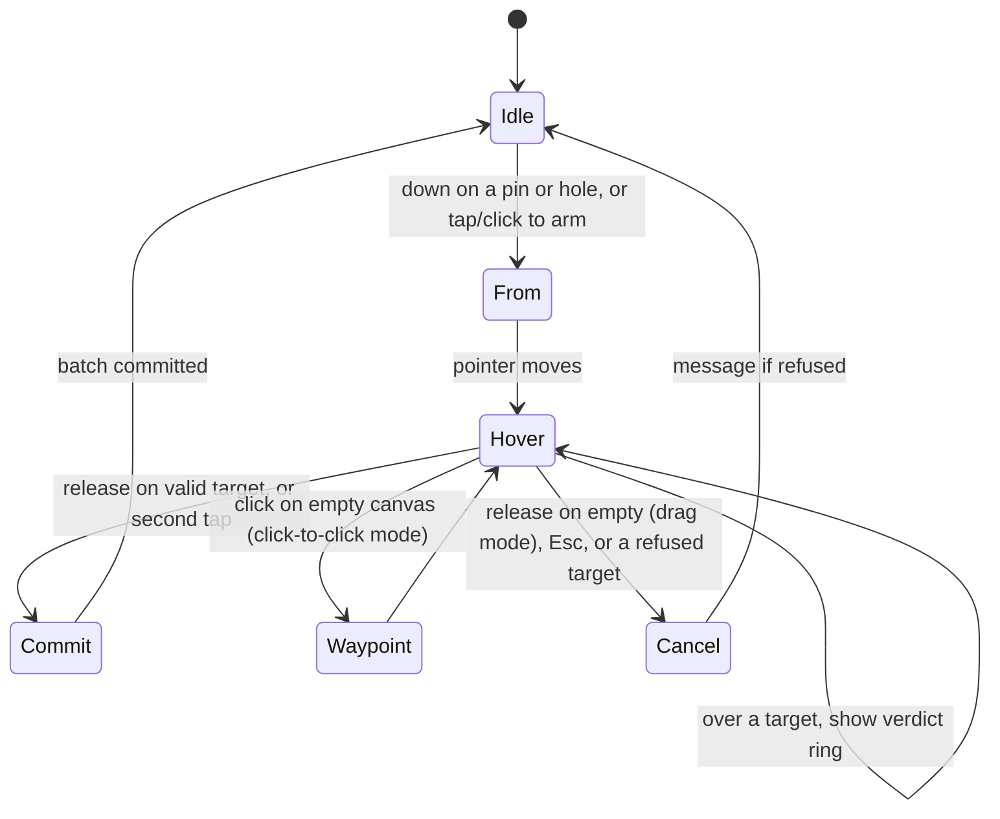

# iynk Studio: the original-project editor

Written 2026-10-27 by the Studio seat. Purpose (D-013): the editor in which Amar, and the friends he works with, imagine, design,
wire, program, run, debug and share their own hardware projects, in a browser, on their own machines, with nothing paid and nothing
hosted by anyone else (D-015). Nothing here is planned around customers, classrooms or markets.

This file specifies the editor shell, the project lifecycle, the canvas and every interaction in BRIEF section 8.2. It does not
re-specify the document (`04_ARCHITECTURE/PROJECT_DATA_MODEL.md`, "PDM" below), the part descriptor
(`04_ARCHITECTURE/COMPONENT_SCHEMA.md`, "CS"), the simulation (`04_ARCHITECTURE/SIMULATION_ARCHITECTURE.md`, "SA") or the room
(COLLAB). It uses their field names and says where it needs something they do not yet give (section 19, Objections).

Evidence labels: VERIFIED (I read the file or number), DOCUMENTED (a repo file says it), EXTERNAL (outside source, not run here),
ESTIMATED (derived, assumptions given), HYPOTHESIS (a design bet to test), PROPOSAL (a number or rule I chose, to be tuned by the
named harness), UNKNOWN. No benchmark number below is mine: every measured figure is cited from `08_RESEARCH_SPIKES/` and every
threshold I chose is marked PROPOSAL.

## 0. The decisions on one page

| # | Question | Decision | Where |
|---|---|---|---|
| 1 | One universal workspace or specialised editors? | One Studio workspace. The schematic, breadboard, board and mat views are lenses over the same document and the same operations. Code, serial, instruments and the guide are docks in the same shell. Domain tools (mechanical, drone design) plug into the shell as tool packs, not as separate apps | 2, ADR-0800 |
| 2 | What does the canvas draw with? | SVG DOM, a thin custom scene core in plain TypeScript behind a `Renderer` interface, with level of detail and culling from the first commit. No xyflow. The RS-01 check says only LOD is a plausible pass on real devices, so LOD and culling are not optional; Canvas stays a swap behind `Renderer`, and the Studio build does not wait for the device run (For Amar, Q-2) | 5, ADR-0801 |
| 3 | What does a gesture produce? | One batch of PDM ops, computed by a pure tool function. Tools never touch the document directly. A wire is a net operation plus a drawing; a breadboard leg is a placement plus the net change its strip implies | 6, ADR-0802 |
| 4 | What may be refused? | Only what has no physical meaning (a pin to itself, a mechanical pin on a net, a hole that does not exist). Everything electrical that is merely wrong is allowed and flagged by the shared static rules, so a person can build the broken circuit on purpose | 7, ADR-0803 |
| 5 | Where do unplaced parts go? | Schematic: auto-placed by a deterministic layout that is computed, not stored, until the first manual edit freezes it. Breadboard: a parts tray, never a hidden position | 6.4, ADR-0804 |
| 6 | Undo? | Per author, last in first out, in memory, from the inverse the apply function returns. Two scopes: canvas (all ops except text) and code editor (CodeMirror history, written as forward `source.edit` ops) | 11, ADR-0805 |
| 7 | Lifecycle | Library in IndexedDB, files on disk, one writer tab per project, fork-on-open for templates and lessons, archive and 30-day trash, share as a copy or as a room | 4, ADR-0806 |
| 8 | Keyboard and screen readers | An outline pane is the accessible twin of the canvas. Every canvas action has a list-based keyboard path that emits the same ops. The build does not wait for RS-16 (never run): the path is built in the Studio phase and gated by a keyboard-only Playwright spec; the screen-reader pass is For Amar (Q-13) | 12, ADR-0807 |
| 9 | Editing while a run is on | A change that can alter the circuit or the code marks the run stale and offers Restart. Layout-only changes do not | 11.4, ADR-0808 |
| 10 | Lessons | Every lesson, board tour, bench and craft is a converted project (PDM section 11). Opening one forks it; the old isometric figure stays as a read-only lens until a Studio view replaces it | 13 |

Status of the evidence this file leans on: RS-01 is INCONCLUSIVE (no phone or Chromebook; the device run is For Amar, Q-2, `docs/device-results.md`, and the
Studio build does not wait for it), RS-09 PASS, RS-16 (keyboard wiring) has no report and is replaced by a built path plus an automated gate (12.2), RS-04
(compile) has no report and becomes a local compile timing task in the build plan (RS-03 measured arduino-cli at 1.17 to 1.40 s cold and 0.33 to 0.56 s warm;
arduino-cli is GPL-3.0). Build order follows D-014; nothing here waits for interviews, a pilot or Fault Lab.

## 1. Scope, upstream and downstream

| Direction | Item |
|---|---|
| Upstream: brief | BRIEF section 7 (Studio), 8.1 (lifecycle), 8.2 (canvas), 18.3 (access) |
| Upstream: decisions | D-013 purpose, D-014 order (Studio editor: Uno first, then all boards), D-015 local-first, D-016 buddies, D-007 fidelity labels, D-010 diagnosis record, D-011 budgets |
| Upstream: audit | TECHNICAL_DEBT A5 (netlist is a by-product of the drawing) and D5 (four change paths), SECURITY_BASELINE X3 (same-origin figures), PERFORMANCE_BASELINE P1 (idle CPU of figures) |
| Upstream: research | `02_RESEARCH/competitors/circuit-eda.md` (Fritzing keeps breadboard, schematic and PCB views on one model, EXTERNAL), TECHNICAL_RESEARCH section 6 (RS-01 exit condition) |
| Upstream: contracts | PDM sections 2 to 7, 9, 11, 12; CS sections 4.4, 4.5, 4.13 and ADR-0204; SA sections 5.1, 13.4, 14, 17.2 |
| Upstream: spikes | RS-01 (rendering), RS-09 (op log, convergence), RS-03 (avr8js, for what a run can show) |
| Downstream: features | F-076 to F-094, F-221 (Domain H), F-097 and F-101 (parts), F-207, F-034, F-038, F-053, F-054, F-055 (docks), F-116, F-121, F-122 (rooms), F-133 (author lessons), F-171, F-177, F-178, F-204 |
| Downstream: requirements | R-038, R-039, R-053 to R-074 (all refined here), R-034, R-033, R-057, R-058 |
| Downstream: journeys | J-03 start an original project, J-04 add and wire components, J-05 write and execute code, J-08 share, J-09 edit together, J-10 author a lesson, J-11 import, J-12 export |
| Downstream: ADRs | ADR-0800 to ADR-0808 in section 20 (this file owns the range ADR-0800 to ADR-0809 (ADR-0809 free); API_CONTRACTS, which also claimed it, moves; the nine records are files in `04_ARCHITECTURE/ADR/`) |

Out of scope here: the room server and its protocol (COLLAB), the AI partner's proposal UI (it reuses the diff card of section
11.3), PCB layout (not planned), 3D mechanical editing (ROBOT; the shell has the seam, section 8.5), the part editor (PARTS),
lesson authoring tools beyond "a project with a `guide`" (LABS).

## 2. One workspace or specialised editors

BRIEF section 7 asks to research this. The question is real because iynk will hold circuits, code, mechanical assemblies and
flight designs. Three options were weighed.

| Criterion | A. One workspace, views as lenses | B. Specialised editors (circuit editor, code IDE, mechanical editor, flight designer) linked by project data | C. One shell, per-mode toolsets (the editor changes its tools when the mode changes) |
|---|---|---|---|
| Integrity of shared data | One document, one `apply`; views cannot disagree about nets because only `nets` is truth (PDM N7, W8) | Same document, but each editor needs its own copy of selection, undo and validation unless they share a runtime; cross-editor edits need a hand-off | Same as A |
| Undo, autosave, rooms, AI proposals | One op log feeds all of them (PDM P5, ADR-0104) | One log, but "undo" is per editor and confuses a person who changed code then wiring | Same as A |
| Learning cost | One layout to learn; view tabs are the only new idea | Several layouts, several menus | One layout whose tool palette changes; people lose track of which tools exist |
| Cost of a bug | A lens that is not open is not mounted, so a lens bug cannot break another | Isolation is better | Mode switches share state and are the usual source of stuck tools |
| Weight | Lenses are lazy chunks; only the active one costs frame time | Each editor is its own route and chunk | One heavy shell |
| Accessibility | One focus model and one live region system to get right | Several to get right | One, plus mode announcements |
| Fit with the data | PDM already stores `views[]` of kinds `schematic`, `breadboard`, `board`, `mat`, each with its own `placements`, `wires`, `junctions` and `labels`, all pointing at one `nets` array | Needs an extra "which editor owns what" rule that the document does not have | Needs a mode field the document does not have (modes would be per viewer) |
| Precedent | Fritzing keeps breadboard, schematic and PCB views over one model (EXTERNAL, `competitors/circuit-eda.md`, Fritzing entry) | PCB suites split schematic and layout into two editors; iynk does not plan PCB layout | Not seen in the researched set |

**Decision (ADR-0800): A, with a plug-in seam for tool packs.** The shell owns the document store, the op pipeline, selection,
undo, the run client, the panes and the keymap. A **lens** draws one view kind from the document and offers that kind's tools. A
**tool pack** adds tools and docks for a domain (mechanical, drone design) through the same `Tool` and `Lens` interfaces
(section 5.1). Nothing a lens does can bypass the shell's op pipeline.

Why not B: nothing in the data model separates the domains, and the founders' workflow (imagine, design, assemble, wire, program,
simulate, debug) crosses them in minutes. Why not C: a hidden mode is the cheapest way to get a stuck tool, and the document has no
place for it.

When this decision would be wrong, and what happens then. If a domain (a 3D chassis editor, say) needs a different interaction
model so completely that it cannot share selection and undo, its lens can run as its own route over the same project store: the
tool-pack interface does not assume the canvas is on the page. Reversal cost is low because the document is view-agnostic
(PDM section 14.1: nothing in it depends on SVG, Canvas or WebGL).

What the founders' workflow looks like in the shell:



## 3. Workspace anatomy and state

### 3.1 Regions

| Region | Contents | Notes |
|---|---|---|
| Top bar | Project name (editable), save state chip, Undo, Redo, view tabs (Breadboard, Schematic, Board), Run, Stop, Reset, speed, fidelity tier chip (R-065), share, menu | Save state chip values: `saved`, `saving`, `unsaved file copy`, `autosave failed`, `read-only (open in another tab)` |
| Left rail | Palette (search, categories, recent, in this project), Files (sources), Guide (when the project has `guide`), Outline | One at a time on narrow screens |
| Centre | The active lens | A lens that is not shown is unmounted |
| Right rail | Inspector, Problems, Checks (F-221) | Inspector follows selection |
| Bottom dock | Code editor with a tab per source, Serial monitor, Plotter and scope (SIM), Instruments | Resizable; the code editor and the canvas can sit side by side |
| Status line | Virtual time, run state, achieved speed ("running slower than real time"), cursor position in mm, zoom, grid step, selection count | `aria-live` off; the live region is separate (section 12.3) |

Layouts by width (CSS px): 1200 and up: left rail, centre, right rail, bottom dock. 768 to 1199: centre plus one rail at a time as a
drawer. Under 768: tabs for Canvas, Code, Serial, Inspector; palette and inspector are bottom sheets; no horizontal page scroll
(R-071, the audit's phone walk found none on the labs, `01_AUDIT/runs/BROWSER_WALK.md` step 13). The existing `Sheet`, `Tabs`,
`Dialog`, `Popover` in `src/components/ui/` are the base (DOCUMENTED, PRD 8.2 verdict "Preserve and extend").

### 3.2 Three stores, one direction

| Store | Holds | Persists | Written by |
|---|---|---|---|
| DocStore | The project document, the confirmed revision, the queue of pending ops, the undo and redo stacks | Document: IndexedDB and files (section 4). Stacks: memory only (R-034) | Only `commit(batch)`, which calls the shared pure `apply` (PDM section 7) |
| ViewState | Per viewer and per project: active view id, viewport per view `{cx_mm, cy_mm, k}`, selection set, expanded panels, grid and snap settings, art mode, overlay toggles, armed palette item | `localStorage` key `iynk:studio:ui:<projectId>`, wrapped in try/catch, absent is fine (PDM 2.2: viewport, selection and layout are per viewer) | The UI |
| RunState | Worker state, virtual time, last frame snapshot, diagnostics, probe readings | Never | The SimWorker client (SA 17.2) |

Data flows one way: ViewState and DocStore produce a `Scene`; the renderer draws it; pointer and key events go to the active tool;
a tool returns a batch of ops (or a preview); the shell commits it. No component writes the document by any other path (audit D5).

### 3.3 Selection model

A selection is an ordered set of `Selectable = {kind: 'part'|'wire'|'junction'|'label', view: vw_id, id}`. Parts are boards and
components (`brd_`, `cmp_`). A net is not selectable on the canvas; "select net" (Alt-click a pin or wire, or a row in the nets
list) sets a separate `focusNet` that highlights its pins and wires (section 10.2). Selection is cleared when the active view
changes, except that `focusNet` survives. A selected id that disappears (a buddy deleted it, an undo removed it) leaves the set
silently and the status line announces the new count.

## 4. Project lifecycle

### 4.1 States of a project



A Draft is not in the library until the first op commits. Opening a template forks it (4.3), so a template is never edited in place.

### 4.2 Operations on a project

Every operation lists what it writes. "Store" means IndexedDB (ADR-0106). "Doc" means ops through `apply`.

| Operation (BRIEF 8.1) | Trigger | Effect | Errors and edge cases | Features, requirements |
|---|---|---|---|---|
| Create blank | Home or Ctrl/Cmd+N: choose a board (Uno R3 first, then the other 11, R-072) | New `prj_` ULID id; document with `format`, `schemaVersion 1.1`, `meta {title "Untitled", kind "project", locale}`, one board (`brd_`), a breadboard `cmp_` and views `vw_bb` and `vw_sch`, one source `main.ino` (or `.py`, `.v` by board language), `provenance.origin {blank}`, `license {LicenseRef-iynk-pending}`, `actors` with the local person. Written to Store at once | IndexedDB unavailable: banner "projects will not be kept", Save to file offered (PRD 7.2 step 1). Unknown board id: refuse with the list of boards | F-076, F-092, R-050 |
| Create from template | New, Template tab | Fork of a template project (4.3) | Template needs a part version not in the registry: opens with the pinned interface and generic art, warns | F-084, R-056 |
| Create by import | Open file, drop a file, Import sketch | Converter returns `{project, loss[]}`; the loss list is shown before saving; `provenance.origin {import}` | Refuse a newer `schemaVersion` (PDM 10) and offer the raw file back; refuse a file over the size limits before parsing; V3 failure opens read-only with errors (recovery open, PDM 9.3) | F-091, R-037 |
| Duplicate | Library menu, Ctrl/Cmd+D in the library | A fork with `origin fork` (4.3) and the title "<title> copy" | None | F-088 |
| Rename | Click the title; library menu | `meta.set {title}` op (1 to 120 characters). The library `index` row updates in the same transaction | Empty or over-long title: inline error, no op | F-092 |
| Edit | Canvas, inspector, code | Ops (section 6) | Rejected op: state unchanged, one-line reason, last good state kept (RS-09 invariant, PDM 7.2 reject codes) | F-079 to F-083 |
| Save | Automatic; Ctrl/Cmd+S saves a file copy | Store write after each committed batch (4.4); Ctrl/Cmd+S writes the `.iynk` or `.iynkz` | Quota: warning chip "autosave failed", keep last good copy, offer file save (R-073) | F-087, F-200, F-201 |
| Version | History pane: Name this version; automatic ones | Checkpoint (PDM 5.15): kind `named` or `auto`; snapshot bytes in Store `revisions` | At most 256 checkpoints (PDM limits), in the document header and in the local client store | F-093, R-066 |
| Compare | History pane: pick two | Structural diff of the two snapshots by id: parts added or removed, nets whose member sets differ, wires, file text diff | A restored snapshot whose `stateHash` does not match its checkpoint is refused | F-093 |
| Restore version | History pane | Not a rollback of history: a batch with `author.kind "user"` that moves the document to the snapshot's state (computed as a structural diff turned into ops), so undo and rooms keep working | Large diffs may exceed the 64 KiB op cap: split into batches (one revision per batch); a room needs the host's OK | F-093 |
| Fork | Project menu: Fork | New `prj_` id, `revision` 0, new genesis chain, `history` empty plus one named checkpoint "Forked from ...", `provenance.origin {fork {project, revision, stateHash}}`, `license` kept (PDM 5.17), forker added to `actors` and `access.owners`; original author stays in `contributors` | Forking a project whose `provenance.thirdParty` has `unchecked` items copies them (the publish gate counts them later) | F-088, R-039 |
| Share | Project menu: Share | Two choices, 4.5 | Server unreachable: file only | F-089, F-121 |
| Export | Project menu: Export | The formats of PDM 12.2, each showing its loss list before writing (4.6) | Secret-shaped strings in text: warn before writing (PDM 13) | F-090, F-160, F-210, F-211 |
| Import | Home, drop, Project menu: Import into this project (sources, parts) | Adds source files or a part pack through ops (`source.add`, `dep.set`, `asset.add`) | Path rules V3-PATH; zip-slip refusal (PDM 13) | F-091, F-220 |
| Archive | Library menu | Library `index` row `archived: true` (a library-only flag, outside the document; boolean on the index row, PDM 12.1, ADR-0106) | Archived projects are hidden from the default list and excluded from search; not synced | F-092 |
| Delete | Library menu | Moves the record to Store `trash` with `trashedAt`; 30 days (F-092). Rooms the project hosts are closed first | Deleting the project that is open in another tab: that tab turns read-only | F-092 |
| Restore | Trash | Back to `projects` and `index` | Id clash cannot happen (ids are never reused) | F-092 |
| Publish to a community catalogue | Not planned | OOS (F-095); sharing with buddies replaces it (F-089, F-143) | | |

### 4.3 Fork-on-open for templates and lessons

Opening a template or a lesson never edits it. The Studio creates a fork with these extras:

1. `provenance.origin` is `template {template}` for a template. For a converted lesson it is `fork {project: <the lesson's prj id>,
   revision, stateHash}`. `origin` is a `oneOf` with one kind at a time (`project.schema.json` `Provenance`), so the fork does not
   also store the `migration {catalogue ...}` origin. The catalogue lab and id stay readable by following `project` to the lesson
   (its own `origin` is the `migration` record). If a later screen needs the catalogue id without that lookup, ask PDM for an optional
   `fork.of` field (Objection O-S10); this file does not depend on it. A named checkpoint "Start" is written at revision 0 so Reset lesson is a restore of that checkpoint.
2. `ext["x-iynk-solution"]` (a hidden solution of a challenge, PDM 11.3) is **not copied** into the fork. It stays with the template
   and is shown only through the template. This keeps a shared fork from leaking the answer (PROPOSAL; PDM says only that a project
   with a hidden solution must not be shared by default).
3. Progress (done flags, quiz answers) is not in the project. It is stored per person against the template id (PDM 11.6).
4. `tests[]` with `visibility: "hidden"` stay in the fork and run, but their expected values are not shown in the Checks pane
   (F-221). **Hidden is a UI convention, not secrecy.** The expected values are still in the JSON document, in the `.iynk` file, in
   share links and in room snapshots, and anyone who opens the file can read them. Real solutions live only in the template
   (item 2); a fork never contains one. Nothing in the Studio may claim a hidden check is secret.

### 4.4 Autosave, durability and multiple tabs

| Topic | Rule |
|---|---|
| When | After each committed batch, debounced: save 500 ms after the last commit, at most 5 s after the first unsaved commit, on `visibilitychange` hidden and on `pagehide` (RC-11) |
| Cost | The write runs off the interaction path (a task in a worker or an idle callback) and must not drop a frame; budget BUD-08: p95 under 50 ms at 500 parts and 1,000 wires (PROPOSAL, to be measured) |
| How | PDM 12.1: two-slot write (new record written before the old is replaced), `index` row in the same transaction, `revision` and `hash` compared first |
| Journal | Edited text is also journalled per keystroke burst (300 ms) so a crash between autosaves loses at most that burst (extends F-087, DOCUMENTED today as `iynk:v1` progress only) |
| Persistence | Ask `navigator.storage.persist()` the first time a project is created (EXTERNAL; not tested here). If it is refused, or the quota estimate is over 80 percent (PROPOSAL), show a one-time note and offer file save |
| File reminder | A project with no file copy and more than 200 committed ops since its last file save shows a quiet chip "Not saved to a file" (PROPOSAL). The brief for local-first is that the person owns the bytes (D-015) |
| Failure | Quota error or write failure: chip `autosave failed`, a toast that says what to do, the in-memory document stays editable, the last good Store copy stays, and each further batch retries once. The tab asks before closing while the failure stands |
| One writer | A Web Lock named `iynk-project-<id>` is taken when a project opens (EXTERNAL API, supported in current Chromium, Firefox and Safari; HYPOTHESIS that it is enough). A second tab that cannot get it opens the project read-only with the banner "Open in another tab" and a Take over button. Where Web Locks is missing, a `BroadcastChannel` heartbeat is the fallback and the revision-plus-hash compare is the last guard (R-035) |
| Recovery | A document that fails V3 opens read-only with the rule ids and paths. "Repair" proposes the safe class of fixes (remove dangling references) as one batch with `author.kind "system"`, shown as a diff, applied only on OK |

### 4.5 Sharing with a buddy

Two different things, both needing the optional server (D-015, F-199) except the file.

| Mode | What the buddy gets | How | When to use |
|---|---|---|---|
| Send a copy | A fork they own. Their copy starts from your `stateHash`; yours is unchanged | Without a server: send the `.iynk` file. With the server: you upload a snapshot (gzipped, PDM 7.1), it returns a link, and the buddy's Studio fetches and forks it, recording `origin fork` | "Look at what I made", "try your own version" |
| Work together | A live room on your project: same document, ops ordered by the server, roles `host`, `editor`, `spectator` (F-121) | Share, Start room. You stay the owner; the document's `access.grants` is updated with `access.grant` ops as a mirror (advisory, PDM 5.1) and the server keeps its own ACL | Debugging with a buddy (F-122), building together |

```mermaid
sequenceDiagram
  participant A as You (Studio)
  participant S as Self-hosted server
  participant B as Buddy (Studio)
  A->>A: Share, Work together
  A->>S: create room (project snapshot gzipped, stateHash)
  S-->>A: room id, invite link
  A-->>B: link (chat, any channel)
  B->>S: join with device token
  S-->>B: snapshot + op tail
  B->>B: validate (V2 to V5) before replacing local state
  loop edits
    A->>S: op batch
    S-->>A: ack + inverse
    S-->>B: op batch
  end
  Note over A,B: Server down: both keep editing locally; resume from last seq
```

Rules the Studio enforces: a snapshot from a room is validated through the five passes before it becomes the local state (PDM 13);
an offline room edit is a queue of pending ops replayed on reconnect (PDM 7.4); a rejected op rebuilds the view from confirmed
state plus the queue; a person leaves a room and keeps a local copy of the last confirmed state, which is a fork. The room
protocol, roles and the baton for code are COLLAB's (F-116, F-121). Live drag feedback is presence, not ops (PDM 7.4, coalescing).

### 4.6 Local-only versus server-backed

| Capability | Local only (no server) | With the self-hosted server |
|---|---|---|
| Create, edit, run, save, undo | Yes | Yes |
| Open and save files, export every format | Yes | Yes |
| Library across devices | No; copy files | Optional sync of snapshots (F-165; conflict rule open, Q-S4) |
| Send a copy | File | Link |
| Rooms and buddies | No | Yes |
| AI partner | With the person's own key, direct from the browser | With the person's own key, direct from the browser, or through the optional relay of their own server (`POST /v1/ai/relay`, R-010, API_CONTRACTS ADR-0612); the server never stores the key |
| Offline | Whole app after first load (service worker, F-094) | Rooms resume on reconnect |

The no-server path is the tested default. A test runs the M1 walk with every network call outside the app origin blocked
(PRD 7.2 step 1).

## 5. The canvas: data and rendering

### 5.1 Interfaces

```ts
// The seam that lets SVG, level-of-detail SVG, Canvas or WebGL replace each other (R-053).
export interface Renderer {
  mount(el: HTMLElement, opts: { locale: string; theme: 'light' | 'dark'; reduceMotion: boolean }): void;
  setViewport(v: Viewport): void;                 // cheap: one transform, no scene rebuild
  draw(scene: Scene, diff: SceneDiff): void;      // incremental: only changed items
  hitTest(xPx: number, yPx: number, slopPx: number): Hit | null;
  hitRect(r: RectPx, mode: 'touch' | 'inside'): Hit[];
  dispose(): void;
}
export interface Viewport { cx_mm: number; cy_mm: number; k: number /* CSS px per mm */; w: number; h: number; dpr: number }
export type Hit =
  | { kind: 'pin'; c: string; p: string }
  | { kind: 'hole'; surface: string; hole: string }
  | { kind: 'wire'; id: string; segment: number }
  | { kind: 'handle'; of: string; handle: 'leg' | 'waypoint' | 'rotate' | 'resize'; index: number }
  | { kind: 'part'; c: string } | { kind: 'junction'; id: string } | { kind: 'label'; id: string };

// A tool is a state machine. It never writes the document; it returns ops.
export interface Tool {
  id: string;
  cursor(ctx: ToolCtx): string;
  pointer(ev: ToolPointerEvent, ctx: ToolCtx): ToolResult;   // 'down' | 'move' | 'up' | 'cancel'
  key(ev: ToolKeyEvent, ctx: ToolCtx): ToolResult;
  preview(ctx: ToolCtx): Overlay[];                           // ghost, rubber band, valid and invalid rings
}
export type ToolResult = { kind: 'none' } | { kind: 'preview' } | { kind: 'commit'; batch: Op[]; label: string } | { kind: 'cancel' } | { kind: 'switch'; tool: string };

// A lens draws one view kind and lists the tools it offers.
export interface Lens { id: string; kinds: ViewKind[]; mount(host: HTMLElement, ctx: LensCtx): void; tools(): Tool[]; dispose(): void }
```

`Renderer` has the five methods PRD R-053 names (`mount`, `setViewport`, `draw`, `hitTest`, `dispose`) and adds `hitRect` for
rubber-band selection. `ToolResult.commit.batch` is a list of PDM ops sharing one `batch` id (PDM 7.3). A pure
`buildScene(doc, viewId, viewState, overlays, lod) -> Scene` is testable without a browser.

### 5.2 Coordinates and units

| Space | Unit | Axes | Notes |
|---|---|---|---|
| View (document) | mm | x right, y down; rotation counter-clockwise in degrees | PDM 5.7. Layout range plus or minus 1,000,000 mm; quantised to 0.001 mm and 0.01 degree at write (PDM 4.2) |
| Part-local | mm | origin at the descriptor's body origin | `pins[].position {x, y}` and `dimensions.body` from the descriptor (CS 4.5) |
| Screen | CSS px | origin top-left of the canvas | `px = (mm - c) * k + size / 2`. Zoom range 0.1 to 40 px per mm (PROPOSAL; at the top end a 2.54 mm breadboard pitch is 100 px, at the bottom a 400 mm board is 40 px) |

Rotations in the schematic and breadboard views are multiples of 90 degrees. Free angles are allowed only in the `mat` view and in
mechanical lenses. The Studio never stores a value it computed by trigonometry (PDM 4.2): rotation is stored as the integer
multiple, and rotated pin positions are computed at draw time with an exact lookup for 0, 90, 180 and 270.

### 5.3 Layers, in z order

| # | Layer | Content | Rendering |
|---|---|---|---|
| 1 | Grid | Dots or lines at the grid step, only when k is large enough to see them (spacing over 8 px) | One CSS background or a pattern, not elements |
| 2 | Surfaces | Breadboard bodies, the mat | Part art, below parts |
| 3 | Parts | Boards and components, ordered by `placement.layer` then document order | LOD, section 5.4 |
| 4 | Wires | One `polyline` per wire, plus junction dots | Constant on-screen stroke width (`vector-effect: non-scaling-stroke`) |
| 5 | Air wires | Thin dashed lines for the part of a net that has no drawn wire (ratsnest, PDM W6) | Computed per net: a minimum spanning tree over its undrawn components |
| 6 | Labels | Net labels and refdes | Text only at LOD1 and above |
| 7 | Overlays | Net focus, problem badges, simulation values | Section 10; separate group updated at most 30 times per second |
| 8 | Interaction | Ghost, rubber band, valid and invalid rings, alignment guides, selection outlines and handles | Drawn last, never in the document |

### 5.4 Level of detail, culling and art budget (RS-01)

RS-01 (INCONCLUSIVE on devices) measured on an Apple M4 Pro, 500 parts, 1,000 wires, 47,097 art elements, five interactions:

| Variant | Headed Chromium 1x, p95, pan-fit / zoom | 4x CPU throttle p95, zoom | DPR 2 p95, zoom | Source |
|---|---|---|---|---|
| Plain SVG | 25.8 / 25.0 ms | 42.4 ms | 66.4 ms | RS-01 report tables 1 and 4 |
| SVG with culling | 25.2 / 25.0 ms | 49.9 ms | not run | table 1 |
| SVG with culling and outline boxes below zoom 0.7 (LOD) | 10.6 / 10.7 ms | 34.1 ms | 9.2 ms | tables 1 and 4 |
| Canvas 2D, full redraw | 33.6 / 25.0 ms | 49.3 ms | 25.1 ms | tables 1 and 4 |

The independent check in the RS-01 report adds that the full-art configuration is unlikely to pass on a real phone or Chromebook;
only LOD is a plausible candidate. So the Studio is built on three rules, each from the report's architecture paragraph:

1. **The budget is drawn art elements in view, not parts.** The scene builder counts them every frame. Starting budget: 10,000
   elements in view (PROPOSAL; the harness in section 14.2 sweeps 5,000, 10,000, 20,000 and 47,000 to find the knee on each
   machine and replaces this number with a measured one).
2. **Level of detail from the first commit.** The level is chosen from the part's on-screen size `s = k * max(w_mm, h_mm)` with 15
   percent hysteresis so a part does not flicker at the threshold. Thresholds are HYPOTHESIS until RS-01 runs on devices, starting from RS-01's switch point (its
   parts were 50 world units wide and swapped at zoom 0.7, so about 35 px).

   | Level | On-screen size | Drawn |
   |---|---|---|
   | LOD0 | under 35 px | One outline rectangle with the body colour. No pins, no text. Pins stay hit-testable through the spatial index |
   | LOD1 | 35 to 120 px | The generic fallback art from CS 4.13 (at most about 12 elements), pin dots, refdes text |
   | LOD2 | over 120 px | The part's full art, if "Illustrated" art is on and the budget allows; otherwise LOD1 |

3. **No hand-drawn displacement filter on the canvas.** The figure pages apply `feTurbulence` plus `feDisplacementMap` (a 580 KB data
   URL per page, RS-01 caveat); RS-01 dropped it and its numbers hold only without it. The filter may be applied to the single
   hovered or selected part at LOD2 (HYPOTHESIS that one filtered part is affordable; measured in the harness).

Culling: a uniform grid spatial index (cell 50 mm, rebuilt incrementally on placement changes) answers "which items intersect the
viewport" and "which pin is under the pointer". Items outside the viewport plus a margin of one screen are set `display:none`
(RS-01's `svg-cull`), not removed, so toggling is cheap.

**Gesture mode** (HYPOTHESIS to meet BUD-02; RS-01's LOD zoom at 4x was 34.1 ms p95 and 58.2 ms at 6x): while a wheel, pinch or drag
gesture is active, the renderer changes only the one transform on the scene group. It does not re-evaluate LOD or culling until 100
ms (PROPOSAL) after the last gesture event, then does both once. If the harness shows this does not fix zoom at 4x, the decision rule
of R-053 applies: reduce art elements per part further, then move wires to one canvas layer.

**Adaptive art.** A setting "Art: Illustrated / Simple / Auto" (default Auto). Auto starts Illustrated on a machine whose first
five-second frame sample has p95 under 12 ms (PROPOSAL) and falls back to Simple for the session if a rolling p95 over 120 frames
exceeds 28 ms; it never switches back without the person asking. This keeps the editor usable on a low-end device (D-011) without
asking the person to know about it.

### 5.5 The art pipeline

Today a part's art is an isometric, 3D, hand-inked figure page (`public/figures/parts/*.html`, built from `figures/parts/*.js`,
VERIFIED: 29 parts), run in an iframe with no `sandbox` attribute (VERIFIED, `src/components/figure/FigureFrame.tsx:351-361`;
SECURITY_BASELINE X3). It cannot be an editor layer: it is a page, it is isometric, and it carries the filter.

| Art tier | Source | Used for | Notes |
|---|---|---|---|
| Fallback | CS 4.13 `visual.fallback` renderers (`generic-two-lead`, `generic-dip`, `generic-header-module`, `generic-terminal-module`, `generic-box`) drawn from `pins[].position` and `dimensions` | Every part, always. Top-down by construction | Required by the schema; the pin positions are the wiring hit targets in both tiers (ADR-0204) |
| Editor art | A flat SVG per core part, extracted at build time from the figure page by a script generalising RS-01's `src/extract.mjs` (which took `path`, `circle`, `rect`, `ellipse` of the part group: 26 parts, 12 to 687 elements, mean 93.6, median 74), with no filter and no text; listed in the descriptor's `visual.assets[]` as `image/svg+xml` with its `sha256` | LOD2 when "Illustrated" | Whether an isometric extraction is acceptable in a top-down breadboard view is UNKNOWN; HYPOTHESIS: a few core parts (LED, resistor, button, Uno) need top-down redraws and the rest use the fallback. Decided after the first side-by-side review |
| Figure page | `visual.breadboard.figure` | The read-only figure lens (8.6) and lesson pages | Core parts only; after the X3 fix |

The breadboard geometry already exists as data: `figures/engine/bench-bb.js:8-19` defines the half (30 columns, 82.5 by 54.5 mm),
full (63 columns, 165.1 by 54.5 mm) and mini (17 columns) breadboards, the row offsets (rows `a` to `j`), the 2.54 mm pitch and the
rail names `T+`, `T-`, `B-`, `B+` (VERIFIED). Those four are display labels from the figure code. They are not valid descriptor ids:
`localId` is `^[A-Za-z][A-Za-z0-9_]{0,31}$` (`component.schema.json`), so `+` and `-` cannot appear in a strip group id, a pin id or a
hole name that must be tied to one. **Rail naming (PDM rule C-LEG, 3.4, VERIFIED over the 27 figure parts):**

| Figure label | Strip group id (`groups[]`) | Hole name | Example leg or wire end |
|---|---|---|---|
| `T+` | `RAIL_TP` | `RAIL_TP<n>` | `"legs": {"A": "RAIL_TP7"}`, `{"kind": "hole", "surface": ..., "hole": "RAIL_TP7"}` |
| `T-` | `RAIL_TN` | `RAIL_TN<n>` | `RAIL_TN12` |
| `B+` | `RAIL_BP` | `RAIL_BP<n>` | `RAIL_BP3` |
| `B-` | `RAIL_BN` | `RAIL_BN<n>` | `RAIL_BN30` |

`<n>` is the legacy hole number from the figure (PDM 3.4: rail hole `T+12` becomes `RAIL_TP12`), so a name never depends on a rail break. A full breadboard has up to 52 holes per rail (`floor(63 * 5 / 6)`, `bench-bb.js`), so a name is at most 9 characters (`RAIL_TP52`), inside the schema's 16. Each rail is
one strip, or two strips on a split rail; the descriptor decides, and V3-HOLE (a hole name must exist on the surface) and B2 treat
rail holes exactly like column holes. The UI shows `+` and `-` from the group's `label` text, never from the id. The generator that writes the breadboard descriptor is the only place the four names are produced (it applies C-LEG), and a test asserts
that every hole name in the descriptor matches `localId`. The breadboard descriptor is generated from these numbers (CS 4.5, "produced by a
pattern in the generator"); the Studio reads holes and strips from the descriptor, never from constants.

### 5.6 Hit testing

Priority at a point: handles, then pins and holes, then wires, then junctions and labels, then part bodies, then the surface. A pin's
hit area is a circle of radius `max(drawn radius, 12 / k mm)` so the target is at least 24 by 24 CSS px (WCAG 2.5.8, R-057). Wire
hit distance is `max(6 px, half the stroke width)`. If several pins overlap at the current zoom, a short press picks the nearest;
a hold opens a pin picker listing them; zooming in separates them. On touch the slop is doubled (PROPOSAL).

## 6. Interactions

### 6.1 Gesture arbitration

One pointer pipeline (Pointer Events, `touch-action: none` on the canvas) feeds the active tool. The **Select** tool is the default
and delegates by what is under the pointer.

| Pointer down on | Mouse | Touch (one finger) | Pen |
|---|---|---|---|
| Empty canvas | Left drag: rubber band. Middle drag, Space plus drag, or right drag: pan | Drag: pan. Long press (500 ms, PROPOSAL) then drag: rubber band | As mouse |
| Part body | Select, then drag moves | Tap selects; drag on a selected part moves it; drag on an unselected part pans (avoids accidental moves) | As mouse |
| Pin or hole | Drag starts a wire (Wire tool, 6.7). Click arms click-to-click wiring | Tap arms wiring; tap a second pin completes; drag also works | As mouse |
| Wire | Click selects; drag a segment moves it; double-click adds a waypoint | Tap selects; drag the handle | As mouse |
| Handle | Drag | Drag | As mouse |
| Two fingers | Not applicable | Pinch zooms about the midpoint, two-finger drag pans, at the same time | Not applicable |

Mouse wheel: with Ctrl or a pinch gesture on a trackpad (`wheel` with `ctrlKey`) it zooms about the cursor. A wheel event with
`deltaMode` line, or an integer `deltaY` with `deltaX` of zero and no `ctrlKey`, is treated as a mouse wheel and zooms; any other
trackpad scroll pans. A setting "Wheel zooms / Wheel pans" overrides the heuristic. This heuristic is a HYPOTHESIS (browsers do not
tell mouse from trackpad); the override exists because it will sometimes be wrong.

### 6.2 Pan, zoom, fit

| Action | Mouse and trackpad | Touch | Keyboard | Detail |
|---|---|---|---|---|
| Pan | Middle drag, Space plus drag, trackpad scroll | One-finger drag, two-finger drag | Arrow keys 40 px, Shift 200 px, when the canvas has focus | View clamps so the content box (plus half a screen) stays reachable |
| Zoom | Wheel, Ctrl plus wheel, trackpad pinch | Pinch | `+` and `-` (also `=` and `_`): factor 1.25 about the view centre | Zoom about the pointer or pinch midpoint. Smooth over 150 ms unless reduced motion is on |
| Fit all | Double-click on empty canvas, toolbar | Double-tap empty canvas | `0` | Fits the bounding box of placements of the active view with 10 percent margin |
| Fit selection | Toolbar | Toolbar | `F` | Falls back to fit all |
| Actual size | Toolbar | Toolbar | `Shift+1` | 96 CSS px per inch, so 3.78 px per mm, for comparing with a real board (HYPOTHESIS that screens report CSS px honestly) |
| Zoom to a pin | Context menu | Double-tap a pin | `Z` on a focused pin | Zooms to where the pin hit target is at least 32 px |

The viewport per view is saved in ViewState (R-054) so switching tabs returns to where you were.

### 6.3 Selection and multiselect

| Action | Gesture | Result |
|---|---|---|
| Select one | Click or tap | Replaces the selection |
| Add or remove | Shift or Ctrl/Cmd plus click; on touch, the "multi" toggle in the floating bar | Toggles membership |
| Rubber band | Drag on empty canvas | Selects every part, wire and label whose box intersects. Alt: only fully inside. Shift: adds |
| Select all | Ctrl/Cmd+A | Everything in the active view |
| Cycle | Tab and Shift+Tab with the canvas focused | Next and previous part in refdes order (also the outline's order) |
| Select connected | Alt-click a pin or wire, or `N` | Sets `focusNet` and selects all wires of that net in this view |
| Clear | Esc | Tool cancel first, then selection, then `focusNet` |

A multi-selection can move, rotate (about its centre), align, distribute, lock, delete, copy, group and change shared inspector
fields. Wires between selected parts follow; wires with one end on an unselected part keep that end fixed and re-route (the
renderer's route, since a stored `route_mm` could now cross things: the tool clears `route_mm` on stretched wires in the same
batch, PROPOSAL).

### 6.4 Placement and layout

**Ways to place** (all produce the same batch):

1. Palette: click an item to arm it, then click the canvas. A ghost follows the pointer; the status line shows whether the spot is
   valid. Shift keeps it armed. Esc disarms.
2. Palette drag and drop with the pointer (touch: long press an item, then drag).
3. Quick add: `A` or `/` opens a search popover at the pointer; Enter arms the first result.
4. Keyboard only: Enter on a palette item puts the ghost at the viewport centre in move mode; arrow keys move it one grid step
   (1 mm when snapping is off; see Objection O-S5), Shift ten steps, Enter drops it, Esc cancels (R-058).

**Where a part may land.** Each descriptor says how it mounts: a part with a `breadboard-leg` connector (CS 4.5) needs a surface in
the breadboard view; boards, modules with headers, supplies and instruments are free parts. A part that needs a surface and is
dropped off any surface snaps back to where it was (or the palette), with the message "This part goes on a breadboard" and, when the
project has no breadboard, a button that adds one (PRD R-055, 7.2 step 3). In the schematic, board and mat views every part is free.

**Recipes.** Every gesture below is a batch; ops are the PDM vocabulary. Net ops that a gesture needs are computed from the current
document by the helper functions named in section 6.6.

| Gesture | Batch (in order) |
|---|---|
| Place part from the palette, breadboard view, onto the surface | `dep.set` (only if the `{ref, version}` is not pinned yet); `component.add {id cmp_new, definition, refdes, params from descriptor defaults}`; `view.place {view, placement {c, x_mm, y_mm, rotation_deg, legs}}`; then `reconcileStrips` output (`net.create` or `net.connect` or `net.merge`) |
| Place a free part (board, module), any view | `dep.set?`; `component.add` or `board.add`; `view.place` |
| Place a part that already exists in another view | `view.place` only |
| Move | One `view.place` per moved item on release (RS-09: one op per drag; live positions to buddies are presence), plus `reconcileStrips` for breadboard legs |
| Rotate or mirror | `view.place` with new `rotation_deg` or `mirrored` (plus `legs` re-derived and `reconcileStrips`) |
| Delete part | `component.remove` (or `board.remove`); cascades are the apply function's (PDM 7.2) and the inverse restores part, nets, placements and wires together (R-057). **When a check names it:** `component.remove` and `board.remove` are rejected with `referenced_by` while a `tests[]` check names a pin of the part (PDM 7.2; lesson boards are named by checks, so deleting the Uno from a lesson fork hits this). The tool does not show the raw rejection. It finds every test that names the part (`test.set` replaces a whole test case, PDM 7.2), and builds one batch: a `test.set` for each affected test with the naming checks removed (or, when a check can be re-aimed at another part, rewritten), then the `component.remove` or `board.remove`. The preview card lists each test and each check that will be dropped or changed, with the buttons Delete anyway and Cancel. Delete anyway commits the batch atomically; one Undo restores the part and the checks together. Any other `referenced_by` (a `param` binding, a firmware `entry`) is handled the same way when a rewriting op exists, and otherwise the card names the blocker and offers no commit |
| Swap part | `component.swap {id, definition, pinMap}`; the tool builds `pinMap` by matching `designator`, then asks for the rest |
| Edit a value | `component.set {id, params: {...}}` (RFC 7396 merge patch) |
| Rename refdes | `component.set {id, set: {refdes}}` (or `board.set`). Uniqueness is checked live (V3-REFDES) |
| Lock | `component.set {id, set: {locked: true}}` |
| Bring to front, send back | `view.place` with a new `layer` (-8 to 8) |

**Refdes assignment.** The next free `<prefix><n>` across boards and components. The prefix is `identity.refdes_prefix` when the
descriptor has it. When absent, the editor derives it from `category` with a keyed table, not from the schematic symbol (RECONCILIATION RC-39):
the table below keys on `category` (the enum in `component.schema.json`). `BB` for surfaces, `U` for boards. The enum is coarse, so
discrete parts (resistor, LED, diode, capacitor, switch, transistor) are expected to set `identity.refdes_prefix` and do not rely on this fallback.

| `category` | Fallback prefix (PROPOSAL) |
|---|---|
| `microcontroller`, `dev-board`, `fpga`, `display`, `communication`, `sensor`, `motor-driver`, `power`, `robotics`, `drone` | `U` |
| `passive` | `R` (a capacitor or inductor sets its own prefix `C` or `L`) |
| `semiconductor` | `D` (a transistor sets `Q`) |
| `actuator` | `M` |
| `mechanical` | `ME` |
| `instrument` | `INS` |
| `virtual` | `V` |

**Unplaced parts and auto layout (ADR-0804).** A component exists in the document once; it has a placement per view only where
someone placed it.

| View | A component with no placement there |
|---|---|
| Breadboard | Listed in the **parts tray** (a strip under the canvas) with a warning dot and the tooltip "Not placed on the breadboard". Click or drag to place. Nets are unaffected |
| Schematic | Drawn at a position from `autoLayout(doc, viewId)`, a pure function: layers left to right by shortest net distance from the board pins, ties broken by refdes, 20 mm gaps (PROPOSAL; any deterministic layered layout is acceptable). The part shows a small "auto" marker |
| Board and mat | Same as schematic; the mat auto-layout is a row, since the mat is for physical placement |

Auto positions are **computed, not stored**, so two buddies who both open the view see the same thing without any op. The first
manual edit in that view (a move, a wire route, a rotation) writes all current auto placements in the same batch before the edit
("freeze on first edit"), so the part you did not touch does not jump when a net changes. An "Arrange" command re-runs the layout and
commits it as one batch.

**Snap and grid.**

| Setting | Behaviour |
|---|---|
| Grid step | Breadboard: 2.54 mm (hole pitch). Schematic: 2.54 mm, selectable 1.27 / 2.54 / 5.08 mm. Mat: 1 mm, selectable 0.5 / 1 / 5 mm (PROPOSAL) |
| Snap to grid | On by default; hold Alt (or the toolbar toggle) to place freely. Free positions are quantised to 0.001 mm at write (PDM 4.2) |
| Snap to hole | In the breadboard view a part with legs snaps so every leg lands in a hole within 0.3 mm (the descriptor's `dimensions.accuracy` for photo-derived pins, CS 4.5). Parts with a `span` range (resistor, wire-like parts) have a flexible second leg: leg 1 follows the pointer and leg 2 is its own handle; the part is drawn from its two holes and its `x_mm`, `y_mm`, `rotation_deg` are written as midpoint and angle for readers that ignore `legs` |
| Snap to pin | Wire ends snap to the nearest pin or hole within the hit radius |
| Alignment guides | While moving, edges and centres of the moved box snap to those of nearby parts within 6 px, and thin guide lines show. Off with Alt |
| Align and distribute | Align left, right, top, bottom, centre; distribute horizontally or vertically (needs 3 or more); one batch of `view.place` |

### 6.5 Rotation and mirroring

`R` rotates the selection 90 degrees counter-clockwise, Shift+R clockwise; `M` mirrors (the `mirrored` flag). A part in the
breadboard view that has legs in holes is rotated about its first leg, then the legs are re-derived from the new pose. If a leg no
longer lands in a hole the whole rotation is refused with "Rotating here would take a leg off the board" and the part stays;
the person can lift the part first (Alt+drag) to rotate in the air. On touch, the floating bar has a rotate button; the rotate
handle above a selected part is a drag target of 32 px.

### 6.6 Net helpers used by the tools

Pure functions, tested headless, shared with validation:

| Helper | Signature (informal) | Purpose |
|---|---|---|
| `reconcileStrips` | `(doc, viewId, touchedStrips) -> Op[]` | For each strip (a `strip` group of the surface descriptor, CS 4.5) touched by a leg or a wire end, make the pins on it one net: no pin is in a net -> `net.create` (needs 2 or more pins, B6); exactly one net -> `net.connect` the rest; several nets -> `net.merge` (a short, see 7.3). Pins that left the strip are `net.disconnect`ed only if no other conductor of this view still joins them (below) |
| `connectivityOfNet` | `(doc, viewId, netId) -> Component[]` | Groups a net's pins by what physically joins them in this view: same strip, a drawn wire, a junction, a part's `internal-short` group |
| `cutAnalysis` | `(doc, viewId, wireId) -> {kind: 'redundant'} \| {kind: 'split', keep, off[]} \| {kind: 'disconnect', pins[]}` | What deleting a wire does to its net. The component with the most members keeps the net id and name; ties go to the one holding a board pin, then to the lowest pin address |
| `canConnect` | `(doc, viewId, a: End, b: End) -> Verdict` | Section 7 |
| `wireRecipe` | `(doc, viewId, a: End, b: End) -> Op[]` | Section 6.7 |
| `route` | `(doc, viewId, wire) -> Point[]` | Section 6.8; deterministic |
| `autoLayout` | `(doc, viewId) -> Map<id, Pose>` | Above |
| `staticProblems` | `(doc, delta?) -> Problem[]` | The F-028 rule set (SA 13.4, `rule:static-electrical@1`) run in the editor; the Studio only calls it |

### 6.7 Wiring

A wire is a drawing of a net (PDM P2, W1 to W8). The tool decides what the net operations are; the person only sees pins and a line.



**Two ways to draw, same result.** Drag from a pin to a pin. Or click a pin, move, click empty canvas to add waypoints, click the
target pin. On touch, tap a pin (it shows "Connecting from D13. Tap another pin."), tap the target. Esc or the Cancel button in the
banner abandons the wire in progress (R-057).

**Wire ends.** `{kind: "pin", c, p}`, `{kind: "junction", id}` or `{kind: "hole", surface, hole}` (PDM 5.7). Releasing on a wire
(schematic) creates a junction; releasing on a breadboard hole makes a hole end.

**`wireRecipe` outcomes** (a and b are the two ends after resolving a junction or hole to its net):

| a and b | Batch |
|---|---|
| Both pins in no net | `net.create {net: {id net_new, connections: [a, b]}}`; `wire.add` |
| One pin in net N, the other free | `net.connect {net: N, pin: other}`; `wire.add {net: N}` |
| Pins in different nets N and M | `net.merge {into: N, from: M}` (N is the one with a board pin, else the older id); `wire.add {net: N}`. The nets' names: if both are named, the popover "Join D12 and GND?" asks first (it is a short if the classes are `power` and `ground`, 7.3); else the merge is silent with a toast and Undo |
| Both already in the same net | `wire.add` only: a second drawing of an existing connection (also what "route the rest" of an air wire does, W6) |
| Hole end, strip already carries net N | `wire.add {net: N, to: hole}`; `net.connect` the pin if it is free |
| Hole end, strip empty | `net.create` if the other end gives a net with 2 or more pins after joining, else only the wire is drawn and the net arrives when a second pin joins (B6) |
| End on an existing wire (schematic) | `junction.add {net, x_mm, y_mm}`; `wire.remove` the old wire; `wire.add` two halves ending at the junction (the old `route_mm` split at the click); then the new wire |

A wire in the breadboard view that joins two holes of the same strip is refused as redundant (`same-strip`, 7.2) because it can never
change a net.

**Wire colour.** One of the ten jumper colours the Board Bench draws (`WireColor`, `src/content/schema.ts:30`, hex table
`src/components/boardlab/WireInPanel.tsx:14-25`, VERIFIED). Default by net class: `power` red, `ground` black, others cycle
orange, yellow, green, blue, purple, brown, white, grey. Changeable in the inspector. `wire.add` carries `color`, but the vocabulary has no `wire.set`, so a colour change is a
`wire.remove` plus `wire.add` with the same id in one batch (Objection O-S2 asks for `wire.set`).

### 6.8 Wire routing

| Aspect | Rule |
|---|---|
| Default | `route_mm` absent: the renderer routes. Orthogonal, up to three segments, choosing among horizontal-vertical-horizontal, vertical-horizontal-vertical and the two L shapes the one that crosses the fewest part boxes, ties by shortest, then by the order listed. Deterministic, so every viewer sees the same line. This is the shape RS-01 drew (horizontal, vertical, horizontal) |
| Breadboard jumpers | Drawn as a gentle arc between two holes (a quadratic curve whose control point is the midpoint raised by a fixed fraction of the length) so they read as jumpers; never routed around parts |
| User control | Drag a segment to move it perpendicular to itself: the tool writes `wire.route` with the waypoints. Double-click a segment adds a waypoint. Double-click a waypoint removes it. "Reset route" clears the route |
| Clearing a route | `wire.route` with `route_mm: []`; the applier stores an absent field (the document never holds an empty route). PDM 7.2 does not say what an empty array means: Objection O-S2 |
| Limits | 256 waypoints, 5,000 wires per view (PDM 9.4) |
| Crossings | Two wires that cross without a junction are not connected. A small gap is drawn in the lower wire (break-over) at LOD1 and above. A junction is a dot; only a junction connects (PDM `junctions[]`) |
| Moving a part | Wires re-route from their pins. A stored route is kept if its end segments can still reach the pins orthogonally, else it is cleared in the same batch (PROPOSAL) |
| Air wires | The undrawn remainder of a net (PDM W6) is shown thin and dashed with a "route the rest" command (Ctrl/Cmd+Shift+R) that adds wires for the minimum spanning tree |

### 6.9 Junctions and labels

`J` places a junction on a wire (`junction.add`); a net label (`L`) is a `label.set {view, label {id lbl_, text, x_mm, y_mm, net}}`.
Two labels with the same text on different nets are not joined (PDM N3: two nets with one name are never merged implicitly). Giving
a label the name of an existing net offers "Connect to net <name>"; accepting it moves the pin it sits on with `net.connect
{move: true}`.

### 6.10 Copy, paste, duplicate, delete, group

| Action | Behaviour |
|---|---|
| Copy | Writes a clip to the clipboard as JSON with media type `application/x-iynk-clip+json`: components with params, their placements in the active view, the wires and junctions whose both ends are inside the selection, and the `{ref, version}` list. No ids that will be reused |
| Paste | New ids for everything, refdes renumbered, offset by 2 grid steps from the original (or the pointer position), one batch: `dep.set?`, `component.add` per part, `view.place`, `net.create` for each internal net (a net with 2 or more selected pins), `wire.add`. Wires to unselected parts are not copied; pins of copied parts that were in nets with outside pins are not connected (R-055). One undo step |
| Paste across projects | Same, plus `dep.set` for parts not pinned in the target; parts the registry does not have arrive with their pinned interface and generic art |
| Paste text | A clip that is not iynk JSON is ignored; pasting while the code editor has focus pastes text |
| Duplicate | Ctrl/Cmd+D: copy and paste in one step at an offset |
| Delete | Delete or Backspace: parts as above; a selected wire follows `cutAnalysis` (default: cut the connection, PDM 7.2 mapping); Shift+Delete removes only the drawing and leaves an air wire (W5). A confirmation is not asked when nothing refers to the item; Undo is the safety (R-057). When a check names the part, the preview card of 6.4 ("When a check names it") is shown first, because that delete also rewrites tests |
| Group | Needs a document field that does not exist yet (Objection O-S1). Interim: Ctrl/Cmd+G makes a **selection set** stored in ViewState (not shared) that selects its members together; it survives reload per viewer. After the schema change a group is `views[].groups[] {id grp_, name?, members[]}` with ops `group.set` and `group.remove`, moves, locks and copies as one, and can be drawn as a titled box in the schematic. Groups never affect nets |

### 6.11 Keyboard shortcuts

This section is the single canonical Studio keymap. USER_JOURNEYS 2.4 and UX_DESIGN_SYSTEM 10.4 repeat keys for readers of those
files, but when they differ this table wins, and the Playwright tests (ACC-2) are written against it only. Those two files carry a
pointer here (their owners are asked to align them; see the log below).

One data list drives both the handler and the `?` dialog, as the Board Lab does (`src/components/boardlab/shortcuts.ts:1-40`,
VERIFIED); the guard that leaves keys to text fields and the CodeMirror editor (`typingTarget`, same file, line 48) is reused.
**Board Lab pages keep their legacy map** (Space = Run, R = Reset view, V/B/C views, 1 to 0 lesson steps, G focus canvas); the
Studio map applies only inside the Studio route. Single-key shortcuts act only while the canvas or main window has focus and never
in a text field, the code editor or a dialog (WCAG 2.1.4; setting `singleKeyShortcuts`, UX 10.4).

Scope column: **Global** works anywhere in Studio, including inside text fields and the code editor (always a modifier or F-key
chord); **Canvas** needs focus on the canvas or main window and no text field; **Guide** needs a guide on the project; **Sim**
needs a run session; **Lists** works in a list or table that has focus.

| Group | Key | Action | Scope |
|---|---|---|---|
| Project | Ctrl/Cmd+N | New project | Global |
| | Ctrl/Cmd+O | Open (library, then file) | Global |
| | Ctrl/Cmd+S | Save a file copy | Global |
| | Ctrl/Cmd+Shift+S | Save as | Global |
| | Ctrl/Cmd+E | Export | Global |
| Edit | Ctrl/Cmd+Z, Ctrl/Cmd+Shift+Z, Ctrl+Y | Undo, redo (scope by focus, 11.2) | Global |
| | Ctrl/Cmd+C, X, V | Copy, cut, paste | Canvas |
| | Ctrl/Cmd+D | Duplicate (copy and paste in one step at an offset) | Canvas |
| | Delete, Backspace | Delete the selection (one undo step) | Canvas |
| | Shift+Delete | Delete the drawing only, leave an air wire | Canvas |
| | Ctrl/Cmd+A | Select all | Canvas |
| | Ctrl/Cmd+G, Ctrl/Cmd+Shift+G | Group, ungroup | Canvas |
| | Alt+Shift+ArrowLeft | Align left | Canvas |
| | Alt+Shift+ArrowRight | Align right | Canvas |
| | Alt+Shift+ArrowUp | Align top | Canvas |
| | Alt+Shift+ArrowDown | Align bottom | Canvas |
| | Alt+Shift+C | Centre horizontally | Canvas |
| | Alt+Shift+V | Centre vertically | Canvas |
| | Esc | Cancel tool, close picker, then clear selection | Canvas |
| | Esc, then Tab | Leave the code editor | Code editor |
| | Enter | Drop a picked-up part; with a part selected, open its inspector; in a list, activate | Canvas, Lists |
| Place | A or / | Quick add part (opens part search at the canvas cursor) | Canvas |
| | R | Rotate 90 degrees counter-clockwise | Canvas |
| | Shift+R | Rotate 90 degrees clockwise | Canvas |
| | M | Mirror | Canvas |
| | W | Wire from the focused pin (opens the PinPicker; target chosen in a pin list, Enter) | Canvas |
| | J, L | Junction, net label | Canvas |
| | Arrows | Nothing selected: move focus between parts. Part selected or picked up: move it one grid step | Canvas |
| | Shift+Arrows | With a part selected: move ten grid steps. Nothing selected: move the canvas cursor ten steps | Canvas |
| | Alt (held) | Free placement, no snap, no guides | Canvas |
| View | 1, 2, 3 | Breadboard, schematic, board view | Canvas |
| | 0, F, Shift+1 | Fit all, fit selection, actual size | Canvas |
| | + and - | Zoom | Canvas |
| | Space (held) | Pan with the mouse. Only when the canvas is focused and no button part is focused; with a button part focused Space presses it (UX 10.4, Section 14 row 5) | Canvas |
| | G | Toggle grid | Canvas |
| | N | Highlight the net of the selection | Canvas |
| | O | Toggle the outline pane | Canvas |
| Guide | [ and ] | Previous, next guide step. Only when the project has a guide; off in text fields. The old "jump to step n" number keys are not used in Studio because 1 to 3 are views | Guide, Canvas |
| Run | Ctrl/Cmd+Enter | Run or Resume; while running with changed code, restart (J-05) | Global |
| | Ctrl/Cmd+. | Stop | Global |
| | Ctrl/Cmd+Shift+Enter | Reset | Global |
| | F10 / F11 | Step over / into (SIM, F-055) | Sim |
| | Ctrl+Alt+L | Read the newest serial line aloud (screen-reader users) | Global |
| Problems | F8, Shift+F8 | Next, previous problem | Global |
| Partner | Ctrl/Cmd+/ | Focus the Partner box (opens the Partner tab) | Global |
| | Ctrl/Cmd+Shift+. | Go to the latest proposal (DiffCard). Replaces UX 10.4 `Ctrl+.`, which is Stop here | Global |
| Navigate | Ctrl/Cmd+K | Command palette: every action, part and view by name, each showing its shortcut | Global |
| | F6, Shift+F6 | Next, previous region (toolbar, palette, canvas, inspector, drawer) | Global |
| Help | ? | Shortcuts dialog | Canvas |

Resolved clashes, for the record:

| Clash | Resolution |
|---|---|
| Space: pan (6.11) versus run/stop (USER_JOURNEYS) versus press a button part (UX) | Space pans, or presses a focused button part. Run is `Ctrl/Cmd+Enter` only. Hold-to-press has a "Latch" alternative (UX Section 14 row 5), so no one needs a held key |
| `Ctrl/Cmd+Enter` run/stop (UX) versus run/restart (USER_JOURNEYS) | Run or Resume, and restart when code changed while running. Stop is `Ctrl/Cmd+.`; there is no toggle, so a test can name one outcome per key |
| `Ctrl+.` stop versus go to latest proposal | Stop keeps `Ctrl/Cmd+.`; the proposal key is `Ctrl/Cmd+Shift+.` |
| G: toggle grid versus focus canvas | Toggle grid. Focusing the canvas is F6 |
| R: rotate versus reset view | Rotate. Reset view is the View menu and the command palette ("Reset view") |
| V/B/C versus 1/2/3 for views | 1, 2, 3. V, B and C are free in Studio |
| 1 to 0 as guide steps versus 1/2/3 as views | Views. Guide steps use `[` and `]` and the guide list |
| Arrows: one grid step versus 1 mm versus move focus | One grid step (grid defaults to 1 mm when units are mm); with nothing selected arrows move focus |

Keys the browser keeps (Ctrl+W, Ctrl+T, Ctrl+N in some browsers) cannot be relied on: New project is also a menu item. User
remapping is not planned (LATER).

### 6.12 Component search

The palette search runs on a small generated index (`parts.index.json`: id, version, name, manufacturer, model, category, tags,
pin count, tier, legacy ids) so the full descriptors load lazily (CS 4.1). Matching: lowercase, split into tokens, every token must
prefix-match a word of name, model, tag or category, or substring-match the id; ranked by (exact name, prefix, tag, substring), then
"in this project", then "recent", then name. Deterministic, no fuzzy library, no network. Results show the name, a thumbnail
(LOD1 art), the model label and tier (R-FID-2, D-007) and a "not modelled yet" mark where the registry says so. Filters: category
(the CS 9.1 list), board family, "works on a breadboard". An empty result offers a link to the part editor (PARTS) and the text "No
part called <query>". The list is virtualised above 100 rows.

## 7. Connection rules

The rules come from three places: the document (PDM N and W rules, B rules), the part descriptor (`pins[].type`, `class`,
`logic_family`, `connectors[]`, `groups[]`, CS 4.5) and the shared static rule set (SA 13.4). `canConnect(doc, viewId, a, b)`
returns a verdict:

```ts
type Verdict =
  | { ok: true; effect: 'create' | 'join' | 'merge' | 'redraw'; warnings: RuleHit[] }
  | { ok: false; reason: RefusalCode };
```

### 7.1 Refusals (the wire is not made)

A closed list. Each code is a localised message key with arguments (never concatenated English, R-068), is announced to screen
readers, and appears next to the target ring and in the status line.

| Code | When | Basis |
|---|---|---|
| `same-pin` | Both ends are the same pin, or two ends of one wire resolve to one pin | PDM W7 / V3-WIRE-SELF |
| `no-such-pin` | A pin or hole that the descriptor (or the pinned interface) does not list | PDM N1 |
| `mechanical-pin` | A pin with `class: "mechanical"` or `type: "mechanical"` (mounting holes) | CS 4.5: not electrical |
| `not-on-view` | An end whose component has no placement in this view (it is in the tray) | PDM V3-PLACE |
| `hole-not-on-surface` | A hole name the view's surface does not have | PDM W4 |
| `same-strip` | Breadboard wire between two holes of one strip | cannot change a net |
| `duplicate-wire` | A wire with the same two ends and net already exists in the view | |
| `empty-target` | Released on empty canvas in drag mode | R-057 |
| `quota` | Over 5,000 wires per view, 2,000 pins per net, 5,000 nets, 2,000 components (PDM 9.4) | |
| `permission` | A viewer or spectator in a room | PDM reject code |
| `read-only` | The project is open read-only (another tab, recovery open) | 4.4 |

### 7.2 Allowed, with a flag

Electrical mistakes are not refused. The wire is made, the batch commits, and `staticProblems` returns hits, drawn as badges
(section 10.1). Reasons to allow: D-014 puts faults and "diagnose first" on any circuit, so the editor must be able to hold a
broken circuit; a real bench lets you build it; and a refusal hides the lesson. The hits are the shared rule ids (SA 13.4), so the
same words come from the editor before a run and from the solver after it.

The rows below are the initial **pin-type pair table** the editor offers the static rule set. CS gives the types
(`power_in power_out power_io ground digital_in digital_out digital_io open_drain analog_in analog_out passive mechanical nc`)
and no pair rules, and SA names the rules but not their pair data, so this table is a PROPOSAL for the F-028 owner to adopt or
replace. "Net" means any pin already on the net the wire joins.

| New pin type | Joined with | Result | Rule id (SA 13.4) | Severity |
|---|---|---|---|---|
| `power_out` | another `power_out` | Two supplies tied | `output-contention` family: `power-contention` (new id requested) | error |
| `power_out` or `power_io` as source | `ground` | Short from supply to ground | `short-circuit` (new id requested; SA lists `missing-ground` and `reverse-polarity` but no short rule) | error |
| `digital_out` | another `digital_out` (push-pull) | Outputs fight | `output-contention` | error |
| `digital_out` | `power_out` or `ground` | Output forced to a rail | `output-contention` | error |
| `open_drain` | `open_drain` | Wired-AND bus; fine | none | none |
| `digital_out` of logic family A | `digital_in` of family B with a lower maximum input | Level mismatch (5 V into a 3.3 V pin) | `logic-level-mismatch` (new id requested) | warning |
| `analog_in`, `digital_in`, `passive`, `analog_out` | anything not above | Fine | none | none |
| any | `nc` | Connected to a no-connect pin | `connected-to-nc` (new id requested) | note |
| `power_in` | a net with no `power_out` and no `power_io` when the board is powered | Unpowered pin | `missing-supply` (new id requested) | warning |

The static pass also reports unconnected required pins and a missing ground (`missing-ground`), and checks polarity roles
(`polarity` on pins) for polarised parts. All of it is advisory in the editor. A run is never blocked by a static warning, except
that a project with an error-level hit shows "Run anyway" after the first press.

### 7.3 The breadboard conducts by position

A breadboard strip joins every hole in it (CS `groups[]` kind `strip`). The editor's rule is that the **document must say what the
bench does** (PDM P2, B2):

| Event | What the editor writes | What the person sees |
|---|---|---|
| A leg lands in an empty strip | The placement and `legs` only (B6) | Nothing happens electrically until a second pin joins |
| A second leg or wire end lands in that strip | `net.create` with both pins (B3 resolved) | The strip highlights as one net on hover |
| A leg lands in a strip that carries net N | `net.connect` | The pin appears in N's member list |
| A leg or wire end lands in a strip that already carries a different net M, or joins two nets | `net.merge`: the nets become one, as the copper would make them | A **short** badge if the classes are `power` and `ground` (error), `output-contention` if two outputs, otherwise a note. The toast says "These holes are connected inside the breadboard. D12 and GND are now one net." with Undo |
| A leg is lifted out and no other conductor of this view joins its pin to the net | `net.disconnect` | The pin's ring turns grey |

Refusing the merge would hide the mistake the fault lab teaches (a wrong column), so the Studio models it and says it loud. V3-STRIP-SHORT
therefore never fires on documents the Studio writes; it exists for foreign files. V3-STRIP-IMPLIED is what a file with legs and no
net ops looks like; opening such a file offers "Connect what the breadboard connects" (the same `reconcileStrips`).

## 8. Views

All views read `nets`; none adds a member to a net (PDM N7). Each has its own placements and wires (W8).

### 8.1 Breadboard view

Surface: the view's `surface` component (breadboard half, full, mini). Parts with legs sit in holes (`placements[].legs`, pin id to
hole name); boards, modules and supplies sit beside it; jumper wires use hole ends. Strips are highlighted on hover or when a leg
is dragged near (the strip under the pointer lights, with its net name if any). Selecting a net dims everything else (R-059). A
breadboard view with no `surface` is allowed: parts are free (a "loose parts" layout).

### 8.2 Schematic view

Parts are drawn from their descriptor symbol (`visual.schematic.symbol` and `pin_sides`, CS 4.13). Wires are orthogonal, nets are
labelled where a wire is long or where a label exists, and ground and power nets may be drawn as symbols (`class: ground|power`
is a hint, PDM 5.6). Auto-layout and freeze are in 6.4. The schematic is generated from the net graph (F-081) in the sense that a
new view starts from `autoLayout` plus "route the rest"; it is stored once the person edits it. A test compares the net sets read from
the breadboard view and the schematic view for equality (R-060).

### 8.3 Board view (pin map)

One board: its pins with names, roles and what each is connected to, and the live pin state while running; for FPGA boards the
ports (switches, LEDs, seven-segment) instead of pins (R-061). Selecting a pin selects its net. It is read-mostly: the one edit is
"wire this pin to ..." which opens the pin picker.

### 8.4 Mat view

The 2D bench placement (the `mat` kind): physical layout of boards, modules, battery and so on, free angles. It is the 2D step of
the mechanical story (ROBOT); in the first Studio phase it shows placements only and has no wiring tools (wires can be shown as air
wires from `nets`). PROPOSAL for what the kind means: PDM lists `board` and `mat` as kinds without describing them, and I read them
by the names in PRD R-061 and the catalogue's Board Bench vocabulary (HYPOTHESIS; Objection O-S6).

### 8.5 Mechanical and 3D (seam only)

`mechanical` (frames, bodies, joints, mounts) is edited by a tool pack in the ROBOT phase; F-086 is LONG-TERM RESEARCH because WebGPU is off in
Firefox (TECHNICAL_RESEARCH F8, quoted in PRD 8.1). The shell reserves a lens slot of kind `mechanical3d` that reads
`mechanical` and `views[kind=mat]`. It uses the same selection, undo, inspector and run client. Nothing about this lens may leak into
the 2D renderer interface.

### 8.6 The figure lens (transition)

For a project with `guide.legacyFigure {page, circuit, variant, sheets}` (PDM 5.13) the Studio offers a read-only lens that embeds the
existing figure with the existing bridge (`FigureFrame` and `protocol.ts`, VERIFIED, `{source:'iynk', v:1}`), fed by the same run
state. It is the way the 71 converted lessons keep their isometric picture until the Studio views replace it (R-144, R-152). It is
shown only after the X3 fix (sandboxing figures, SECURITY_BASELINE) and is removed per lesson when that lesson's Studio views pass the
parity test of section 13.3.

## 9. Inspector, outline and docks

### 9.1 Inspector

Follows the selection. Every field has a text label, a keyboard path and `aria-describedby` for errors.

| Selection | Fields |
|---|---|
| One part | Name (from the descriptor), refdes (editable, unique), label (at most 60), definition `{ref, version}` with an "update available" row when a newer version exists (never applied silently, R-029), parameters from the descriptor `parameters[]` (kinds `variant`, `build-option`, `setting`, `environment`; enum as select, number with unit, boolean as switch), pose in this view (x, y mm; rotation as 0/90/180/270; mirrored; layer), lock, pins list (designator, name, net, live state while running), ratings in three labelled slots with the slot the model reads marked ("Stated by the maker", "iynk's assumption", "Bench-measured", CS 4.6), "What it models" (tier and model ids from the registry, R-065) |
| A board | The above plus variant, `powerInput`, language and entry file, runtime engine (`runtimes[].engine`) with its notice if the engine is not available |
| One wire | Net (name, class; links to select net), colour (ten swatches with names, not colour alone), route (reset), from and to as text, length in mm, "delete connection / delete drawing" |
| One net (from the nets list) | Name, class (`signal power ground analog`), members as refdes.pin, wires per view, air wires, problems on it |
| Several | Common fields only; mixed values show "Mixed" |
| Nothing | The project: title, description, tags, board list, `simulation.seed` and `duration_ms`, license (`LicenseRef-iynk-pending` until D-017), third-party item count |

**Value entry.** Numbers are parsed with `parseQuantity(text, dimension)` of SA 5.1 (`330`, `330R`, `0.33k`, `4k7`, `2R2`, the micro
sign) and written in base units in the document (`ohms: 330`, CS 4.2 "base units only"); the field shows a unit-prefixed display
value. Commit on Enter or blur as one `component.set`; Esc reverts; out of range or off the step grid shows the descriptor's limits
(V3-PARAM-RANGE) and does not commit. A bound value (`{param: "par_x"}`) shows a link to the project parameter.

### 9.2 Outline pane (the accessible twin)

A tree: Boards, Components, Nets, Wires of the active view, Problems. Each part row expands to its pins; a pin row shows the net or
"not connected". Selecting a row selects on the canvas and the reverse. It is the primary keyboard and screen reader path
(section 12.2) and also a fast way to find a part by refdes in a big project.

### 9.3 Docks

| Dock | Source | Notes |
|---|---|---|
| Code | `sources` (up to 20), CodeMirror loaded on demand (567 KB raw today, PRD 8.2) | Tabs per file; markers from `diag` events; edits are `source.edit` ops (PDM 7.2); run uses unsaved text; Esc then Tab leaves the editor (keyboard-trap escape, R-062) |
| Serial | Worker `event`s (SA 17.2) | R-063: virtual-time stamps, 5,000 lines kept, polite live region, rate-limited |
| Instruments | `simulation.instruments[]`, probes (SA 14) | SIM phase: voltmeter, scope, logic analyser |
| Problems | `staticProblems`, V3, run diagnostics, code diagnostics | Section 10.1 |
| Guide | `guide.steps`, `hints`, `quiz`, `starter` | Only when the project has a `guide`; hints respect the diagnosis `hint_level` |
| Checks | `tests[]` (F-221) | Runs the existing `Check` engine; shows pass or fail per run |
| History | `history.checkpoints` | Named versions, compare, restore |

## 10. Problems, error highlighting and simulation overlays

### 10.1 One Problem record

Four producers, one shape, so the canvas, the list and the keyboard all work from the same data.

```ts
interface Problem {
  id: string;                                   // stable within a pass: rule id + target ids
  source: 'validation' | 'static' | 'run' | 'code';
  severity: 'error' | 'warning' | 'note';
  rule?: string;                                // e.g. 'output-contention', 'V3-STRIP-SHORT'
  diagnosis?: { cause_id: string; symptom_id: string; evidence: unknown; hint_level: 0 | 1 | 2 | 3 };  // D-010, SA 13.4
  targets: Array<{ kind: 'part' | 'pin' | 'net' | 'wire' | 'hole' | 'file'; id: string; pin?: string; line?: number; col?: number }>;
  messageKey: string; args: Record<string, string | number>;
}
```

| Producer | Source | When |
|---|---|---|
| validation | The V3 rules of PDM 9.2, incrementally at the end of every batch | Rare; the apply function already rejects what it can |
| static | `staticProblems` (F-028) | After each batch, in an idle task, over the changed nets only (PROPOSAL) |
| run | `SimToHost` `loaded.diagnostics` and `event` (faults, diagnoses, brown-outs, breakpoints, SA 17.2) | During a run |
| code | The interpreter or compiler diagnostics `{file, line, column, severity, message}` (SA, `diagnostics`) | On edit or run |

**Hints respect the ladder.** A `run` or `static` problem that carries a `diagnosis` shows its text by `hint_level`: 0 shows only
the symptom ("the LED stays dark"), 1 where to look (the highlighted part), 2 what to measure, 3 the cause. In an ordinary project
all problems open at level 3; in a challenge project (a fault the author injected and hid, PDM 5.11) the panel starts at level 0 and
the person climbs the ladder (FAULTS owns the ladder; the Studio only renders the level it is given).

### 10.2 Highlighting on the canvas

| Cue | Meaning | Non-colour form |
|---|---|---|
| Red outline and a filled circle badge with an exclamation mark at the target | error | Solid thick outline, circle shape |
| Amber outline and a triangle badge | warning | Dashed outline, triangle shape |
| Blue dot badge | note | Thin dotted outline, dot shape |
| Pin ring | Verdict of a wire in progress: green solid ring (valid), amber dashed ring (valid with a flag), red ring with a cross (refused) | Ring style plus tooltip text plus live region text |
| Net focus | Pins and wires of the focused net stay at full strength with a heavier stroke and a name tag; everything else dims to 30 percent | Heavier stroke and a text tag; the tag is the non-colour cue (R-059) |
| Air wire | Thin dashed line between undrawn members of one net | Dashes |

Badges are screen-sized (not scaled with zoom) and keep a 24 px target. Clicking a badge, or a row in Problems, selects the target,
centres it and opens the message; `F8` walks the list in severity order then document order. The outline pane marks the same rows.
A problem whose target is not in the active view is shown in the list with "in the schematic view" and a Go button.

### 10.3 Simulation overlays

Overlays read RunState; they never change geometry, so a run does not re-layout. They update at most 30 times per simulated second
(the cap SA gives the `frame` message) and only for items in the viewport.

| Overlay | Source | Drawn as |
|---|---|---|
| Pin logic level | Frame snapshot (`World` pin state, SA L3) | A dot on the pin: filled for high, hollow for low, a bar for floating (Z), a cross for X (contention). Shape plus colour |
| Net voltage | Probes of kind `voltage` on visible nets (SA `ProbeSpec`), capped at 64 at once (PROPOSAL) | A tag on the net with value and unit (parsed back through the same unit formatting), colour ramp optional, always with the number. Each reading carries its tier (SA 14.2); the tag shows a tier mark and "approx" when T1 or lower |
| Branch current | Probes of kind `current` on two-terminal elements (SA `SolveResult.branch`) | Moving dots along the part's wire, speed by log current; **only** where the solver reports a branch for the element at that wire. In a meshed net the current in one drawn wire is not defined by the solver, so no arrow is drawn there (UNKNOWN how to split; Objection O-S4). With reduced motion: static arrowheads |
| Part state | `SolveResult.state` (`on off sat active open burnt`), LED brightness from duty | LED fill opacity and a glow ring, burnt icon with the word "burnt" in the tooltip, motor spin as a rotating mark (static when reduced motion), button pressed pose |
| Not modelled | The registry says a part or protocol is `not-modelled-yet` | A grey hatch with a "?" mark and the model label, never silence (R-064, R-FID-3) |
| Run state | Orchestrator `state` | Top bar chip and a thin border colour on the canvas |

The overlay layer asks for what it shows (the set of visible nets and parts) through `probe add/remove` messages as the viewport
changes, debounced by 200 ms (PROPOSAL), so zooming out does not subscribe to 5,000 nets. What `frame.snapshot` contains beyond the
existing `Snapshot` is not defined in SA (it points at `world.ts`): the Studio needs `netVolts`, `pinState`, `branchAmps` and
`partState` keyed by document ids; that request is Objection O-S4.

## 11. Undo, redo and the operation log

### 11.1 Model

Undo follows PDM 7.4 and RS-09. The shell records, for each committed batch, the inverse the apply function returned
(`apply(state, op) -> {state', inverse[]}`), keyed to the author's own batches. Undo applies the inverse as a new batch (a forward
op in the log, `author.kind "user"`); redo re-applies the original. Stacks are in memory, per author, last in first out, 200 entries
(PROPOSAL). The stacks are cleared on project close and not restored on reload, which is what R-034 and the M1 walk step 7 say
("work across the reload point only for operations after it").

### 11.2 Granularity and scopes (ADR-0805)

| Gesture | One undo entry |
|---|---|
| Drag a part, wire end or segment | One, at release |
| Place from the palette | One (includes dependency, component, placement, net changes) |
| Wire | One (net ops plus wire) |
| Paste, duplicate, delete, align, rotate | One batch each |
| Typing a value in the inspector | One, at commit |
| Dragging a slider | One, at release; intermediate values are previews |
| Run Break it / Restore (fault toggles, F-030) | One each (`fault.set` toggles, PDM 5.11) |
| Accept an AI or buddy proposal | One for the whole proposal batch |

Scopes. Two, chosen by focus: **Canvas scope** (all ops except text) and **Code scope**. With focus in the code editor Ctrl/Cmd+Z uses
CodeMirror's history, which is the expected behaviour for text; its undo produces new changes that the Studio writes as ordinary
forward `source.edit` ops (with `baseSeq` set, PDM 7.4), so the log stays append-only. The top bar buttons act on the scope of the
last focused pane and carry its name in the tooltip ("Undo: move part"). In a room, code has one writer at a time (the baton), so a
foreign edit cannot interleave with a text undo.

### 11.3 In a room, and with proposals

An inverse that is no longer valid because someone else removed the thing is dropped, and the entry disappears with a toast "Can't
undo: <part> was deleted by <name>" (PDM 7.4). The known RS-09 limit is shown honestly: undoing a move after a buddy moved the same
part moves it back to the old spot. Redo across authors is not provided. An AI or buddy proposal is a diff card (parts added or
removed, nets whose member sets change as `refdes.pin` lists, wires, file hunks) with Accept all, Accept some, Reject, built from the
dry-run of its ops (PDM 7.5); this file only requires that the card reuses the History diff of section 4.2.

### 11.4 Editing while a run is on (ADR-0808)

A run loads a netlist and a program at start. Each op kind is classed:

Every op kind in `project.schema.json` `$defs/Op` appears exactly once below (55 kinds in schema 1.0, listed from the file).

| Class | Op kinds | Effect on a run |
|---|---|---|
| Layout only | `meta.set`, `access.grant`, `access.revoke`, `view.add`, `view.remove`, `view.place`, `view.unplace`, `wire.add`, `wire.route`, `wire.remove`, `junction.add`, `junction.remove`, `label.set`, `label.remove`, `asset.add`, `asset.remove`, `guide.set`, `license.set` | None; the run continues |
| Changes the circuit | `board.add`, `board.remove`, `board.set`, `component.add`, `component.remove`, `component.set`, `component.swap`, `net.create`, `net.connect`, `net.disconnect`, `net.merge`, `net.split`, `net.rename`, `net.delete`, `mech.set`, `mech.remove`, `param.set`, `param.remove`, `dep.set`, `dep.remove`, `domain.set` | Run marked **stale**: banner "The design changed since this run began. Restart?" with Restart. No hot patch in the first Studio phase |
| Changes the program | `source.add`, `source.remove`, `source.rename`, `source.edit` | Stale for the board whose firmware it is |
| Changes the run itself | `sim.set`, `runtime.set`, `runtime.remove`, `input.set`, `input.remove`, `script.set`, `fault.set`, `fault.remove`, `instrument.set`, `instrument.remove` | Stale |
| Tests | `test.set`, `test.remove` | None |

Refinements, all decided by a predicate over the op, not by prose: `component.set` and `board.set` whose patch touches only `label`
or `locked` are layout only; `board.set` with a `firmware` member is class program; `wire.*` in a batch with a `net.*` op is
covered by the batch rule below. `mech.*` and `domain.set` change the circuit or the run because mechanical frames and domain
settings feed the world model. `asset.*` stores files (art, images) and never reaches the solver, so it is layout only. A
reference to a kind that is not in the schema (`group.*`, `actor.*`) is wrong today: `group.set` and `group.remove` are not in
schema 1.0 (Objection O-S1) and there are no `actor.*` ops (actors change through `access.*`). When PDM adds one, the same
change must class it here, and the CI test below fails until it does.

**CI test (STU-32).** `opClass.test.ts` loads `project.schema.json`, enumerates the `const` of `k` in every `oneOf` branch of
`$defs/Op`, and fails when any kind has no class in `opClass.ts`, when a kind is listed in two classes, or when `opClass.ts` names
a kind the schema does not have. The stale-run banner calls `classOf(batch)` and cannot be built without this table, so a missing
class is a build failure, not a runtime default.

A `wire.*` change can still change the circuit when it comes with a `net.*` op in the same batch; the class of a batch is the highest
class of its ops. An option "Restart automatically after a change" is off by default. Hot-applying a parameter (turning a pot
resistance while running) is a SIM decision, not made here; a world input slider is not an op and works live (it is an `input`
message, SA 17.2).

## 12. Touch, keyboard and assistive technology

### 12.1 Touch

| Concern | Spec |
|---|---|
| Pointer model | Pointer Events for mouse, touch and pen; `touch-action: none` on the canvas; the page itself does not scroll sideways at 360 CSS px (R-071) |
| Targets | Every control 24 by 24 CSS px at least (WCAG 2.5.8); pins by the hit-radius rule of 5.6; the floating action bar buttons 40 px |
| Floating bar | Appears near a non-empty selection: rotate, mirror, delete, duplicate, wire from here, undo, redo, multi-select toggle. Needed because there is no keyboard |
| No hover | Everything that hover shows (pin names, tooltips) is reachable by tap on the part, which opens the inspector summary |
| Wiring | Tap, tap (6.7) with a banner and a Cancel button; the view can zoom to a pin (6.2) |
| Palette | A bottom sheet with search; picking an item arms it, then tap the canvas |
| Context menu | Long press (500 ms) |
| Zoom | Pinch about the midpoint; double-tap fit; no 300 ms delay (the viewport meta and `touch-action` handle it) |
| What is not a goal | Heavy editing on a phone (R-071); view, run and light edits (move a part, change a value, edit code) must work |

### 12.2 Keyboard-only and screen reader (ADR-0807, decided without RS-16)

| Task | Path |
|---|---|
| Find and place a part | Palette (Tab to it), arrow keys through results, Enter arms; the ghost is placed at the viewport centre in move mode; arrows move, Enter drops (R-058) |
| Select | Tab into the canvas (it is one focus stop, `role="application"` with a label naming the view), Tab and Shift+Tab cycle parts; or choose a row in the outline |
| Move, rotate, delete | On a focused part: arrows, `R`, Delete |
| Wire | Focus a pin in the outline or by arrow-key traversal of the part's pins, press `W`; a list of pins on the board (grouped by part, searchable) opens; Enter picks the target; the same `wireRecipe` batch runs. A wire is never made by keyboard alone without a visible target list |
| Edit values | Inspector fields are normal form controls |
| Announce | A polite live region, separate from the status line: "Added R1, resistor, at 40 millimetres, 20." "Wire made between D13 and R1 pin 1." "Deleted R1 and 2 wires." "Refused: this part goes on a breadboard." Localised keys, rate-limited to one message per 250 ms (PROPOSAL), never a flood during a drag |

Colour is never the only cue (the table in 10.2). Contrast: 4.5:1 for text and 3:1 for graphical objects in both themes. Focus is
never hidden under a toolbar (WCAG 2.4.11). `prefers-reduced-motion` and the in-app setting stop the flow dots, smooth zoom and glow
(R-069). The test for ACC-2 (keyboard walk) and ACC-4 (one recorded screen-reader pass) is the gate in R-070. RS-16 has no report (RS-16 never ran), so the
Studio phase builds the path above now and does not wait. The agent-checkable gate is a keyboard-only Playwright spec for STU-15 plus an automated
accessibility scan of the outline pane. Reversible: the path emits the same ops as the pointer, so changing it later changes no data. What would
change it: a screen-reader pass by Amar (For Amar, Q-13) finding the outline order or announcements unusable. That pass is a person task, not a build task.

### 12.3 Language

Every string is a key with arguments in the six languages (R-068). Net names, refdes and code are never translated. Part names
come from the descriptor's `text` object (`{i18n_key?, en, <lang>?}`, `en` required; CS 4.2). Direction is left to right only (right-to-left is LONG-TERM RESEARCH).

## 13. Lessons become templates; figures are reused or replaced

### 13.1 What exists

The catalogue converter (F-077, PDM 11) turns 38 items into 140 projects (12 board tours, 71 lessons, 31 practice tasks, 13 benches,
13 crafts), 12 board descriptors and the module and part descriptors. Lessons carry `guide`, `tests` (461 checks over 102 projects,
VERIFIED in PDM 11.1) and a `legacyFigure`. Drone crafts have no pins and no nets (PDM 11.5), so they open as projects with a
`domains.drone` payload and an empty circuit until DRONE.

### 13.2 How a lesson becomes a template

| Step | Rule |
|---|---|
| 1. Eligible set | Templates are projects with `meta.kind` of `template`, `lesson` or `challenge` and a converter-written `provenance.origin {migration}`. The New dialog lists templates (about ten Uno starters first, R-056), lessons by board, and challenges |
| 2. Open | Fork-on-open (4.3). The Guide dock shows `guide.steps` with the lede, hints and quiz; steps that were figure button presses (`guide.assembly[].action`, legacy) are shown as text with a "Show me" that opens the figure lens |
| 3. Run | `guide.starter` and the project's `sources` run in the worker (R-042). Checks run on the user's design the same way as before (F-032 behaviour parity: the same four verdicts on the old and the new path, PDM 11.4 "not run" today) |
| 4. Reset | Restore the "Start" checkpoint |
| 5. Authoring (F-133, J-10) | "Make this a lesson": add a `guide`, set `meta.kind` to `lesson`, add tests with visible or hidden checks; sharing is a send-a-copy to a buddy. Classroom assignment is out of scope |
| 6. Provenance | Each converted lesson starts with `provenance.thirdParty` items `unchecked`; the Studio shows a count in the project info, and "Export" and "Share beyond buddies" warn while `unchecked` items remain (D-017, F-197) |

### 13.3 Figure reuse, by artefact

| Artefact | Verdict | Why and when it goes |
|---|---|---|
| Part figure pages (29 parts, 12 modules, 80 pages in all) | **Preserve** as the source of editor art and as the figure lens | Hand-inked, working; replacement is not measurably better (BRIEF 3.5). Editor art is extracted, not iframed |
| `B.part` data (`legs`, `span`) in `figures/parts/*.js` | **Preserve as data**: becomes `visual.breadboard.legs` and `span` in descriptors (CS 5 mapping) | VERIFIED, e.g. `figures/parts/led.js:12` |
| Breadboard geometry `bench-bb.js` | **Preserve as data** for the breadboard descriptors | Section 5.5 |
| The figure bridge `FigureFrame`, `protocol.ts` | **Preserve**; used by the figure lens | The best-defined API in the repo (SA 17.2 quote) |
| Bench solver `bench-solve.js` | Not a Studio concern; replaced by the pure solver (F-045) for user circuits | |
| The Board Lab, Robotics and Drone pages | **Preserve untouched** until LABS moves each into Studio | PRD 8.2 verdict |
| `ViewBar`, `LessonWorkspace` | Preserved for the labs; not used by Studio | |

**Parity before removal (per lesson).** The figure lens for a lesson is removed when, for that lesson, (a) the Studio breadboard view
shows the same parts in the same holes, (b) the net sets from the breadboard and schematic views are equal to the converted `nets`,
(c) the lesson's checks give the same verdicts as the legacy path on the same inputs, and (d) a person (Amar) has compared the two
side by side and accepted. This is a per-lesson gate, run by the converter test and one look.

## 14. Performance, tests and the harness

### 14.1 Budgets that apply (PRD 3.1)

| ID | Applies to | Budget |
|---|---|---|
| BUD-01 | Pan, drag, hover, zoom at 500 parts and 1,000 wires, LOD on | p95 under 20 ms, desktop Chromium, 1x, DPR 1 |
| BUD-02 | The same at 4x CPU throttle | p95 under 33 ms; known miss: LOD zoom 34.1 ms (MEASURED) |
| BUD-03 | DPR 2 | p95 under 20 ms in pan, fit, zoom; WebKit pan-fit with LOD 22 ms (MEASURED) needs work |
| BUD-04 | Idle open project, nothing running | Under 5 percent of one core at 1x, under 25 percent at 4x |
| BUD-06 | Click Run to "Running" | Under 2 s at 1x, under 4 s at 4x |
| BUD-08 | Autosave commit | p95 under 50 ms, off the interaction path |
| BUD-09 | Open a saved project to an editable canvas | Under 1 s at 1x, under 3 s at 4x |
| BUD-11 | Tab heap after 10 minutes of editing and running a Uno project | Under 150 MB |

### 14.2 What RS-01 did not measure, and the harness must add

The harness is a port of the RS-01 scene generator (R-074, `08_RESEARCH_SPIKES/RS-01-editor-rendering/src`, 261 lines for three
prototypes). Its scene is simpler than a real project; the Studio harness adds, one at a time so the cause of any regression is visible:

| Gap | Add |
|---|---|
| Text labels (RS-01 dropped them) | Refdes on every part at LOD1 and above; net tags |
| Selection, handles, guides, ghost | The interaction layer during drag |
| Long wires and crossings | Wires across the board, not within 3 cells; 10 percent crossing |
| Many parts moved at once | Multi-select drag of 50 parts |
| Air wires | A net with 20 undrawn members |
| Simulation overlays | 30 Hz updates on 200 visible items |
| Real devices | A mid-range Android phone and a school-grade Chromebook (UNKNOWN: Amar has neither today); until then 4x and 6x throttle and DPR 2, and the results file says so |
| The art budget sweep | 5,000 / 10,000 / 20,000 / 47,000 elements in view (5.4 rule 1) |
| Filter on one part | The hover and selection filter (5.4 rule 3) |
| Gesture mode | Zoom at 4x and 6x with and without it |

Rule: if the first real-device run shows p95 over 33 ms in any interaction with LOD on, apply R-053's decision rule in order: fewer
art elements per part, then wires to one canvas layer. The harness runs in Chromium and WebKit at 1x, 4x, 6x and DPR 1, 2 as a
scheduled job (frame timing is too noisy for every push, PRD 3.1) and writes `docs/device-results.md`.

### 14.3 Tests the editor needs

| Test | Level | Pass |
|---|---|---|
| `canConnect` table | Unit, headless | Every refusal code and every pin-type pair row gives the verdict above (about 60 cases) |
| `wireRecipe`, `reconcileStrips`, `cutAnalysis` | Unit | For 200 generated random edit sequences, after every batch the document passes V3 and the nets equal an independent union-find over strips, wires and groups (the same oracle idea as PDM 11.4) |
| Round trip of gestures | Property | Do a random gesture, undo it: `stateHash` equals the earlier hash |
| Move equals no net change | Property | Any sequence of `view.place` leaves `nets` unchanged (PDM N6) |
| Scene build | Unit | The same document and view give the same `Scene` (deterministic) |
| Auto layout | Unit | The same document gives the same positions on repeated calls and in two browsers |
| E2E walk | Playwright | M1 steps 2 to 8 (PRD 7.2), with the network blocked |
| Keyboard walk | Playwright | Place, wire, edit value, run, with the mouse never used (ACC-2) |
| axe | Playwright | Zero serious and critical (ACC-1) |
| Touch | Playwright with touch emulation | Tap-tap wiring, pinch zoom, long-press menu at 360 by 640 |
| Performance | Scheduled | Section 14.2 |
| Crash safety | Playwright | Kill the tab mid-drag: reopen gives the last committed state |

## 15. Preserve, extend or replace

From the audit and PRD 8.2.

| Subsystem | Verdict | Why | Evidence |
|---|---|---|---|
| Editor canvas | **New** (no editor exists) | The figures are not an editor (section 5.5) | FV section 6: no project object exists |
| Code editor (`CodeEditor`, `CodePanel`, CodeMirror) | **Preserve**, load on demand | Run, Stop, Reset, Copy and shortcuts work; what is missing is persistence, which CORE adds | `src/components/boardlab/CodeEditor.tsx` (182 lines), `CodePanel.tsx` (158) |
| Serial monitor | **Preserve**, feed from worker events | F-207 | `src/components/boardlab/SerialMonitor.tsx` (225) |
| UI kit (`src/components/ui`, 31 files, no Radix) | **Preserve and extend** | Hand-written Dialog, Popover, Tabs, Sheet, focus trap, tested; the accessibility base | PRD 8.2 |
| Keymap pattern (`shortcuts.ts`) | **Extend** the pattern (data list drives handler and dialog); new Studio keymap | Conflicts in 6.11 | `src/components/boardlab/shortcuts.ts` |
| Part artwork | **Preserve** as the source of editor art; add the fallback | ADR-0204 | 5.5 |
| Figure bridge (`FigureFrame`, `protocol.ts`) | **Preserve**; only the figure lens uses it | | |
| `ViewBar`, `WireInPanel`, `LessonWorkspace` (Board Lab) | **Preserve for the labs**; reuse `WIRE_HEX` colours | Board Lab keeps working beside Studio | `WireInPanel.tsx:14-25` |
| `src/lib/progress` (`iynk:v1` in localStorage) | **Replace** for projects (IndexedDB); keep for settings; one-time import of progress (PDM 11.6) | | `src/lib/progress/storage.ts:5` |
| Realtime client (`src/lib/realtime`, `src/components/realtime`) | **Extend** in COLLAB; Studio uses its op pipeline, not its own | | |
| xyflow (`@xyflow/react`) | **Not adopted** | RS-01: 61.6 KB gzip beyond React for three nodes, loose connection mode needed for same-type handles, node-and-edge model is wire-first, no frame time measured at 500 nodes | RS-01 section 6 and caveats |
| Hand-drawn displacement filter on the canvas | **Drop** for the canvas | RS-01 numbers hold only without it | RS-01 caveats |

## 16. Build slices (the STUDIO phase, D-014)

The phase stops for Amar's OK after the Uno slice and again after all boards (PRD 8.4). Slices respect the rule of at most five
files per step in the build agents' working agreement, by being small. Each slice ends with its tests.

| Slice | Content | Needs |
|---|---|---|
| ST-0 | Shell skeleton: three stores, command registry, keymap, panes empty; route under `src/app/` following the Next.js docs in `node_modules/next/dist/docs/` (AGENTS.md says this Next differs from older versions) | CORE: `apply`, store, files |
| ST-1 | `Renderer` interface, `buildScene`, SVG implementation with LOD and culling, pan and zoom, selection, the harness with the RS-01 scene | Fallback art generators |
| ST-2 | Palette, search, placement, inspector, delete, undo and redo, autosave wiring | Part registry index (PARTS minimal), 3 descriptors |
| ST-3 | Wiring with pointer and touch, `canConnect`, `wireRecipe`, breadboard strips, routing, air wires | Breadboard descriptor with strips |
| ST-4 | Code dock, serial, Run, overlays (pin level, part state), Problems from V3, static and code | SimWorker (CORE), static rules |
| ST-5 | Lifecycle: library, templates, fork-on-open, history, export and import of `.iynk` | Converter (F-077) |
| ST-6 | Schematic view, board view, copy and paste across projects, align, groups (after O-S1) | |
| ST-7 | Keyboard path and outline pane, keyboard-only Playwright gate (screen-reader pass is For Amar, Q-13) | none; RS-16 never ran and nothing waits for it |
| ST-8 | The other 11 boards, one by one (R-072 order), starter template each | Board descriptors |

M1 (PRD 7.2 steps 3 to 8) is met after ST-5 for the Uno. The Studio gate also includes ST-7, the F-177 core: axe zero serious and critical, the keyboard path, and the outline pane.

## 17. Acceptance criteria

Each is a test. IDs are local to this file (STU-nn) so they cannot collide with the PRD's R-ids; the PRD may fold them in.

| ID | Given / When / Then | Refines |
|---|---|---|
| STU-01 | Given the Studio route, When I read `Renderer`, Then it has `mount`, `setViewport`, `draw`, `hitTest`, `hitRect`, `dispose`, and a test renderer that draws nothing can run every tool test | R-053 |
| STU-02 | Given a 500-part, 1,000-wire scene, When the harness runs pan, drag, hover and zoom in headed Chromium at 1x DPR 1, Then p95 is under 20 ms in each; at 4x under 33 ms or the miss is recorded; at DPR 2 under 20 ms in pan, fit, zoom | BUD-01 to 03, R-074 |
| STU-03 | Given any zoom, When the pointer is 12 CSS px from a pin, Then the pin is the hit target; on touch it is at least 24 by 24 CSS px | R-057 |
| STU-04 | Given an empty Uno project, When I place an LED from the palette onto the breadboard, Then one undo entry holds `component.add`, `view.place` with `legs`, and any net op; undo restores the earlier `stateHash` | R-055, R-034 |
| STU-05 | Given a part that needs a surface, When I drop it off the breadboard, Then it returns to its last place and the message says why | R-055 |
| STU-06 | Given two free pins, When I drag from one to the other, Then `net.create` and `wire.add` commit as one batch and `nets` lists both pins | R-057 |
| STU-07 | Given pin to itself, empty canvas, missing pin, mechanical pin, a drag ends, Then no wire is made and the matching refusal code and message appear; Esc cancels a wire in progress | R-057, R-073 |
| STU-08 | Given two legs dropped in the same strip with different nets, When I release, Then `net.merge` is in the batch, the short or contention badge appears, and Undo removes both | 7.3 |
| STU-09 | Given a wire is the only link between two sub-groups of a net, When I press Delete on it, Then the net is split per `cutAnalysis`; Shift+Delete leaves an air wire and `nets` is unchanged | PDM W5 |
| STU-10 | Given a sequence of 200 random gestures, When each commits, Then the document passes V3 and the nets equal the union-find oracle | 14.3 |
| STU-11 | Given a part is moved, Then `nets` is unchanged and only `view.place` ops exist in the batch | PDM N6 |
| STU-12 | Given a copy of three parts with two internal wires and one wire to an outside part, When I paste, Then new ids are assigned, the two internal wires and their nets exist, the outside wire does not, and one undo removes it all | R-055 |
| STU-13 | Given the same document opened in the schematic view twice, Then `autoLayout` gives identical positions; after my first move, all current positions are written in the same batch | 6.4 |
| STU-14 | Given a value `4k7` typed in the inspector, Then `component.set` writes `ohms: 4700`; `0` or text is refused with the limits shown | R-055 |
| STU-15 | Given a keyboard only, When I add a resistor, wire it to D13 and edit its value, Then the same ops result as with a pointer and the live region announces each step | R-058 (Playwright keyboard-only spec; RS-16 never ran) |
| STU-16 | Given a 360 by 640 viewport, Then there is no horizontal page scroll, canvas, code and serial are tabs, and tap-tap wiring works | R-071 |
| STU-17 | Given Run, When I change a resistor value, Then the run is marked stale and Restart is offered; when I move a part, it is not | 11.4 |
| STU-18 | Given a project with an injected, hidden fault, When Problems opens, Then it shows the symptom only at hint level 0 and reveals the cause only at level 3 | D-010 |
| STU-19 | Given a net selected, Then its pins and wires are emphasised, the rest dim, and a text tag names the net | R-059 |
| STU-20 | Given a part with no model, Then the overlay shows the "not modelled yet" mark and the Inspector's model label says so | R-064, R-065 |
| STU-21 | Given two tabs, Then the second opens read-only with the banner; Take over makes the first read-only | 4.4 |
| STU-22 | Given a quota failure on save, Then the chip says `autosave failed`, editing continues, the last good copy stays, and closing the tab asks | R-073 |
| STU-23 | Given a template or lesson, When I open it, Then a new project exists with `origin` and a "Start" checkpoint, the template is unchanged, and the hidden solution is not in the fork | 4.3 |
| STU-24 | Given Fork, Then `id` is new, `revision` is 0, `origin fork {project, revision, stateHash}` is set, `license` is kept | R-039 |
| STU-25 | Given a `.iynk` file with a newer `schemaVersion`, Then it is refused with a message and offered back raw; it is never half-opened | PDM 10 |
| STU-26 | Given the M1 walk steps 2 to 8 with all network calls outside the app origin blocked, Then every step passes | PRD 7.2 |
| STU-27 | Given axe on the Studio routes, Then zero serious or critical findings in light and dark | R-070 |
| STU-28 | Given the art mode Auto on a throttled CPU whose rolling p95 passes 28 ms, Then art drops to Simple and does not return unasked | 5.4 |
| STU-29 | Given a lesson with a `legacyFigure`, When I open the figure lens, Then it is read-only, fed by the run, and does not exist for projects without one | 8.6 |
| STU-30 | Given an unknown part id in a document, Then it loads with the pinned interface and the generic fallback art, labelled "unknown part", and wiring works | PRD 7.2 step 3 |
| STU-31 | Given a lesson fork whose checks name pins of the Uno, When I delete the Uno, Then a preview card lists each test and check that will change, Delete anyway commits one batch (`test.set` for each affected test, then `board.remove`) with no `referenced_by` rejection, the document passes V3, and one Undo restores the Uno and every check | 6.4, PDM 7.2 |
| STU-32 | Given `project.schema.json`, When `opClass.test.ts` enumerates `$defs/Op`, Then every op kind has exactly one class in 11.4 and the test fails on an unclassified, duplicated or unknown kind | 11.4 |
| STU-33 | Given a lesson fork, Then `provenance.origin` is one `fork {project, revision, stateHash}` object, validates against the schema, and following `project` reaches the lesson whose origin is `migration {catalogue}` | 4.3 |
| STU-34 | Given the breadboard descriptor, Then every strip group id, pin id and hole name (rail holes `RAIL_TP<n>`, `RAIL_TN<n>`, `RAIL_BP<n>`, `RAIL_BN<n>` included) matches `localId`, and a leg in `RAIL_TP7` and a wire end at `RAIL_TN12` pass V3-HOLE | 5.5 |

## 18. Risks

| Risk | Likelihood and effect | Mitigation |
|---|---|---|
| Full-art SVG misses the budget on real devices (RS-01 independent check) | High on low-end devices (HYPOTHESIS from proxies) | LOD, art budget, adaptive art, gesture mode; decision rule of R-053; Canvas stays swappable |
| Isometric extracted art looks wrong in a top-down view | Medium | Fallback art is the default; redraw a few core parts top-down; decided after the first side-by-side review |
| The net-first tool layer is more code than a wire-first editor | Certain | It is the point (audit A5). The helpers are pure and property tested against an oracle |
| Pointer-free wiring does not meet WCAG 2.5.7 | Medium | The outline-based path is already a full alternative; RS-16 never ran, so the screen-reader pass is For Amar (Q-13) |
| The mouse-or-trackpad heuristic misfires | Medium | A setting overrides it |
| A very large breadboard exceeds the descriptor limits | Certain for the full-size board | Objection O-S7 |
| Auto-layout surprises people | Low | Freeze on first edit, "auto" marker, Arrange command |
| Browser support: Web Locks, File System Access, `storage.persist` | Medium | Fallbacks in 4.4; the behaviour is tested only in Chromium and WebKit, Firefox is UNKNOWN |

## 19. Objections

I build to D-013 to D-017, D-010, D-011 and the existing contracts. I have no objection to any decision. The items below are
requests to the contract owners, with evidence. None blocks the work: each has a default taken here.

| # | To | Objection or request | Evidence | Default taken here |
|---|---|---|---|---|
| O-S1 | PDM | There is no entity for grouping (BRIEF 8.2 lists "Grouping"; F-082 includes it) | `views[]` fields in PDM 5.7 have `placements`, `wires`, `junctions`, `labels` only; prefix table 3.2 has no `grp` | Interim ViewState selection sets; request `views[].groups[]` (`grp_`, `members[]`, `name?`) and ops `group.set`, `group.remove` as MINOR 1.1 |
| O-S2 | PDM | The op vocabulary has no `wire.set`, so changing a wire's colour is remove plus add; `wire.route` with an empty array is undefined | PDM 7.2 wire row: `wire.add / wire.route / wire.remove` only; the schema defines `route_mm` as an array of up to 256 | Colour change as remove plus add with the same id in one batch; empty route array means "auto" and is stored as absent. Please confirm or add `wire.set` |
| O-S3 | CS | Refdes prefix source | RECONCILIATION RC-39: field `identity.refdes_prefix?` exists; the fallback derives from `category` | Read `identity.refdes_prefix`; when absent use the category-keyed table in 6.4. Resolved by RC-39 |
| O-S4 | SA | The `frame` snapshot is defined only by reference to `world.ts`; the Studio needs net voltages, pin states, branch currents and part states keyed by document ids, plus the rule that no current is drawn on a wire the solver cannot attribute | SA 17.2 `Snapshot`; SA 5.2 `SimNetlist` parts and nets carry ids; `SolveResult.branch` is keyed by element id (SA `SolveResult`, line 607) | Overlays specified against `ProbeSpec` kinds `voltage`, `current`, `pin`, `state` (SA 14.1). Request a typed `Snapshot` that includes them |
| O-S5 | PRD | R-058 says arrow keys move a ghost "in 1 mm steps"; a 1 mm step cannot land a leg on a 2.54 mm hole | PRD R-058; breadboard pitch 2.54 mm (`bench-bb.js`) | Arrow keys move one grid step (1 mm only when snapping is off) |
| O-S6 | PDM | View kinds `board` and `mat` are listed but not defined | PDM 2.1 and 5.7 | Read as pin map and 2D bench placement (8.3, 8.4); please state it |
| O-S7 | CS | CLOSED by RC-38: pins are capped at 1,024 and groups at 256. Before RC-38, a full-size breadboard could not be a single descriptor (caps were 512 and 128); the full board has 63 columns by 10 rows plus four rails of about 52 holes, about 838 holes, and 63 by 2 strips plus 4 rails, 130 strips | `component.schema.json:17-18` (now `maxItems: 1024` and `256`; project.schema.json InterfaceGroup 256); `bench-bb.js:8-19` (full: `cols: 63`, `railCols` is `floor(cols*5/6)` per rail, VERIFIED by reading, count computed not run) | None needed; the full board (about 838 holes, 130 strips) fits the new caps. Half and mini still ship first (400 and about 170 holes) |
| O-S8 | PDM | The pinned interface in `dependencies` has no pin positions, `class`, `logic_family` or strips, but the editor needs pin positions for hit targets and strips for the breadboard rule | `schemas/examples/uno-blink-d12.project.json`: `core.led-5mm` interface pins have only `id`, `designator`, `type`; `core.breadboard-half` interface has `pins: []` and no `groups` | The editor loads the full pinned descriptor (`{ref, version}`) from the registry; if it is missing, wiring by pin is possible but the fallback art has no positions and breadboard strips are unknown, so the part is placed free and flagged. Request that the pinned interface carry `position`, `class` and `groups` so a project is self-sufficient (also needed for a friend's project that uses a part you do not have) |
| O-S9 | PDM, PRD | R-057 names an `addWire` op and R-055 a `setProp` op; PDM maps them to batches | PDM 7.2 mapping table | Specified as batches; STU criteria use PDM's names |
| O-S10 | PDM | A converted lesson fork cannot keep both the catalogue origin and the fork origin: `provenance.origin` is a `oneOf` with one kind | `project.schema.json` `Provenance.origin` | The fork stores `origin fork {project, ...}`; the catalogue id is read by following `project`. Optional request: `fork.of` carrying the catalogue `{lab, id}` |

## 20. Open questions

| # | Question | Default | Who |
|---|---|---|---|
| Q-S1 | Is isometric extracted art acceptable in the top-down breadboard view, or are the first six core parts redrawn flat? | Fallback art by default; review after ST-1 | Amar, by eye |
| Q-S2 | Hot-apply parameter changes during a run? | No: stale and Restart (ADR-0808) | SIM phase |
| Q-S3 | Should a short on a breadboard be refused for beginners (an interface level)? | Never refused; flagged (ADR-0803) | Amar; LABS may add a level |
| Q-S4 | Library sync conflict rule between devices | Not decided: on divergence offer "keep both" (a fork). COLLAB decides | COLLAB |
| Q-S5 | Does an unplaced component in the breadboard tray need an explicit "removed from view" state? | No; the tray lists it until placed or deleted | Studio |
| Q-S6 | Trackpad versus mouse wheel heuristic good enough? | Setting overrides | Test on Amar's devices |
| Q-S7 | Do we need a 3D view of the breadboard (a pretty render) at all? | No (LONG-TERM RESEARCH with F-086) | Amar |
| Q-S8 | Firefox support level | UNKNOWN; tested in Chromium and WebKit first | Amar |

## 21. Architecture decision records

This file owns ADR-0800 to ADR-0809. Each decision below is a full 12-field record in `04_ARCHITECTURE/ADR/ADR-08nn-*.md` (BRIEF 19.6); the table is the index.

| ADR | Decision | Alternatives rejected | Status |
|---|---|---|---|
| [ADR-0800](../04_ARCHITECTURE/ADR/ADR-0800-one-studio-workspace-with-tool-packs.md) | One Studio workspace; views are lenses over one document and one op pipeline; domain tools are tool packs | Separate editors per domain; a mode-switching single editor | Decided |
| [ADR-0801](../04_ARCHITECTURE/ADR/ADR-0801-canvas-renderer-svg-scene-core.md) | Canvas = SVG DOM with a thin custom scene core in TypeScript behind `Renderer`, LOD and culling from the first commit, art budget counted in elements; React for panes, not for the scene; Canvas and WebGL stay swappable | `@xyflow/react` (61.6 KB gzip beyond React, node-and-edge model, loose handles needed); React-reconciled SVG scene (equal frame time at 1x in RS-01, but pan and zoom would pass through reconciliation); naive full-redraw Canvas (worse in fit and zoom, RS-01) | Accepted for the build; the renderer implementation choice stays open until the RS-01 device run (INCONCLUSIVE) |
| [ADR-0802](../04_ARCHITECTURE/ADR/ADR-0802-tools-are-pure-functions-to-op-batches.md) | Tools are pure functions from document and gesture to a batch of ops; net operations are computed by helpers (`wireRecipe`, `reconcileStrips`, `cutAnalysis`) | Tools that mutate state; stored wires as truth (audit A5) | Decided |
| [ADR-0803](../04_ARCHITECTURE/ADR/ADR-0803-connection-rules-refuse-little-flag-much.md) | Refuse only what has no physical meaning; flag everything electrical through the shared static rules; a breadboard strip joining two nets merges them and says so | Block electrical errors at connection time; refuse breadboard shorts | Decided |
| [ADR-0804](../04_ARCHITECTURE/ADR/ADR-0804-unplaced-parts-tray-and-computed-layout.md) | Unplaced parts: tray in breadboard view, computed auto layout in other views, frozen on first manual edit | Store auto layout at view creation; hide unplaced parts | Decided |
| [ADR-0805](../04_ARCHITECTURE/ADR/ADR-0805-per-author-undo-two-scopes.md) | Undo: per author, in memory, from `apply` inverses; two scopes (canvas, code); code undo is written as forward ops | One global stack; persistent undo | Decided |
| [ADR-0806](../04_ARCHITECTURE/ADR/ADR-0806-project-lifecycle-fork-on-open-and-tab-lock.md) | Lifecycle: IndexedDB library plus files, one writer tab by Web Lock, fork-on-open for templates and lessons, archive and 30-day trash, share as a copy or a room | Edit templates in place; last-writer-wins across tabs | Decided; Web Locks coverage HYPOTHESIS |
| [ADR-0807](../04_ARCHITECTURE/ADR/ADR-0807-outline-pane-as-accessible-twin.md) | An outline pane is the accessible twin of the canvas; every canvas action has a list-based keyboard path emitting the same ops | Spatial arrow-key navigation of the canvas only | Proposed; built now, screen-reader pass For Amar (Q-13) |
| [ADR-0808](../04_ARCHITECTURE/ADR/ADR-0808-edits-during-a-run-op-classes.md) | Edits during a run: class the op; circuit and program changes mark the run stale; layout changes do not | Hot patch every change; stop the run on any edit | Decided for the first Studio phase |

## 22. Traceability

| Source | Items |
|---|---|
| BRIEF 7 | Section 2 (one workspace), section 0 row 10 (the 14-step flow is the M1 walk plus the later phases) |
| BRIEF 8.1 | Section 4.2 (every verb in the list), 4.4, 4.5, 4.6 |
| BRIEF 8.2 | Pan and zoom 6.2; selection 6.3; drag-and-drop 6.4; rotation and alignment 6.4 to 6.5; snap 6.4; connections 6.7; valid and invalid 7; routing 6.8; breadboard 8.1; schematic 8.2; mechanical 8.5; 2D and 3D 8.4 to 8.5; multiselect 6.3; grouping 6.10; copy and paste 6.10; shortcuts 6.11; search 6.12; inspector 9.1; connection visualisation 10.2; error highlighting 10.1 to 10.2; simulation overlays 10.3; touch 12.1; rendering technology 5.4 and ADR-0801 |
| Decisions | D-007 (labels 9.1, 10.3), D-010 (10.1), D-011 (14), D-013 (purpose), D-014 (16), D-015 (4), D-016 (buddies in 4.5), D-017 (13.2) |
| PDM | Fields: `id`, `revision`, `meta`, `actors`, `access`, `boards`, `components`, `nets`, `views`, `placements`, `legs`, `wires`, `junctions`, `labels`, `sources`, `simulation`, `tests`, `guide`, `history`, `provenance`, `license`, `ext`; rules N1 to N10, W1 to W8, B1 to B6; ops in 7.2; batches 7.3; undo 7.4; proposals 7.5; V3 in 9.2; limits 9.4; conversion 11; storage 12; security 13 |
| CS | Pins and types 4.5; groups and connectors 4.5; ratings 4.6; visual 4.13; ADR-0204; mapping 5 |
| SA | Quantities 5.1; netlist 5.2; static rules 13.4; probes 14; worker protocol 17.2; hint level |
| Spikes | RS-01 (5.4, 14.2, ADR-0801), RS-09 (11), RS-03 (what a run shows), RS-16 and RS-04 (never run; see the fold-in section) |
| Audit | A5 (net-first), D5 (one change path), X3 (figure iframe), P1 (idle CPU), BROWSER_WALK step 13 (phone) |
| Features | F-076 to F-094, F-221, F-097, F-101, F-207, F-034, F-038, F-053 to F-055, F-084, F-116, F-121, F-122, F-133, F-171, F-177, F-178, F-204 |
| Requirements | R-034, R-037 to R-039, R-053 to R-074 |
| Journeys | J-03, J-04, J-05, J-08, J-09, J-10, J-11, J-12 |
| Code read | `src/components/boardlab/shortcuts.ts`, `WireInPanel.tsx`, `ViewBar.tsx`; `src/components/figure/FigureFrame.tsx`, `protocol.ts`; `src/lib/progress/storage.ts`; `src/content/schema.ts`; `figures/engine/bench-bb.js`; `figures/parts/led.js` |

## Review fixes (2026-10-27)

| # | Issue | What I did |
|---|---|---|
| 1 | 4.3 said a lesson fork keeps the catalogue origin and adds `fork` | Applied. 4.3 item 1 now says the fork sets one `origin fork {project, revision, stateHash}`; the catalogue lab and id are read by following `project` to the lesson. "Adds fork" is gone. Optional `fork.of` request added as O-S10. Test STU-33 |
| 2 | 11.4 op classes missed `mech.*`, `domain.set`, `asset.*` and listed `group.*` | Applied. Read `$defs/Op` (55 kinds, checked by script: none missing, none twice, none unknown). Each kind is listed once; `mech.*` and `domain.set` change the circuit, `asset.*` is layout only; `group.*` removed and `actor.*` stated as not existing. Refinement predicates for `component.set`, `board.set` stated. CI test STU-32 `opClass.test.ts` fails on an unclassified kind |
| 3 | Delete ignored `referenced_by` | Applied. 6.4 delete row now builds one atomic batch of `test.set` (naming checks removed or re-aimed) plus the remove, with a preview card; 6.10 points to it. Criterion STU-31 (delete the Uno from a lesson fork) |
| 4 | Rail names invalid, "hidden" cosmetic, 12.3 pointed at PDM 5.13 | Applied. 5.5 defines `RAIL_TP/TN/BP/BN` strip groups and `RAIL_TP<n>` style hole names (PDM rule C-LEG, 3.4; `n` is the legacy hole number) matching `localId`. Hole names in the schema are free strings up to 16 characters, so the real constraint is the strip group id and pin ids, which is what the rule fixes. 4.3 item 4 says hidden is a UI convention and solutions live only in the template. 12.3 now points to CS 4.2. Test STU-34 |
| 5 | ADRs 0800 to 0808 were table rows | Applied. Nine full 12-field files `ADR-0800` to `ADR-0808` written in `04_ARCHITECTURE/ADR/`; the table is now an index with links. Range 0800 to 0809 stays here; API_CONTRACTS must move (not edited by me) |
| 6 | Keyboard maps contradicted across STUDIO_EDITOR 6.11, USER_JOURNEYS 2.4 and UX_DESIGN_SYSTEM 10.4 | Applied. Read all three. 6.11 is now stated as the single canonical Studio keymap with a Scope column and one row per key. Added Ctrl/Cmd+K, Ctrl/Cmd+/, F6 and Shift+F6, `[` and `]` (guide only), Ctrl/Cmd+Shift+. (latest proposal), Enter, Ctrl+Alt+L, Esc then Tab, Shift+Delete, Shift+Arrows. Space is pan only when the canvas is focused and no button part is focused, otherwise it presses the button part; Run is Ctrl/Cmd+Enter only. Board Lab pages keep their legacy map (stated). A clash table lists eight resolutions. One consequence I had to decide: USER_JOURNEYS "1 to 0 jump to step" collides with views 1/2/3, so Studio uses `[`/`]`. Not edited by me: USER_JOURNEYS 2.4 (rows 161-181, and steps citing Space or `Ctrl+.` as Stop at lines 280, 650, 655) and UX 10.4 (rows Space, Ctrl+Enter, Ctrl+., arrows, plus DS-27 `Ctrl+.`) must be aligned by their owners; ACC-2 tests follow 6.11 only |
| 7 | 4.6 said the server is not a key proxy | Applied. The AI row now reads: own key direct from the browser, or through the optional relay of their own server; the server never stores the key. Used the contract's route `POST /v1/ai/relay` (API_CONTRACTS line 619, base `{origin}/v1`, ADR-0612), not `/api/v1/ai/relay` as the issue wrote; the base path in the contract has no `/api`. The PRD R-010 storage and CSP `connect-src` change belongs to the PRD owner and I did not edit it (proposed text: key in IndexedDB store `keys`, excluded from export, share and backup; CSP `connect-src` allow-list of the chosen provider and the server origin only) |

## Reconcile and spike fold-in (2026-10-27)

Changes made in this pass. Source for each RC id: `04_ARCHITECTURE/RECONCILIATION.md`.

| Id | Change | Where |
|---|---|---|
| RC-12 | Local retention is "at most 256 checkpoints (PDM limits)"; the 50-named proposal is gone | 4.3 Version row |
| RC-33 | `LicenseRef-iynk-unspecified` became `LicenseRef-iynk-pending` | 4.2 Create blank; 9.1 Inspector (share table) |
| RC-34 | New projects are `schemaVersion 1.1` | 4.2 Create blank |
| RC-36 | Rail holes are `RAIL_TP<n>`, `RAIL_TN<n>`, `RAIL_BP<n>`, `RAIL_BN<n>`, `n` the legacy hole number (PDM rule C-LEG, 3.4). `RTP<k>` and "no C-LEG mapping" deleted | 5.5, STU-34, review fix 4 |
| RC-39 | The editor reads `identity.refdes_prefix`; when absent it derives the prefix from `category` with a keyed table (PROPOSAL, since the enum is coarse). "No refdes-prefix field" deleted; O-S3 marked resolved | 6.4, O-S3 |
| RC-61 | Checked: "owns ADR-0800 to ADR-0809 (ADR-0809 free)" already stands and no `0900` wording exists. No change | header table, section 20 |
| RC-72 | F-086 and F-115 "LATER" became "LONG-TERM RESEARCH" where this file names them (F-086 in 8.5 and Q-S7). Line 728 "remapping is not planned (LATER)" and the right-to-left note are not F-086 or F-115 and were left; F-115 is not named in this file | 8.5, Q-S7 |
| RS-01 | INCONCLUSIVE. Kept SVG scene core behind `Renderer` with LOD and culling from the first commit, no canvas filter, element count as the budget (`08_RESEARCH_SPIKES/RS-01-editor-rendering/REPORT.md`: plain SVG 25.8 ms fit and 25.0 ms zoom at 1x, over the 20 ms p95 line; LOD zoom 34.1 ms at 4x and 58 ms at 6x). The check says only LOD is a plausible pass on real devices. The device run is For Amar (Q-2, `docs/device-results.md`); the build does not wait | header, decision 2 |
| RS-09 | Unchanged: server-ordered op log, PASS for convergence. Reconnect over a slow link is UNKNOWN and is For Amar | section 11 |
| RS-03 | Unchanged here. Studio shows what a run shows; avr8js is an opt-in Firmware mode (R-102), not a Studio dependency. arduino-cli compile times (1.17 to 1.40 s cold) cited for the RS-04 timing task | header evidence status |
| RS-16 | Three PENDING mentions (decision 8, section 12.2 heading and closing paragraph, STU-15, ST-7, risk row, ADR-0807 row) replaced. RS-16 never ran. The outline pane and list-based keyboard path are built in the Studio phase and gated by a keyboard-only Playwright spec for STU-15 plus an automated scan. They are reversible because they emit the same ops as the pointer. The screen-reader pass is For Amar (Q-13) | 12.2, ST-7, STU-15, risks |
| RS-04 | Never run. Becomes an agent task: a local arduino-cli compile timing. The "4G phone" rule assumes scale this app does not have | header evidence status |
| RS-06, RS-08, RS-12, RS-13, DP-01 | Reviewed. Nothing in this file depends on them; no change. DP-01 is not cited as a verdict | n/a |
| Wording | Nothing here waits for interviews, a pilot or Fault Lab. Line 814 uses "fault lab" as a name for a feature (a wrong-column mistake), not as a gate; left as is. Build order follows D-014 | 1, 13 |

Not changed: RC-61 (already correct), F-115 (not named), RS-06 / RS-08 / RS-12 / RS-13 (no dependency).

## Reconcile, second pass (2026-10-27)

| Id | Change | Where |
|---|---|---|
| RC-67 | Decision for this file: no RS-16. RS-16 never ran and nothing waits for it; ST-7 builds the keyboard path and outline pane, gated by a keyboard-only Playwright spec (ADR-0807, UX_DESIGN_SYSTEM line 36 agree). Lines 28, 33, 1074, 1208, 1233, 1261, 1360 already said so and are unchanged. Added to the M1 line: the Studio gate includes ST-7, the F-177 core (axe zero serious and critical, keyboard path, outline pane). Not editable here: FEATURE_PRIORITIZATION lines 449, 469, 537, 574, 629, 636 and RC-67 (line 838) still say "RS-16 first task"; their owner must rewrite them to "no RS-16; ST-7 builds the path and a Playwright keyboard gate" | 14, M1 line |
| RC-11 | Save "When" cell: 500 ms after the last commit, at most 5 s after the first unsaved commit, on `visibilitychange` hidden and on `pagehide`. The 300 ms journal burst line was correct and is unchanged | 4 Save row |
| RC-38 | O-S7 marked closed; caps are 1,024 pins and 256 groups (component.schema.json:17-18); the "request caps" default dropped | O-S7 |
| RC-09 | Archive row: "boolean on the index row (PDM 12.1, ADR-0106)" replaces the PROPOSAL wording | Archive row |
| RC-57 | Level-of-detail thresholds are HYPOTHESIS until RS-01 runs on devices | 5.4 |
| RC-36, RC-39 | Checked, no leftover (RAIL_TP<n> only; 6.4 keys on category, O-S3 resolved). No change | n/a |
