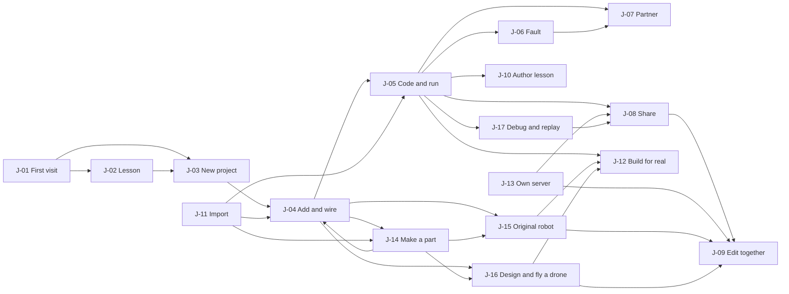
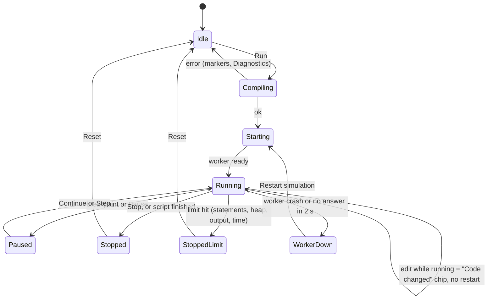
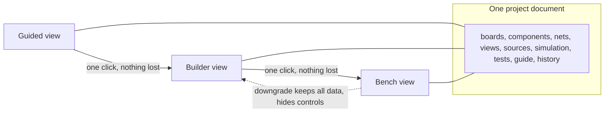
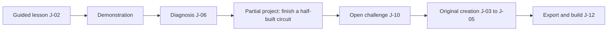
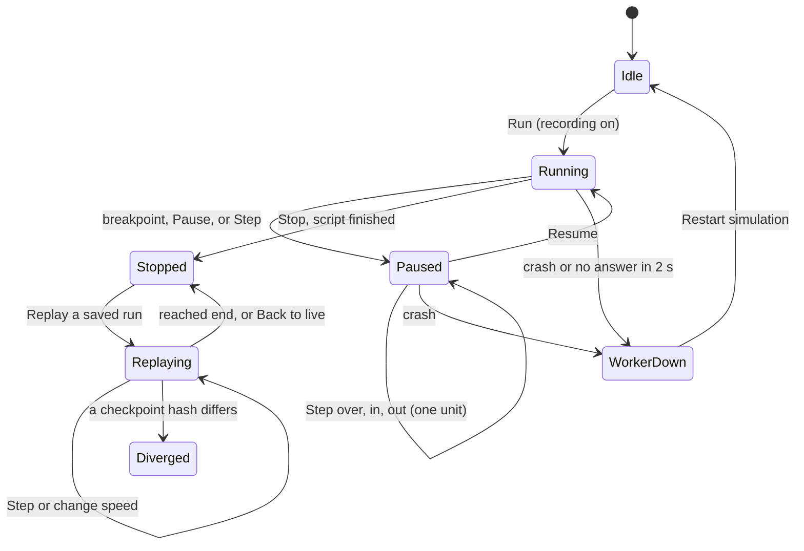

# iynk user journeys

Written 2026-10-27 by the experience design seat. Status: draft for Amar's review. Scope: BRIEF section 18.1 (the principal flows, J-01 to J-17), section 18.2 (progressive complexity); J-13 (self-hosting) is kept short because the catalogue added it, and J-14 (make a custom part), J-15 (build and drive an original robot), J-16 (design and fly a drone) and J-17 (debug and replay) added by the review of 2026-10-27 because D-014 names the custom component editor, robotics creation, drone creation, and the debugger and replay, and no flow covered them.

Upstream: `BRIEF.md` section 18 (and 18.3 for accessibility), `00_EXECUTIVE/DECISION_REGISTER.md` (start with "Current decisions: the build reframe": D-013 to D-017, plus D-007, D-010, D-011), `03_PRODUCT/FEATURE_CATALOGUE.md` (F-ids; journey list in its section 5), `03_PRODUCT/PRODUCT_REQUIREMENTS.md` (R-ids; the journey table in its section 15), `03_PRODUCT/FEATURE_PRIORITIZATION.md` (classes and the Milestone 1 acceptance walk, section 7.2), `01_AUDIT/runs/BROWSER_WALK.md` (what the product does today), the contract documents `04_ARCHITECTURE/PROJECT_DATA_MODEL.md`, `schemas/project.schema.json`, `COMPONENT_SCHEMA.md`, `schemas/component.schema.json` and `SIMULATION_ARCHITECTURE.md`.

In sections 20 to 23, "SA" means `04_ARCHITECTURE/SIMULATION_ARCHITECTURE.md`. The new flows sit at the end so that the section numbers cited elsewhere (2.4, 16, 17) stay valid.

Downstream: the Studio build tickets, the e2e suite (every success criterion below with method "Playwright" becomes a test), the accessibility checks (ACC-1 to ACC-4), and the roadmap.

Labels: VERIFIED, DOCUMENTED, EXTERNAL, ESTIMATED, HYPOTHESIS, UNKNOWN as in the brief. PROPOSAL marks a number or behaviour I set here with no measurement behind it. PENDING RS-xx means a spike has no verdict yet; the section gives the options and the decision rule and the final choice waits.

## Contents

1. Reading guide and the people in these flows
2. Shared foundations: shell, states, keyboard, accessibility, success criteria
3. J-01 First-time visitor
4. J-02 Open the app and complete a lesson
5. J-03 Start an original project
6. J-04 Add and wire components
7. J-05 Write and run code
8. J-06 Meet a simulated fault
9. J-07 Ask the AI partner
10. J-08 Share a project with a friend
11. J-09 Two buddies editing together
12. J-10 Author a lesson or challenge
13. J-11 Import a project or sketch
14. J-12 Export a physical build package
15. J-13 Set up your own server and invite a buddy
16. Progressive complexity (BRIEF 18.2)
17. Coverage: journeys to requirements and features
18. Objections
19. Open questions and pending spikes
20. J-14 Make and use a custom part
21. J-17 Debug a run and replay it
22. J-15 Build and drive an original robot
23. J-16 Design and fly a drone

---

## 1. Reading guide and the people in these flows

### 1.1 Who "you" is

D-013 says iynk is a complete open-source hardware lab that Amar uses himself with his friends. BRIEF 18.1 was written for students and an educator. This file keeps the twelve flows and changes the person:

| BRIEF 18.1 wording | Here | Why |
|---|---|---|
| Student | You, or a buddy | No classrooms, no institutions (D-013). The same screens serve a first-timer and an expert, so the flows are written for a person who may know nothing yet. |
| Anonymous user | Anyone with the app open, no server | Nothing in iynk needs an account. Identity is a local name, plus an optional browser keypair when you pair with a buddy (F-206). |
| Educator creating an assignment | You writing a lesson or challenge for yourself or a buddy (J-10) | Catalogue section 5 already reframes it. Class rosters, grading and school compliance are out of scope (D-008, D-009). |

Two roles appear in the collaboration flows: the **host** (the person whose browser owns the room and runs the authoritative simulation) and a **buddy** (anyone paired with you who joins). A **maintainer** appears only in J-13.

### 1.2 Evidence base for "today"

Every "Today" paragraph comes from `01_AUDIT/runs/BROWSER_WALK.md` (Playwright on Chromium and WebKit, keyless production build, commit `bb546d6`, 2026-10-27). Step numbers in this file ("walk 14") are the walk's step numbers. Nothing was re-run for this file, so these are DOCUMENTED here and VERIFIED in the walk.

Headline from the walk, used throughout: the product is a guided simulator, not a workbench. Each lesson ships a fixed circuit; there is no blank project, no part palette, no free wiring, no save and no share of edited work (walk 14 and 15). Failure teaching is the strongest part and must survive (walk "What this means", item 9).

### 1.3 Preserve, extend, replace per journey

BRIEF 3.5: nothing is replaced until the replacement is measurably better. Each journey ends with a one-line verdict. Summary:

| Journey | Existing code it builds on | Verdict |
|---|---|---|
| J-01 | `src/components/marketing/index.tsx`, `src/app/[lang]/page.tsx`, language redirect | Preserve the look and the redirect; extend with New, Open and the first run |
| J-02 | `src/components/boardlab/*`, `src/lib/interp/checks.ts`, `src/lib/progress/*` | Preserve the lesson loop; extend (meaningful pass, solution, autosave); move into Studio only on parity (R-152) |
| J-03 to J-04 | none (walk 15) | New |
| J-05 | `CodeEditor.tsx`, `CodePanel.tsx`, `src/lib/interp/*`, `SerialMonitor.tsx` | Preserve editor and interpreters; extend with worker, limits, messages (F-025, F-044); new debugger |
| J-06 | `FailurePanel.tsx`, 144 board failures, 106 bench faults | Preserve the cards; extend with diagnose-first and the shared record; new generic rules |
| J-07 | `src/components/ai/*`, `src/lib/ai/*` | Replace the provider path (bring your own key), preserve the dock and change card, extend to operations |
| J-08 to J-09 | `src/lib/rooms/*`, `server/realtime` | Extend: rooms move from lessons to projects; relay authority is new work |
| J-10 | `src/content/*` (TypeScript content), `checks.ts` | New authoring over the preserved check engine |
| J-11 to J-12 | nothing (only a Build Story PNG downloads today) | New |
| J-14 | none (a new part needs a new `.js` file and a rebuild today) | New; Part Maker over the part descriptor |
| J-15 | `src/content/robotics/*.ts`, `src/lib/robotics/*` (13 benches, 106 faults, 272 steps) | Preserve the benches as templates; extend the project document; new robot builder, checker, physics and arena (ROBOTICS 3) |
| J-16 | `src/lib/drone/calc.ts`, `src/lib/dronelab/*`, `src/lib/flight/*` (13 crafts, calculator, 78 bench tests, flight range) | Preserve all; extend calculator and design panel into the builder; new part-based propulsion, rigid model, traces and comparison (DRONE 3.3) |
| J-17 | the run loop in `src/lib/interp/run.ts`, flight `replay()` (`sim.ts:1008`) | Extend the run loop and the replay idea; new debugger and circuit and firmware replay |

---

## 2. Shared foundations

Everything in this section applies to all fifteen flows. A journey says only what it adds or changes.

### 2.1 The shell

The current identity (warm paper background `rgb(242,239,231)`, hand-inked figures, calm lab look, VERIFIED walk 1) is kept. Studio is a new layout inside that identity, not a generic dashboard (BRIEF 18).

```
Desktop, 1280 px and up (Studio open on a project)
+----------------------------------------------------------------------------------+
| iynk   Library  Labs  Buddies        [Project title v]  saved 14:02   EN v  Aa  ? |  top bar (SH region 1)
+--------------+-------------------------------------------+-----------------------+
| Parts        |  [Breadboard] [Schematic] [Board]   100%   | Inspector             |
| search....   |                                           |  LED1  core.led-5mm   |
| > Basic      |         canvas  (figure or SVG)           |  colour  [red v]      |
| > Boards     |                                           |  tier: T1 Teaching    |
| > Sensors    |                                           |-----------------------|
|--------------|                                           | Guide / Checks        |
| Files        |                                           |  1 Place the LED      |
|  main.ino    |                                           |  [ ] checks 0/3       |
|  + add file  |                                           |                       |
+--------------+---------------------+---------------------+-----------------------+
| [Run]  [Stop] [Reset]  t=0.000 s   Tier: Execution T1, Circuit T1      |  run bar
| Serial | Diagnostics | Instruments | Partner | Room                                 |  bottom dock tabs
+----------------------------------------------------------------------------------+
| status strip:  Storage: file copy none [Save a file]   Server: none   Offline: no |
+----------------------------------------------------------------------------------+
```

Regions, in tab order (each is a landmark): 1 banner (top bar), 2 navigation (Parts and Files), 3 main (canvas), 4 complementary (Inspector and Guide), 5 region "Run" (run bar and dock), 6 status (status strip, `role="status"`). `F6` and `Shift+F6` move focus between regions; this also satisfies WCAG 2.4.1 (bypass blocks).

```
Phone, under 640 px
+--------------------------+
| iynk  Blink v   saved  ≡ |
+--------------------------+
|        canvas            |
|   (pinch zoom, tap pin)  |
+--------------------------+
| [Run]  t=0.000 s   ...   |
+--------------------------+
| Parts | Code | Serial |  |   bottom tab bar, 48 px high
| Guide | Check | Partner  |   (scrolls sideways inside the bar only)
+--------------------------+
```

Phone rules (F-178, BUD-03): no sideways page scroll (walk 13: VERIFIED today on Pixel 7 and iPhone 14 descriptors), every target at least 44 CSS px high in the bar and at least 24 by 24 CSS px elsewhere (WCAG 2.5.8; the walk found 2 landing targets under 44 px, not yet identified), panels open as bottom sheets with a visible close button and `Esc`.

### 2.2 Shell states used by every flow

These are the shared states. Journeys refer to them by id instead of repeating them.

| Id | Condition | What shows | Action offered | Announced |
|---|---|---|---|---|
| SH-01 Loading shell | Studio chunk or project still loading | Skeleton of the layout (grey blocks, no spinner alone), text "Opening Studio" and, for a project, its title once the index entry is read | none; `Esc` goes back to the library | polite: "Opening {title}" |
| SH-02 Empty library | IndexedDB opened, zero projects | Illustration slot (one hand-inked figure), "Nothing here yet. Make a project or open a lesson." and buttons New project, Open file, Try Blink | those three | none |
| SH-03 Storage unavailable | IndexedDB blocked or absent (private window) | Persistent banner above the top bar: "Projects will not be kept in this browser. Save a file to keep your work." and a Save file button; autosave line shows "not saved" | Save file (F-201) | assertive once |
| SH-04 No file copy | A project exists only in IndexedDB | Status strip chip "Saved here only" with a Save file button; amber, with the words, not colour alone (R-037) | Save file | polite on first edit of a session |
| SH-05 Save failed | Quota or write error | Banner "Could not save: storage is full or blocked. The last good copy is from {time}. Save a file now." Last good copy is kept (two-slot write, ADR-0106) | Save file, Free space (opens the library with sizes) | assertive |
| SH-06 Offline | `navigator.onLine` false or fetch fails | Status chip "Offline"; local work continues (R-040); anything needing the network is disabled with its reason as visible text ("Needs a server") | none | polite once per change |
| SH-07 No server | No server URL configured | Rooms, share links and Buddies show "Needs your own server. Set one up" linking to the guide (F-198); nothing is hidden silently | Open the setup guide | none |
| SH-08 Worker down | Simulation worker killed (run limit, crash) | Run bar shows "Simulation stopped: {reason}. Your project is unchanged." with Restart; a new worker is built from the document (BUD-12, section 6.8 of SIMULATION_ARCHITECTURE) | Restart simulation | assertive |
| SH-09 Newer or damaged file | Loader refuses a document (R-028, data model 9.3) | Recovery view: first 20 diagnostics with JSON paths, the raw text of each source, Export raw; the stored record is never rewritten or deleted | Export raw, Close | assertive |
| SH-10 Not supported | No Worker, no IndexedDB and no way to download | Static page "This browser cannot run Studio" naming the missing feature; the home page and read-only pages still work | none | n/a |

### 2.3 Error message format

Every refusal uses the same three parts, in the user's language (all strings are localised keys, R-073): what happened, why, what to do. Example, from the data model's reject codes (`PROJECT_DATA_MODEL.md` section 7.2):

| Reject code | User text (English) | Where shown |
|---|---|---|
| `pin_in_use` | "Pin D13 is already on net N3. Move it here?" with buttons Move and Cancel | Beside the pin, and in the live region |
| `missing_pin`, `missing_target` | "That pin is not on this part any more." | Toast plus the live region |
| `duplicate_id` | not shown (retry with a new id; a bug if it surfaces: reported in the diagnostics list) | Diagnostics |
| `unknown_definition` | "{part} is not in this build. It stays in your project as an unknown part." | Inspector |
| `referenced_by` | "Cannot delete: a check or wire still uses it ({list})." | Dialog |
| `permission` | "Only an owner can change who has access." | Dialog |
| `invariant` | message from the failing rule (V3), for example "A wire needs two ends." | Toast |

A rejected operation changes nothing (RS-09 invariant, `PROJECT_DATA_MODEL.md` 7.2). The text never blames the person.

### 2.4 Keyboard map

Keys are defined once in `STUDIO_EDITOR.md` 6.11 (and its clash table, which settles Space, G, R and the number keys). Legacy lab pages keep `src/components/boardlab/shortcuts.ts` (VERIFIED; Space runs, `V` `B` `C` switch views, `1` to `0` jump to a lesson step). This file does not repeat the map, so there is one place to change it. The journeys below name a key only when it is a key from 6.11, and the ones they lean on are: Run or Resume `Ctrl/Cmd+Enter`, Stop `Ctrl/Cmd+.`, Reset `Ctrl/Cmd+Shift+Enter`, rotate `R`, views `1` `2` `3`, previous or next guide step `[` and `]`, step over and into `F10` and `F11`, command palette `Ctrl/Cmd+K`, next region `F6`, Partner box `Ctrl/Cmd+/`, read the newest serial line `Ctrl+Alt+L`, shortcut list `?`.

Rule kept from today: single-key shortcuts act only while the canvas or the main window has focus and never while a text field, the code editor or a dialog has focus (`boardlab.json` key `keys.ignored`; `typingTarget`, `shortcuts.ts:48`). This also satisfies WCAG 2.1.4. Where a journey needs an action that 6.11 gives no key (toggle a breakpoint, step out, chat focus), it is reached by a named button and by the command palette, and the gap is listed in section 19.

PENDING RS-16: the canvas key paths (A, W, arrows) are defined in 6.11 from the R-058 acceptance text. The spike (keyboard-only and screen-reader pass on the RS-01 prototype) sets the final test. Decision rule from `TECHNICAL_RESEARCH.md` section 6, row 14: pass if a part can be placed and two pins wired with no pointer and targets meet 24 by 24 CSS px; if it fails, the fallback is a form-based "Connections" table (From pin, To pin, Add), which is already specified in J-04 as the second keyboard path and costs little.

### 2.5 Accessibility baseline

Applies to every flow. Journeys add their own items.

| Id | Requirement | Source | Test |
|---|---|---|---|
| A-01 | WCAG 2.2 AA on every route and on each Studio view. axe: zero serious or critical findings | R-070, ACC-1 | axe in Playwright on each journey's screens |
| A-02 | Everything doable with a pointer is doable with the keyboard; drag has a non-drag alternative | WCAG 2.5.7, ACC-2, R-058 | Keyboard-only run of the journey's main task |
| A-03 | Targets at least 24 by 24 CSS px (44 on the phone bar) | WCAG 2.5.8 | `getBoundingClientRect` sweep, as the walk did |
| A-04 | Focus is always visible and never hidden under a sticky bar or the dock | WCAG 2.4.11 | Tab through each screen; screenshot each stop |
| A-05 | Colour is never the only signal: every state has text or a shape (lit/dark, pass/fail, warning/error, presence colours) | BRIEF 18.3 | Grayscale screenshot review; text present in DOM |
| A-06 | The figure and the canvas have a text mirror: "Figure controls" list and a part and net list that a screen reader can walk. The mirror is translated like the rest (today the mirror stays English in es and hi, walk 11) | F-177, BRIEF 18.3 | Language parity test includes the mirror |
| A-07 | Live regions: `polite` for saves, joins, run state; `assertive` only for refused actions and stopped simulations | R-058 | Announcements asserted in tests |
| A-08 | Reduce motion: with `prefers-reduced-motion`, figures stop animating continuous motion (spinning motors become a static arrow), replays default to step mode, toasts do not slide | BRIEF 18.3 | Playwright `reducedMotion: 'reduce'` run |
| A-09 | Contrast 4.5 to 1 for text, 3 to 1 for UI parts and focus rings, in light and dark | WCAG 1.4.3, 1.4.11 | axe plus a tokens test |
| A-10 | Text resizes to 200 percent and reflows at 320 CSS px wide with no loss | WCAG 1.4.4, 1.4.10 | Viewport test |
| A-11 | Screen reader pass recorded once per release on the core tasks. No screen reader has been tried (UNKNOWN today) | ACC-4 | Manual, recorded in `docs/` |

### 2.6 Internationalisation baseline

Six languages ship (en, es, fr, de, zh, hi: 2,064 UI keys, VERIFIED, F-171). Every string in this file is a key. Studio adds: pluralisation rules per language, numbers and units through `Intl` (units themselves stay SI, `PROJECT_DATA_MODEL.md` 4.1), and an English-term toggle that shows the English technical term beside the translation (R-150). Right-to-left is not shipped; layout uses logical CSS properties (`margin-inline-start`) so Arabic or Hebrew can be added without a rewrite (BRIEF 18.3; HYPOTHESIS that this is enough). Gaps found today: 12 untranslated "Figure controls" labels and a few figure toasts (walk 11).

### 2.7 Success criteria: how they are written

Id `SC-Jnn-k`. Each has a measure, a target, a method and a label. No user study exists (D-013: no pilots), so targets are engineering targets, checked by Playwright where possible and otherwise by Amar walking the flow on his own machine (and with one friend for J-08 and J-09), as the release checks say (PRODUCT_REQUIREMENTS section 11). A target marked PROPOSAL is mine to confirm or change at the phase start. A budget cited as BUD-xx comes from `PRODUCT_REQUIREMENTS.md` section 3.1. No criterion here is a measured result; the "today" column quotes the walk where it measured something.



---
## 3. J-01 First-time visitor

| Item | Value |
|---|---|
| Intent | Someone opens iynk for the first time (from the repository README or a friend's link), understands what it is, and has a circuit running within a minute. |
| Phases | B0 (copy and basics), CORE and STUDIO (New and first run), KEEP for the existing page |
| Features | F-174, F-175, F-171, F-011, F-032, F-012, F-094 |
| Requirements | R-023, R-050, R-FID-1, R-068, R-012, R-040, R-013 |
| Today (walk 1) | `/` gives 307 to `/en` (or `/hi` from `Accept-Language`); `domInteractive` 36 ms, `load` 205 ms; H1 "Learn hardware by building it"; 12 boards, 13 benches, 13 drones; a live Uno figure in an iframe; no cookie set. VERIFIED. The copy still talks about Muse Spark finding a build buddy, which is off keyless. |
| Verdict | Preserve the page and redirect; extend with New, Open and the first run; rewrite copy for an open-source project (R-013) |

### 3.1 Screens

```
Home  /{lang}                                          [ EN v ] [ Aa theme ] [ GitHub ]
+---------------------------------------------------------------------------------+
|  iynk                                                                           |
|                                                                                 |
|  An open hardware lab in your browser.                                          |
|  Imagine, wire, program, break and build, alone or with friends.                |
|                                                                                 |
|  [ New project ]  [ Open a file ]  [ Try Blink on an Uno ]                      |
|                                                                                 |
|  +--------------------+  +-----------------------------------------------+      |
|  |  live Uno figure   |  |  Recent projects   (empty: "None yet")        |      |
|  |  drag to turn it   |  |  Blink         edited 2 min ago  Saved here   |      |
|  +--------------------+  +-----------------------------------------------+      |
|  Labs:  Boards (12)   Robotics (13)   Drones (13)     "What it models" v        |
|  Runs here, offline after first load. No account. Nothing leaves this browser.  |
+---------------------------------------------------------------------------------+
```

The sentence "Nothing leaves this browser" appears only while the claim is true: with no server configured and no key stored. With a server or a key it reads "Sent only to the server and providers you set up" (R-013: copy limited to verified claims).

First run (after "Try Blink on an Uno"): Studio opens the starter project `Blink` (a converted catalogue item, F-077) with a non-modal strip above the canvas:

```
 Step 1 of 4  Press Run (Ctrl/Cmd+Enter).   [Next]  [Skip tour]  [Do not show again]
```

The four steps: Run; watch D13 and the LED; change `delay(500)` to `delay(100)` and Run again; press Break it. Each step highlights its target with an outline and a text label, never colour alone. The strip is a convenience stored in `localStorage` under `iynk:v1.settings.coach`; it is not project data.

### 3.2 Interaction specification

| Step | Pointer or touch | Keyboard | System response |
|---|---|---|---|
| 1 | Open the URL | same | Redirect by `Accept-Language`, else `/en`. Static page, no script needed to read it. First paint of text, then the figure iframe loads lazily |
| 2 | Click Try Blink | `Tab` to it, `Enter` | SH-01. Studio loads. A project is created in IndexedDB from the Blink template with `meta.kind = "project"`, title "Blink", provenance `catalogue:boards/uno-r3/blink` |
| 3 | Click Run | `Ctrl/Cmd+Enter` | Run bar goes Starting then Running; D13 and LED1 follow; serial shows the three upload lines (as today) |
| 4 | Edit the delay in the code panel, click Run | `Ctrl/Cmd+Enter` | The run restarts (see J-05: an edit while running shows "Code changed: Run again to apply" until restarted) |
| 5 | Click Break it | `Tab`, `Enter` | Hands over to J-06 |
| 6 | Click New project | `Ctrl/Cmd+N`, or the menu item | J-03 |
| 7 | Click Open a file | `Ctrl/Cmd+O` | J-11 |
| 8 | Language picker | `Tab`, `Enter`, arrows | Navigates to `/{lang}` and keeps the page; an untranslated notice shows when a namespace is missing (exists, `UntranslatedNotice.tsx`) |
| 9 | Theme control | `Tab` | Auto (follow the OS), Light, Dark. The walk saw `data-theme="light"` with a headless browser that reported no dark preference; whether today's control follows an OS dark setting is UNKNOWN, so "Auto" is a decision to confirm, not a fact |

### 3.3 States

| State | Behaviour |
|---|---|
| Loading | The home page is prerendered (827 static pages today, VERIFIED F-174) so text is there at first paint. Studio shows SH-01 |
| Empty | "Recent projects" shows "None yet" and SH-02 buttons |
| Error | JavaScript off: the page reads fine; New and Try Blink are links to a `noscript` explanation. SH-03 or SH-10 as they apply. Figure iframe fails: a text description and the poster image remain |
| Offline | First visit offline fails at the browser. After one load, a precache of the app shell, the Studio chunk, the Uno template and fonts makes the home, a new Uno project, Run and save work offline (R-040, F-094). SH-06 chip shows |
| Success | Run is "Running" and the LED lit or dark follows D13 within the same second. The coach strip reaches step 4 or is dismissed |
| Wrong browser | Safari, Chrome and Firefox are the target set. Firefox is untested (not installed for the walk, a known limit). Missing Worker or IndexedDB gives SH-10 |

### 3.4 Validation behaviour

None on the home page. The language segment is validated by the router (`/xx` not in the six gives 404 with a link home). A file chosen in Open is validated in J-11.

### 3.5 Accessibility (adds to 2.5)

- One `h1`; the figure iframe has a title that names the circuit and says "drag to turn it" (exists, walk 1) plus a text alternative listing parts and the pin state.
- The coach strip is a `role="region"` with an accessible name, not a modal; focus is not moved into it; `Esc` dismisses it when it has focus.
- Skip link to main content is the first Tab stop.
- The tier chip "Teaching model" and the "What it models" link are reachable from Home and from the first run (R-FID-1).

### 3.6 Success criteria

| Id | Measure | Target | Method | Label |
|---|---|---|---|---|
| SC-J01-1 | Interactions from landing to a running LED | At most 2 clicks (Try Blink, Run) | Playwright | PROPOSAL |
| SC-J01-2 | Click Run to "Running", desktop | Under 2 s at 1x, under 4 s at 4x (BUD-06). Today 1.57 s with the interpreter on the main thread (MEASURED, walk 2) | Playwright with CDP throttle | PROPOSAL, baseline MEASURED |
| SC-J01-3 | First-load JavaScript of Home | At most 400 KB gzip (BUD-05). Today 727 KB transferred | CI size check | PROPOSAL, baseline MEASURED |
| SC-J01-4 | Idle main-thread use on Home | Under 5 percent of a core at 1x, under 25 percent at 4x (BUD-04). Today 62 to 65 percent and 100 percent | Playwright trace | PROPOSAL, baseline MEASURED |
| SC-J01-5 | Network requests outside the app origin on Home with no server | Zero | Playwright request log (M1 step 1) | PROPOSAL |
| SC-J01-6 | Works with no key and no server | Home, New, Run and save all work (R-012) | Keyless e2e | PROPOSAL |
| SC-J01-7 | axe on Home and the first run | Zero serious or critical | axe | PROPOSAL |

---

## 4. J-02 Open the app and complete a lesson

| Item | Value |
|---|---|
| Intent | Work through an existing lesson (blink, button, sensors, a bench, a drone build) and have the app compute whether you finished. No account is involved, so "anonymous" is simply the normal case. |
| Phases | LABS (lessons move into Studio), CORE (storage); the current page works today |
| Features | F-032, F-033, F-034, F-023, F-087, F-036, F-200, F-025 |
| Requirements | R-140, R-141, R-143, R-036, R-139, R-151, R-152 |
| Today (walk 2, 11, 14) | 12 boards, 71 lessons, 461 checks. Run to "Running" in 1.57 s. Checks run on a fixed virtual-clock script, so the same code always gets the same verdict, about 8.5 s for Blink. The Blink starter passes all 3 checks untouched, so "pass" means nothing there (VERIFIED). No solution control on the Blink lesson (the L298N task has one). Running never auto-stops. Edited code is lost on reload; only done flags survive (`iynk:v1`). `]` next-lesson works (5 of 5 by hand); its e2e failure is a flaky test. |
| Verdict | Preserve the loop, the check engine and the six-language text. Extend: meaningful pass, a solution that does not overwrite, autosave, visible run state. Move into Studio only when parity tests pass (R-152) |

### 4.1 Screens

```
Lesson in Studio   /{lang}/boards/uno-r3/blink  (old URL still works, R-151)
+---------------------------------------------------------------------------------+
| iynk  Library Labs Buddies     Blink · Uno R3            saved 14:02   EN v  ? |
+--------------------------+-------------------------------+----------------------+
| Lesson 3 of 16     [<][>]| [Board][Breadboard][Schematic]| Overview Pins Code   |
| 1 Wire the LED   done    |                               | Specs  Hints (0/3)   |
| 2 Open the sketch done   |        figure: Uno + LED      |----------------------|
| 3 Change the delay  <--  |        LED1: lit 12.2 mA      | Checks   2 of 3 pass |
| 4 Break it               |                               |  runs 8 s     Pass   |
| Quiz (1 question)        |                               |  D13 toggles  Pass   |
+--------------------------+-------------------------------+  code turns off Not  |
| [Run] [Stop] [Reset code] [Show a solution v]   Running · t = 3.2 s             |
| code editor ...                                                                 |
| Serial | Diagnostics                                                             |
+---------------------------------------------------------------------------------+
```

### 4.2 Interaction specification

| Step | Pointer or touch | Keyboard | System response |
|---|---|---|---|
| 1 | Choose a lesson on Labs, a board page, or a recent entry | `Tab`, `Enter`; `[` `]` inside a guide (the number keys are views in Studio) | Opens the lesson as a guided project (`meta.kind = "lesson"`, `guide` present). Position in the lesson list is shown as "3 of 16" |
| 2 | Read the step; open Hints | `Enter` on a hint | Hints reveal one at a time; each open is logged locally with its level (F-020, R-121) |
| 3 | Edit the code | type in the editor | Autosave after 400 ms idle (F-087, BUD-08). Status "saved 14:02" updates; if the code differs from the starter, the lesson records `edited` |
| 4 | Run | `Ctrl/Cmd+Enter` | See J-05. While running, an edit sets the chip "Code changed: Run again to apply". `Ctrl/Cmd+Enter` restarts. This fixes the walk's finding that a learner can think the edit applied |
| 5 | Watch Checks | Checks panel is `aria-live="polite"` | Each check shows Pass, Fail or Not yet, with text. A third state explains why: "Needs the full 8 s of virtual time (3.2 s done)". The panel says plainly that checks run on a fixed script |
| 6 | Answer the quiz | arrow keys, `Enter` | Right or wrong with the reason (`why`), wrong answers can be retried; the attempt is logged locally |
| 7 | Show a solution | `Tab` to the button, `Enter` | A confirm: "This opens the solution in a copy. Your code stays." The solution opens in a fork (F-088) named "Blink, solution"; your project is untouched. Using it sets `solutionViewed` on the lesson record. It does not block completion of your own project |
| 8 | Lesson passes | n/a | All checks Pass, at least one real edit of the starter (compared by source hash with `guide.starter`), and at least one quiz answer given (F-023, R-140). Panel: "All checks pass. Lesson done." Progress "Done 4/16". If checks pass but the edit rule is not met: "Checks pass. Change something in the code to finish." |
| 9 | Next lesson | `]` | Opens lesson 4. Unsaved nothing: autosave has run |

### 4.3 States

| State | Behaviour |
|---|---|
| Loading | SH-01; the lesson text arrives first (prerendered), the figure and editor follow. The walk saw the editor usable 253 ms after load |
| Empty | A lesson always has a starter. A lesson with no checks shows "This lesson has no checks. Run it and watch the readout" (a few catalogue items may; to be confirmed by the F-032 audit) |
| Error | Compile or runtime error: marker in the gutter plus a line in Diagnostics (J-05). A check job that exceeds its budget: "Checks took too long and were stopped" with Retry; the worker is rebuilt (`check-client.ts`, 20 ms past budget today) |
| Offline | Works after first load (R-040). Hints, quiz and checks are all local |
| Success | As step 8. A short, non-modal "Done" line with the next lesson link. No sound unless the sound setting is on; no confetti (A-08) |
| Stale progress | First open after the upgrade imports `iynk:v1` done flags and quiz results once into the project store, with no loss, and keeps the old key until the import is confirmed (R-143) |

### 4.4 Validation behaviour

- The code is validated as you type by the same parser Run uses; errors appear as gutter markers with line and column (F-025).
- "Done" is computed, never clicked (F-033). A manual "mark done" does not exist.
- Parameters (resistor value, delay) accept only the ranges the lesson declares (50 to 2000 ms for Blink today); an out-of-range number is clamped with a message "Delay must be 50 to 2000 ms".
- Audit of the 71 starters: no starter may pass all checks untouched unless its lesson is explicitly marked `demonstration` (F-023). Blink fails this audit today.

### 4.5 Accessibility (adds to 2.5)

- The step list is an ordered list with `aria-current="step"`; Checks use text plus an icon with a text label.
- The editor has a documented way out: `Esc` then `Tab` (existing text in the shortcut dialog).
- Figure state is mirrored as text: "LED1: lit, 12.2 mA. D13: high." (exists as the readout; A-06 requires translation of the control list mirror, a gap today).
- Reduced motion: the Do-it assembly animation (4.6 s to 25 s per step on the L298N bench, walk 6) becomes a stepped before-and-after with a Next button.

### 4.6 Success criteria

| Id | Measure | Target | Method | Label |
|---|---|---|---|---|
| SC-J02-1 | Same verdict as the old page on every migrated lesson | 71 of 71 lessons, same pass or fail on the reference solution and on the starter (parity, R-141) | Unit parity test | PROPOSAL, REF-style |
| SC-J02-2 | Starters that pass untouched | Zero, except lessons marked `demonstration` | Audit script | PROPOSAL |
| SC-J02-3 | Edited code after reload | Identical document hash (DET-3) | Playwright reload | PROPOSAL |
| SC-J02-4 | Progress import | 100 percent of `done` and `quiz` entries present after the first Studio open | e2e with a seeded `iynk:v1` | PROPOSAL |
| SC-J02-5 | Complete Blink from open to "Lesson done" | Under 3 minutes by hand for a first-timer, 6 interactions or fewer for the pass path | Amar's gate walk | PROPOSAL |
| SC-J02-6 | `]` shortcut test | Passes 20 of 20 at load 40 or more (the test waits after Escape) | CI | PROPOSAL |
| SC-J02-7 | Old URLs | `/en/boards/uno-r3/blink` still resolves to the same lesson (R-151) | Playwright | PROPOSAL |

---

## 5. J-03 Start an original project

| Item | Value |
|---|---|
| Intent | Make something that is not a lesson: a blank project on a chosen board, or a copy of a template. |
| Phases | CORE (document, store, library), STUDIO (New dialog, boards) |
| Features | F-084, F-076, F-079, F-092, F-200, F-077, F-104 |
| Requirements | R-050, R-025, R-056, R-053, R-038, R-035, R-072 |
| Today (walk 15) | Not possible. No new-project control, no blank start, no board without lessons, 12 boards only |
| Verdict | New. Nothing to preserve except the 12 board definitions, which become templates through the converter (F-077, ADR-0108) |

### 5.1 Screens

```
New project (dialog)
+----------------------------------------------------------+
| New project                                          [x] |
| Name       [ My first circuit              ]  1 to 120   |
| Board      ( ) Arduino Uno R3       <- first, all tested  |
|            ( ) Arduino Nano   ...   (all 12 boards)       |
|            ( ) No board (just parts)                      |
| Start from [ Blank v ]  Blank / Blink / Button / Fade /   |
|            Servo sweep / ... from templates               |
| Language of the code comments  [ English v ]              |
| What it models: Teaching model (T1) for Uno. Details      |
|                                    [Cancel]  [Create]     |
+----------------------------------------------------------+

Library  /{lang}/projects
+------------------------------------------------------------------+
| Projects    search [............]   sort [Edited v]  [New] [Open] |
| +-------------+ +-------------+ +-------------+                   |
| | thumbnail   | | thumbnail   | |  + New      |                   |
| | My circuit  | | Blink copy  | |             |                   |
| | Uno · 2 min | | Uno · 1 d   | |             |                   |
| | Saved here  | | File copy   | |             |                   |
| +-------------+ +-------------+ +-------------+                   |
| Trash (3) · items stay 30 days                                    |
+------------------------------------------------------------------+
```

### 5.2 Interaction specification

| Step | Pointer or touch | Keyboard | System response |
|---|---|---|---|
| 1 | New project | `Ctrl/Cmd+N` or the menu item; `Ctrl/Cmd+K` "New project" | Dialog opens, focus on Name, `aria-modal` |
| 2 | Type a name | type | Live counter 1 to 120 (`meta.title`). Create stays enabled while the name is valid |
| 3 | Choose a board | arrows in the radio group | Uno first. Boards beyond the Uno sub-gate show "Limited, see What it models" when partly supported, or are disabled with text "Not in this build yet" before their gate (R-072). Choosing updates the template list to those that fit the board |
| 4 | Choose a template | combobox | Blank: one `main.ino`, empty `setup()` and `loop()`. Others: converted catalogue items (R-139) |
| 5 | Create | `Enter` in the dialog | A document is made: `format "iynk.project"`, `schemaVersion "1.1"`, `id prj_...`, `revision 0`, `boards[0]` = the chosen board with `firmware.entry = src_main`, one source, `simulation.seed` random but stored, `access.owners = [you]`, `license` placeholder (D-017). It is written to IndexedDB before the editor opens (M1 step 2). Opens in Studio (SH-01) |
| 6 | Open from Library | Card is a link; `Enter` | Opens in under the BUD-09 time |
| 7 | Rename, duplicate, archive, delete | Card menu `...` or `F2` rename, `Delete` | Delete moves to Trash with 30-day retention (R-038); Restore returns the exact document. Permanent delete asks for a typed confirmation of the title |

### 5.3 States

| State | Behaviour |
|---|---|
| Loading | Library grid shows skeleton cards, then fills from the `index` store (fast: index rows, not documents) |
| Empty | SH-02 |
| Error | Create fails to write: SH-05, the dialog stays open and the document is not lost; Create retries. Library index is corrupt: rebuilt from the `projects` store with a notice. A corrupted document: SH-09, and the other projects still open |
| Offline | Everything works. The library does not sync (no server) |
| Success | The project appears in the library at once, the editor shows an empty canvas with the board placed, `main.ino` open, and the status strip "Saved here only" (SH-04) |
| Persistence at risk | After the first edit, SH-04 offers Save a file. The browser is asked for persistent storage once (`navigator.storage.persist()`), and the answer is shown in Settings (F-200) |

### 5.4 Validation behaviour

| Field | Rule | Message |
|---|---|---|
| Name | 1 to 120 characters after trimming; any Unicode; control characters removed | "Give it a name, up to 120 characters." |
| Name duplicate | Allowed (ids differ), warned | "You already have a project called {name}." (does not block) |
| Board | Required unless "No board" | "Pick a board or choose No board." |
| Template | Must fit the board | A template that does not fit is not offered |
| Quota | Estimated before create (`navigator.storage.estimate()`) | "Not enough space to create a project. Free space or save files elsewhere." |

### 5.5 Accessibility (adds to 2.5)

- Dialog traps focus, restores it to New on close, `Esc` cancels. Radio groups use arrow keys. The "What it models" line is real text.
- Library cards are links with the project title as the accessible name and a description "Uno, edited 2 minutes ago, saved here only". Thumbnails have empty alt (decorative); the text carries meaning.
- Sorting and search results announce the count politely ("12 projects").

### 5.6 Success criteria

| Id | Measure | Target | Method | Label |
|---|---|---|---|---|
| SC-J03-1 | New project to editable canvas | Under 1 s at 1x, under 3 s at 4x (BUD-09) | Playwright | PROPOSAL |
| SC-J03-2 | Document validity | The new document passes V1 to V4 and its hash is stable across save and reopen (DET-3) | Unit and e2e | PROPOSAL |
| SC-J03-3 | Clicks from Home to an empty Uno project | At most 3 (New, Create with defaults) plus typing a name | Playwright | PROPOSAL |
| SC-J03-4 | Newer-schema file | Refused, bytes untouched, SH-09 shown (M1 step 2 error case) | e2e | PROPOSAL |
| SC-J03-5 | Library with 200 projects | List renders and searches in under 200 ms | Playwright | PROPOSAL (no measurement) |
| SC-J03-6 | Trash restore | Restored document hash equals the deleted one | Unit | PROPOSAL |

---

## 6. J-04 Add and wire components

| Item | Value |
|---|---|
| Intent | Build a circuit: place parts from a palette, wire pins, set values, see the netlist, get warnings before running. |
| Phases | STUDIO (editor), CORE (netlist, operations), FAULTS (generic rules) |
| Features | F-079, F-080, F-082, F-081, F-097, F-028, F-078, F-083, F-098, F-011 |
| Requirements | R-053 to R-060, R-055, R-057, R-058, R-059, R-029, R-031, R-033, R-034, R-073, R-123, R-FID-2 |
| Today (walk 15) | Not possible: fixed circuit, no palette, no free wiring. "Place a part" only returns the board's own removed parts. Wiring D12 instead of D13 in code shows "LED1: not connected" though the LED is connected to D13 (misleading) |
| Verdict | New. The renderer sits behind an interface (RS-01 INCONCLUSIVE on devices: LOD SVG is the default candidate; MEASURED p95 10.3 to 10.7 ms on an M4 Pro, zoom at 4x throttle 34.1 ms is a known miss). Hand-inked figures remain the art for core parts through the figure bridge (R-144) |

### 6.1 Screens

```
Place a part                                    Wire mode (keyboard)
+-------------------------+                     +---------------------------------------+
| Parts   [search: led  ] |                     | Wire from  LED1 · A (anode)           |
| > LEDs                  |                     | To: [ type to filter pins        v ]  |
|   LED 5 mm      core.led-5mm   T1             |   R1 · 1                              |
|   LED RGB                                      |   Uno · D13                           |
| > Resistors  (E12 values)                      |   Uno · D12   ...                     |
| > Buttons and switches                         | Preview: LED1.A to R1.1 (net N4 new)  |
| (drag, or Enter to pick up)                    |                 [Cancel Esc] [Wire Enter] |
+-------------------------+                     +---------------------------------------+

Rules check panel (Diagnostics tab)
 ! LED1 has no series resistor. Pins LED1.A, Uno.D13. Current would be about {computed} mA (the solver's value for this circuit), the LED allows 20 mA.   [Show on canvas]
 ! Button B1 pin 2 floats when open. Use INPUT_PULLUP or add a resistor.                                    [Show on canvas]
 i R1 is not modelled yet. The rest of the circuit still runs.
```

### 6.2 Interaction specification

| Step | Pointer or touch | Keyboard (R-058, PENDING RS-16) | System response |
|---|---|---|---|
| 1 | Search the palette; drag a part onto the canvas | `A` opens part search at the canvas cursor; type; arrows; `Enter` picks the part up; arrows move it one grid step, 1 mm by default (`Shift` ten steps); `Enter` drops | One operation batch: `component.add` plus `view.place` (R-033 mapping). Part gets a refdes (`LED1`). Inspector opens on it. Announced: "LED1 added at 40, 22 mm" |
| 2 | Drop outside the board area | `Enter` outside | Part snaps back to the last valid spot; message "Parts must sit on the board area" (M1 step 3) |
| 3 | Unknown part id in a loaded file | n/a | Loaded as a placeholder "unknown part" with the pins of its pinned interface; saved back unchanged (data model 9.3) |
| 4 | Drag from a pin to another pin; or tap pin then tap pin | Focus a pin (`Tab` into the part, arrows between pins), `W`, choose the target in the list, `Enter` | Batch: `net.create` or `net.connect` or `net.merge` as needed, then `wire.add`. The wire exists only if the net does (R-031: a drawn wire is always a modelled connection) |
| 5 | Drag ends on empty canvas, on the same pin, or on a missing pin | `Esc` | No wire; short reason beside the pointer and in the live region; `Esc` cancels a wire in progress (R-057) |
| 6 | Pin already in another net | accept the prompt | `pin_in_use` prompt "Pin D13 is already on net N3. Move it here?" Move sends `net.connect` with `move: true` |
| 7 | Select a part, edit values in the Inspector | `Enter` on the part; Tab in the Inspector | Value fields validate against the part's parameter ranges (R-029). `component.set` |
| 8 | Select a net in the overlay list | arrows in the list | Every pin and wire on that net is highlighted, the rest dim, with an outline and a label (not colour alone, R-059) |
| 9 | Delete a part | `Delete` | Its wires and net membership go in the same batch (R-033); undo restores part and wires together (M1 step 4) |
| 10 | Undo, redo | `Ctrl/Cmd+Z`, `Ctrl/Cmd+Shift+Z` | Inverse operations; undo works across the reload point only for operations after it (M1 step 7) |
| 11 | Press Check | `Ctrl/Cmd+K` "Check circuit" | Rules check (F-028): LED without resistor, two outputs shorted, pin used as input and output, floating input, power to ground, wrong supply for a part. Each row names the pins and highlights them. Current-based rules need the solver (R-100); before it exists they say "needs the solver" and are not guessed |
| 12 | Switch view | `1`, `2`, `3` | Breadboard, schematic and board (in that order) views are generated from the same netlist; moving a part in one view never changes another view's layout nor the netlist (R-060) |
| 13 | Second keyboard path (fallback if RS-16 fails, also an accessibility alternative) | `Ctrl/Cmd+K` "Connections table" | A table with From pin, To pin and Add; rows list every wire with Remove. Same operations |

### 6.3 States

| State | Behaviour |
|---|---|
| Loading | SH-01. Heavy part artwork loads lazily; parts draw with the fallback symbol (from pins and dimensions) first, then the hand-inked figure replaces it |
| Empty | A new Uno project: the board is placed and the canvas says "Press A to add a part, or drag one from the list." The palette has its search focused on `A` |
| Error | The reject codes in 2.3. Netlist limit reached (2,000 parts, 20,000 connections): "This project is at the size limit of this version." Document limit 5 MiB: refuse the op with the size |
| Offline | Unaffected |
| Large scene | At 500 parts and 1,000 wires the editor keeps p95 under 20 ms (BUD-01). Past that the renderer drops to level of detail with a visible "Simplified view" chip and a text reason |
| Success | The netlist panel lists exactly the connections drawn; Check shows no errors; Run follows the circuit (J-05) |

### 6.4 Validation behaviour (the invariants the UI mirrors)

| Rule | UI behaviour |
|---|---|
| A wire needs two ends on existing pins (W1 to W4) | Cannot finish a wire anywhere else |
| A pin is in at most one net | `pin_in_use` prompt |
| Removing a wire never changes a net unless asked (W5) | Delete on a wire cuts the connection by default (second form in the data model), and a context action "Delete drawing only" keeps the connection |
| Legs sit in holes (batch-end check B2) | Part with legs off the strip shows "Not seated" and its pins join no net |
| Values within descriptor ranges | Field error text, value reverts on blur |
| Part voltage and current limits | Not a block. The rules check and the run report it (the app teaches by failing, not by forbidding) |

### 6.5 Accessibility (adds to 2.5)

- The canvas is one composite widget: one Tab stop, arrow keys move between parts in reading order, `Enter` descends into a part's pins. A part-and-net list (a plain tree) is always available as a text alternative and drives the same selection.
- Announcements (R-058): part added with name and position; wire made between named pins; a deletion states what it removed ("LED1 deleted with 2 wires").
- Pin hit targets are at least 24 by 24 CSS px even when drawn smaller, and the view zooms to a pin (R-057).
- Drag is never required (A-02, WCAG 2.5.7): tap-tap, `W` list, and the Connections table.
- Selection and wire states use outline style (solid, dashed) plus labels, not just colour.

### 6.6 Success criteria

| Id | Measure | Target | Method | Label |
|---|---|---|---|---|
| SC-J04-1 | Keyboard-only: place LED, resistor, button; wire pin 13 through the resistor to the LED; button to pin 2 and ground | Completes with no pointer (ACC-2); the resulting netlist equals the pointer-built one | Playwright keyboard script | PROPOSAL, PENDING RS-16 |
| SC-J04-2 | Netlist equals drawn connections | Exactly, over a randomised property test of place, wire, delete and undo | Unit | PROPOSAL |
| SC-J04-3 | Editor frame time, 500 parts and 1,000 wires | p95 under 20 ms desktop 1x (BUD-01); under 33 ms at 4x (BUD-02, known miss 34.1 ms); under 20 ms at DPR 2 (BUD-03) | Scheduled Playwright job | Budgets from RS-01, MEASURED |
| SC-J04-4 | Error cases of R-073 | Each of the seven has a test and a localised message | e2e | PROPOSAL |
| SC-J04-5 | Wrong-pin case | Code writes D12, LED is on D13: the message names both ("Your code uses D12; LED1 is on D13") instead of "not connected" (R-126, F-026) | e2e | PROPOSAL |
| SC-J04-6 | Rules check on the fault corpus | Zero false alarms on `tests/fixtures/fault-corpus/clean/`; at least 18 of the 20 files in `broken/` caught; at least 8 distinct rules (F-029 target, RC-48) | Unit | PROPOSAL |
| SC-J04-7 | Touch: place and wire with one finger on a phone-sized viewport | Completes; no target under 24 px | Playwright touch | PROPOSAL, device run PENDING (RS-01 device half INCONCLUSIVE) |

---

## 7. J-05 Write and run code

| Item | Value |
|---|---|
| Intent | Write a program for the board, run it, watch the pins, serial and parts react, and find out what is wrong when it does not behave. |
| Phases | CORE (worker, limits, interpreter from a project), SIM (debugger, firmware mode, compile) |
| Features | F-034, F-038, F-039, F-040, F-044, F-025, F-203, F-207, F-041, F-047, F-052, F-055, F-048, F-049, F-011, F-098 |
| Requirements | R-062, R-041, R-042, R-043, R-044, R-045, R-063, R-064, R-106, R-FID-3, R-102, R-103, R-018 |
| Today (walk 2, 4, 5, 17) | Editor and Run work in 1.57 s. Failure messages: 5 of 7 cases good; templates are reported as the generic "cannot run in this build" because `run.ts:176` discards the reason; an unknown `#include` runs silently; a bad import in MicroPython and Python has no hint line. Infinite loops keep the UI at 60 frames per second and stop in 47 to 77 ms, but nothing tells you the loop never delays. The interpreter runs on the main thread. Four other languages run (Verilog, MicroPython, Python, ESP32 C++). |
| Verdict | Preserve the editor, the three interpreters and the serial monitor. Extend: move to the worker, add limits and loud messages. New: breakpoints and a variable view, and firmware mode (avr8js, RS-03 PASS for correctness) |

### 7.1 Screens

```
Code and run
+---------------------------------------------------------------------------------+
| [Run]  [Stop] [Reset]  speed [1x v]   State: Running   t = 3.214 s      |
| Chip: Your code runs in iynk's interpreter, a teaching subset of C++. Not a chip. |
+--------------------------------------------+------------------------------------+
|  main.ino   helpers.h  [+]                 |  Pins   D13 high   D12 low  ...    |
|  1  const int LED_PIN = 13;                |  Parts  LED1 lit 12.2 mA           |
|  2  void setup() { pinMode(LED_PIN,OUTPUT);|  Inputs [button B1: Press]  [knob] |
|  3  void loop() {                          |                                    |
|  4    digitalWrite(LED_PIN, HIGH); ...     |                                    |
|  (x) 7  'frobnicate' was not declared      |                                    |
+--------------------------------------------+------------------------------------+
| Serial | Plotter | Diagnostics (1) | Variables | Instruments                     |
| [t=0.000] Compiling...   [t=0.512] hello         send: [______] [Send] baud [9600v] |
+---------------------------------------------------------------------------------+
```

### 7.2 Run state machine



### 7.3 Interaction specification

| Step | Pointer or touch | Keyboard | System response |
|---|---|---|---|
| 1 | Edit code in the editor | type | Syntax errors as gutter markers with line and column and a Diagnostics entry. Editor stays responsive during analysis (it runs in the worker) |
| 2 | Run | `Ctrl/Cmd+Enter` | State Compiling then Starting then Running. The worker is built from the project document (R-042). Virtual clock starts at 0; serial lines carry virtual-time stamps (M1 step 6) |
| 3 | Watch pins and parts | Pins list is text; Parts follow netlist state | LED part follows D13 through the netlist (R-044). A part with no model shows "not modelled yet" (R-FID-3) |
| 4 | Serial | Focus the Send box, `Enter` sends | Line ending choice; baud list (300 to 74,880 as today); autoscroll toggle that stops when you scroll up; Plotter plots numeric lines. Output is capped at 1 MiB a run, then "Output limit reached; run continues without storing more" |
| 5 | Push a button or turn a knob in the Inputs panel | `Tab`, `Space` | World input events (F-041). Every input has a keyboard path (R-142) |
| 6 | Edit while running | type | Chip "Code changed: Run again to apply". `Ctrl/Cmd+Enter` restarts. The old program keeps running until then (the walk's reported confusion is removed by saying so) |
| 7 | Stop, Reset | `Ctrl/Cmd+.` (Stop), `Ctrl/Cmd+Shift+Enter` (Reset) | Stop freezes at the current virtual time; Reset returns the world to the document's initial state, same seed (DET-1) |
| 8 | Set a breakpoint (SIM) | `Ctrl/Cmd+K` "Toggle breakpoint" on the cursor line; or click the gutter | Execution pauses with virtual time frozen; Variables shows locals and globals with types; Step over (`F10`), Step in (`F11`), Step out and Continue (`Ctrl/Cmd+Enter` resumes) (R-106, `SIMULATION_ARCHITECTURE.md` 8.7). The full debugging flow is J-17 in section 21 |
| 9 | Speed | select, `[` `]` are lesson keys so speed uses the menu | 0.25x to 4x, or Max; if the device cannot keep up: "Running at 0.6 times real time on this device" (section 6.8.5) |
| 10 | Switch engine (SIM) | Run bar menu "Engine" | Interpreter (T1, instant, the default) or Firmware mode (T3: avr8js in a Worker on a compiled hex, opt-in, R-102). The tier chip changes. The compile step is an open slot (ADR-0013, ADR-0427); see 7.7 |

### 7.4 Messages that must be specific (F-025, R-FID-3)

| Case | Today (walk 4) | Required |
|---|---|---|
| `template<typename T>` | "This code cannot run in this build." (reason discarded at `run.ts:176`, hidden at `CodePanel.tsx:79`) | "Line 3: templates are not supported by the interpreter. Real Uno code can use them. Try Firmware mode if available." with line and column |
| `#include <NoSuchLib.h>` | Runs, prints "hi" | Error: "Line 1: library NoSuchLib.h is not known to this build." Known libraries (Servo, Wire, LiquidCrystal, ...) are listed in the Diagnostics hint |
| `int *p` pointers | Good (line and hint) | Keep as is |
| Undeclared name, type error, missing `loop()` | Good | Keep as is |
| MicroPython bad import | "ImportError: no module named 'x'" with no hint | Add a hint line: "Only the modules in this build's list are available" and link the list |
| Loop with no delay | Silent | After 2 virtual seconds with no `delay`, `yield` or blocking call: info line "Your loop never waits. It runs as fast as it can; that is fine for the simulator, but real boards need delays for some tasks." Not an error |
| `setup()` never returns | Silent | Info line "setup() has not returned after 2 s of virtual time" |
| Wrong pin vs wiring | "LED1: not connected" | Names both pins (J-04 SC-J04-5) |
| Run limit hit | n/a (main thread) | "Stopped: this run used more than 400,000 statements in one step. That usually means a loop with no end." Names which limit, the line the program was on, and "Your project is unchanged." (BUD-12: editor responsive in under 2 s) |

### 7.5 States

| State | Behaviour |
|---|---|
| Loading | The engine chunk loads on first Run (not on page load) to protect first-load JS (BUD-05); "Starting the simulation" for up to 1 s; budget BUD-06 |
| Empty | Serial and Diagnostics say "Nothing yet. Run to see output." |
| Error | Compile error: state returns to Idle, first error is focused, markers stay. Worker down: SH-08. Engine id unknown to this build (project from a newer app): "engine not available" with the default engine offered |
| Offline | Interpreter mode works offline. Firmware mode compile works offline only if the compiler is the browser option; the server option needs the server (SH-06, SH-07) |
| Success | Running, serial has expected text, parts follow pins, tier chip honest. Ten runs of the same project and seed give the same serial text and pin-trace hash (DET-1) |
| Slow device | "Running at x times real time" chip; nothing else changes |

### 7.6 Validation behaviour

- Source files: up to 20, 262,144 bytes each (data model 9.4); file names are labels, not paths (no `..`, no leading `/`, no reserved Windows names).
- Run limits: 64 MiB logical heap, 1,000,000 elements per array, 400,000 statements per slice, 1 MiB serial per run (`SIMULATION_ARCHITECTURE.md` 8.8). A limit is reported, never silent.
- Nothing in the code is evaluated as JavaScript. No `eval`, no dynamic import of user text.

### 7.7 Compile paths (open slot, ADR-0013 and ADR-0427)

Options for Firmware mode: (A) arduino-cli on your own server in a locked container; (B) avr-gcc compiled to WASM in the browser. Decision rule from `TECHNICAL_RESEARCH.md` section 6: pass if click-to-running p95 is under 3 s warm and 8 s cold on a 4G-class link with no licence blocker; if the browser option fails the speed bar and the server option has no licence problem, choose the server and keep the interpreter as the default. arduino-cli is GPL-3.0 or commercial (R-103): running it on a server Amar controls for his friends and publishing the server source is a licence question RS-17 answers. Until then the Run bar offers only the interpreter, and the Engine menu item reads "Firmware mode (not available in this build)". The journey works end to end without it, and ships with "import .hex" and the flashing guide (ADR-0427).

What RS-03 gives (`08_RESEARCH_SPIKES/RS-03-avr8js-differential/REPORT.md`, INCONCLUSIVE overall, checker: correctness reproduced, speed within 15 percent): a local arduino-cli compile took 1.17 to 1.40 s cold and 0.33 to 0.56 s warm on a fast laptop (MEASURED, not a sandbox VM), and arduino-cli is GPL-3.0. avr8js ran 6.1 to 7.5 times real time on a desktop but about 1.7 times at 4x CPU throttle and 1.1 times at 6x, below the 3x line; phones were not tested. So the interpreter stays the default and the offline path (ADR-0305), and Firmware mode stays opt-in behind the engine interface. The choice between a local arduino-cli on Amar's own machine and a browser avr-gcc stays open. The 4G-phone rule above assumes scale a self-hosted app does not have; an agent task times a local compile (RS-04 style). What would change it: a compile timing on the device Amar uses, or a GPL reading by Amar (For Amar, RS-17).

### 7.8 Accessibility (adds to 2.5)

- Editor: CodeMirror's accessible mode; the line and column are in the status; markers have text equivalents in Diagnostics (a list you can walk with arrows, `Enter` jumps to the line).
- Serial is a log region (`role="log"`, `aria-live="off"` by default because it can be fast); a "Read latest line" key (`Ctrl+Alt+L`) speaks the newest line. This avoids flooding a screen reader.
- Run state changes are announced politely ("Running", "Stopped: limit reached") and the assertive channel is kept for SH-08.
- Breakpoint, step and continue have buttons with names; the keys are `F10` (step over), `F11` (step in) and `Ctrl/Cmd+Enter` (resume) from 6.11, and toggle breakpoint and step out are palette commands. Variables is a table with headers.

### 7.9 Success criteria

| Id | Measure | Target | Method | Label |
|---|---|---|---|---|
| SC-J05-1 | Click Run to Running | Under 2 s at 1x, under 4 s at 4x (BUD-06) | Playwright | PROPOSAL |
| SC-J05-2 | Ten runs, same project and seed | Identical serial text and pin-trace hash (DET-1) | Unit and e2e | PROPOSAL |
| SC-J05-3 | Runaway code (`while(true){}`, huge array, zero-cost loop) | Stopped and the editor responsive within 2 s, limit named (BUD-12) | Playwright | PROPOSAL |
| SC-J05-4 | Busy-loop speed | At least real time at 4x throttle (BUD-07) | Playwright | PROPOSAL |
| SC-J05-5 | Loud failures | The 8 rows of 7.4 each produce the stated message in en; none are silent | Unit, corpus of public Arduino sketches (TST-4) | PROPOSAL |
| SC-J05-6 | Interpreter against avr8js on Blink, Fade, analogRead | Equal serial text, PWM duty within 2 percent (REF-2; RS-03: 80 of 80 lines equal) | Differential test | RS-03 MEASURED PASS |
| SC-J05-7 | Walk steps 5 to 6 in the M1 acceptance walk | Pass by hand and in Playwright | Gate walk | PROPOSAL |
| SC-J05-8 | Keyboard-only edit, run, read serial | Completes (ACC-2) | Playwright keyboard script | PROPOSAL |

---

## 8. J-06 Meet a simulated fault

| Item | Value |
|---|---|
| Intent | A circuit misbehaves, on purpose (Break it) or by your own mistake. You see the symptom, work out the cause with evidence, fix it and see it clear. Diagnose-first hides the cause until you commit to one. |
| Phases | FAULTS (diagnose-first, generic rules), SIM (multimeter, evidence), LABS (existing fault cards) |
| Features | F-017, F-018, F-019, F-020, F-021, F-029, F-030, F-026, F-056, F-053, F-024, F-028 |
| Requirements | R-118 to R-127, R-101, R-122, R-FID-1 |
| Today (walk 3, 6, 7, 18) | Break it works on the Uno (15 faults), the L298N bench (8) and the flight range (5): the readout and figure show damage, a card gives "What you see", "Why" (with a number), "Fix", and Repair. 144 board failures and 106 bench faults carry text. Inconsistency: 113 mA computed vs "about 115 mA" in prose. The cause is always visible; there is no diagnose-first, no hint ladder, no evidence trace. Faults exist only on catalogue circuits |
| Verdict | Preserve the cards and data (the strongest part of the product, walk "What this means" item 9). Extend: diagnose-first, hint ladder, the shared record D-010. New: generic fault rules so it works on your own circuit |

### 8.1 Screens

```
Diagnose (cause hidden)
+---------------------------------------------------------------------------------+
| Symptom: The LED never lights.            [Cause visible]  mode: Diagnose first |
| Readings now:  D13 high   LED1 0.0 mA   5V rail 4.98 V (computed, T1)           |
+---------------------------------------------------------------------------------+
| What do you think is wrong?                                                     |
|  ( ) LED is backwards       ( ) No resistor           ( ) Wire not connected    |
|  ( ) Code uses the wrong pin   ( ) Board not powered                           |
|                          [Check my answer]   [Give up: show the cause]         |
| Hints:  [1 Where to look]  [2 What to measure]  [3 Which part]   (0 of 3 used)  |
| Tools:  [Multimeter]  [Evidence]  [Restore the circuit]                         |
| Editing is off until you pick the right cause. Measure first.   (built-wrong)   |
+---------------------------------------------------------------------------------+

The option list is the item's `DiagnoseSpec.options`: 4 to 6 causes, exactly one equal to the answer
(EDUCATION 6.4). There is no free-text option.

After a right answer
 Right: led-reversed. Evidence: LED1 reverse biased, 0 mA while D13 is high (t=1.2 s).
 [Fix it]  [Show me the fix]  Next: one question on a similar circuit [Try it]
```

### 8.2 Interaction specification

| Step | Pointer or touch | Keyboard | System response |
|---|---|---|---|
| 1 | Open Break it; pick a fault | `Tab`, arrows, `Enter` | Fault is applied as `fault.set` with `enabled: true` (undoable, data model 7.2). The circuit runs with the fault; the symptom shows in the readout, figure and a plain-language line |
| 2 | Choose the mode | toggle | Cause visible (today's card, instantly) or Diagnose first. You can switch to Cause visible at any time (R-120); doing so, like "Give up", reveals the cause and sets the outcome to `revealed` (EDUCATION 6.3) |
| 3 | Open hints | `Tab` to a hint button, `Enter` (the number keys are views in Studio, `STUDIO_EDITOR.md` 6.11) | Level 1 says where to look, 2 what to measure, 3 which part (never the fix itself). Each open appends `{hint_level}` to the local event log (R-121) |
| 4 | Probe with the multimeter | `Ctrl/Cmd+K` "Multimeter", choose two pins from lists | Volts DC, amps (in series) or ohms (power off), each with the tier label and tolerance; an unmodelled node reads "not modelled yet" (R-101) |
| 5 | Pick a cause | arrows, `Enter` | The list is `DiagnoseSpec.options` (4 to 6 causes, one correct; the wrong ones are registry causes marked `confusableWith` the answer, EDUCATION 6.7). Wrong: "Not it. {Why that does not match the evidence}." A wrong pick appends a `diagnose.answer` event (`correct: false`) to the local event log; it is not evidence, because evidence is only what the learner pinned with "Add to notes" (EDUCATION 6.9). A wrong pick never ends the item, and you try again. Right: the Diagnosis record is written to the local event log and the item moves to Fixing |
| 6 | Fix it | Repair button, or edit the circuit or code yourself | Only after a correct pick (state Fixing, EDUCATION 6.3). For a built-wrong item the document is read-only until then, so Repair and every edit are disabled with the line "Editing opens after you pick a cause"; Restore and Give up stay available. For an injected fault the remedy choice is the action and Repair disables the fault. The symptom clears when the cause is gone, in the readout. If you fix by editing, the app checks the cause id is no longer detected |
| 7 | Transfer question | answer | One question on a near variant of the same fault (F-021) |
| 8 | Restore | button | The exact starting document returns: hash equal (R-125) |
| 9 | Your own mistake (no Break it) | n/a | If the rules check or the run finds a cause (for example the code writes D12 while the LED is on D13), a Diagnostics item says "Why?" and opens the same card in Cause visible mode, with the evidence (R-126, R-127). No item is being graded there, so editing stays on (PROPOSAL; choosing Diagnose first on your own circuit applies the item rules above) |
| 10 | Open Evidence | `Tab`, `Enter` | Pin levels, net voltages (when modelled), serial lines, with times. Unmodelled evidence says "not modelled yet" |

The record written to the event log, unchanged from D-010: `{cause_id, symptom_id, evidence[], hint_level}`. `evidence[]` entries use the `Evidence` type of `SIMULATION_ARCHITECTURE.md` 13.4 (kind, ref, at, value, unit, provenance, tier, modelIds). The log is local and viewable and clearable (R-122); nothing is sent.

### 8.3 States

| State | Behaviour |
|---|---|
| Loading | The fault list loads with the lab; generic rules compute from the netlist in the worker |
| Empty | No faults apply to this project: "This circuit has nothing Break it can change yet. Add a part or wire." |
| Locked | Built-wrong item before a correct pick: the document is read-only, the canvas and code editor show the bar "Measure first. Editing opens after you pick a cause." (text, not colour), and the live region says so once. Running, probing and reading serial still work (EDUCATION 6.3) |
| Error | A fault target no longer exists (you deleted the part): the fault is shown "target removed" and disabled; `fault.set` is not applied. The solver does not converge: "Could not calculate this circuit. Showing what is known." with the convergence report (SIMULATION_ARCHITECTURE section 7.5), never a made-up number |
| Offline | Fully local |
| Success | Symptom clears and the right cause id is recorded; hint count is shown; the transfer question is answered |
| Destroyed part | A burnt LED shows "LED1: burnt out" in text and in the figure; Repair or Restore returns it. The word "safe" is never used (SIMULATION_ARCHITECTURE 4.1 rule 4) |

### 8.4 Validation behaviour

- A diagnosis must pick exactly one cause id from `DiagnoseSpec.options`, which has 4 to 6 entries with exactly one equal to `answer.cause_id`. There is no "Something else" option and no free-text answer; a person who cannot choose uses Give up. (A free-text note field would be a separate, ungraded control outside `options`; none is specified.)
- Hint level 3 is checked by a content test: it must not contain the fix verb sequence of the fault's `fix` text (a schema test fails if a fault lacks `cause_id` or `symptom_id`, R-119).
- Number consistency: any number in prose is generated from the model or checked against it (the banner shows the computed current; a test compares the prose value with the solver against the realistic model, RS-08).
- Generic fault rules (R-124) are at least 8 rules drawn from the `SIMULATION_ARCHITECTURE.md` 13.4 detectors; a rule that produces false alarms on `tests/fixtures/fault-corpus/clean/` is disabled until fixed (F-029 target: zero false alarms on `clean/`, at least 18 of the 20 files in `broken/` caught).

### 8.5 Accessibility (adds to 2.5)

- Symptom, readings and verdict are text first; the figure shows damage with a text label (walk 3: "LED1 · burnt").
- Choices are a radio group; the result of "Check my answer" is announced assertively because it is a response to the person's action.
- Hint buttons say how many are left; the ladder is keyboard-operable.
- Flashing and shaking effects are off with reduced motion; a fault banner never blinks.
- Fault explanations come from translated text; numbers use `Intl`.

### 8.6 Success criteria

| Id | Measure | Target | Method | Label |
|---|---|---|---|---|
| SC-J06-1 | Existing faults | All 250 keep working with the same text; 100 percent carry `cause_id` and `symptom_id` (R-119) | Schema test | PROPOSAL |
| SC-J06-2 | Generic rules | Zero false alarms on `tests/fixtures/fault-corpus/clean/`, at least 18 of the 20 files in `broken/` caught, at least 8 distinct rules | Unit | PROPOSAL |
| SC-J06-3 | Break it then Restore on a user circuit | Document hash equal after Restore | Unit | PROPOSAL |
| SC-J06-4 | Diagnose-first on 10 faults | Each can be solved by a keyboard-only user using hints and the multimeter | Playwright keyboard script | PROPOSAL |
| SC-J06-5 | Hint log | Every hint open writes one event with its level; level 3 never contains the fix text | Unit | PROPOSAL |
| SC-J06-6 | Wrong-pin case | Diagnosis names both pins (R-126) | e2e | PROPOSAL |
| SC-J06-7 | Time to first symptom from Break it | Under 1 s for catalogue faults | Playwright | PROPOSAL |
| SC-J06-8 | Wrong pick | Appends exactly one `diagnose.answer` event with `correct: false`; the Diagnosis `evidence[]` contains only entries the learner pinned (zero entries after a wrong pick with nothing pinned) | Unit | PROPOSAL |
| SC-J06-9 | Built-wrong lock | Before a correct pick every edit operation and Repair are refused and the bar is shown; after it they work; the same on a keyboard-only run | Playwright | PROPOSAL |
| SC-J06-10 | Option list shape | Every item has 4 to 6 options with exactly one equal to the answer; no option text is free-form | Schema test (EDUCATION 6.4) | PROPOSAL |

---
## 9. J-07 Ask the AI partner

| Item | Value |
|---|---|
| Intent | Ask a question about your own project, get an answer that points at the real part, pin or line, and, later, let the partner propose changes that you review. The partner uses a key you bring (D-015). |
| Phases | B0 (key settings), AI (partner on the project, then operations) |
| Features | F-193, F-105, F-109, F-110, F-106, F-112, F-111, F-107, F-194 |
| Requirements | R-010, R-154, R-155, R-156, R-157, R-158, R-159, R-008 |
| Today (walk 10, 16) | Keyless: a clear message that the partner is not set up and names the keys. Keyed: the answer used the real bench state (code, check results, pin D12 high, LED 0 mA) and highlighted LED1; one question made two model round trips (8.1 s); it stopped one step short and asked where the LED is wired; accepted changes can overwrite newer edits (ai-search D5). The provider path uses Amar's Meta and Gemini keys, which must go. |
| Verdict | Replace the provider path (browser-held key, provider adapter). Preserve the dock UI and the change card. Extend: grounded read-only partner first (R-156), operations second (R-157). Which model to use is PENDING RS-11 (the evaluation set), and whether providers allow browser-direct calls is UNKNOWN (CORS), so a server proxy path stays |

### 9.1 Screens

```
Partner dock tab
+---------------------------------------------------------------------------------+
| Partner   model: Gemini (your key)   usage today 14k / 200k tokens   [Settings]  |
| Context sent: main.ino, netlist, last 40 serial lines, diagnostics.  [Preview]  |
|---------------------------------------------------------------------------------|
| You:  My LED is not blinking. What is wrong?                                    |
| Partner: Your code drives D12, but LED1 is wired to D13 (net N2).               |
|          [LED1]  [main.ino:1]  [D13]                       (clickable citations) |
|          Proposed change (2 operations)                                         |
|          - main.ino line 1:  - const int LED_PIN = 12;  + const int LED_PIN = 13;|
|          - netlist change: none                                                |
|          Based on revision 41.        [Accept] [Accept some...] [Reject]        |
| [ Ask the partner...                                              ] [Send]       |
+---------------------------------------------------------------------------------+
```

Not set up (no key): "The partner is not set up. Add a key for Gemini, an OpenAI-compatible endpoint, Anthropic, or a local Ollama address in Settings. Everything else works without it." with a button Open Settings. This keeps today's graceful behaviour and names the real need.

### 9.2 Interaction specification

| Step | Pointer or touch | Keyboard | System response |
|---|---|---|---|
| 1 | Settings, Partner, choose provider, paste key, pick model | `Tab`, type | Key saved in the browser store only (`keys` store, outside every export path), or read from the self-hosted server's environment. A Test button sends one tiny request and shows the provider's answer or error. The key is never in a project, room, export, log or error report (R-154) |
| 2 | Open the Partner tab | `Ctrl/Cmd+/` | The tab shows model, token meter and what will be sent. Nothing fetches on open (the walk found the dock firing paid searches on open; search and price calls fire only on an explicit button, R-184) |
| 3 | Type a question, Send | `Enter` (`Shift+Enter` newline) | The partner receives the document, netlist, last run's serial and diagnostics (R-156), the interface language (R-068) and answers in it. Read tools only: read file, read netlist, read serial, read diagnostics, search parts with your search key (R-155). Tool calls are shown, not hidden |
| 4 | Click a citation | `Enter` on it | Highlights the part, pin or line; focus moves there; `Esc` returns to the Partner box |
| 5 | Proposal appears (AI phase 2) | Tab to the card | Diff card (R-158): parts, wires and file edits, a preview of the netlist change, base revision. Operations come from the data model vocabulary (R-157): dry-run on a copy first, invalid proposals are rejected with the reason and the partner may retry twice |
| 6 | Accept, Accept some, Reject | buttons; Accept some opens a checklist | Accept applies one batch with `author.kind = "ai"` and `author.proposal`, one undo step. If revision moved on: if the ops touch the same ids, "Stale: the project changed. Ask the partner again." Otherwise the batch is re-validated on the current state (data model 7.5) |
| 7 | Stop a reply | `Esc` in the box | Aborts the request; partial text stays, marked "stopped" |
| 8 | Ask a buddy instead (F-107) | button "Ask {buddy}" | The partner drafts a message; it is never sent without your confirmation (R-159) |

### 9.3 States

| State | Behaviour |
|---|---|
| Loading | "Thinking" with elapsed seconds; streaming text when the provider streams. A second round trip for tool results shows "Reading your netlist..." so two round trips do not look like a hang |
| Empty | Suggested first questions drawn from the project state: "Why is nothing happening?" if the last run showed no pin activity, "What does this code do?" |
| Error | Invalid key (401): "The provider rejected the key. Check it in Settings." Quota or rate limit (429): the real reason from the provider (the walk found quota exhaustion shown as "too many requests, wait a minute", wrong). Daily cap reached: "Your daily limit of {n} tokens is used. Raise it in Settings." Network or CORS block: "The browser cannot reach {provider} directly. Use the server proxy in Settings." Provider timeout at 60 s: partial text kept with Retry |
| Offline | Disabled with reason "Needs the internet to reach {provider}" unless the provider is a local Ollama address, which works offline |
| Success | Answer cites at least one real part, pin or line of this project (R-156). A proposal is accepted or rejected |
| Untrusted text | If the turn read text from search results, a buddy's chat, a part fact sheet or a file comment, it is fenced and marked "untrusted" in the context preview. A write proposal from such a turn needs an extra confirmation line: "This answer used text from {source}. Review the change carefully." (R-159, F-112) |

### 9.4 Validation behaviour

- Key field: trimmed; secret-shape scan prevents pasting a key into a project field or chat (warning on send).
- Proposals are validated by the same engine as human operations: schema, permission, limits, invariants. A proposal with a bad id, a deleted target or an unknown part is rejected before you see it.
- Message length cap (PROPOSAL: 8,000 characters); attachments are not supported in the first version.
- A per-day token cap exists by default (PROPOSAL 200,000) so a loop in the partner cannot spend without you noticing (R-154).

### 9.5 Accessibility (adds to 2.5)

- The conversation is a `role="log"`; new replies are announced politely once complete (not token by token).
- The diff card is a table with headers (Change, Before, After); Accept and Reject are buttons with names; keyboard users can step through changes with arrow keys and tick them in Accept some.
- Citations are buttons, not colour-only links.
- Voice (F-108) is optional and never the only way.

### 9.6 Success criteria

| Id | Measure | Target | Method | Label |
|---|---|---|---|---|
| SC-J07-1 | Partner with no key | Message names the missing key and nothing else breaks (R-012) | Keyless e2e | PROPOSAL; today PASS (walk 10) |
| SC-J07-2 | Key leakage | Key appears in zero exports, rooms, logs, error reports (scan test) | Unit | PROPOSAL |
| SC-J07-3 | Grounded answer | On 20 scripted fault projects, the answer cites the right part, pin or line in at least 18 | Evaluation set (F-111, RS-11) | PROPOSAL, PENDING RS-11 |
| SC-J07-4 | Proposal safety | 100 percent of invalid proposals are rejected before display; stale accept after other edits never overwrites (fixes A10) | Property test | PROPOSAL |
| SC-J07-5 | Injection test set | Zero write proposals applied without the extra confirmation across the injection strings (R-159) | Unit | PROPOSAL |
| SC-J07-6 | Round trips per question | Shown to the person; target one or two, with the token count displayed | e2e | PROPOSAL; today two (walk 16) |
| SC-J07-7 | One accept | Exactly one undo step restores the previous document hash | Unit | PROPOSAL |

---

## 10. J-08 Share a project with a friend

| Item | Value |
|---|---|
| Intent | Hand your work to a friend so they see exactly what you made, can run it, and can keep their own copy. |
| Phases | CORE (file, fork), COLLAB (server links), EXPORT |
| Features | F-089, F-088, F-090, F-201, F-206, F-198, F-199, F-092 |
| Requirements | R-095, R-037, R-039, R-181, R-076, R-083 |
| Today (walk 14) | Absent. Only a room link (`?room=<code>`), the daily-challenge text, and a Build Story PNG (to be removed, D-016). A lesson URL carries no edited code |
| Verdict | New. Share by file always works. Links need the self-hosted server (D-015). A URL payload exists only for the smallest projects (ADR choice, see Objections) |

### 10.1 Screens

```
Share dialog
+--------------------------------------------------------------+
| Share "My circuit"                                       [x] |
| Who can open it   ( ) Only me  (*) My buddies  ( ) Anyone with the link |
| 1  File           [Download .iynk]  [Save to disk]   works anywhere      |
| 2  Link           https://<host>/s#<token>   [Copy]   (needs your server)  |
|                   The token is in the part after #, shown once.            |
|                   Not available: no server set up.  [Set one up]         |
| 3  Room           [Start a room] -> J-09                                  |
| 4  Small link     #p=... (this project is 2.3 KB; works in a chat)  [Copy]|
| Includes: parts, wiring, code, tests.   History: [ ] include revision history |
| Checked before sharing: no keys found in text. Licence: LicenseRef-local-private |
+--------------------------------------------------------------+

Share again (a project that already has a link)
+--------------------------------------------------------------+
| "My circuit" is shared. Each share is a frozen snapshot.     |
| Link A   revision 3, shared 14:02, 2 opens     [Revoke]      |
| This project now: revision 5, differs from revision 3.       |
|  (*) Make a new link for revision 5   (link A stays as it is)|
|  ( ) Replace link target: link A will show revision 5        |
|      instead of revision 3. Friends who opened revision 3    |
|      keep their copy. Confirm needed.                        |
|                                  [Share]   [Cancel]          |
+--------------------------------------------------------------+

Receiving side: opening a link or file
+--------------------------------------------------------------+
| Open "My circuit" from Ann                                   |
| Uno R3, 2 parts, 1 file, tier T1.  Made with iynk 1.0.       |
| Not checked: this came from someone else. It will not run   |
| until you press Run.                                         |
|                         [Open a copy]   [Cancel]             |
+--------------------------------------------------------------+
```

### 10.2 Interaction specification

| Step | Pointer or touch | Keyboard | System response |
|---|---|---|---|
| 1 | Share | `Ctrl/Cmd+K` "Share" | Dialog. Before anything is produced a secret-shape scan runs over text and sources (patterns such as `sk-`, `AIza`, PEM headers, long hex); a hit shows "This text looks like a key: {file}:{line}. Remove it or share anyway." and does not write until chosen |
| 2 | Download .iynk | `Enter` | The R-037 envelope `{format: "iynk.file", version: 1, hash, project}` in pretty form. File name `{slug}.iynk`. `exports[]` records the hash and losses |
| 3 | Save to disk (Chromium) | `Ctrl/Cmd+S` | File System Access handle; the library marks "File copy"; later saves rewrite the same file. Elsewhere: download and upload (R-037) |
| 4 | Copy link (server) | `Enter` | The client uploads the canonical document (no history by default) to the server, which validates it and stores an immutable, signed snapshot identified by its `stateHash` (COMMUNITY 3.5, ADR-0817). The server returns the token once; the app builds `https://<host>/s#<token>`. The token sits in the URL fragment, so it is not in the request line or a proxy log (API_CONTRACTS section on secrets in URLs); the page at `/s` reads the fragment and calls `GET /shares/{token}`. The server enforces its own ACL; `access.visibility` in the document is advisory. Revoke from Share, "Stop sharing" |
| 5 | Small link | `Enter` | Offered only if gzip plus base64url of the canonical document without history is at most 8 KiB (PROPOSAL; measured gzip sizes are 2.3 KB for Uno blink, data model 12.1) |
| 6 | Receiver opens | click link | A static page checks the payload without running anything, shows the summary, then `Open a copy`. The copy is a new project with a new id, `provenance.origin` naming the sender and the hash, and `license` as the sender set it (fork, F-088). Nothing runs until Run |
| 7 | Edit the copy | n/a | The receiver's copy and the original diverge; the original is never changed by the receiver (unless they join a room, J-09) |
| 8 | Update later | Share again | A share is immutable (COMMUNITY CD-3, 3.5), so sharing again makes a new share with its own link, and the default choice is "Make a new link". Up to 10 older revisions per project are kept on the server and the oldest is pruned. The dialog also offers "Replace link target" for an existing link, which points that link at the new snapshot as a new revision under the same share id. It runs only after the owner presses a confirm button that states the old and new revision numbers. Nothing changes the content behind a link without that confirm, and the receiving page always shows the revision number, the share date and the owner, so a changed target is visible. A friend who already pressed "Open a copy" keeps their copy. (PROPOSAL: COMMUNITY 3.5 and API_CONTRACTS have no retarget operation yet; see section 19) |

### 10.3 States

| State | Behaviour |
|---|---|
| Loading | Upload shows progress for large projects; cancel works |
| Empty | Nothing to share: a project with no parts and an empty source shows "This project is empty." and still allows a file |
| Error | No server: item 2 is disabled with the reason (SH-07). Server unreachable: "Could not reach {server}. Your file option still works." Server rejects (401): "Your device is not paired with this server" and a link to J-13. Too big: "This project is {size}; links allow up to {limit}. Use a file." Receiver errors: damaged or hostile file shows SH-09; newer `schemaVersion` is refused with the original bytes untouched; hash mismatch is a warning "edited outside iynk", not a refusal; license `unchecked` third-party items block a public link per D-017 |
| Offline | File and Save to disk work; links wait. "Sharing a link needs the internet and your server" |
| Success | Sender sees "Copied". Receiver's page shows "Revision {n}, shared {date}". Receiver's library lists the copy with "From Ann". Opening it reproduces the sender's document hash (DET-3), and Run gives the same serial text (DET-1) |

### 10.4 Validation behaviour

- Size: the canonical document at most 5,242,880 bytes; assets 16,777,216 bytes each; container 134,217,728 bytes total; zip rules (at most 1,000 entries, no path escape, compression ratio at most 100 to 1) enforced while streaming (data model 12.1 and 13).
- Receiver never renders any text as HTML; SVG assets are sanitised or shown via `` only.
- Link tokens are at least 128 bits, live in the URL fragment, are stored on the server only as a SHA-256 hash, and are revocable; an unknown, expired or revoked token gives one generic not-found page.
- The share dialog never includes the `keys` store or a settings export.

### 10.5 Accessibility (adds to 2.5)

- Radio group and the four options are in reading order; the generated link is in a read-only text field with a "Copy" button that announces "Copied".
- The receiving page works without scripts for the summary (static), and has headings for each part of the summary.

### 10.6 Success criteria

| Id | Measure | Target | Method | Label |
|---|---|---|---|---|
| SC-J08-1 | File round trip | Save, close, open from the file: equal canonical hash (DET-3, M1 step 8) | e2e | PROPOSAL |
| SC-J08-2 | Link round trip on a self-hosted server | Open the link in a second browser profile: equal hash and equal serial text on Run | e2e | PROPOSAL |
| SC-J08-3 | Secret scan | Catches the pattern set, zero false blocks on the 71 lesson sources | Unit | PROPOSAL |
| SC-J08-4 | Hostile files | Oversize, deep nesting, `__proto__` keys, zip-slip and bomb cases all refused without a crash | Unit (data model 9.5) | PROPOSAL |
| SC-J08-5 | Clicks to share by file | At most 3 (Share, Download) | Playwright | PROPOSAL |
| SC-J08-6 | Walk with one friend | Amar shares a project and the friend runs it, recorded in the gate notes | Gate walk | PROPOSAL |
| SC-J08-7 | Share again | Sharing a changed project creates a second share and the first link still opens the first snapshot (equal hash); the eleventh revision prunes the oldest | e2e on a self-hosted server | PROPOSAL |
| SC-J08-8 | Replace link target | Without the confirm button nothing changes; after it the same link opens the new revision and the page shows the new revision number; a copy opened earlier is unchanged | e2e | PROPOSAL |
| SC-J08-9 | Link shape | Every generated link matches `https://<host>/s#<token>`; the token never appears in a request path, query or server log line | Playwright network capture plus log scan | PROPOSAL |

---

## 11. J-09 Two buddies editing together

| Item | Value |
|---|---|
| Intent | You and a buddy open the same project, see each other, and build it together: parts, wires and code, with a clear rule for who is typing code and a safe way back when a connection drops. |
| Phases | COLLAB (Milestone 1 steps 9 to 11) |
| Features | F-206, F-116, F-121, F-122, F-119, F-138, F-117, F-120, F-118, F-199, F-005 |
| Requirements | R-075, R-076, R-077, R-080, R-081, R-082, R-084, R-085, R-086, R-087, R-088, R-089, R-090, R-092, R-093, R-094, R-097 |
| Today (walk 9) | Two tabs in one browser sync code, run, serial, faults and chat; the keyboard baton works; join in 2.8 s. **A non-holder's code edit stays local and silently diverges.** The relay path across devices was not tested; the relay has 39 tests; host takeover and room exhaustion were reproduced as defects. Both tabs show one name because identity is in shared localStorage |
| Verdict | Extend: rooms move from lesson benches to projects (F-121). Relay authority is new work (F-119). Build Buddies is rebuilt as friends on one project (D-016) |

### 11.1 Screens

```
Buddies  /{lang}/buddies
+-----------------------------------------------------------------+
| Buddies                                    [Add a buddy]         |
| Ann        online · has "Line follower" open      [Invite to a project] |
| Raj        offline · last seen yesterday                          |
| Leaderboard (buddies only, optional)  [Show]                      |
+-----------------------------------------------------------------+

Room on a project
+-----------------------------------------------------------------------------+
| My circuit  · Room "my-circuit"   You (host) · Ann (editor) · [Invite]  [Leave]|
| Presence:  ● You (circle)   ▲ Ann (triangle)    Ann is pointing at R1        |
+----------------------------------------+------------------------------------+
| canvas with remote cursors (labelled)  | main.ino    Ann has the keyboard   |
|                                        | [Read-only for you]  [Ask for it]  |
+----------------------------------------+------------------------------------+
| Chat | Serial | Diagnostics     Connection: connected · revision 57          |
+-----------------------------------------------------------------------------+
Offline banner:  You are offline. You can keep editing; changes sync when the server is back. (resume at seq 57)
```

### 11.2 Interaction specification

| Step | Pointer or touch | Keyboard | System response |
|---|---|---|---|
| 1 | Pair: Add a buddy, create invite | `Enter` | An invite link or short code is made (F-206). Your browser has a WebCrypto ECDSA P-256 keypair; the server stores public keys and the pairing, never a password or email |
| 2 | Buddy opens the link or types the code | same | Wrong or expired code gives one generic error "That code did not work." and a hint to ask for a new one. After pairing both lists show each other. Revoke removes the pairing and closes shared rooms |
| 3 | Invite to a project | `Enter` | The room is created for this project (invite-only, up to 8 people). The invite link carries a room secret |
| 4 | Buddy joins | click link | Sees the same parts and code after the snapshot loads. Presence avatars have a name, a colour and a shape (A-05) |
| 5 | Edit parts and wires | as J-04 | Operations go to the server and come back in one global order (R-089). Both screens converge; edits from either side appear within the reconnect budget |
| 6 | Edit code | focus the editor | Only the **baton** holder types in the shared file (R-094). Everyone else sees it read-only with a visible bar "Read-only for you: Ann has the keyboard" and a button Ask for it. A typing attempt in the read-only editor does not change text and shows the bar's message once. This replaces the walk's silent divergence |
| 7 | Pass the baton | on the request, "Pass" | The holder is announced to everyone ("Ann has the keyboard") |
| 8 | Run | Run bar | One authoritative runner (the host's browser, R-085); every client sees the same run state, serial and part states. A guest pressing Run asks the host unless the host allowed guests to run (R-093) |
| 9 | Chat | `F6` to the dock, `Tab` to the Room tab, then the chat box (6.11 has no chat key) | Messages are text, rendered as text, with server-set kind (R-092). Names in chat cannot spoof a system line |
| 10 | Drop and return | n/a | Dropped connection: banner "Reconnecting"; local editing continues; on return the client resumes from its last sequence number, or from snapshot plus tail. Stale rejected ops cause a resync, not a loss of your unsent ops, which are rebased or reported (R-087, R-090) |
| 11 | Leave, or host removes someone | button | Host controls: remove a person, lock the room, end the room (R-093). A removed person keeps their local copy up to the last synced revision |
| 12 | Hostile client | n/a | Takeover of host or flooding is refused by the relay (R-075, R-097); the victim sees nothing unusual except a rate-limit notice to the offender |

### 11.3 States

| State | Behaviour |
|---|---|
| Loading | "Joining {room}": snapshot download with size; a 513 KiB frame cap means large snapshots arrive gzipped |
| Empty | No buddies: "You have no buddies yet. Add one with an invite." and the explanation of J-13 if no server is set (SH-07) |
| Error | Room full: "This room has 8 people." Room closed or expired: generic not-found. Unauthorized token: 401 with no detail. Server rejects an op: shown as a toast "Your change did not apply: {reason}" and the document resyncs |
| Offline | Local editing continues; banner as above; rooms resume. Pairing and invites need the server |
| Divergence | If hashes differ after a settle period, the client auto-resyncs from the server snapshot and says so (R-090). The walk showed this was never surfaced |
| Success | Both clients show equal document hash at the same revision (DET-4) |

### 11.4 Validation behaviour

- Names: 1 to 60 characters (`actors[].name`); display only.
- Roles: `host`, `editor`, `spectator` map to `access.grants` roles `owner`, `editor`, `viewer`; `access` is advisory in the file and enforced by the server for a hosted room (data model 5.1).
- Ops: each at most 65,536 bytes; schema and invariant checks run on the server; a rejected op changes nothing.
- Code edits: `source.edit` carries `baseSeq`; the server transforms ranges over later edits, server order wins ties (data model 7.2).

### 11.5 Accessibility (adds to 2.5)

- Joins, leaves, baton changes and "Ann is pointing at R1" are announced politely (Rooms UI passes axe, COLLAB gate).
- Remote cursors have name labels and different shapes; they can be hidden. Pointing at a part focuses nothing on your side (no focus theft); it adds a visible, announced marker.
- The Read-only bar is real text with a button, reachable by Tab. No state depends on colour alone.

### 11.6 Success criteria

| Id | Measure | Target | Method | Label |
|---|---|---|---|---|
| SC-J09-1 | Reconnect after a drop | Back in sync under 2 s (BUD-10); localhost 22 ms for a 10,000-op tail (RS-09 MEASURED); real networks UNKNOWN | Scripted drop test, then a real home network by Amar | Budget from RS-09 |
| SC-J09-2 | Convergence | Zero divergence in 40 randomised runs of about 10,900 ops (REF-4) | Property test | RS-09 MEASURED PASS |
| SC-J09-3 | Non-holder typing | Never changes shared text, always shows the bar message | e2e with two pages | PROPOSAL; today FAIL (silent, walk 9) |
| SC-J09-4 | Hostile suite | Host takeover and flood both refused (M1 step 11) | Relay tests | PROPOSAL |
| SC-J09-5 | Server killed mid-session | Local editing continues, resumes after restart (COLLAB gate) | e2e | PROPOSAL |
| SC-J09-6 | Walk steps 9 to 11 with one real friend on another device | Amar and the friend finish them | Gate walk | PROPOSAL |
| SC-J09-7 | Presence announcements | Join, leave and baton change each announced once | Playwright with a screen-reader log | PROPOSAL |

---

## 12. J-10 Author a lesson or challenge

| Item | Value |
|---|---|
| Intent (reframed) | Turn a working project into a lesson or a challenge for yourself or a buddy: steps, hints, a starter that does not pass, checks, some of them hidden, and a quiz. No classes, no grading, no rosters (D-013). |
| Phases | LABS (guide in Studio), STUDIO (tests), LATER (challenges among buddies) |
| Features | F-133, F-221, F-134, F-144, F-143, F-023 |
| Requirements | R-149, R-067, R-096, R-120 |
| Today | Not possible. Content is TypeScript in `src/content/*` and ships with the app |
| Verdict | New authoring over the preserved check engine (`checks.ts`, ten check kinds) and the `guide` section of the data model |

### 12.1 Screens

```
Make a lesson (side panel)
+--------------------------------------------------------------+
| Lesson editor           Preview as learner [Open]  Save template |
| Title [ Blink twice ]    Level [ beginner v ]    Kind [ lesson v]|
| Steps    1 Wire the LED   2 ...   [+ add step]  (up to 64)       |
| Starter  [ Use current code ]  [ Use another file ]  Starter passes: 1 of 3 checks |
| Solution [ Use current code ]                                    |
| Checks   [+ pin toggles] [+ serial] [+ pin level] [+ node voltage]|
|   1 D13 toggles 50 to 2000 ms     visible   Starter: fails  Solution: passes |
|   2 Serial contains "twice"       hidden    Starter: fails  Solution: passes |
| Hints (3)   Quiz (1)    [Check the lesson]                       |
+--------------------------------------------------------------+
```

### 12.2 Interaction specification

| Step | Pointer or touch | Keyboard | System response |
|---|---|---|---|
| 1 | Open the lesson editor on a project | `Ctrl/Cmd+K` "Make a lesson" | Adds a `guide` with `kind` `lesson` or `challenge`; the project keeps working as a project |
| 2 | Add steps and hints | `Enter` adds a row | Up to 64 steps and 32 hints (data model 5.13). Text is localisable: the author writes in `meta.locale`; other languages are optional |
| 3 | Set Starter and Solution | buttons | Starter is the code a learner begins with (`guide.starter`, with optional `{{p:name}}` parameter tokens); Solution is a stored second source |
| 4 | Add checks | check picker | Uses the saved-test model (F-221, data model 5.12): kinds `runs`, `serial`, `pin-level`, `pin-toggles`, `pwm`, `tone`, `servo`, `responds`, `code`, `node-voltage`, `supply-current`. Each check has `visibility` visible or hidden |
| 5 | Check the lesson | button | Runs the starter and the solution against every check in the worker. Reports: "Starter passes 1 of 3. Solution passes 3 of 3." |
| 6 | Preview | button | Opens a learner view in a temporary state with no changes saved |
| 7 | Save as a template; send to a buddy | Share (J-08) | Template goes into your library; a buddy gets it as a file or in a room. Challenge: the buddy runs it and their pass or fail comes back as a result you can compare (F-144, R-096) |
| 8 | Order lessons into a path | list reorder with `Alt+Arrow` | A path is a list of lesson ids in your library, exportable as a file (R-149) |

### 12.3 States

| State | Behaviour |
|---|---|
| Loading | Editor opens instantly; the Check run shows progress per check |
| Empty | No checks: "Add at least one check so the lesson can tell when it is done." The lesson can still be saved as a demonstration with a flag `demonstration` |
| Error | A check names a net, pin or part that was deleted: rejected with `referenced_by` on delete and a "needs fixing" marker on load. A check that cannot be evaluated because the part is not modelled: "Cannot check: {part} is not modelled yet." A worker timeout: "Checks took too long" with the check name |
| Offline | Fully local |
| Success | Starter fails at least one check, solution passes all, each hidden check has a reason shown to the author, and the lesson passes the meaningful-pass rule |

### 12.4 Validation behaviour

| Rule | Message |
|---|---|
| Starter passes every check | Warning: "The starter already passes. A learner can finish without doing anything." Blocks "Publish to buddies" unless marked `demonstration` (F-023) |
| Solution fails a check | Error, blocks saving as a lesson |
| At most 64 tests, 200 checks per test | Counter beside the list |
| Hidden checks | At least one visible check must exist so a learner knows what to aim for |
| Regex checks | Literal or glob by default; a regex runs under a step budget (data model 13, SIMULATION 8.8) |
| Quiz | Each question has an answer and a `why` (4,000 characters max) |
| Titles and labels | 1 to 120 and up to 240 characters |

### 12.5 Accessibility (adds to 2.5)

- The editor is a form: labels on every field, errors linked with `aria-describedby`, check rows are a table with column headers.
- Drag-to-reorder is never the only way (move up and down buttons, `Alt+Arrow`).
- The preview is announced as "Preview, not saved".

### 12.6 Success criteria

| Id | Measure | Target | Method | Label |
|---|---|---|---|---|
| SC-J10-1 | Make a lesson from the Blink project | Under 10 minutes by hand, with a starter that fails and a solution that passes | Gate walk | PROPOSAL |
| SC-J10-2 | Authored lesson round trip | Share as a file, buddy opens it, checks give the same verdicts (the check engine is deterministic) | e2e | PROPOSAL |
| SC-J10-3 | Meaningful pass rule | A lesson whose starter passes cannot be published as a lesson | Unit | PROPOSAL |
| SC-J10-4 | Existing lessons expressed as a guide | All 71 convert and pass R-141 parity | Unit | PROPOSAL |
| SC-J10-5 | Keyboard-only authoring | Complete a 3-step, 2-check lesson | Playwright | PROPOSAL |

---

## 13. J-11 Import a project or sketch

| Item | Value |
|---|---|
| Intent | Bring existing work in: an `.iynk` or `.iynkz` file, an Arduino sketch or folder, a compiled hex, or a diagram or netlist from another tool, and be told plainly what carried over and what did not. |
| Phases | CORE (own formats), EXPORT (sketch, interchange), SIM (hex) |
| Features | F-091, F-201, F-048, F-049, F-101, F-211, F-097 |
| Requirements | R-051, R-181, R-103, R-134, R-187, R-037, R-028 |
| Today | No import of any kind (walk 14). The Arduino subset parser exists and can read most beginner sketches |
| Verdict | New converters, each small, each with a loss report (ADR-0109) |

### 13.1 Screens

```
Open (dialog or drop zone anywhere in the app)
+----------------------------------------------------------------+
| Open a file or folder         drop here, or [Choose...]         |
| Accepts: .iynk  .iynkz  .ino  .h  .cpp  .py  .v  .hex  .net  .cir  diagram.json  folder |
+----------------------------------------------------------------+

Import report
+----------------------------------------------------------------+
| Imported "weather.ino" as a new Arduino Uno project             |
| Board guessed: Uno R3 (from #include <DHT.h> and pin 2)  [Change]|
| 2 notes, 1 warning, 1 error                                     |
|  error   line 14:3  templates are not supported by the interpreter |
|  warning #include <DHT.h>  library is not in this build; it stays in dependencies |
|  note    no wiring in a sketch: add parts in the editor         |
|  note    code kept exactly as written                            |
|                                      [Cancel]  [Open the project]|
+----------------------------------------------------------------+
```

### 13.2 Interaction specification

| Step | Pointer or touch | Keyboard | System response |
|---|---|---|---|
| 1 | Choose a file, folder or drop it | `Ctrl/Cmd+O` on Home and in Studio | The file is read in a worker. First check: size (document 5 MiB, container 128 MiB, entry 16 MiB, at most 1,000 entries, ratio 100 to 1). Nothing is rendered as HTML and nothing runs |
| 2 | Type detection | automatic | By content, not only extension. Unknown: "iynk cannot read this file type." with the accepted list |
| 3 | `.iynk`/`.iynkz` | n/a | Verify hash (mismatch is a warning "edited outside iynk"), validate V2 to V5, show summary; a newer `schemaVersion` is refused with the raw bytes offered back |
| 4 | `.ino`, `.h`, `.cpp`, folder | n/a | Sources become `sources[]`; board guessed from `#include`s and pin use, changeable; unsupported constructs listed with line and column; unknown includes become dependency entries with a warning, never a silent pass (F-025). Wiring is empty and the report says so |
| 5 | `.hex` (SIM) | n/a | Stored as an asset with role `binary`, bound to a board runtime in Firmware mode; no source mapping |
| 6 | KiCad netlist, SPICE `.cir`, Wokwi `diagram.json` (F-211, where the format and licence allow) | n/a | Parts mapped by value and name; unmapped become "unknown part" placeholders with pins; converter returns `{project, loss[]}`; each loss has `{code, severity, path, message}` |
| 7 | Review the report; Open the project | `Enter` | A new project is created with `provenance.origin` naming the file and its hash and `provenance.imported` listing the losses; it is never merged into an existing project without a choice |
| 8 | Custom part needed | "Make this part" | For an unknown part, the beginner part editor (R-134) opens pre-filled with the pins from the file; the result is saved to your library |
| 9 | Folder with git (advanced) | n/a | Folder export and re-import fold edited sources back by path; the folder is an export, not a second source of truth |

### 13.3 States

| State | Behaviour |
|---|---|
| Loading | Progress bar with bytes and entries; Cancel works and leaves no trace |
| Empty | Drop zone with the accepted list |
| Error | Too big, too many entries, ratio too high, path escape, reserved name, duplicate key, nesting over 32, prototype keys: all refused with the specific reason and no partial import. Corrupt: SH-09 recovery view. Browser cannot read folders: "Choose files instead" (File System Access is Chromium-only) |
| Offline | Local formats work offline |
| Success | Report shows zero errors or lists them; the project opens; Run works or says why not; a round trip of an exported `.iynk` keeps the hash |

### 13.4 Validation behaviour

- Per-format acceptance tests are in the data model (12.2): `.iynk` round trip equal hash, MicroPython sources of the 10 shipped lessons, Verilog designs (10 of 10 elaborate in Yosys WASM, RS-12 PASS, but Yosys needs 662 to 725 MB renderer memory, so it loads on request and is refused when `navigator.deviceMemory` is 4 or less, BUD-11), 10 public Wokwi diagrams (UNKNOWN until tried).
- Coverage of `.ino` import is UNKNOWN today; F-091 names a 50-sketch test. The report is the safety net: every unsupported construct is named.
- Secrets in imported text trigger the same scan as export (a warning only).

### 13.5 Accessibility (adds to 2.5)

- The drop zone is also a button and works with `Enter`; the report is a table with headings, severity as text (error, warning, note) plus an icon label.
- Focus moves to the report heading after import and returns to Open on cancel.

### 13.6 Success criteria

| Id | Measure | Target | Method | Label |
|---|---|---|---|---|
| SC-J11-1 | `.iynk` round trip | Equal hash (DET-3) | Unit | PROPOSAL |
| SC-J11-2 | 50-sketch corpus | Report produced for all 50; every failure is a named, positioned message; coverage number recorded, not promised (TST-4) | Corpus test | PROPOSAL; coverage UNKNOWN |
| SC-J11-3 | Hostile files | The 8 refusal cases in 13.3 each refused with no crash and no partial import | Unit | PROPOSAL |
| SC-J11-4 | Loss reports | Every converter returns `loss[]`; export then re-import of a netlist gives the same netlist (R-187) | Unit | PROPOSAL |
| SC-J11-5 | Import time | A 1 MB project imports in under 2 s at 1x | Playwright | PROPOSAL |
| SC-J11-6 | Keyboard-only import | Complete with no pointer | Playwright | PROPOSAL |

---

## 14. J-12 Export a physical build package

| Item | Value |
|---|---|
| Intent | Turn a finished project into something you can build on a real bench: a parts list, wiring steps, flashing steps, a checklist, diagrams and your code, and an honest note of how far the simulation can be trusted. |
| Phases | EXPORT |
| Features | F-090, F-160, F-161, F-162, F-210, F-155, F-154, F-159, F-011, F-098, F-212 |
| Requirements | R-181, R-182, R-183, R-184, R-185, R-186, R-188, R-189, R-190, R-192, R-FID-4 |
| Today (walk 7, 16) | The drone lab has a "Build it for real" tab with catalogue prices (total $346.00 for quad5, works keyless, 3.0 s) and a budget optimiser (27 combinations). Live prices were not shown working; opening the dock fired price searches on its own and a 12-part drone needs 36 searches per check; a 429 for exhausted quota was shown as "wait a minute" (wrong). No export of a sketch, wiring table or schematic exists |
| Verdict | Preserve the catalogue-price BOM and optimiser (F-155, F-156). New: BOM, instructions, diagrams, reality gap on any project. Live prices only on an explicit button with your own key |

### 14.1 Screens

```
Build it   (tab in the dock, or Export > Build package)
+---------------------------------------------------------------------------------+
| Build it: "Blink with button"  Uno R3                                           |
| 1 Check before you build   Rules check: 0 errors, 1 warning  [Open]             |
|                            Reality gap:  not checked against hardware: 5 items [Open]|
| 2 Parts list               4 parts · catalogue prices (not live, 2026-10)  $14.20|
|                            [BOM CSV] [BOM Markdown] [Check live prices (your key)]|
| 3 Wire it                  9 steps from the netlist   [Open steps] [Print]       |
| 4 Flash it                 Arduino IDE or avrdude: steps for Uno R3  [Open]      |
| 5 Test it                  Power off, polarity and current checklist [Open]      |
| Safety notes: LiPo, motors ... (shown when the project has them)                |
| [ Download the package (.zip) ]   Contains: README.md bom.csv wiring.md          |
|   schematic.svg wiring.svg netlist.json sketch/ project.iynk reality-gap.md       |
+---------------------------------------------------------------------------------+
```

### 14.2 Interaction specification

| Step | Pointer or touch | Keyboard | System response |
|---|---|---|---|
| 1 | Open Build it | `Ctrl/Cmd+K` "Build it" | Runs the rules check (F-028) and builds the reality-gap list. Errors do not block the package; they appear at the top of the README as "Known problems" so a printed copy carries them |
| 2 | Open Reality gap | `Enter` | The panel (R-189) lists: what has been checked against hardware (fixture file and date, for example R-130), what is simulated only, assumptions, uncertain specifications, remaining risks (power, polarity, current limits). Anything without bench evidence reads "not checked against hardware". The word "validated" is never printed for a model (D-007) |
| 3 | BOM | buttons | Rows: refdes list, part id and version, value, package, quantity, manufacturer part number and datasheet link where known, `model fidelity`. Virtual parts (supplies, breadboards, instruments) are flagged `not-purchasable`. CSV and Markdown. Totals equal a hand count (data model 12.2) |
| 4 | Prices | `Prices` | Catalogue prices with a date and a "not live" label, no network call (R-183). "Check live prices" needs your search key and is a button, never automatic; quota use is shown beforehand ("this check uses up to 12 searches") and the real error text is shown afterwards (R-184, F-194) |
| 5 | Wire steps | `Enter` | A step list generated from the netlist: "Connect Uno D13 to resistor R1 pin 1 (row 12)", each step with its source (netlist, descriptor or note) (R-185). Hole names come from the breadboard view when the project has one; otherwise pin to pin |
| 6 | Flash steps | `Enter` | For the board: Arduino IDE steps and command-line steps; hex download only when the compile path exists (open slot, 7.7). Honest banner at tier T1: "This sketch ran in iynk's interpreter. It may not compile as exported." (F-090) |
| 7 | Checklist | `Enter` | Power off while wiring; check polarity; check each current against the part's rating; first power-up with a current-limited supply where possible. Checkable items; state is local |
| 8 | Safety notes | automatic | LiPo, charger, motors and anything mains-adjacent add the matching notes (storage, charging, current, no mains); a mains project is refused with an explanation (R-192) |
| 9 | Diagrams | `Enter` | Schematic and wiring diagram as SVG and PDF (one view, one language), netlist as text and JSON (R-186). SVG has `<title>` and `<desc>`; the PDF is tagged where the tool allows (UNKNOWN which library) |
| 10 | Download the package | `Enter` | One deterministic zip. The README lists every file and the reality-gap summary |
| 11 | Hardware twin (R-188, should) | Connect | Web Serial plus Firmata on a real Uno, Chromium only; Firefox and Safari show "not supported in this browser" with the instructions-only path |

### 14.3 States

| State | Behaviour |
|---|---|
| Loading | Steps are generated in the worker; each section shows its own progress. Diagram export on a large project can take seconds: progress and Cancel |
| Empty | No parts: "Add parts and wires first." Package disabled. A project with only code gets a sketch export and a flashing guide, with "no wiring in this project" |
| Error | Part with no datasheet link: the cell says "not known". Unknown part: row flagged "unknown part, check by hand". Price search unavailable (no key): section says "Add a search key to check live prices", not an error. Quota exhausted: the provider's message, with "Wait" not suggested if waiting will not help. Export write fails: SH-05 style message |
| Offline | Everything except live prices and the hardware twin's dependencies works offline |
| Success | Package contains every listed file; the printed wiring steps, followed on a real Uno, make the Blink starter blink (Amar's bench result recorded, EXPORT gate) |
| Honesty | Every number in the README carries its tier or "approximate"; a model with no validation says "Not checked against a reference." |

### 14.4 Validation behaviour

- Package files are named by a fixed rule (`{slug}-build/…`), no absolute paths, no reserved Windows names, no case collisions.
- The `exports[]` entry records the package hash and the loss codes. No key or `keys` content can enter (secret scan).
- A BOM row without a quantity or part id is a bug, covered by a unit test over all shipped templates.
- Prices are never added to totals without a date and a source label.

### 14.5 Accessibility (adds to 2.5)

- The steps are an ordered list and a table; the printed version has no colour-only meaning and meets contrast on paper (black on white, no tinted backgrounds).
- The checklist is a set of checkboxes with labels; the Reality gap panel uses headings and lists, severity as text.
- Diagrams have text equivalents (the wiring steps themselves).

### 14.6 Success criteria

| Id | Measure | Target | Method | Label |
|---|---|---|---|---|
| SC-J12-1 | Real build from the generated guide | The Blink starter and one sensor starter work on a real Uno; result recorded by Amar (EXPORT gate) | Bench | PROPOSAL |
| SC-J12-2 | BOM correctness | Totals and quantities equal a hand count on 5 templates | Unit | PROPOSAL |
| SC-J12-3 | Reality gap honesty | Items without bench evidence read "not checked against hardware" in 100 percent of cases; the word "validated" never appears (D-007) | Text scan test | PROPOSAL |
| SC-J12-4 | Live prices | Zero price or video searches fire without a click; the shown error equals the provider's | Network log test | PROPOSAL; today FAIL (walk 16) |
| SC-J12-5 | Package determinism | Same project, same bytes (SHA-256) | Unit | PROPOSAL |
| SC-J12-6 | Safety note rule | LiPo or motor in the project adds the matching notes; a mains part blocks the package | Unit | PROPOSAL |
| SC-J12-7 | Keyboard-only | Open Build it and download the package with no pointer | Playwright | PROPOSAL |

---

## 15. J-13 Set up your own server and invite a buddy

Short, because it is a prerequisite to J-08 and J-09 and has its own requirements (R-078, R-079, R-077, R-080, R-098) and the guide F-198.

| Step | What you do | What must be true |
|---|---|---|
| 1 | Read one document and run one command (a compose file) | The server starts, prints its URL; `iynk-server init` prints the first enrolment code. The server needs only its SQLite file (R-083; Postgres is a later could). Following only the document works on a clean VM (M1 step 9) |
| 2 | In the app, Settings, Server: paste the URL and the token | The browser gets a device token (hash stored on the server); wrong token gives 401 with no detail; status strip shows "Server: connected" |
| 3 | Buddies, Add a buddy, copy the invite | Invite works once, expires, and reveals nothing on failure |
| 4 | Your buddy opens the link in their browser and pairs | Their public key is stored with the pairing; revoke is one click |
| 5 | Backup, upgrade, rollback, graceful shutdown | Drills in the document (R-098); `/healthz`; kill switches; logs without secrets |

States: no server (SH-07), server down (banner, local work continues), wrong token (one generic error), expired invite (one generic error). Success criterion SC-J13-1: a person other than the author finishes steps 1 to 4 in under 15 minutes following only the document (PROPOSAL; not measured).

---
## 16. Progressive complexity (BRIEF 18.2)

### 16.1 The rule: one document, three views of it

The three interface levels are views on the same project document. There is no beginner file format and no "export to advanced". `PROJECT_DATA_MODEL.md` has no level field in the document, and none is added: the level is a setting of the person, kept in the local `settings` store (and optionally remembered per project in the `index` store, outside the hash). Two buddies in one room can use different levels on the same project.

Names: **Guided** (beginner), **Builder** (intermediate), **Bench** (advanced). These are working names; the person-facing labels are a translation decision.

A lesson's own `guide.level` (`beginner`, `intermediate`, `advanced`, data model 5.13) is how hard the lesson is. It is independent of the interface level. A person at Bench can open a beginner lesson and a person at Guided can open an advanced one; the app does not stop either.



The growth path inside the product (F-134), mapped to the flows above:



### 16.2 What each level shows

| Area | Guided | Builder | Bench |
|---|---|---|---|
| Canvas | Breadboard view only. Parts snap to holes; pins drawn large; wires route themselves; palette shows "Basic" parts (the ones lessons use) with search over all | Adds schematic and board views, free wire routing, rotation, value editing, full palette, net overlay list | Adds junctions and net labels, several views at once, mechanical frames and joints (ROBOT, DRONE), parameter binding, part ids and versions, unknown-part placeholders editable |
| Code | One file, plain editor, error text in plain words with a hint line, snippets, Run and Stop | Several files, serial plotter, breakpoints and variables (SIM), speed control | Engine choice (interpreter, avr8js), compile output, hex import, watchpoints, registers, SRAM view, logic analyser |
| Simulation | Run, Stop, Reset; text readouts; tier chip | Inputs panel, multimeter, checks panel, speed, "What it models" with lists | Seed, duration, solver and engine options, time travel and replay, instrument set, convergence reports, tolerance bands, determinism hashes |
| Faults | Break it with the cause shown | Diagnose-first, hint ladder, evidence trace, Break it on my own circuit | Fault authoring, generic rule list with detectors and cause ids, raw diagnosis records |
| Partner | Ask and read answers with citations | Proposals as diff cards, accept some | Context preview and edit, tool-call trace, provider and model choice, token meter detail |
| Project | Autosave, library, share by file | Fork, history and compare, tests and checks, make a lesson | JSON view of the document (read-only first, then edit with live validation), operation log, dependencies, folder export for git, schema version info |
| Parts | Use parts | Beginner custom part editor (R-134) | Advanced extension parts, descriptor JSON, pack import (F-220) |
| Export | `.iynk` file, Build it steps | BOM, diagrams, `.ino` | All converters, loss reports, container, replay logs |
| Honesty | Tier chip and a one-line "What it models" | Full lists | Registry entries, validation fixtures, error tables |

Honesty is not a level feature: the tier chip, the "not modelled yet" notices and the reality-gap warnings appear at all three levels (D-007, R-FID-1).

### 16.3 Rules that keep the data compatible

| Id | Rule |
|---|---|
| LV-R1 | Hidden is not removed. Anything the level cannot edit appears as a read-only summary chip with its count or name ("3 files", "Firmware mode on", "2 boards") and a "Switch to Builder" button. Nothing in the document is invisible |
| LV-R2 | The editable subset at a lower level uses the same operations as at a higher level. A Guided edit is the same `component.add` or `net.connect` batch a Bench edit would be (data model 7.2). No level has its own op kinds |
| LV-R3 | Monotone growth: every action available at Guided is available at Builder and Bench with the same key or a documented equivalent |
| LV-R4 | Switching is non-destructive and live. Selection, scroll, undo stack, running simulation and keyboard focus (moved to the same logical element) survive a switch. Switching never writes to the document |
| LV-R5 | An element a lower level cannot edit (a schematic-only wire, a second board, an extension part, a multi-file source) stays editable only at its level. At the lower level it shows a lock icon and the text "Edit this in Builder", never a failure |
| LV-R6 | No auto-switching. The app never changes your level on its own. The first time a feature above the level is reached, one hint explains where it lives. A person can ask for a suggestion in Settings ("Suggest when I seem ready") that is off by default, because no data exists to tune it (HYPOTHESIS that a prompt helps) |
| LV-R7 | Defaults: first run is Guided (J-01). Phone layout defaults to Guided chrome (fewer panels), with the level still selectable. A project made by a buddy opens at your level, not theirs |
| LV-R8 | Three levels, not more. Anything finer is a setting inside a level (for example "show pin ids") |

### 16.4 How each journey differs by level

| Journey | Guided | Builder | Bench |
|---|---|---|---|
| J-01 | Default start; coach strip | Skips the coach strip if chosen | Open from file, folder or command palette first |
| J-02 | Lesson with steps, hints, checks | Lesson plus code editing of any file | Lesson plus the document view and checks source |
| J-03 | Board plus Blank or a template | Adds kind, language, seed | Adds engine, dependencies, empty guide |
| J-04 | Breadboard, tap-tap wiring, basic parts | Schematic, free routing, values | Net labels, junctions, mechanical, part versions |
| J-05 | Run, serial, plain errors | Breakpoints, plotter, speed | Engine, hex, registers, DWARF |
| J-06 | Break it, cause shown | Diagnose-first, hints | Rule authoring, records |
| J-07 | Ask | Review proposals | Edit context, see tool calls |
| J-08 | Share a file | Link, fork | Container with history and assets |
| J-09 | Join and watch, baton | Edit parts and code | Op log view, resync controls |
| J-10 | Not shown (opens as "Make a lesson" under Builder) | Lesson editor | Raw `guide` and `tests` JSON |
| J-11 | `.iynk` and `.ino` | Adds netlist formats | Adds hex, container, folder, loss codes |
| J-12 | Wiring steps and BOM | Diagrams, package | Reality-gap sources, converters, hardware twin |
| J-14 | Not shown (Part Maker opens from Add part under Builder) | Part Maker, beginner mode | Raw descriptor, test files, versions |
| J-15 | Template robot, Run and the Checker result | Mechanics, arena, wiring, code, faults | Collider, joint and physics parameters, `domains.robotics.data` JSON, replay record |
| J-16 | Template craft, Checks result, fly | Builder, Bench, Params, traces, comparison | Part `mechanics` data, step rate, estimator and controller settings, trace JSON |
| J-17 | Pause and Stop only | Breakpoints, step, Variables, recording and replay | Step units (event, ns), checkpoints, record JSON |

### 16.5 Acceptance tests for compatibility

| Id | Test | Method |
|---|---|---|
| LV-1 | Open the same project at each level and make no edit: the canonical hash is equal and `revision` is unchanged | Playwright |
| LV-2 | A scripted edit sequence (place, wire, edit, delete) done at Guided and at Bench produces identical operation lists | Unit on the op log |
| LV-3 | Switching level during a run keeps the run (state Running, same virtual time) | Playwright |
| LV-4 | Monotone: the set of Guided actions is a subset of Builder actions, which is a subset of Bench actions (generated from the action registry) | Unit |
| LV-5 | A Bench-made project with features Guided cannot edit opens at Guided with chips and locks, no error and no hash change | Playwright |
| LV-6 | Focus survives a switch | Playwright with an axe focus assertion |
| LV-7 | Journeys J-01 to J-06 and J-08 and J-12 pass their main task at Guided; J-04 to J-11, J-14, J-15, J-16 and J-17 at Builder; all at Bench | Playwright matrix |

### 16.6 Low power, low bandwidth, mobile (BRIEF 18.3, D-011)

| Concern | Rule | Source |
|---|---|---|
| Low bandwidth | App shell, Studio chunk and the Uno template precached after the first load; Studio engine chunks load on first Run; fonts self-hosted; no request outside the origin without a user action; first load of Home at most 400 KB gzip | BUD-05, BUD-15, R-040 |
| Slow first load | First load at 3G-class bandwidth is measured and recorded; no budget until a measurement exists | BUD-15 PROPOSAL |
| Low power | Idle CPU under 5 percent of a core at 1x and 25 percent at 4x; heavy engines (Yosys WASM, physics) load on request and are refused with a reason when `navigator.deviceMemory` is 4 or less | BUD-04, BUD-11, BUD-14 |
| Behind real time | The honest chip "Running at x times real time" | SIMULATION_ARCHITECTURE 6.8 |
| Phone | No sideways scroll (VERIFIED today), 44 px bar targets, bottom sheets, touch sticks for the flight range keep working, HUD must show current, used mAh and crashes (the walk found them cut) | F-178, walk 13 |
| Real devices | Phone and Chromebook rendering numbers are UNKNOWN (RS-01 device half INCONCLUSIVE); every device claim stays UNKNOWN until a device is tested | RS-01 |

---

## 17. Coverage: journeys to requirements and features

Catalogue ids are from `FEATURE_CATALOGUE.md` section 5; requirement ids from `PRODUCT_REQUIREMENTS.md` section 15 plus the ones added above after reading the requirement text. "Added" marks ids this file uses that those tables do not list for the journey.

| Journey | Features | Requirements | Added here |
|---|---|---|---|
| J-01 | F-174, F-175, F-171, F-011, F-032 | R-023, R-050, R-FID-1, R-068, R-012 | F-012, F-094, F-014; R-040, R-013 |
| J-02 | F-032, F-033, F-034, F-023, F-087, F-036, F-200 | R-140, R-141, R-143, R-036 | F-025; R-139, R-151, R-152 |
| J-03 | F-084, F-076, F-079, F-092, F-200 | R-050, R-025, R-056, R-053, R-038 | F-077, F-104; R-035, R-072 |
| J-04 | F-079, F-080, F-082, F-081, F-097, F-028 | R-055, R-057, R-058, R-059, R-123 | F-078, F-083, F-098, F-011; R-053, R-054, R-029, R-031, R-033, R-034, R-060, R-073, R-FID-2 |
| J-05 | F-034, F-038, F-039, F-040, F-044, F-025, F-203, F-207 | R-062, R-041, R-042, R-043, R-063, R-106 | F-041, F-047, F-052, F-055, F-048, F-049; R-044, R-045, R-064, R-102, R-103, R-018, R-FID-3 |
| J-06 | F-017, F-018, F-019, F-020, F-021, F-029, F-053 | R-118 to R-127, R-101 | F-030, F-026, F-056, F-024, F-028 |
| J-07 | F-193, F-105, F-109, F-110, F-106, F-112 | R-010, R-154 to R-159 | F-111, F-107, F-194; R-008 |
| J-08 | F-089, F-088, F-090, F-201, F-206 | R-095, R-037, R-039, R-181 | F-198, F-199, F-092; R-076, R-083 |
| J-09 | F-206, F-116, F-121, F-119, F-138 | R-080, R-084 to R-089, R-094 | F-122, F-117, F-120, F-118, F-199, F-005; R-075, R-076, R-077, R-081, R-082, R-090, R-092, R-093, R-097 |
| J-10 | F-133, F-221, F-134, F-144 | R-149, R-067 | F-143, F-023; R-096, R-120 |
| J-11 | F-091, F-048, F-049, F-101, F-211 | R-051, R-181, R-103, R-134 | F-201, F-097; R-037, R-028, R-187 |
| J-12 | F-090, F-160, F-161, F-162, F-210 | R-182, R-185, R-186, R-189 | F-155, F-154, F-159, F-212, F-011, F-098; R-181, R-183, R-184, R-188, R-190, R-192, R-FID-4 |
| J-13 | F-198, F-199, F-206, F-138 | R-078, R-079, R-077, R-080 | F-005; R-098, R-083 |
| J-14 | F-101, F-097, F-098, F-096 | R-134, R-138, R-029 | F-011, F-220, F-102 (PENDING RS-15); R-028, R-137 |
| J-15 | F-213, F-214, F-215, F-060, F-061 | R-164, R-165, R-166, R-167, R-169, R-170 | F-209, F-097, F-203, F-206, F-057, F-058, F-062 (could); R-168, R-171 (could), R-FID-1, R-024 |
| J-16 | F-216, F-073, F-068, F-217 | R-172, R-173, R-174, R-175, R-179 | F-064, F-065, F-066, F-067, F-069, F-070, F-072, F-218, F-063, F-010, F-160, F-074 (PENDING RS-14); R-176, R-177 (could, PENDING RS-14), R-024, R-FID-1, R-FID-6 |
| J-17 | F-055, F-051, F-047 | R-106, R-107 | F-054, F-207, F-048; R-108, R-112, R-042, R-043, R-FID-3 |

Features and requirements whose behaviour this file specifies but that appear in no catalogue journey row: the command palette (`Ctrl/Cmd+K`), the interface levels (section 16, F-134 names them but no R-id specifies them), the first-run coach strip beyond "a starter opens" (F-175), the solution-in-a-fork rule (J-02), the "Code changed: Run again" chip (F-025 says "restart or say it did not"), the Connections table fallback (R-058 names the list but not the table), the secret-shape scan before share and export (data model 13 and R-154 cover keys, not the scan dialog), the diff-card "Accept some" (R-158), and the Read-only bar (R-094 states the rule, not the bar). They are gaps in the contract documents, listed in section 18.

---

## 18. Objections

None of these changes the direction decided in D-013 to D-017. Each asks the owner of the cited document to confirm or fix.

| Id | Objection | Evidence | Suggested resolution |
|---|---|---|---|
| OBJ-1 | R-189 and R-FID-4 disagree on priority: R-189 says must, R-FID-4 says should for the same feature (F-162). R-189's wording also says "what has been physically validated", but D-007 and `SIMULATION_ARCHITECTURE.md` 4.1 ban the word "validated" in the interface | `PRODUCT_REQUIREMENTS.md` R-FID-4 and R-189 | Make both must (the panel is the honesty mechanism before a real build) and change the panel label to "Checked against hardware". J-12 uses that wording |
| OBJ-2 | R-067 (author checks on your own project) is "could" but J-10 (R-149 "should") needs hidden and visible checks to mean anything. If R-067 is cut, J-10 degenerates to text steps | R-067, R-149 | Raise R-067 to should, or accept that J-10 ships without checks and say so |
| OBJ-3 | R-058 (keyboard wiring) is "must" for the Milestone 1 gate while RS-16 has not run, so the gate depends on an unmeasured spike | `TECHNICAL_RESEARCH.md` section 6 row 14; `PRODUCT_REQUIREMENTS.md` R-058 | Run RS-16 on the RS-01 prototype before the STUDIO phase starts. J-04 already carries the Connections table as the fallback so the gate does not hinge on one design |
| OBJ-4 | The catalogue's journey list (section 5) omits F-143 and R-096 from J-10, although "challenges among buddies" is the reframed J-10 goal. R-096 is "could" and F-144 sits in LATER | `FEATURE_CATALOGUE.md` section 5 | Keep it LATER; this file lists the receive-and-compare step so the dependency is visible |
| OBJ-5 | The share-by-URL option (F-089) is an ADR choice: gzip sizes are 2.3 KB for a blink project, but a project with several files and a netlist can pass a chat client's limit. This file proposes an 8 KiB cap (PROPOSAL) | `PROJECT_DATA_MODEL.md` 12.1 | Decide in the ADR for sharing; the dialog already treats "Small link" as optional |
| OBJ-6 | No requirement covers interface levels (F-134 names them; R-149 only covers authoring paths). Without an R-id they have no gate | R-149, F-134 | Add a requirement per section 16.3 and 16.5 (LV-R1 to LV-R8, LV-1 to LV-7). The requirements seat assigns the id |
| OBJ-7 | The current relay silently diverges when a non-holder types (walk 9). Rooms are off until COLLAB (R-022), so there is no user-facing bug today, but the lesson-bench code that moves into project rooms carries it | `BROWSER_WALK.md` step 9 | R-094 should add "a non-holder's keystrokes never reach the document and a visible bar says why" (SC-J09-3) |
| OBJ-8 | BUD-06 (Run to Running under 2 s) was measured with the interpreter on the main thread (1.57 s). Moving it to a worker adds startup cost nobody has measured, so 2 s may fail at 4x | `PRODUCT_REQUIREMENTS.md` 3.1; walk 2 | Keep it a PROPOSAL until the worker host exists, then measure and record |
| OBJ-9 | The brief's flow 10 (educator creating an assignment) is dropped by D-013 and replaced by authoring a lesson. Reviewers comparing against BRIEF 18.1 will see a gap; it is deliberate | D-013, `FEATURE_CATALOGUE.md` section 5 | None needed; recorded so it is not mistaken for an omission |
| OBJ-10 | The theme default is unclear. The walk saw `data-theme="light"` in a browser that reported no dark preference, so whether the control follows an OS dark setting is UNKNOWN | `BROWSER_WALK.md` step 1 | Check `ThemeControl.tsx`; J-01 proposes Auto, Light, Dark |
| OBJ-11 | RESOLVED by the review of 2026-10-27. Studio has its own keymap in `STUDIO_EDITOR.md` 6.11: `R` rotates, reset view moves to the View menu and the palette, views are `1` `2` `3`, Run is `Ctrl/Cmd+Enter` only. Lab pages keep today's `shortcuts.ts` | `STUDIO_EDITOR.md` 6.11 clash table | None; this file no longer lists keys |
| OBJ-12 (CLOSED by RC-70: the journey list is J-01 to J-17 everywhere; LV-7 already names J-14 to J-17) | J-14 to J-17 were not in the journey table of `PRODUCT_REQUIREMENTS.md` section 15 or in `FEATURE_CATALOGUE.md` section 5, and R-134 is tied only to J-11 there. Interface-level rows for them are in 16.4 but LV-7 lists J-01 to J-12 only | `COMPONENT_ECOSYSTEM.md` Objection 1; D-014 (custom component editor, debugger, replay) | The owners of those two files add the rows (J-14: R-134, R-138, R-029; J-17: R-106, R-107). LV-7 now includes J-14 to J-17 at Builder and Bench. Add also J-15: R-164 to R-167, R-169, R-170; J-16: R-172 to R-175, R-179 |

---

## 19. Open questions and pending spikes

| Item | State | What the journeys do meanwhile |
|---|---|---|
| RS-16 keyboard and screen-reader pass on the editor | PENDING (no report) | J-04 specifies the R-058 text and a Connections table fallback. Decision rule in 2.4 |
| RS-01 on phones and Chromebooks | INCONCLUSIVE (desktop PASS, devices not tested) | Phone criteria are written but marked PENDING; renderer sits behind an interface (R-053) so it can be swapped. RS-01 (checked): plain SVG misses p95 20 ms in fit (25.8 ms) and zoom (25.0 ms) on an M4 Pro; SVG with LOD and culling holds about 10 ms at 1x but 34.1 ms at 4x throttle. So the Studio canvas is built with LOD and culling from the start, no hand-drawn filter on it, drawn-element count as the budget. The device run is For Amar (Q-2) and Studio does not wait for it |
| RS-04, RS-05, RS-17 compile path and licence | Never run; RS-03 gives local compile times (1.17 to 1.40 s cold, 0.33 to 0.56 s warm) and arduino-cli GPL-3.0 | Firmware mode is hidden behind "not available in this build"; the interpreter is the default path; import .hex and the flashing guide ship (7.7, ADR-0427). RS-05 assumes hosted scale and is dropped; the licence choice is For Amar |
| RS-11 AI evaluation and provider choice; CORS to providers | PENDING; CORS UNKNOWN | Provider adapter with a server proxy path; SC-J07-3 target stays PROPOSAL |
| RS-06 rp2040js | Pass clause NOT MET, fail clause NOT TRIGGERED (stock loop, idle-skip untested; 0.54 to 0.79x real time, 0.13 to 0.19x throttled; checked) | Pico lessons keep the TypeScript MicroPython interpreter; rp2040js is an offline test oracle only; no journey depends on it |
| RS-09 collaboration | PASS for convergence (40 runs, no divergence); PASS-by-CPU for reconnect (2.8 ms for 1,000 ops, 22 ms for 10,000; checked) | Server-ordered op log, snapshot-plus-tail or gzip needed for the 2 s budget on a 5 Mbit/s link (raw 1.4 MB is about 2.3 s, arithmetic). Real-network reconnect is UNKNOWN; SC-J09-1 asks Amar to measure it (For Amar) |
| RS-08 (b) transient analysis, RS-07 ngspice | RS-08(a) mixed: linear and junction solve PASS (20 of 20 within 2 percent), realistic device models FAIL (10 of 20 within 2 percent; checked); (b) and RS-07 not run | Multimeter readings in J-06 are DC only until the Fidelity-phase transient task (R-046). No SPICE-level accuracy claim (R-FID-1) |
| Pairing code length and invite lifetime | Not specified in F-206 or R-080 | Closed by ADR-0812: tokens are 128 random bits; a typed pairing code is `XXXX-XXXXXX` (4-character public channel, 6-character secret), 5 wrong secrets delete the code but not the link; expiry defaults to 24 hours and pairings last at most 7 days; a 12-character typed Crockford form (60 bits) exists for enrolment. This file still requires one generic error (missing, expired, used and revoked all answer one 404) |
| Whether lessons open as Studio projects or as the preserved pages before parity | R-151 allows either | J-02 works in both; the URL must not break |
| Interface-level names and the first-run level for a returning visitor | Open | Guided for a first visit; a stored choice after that |
| Screen reader coverage | UNKNOWN (ACC-4, none tried) | A-11 asks for a recorded pass per release |
| Link shape: this file uses `https://<host>/s#<token>`; COMMUNITY 3.5 names the view route `GET /s/{token}` and `API_CONTRACTS.md` writes the built link as `{origin}/#share={token}` and the read call as `GET /shares/{token}` | Three shapes in three documents | J-08 follows the review instruction (page `/s`, token in the fragment, API call `GET /shares/{token}`); COMMUNITY and API_CONTRACTS owners to settle one |
| Replace link target (J-08 step 8) | Not in COMMUNITY 3.5 or API_CONTRACTS, which only know "sharing again makes a new share" | Needs a retarget operation that adds a revision under the same share id, owner-confirmed; until it exists the dialog offers only "Make a new link" |
| Keys missing from `STUDIO_EDITOR.md` 6.11 | Toggle breakpoint, step out, chat focus have no key | Reached by buttons and the palette (J-05, J-09, J-17); 6.11 owner may assign keys |
| Conformance count for a part with no code (J-14) | `COMPONENT_SCHEMA.md` 9.8 shows "passed 7 of 8" and does not say how T-02 and T-07 are reported for a data-only part | J-14 shows them as not applicable and counts "n of n applicable" (PROPOSAL) |
| Replay record storage and size cap (J-17) | SA 6.7 defines the record, not where it is kept, or how big it may grow | J-17 proposes the local store with a 100,000-entry cap and a one-second flush |
| Baseline device for robot and drone step budgets (J-15, J-16) | UNKNOWN (RS-01 follow-up) | Targets are written as budgets (RA-07, DA-22); no measured number is claimed |
| Rigid-model drone fidelity label (J-16) | RS-14 never run; SITL optional and local | Game model is the default; the choice stays reversible behind `flight.model` (23.3) |
| Robot cross-browser hash (J-15) | RS-13 PASS: identical hashes at 10 checkpoints in Node, Chromium and WebKit, 4x and 6x throttle; one CPU architecture, Firefox and x86-64 untested; Rapier split build only | Rooms compare the class D hash until RA-02 passes there (ROBOTICS 17) |

Not planned here, per the decisions: any account system, classroom or teacher view, credential or wallet, public gallery or marketplace, paid tier, or telemetry beyond local events (D-013, D-016, R-009).

## 20. J-14 Make and use a custom part

| Item | Value |
|---|---|
| Intent | You need a part the library lacks, usually a breakout board or a small logic chip. You describe it in a form, check it, keep it in your library and use it in a project. No code is written in this journey. |
| Phases | PARTS (Part Maker beginner mode), STUDIO (placeholder repair, palette), EXPORT (pack file, later) |
| Features | F-101, F-097, F-098, F-096, F-011, F-220 (packs, could), F-102 (advanced mode, PENDING RS-15, not part of this journey) |
| Requirements | R-134, R-138, R-029, R-028, R-137 (could) |
| Today | Absent. A new part needs a new `.js` file, a rebuilt committed HTML and a redeploy (`COMPONENT_ECOSYSTEM.md` 5.1, figure-engine finding 2). A part id the app does not know loads as a placeholder (J-04 step 3) |
| Verdict | New. Behaviour is the seven steps of `COMPONENT_ECOSYSTEM.md` 5.3 over the descriptor of `COMPONENT_SCHEMA.md`; this journey adds the screens, states, validation and test targets. Raised as `COMPONENT_ECOSYSTEM.md` Objection 1 |

### 20.1 Screens

```
Part Maker, step 5 of 7: Behaviour                         saved as draft 14:21
+-----------------------------------------------------------------------------+
| 1 Identify  2 Pins  3 Connections  4 Limits  [5 Behaviour]  6 Look  7 Save  |
|-----------------------------------------------------------------------------|
| What should the part do?   (*) Digital truth table   ( ) Resistor-like       |
|                            ( ) Switch                ( ) LED-like            |
| Inputs: A, B     Output: Y     Delay [ 0 ] ns    Drive [ 4 mA ]              |
|   A   B   |  Y        Use 0, 1 or x for inputs; 0, 1 or z for outputs         |
|   0   0   |  0        4 of 4 input rows filled. No row is listed twice.       |
|   0   1   |  0                                                                |
|   1   0   |  0        This model has no memory. A flip-flop or counter needs   |
|   1   1   |  1        advanced mode or a built-in model. [Save as not modelled]|
| [Back]                                                          [Next]      |
+-----------------------------------------------------------------------------+

Step 7, after Save: Try it and checks
+-----------------------------------------------------------------------------+
| Try it: with [5] V on VCC and [1] kohm to GND, Y should be about [4.5] V.    |
|   Mini circuit: 5 V - VCC; A, B at 5 V; Y -> 1 kohm -> GND    Result: 4.46 V |
| Checks   T-01 Schema ............ pass     T-03 Determinism ....... pass     |
|          T-04 Snapshot .......... pass     T-05 Budget ............ pass     |
|          T-06 Fuzz .............. pass     T-08 Reference ......... pass     |
|          T-02 Permissions ....... not applicable: this part has no code        |
|          T-07 Hostile code ...... not applicable: this part has no code        |
| Passed 6 of 6 applicable checks. Set by you, not checked against a datasheet. |
| Tier: T1, partly modelled. Not modelled: everything this form does not set.   |
| [Use in this project]  [Add to my library only]  [Edit again]                 |
+-----------------------------------------------------------------------------+
```

The tier line and "set by you, not checked against a datasheet" come from the descriptor (`simulation.tier` T1, `status` `partly-modelled`, `not_modelled` pre-filled), not from this screen (`COMPONENT_ECOSYSTEM.md` 5.3, AC-CE-08). The result says "passed", never "validated" (D-007; `COMPONENT_SCHEMA.md` 9.8).

### 20.2 Interaction specification

Entry points (`COMPONENT_ECOSYSTEM.md` 5.2): Add part in the palette; "Make a part from this placeholder" on an unknown-part placeholder; "Copy this core part" on a core part.

| Step | Pointer or touch | Keyboard | System response |
|---|---|---|---|
| 1 | Palette, Add part | `Ctrl/Cmd+K` "Make a part" | Part Maker opens full screen on the phone and as a large dialog on the desktop. A draft is created in the local library store at once (autosave per step, never installed until saved) |
| 2 | Identify: name, category, one line | Plain form, `Tab` | Live validation: empty name, or a slug that clashes with an installed `local.*` part, shows a message beside the field. Going back is never blocked |
| 3 | Pins: pick a preset (two-lead, DIP with N pins, header module with N pins at 2.54 mm, terminal block, box), name each pin, choose its type from the 13 plain-language choices | Positions can be typed in mm as well as dragged (WCAG 2.5.7) | At most 32 pins. Errors: two pins with one name, a pin outside the body, a missing pin type |
| 4 | Connections: tick pins that are one net inside the part | Checkbox list | A group of one pin is refused. Skippable |
| 5 | Limits: supply range, pin voltage max, current max | Number fields with unit chips | Base units stored, prefixes shown. Min above max is refused. Typed values go in the simulation slot with confidence `low`. "This is from a datasheet" opens a source form (title, page, link, "Did you read the maker's own document?"); no source means no manufacturer slot (AC-CE-10) |
| 6 | Behaviour: choose one of the four templates; for the truth table fill the rows | Radio group; table cells reachable with arrows | Up to 256 rows with inputs `0 1 x` and outputs `0 1 z`. A row listed twice, or over 256 rows, is refused. A part that needs memory gets the message "needs advanced mode or a built-in model" and the button "Save as not modelled yet", which still gives a placeable, wireable part with an honest label |
| 7 | Look: size, colour, label, optional SVG or PNG | File input | Art with a script, `foreignObject`, an external reference or over the size cap is rejected with the reason; the fallback art is used (AC-CE-13). Skippable |
| 8 | Licence and save: licence (default `LicenseRef-local-private`), authors, sources | Plain form | An unknown SPDX string is refused. `provenance.license` is required (R-138). Same `id@version` with different bytes is refused with both hashes shown and "save as new version" offered |
| 9 | Try it: type one worked example | Number fields | The example runs on the normal solver as a mini circuit and is written as the part's generated golden-trace test (AC-CE-09). A mismatch shows both numbers and keeps the part saved as a draft |
| 10 | Checks run | `Enter` on "Run checks" | The harness runs T-01 to T-08. The table shows each row and the count. T-02 (permissions) and T-07 (hostile code) have nothing to test in a part with no code and are shown as not applicable. T-08 needs a reference test or the label `partly-modelled` with the gap stated, which a beginner part always has. PROPOSAL: `COMPONENT_SCHEMA.md` 9.8 gives the suite and the "passed n of 8" count but does not say how a no-code part is reported (section 19) |
| 11 | Use in this project | Button | The part is added as `dep.set` (pins `{ref, version}` and the descriptor hash) and armed in the palette; place and wire as J-04. The project stays valid with the part pinned |
| 12 | From a placeholder | Same form with the pins prefilled from the wires that touch the placeholder | Saving replaces the placeholder in one undo step (AC-CE-11) |
| 13 | Edit a saved part | Open from My parts | Changing a pin forces a major version and lists the local projects that stay on the earlier version (AC-CE-12). Projects pin parts, so none changes by itself |

### 20.3 States

| State | Behaviour |
|---|---|
| Loading | The form is data and opens at once; the live validator runs in a worker so no editor action blocks the main thread over 16 ms (COMPONENT_ECOSYSTEM K-PERF) |
| Empty | My parts is empty: "You have not made a part yet. Add part starts one." |
| Draft | Autosaved per part; a reload restores the step and the fields. A draft is never installed |
| Invalid | Each step shows its own problems in plain words with the field named; first 20 problems at most; the JSON path is behind "details" |
| Saved | The part is in the library with its descriptor hash. Offline is the normal case: everything is local |
| Error | Storage full or blocked: warning, last good copy kept, "Export as a file" offered. Descriptor fails the schema: live message. Art rejected: named reason. Check fails: the failing row is named with the rule that failed, the part stays usable and its review status stays below `ci-checked` |
| Received | A buddy's project or pack that contains a beginner part opens with the part usable at once; a pack that contains a code part is refused unless code parts are on (R-137, R-135 PENDING RS-15) |

### 20.4 Validation behaviour

- Limits: 32 pins, 64 parameters, 256 truth-table rows (`COMPONENT_ECOSYSTEM.md` 5.3). Beginner mode cannot write `builtin` or `extension` layers.
- The file written is a descriptor valid against `schemas/component.schema.json` (checks S-01 to S-17); a part that fails is never installed.
- Text is rendered as text. Art goes through the sanitiser; nothing from a part runs on arrival.
- Pins use the `COMPONENT_SCHEMA.md` vocabulary (13 types and 8 classes), not the PRD's (`COMPONENT_ECOSYSTEM.md` Objection 8).

### 20.5 Accessibility (adds to 2.5)

- All seven steps work with the keyboard only, and a drag is never the only way to place a pin (AC-CE-08, A-02).
- The truth table is a real table with row and column headers; adding a row is a button, not only "Tab past the last cell".
- The stepper is an ordered list with `aria-current="step"`; validation messages are tied to their fields and announced politely, and the result of the checks is announced once.
- The check table uses text ("pass", "not applicable"), not colour.

### 20.6 Success criteria

| Id | Measure | Target | Method | Label |
|---|---|---|---|---|
| SC-J14-1 | Beginner part from a truth table | A 5-pin AND gate (A, B, Y, VCC, GND) is made, saved and armed in the palette in at most 45 Playwright actions, where an action is one click, fill, select or key press and the count starts at "Add part". The 45 is my count of one action per field for 5 pin names, 5 pin types, 4 truth-table rows, the Try it values and the Next presses, plus slack | Playwright action counter | PROPOSAL; ESTIMATED (hand count of about 35, not measured) |
| SC-J14-2 | Conformance result shown | After Try it, the check table lists T-01 to T-08, with T-01, T-03, T-04, T-05, T-06 and T-08 passing and T-02, T-07 not applicable, and the count "passed 6 of 6 applicable" | Playwright on the DOM text | PROPOSAL |
| SC-J14-3 | The part works in a project | Place the part, wire A and B to two inputs and Y to an LED; the four input rows give the truth table's output within the part's drive limit | Playwright with a seeded run | PROPOSAL |
| SC-J14-4 | Honest label | The part page and the palette show "set by you, not checked against a datasheet", tier T1, status partly modelled; no text contains "validated" | DOM text check (R-FID-1) | PROPOSAL |
| SC-J14-5 | Keyboard only | The 5-pin AND gate is finished with no pointer (AC-CE-08) | Playwright keyboard script | PROPOSAL |
| SC-J14-6 | Refusals | 33 pins, 257 rows, a duplicate row, a duplicate pin name, a script in the art and a missing licence are each refused with the named reason and nothing is installed | Unit and Playwright | PROPOSAL |
| SC-J14-7 | Placeholder repair | "Make a part from this placeholder" replaces the placeholder and one undo restores it (AC-CE-11) | Playwright | PROPOSAL |
| SC-J14-8 | Versions | Changing a pin of a saved part requires a major version and lists the projects that stay on the old one (AC-CE-12); a project hash does not change until the person moves it | Unit | PROPOSAL |
| SC-J14-9 | Draft survives a reload | A reload at step 5 restores the same step and fields; nothing is installed | Playwright | PROPOSAL |
| SC-J14-10 | Walk with one friend | Amar's first real missing part is made by him; the first friend who makes one is asked whether the worked example made them trust the part (HYPOTHESIS in `COMPONENT_ECOSYSTEM.md` 5.3) | Gate walk | PROPOSAL |

---

## 21. J-17 Debug a run and replay it

| Item | Value |
|---|---|
| Intent | Your program does not do what you expect. You stop it on a line, step through it, look at variables and pins, record a run, and replay exactly the same run to look again or to hand it to a buddy. If the simulation worker dies, you lose no project data. |
| Phases | SIM (debugger, replay), CORE (worker host, two-slot save) |
| Features | F-055, F-051, F-047, F-054, F-207, F-048 (firmware mode, later) |
| Requirements | R-106, R-107, R-108, R-112, R-042, R-043, R-FID-3 |
| Today (walk 2, 4, 5) | No breakpoints, no step, no variables (`SIMULATION_ARCHITECTURE.md` layer L11). The interpreter runs on the main thread. Pause exists only as stop. Flight replays a `{step, action}` log and a test compares frames (`flight.test.ts:296-311`, VERIFIED in the architecture document). Circuits and firmware have no replay |
| Verdict | New for circuits and code, extending the preserved run loop and the flight replay idea. Replay is "seed plus versions plus input log" (ADR-0312), not a video |

### 21.1 Screens

```
Debugging (paused at a breakpoint)
+---------------------------------------------------------------------------------+
| [Resume]  [Step over F10] [Step in F11] [Step out]  [Stop]   State: Paused       |
| t = 3.214 s (frozen; every engine holds at this time)           speed [1x v]    |
+--------------------------------------------+------------------------------------+
|  1  const int LED_PIN = 13;                |  Pins    D13 high   D12 low         |
|  2  void setup() { pinMode(LED_PIN,OUTPUT);|  Parts   LED1 lit 12.2 mA           |
|  3  void loop() {                          |  Inputs  [button B1: Press]         |
| (o) 4    digitalWrite(LED_PIN, HIGH);  <== |                                     |
|  5    delay(count * 100);                  |                                     |
+--------------------------------------------+------------------------------------+
| Serial | Variables | Plotter | Recording                                         |
| Variables   name    type   value                                                |
|   globals   LED_PIN int    13                                                    |
|   locals    count   int    3                                                     |
+---------------------------------------------------------------------------------+

Recording tab
+---------------------------------------------------------------------------------+
| (o) Recording since t=0   inputs: 3   checkpoints: 3   [Stop recording]         |
| Saved runs:  Run 14:25  10.0 s  seed 42  Blink v2 (hash 9f3a...)                |
|              [Replay]  [Replay in steps]  [Save as file]  [Delete]              |
| Replay (Run 14:25): position |------o------| 4.0 s of 10.0 s   speed [4x v]     |
|   Checkpoints equal so far: 4 of 4          [Pause] [Step] [Back to live]       |
+---------------------------------------------------------------------------------+
```

A breakpoint shows as a filled marker in the gutter with a text label ("breakpoint, line 4"), not colour alone (A-05).

### 21.2 Run states for this journey



### 21.3 Interaction specification

Keys: step over `F10`, step in `F11`, Resume `Ctrl/Cmd+Enter`, Stop `Ctrl/Cmd+.`, Reset `Ctrl/Cmd+Shift+Enter` (`STUDIO_EDITOR.md` 6.11). Toggle breakpoint and step out are buttons and palette commands because 6.11 gives them no key.

| Step | Pointer or touch | Keyboard | System response |
|---|---|---|---|
| 1 | Click the gutter beside a line | `Ctrl/Cmd+K` "Toggle breakpoint" on the cursor line | A breakpoint is set for `file:line` through `DebugPort.setBreakpoints` (SA 8.7). A breakpoint on a line with no statement moves to the next statement and says so. Breakpoints belong to the viewer's session, not to the project document (PROPOSAL; they are not part of the canonical hash) |
| 2 | Run | `Ctrl/Cmd+Enter` | Recording starts with the run: seed, document hash, engine and model versions and every input (button, knob, serial byte, fault, control) are logged with their virtual time and a sequence number (`ReplayRecord`, SA 6.7). The tier chip says what is executing |
| 3 | The run reaches the breakpoint | n/a | State Paused. Virtual time freezes and every engine holds at the same time (R-106). The line is marked and scrolled into view; the live region says "Paused at line 4". Serial and Variables show the state at that time |
| 4 | Read Variables | `Tab` into the table, arrows | Locals and globals with types (T1). A value that is not available says "not available in this build" and names why. The table has headers (A-02) |
| 5 | Step | `F10` step over, `F11` step in, button Step out | Execution advances by one statement (T1) or one source line (firmware mode, later) and pauses again. The time shown is the new virtual time. The step unit can be changed to event or nanoseconds (SA 6.7 `step(unit, n)`) |
| 6 | Change a pin or input while paused | Inputs panel | The input is logged at the paused time; the next step sees it. Editing code while paused sets the chip "Code changed: Run again to apply" (J-05) |
| 7 | Resume | `Ctrl/Cmd+Enter` | Running continues from the frozen time. Stepping and pausing never change the result: the serial text and pin trace of a stepped run equal those of an unbroken run (DET-1) |
| 8 | Speed | Speed menu | 0.1x to 100x, or as fast as possible (R-107; SA 14.5 allows 0.01x). If the device cannot keep up: "Running at 0.6 times real time on this device" |
| 9 | Stop recording, name the run | Recording tab | The record (the seed plus inputs plus checkpoints, a few kilobytes) is stored in the local store, listed under the project. Checkpoints: a state hash every 1,000 ms of simulated time (SA 6.7) |
| 10 | Replay | Button Replay | A fresh worker loads the document whose hash is `docHash` in the record and replays the inputs. Pin traces, serial text and every checkpoint hash equal the original (R-107, DET-1, DET-4). The header says "Replay of Run 14:25. Not live." Live inputs are disabled so the record cannot be changed |
| 11 | Replay in steps | Button Replay in steps; the default when `prefers-reduced-motion` is on (A-08) | Step moves one unit at a time; Pause and Step work as when live. Position can be moved to an earlier time: the interpreter restores from the nearest keyframe (every 10 simulated seconds) and re-runs; in firmware mode a restore re-runs from time zero and the chip says how long it takes ("about 10 s", SA 6.7) |
| 12 | Project changed since the recording | Replay | If the current document hash differs from `docHash`, replay is refused with "This run was recorded on an earlier version of the project." and the buttons "Open the recorded version as a copy" (only when the project history holds that revision; PROPOSAL) or "Cancel". It never replays against a different document and shows a result |
| 13 | Divergence | automatic | If a checkpoint hash differs, replay stops at the first differing checkpoint with state Diverged: "The replay differs from the recording at t = 4.0 s. The app or an engine version changed." and shows the pinned versions from the record next to the current ones (class N parts compare inside their stated tolerance, SA 6.9) |
| 14 | Save as file, send to a buddy | Button | The record is written as JSON with the document hash. A buddy who opens it needs the same document (J-08) and the same engine versions or sees step 13. A record is a bug report: anyone with both can reproduce the run (SA 15.1) |
| 15 | Worker crash | n/a | SH-08: "Simulation stopped: {reason}. Your project is unchanged." with Restart. Breakpoints stay; the recording up to the last stored flush is kept and listed as "interrupted" |
| 16 | Tab killed or browser crashed | Reopen the project | The project opens from the last good copy (two-slot write, ADR-0106). The recording tab offers "Recover the last run" when an interrupted record exists. PROPOSAL: the input log is appended to the local store at most once a second while recording, so a crash loses at most about one second of inputs |

### 21.4 States

| State | Behaviour |
|---|---|
| Loading | The debugger and replay code load with the engine chunk on first Run, not on page load (BUD-05). Replay loads a worker only when pressed |
| Empty | Recording tab: "No saved runs. Run the project and a recording starts." Variables when not paused: "Variables show when the run is paused." |
| Error | Breakpoint on a file that no longer exists: the marker is struck through with text and removed on the next run. Unknown engine version in a record: refused with the names of the missing versions. Record too large: capped at a stated number of inputs (PROPOSAL, 100,000 entries) with "Recording stopped: input log full"; the run continues |
| Offline | Everything is local. Sending a record to a buddy needs the file path or the server |
| Success | A replay finishes with "Replay matches the recording: 10 of 10 checkpoints equal." |
| Slow device | The honest chip "Running at x times real time"; stepping is unaffected because time is virtual |
| Paused for long | Virtual time stays frozen; no wall-clock timeouts fire in the program (invariant 6, SA 6.7) |

### 21.5 Validation behaviour

- A breakpoint line is an integer within the file; the file name is a label, not a path.
- A record has `format: 1`; any other format, a missing `docHash`, unsorted `inputs` or a checkpoint at a time past `endsAt` is refused with the reason. Inputs are sorted by `(at, seq)`.
- Replay reads the record and the document; it never evaluates anything from the record as code.
- A record imported from a buddy is untrusted data: size cap as for imports, no HTML rendering of its labels.

### 21.6 Accessibility (adds to 2.5)

- Breakpoint, step, resume, stop and record each have a named button and, where 6.11 gives one, a key. Variables is a table with headers. The paused line is announced once, politely.
- The replay position is a slider with a value in seconds and a text "4.0 s of 10.0 s"; Step and Pause are buttons; checkpoint results are text.
- Reduced motion: replay defaults to step mode; no animated scrubbing (A-08).
- Focus is not stolen when a breakpoint hits unless the person is already in the code editor.

### 21.7 Success criteria

| Id | Measure | Target | Method | Label |
|---|---|---|---|---|
| SC-J17-1 | Breakpoint pauses with time frozen | A breakpoint on line 4 of Blink pauses the run; virtual time read twice, 2 s apart in wall time, is equal; Resume continues from that time | Playwright | PROPOSAL |
| SC-J17-2 | Variables | For a known sketch with 2 globals and 1 local, the table shows the names, types and values at the pause point | Unit on `DebugPort.inspect` and Playwright | PROPOSAL |
| SC-J17-3 | Stepping does not change results | Run Blink for 10 s with 20 steps and 3 breakpoints, and again unbroken: equal serial text and equal pin-trace hash | Unit and e2e | PROPOSAL |
| SC-J17-4 | Replay equals original | Record 10 s of a project with 3 button presses and one fault; replay it: serial text, pin-trace hash and all 10 checkpoint hashes equal, 20 of 20 repeats, in Chromium and WebKit (R-107, DET-1, DET-4) | e2e | PROPOSAL; class B hashes on the interpreter, class N for analog parts |
| SC-J17-5 | Replay needs the same document | Change the code and press Replay: refused with the stated message and no replayed result is shown | Playwright | PROPOSAL |
| SC-J17-6 | Divergence is reported | A record with one altered checkpoint hash stops at that checkpoint with state Diverged | Unit | PROPOSAL |
| SC-J17-7 | Worker crash | Killing the worker (test hook) shows SH-08, the project's canonical hash is unchanged, Restart reaches Running within BUD-06, and breakpoints are kept | Playwright | PROPOSAL |
| SC-J17-8 | Tab crash recovery | Close the tab 5 s into a recording; reopen: the project opens equal to the last save and "Recover the last run" replays with at most about 1 s of inputs missing | Playwright with a forced close | PROPOSAL |
| SC-J17-9 | Keyboard only | Set a breakpoint through the palette, step with `F10` and `F11`, read Variables, resume, record and replay, with no pointer (ACC-2) | Playwright keyboard script | PROPOSAL |
| SC-J17-10 | Reduced motion | With `reducedMotion: 'reduce'` the replay starts in step mode | Playwright | PROPOSAL |
| SC-J17-11 | Record size | A 10 s recording with 3 inputs is under 10 KB; an hour-long run with 1,000 inputs is under 500 KB | Unit | PROPOSAL; ESTIMATED (SA 6.7 says "small" and gives no number) |

---

## 22. J-15 Build and drive an original robot

In this section "RA" means the acceptance ids of `04_ARCHITECTURE/ROBOTICS_ARCHITECTURE.md` section 19, "RB" its rule and check ids (4.5, 6.3), and "ROBOTICS" that file. Placement note: sections 22 and 23 sit after section 21 so that every earlier section number stays valid; the journey ids follow BRIEF 18.1 and the review of 2026-10-27 (J-14 part, J-15 robot, J-16 drone, J-17 debug).

| Item | Value |
|---|---|
| Intent | You design a wheeled robot or a planar arm that is yours, not a lesson. You start from a template or a blank robot, place the body, wheels, motors, driver, controller and sensors, see at once whether the motors can move it, wire it, write the control code, drive it around an arena you draw, break it on purpose and fix it, and work on it with a buddy. |
| Phases | ROBOT (builder, physics, sensors, templates), STUDIO (placement, wiring, code), SIM (worker, replay), COLLAB (`domain.patch`) |
| Features | F-213, F-214, F-215, F-060, F-061, F-209, F-097, F-203, F-206 (buddy), F-062 (URDF export, could), F-057 and F-058 (the 13 benches as templates) |
| Requirements | R-164, R-165, R-166, R-167, R-168, R-169, R-170, R-171 (could), R-FID-1, R-FID-3, R-024 |
| Today (walk 6, FEATURE_VERIFICATION) | The 13 robotics benches are electronics lessons (motor drivers, sensors, power stages), VERIFIED; there is no robot, no chassis, no physics, no arena (`ROBOTICS_ARCHITECTURE.md` 3; `FEATURE_CATALOGUE.md` F-213 "Absent"). The 106 bench faults and 272 build steps work and must keep working (RA-24) |
| Verdict | Preserve the 13 benches, their faults and steps; they become Studio templates in LABS (F-057, F-058). Extend the project document with `domains.robotics.data` (ADR-0701). New: the robot builder, checker, physics, arena and sensors. The engine (Rapier, ADR-0700, RS-13 PASS on one CPU architecture) loads only when a robot project first runs (BUD-14) |

### 22.1 Screens

```
Robot: line-follower-1        Tier T1  What it models / Not modelled yet     Saved 14:02
+------------------------------------------------------------------------------------+
| [Mechanics] [Wiring] [Code] [Arena] [Checker 1 warn]            Run  Step  Reset   |
|------------------------------------------------------------------------------------|
| Palette        | Top-down mechanics (mm)                 | Selected: wheel_L        |
| Chassis        |        front                            | radius_mm  [ 30 ]        |
| Wheel          |   +-------------+                       | width_mm   [ 14 ]        |
| Gearmotor      |   |  [qtr]      |   qtr = reflectance   | surface    [ rubber ]    |
| Caster         | wL|    Uno      |wR                     | mu 0.9   crr 0.02        |
| Driver         |   |   [batt]    |                       | drive: motor_L (N20 1:30)|
| Uno / ESP32    |   +----o--------+  o = caster           | Position  x [-45] y [0]  |
| Sensors        |                                         | Mass total 0.71 kg       |
| Arm link/servo | Parts list (text mirror of the canvas)  | Centre of mass x 3 y -1  |
+------------------------------------------------------------------------------------+
Checker                                                           Limiting part
 RB-C-01 Climb 10 deg ........ ok    margin 1.9 (needs 1.5)       motor_L
 RB-C-04 Stall current ....... warn  1.4 A of 1.2 A driver        driver_1  [Go to part]
 RB-C-07 Tip-over ............ ok    lateral 38 deg, longitudinal 31 deg
 RB-C-10 Sensor geometry ..... ok
```

```
Run view (top-down)                                    t = 12.340 s   physics 240 Hz
+------------------------------------------------------------------------------------+
| Arena 1200 x 800 mm, track 19 mm wide.  Robot pose x 412 y 233 yaw 31 deg           |
| Instruments                                                                         |
|  Line sensor (QTR-8RC style)  ch1..ch8 sensor [ 812 640 120 90 95 130 700 810 ]     |
|                                      truth   [ 800 650 118 92 96 128 705 808 ]     |
|  Left wheel speed 8.2 rad/s   Right 7.9 rad/s   Battery 7.31 V   Loop 1.02 ms       |
|  Provenance: computed (rigid body, T1); sensor: approximation (T1)                   |
+------------------------------------------------------------------------------------+
```

The tier chip, "What it models" and "Not modelled yet" come from the fidelity registry (ROBOTICS 14, RA-23), not from this screen. Sensor and truth are shown side by side with the provenance tag (ROBOTICS 8, "Ground truth"). No text says "validated", "accurate" or "realistic".

### 22.2 Interaction specification

| Step | Pointer or touch | Keyboard | System response |
|---|---|---|---|
| 1 | New, then Robot. Choose a template from the ladder (ROBOTICS 15: 1 drive base open loop, 2 speed control, 3 line follower, 4 obstacle avoider, 5 rover with odometry, 6 planar arm, 7 maze vehicle) or Blank robot. A bench from the 13 (F-057) is also offered as "Start from a bench" | As J-03 | A project is made with `domains.robotics.data` at schemaVersion "1.0" and `simulation.physics.engine` set. Templates open with parts, wiring, code, an arena and a reference solution |
| 2 | Mechanics tab: drag a chassis, wheels, motors and caster from the palette; set size, mass and position in the side panel | Select a part from the text mirror, arrows nudge by 1 mm (`Shift` 10 mm), or type x, y, yaw in mm and degrees (WCAG 2.5.7) | Each placement is a `mech.set` operation. Mass comes from the part descriptor `mechanics` block when the body has a component (ROBOTICS 4.4 rule 2). A wheel joint with no `WheelSpec` shows RB-E-WHEEL at once. Centre of mass and total mass are computed, not typed |
| 3 | Joints: connect wheel to chassis; arm template links servo joints | Joint form: kind, axis, limits, drive component | Joint axis is normalised and the normalised value shown (RB-E-AXIS). A `revolute` limit of 360 degrees or more is offered as `continuous` (RB-E-LIMITS) |
| 4 | Checker panel updates after each edit (debounced, runs off the main thread) | Panel is a list; `Enter` on a row opens its formula, inputs and assumptions | RB-C-01 to RB-C-10 return `{id, result, value, limit, limitingPart, formula, assumptions}` (ROBOTICS 6.3). "Go to part" selects the limiting component. Margins like 1.5 are labelled "iynk's margin" and editable |
| 5 | Wiring tab: as J-04 (motors to driver outputs, driver to controller pins, sensors to analog or digital pins, battery) | As J-04 | The electrical truth is the netlist (ADR-0101); a joint's `drive.component` names the motor component. A sensor needs a `SensorBinding` with a mount, query type and its component; a missing mount is refused in plain words |
| 6 | Code tab: Arduino C++ (and MicroPython where the board supports it) | As J-05 | Code runs on the board runtime in the SimWorker; the plant is stepped at 240 Hz and encoder edges arrive at their interpolated times (ADR-0704). A loop-timing probe shows the loop period against the period you set |
| 7 | Arena tab: floor surface, tracks, statics, start pose | Tracks are a points table (x, y in mm, width, reflectance, closed); drag is optional | Limits in 22.4. Surfaces have `mu`, `crr`, `reflectance` in range. Out-of-range numbers are refused with the range |
| 8 | Run | `Ctrl/Cmd+Enter` | The engine loads on first Run of a robot project (lazy, BUD-14); the Run button shows "Loading physics" until ready. Bodies are created in canonical id order and with sleeping off (ROBOTICS 4.4). The top-down view and instruments update from the worker snapshot |
| 9 | Step, pause, rewind | `F10` steps one physics step (4.17 ms); Pause `Ctrl/Cmd+.` toggles per `STUDIO_EDITOR.md` 6.11 | Step is whole mechanical steps. Rewind restores from a keyframe (every 5 simulated seconds, cap 64) and re-runs (ROBOTICS 17) |
| 10 | Break it: Faults menu (wheel friction, motor `ke` weaker, sensor height, swapped encoder channels, driver undersized) or a bench fault | Menu | Faults are operations on the model (ADR-0314); the failure is derived. Diagnose-first as J-06; the record is `{cause_id, symptom_id, evidence, hint_level}` (D-010). Robot cause ids include `motor-direction-reversed`, `wheel-slip`, `sensor-too-high`, `tip-over`, `loop-too-slow` (ROBOTICS 13) |
| 11 | Invite a buddy | As J-09 | The host's browser runs the authoritative simulation. Edits to different wheels, frictions or sensor bindings go as `domain.patch` operations (RFC 7396 merge patch) and `mech.set`, so both survive (RA-20; ROBOTICS Objection 2). `domain.set` is used only for import and migration |
| 12 | Replay a run | Replay button, then as J-17 | The record carries the engine version and WASM hash, `length_scale`, the combine rules and solver iterations (ROBOTICS 17). A different engine build refuses replay and shows both hashes (RA-22) |
| 13 | Export | As J-12 | BOM and wiring from the netlist; the lab-guidance panel (battery handling, pinch points, hot stalled motors, do not leave a powered robot unattended) shows before the first export; URDF export is offered when F-062 exists (RA-18) |

### 22.3 States

| State | Behaviour |
|---|---|
| Loading engine | Editing, wiring and the checker work with no engine. First Run shows "Loading physics" with a size note; a page with no dynamic body requests no engine bytes (RA-26) |
| Empty | Blank robot: "Place a chassis to start." Arena has a floor and a start pose only |
| Valid | No RB-E errors. Warnings (RB-W-TUNNEL, RB-W-CG, RB-W-MASSRATIO, RB-W-ASPECT, RB-W-INERTIA-BOX) are listed with the body named and do not block Run |
| Invalid | Any RB-E error blocks Run, lists the first 20 with the body or joint named, and keeps editing open |
| Running | Fixed step 1/240 s, seeded, in the worker. Main-thread frames are not blocked (BUD-13 is the step budget; a measured value on the baseline device is UNKNOWN until RA-07 runs) |
| Paused / Stepping | Time frozen; instruments hold the last values |
| Fault active | Failure derived from the model; diagnose-first screen as J-06 |
| Numeric halt | A NaN or infinity in a body state halts with `numeric-fault`, names the body and writes a snapshot into the report. A body above 100 m/s or beyond 10 km halts with `physics-diverged` (ROBOTICS 18). The project is unchanged |
| Engine failed | Download or start failed: "Physics could not start. Electronics still run. Try again." The checker still works. Offline is the normal case, so the engine is part of the app files, not fetched at run time |
| Read-only (buddy) | A guest sees the run and instruments and cannot edit unless allowed (R-093); the baton rule applies to the code file (J-09) |
| Cross-browser | Rooms compare the class D hash until RA-02 passes on Firefox and x86-64, which RS-13 did not test (ROBOTICS 17) |

### 22.4 Validation behaviour

- Document limits: 512 bodies, 512 joints, 2,000 mounts, 32 surfaces, 64 sensor bindings, 64 tracks of 2 to 512 points, 256 static boxes, convex colliders up to 256 points, dynamic triangle meshes refused (ROBOTICS 4.2, 4.3, 4.4).
- Ranges: `mu` 0 to 3, `crr` 0 to 0.2, `reflectance` 0 to 1, restitution 0 to 1; NaN and infinity are errors.
- Errors RB-E-TREE, RB-E-MASS, RB-E-INERTIA, RB-E-THIN (collider under 5 mm), RB-E-AXIS, RB-E-LIMITS, RB-E-DRIVE, RB-E-WHEEL, RB-E-SURFACE, RB-E-COUPLING (RA-12). Each message names the object and the fix.
- A scene that would pass the step budget is refused at load with the count (ROBOTICS 18), not run slowly.
- A robot imported from URDF or STL goes through the worker parser with the caps of ROBOTICS 12.1 (J-11 rules).
- The content rule of R-024 applies: no weapon part, template or goal, and the AI partner refuses them (ROBOTICS 18).

### 22.5 Accessibility (adds to 2.5)

- The canvas has a text mirror: bodies, joints, wheels, sensors and their live values as a table; every placement and every arena point can be typed in mm (A-02, A-06).
- Sensor beams and the track are drawn with shape and pattern, not colour alone; the instruments show numbers (A-05).
- The Checker is a table with text results ("ok", "warn", "fail"); changes are announced politely, a new fail once.
- With `prefers-reduced-motion` the run view does not animate continuously: it shows the pose after each step press, and replay starts in step mode (A-08).
- Step and Pause have keys; Run, Reset and Pause use the keys of `STUDIO_EDITOR.md` 6.11 only.

### 22.6 Success criteria

| Id | Measure | Target | Method | Label |
|---|---|---|---|---|
| SC-J15-1 | Template runs and is repeatable | The line follower template (ROBOTICS 15, template 3) follows its track with its reference solution; ten runs with one seed give the same `hash2` at every 1,000 ms checkpoint; two browsers also agree (RA-02, R-166, R-170) | Node and Playwright | Test targets from the architecture; cross-browser limited to what RS-13 measured |
| SC-J15-2 | Build from a blank robot | A two-wheel drive base (chassis, two gearmotors and wheels, caster, TB6612, Uno, battery) is placed, wired and driving forward in at most 120 Playwright actions counted as in SC-J14-1, starting at New | Playwright action counter | PROPOSAL; ESTIMATED (hand count of about 85) |
| SC-J15-3 | Checker finds the weak part | A drive base with an undersized driver fails RB-C-04 with `limitingPart` equal to the driver; a heavy payload fails RB-C-01 naming the motor; a sensor 30 mm too high fails with `sensor-too-high` evidence and a three-level hint ladder (RA-11, RA-13) | Unit and Playwright | Test targets from the architecture |
| SC-J15-4 | Two buddies, one robot | Two peers change friction on different wheels at the same time; both values are in the final document and both peers show the same canonical hash (RA-20, R-095) | Two-context Playwright | Test target from the architecture |
| SC-J15-5 | Honest label | Every robot panel shows the tier and both lists; a grep of shipped strings for "validated", "accurate", "realistic" finds none (RA-23, R-FID-1) | DOM and string grep | Test target from the architecture |
| SC-J15-6 | Engine is lazy and bounded | A page with no dynamic body requests no engine bytes; the shipped engine files are at most 1,000,000 B compressed (RA-26, RA-27, BUD-14) | Network log; size script | Budget from the architecture; today 888,151 B (ROBOTICS RA-27) |
| SC-J15-7 | Old benches still pass | The 13 benches, 106 faults and 272 steps keep passing their existing tests after the move to templates (RA-24, BRIEF 3.5) | Existing test suites | Test target from the architecture |
| SC-J15-8 | Keyboard only | The drive base is built with typed positions, wired with the J-04 keyboard path, run and stepped with no pointer (ACC-2) | Playwright keyboard script | PROPOSAL |
| SC-J15-9 | Safe halting | A scene forced to NaN halts with `numeric-fault` naming the body, the project hash is unchanged and Run can start again after a Reset | Unit and Playwright | PROPOSAL |
| SC-J15-10 | Step cost | A 64-body, 32-joint scene at 6x CPU throttle in a Worker has a mean step under 1 ms and heap under 150 MB after 10 minutes (RA-07, BUD-11, BUD-13) | Benchmark | Test target; the baseline device is UNKNOWN (RS-01 follow-up) |
| SC-J15-11 | Walk with one friend | Amar builds a robot nobody has templated, runs it, and a friend edits the arena while he edits the code | Gate walk | PROPOSAL |

---

## 23. J-16 Design and fly a drone

In this section "DA" means the acceptance ids of `04_ARCHITECTURE/DRONE_ARCHITECTURE.md` section 15, "DB-C" its design checks (8.1) and "SN" its safety notices (12.2); "DRONE" means that file.

| Item | Value |
|---|---|
| Intent | You design a multirotor from parts, learn whether it can hover and for how long before you buy anything, bench-check it, set its flight-controller parameters, fly it on a course, look at why a flight went wrong, compare two builds, and take the parts list and parameters to a real bench. |
| Phases | DRONE (builder, checks, rigid model, traces), PARTS (motor, prop and battery descriptors), STUDIO (wiring), SIM (replay), EXPORT |
| Features | F-216, F-073, F-064, F-065, F-066, F-067, F-068, F-069, F-070, F-072, F-217, F-218, F-010, F-074 (PENDING RS-14), F-160, F-063 (13 crafts as templates) |
| Requirements | R-172, R-173, R-174, R-175, R-176, R-177 (could, PENDING RS-14), R-179, R-024, R-FID-1, R-FID-6 |
| Today (walk 8, 13; FEATURE_VERIFICATION) | The lab has 13 fixed drone configurations, a calculator with 3 batteries, 3 motors and 3 propellers in dropdowns, 78 bench tests, 131 CLI snippets and a flight range with 22 courses on an arcade point-mass model (`src/lib/drone/calc.ts:151`, `src/lib/flight/sim.ts`). `designInput` throws on a part it does not know. A drone you design cannot be flown |
| Verdict | Preserve the 13 configurations, calculator, bench tests, CLI console, flight range, crash replay, ghosts and medals (F-063 to F-072), with their existing tests (DA-02). Extend the calculator and design panel into the builder (F-216). Replace the dropdown part list with part descriptors. New: rigid-body flight model, traces and comparison. The deeper model waits for RS-14 |

### 23.1 Screens

```
Drone: my-5in-freestyle            Tier T1   Model: flight-game@1      Saved 15:40
+------------------------------------------------------------------------------------+
| [Frame] [Propulsion] [Battery] [Controller] [Checks 2 warn] [Bench] [Params] [Fly] |
|------------------------------------------------------------------------------------|
| Propulsion                                                                           |
|  Motor  [2306 1750 kV]   Prop [5 in 3 blade]   ESC [45 A 4-in-1]    4 motors         |
|  Thrust at full throttle, loaded 22.2 V : 1,380 g  (band 1,290 to 1,470 g)           |
|  Source: datasheet fit, 12 points, you entered   Not checked against a bench test    |
| Checks                                               Limiting part                   |
|  DB-C-01 Hover with margin .... ok    T:W 6.8 (class minimum 2.0)                    |
|  DB-C-03 ESC current .......... warn  41.2 A of 45 A burst-limited   esc_1           |
|  DB-C-09 Flight time .......... ok    hover 6.4 to 8.1 min (range, not one number)   |
|  DB-C-13 Mass notice .......... info  AUW 612 g: rules may apply where you fly       |
+------------------------------------------------------------------------------------+
Safety: "This simulation does not certify a design ..." (SN-8, on every output)
```

```
Fly                                                    Course: gates-1   Wind 3 m/s
+------------------------------------------------------------------------------------+
| Model note: this model is tuned to feel and cannot teach PID tuning. [Use rigid model]|
| [FPV / third person]   Angle  Acro            Batt 21.3 V   Thr 48%   t 00:41.2     |
| Crash? "Here's why": Motor 3 saturated at 41.2 s, battery sagged to 3.2 V per cell.   |
| [Slow motion replay] [Save flight] [Compare with build B] [Ghost: Ann 00:38.9]        |
+------------------------------------------------------------------------------------+
```

The thrust band and "you entered" come from the part descriptor's source and uncertainty fields (R-173, DRONE 6.3), not from this screen. The model note is required by DA-20.

### 23.2 Interaction specification

| Step | Pointer or touch | Keyboard | System response |
|---|---|---|---|
| 1 | New, then Drone. Choose Blank multirotor or one of the 13 crafts (F-063) | As J-03 | A project with `domains.drone.data` schemaVersion "1.0" is made. A migrated craft has `kind: 'legacy-craft'` and `thrustSource: 'legacy-calc'`; a blank one has `kind: 'multirotor'` and `thrustSource: 'parts'`. Exactly one source is active (DRONE Objection 3) |
| 2 | Frame: layout `x`, `plus`, `h` or `custom`; arm length; motor mounts; maximum prop size | Mount positions and angles typed in mm and degrees | `MotorSlot` list of 3 to 12 slots. The slots and mounts define the mixer. A mount whose thrust axis is more than 90 degrees from body +z is refused (no inverted rotors in v1) |
| 3 | Propulsion: pick motor, prop and ESC for each slot (or all slots at once) from part descriptors | Combo boxes | Thrust and current curves, rpm, efficiency and maximum thrust at loaded voltage are computed by the closed form (DRONE 6.2). A missing required field is named and only the outputs that need it are blocked (DA-03) |
| 4 | A motor or battery that is not in the library: Make a part (J-14) with the `mechanics` block and a datasheet source | As J-14 | The datasheet fit shows an error band; with no source the part says "you entered, not checked" (R-173). A row outside the schema range is refused (DRONE 8.1 input guards) |
| 5 | Battery: cells, capacity, C rating, chemistry from a battery descriptor | Number fields | Open-circuit and loaded voltage, sag at full throttle and usable energy are shown; Li-ion packs are checked against the per-cell current limit (DB-C-04) |
| 6 | Controller: pick the flight-controller board, IMU, receiver, GPS, camera | As J-04 | Wiring is the netlist; electrical checks of the editor run (F-028, F-029). Component masses and mount positions feed the mass and centre-of-mass computation |
| 7 | Checks tab: the endurance check and the other design checks | `Enter` opens a row | DB-C-01 to DB-C-14 return `{id, result, value, limit, limitingPart, formula, assumptions, tier}`. Hover time is a range from stepping the battery model at 1 s intervals (DRONE 6.4), never one number. Weight over 250 g shows an information chip (DB-C-13), not legal advice |
| 8 | Bench tab: smoke stopper power-up, motor direction with props off, accelerometer calibration, arming rules | As buttons | Each is a run on the model with props off; results are written with the document hash and become stale when the hash changes (DRONE 8.2). Blocking rules: built, capacitor fault, smoke test, motor check, accelerometer calibration. Warnings: FC arrow reversed, props swapped |
| 9 | Params tab: rates, PID, filters, failsafe; CLI console | Keyboard-first text console | The CLI console is preserved (F-067). Loop rates are checked (DB-C-12). Parameters not mappable on export appear in the loss list (DA-19) |
| 10 | First-flight panel opens from the checklist before the first export or flight | Dialog | SN-1, SN-2, SN-3, SN-5 and SN-6 are shown once per build until read, and SN-8 is on every output (DRONE 12.2). Words like "safe to fly", "certified", "validated", "guaranteed", "approved" are never used about a build (DA-14) |
| 11 | Fly: pick the model (game model `flight-game@1`, or rigid model `multirotor-rigid@1` when available), course, wind and seed; fly with keyboard, touch sticks or gamepad | Keyboard flight keys are listed in the Fly tab; touch sticks and gamepad panel preserved (F-072) | The game model is the preserved one (F-068) with a note that it is tuned to feel. The rigid model uses the full inertia tensor, rotor ODEs, sensors, estimator and controller at 1 kHz by default (DRONE 7.1). Which model labels apply is PENDING RS-14 (23.3) |
| 12 | Environment and failures: wind, gusts, GPS and IMU noise, motor-out, sensor failure | Dialog | Seeded, recorded as `fault` entries in the input log (DA-26), so a replay repeats them. A motor-out outcome repeats exactly over ten runs (DA-23) |
| 13 | Crash or finish: "Here's why" card and slow-motion replay | Replay button | The cause comes from the shared record `{cause_id, symptom_id, evidence, hint_level}`. Replay is deterministic from the input log, the seed and the document hash (DA-07). Legacy `{step, action}` logs are converted on load (DRONE 11.1) |
| 14 | Traces and metrics | Table view for every plot | `FlightTrace` channels (position, attitude, rates, setpoints, motor command and speed, current, pack voltage, state of charge, estimator error, wind) are plotted. Rise time, overshoot, settling time, drift, minimum voltage and peak current come from one code path for plots and comparison (DA-09) |
| 15 | Compare builds | Pick build B | The bench-flight set (hover hold, rate step, punch-out, endurance, max speed) runs headless in an analysis worker with one seed; every metric difference is shown with identical assumptions listed, and the first-difference marker lands on the first sample past 1 degree, 5 cm or 3 percent (DA-12, DA-13, R-175) |
| 16 | Buddy | As J-09 | Two buddies tuning different PID values both keep their edits because drone edits use `domain.patch` only (DRONE Objection 4). Ghosts of a buddy's best lap are shown for the same course and model (F-070) |
| 17 | Export | As J-12 | BOM with manufacturer part numbers where known, wiring sheet, parameter dump, notices. SN-8 is the first line of every export; the files hold no mission or targeting data (DRONE 12.3) |

### 23.3 Pending choices

| Choice | State | What the journey does meanwhile |
|---|---|---|
| Rigid model fidelity label and whether PX4 or ArduPilot SITL is offered | RS-14 was never run (no report). Rule: rise time and overshoot within 15 percent of PX4 SIH on 3 craft, SITL under 50 percent of one shared vCPU (R-177, DRONE 13.3). The agent-doable part is an offline PX4 SIH comparison; SITL is optional and local | The game model is the default and says it is tuned to feel. The rigid model is built behind the same `flight.model` field; if it misses the rule, its label says so and PID tuning is taught only as "model behaviour" |
| Cross-browser replay hash for the rigid model | UNKNOWN beyond Chromium and WebKit (DA-07 names both) | Replay compares hashes and shows Diverged (as J-17) if they differ |
| Baseline device for step time | UNKNOWN (RS-01 follow-up) | Targets are written as budgets (DA-22); no number is claimed measured |

### 23.4 States

| State | Behaviour |
|---|---|
| Empty | Blank multirotor: "Add a frame to start." Outputs say which input is missing |
| Incomplete | A missing required part field is named; only dependent outputs (hover throttle, flight time) are blocked, the rest still compute (DA-03) |
| Checked | Each DB-C row is ok, warn or fail with the limiting part. A fail does not block flying in the simulator, but arming rules in the Bench tab can (DRONE 8.2) |
| Bench stale | The document hash changed after a bench run: the row says "stale, run again" |
| Flying | Model, course, seed and wind are shown in the header; the input log is recorded from the first stick action |
| Crashed | "Here's why" card with cause, evidence and a hint ladder; slow-motion replay is offered |
| Replaying | As J-17 states; diverged state when a checkpoint hash differs |
| Numeric halt | The solver returns `{error: 'out-of-range', field}` for bad input and never emits NaN or infinity (DA-01). A runtime NaN halts with `numeric-fault` as in J-15 |
| Offline | Normal. Everything above runs from local files; price lookups on the Export tab need a key you bring (D-015) |
| Read-only (buddy) | A guest watches; edits need the room's permission (R-093) |

### 23.5 Validation behaviour

- Limits: 3 to 12 motors per craft; user course up to 64 solids, 32 gates, field up to 2,000 m by 2,000 m; mission range cap 2 km; swarm formation up to 8 craft; `step_hz` in {500, 1000, 2000} and `pid_hz` divides `step_hz` (DRONE 5.3, 12.3, DB-C-12).
- Structural errors DB-E-INERTIA, DB-E-MIXER (rank under 3), DB-E-FIELD (a required field missing, named).
- Part use outside a maker-stated rating warns (DB-C-14). `prop_spin` different from `spin` is allowed because it is a fault you can make, and fails DB-C-11 naming the motor.
- Content rule (R-024): no weapon mount, release mechanism aimed at a target, follow-me or target-tracking mode; CI fails if a shipped part, template or AI tool is flagged `restricted: true` (DA-15). Flight modes: stabilise, angle, acro, altitude hold, position hold, return home, land, waypoint within the simulated field.
- Safety text is data (`SafetyNotice`), with SN-8 on every output (DA-14).

### 23.6 Accessibility (adds to 2.5)

- Every chart has a data table; every colour in a plot has a label and a line pattern (A-05).
- Flight works with the keyboard, touch sticks and a gamepad; all three are listed in the Fly tab, and the phone HUD keeps its numbers (the walk saw values dropped on a phone, F-072).
- Checks and bench results are text rows; stale and fail are announced politely and once (A-07).
- The course and the craft have a text mirror: position, altitude, speed, next gate, battery.
- With reduced motion, crash replay opens in step mode and no camera shake runs (A-08).

### 23.7 Success criteria

| Id | Measure | Target | Method | Label |
|---|---|---|---|---|
| SC-J16-1 | Builder computes the endurance check | With a motor, propeller and battery entered, the builder returns hover throttle, thrust-to-weight, hover current and a flight-time range with the band; with one required field missing it names that field and blocks only the outputs that need it (DA-03, R-172) | Unit and Playwright | Test target from the architecture |
| SC-J16-2 | Design from a blank multirotor | A 5-inch quad (frame, 4 motors, props, ESC, battery, flight controller, wiring) is built to a passing Checks tab in at most 90 Playwright actions counted as in SC-J14-1, from New | Playwright action counter | PROPOSAL; ESTIMATED (hand count of about 60) |
| SC-J16-3 | Bench checks follow the document | Rotating the FC mount 180 degrees in yaw marks the bench rows stale and the build flips on take-off through the controller (DA-10); swapping a motor marks the motor check stale | Playwright | Test target from the architecture |
| SC-J16-4 | Replay repeats the flight | The same project, seed and input log run ten times give identical hashes at every 1,000 ms checkpoint; a legacy `{step, action}` log converts to entries and back to the same list (DA-07) | Unit and e2e | Test target; browsers beyond Chromium and WebKit UNKNOWN |
| SC-J16-5 | Comparison is exact | Comparing A to B and B to A negates every metric difference; a changed stick action at 3.2 s puts the first-difference marker within one sample of 3.2 s and names the channel (DA-12, DA-13) | Unit | Test target from the architecture |
| SC-J16-6 | Honest and safe wording | Every drone page and export contains SN-8; a grep of shipped strings finds none of "safe to fly", "certified", "validated", "guaranteed", "approved" (DA-14, R-FID-1); the 20-prompt refusal set passes (DA-15) | String grep; CI | Test targets from the architecture |
| SC-J16-7 | Old craft still work | The 342 golden rows, 96 flight tests and per-craft content tests pass unchanged (DA-02); legacy ghosts and medals stay separate from rigid-model ones (DA-20) | Existing suites | Test targets from the architecture |
| SC-J16-8 | Rigid model budget | The rigid model at 1 kHz and 2 kHz at 6x throttle in a Worker has a mean step under 50 microseconds, or 2000 is removed from the allowed rates (DA-22) | Benchmark | Test target; baseline device UNKNOWN |
| SC-J16-9 | Two buddies tune one drone | Two peers change different PID values at once; both edits are in the final document (DRONE Objection 4, J-09) | Two-context Playwright | Test target |
| SC-J16-10 | Keyboard only | Build, check, bench, fly one gate course with keyboard flight and replay it, with no pointer (ACC-2) | Playwright keyboard script | PROPOSAL |
| SC-J16-11 | Walk with one friend | Amar designs a drone he intends to build, compares two propeller choices, and a friend flies the same build and course for a ghost | Gate walk | PROPOSAL |

---

## Links

- Brief: `BRIEF.md` sections 18, 3.5, 17, 8, 13.
- Decisions: `00_EXECUTIVE/DECISION_REGISTER.md` D-007, D-010, D-011, D-013 to D-017.
- Product: `FEATURE_CATALOGUE.md` (section 5), `PRODUCT_REQUIREMENTS.md` (sections 3, 5 to 10, 15), `FEATURE_PRIORITIZATION.md` (7.2).
- Architecture: `PROJECT_DATA_MODEL.md` (5.1, 5.11 to 5.13, 7, 9, 12, 13), `COMPONENT_SCHEMA.md` (9, 9.8), `COMPONENT_ECOSYSTEM.md` (5), `EDUCATION.md` (6.3 to 6.9), `COMMUNITY.md` (3.5), `STUDIO_EDITOR.md` (6.11), `SIMULATION_ARCHITECTURE.md` (4, 6.7, 6.8, 8.7, 8.8, 13.4, 14.5, 15.1), `ROBOTICS_ARCHITECTURE.md` (3, 4, 6.3, 8, 13, 14, 15, 17, 19), `DRONE_ARCHITECTURE.md` (4, 5.3, 6, 7, 8, 11, 12, 15), `ADR/ADR-0104`, `ADR-0106`, `ADR-0108`, `ADR-0109`.
- Audit: `01_AUDIT/runs/BROWSER_WALK.md`, `FEATURE_VERIFICATION.md`, `TECHNICAL_DEBT.md`.
- Spikes: `08_RESEARCH_SPIKES/RS-01`, `RS-03`, `RS-06`, `RS-09`, `RS-12`, `RS-13` (physics determinism, PASS); RS-14 (flight model) has no report.
- Downstream: Studio build tickets; e2e suite (every Playwright success criterion above); accessibility checks ACC-1 to ACC-4; any ADR for sharing, pairing and compile path (ids assigned by their owners).

## Review fixes (2026-10-27)

| # | Issue | What I did | Evidence read |
|---|---|---|---|
| 1 | 2.4 keyboard table conflicts with `STUDIO_EDITOR.md` 6.11 | Applied. Deleted the table and replaced 2.4 with "Keys are defined once in `STUDIO_EDITOR.md` 6.11; legacy lab pages keep `src/components/boardlab/shortcuts.ts`", a short list of the 6.11 keys the journeys use, the focus rule and the RS-16 decision rule (kept). Changed every key in the J-0x tables: Run is `Ctrl/Cmd+Enter` only (Space removed from J-01, J-02, J-05), Stop `Ctrl/Cmd+.`, views `1` `2` `3` (J-04 step 12), arrows move one grid step, no `1` to `0` lesson keys (J-02 uses `[` `]`), hint keys `1` `2` `3` replaced by Tab and Enter (J-06), `N` and `O` on Home replaced by `Ctrl/Cmd+N` and `Ctrl/Cmd+O`, `Ctrl+K` and `Ctrl+S` written `Ctrl/Cmd+`, F9 and F5 and `Shift+F11` removed from J-05, chat key removed from J-09. OBJ-11 marked resolved. Keys 6.11 does not define (toggle breakpoint, step out, chat focus) are reached by buttons and the palette and listed in section 19 | `STUDIO_EDITOR.md` 6.11 and its clash table (lines 654 to 725), `shortcuts.ts` |
| 2 | J-08 share semantics conflict with COMMUNITY 3.5 and API_CONTRACTS | Applied. Link form is `https://<host>/s#<token>` in the mock and step 4, token in the fragment, the page at `/s` calls `GET /shares/{token}`. Step 8 now says a share is immutable, sharing again makes a new share (default "Make a new link", up to 10 revisions kept), and "Replace link target" is offered only as a new revision under the same share id after an owner confirm that names the old and new revision numbers. The silent-change claim is gone; the receiving page shows revision, date and owner. Added a "Share again" mock, SC-J08-7 to SC-J08-9, and a validation line on the token. Remaining mismatch, not mine to fix: `API_CONTRACTS.md` writes the built link as `{origin}/#share={token}` and COMMUNITY names `GET /s/{token}` as the view route, and neither has a retarget operation (section 19) | `COMMUNITY.md` CD-3 and 3.5 (lines 30, 196 to 232), `API_CONTRACTS.md` lines 18, 311, 558, 663 |
| 3 | J-06 contradicts EDUCATION 6.4 and 6.9 | Applied. Step 5 now says a wrong pick appends a `diagnose.answer` event (`correct: false`) and evidence is only what the learner pinned. "Something else" removed from the mock and from validation; the list is `DiagnoseSpec.options` (4 to 6, exactly one answer) and a person who cannot choose uses Give up. Added the lock: for built-wrong items editing and Repair are disabled until a correct pick (step 6, a Locked state, a bar in the mock). One part of the issue text I read differently: it says Repair is allowed before a pick, but EDUCATION 6.3 allows edits only in Fixing, so Repair is also locked until a correct pick; Restore and Give up stay available. Step 2 now says switching to Cause visible equals Give up (outcome `revealed`). Own-mistake cards (step 9) open in Cause visible mode so editing stays on; that reading is marked PROPOSAL. Added SC-J06-8 to SC-J06-10 | `EDUCATION.md` 6.2 to 6.5, 6.9 |
| 4 | No journey for a custom part, debugger and replay, or crash recovery | Applied. Added section 20 (J-14 Make and use a custom part) and section 21 (J-17 Debug a run and replay it), placed after section 19 so existing section numbers keep their meaning. J-14: screens, 13 steps, states, validation, accessibility, SC-J14-1 to SC-J14-10 (beginner AND gate in at most 45 Playwright actions, a PROPOSAL from a hand count of about 35, T-01 to T-08 table with T-02 and T-07 shown as not applicable for a no-code part, also marked PROPOSAL). J-17: breakpoint, step over and in with the 6.11 keys, Variables, recording, replay equal to the original by serial text, pin trace and checkpoint hashes (R-107), refusal when the document hash differs, divergence state, worker crash (SH-08) and tab-crash recovery, SC-J17-1 to SC-J17-11. Updated the flow diagram, 1.3 verdicts, 16.4, LV-7, section 17, section 19, contents and Links. Not edited, as the issue says: `PRODUCT_REQUIREMENTS.md` section 15 and `FEATURE_CATALOGUE.md` section 5 (OBJ-12 asks their owners to add J-14 and J-17) | `COMPONENT_ECOSYSTEM.md` 5.2 to 5.6, 10 (Objection 1), AC-CE-08 to AC-CE-13; `COMPONENT_SCHEMA.md` 9.8; `SIMULATION_ARCHITECTURE.md` 6.7, 8.7, 14.5, 15.1; `PRODUCT_REQUIREMENTS.md` R-106, R-107, R-134, R-138 |
| 5 | BRIEF 30 and D-014 need journeys for original robot and drone creation; `COMPONENT_ECOSYSTEM.md` line 633 asks for J-14 "Make a part" and it dangles | Applied, with one numbering conflict resolved. J-14 already existed (section 20, added by fix 4), so the dangling reference is closed and J-14 is unchanged. The earlier fix had used J-15 for "Debug a run and replay it", which collides with the requested J-15 robot. To follow the requested ids I renamed the debug journey to J-17 everywhere in this file (its success ids are now SC-J17-1 to SC-J17-11, section 21 keeps its number so cross-references to 21.x hold) and added section 22 = J-15 Build and drive an original robot (template, mechanics, wiring, code, arena, checker, faults, `domain.patch` with a buddy, replay, export; SC-J15-1 to SC-J15-11) and section 23 = J-16 Design and fly a drone (parts, endurance and design checks, bench checks, parameters, first-flight notices, fly, crash replay, traces, comparison, buddy tuning, export; SC-J16-1 to SC-J16-11). Each has screens, interaction steps, states, validation, accessibility and success criteria in the J-03 to J-12 form. Updated the header, contents, 1.3 verdicts, the flow diagram, 16.4, LV-7, section 17 coverage, OBJ-12, section 19 and Links. Sections 22 and 23 follow section 21 so that earlier section numbers stay valid; the ids are therefore not in order in the contents (21 = J-17, 22 = J-15, 23 = J-16). Robot and drone journeys use the rules and acceptance ids of the two architecture files (RB, RA, DB-C, DA, SN); every numeric target is either an architecture test or marked PROPOSAL or ESTIMATED; RS-14 is marked PENDING with the options and rule; no `PRODUCT_REQUIREMENTS.md` or `FEATURE_CATALOGUE.md` edit. Check for other files: no file outside this one cites J-15 or J-17 (grep of `docs/MASTER_PLAN`), so the rename breaks no reference | `BRIEF.md` 18; D-014; `COMPONENT_ECOSYSTEM.md` 5.2, 10 (Objection 1), line 633; `ROBOTICS_ARCHITECTURE.md` 3, 4.3 to 4.5, 6.3, 8, 13 to 15, 17 to 19; `DRONE_ARCHITECTURE.md` 4, 5.3, 6.4, 8.1, 8.2, 11, 12, 15; `FEATURE_CATALOGUE.md` 3.6, 3.7; `PRODUCT_REQUIREMENTS.md` R-164 to R-179; `08_RESEARCH_SPIKES/RS-13-physics-determinism/REPORT.md` (PASS); RS-14 has no report |

## Reconcile and spike fold-in (2026-10-27)

Changes made from `04_ARCHITECTURE/RECONCILIATION.md` and the spike reports. Each was checked against the file first.

| Id | Where | Change |
|---|---|---|
| RC-03 | M1 table row 1 (J-13) | "Postgres is optional" became "the server needs only its SQLite file (R-083; Postgres is a later could)" |
| RC-15 | M1 table row 1 (J-13) | "a setup token" became "`iynk-server init` prints the first enrolment code" |
| RC-34 | J-03 step 5 | New project `schemaVersion "1.1"` |
| RC-47 | Rules panel mock-up, 8.4 | Fixed "113 mA" replaced by the computed current; consistency test compares prose with the solver against the realistic model (RS-08) |
| RC-48 | SC-J04-6, SC-J06-2, 8.4 generic rules | Corpus named as `tests/fixtures/fault-corpus/` (`clean/`, `broken/`), at least 18 of 20 caught, at least 8 rules drawn from SIM 13.4 detectors |
| RC-61 | J-08 share step | ADR-0802 became ADR-0817. No README-section-5 remark about line 932 exists, so nothing was deleted |
| RC-70 | Line 3, OBJ-12 | Scope reads J-01 to J-17. OBJ-12 marked closed. LV-7 already lists J-14 to J-17, so it was left as is |
| RS-03, RS-04, RS-05, RS-17 | 7.7 heading and text, step 10 of 7.x, J-10 flash step, open-items table | PENDING replaced by "open slot" (ADR-0013, ADR-0427). Interpreter default, Firmware mode opt-in in a Worker (ADR-0305), import .hex ships. Local compile 1.17 to 1.40 s cold, 0.33 to 0.56 s warm, GPL-3.0 cited from the RS-03 report. Licence choice is For Amar |
| RS-01 | Open-items table | LOD and culling from the start, no canvas filter, device run For Amar (Q-2) |
| RS-06 | Open-items table | Wording follows the checked report: pass clause not met, fail clause not triggered; oracle only |
| RS-08 | Open-items table | Part (a) mixed, part (b) not run; no SPICE-level claim |
| RS-09 | Open-items table | Convergence PASS, reconnect PASS-by-CPU, snapshot-plus-tail or gzip needed on slow links; real-network time is For Amar (SC-J09-1) |
| RS-13 | Open-items table | PASS on one CPU architecture, split Rapier build only. Line 1784 text already said this and was left |
| RS-14 | J-16 open items (two places) | Never run. Game model default, SITL optional and local, offline PX4 SIH comparison is an agent task |
| D-013 | SC intro | Already says no pilots. Left as is |
| Skipped | "Studio waits for interviews, pilot or Fault Lab" | No such wording found in this file |

For Amar: licence reading for arduino-cli (RS-17), device run for the editor canvas (Q-2), real-network reconnect time (SC-J09-1), screen-reader pass (RS-16, Q-13).

## Reconcile, final nits (2026-10-27)

- Open-items table, pairing code length and invite lifetime: now states the values ADR-0812 fixes and cites it.
- J-14 step 8: field name `provenance.licence` changed to `provenance.license` (RC-33). Prose spelling "licence" left as is.
