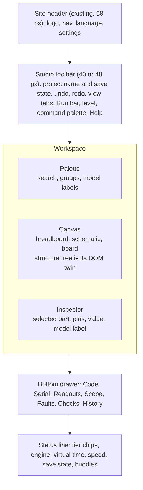
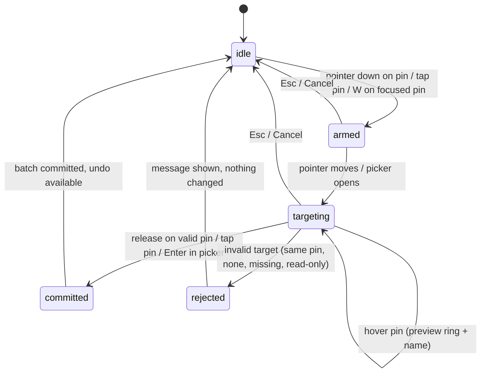
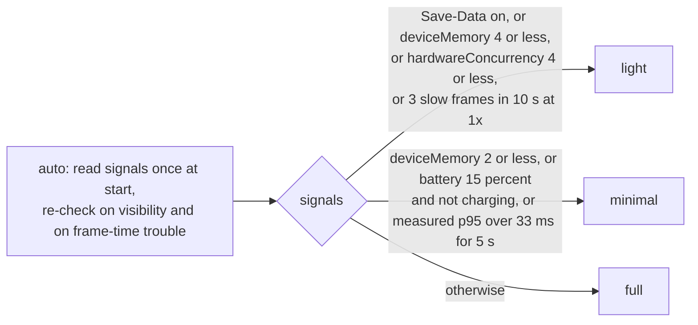

# iynk UX design system

Written 2026-10-27 by the UX design seat. Status: specification for the build, not yet reviewed by Amar. Source: `BRIEF.md` section 18 (and 8.2, 10.6, 14), the decisions in `00_EXECUTIVE/DECISION_REGISTER.md` (start with "Current decisions: the build reframe"), the audit (`01_AUDIT/`), the research (`02_RESEARCH/`), the spikes (`08_RESEARCH_SPIKES/`), the product files (`FEATURE_CATALOGUE.md`, `PRODUCT_REQUIREMENTS.md`, `FEATURE_PRIORITIZATION.md`) and the contract files (`04_ARCHITECTURE/PROJECT_DATA_MODEL.md`, `COMPONENT_SCHEMA.md`, `SIMULATION_ARCHITECTURE.md` with their schemas).

Purpose (D-013): a complete open-source hardware lab that Amar uses with his friends. Nothing here is planned around customers, classrooms or institutions. WCAG 2.2 AA is kept as an engineering target because the code is public and because keyboard, language and low-power access are also what make a tool pleasant to use on a bad laptop (D-011), not because a buyer asks for it.

## 0. Summary

This file does five things. It audits the identity the hackathon built, keeps most of it, and says where Studio must differ (section 2 to 4). It defines tokens, components, states, density levels, focus, targets, motion and colour rules for Studio (section 5 to 9, 12, 13). It specifies the non-drag way to place and wire parts, which is the hardest accessibility problem in an editor (section 10, 11). It lists every simulation control that cannot meet AA and the equivalent that replaces it (section 14). It sets language, bandwidth, power and phone rules as constraints on every screen (section 15 to 17). Journeys, acceptance tests, build order and ADRs follow (section 18 to 21).

Decisions in one table. Full records are in section 21.

| ID | Decision | Where |
|---|---|---|
| ADR-0850 | Keep the paper and ink identity. Two registers: the **Plate** register (chrome, lessons, figures, hand-inked, grain) and the **Bench** register (the Studio canvas: flat, no filter, no grain, ink outline). The canvas stays a light paper plate in both themes. | 4 |
| ADR-0851 | Tokens are CSS custom properties in three layers (primitive, semantic, component), still declared in `globals.css` under Tailwind v4 `@theme`. A CI script reads the declared pairs and fails on a contrast miss. | 5 |
| ADR-0852 | Beginner, intermediate and advanced are a per-viewer **level** that changes defaults and promotion, never data and never reachability. The command palette lists everything at every level. | 8 |
| ADR-0853 | The canvas has a parallel DOM **structure tree** (part list, pin list, net list). Every canvas action has a list-based path. Wiring without drag is the pin picker. (Final shape PENDING RS-16.) | 10, 11 |
| ADR-0854 | Language is a layout constraint: logical CSS only, `dir` from a locale table, a glossary file per term, pseudo-locales in CI, six languages kept. RTL is ready, not shipped. | 15 |
| ADR-0855 | One performance ladder (`full`, `light`, `minimal`) chosen automatically from device signals and overridable. Every visual cost has a rung where it turns off. | 16 |
| ADR-0856 | One motion contract for CSS and JavaScript, with a flash limit on simulated visuals (at most 3 visible on/off changes per second unless the viewer opts out). | 13 |
| ADR-0857 | Phone layout is tabs and sheets, never a sticky stage over a scrolling rail. | 17 |

What this file does not do: it does not write per-journey wireframes beyond the shell and the hard cases (section 18 gives states, validation and success criteria per journey and points to the components). It does not choose the canvas renderer (R-053 and RS-01 own that); it only sets what the renderer must draw and expose.

Ids used in this file. `DS-nn` are design rules (stable, local to this file). `UXA-nn` are acceptance checks (section 19). `VI-nn` are audit findings (section 2). Feature ids F-xxx, requirement ids R-xxx, budget ids BUD-xx, accessibility ids ACC-x and journey ids J-01 to J-13 are the shared ones; this file does not create any.

## 1. Upstream, downstream and evidence labels

| Direction | What | Link |
|---|---|---|
| Upstream | Brief | section 18 (experience, progressive complexity, accessibility and i18n), 8.2 (canvas), 10.2 (fidelity labels), 10.6 (instrumentation), 14 (collaboration) |
| Upstream | Decisions | D-007 honest labels, D-010 diagnosis record, D-011 low-end budgets, D-013 to D-017 |
| Upstream | Constraints | K-A11Y, K-I18N, K-DEV, K-PERF, K-LOCAL, K-KEY in `PRODUCT_REQUIREMENTS.md` section 4; ACC-1 to ACC-4, BUD-01 to BUD-15 |
| Upstream | Audit | `01_AUDIT/inventory/shell-i18n.md` (design system, i18n, settings), `01_AUDIT/runs/BROWSER_WALK.md` (phone, i18n, rooms), `01_AUDIT/TEST_COVERAGE.md` (axe coverage) |
| Upstream | Spikes | RS-01 (render cost, INCONCLUSIVE), RS-09 (op log), RS-13 (physics). RS-16 (editor accessibility) has not been run: every claim about its exit measure is PENDING RS-16 |
| Downstream features | F-079 canvas, F-080 wiring, F-081 views, F-082 inspector and palette, F-011 tier label, F-171 languages, F-172 review, F-173 English term beside translation, F-176 settings, F-177 WCAG, F-178 phone, F-179 RTL, F-094 offline, F-207 serial, F-053 multimeter, F-054 scope, F-051 replay, F-017 to F-021 diagnosis, F-106 diff card, F-138 buddies | `FEATURE_CATALOGUE.md` |
| Downstream requirements | R-053 to R-074 (Studio), R-068 (languages), R-070 (WCAG), R-071 (phone), R-058 (non-drag), R-063 (serial), R-065 (tier label) | `PRODUCT_REQUIREMENTS.md` |
| Journeys | J-01 to J-13 | section 18 |
| ADRs | ADR-0850 to ADR-0857, the range reserved for this file (the realtime seat owns ADR-0500 to 0511). Flag in section 23 | |

Evidence labels as in the brief: VERIFIED (I read the code or ran the command), DOCUMENTED (a project file says so), EXTERNAL (a standard or outside source), ESTIMATED (my arithmetic, assumptions shown), HYPOTHESIS (a test is named), UNKNOWN (cannot be checked now). PENDING RS-xx means a spike has no verdict that decides it. No user has been interviewed and no phone, Chromebook or screen reader has been tried, so every claim about those is UNKNOWN and is listed in section 24.

## 2. Audit of the current visual identity

### 2.1 What was inspected

| Source | How |
|---|---|
| `src/app/globals.css` (604 lines) | Read in full: tokens, themes, language fonts, base, components, reduced motion |
| `src/components/ui/*` (31 files, 2,168 lines with tests, `shell-i18n.md`) | Read the index and Button, Chip, Callout, Tabs, Sheet; the rest through the inventory |
| `src/components/shell/*`, `src/lib/settings/*`, `src/i18n/config.ts`, `translate.ts` | Read the parts cited below |
| Screenshots | `/Users/amar/iynk-master-plan-scratch/audit/browser-walk/shots/01_landing_desktop.png` and `02d_blink_running.png` viewed; the other captures through `BROWSER_WALK.md` (phone, flight, rooms, es and hi) |
| Contrast | Computed with the WCAG 2.x relative-luminance formula from the declared token values; script `/Users/amar/iynk-master-plan-scratch/design/ux-design-system/contrast.py` (VERIFIED by computation) |
| Figures' style | `docs/FIGURES.md` and the engine's three-band shading, through `figure-engine.md`; the 24 MB under `public/figures` |

I did not run the app, an axe pass or a screen reader for this file. Where a statement is about runtime behaviour it is DOCUMENTED from the audit or marked HYPOTHESIS.

### 2.2 What the identity is

| Part | What it is | Evidence |
|---|---|---|
| Surface | Warm paper `#f2efe7` with a 280 px tiled grain (SVG turbulence as a data URI) painted on `body`; cards `#faf8f2` | `globals.css` (`--grain` on `:root`, `background-image` on `body` in the base layer) |
| Line | 2 px ink border on cards and buttons, hand-cut corners (`--radius-ink`, uneven four-value radii), hard offset shadow `3px 3px 0` | `globals.css:67-68` (radii), `.ink-card` |
| Colour | Five figure palettes (tomato, mustard, mint, cobalt, blush) each in light, mid, dark bands, plus a warm "technical monochrome" ramp and metal. One accent, tomato, used as a mark only | `globals.css:27-63`, `:181-183` |
| Type | Geist for body and headings, Geist Mono for small caps labels and code, Instrument Serif italic for one accent word in a headline. Devanagari and Han faces handled per language | `layout.tsx:16-19`, `globals.css:290-320` |
| Figures | Isometric hand-inked objects: real 3D bodies in three flat bands, heavy silhouette, finer inner lines, a flat blue cast shadow, drawn on a paper plate; the plate stays light in dark theme (dimmed to `#e4ddcf`) | `globals.css:1-12`, `.ink-plate`, figure engine |
| Theme | Light by default, whatever the OS prefers; dark by choice or by system; the settings object is `{theme, sound, lofi, labels, reduceMotion, telemetry}` | `storage.ts:31-39` |
| Motion | Press-down buttons on the offset shadow, a bouncing "ink-pop", fades and slides of 0.18 to 0.22 s; reduced motion by media query and by an in-app setting | `globals.css:66-92`, `:585-600` |
| Layout | A reading frame up to 80 rem, a header of 58 px, and a workspace: a bar, a stage and a rail (30 vw), the stage sticky on phones | `globals.css:187-194`, `.ws` rules |

What I saw in the screenshots. The landing page is calm: one large Geist headline with an italic serif word, a dark pill button, one lit figure with measured labels ("LED1 12.2 mA", "RES1 220 ohm"). The Blink lesson in the running state is dense but readable: pill-shaped tabs and buttons with ink outlines, a figure plate with a large "RUNNING / 5.0 V" readout, a code pane with a mustard-highlighted constant, chips under the figure for pin states ("ON LED on", "D13: LOW"). The identity reads as one thing across both pages. This is the asset the brief says not to throw away.

### 2.3 Contrast, computed

Text needs 4.5:1 (1.4.3), graphics and control boundaries 3:1 (1.4.11). All values below are the WCAG ratio for the token pair as declared.

| Pair | Ratio | Verdict |
|---|---|---|
| Light: ink on paper | 14.40 | pass |
| Light: muted `#625b4f` on paper / on sunken | 5.84 / 5.29 | pass |
| Light: good, bad, warn, info text on paper | 5.47, 5.32, 5.56, 6.93 | pass |
| Light: ink on mustard, tomato, mint, cobalt, blush fills (`on-fill`) | 9.25, 5.39, 9.60, 6.22, 8.66 | pass |
| Light: accent tomato `#ef6a4c` on paper | 2.67 | fails as text, fails as a boundary: mark only |
| Light: mustard fill on paper | 1.56 | a fill never carries state alone: it has an ink outline (2 px, 14.4) |
| Light: `--rule` `#d9d1c1` on paper | 1.32 | decorative divider only. Must never be the only edge of an input, a button or a target |
| Light: mono-500 `#857d6e` on surface (placeholder candidate) | 3.84 | fails as text; do not use for placeholder or hint text |
| Dark: ink, muted on paper | 14.22, 7.69 | pass |
| Dark: good, bad, warn, info on paper | 10.27, 7.23, 9.89, 9.16 | pass |
| Dark: `--rule` `#3d372d` on paper | 1.50 | decorative only (same rule) |
| Dark: `--line` `#cfc6b4` on paper / on surface | 10.44 / 9.34 | pass |
| Dark focus mustard `#f4b829` on paper / surface | 9.89 / 8.84 | pass |
| Plate in dark theme (`#e4ddcf`): ink, muted, good, bad, warn, info | 12.25, 4.97, 4.65, 4.53, 4.72, 5.90 | pass, `bad` is 0.03 above the line: do not darken the plate further |
| Code tokens light, on `#faf8f2` | comment 5.51, keyword 7.37, number 6.46, function 6.20, preprocessor 7.49 | pass |
| Code tokens dark, on `#14120e` | comment 6.71, keyword 9.69 | pass |
| Console (dark green panel) text, muted, error, warn | 14.20, 6.23, 7.43, 9.85 | pass |
| Cobalt-m `#5a82c6` on the dimmed plate (a candidate selection colour) | 2.86 | fails 3:1: not used for selection. Selection uses `--info` `#2f4f8f` (5.90) |
| Cobalt-m on paper (a candidate buddy-cursor colour) | 3.36 | barely passes as a graphic; other palette hues do not. Buddy identity is not colour alone (section 12) |

The audit's own note that the dark muted pair was "not computed" (`shell-i18n.md`, item 5) is now closed: 7.69.

### 2.4 Findings

| ID | Finding | Evidence | Matters for Studio because | Action |
|---|---|---|---|---|
| VI-01 | The hand-drawn SVG filter (feTurbulence plus displacement, a 580 KB data URL per figure page) was dropped from the RS-01 test scene. The spike says a filtered 500-part scene is "likely much slower" and the real figures use it | RS-01 REPORT caveats | The identity's most expensive trait cannot be on the canvas | The Bench register is filter-free (section 4). Filter only on chrome and static art. Whether a filter on one hovered part is affordable is UNKNOWN; do not use it until measured |
| VI-02 | `.ink-hand { filter: url(#ink-hand) }` exists but nothing in `src` renders the `<InkFilters/>` it needs | `globals.css` `.ink-hand`; grep of `src` and `figures/engine` finds only the CSS | Dead style | Delete in B0 (CLAUDE.md step 0) or implement for chrome only |
| VI-03 | `settings.lofi` is declared, defaulted and parsed, and read nowhere else | `storage.ts:14,35,102`; grep of `src` finds tests only | A "low-fi" switch was meant; the performance ladder (ADR-0855) replaces it | Remove `lofi` and `telemetry` (R-009) from `Settings` in B0; add `level`, `spacing`, `perf`, `announceSerial` (section 5.9) |
| VI-04 | No `forced-colors` and no `prefers-contrast` rules; the offset shadow carries the card edge | `shell-i18n.md` defect 6 | In Windows High Contrast box-shadow is dropped, so a card edge could vanish | Every raised element also has a real border (it does: 2 px). Add the two media blocks (section 5.8) |
| VI-05 | `dir="ltr"` is hard-coded | `layout.tsx:57` | RTL readiness (F-179) | A locale table drives `dir` (section 15.5) |
| VI-06 | Logical properties are already the habit: 129 logical utility uses (`ms-`, `me-`, `ps-`, `pe-`, `text-start`, `text-end`, `start-`, `end-`, `inset-inline`) against 9 physical uses in 5 files | grep of `src/**/*.tsx` (VERIFIED) | RTL is cheaper than the audit assumed | Fix the 9 physical uses (listed in section 15.5) and add a lint rule |
| VI-07 | The sticky stage on phone (46 to 52 svh) sits over the scrolling rail, and `scroll-padding-top` is a fixed 5 rem | `globals.css` `html` and `.ws-stage` rules | A focused control in the rail can scroll behind the stage: WCAG 2.4.11 risk (HYPOTHESIS, not tested) | Studio does not use this pattern on phone (ADR-0857). `scroll-padding-top` becomes a token that sums every sticky bar |
| VI-08 | `Button` size `sm` is 36 px high on a fine pointer, 44 px on a coarse one; IconButton `sm` 36 px; Toggle 44 | `Button.tsx:27`, `IconButton.tsx:74`, `Toggle.tsx:19,38` | 24 px is the AA floor (2.5.8) and 36 passes it; the audit found 2 targets under 44 px on the landing page, not identified | Keep; name the floors as tokens (section 9.3); find the two (UXA-09) |
| VI-09 | axe runs on 5 spec files (13 lines) and the dashboard and 404 in `shell.spec.ts`; not on catalogue indexes, about or most lab pages | `TEST_COVERAGE.md` finding 12, `shell-i18n.md` | ACC-1 needs every route and every Studio view | Route crawler with axe in CI (UXA-01) |
| VI-10 | The page "Figure controls" mirror and a handful of figure strings stay English in es and hi (12 labels) | `BROWSER_WALK.md` i18n section, item 8 of its summary | Screen-reader users in those languages meet English | Fix at the string level in LABS; Studio has no such gap by construction (parity test over the new namespaces, section 15.2) |
| VI-11 | Fonts: three Latin families preloaded, Devanagari not preloaded, Chinese from platform fonts | `layout.tsx:12-20`, `globals.css` | Offline use (F-094) needs the font files in the service worker cache; CJK relies on the system | Section 16.5 |
| VI-12 | One localStorage key `iynk:v1` holds progress and settings together | `storage.ts`, `shell-i18n.md` debt table | Studio adds per-viewer UI state that must not live in the progress blob | Section 5.9 |
| VI-13 | The only accessible description of a figure is an iframe-external mirror and a `role="status"` line; the canvas of Studio has no equivalent yet | `FigureFrame.tsx:374-386` | The core of the non-drag work | Section 10 and 11 |
| VI-14 | Grain on `body` (an SVG-filter tile) is painted on every page; its cost has not been measured | `globals.css` base | BUD-04 idle CPU came from the figure core (P1), not from the grain, but the grain on a low-end GPU is UNKNOWN | Measure in B0 with a paint profile; removed at rung `light` regardless (section 16.2) |

### 2.5 Keep, extend, replace

BRIEF section 3.5: nothing is replaced until the replacement is measurably better.

| Piece | Verdict | Reason and condition |
|---|---|---|
| Paper, ink, tomato accent, the five figure palettes, three-band shading | **Preserve** | Coherent, measured to pass contrast, matches the figures. Studio part art reuses the bands |
| Light by default | **Preserve** | Decided in the hackathon and tested (`shell.spec.ts:123,137`). Dark stays a choice, plus "system" |
| Geist, Geist Mono, Instrument Serif accent | **Preserve** | Already handle six languages through per-language overrides |
| Semantic tokens (`--paper --surface --sunken --ink --muted --rule --line --good --bad --warn --info`, code and console sets) | **Extend** | Add state, canvas and density tokens (section 5); keep every existing name |
| `ink-card`, `ink-plate`, hand-cut corners, offset shadow | **Preserve for chrome**, **do not use on the canvas** | VI-01 |
| UI kit (Button, Callout, Chip, Dialog, Sheet, Tabs, Tooltip, Toggle, SegmentedControl, Field, Stepper and others) | **Extend** | Hand-written, tested for focus trap and ARIA (`useModal`), logical properties used. Studio adds components in section 7; nothing is rebuilt |
| Global `:focus-visible` (2.5 px ink outline, 7 px halo) | **Preserve** | Meets 2.4.7; 14.4:1 light, 9.9:1 dark |
| Reduced-motion block | **Extend** | CSS only today; JavaScript animation is not covered (section 13) |
| The figure iframes (legacy lesson art) | **Preserve until Studio parity** (R-152) | They stay the lesson and template art; Studio draws its own editor art (R-053) |
| Settings in the progress blob | **Replace in shape** | Move UI settings to a settings key; keep the blob readable for migration (section 5.9) |
| Sticky-stage phone workspace | **Replace for Studio** | VI-07; lesson pages may keep it until LABS |

## 3. Principles

| # | Principle | Test |
|---|---|---|
| P1 | The identity stays, the cost does not. Anything that makes a frame slower than the budget (BUD-01 to BUD-03) turns off on the canvas | Section 4 |
| P2 | Same data, different view. A level, a density, a language or a theme never changes the project document | ADR-0852; a test saves the same document at every level |
| P3 | Everything has a list path. Each canvas action is available from a DOM list with names | Section 10 |
| P4 | Say what the model is. Every number on screen carries its tier or "not modelled yet" (D-007) | Section 7.3 |
| P5 | Undo, do not ask. Reversible actions never open a confirmation; the toast offers Undo. Dialogs are for what cannot be undone | Section 7.4 |
| P6 | Words are data. No string is built from English fragments; no layout depends on an English word length | Section 15 |
| P7 | Colour is a second channel. Every state has a shape, a word or a pattern | Section 12 |
| P8 | Offline and keyless are normal states, not errors (K-LOCAL, K-KEY) | Section 7.4 |

## 4. Two registers: Plate and Bench

The identity has two registers so the editor can keep its look and still meet BUD-01.

| | Plate register | Bench register |
|---|---|---|
| Used for | Page chrome, panels, lesson art, legacy figures, dialogs, the project home | The Studio canvas and anything drawn at part scale: parts, wires, labels, overlays, probes |
| Edges | 2 px ink border, hand-cut corners (`--radius-ink`), offset shadow | 1.5 px ink outline (`--bench-line`), true geometry, no offset shadow |
| Surface | Paper with grain | Flat plate colour, optional dot grid (1 px dots at 2.54 mm, decorative) |
| Filters | Allowed on static chrome | None. No SVG filter, no blur, no drop shadow on parts (VI-01) |
| Shading | Three bands, cast shadow | Three bands kept (light, mid, dark fill steps) but **no cast shadow** and no inner hatching below zoom 100 percent (level of detail) |
| Art budget | Not limited | At most 80 SVG elements per part at full detail (RS-01: 40 to 80 asked, mean 93.6 measured for figure art), outline rectangle plus pin dots below the LOD threshold (R-053 rule 2) |
| Text | Any size from 12 px | Part labels are `refdes` and values only (`R1`, `220 Ω`), minimum 11 CSS px at 100 percent zoom, hidden by LOD when smaller |
| Theme | Follows light or dark | **Always the light plate** (`.ink-plate` tokens). In dark theme the plate is dimmed to `#e4ddcf` and keeps dark ink, exactly the figure rule in `globals.css:1-12` |

Why the canvas stays a plate in dark theme. The part art, the breadboard and every figure are drawn for dark ink on light paper. A dark canvas needs a second art set, and the dimmed plate already meets 4.5:1 for every state colour (section 2.3). HYPOTHESIS: a dark canvas is wanted by some people for night use; decide after use. The theme token set makes it a later change (`--canvas-*` only).

The Bench rules are testable: the editor performance harness (R-074) fails a build that adds a filter or a cast shadow to a part (a lint on the art files plus the frame-time budget).

## 5. Tokens

### 5.1 Layers and naming

ADR-0851. Three layers, all CSS custom properties, all in `globals.css` (or the files it imports; the file is 604 lines and should be split before it grows, see section 20).

| Layer | Purpose | Example | Rule |
|---|---|---|---|
| Primitive | Raw values, no meaning | `--color-tomato-m`, `--color-mono-600`, `--space-4`, `--dur-base` | Never used in a component directly except figure and part art |
| Semantic | A role, themeable | `--paper --surface --sunken --ink --muted --rule --line --good --bad --warn --info`, `--focus`, `--select`, `--state-*` | What components use. All existing names stay |
| Component | One component's decisions | `--btn-min-h`, `--pin-hit`, `--wire-w` | Defined next to the component, refer to semantic tokens |

Naming: kebab case; `--<role>` or `--<role>-<variant>`; states as `--state-<name>`; canvas tokens as `--canvas-*` or `--bench-*`; sizes in `rem` except hit areas and canvas geometry, which are CSS px (a hit area must not grow when a person raises the base font size above the page zoom they chose; the 24 px floor is in CSS px by definition).

Tailwind v4 maps tokens through `@theme` and `@theme inline` as today. No second token file in JSON is introduced (one source of truth). A small script `scripts/tokens-report.mjs` (to be written in B0) parses `globals.css`, resolves each declared pair in `contrast-pairs.json`, and prints this section's table; CI fails on a pair under its threshold (UXA-02).

### 5.2 Colour roles

Existing tokens are kept and listed once so the new ones have a home. Values are light then dark where they differ.

| Role | Token | Light | Dark | Use |
|---|---|---|---|---|
| Page | `--paper` | `#f2efe7` | `#1b1813` | Page background |
| Raised | `--surface` | `#faf8f2` | `#26221b` | Cards, panels, inputs |
| Recessed | `--sunken` | `#e9e4d8` | `#14120e` | Wells, disabled fills, tab rail |
| Text | `--ink` | `#231e16` | `#ece6d8` | Body text, outlines |
| Secondary text | `--muted` | `#625b4f` | `#b3aa98` | Hints, labels; 4.5:1 on paper, surface and sunken |
| Divider | `--rule` | `#d9d1c1` | `#3d372d` | Decorative only (1.32 and 1.50:1) |
| Control edge | `--line` | `#231e16` | `#cfc6b4` | Borders of anything interactive (15.6 and 9.3:1) |
| Focus | `--focus` | `#231e16` | `#f4b829` | Focus outline; halo `--halo` |
| State text | `--good --bad --warn --info` | `#2e6b52 #a8402b #7a5a00 #2f4f8f` | `#93d3b0 #f08a70 #f4b829 #9dbcef` | Text and icons for a state |
| State fill | `--good-bg --bad-bg --warn-bg --info-bg` | `#93d3b0 #f3a28f #f4b829 #a9c3ec` | same | Chips and bars; text on them is `--on-color` |
| Accent mark | `--accent` | `#ef6a4c` | same | A dot, a live indicator, never text, never a boundary |
| Accent text | `--accent-ink` | `#a8402b` | `#f08a70` | Accent where text is needed |
| Code and console | `--code-*`, `--console-*` | as declared | as declared | Unchanged |

New semantic tokens for Studio (names fixed here; values are the starting point, checked by UXA-02):

| Token | Light | Dark | Role | Checked |
|---|---|---|---|---|
| `--select` | `#2f4f8f` | `#9dbcef` | Selection outline and selected-row accent in chrome | 6.93 on paper, 9.16 on dark paper |
| `--state-running` | `var(--good)` | `var(--good)` | Run indicator text, always with the word "Running" | |
| `--state-paused` | `var(--info)` | `var(--info)` | Paused, with the word | |
| `--state-halted` | `var(--bad)` | `var(--bad)` | Halted by an error, with the word and the message | |
| `--state-slow` | `var(--warn)` | `var(--warn)` | "Running at 0.4 times real time on this device" | |
| `--state-readonly` | `var(--muted)` | `var(--muted)` | Not holding the baton, not an editor, or a restored old revision | |
| `--ai` | `#7a3a6a` | `#c4b5f4` | AI proposal border and label (the same hue as the code preprocessor token, so no new hue enters the palette) | 6.92 on paper, 9.49 on dark paper; 5.89 on the dimmed plate |
| `--tier-t0 --tier-t1 --tier-t2 --tier-t3` | `var(--muted)`, `var(--info)`, `var(--good)`, `var(--good)` | same | Tier chip accent; the chip always carries the words (section 7.3) | |

Canvas tokens. They are defined on `.ink-plate` and on the canvas element and are the **same in both themes**:

| Token | Value | Role |
|---|---|---|
| `--canvas-bg` | `var(--plate-bg)` (`#f2efe7`, dimmed to `#e4ddcf` in dark theme) | Canvas fill |
| `--canvas-grid` | `#cfc8b8` (mono-300) | Dot grid, decorative, 1 px |
| `--bench-line` | `var(--color-ink-fixed)` `#231e16` | Outline of parts and wires, 12.25 to 14.40:1 |
| `--canvas-select` | `#2f4f8f` | Selection outline (2 px) plus 4 px halo at 35 percent |
| `--canvas-hover` | `#231e16` at 100 percent, 1 px dashed | Hover, never colour only |
| `--canvas-pending` | `#55504a` | Ghost of an unplaced part, a wire in progress (dashed) |
| `--canvas-ok` `--canvas-bad` `--canvas-warn` | `#2e6b52` `#a8402b` `#7a5a00` | Valid target, invalid target, warning on a net or a part; 4.53 to 5.47 on the plate; each always with an icon and a word in the readout |
| `--canvas-label` | `#231e16` on `--canvas-bg` | Refdes and value text |
| `--ratsnest` | `#625b4f` | Air wire for the undrawn part of a net (W6), 1 px, dash 4 4 |

### 5.3 Wire colours and nets

The project's wire colour is one of ten: red, black, orange, yellow, green, blue, white, purple, brown, grey (`WireColor` in `project.schema.json`). It is the person's choice and carries no electrical meaning in the data. Rules:

- Wire fills use the Colorfigures band values, drawn with the `--bench-line` outline so every wire has at least 14:1 edge contrast (a white wire on a light plate is visible by its outline).
- Meaning is carried by the **net**, not the colour: a net chip (name, class glyph) on hover, on select and in the net list (section 12).
- The editor may suggest red for `power` class nets and black for `ground` and say so in a hint; it never changes a colour by itself.

### 5.4 Type

| Token | Value | Use |
|---|---|---|
| `--font-body` | Geist, system sans | Body, controls |
| `--font-ui` | Geist Mono | Code, serial, `shell-meta` labels, values |
| `--font-head` | Geist | Headings |
| `--font-accent` | Instrument Serif italic | One accent word in a hero headline only (Plate register, never in Studio chrome) |
| `--fs-xs` `--fs-sm` `--fs-base` `--fs-lg` | 0.75, 0.875, 1, 1.125 rem | Studio UI scale. Nothing in Studio chrome below 0.75 rem (12 px); canvas labels follow zoom with an 11 px floor |
| `--lh-ui` | 1.4 (1.55 Latin body; 1.7 for hi) | Line height, raised for Devanagari and Han (section 15.4) |

Large display sizes (`h1` clamp 2 to 3.25 rem) stay for the project home only. Studio screens use `h2` and below.

### 5.5 Space, size, shape, elevation

| Token | Value | Note |
|---|---|---|
| `--space-1 ... --space-8` | 0.25, 0.5, 0.75, 1, 1.5, 2, 3, 4 rem | Comfortable spacing |
| `--gap-ui` | 0.5 rem comfortable, 0.25 rem compact | Section 8.3 |
| `--target-min` | 24px | WCAG 2.5.8 floor; never go below |
| `--target-fine` | 32px | Default control on a fine pointer, compact spacing may use 24 to 31 only for icon buttons in dense toolbars |
| `--target-coarse` | 44px | Default on a coarse pointer (`@media (pointer: coarse)`), matches the existing `min-h-11` |
| `--pin-hit` | 24px fine, 44px coarse | Canvas pin hit circle radius equivalent; see section 9.3 |
| `--radius-ink`, `--radius-ink-sm` | as declared | Chrome |
| `--radius-bench` | 2px | Canvas objects |
| `--shadow-ink`, `-sm`, `-lg` | `3 3 0`, `2 2 0`, `5 5 0` | Chrome raised |
| `--z-canvas 0, --z-overlay 10, --z-bar 20, --z-sheet 30, --z-dialog 40, --z-toast 50` | | One scale; no number outside it |
| `--bar-h` | 40px compact, 48px comfortable (Studio toolbar), `--header-h` 58px | Summed by `--sticky-top` for focus-not-obscured (section 9.2) |

### 5.6 Motion tokens

| Token | Value | Use |
|---|---|---|
| `--dur-instant` | 0ms | Reduced motion value for everything below |
| `--dur-fast` | 100ms | Press, hover |
| `--dur-base` | 180ms | Fade, small slide (`ink-fade`) |
| `--dur-slow` | 260ms | Sheets and drawers (`ink-rise`, `ink-from-start` are 220ms today, kept) |
| `--dur-flourish` | 700ms | `ink-pop` celebration, Plate register only |
| `--ease-out` | `cubic-bezier(0.2, 0.9, 0.3, 1)` | Entering |
| `--ease-pop` | `cubic-bezier(0.3, 1.4, 0.5, 1)` | `ink-pop` only |

### 5.7 Breakpoints

Existing: 40 rem (phone to tablet), 48 rem, 64 rem (workspace becomes two columns), 105 rem (wider frame). Studio adds one at 90 rem (three docked columns). Container queries are preferred inside panels so a panel responds to its own width, not the window (a docked rail and a sheet are the same component at different widths).

| Name | Width | Studio layout |
|---|---|---|
| `phone` | under 40 rem | Tabs and sheets (section 17) |
| `tablet` | 40 to under 64 rem | Canvas plus one slide-over panel |
| `desktop` | 64 to under 90 rem | Canvas, one docked rail (30 vw, 22 to 36 rem as `--rail-w`) |
| `wide` | 90 rem and up | Palette, canvas, inspector docked, bottom drawer for serial and scope |

### 5.8 Themes, forced colours, contrast preference

```css
/* Sketch, to be written in B0. Names are binding, values start here. */
@media (forced-colors: active) {
  .ink-card, .ink-plate { border: 2px solid CanvasText; box-shadow: none; }
  :focus-visible { outline: 3px solid Highlight; box-shadow: none; }
  .canvas svg [data-state] { forced-color-adjust: none; }   /* state glyphs keep shape; fills use system colours via data attributes */
}
@media (prefers-contrast: more) {
  :root { --rule: var(--line); --muted: var(--ink); }
  .ink-plate { --canvas-grid: transparent; }
}
```

In forced colours the canvas relies on its outline and its glyphs, which is why section 12 forbids fill-only states. Testing: Chromium's forced-colors emulation in Playwright (UXA-06).

### 5.9 Settings and state storage

| State | Where | Notes |
|---|---|---|
| `theme`, `sound`, `reduceMotion`, `labels` | `iynk:v1.settings` (existing) | Keep as is for migration |
| `level` (`beginner`, `intermediate`, `advanced`), `spacing` (`comfortable`, `compact`), `perf` (`auto`, `full`, `light`, `minimal`), `announceSerial` (`off`, `summary`, `all`), `singleKeyShortcuts` (`on`, `off`), `trueBlinkRate` (`off`, `on`) | New keys in the same `settings` object (extend `Settings` in `storage.ts`) | Per viewer, device-local. Never in a project (PROJECT_DATA_MODEL 2.2: viewport, selection, panel layout are per-viewer) |
| Viewport, selected view, panel sizes, which tab | `iynk:view:<prj_id>` in `localStorage`, plus a copy in the IndexedDB project store if F-200 provides one | Each read wrapped in try/catch; the app renders correctly with it empty (private windows, ADR-0106) |
| Remove | `lofi`, `telemetry` | VI-03; D-005 and R-009 (telemetry off or opt-in with no upload) |

## 6. Studio shell and layout

### 6.1 Regions



Wireframe, desktop, `wide` (90 rem and up). Panels collapse by width, not by level; the level (section 8) changes what is inside them.

```
+--------------------------------------------------------------------------------------------+
| iynk   Studio  Boards  Robotics  Drone  Together                          EN v   [gear]       |  site header
+--------------------------------------------------------------------------------------------+
| Blink on D12 *saved  [undo][redo] | Breadboard | Schematic | Board |  [> Run][Stop][Reset] 0:03.250 | Level v | Ctrl+K | ? |
+---------------+--------------------------------------------------------+-------------------+
| Parts         |  .  .  .  .  .  .  .  .  .  .  .  .  .  .  .  .       | Selected: LED1    |
| [search...  ] |  .      +-----------+                                  | Red LED 5 mm      |
| Common        |  .      | Arduino   |---(R1 220 ohm)---(LED1)---+       |  Teaching model   |
|  LED          |  .      | Uno R3    |                            |       | Value  [220] ohm  |
|  Resistor     |  .      +-----------+----------------------------+       | Pins              |
|  Button       |  .  .  .  .  .  .  .  .  .  .  .  .  .  .  .  .       |  anode  -> D12    |
| Power         |                                  [ - ] 100% [ + ] [fit]|  cathode-> GND    |
| ...           +--------------------------------------------------------+-------------------+
|               | Code | Serial | Readouts | Faults | Checks | History      [Follow output]    |
|               | 1 const int LED = 12;   ...                                                  |
+---------------+--------------------------------------------------------------------------------+
| Circuit: Teaching model | Execution: Teaching model (built-in interpreter) | 1.0x | 2 buddies | OK |
+--------------------------------------------------------------------------------------------+
```

Phone is in section 17. Tablet drops the palette to a sheet opened from the toolbar and keeps the inspector as a slide-over.

### 6.2 Rules

| ID | Rule |
|---|---|
| DS-01 | The toolbar, status line and drawer tab bar are the only sticky regions inside Studio, so `--sticky-top` (the sum of the header, toolbar and any sticky tab bar) is a known number and focus scrolling can use it (2.4.11) |
| DS-02 | Panel visibility, size and tab are per viewer (`iynk:view:<prj_id>`); a "Reset layout" command in the palette restores defaults |
| DS-03 | The same panel component renders docked, as a slide-over, as a bottom sheet or as a tab, chosen by container width. No panel exists in only one mode |
| DS-04 | The drawer is a region with a heading and tabs; a closed drawer does not unmount a running instrument (the serial buffer keeps filling; the Scope keeps its ring buffer) |
| DS-05 | Language switching keeps the route and the open project (existing behaviour, `shell.spec.ts`); the canvas keeps its viewport |
| DS-06 | No panel appears over the canvas without a close control and Escape; nothing covers the toolbar |
| DS-07 | The skip link list in Studio is: skip to canvas structure tree, skip to code, skip to drawer, skip to inspector (extends the existing `SkipLink`) |
| DS-08 | Landmarks: `header`, `nav` (toolbar view tabs are `role="tablist"`), `main` (workspace), `aside` (palette, inspector), `region` with a name for the drawer, `footer` for the status line |

## 7. Components and states

### 7.1 Inventory and verdict

Existing components are preserved and extended; names are the ones in `src/components/ui/index.ts`.

| Component | Verdict | Studio use and change |
|---|---|---|
| Button, ButtonLink, IconButton, Toggle, SegmentedControl | Preserve | Add `size="xs"` (24 px, icon buttons in compact toolbars, never on coarse pointers where it grows to 44) |
| Tabs | Preserve | Used for the drawer; hidden panels stay mounted (a running serial keeps its buffer, matches DS-04) |
| Dialog, Sheet, Popover, Tooltip | Preserve | `Tooltip` must satisfy 1.4.13 (dismissible with Escape, hoverable, persistent while focus or hover stays): to verify in UXA-08 |
| Callout, Chip, Meter, Stat, Stepper, Kbd, CodeBlock, Panel, Card | Preserve | `Chip` is the base of the tier chip and net chip |
| Select, TextInput | Extend | Add `NumberInput` with unit parsing (section 15.6) |
| SkipLink, VisuallyHidden | Extend | DS-07 |
| Studio components | New | 7.3 |

### 7.2 State matrix

Every interactive component implements this set. A cell says what the user sees and what assistive technology gets. "Second channel" is the non-colour cue (P7).

| State | Visual | Second channel | AT |
|---|---|---|---|
| Rest | Token colours | | role and name |
| Hover (pointer only) | Raise 1 px and offset shadow grows on raised controls; dashed 1 px outline on canvas objects | Shape change | none |
| Focus-visible | 2.5 px `--focus` outline, 3 px offset, 7 px halo | Outline is a shape | native focus |
| Active (pressed) | Press into the shadow, 2 px | Movement (not under reduced motion: colour step instead) | `aria-pressed` for toggles |
| Selected | `--select` outline 2 px plus handles; a row gets a start-edge bar | Outline thickness; the word "Selected" in the inspector header | `aria-selected` or `aria-current` |
| Disabled | `--sunken` fill, `--muted` text, no shadow (as `Button` today) | Dashed border | `aria-disabled` and a reason on focus, never silent |
| Busy or loading | Spinner glyph that stops under reduced motion, and the word | "Working" text | `aria-busy`, status text |
| Error | `--bad` border, `!` icon, message under the field | Icon and text | `aria-invalid`, `aria-describedby` |
| Warning | `--warn` bar, triangle icon | Icon and text | status message |
| Success | `--good` bar, check icon | Icon and text | status message |
| Read-only | `--state-readonly`, lock icon, controls inert but readable | Lock icon and the word "Read only" with the reason (baton, viewer role, old revision) | `aria-readonly` |
| Stale (AI proposal or buddy op rejected `stale_base`) | `--warn` dashed outline | Word "Out of date" | status message |
| Not modelled yet | Hatched fill (diagonal, 45 degrees) and the mark | Hatch and words ("{part} is not modelled yet. The rest of the circuit still runs.") | text in the structure tree |
| Offline or no server | Quiet callout, no error colour | Words with the next step | status |
| Empty | Short sentence and one action | | |

### 7.3 Studio components

Each row gives the component, its anatomy, its data source and its accessibility contract. `ops` are the operation kinds from `PROJECT_DATA_MODEL.md` 7.2.

| Component | Anatomy and states | Data and ops | Accessibility |
|---|---|---|---|
| **Canvas** (`StudioCanvas`) | A `Renderer` (R-053) drawing the active `views[]` entry; layers: grid, parts, wires, ratsnest, overlays, selection, remote cursors. States: idle, panning, placing (ghost), wiring, marquee, running, read-only | Reads `views[].placements`, `wires`, `nets`; draws nothing the netlist does not say (R-059). Writes only ops | `role="application"` is **not** used (it would swallow screen-reader keys). The SVG is `aria-hidden` for its drawing; the **structure tree** (7.3, next row) is the accessible twin. The canvas element is focusable as one stop with `aria-label` and `aria-describedby` pointing to the keyboard help |
| **Structure tree** (`StructureTree`) | A visually hidden-by-default (shown in the Parts and Nets panel at every level) tree: Board, Parts (each with pins), Nets (each with members), Wires. Roving tabindex; Up, Down, Left, Right, Home, End; typeahead on names | Derived from `boards`, `components`, `nets`, `views` | `role="tree"` with `role="treeitem"`; each item name is "LED1, red LED, anode connected to D12 via net n1, cathode to GND"; a selection in the tree selects on the canvas and the reverse (one source of selection state) |
| **Palette** (`PartPalette`) | Search, groups from `category`, each item: figure thumbnail, name, model label (modelled, partly, not yet). States: filtered, empty, loading, part unavailable offline | Part descriptors (F-097); `status` and `tier` fields of `simulation` (COMPONENT_SCHEMA 4.11) | List with `role="listbox"`; Enter places at the canvas centre and focuses the placed part; drag is optional |
| **Inspector** (`Inspector`) | Header (name, refdes, model chip), value fields from the descriptor's parameters with their `unit`, label, rotation, pin table (pin `designator`, `name`, net, state), "Models" disclosure | `component.set`; `view.place` for rotation and position | Each field is a labelled input; position X and Y fields in mm (0.01 resolution) make the part movable without a pointer; changing a value commits one op on blur or Enter, announced as "R1 set to 330 ohm" |
| **PinPicker** | A popover or sheet listing pins as 44 px buttons, grouped by part, with search and "Nearby" first. Opened by tapping near a pin cluster, by `W`, or from the pin table | Reads pins; commits `net.connect` or `net.merge` plus `wire.add` as one batch | Section 10 |
| **NetOverlayList** | Net list; selecting a net highlights members and dims others, adds the outline and a label (R-059) | `nets[]` | A net is announced as "Net 5V, power, 4 pins" |
| **WireTool state** | `idle`, `armed` (from-pin chosen), `targeting`, `committed`, `rejected(code)` | `wire.add`, `net.*` | Section 10 |
| **RunBar** | Run, Pause, Stop, Reset, Step (advanced), speed, virtual time `m:ss.mmm`, state word. States: idle, running, paused, halted, done (SIMULATION_ARCHITECTURE 6.7) | Orchestrator events | State word is a live region (polite); the slow-down state says "Running at 0.4 times real time on this device" (SIM 4.4) |
| **TierChip** and **ModelsPanel** | Chip: "Teaching model", "Calculated model", "Runs your compiled firmware", "Illustration. Not a calculation." (exact English strings from SIM 4.4, in the `fidelity` namespace). One chip per layer plus a summary equal to the lowest (ADR-0302). Panel: three lists per layer, Modelled, Mocked, Not modelled yet, each line linking to a registry entry | Registry (ADR-0310) and descriptors' `status` and `tier` | Chip is a button that opens the panel; text, not colour, carries the tier; no chip prints a tier the registry does not hold |
| **Readout** (`Reading`) | Value and unit, tier, provenance: "{value} {unit}, {tier}, computed from {model}" or "approximate, {why}" (SIM 4.4). An unmodelled node shows "not modelled yet" and no number | Probe tap with `provenance` (ADR-0313) | Single text string for AT; numbers localised (Intl) with the SI symbol unchanged |
| **Multimeter and scope panels** | Probe placement by pin list or pointer; scope draws to canvas | F-053, F-054 | Alternative in section 14 |
| **SerialMonitor** | Output log, input line, baud, Clear, Copy, "Follow output", virtual-time stamps `[t=1.000 s]`, 5,000-line cap with "older lines dropped" (R-063) | Interpreter or avr8js output | `role="log"`; announcement policy `announceSerial` (section 11.3) |
| **CodeEditor** | CodeMirror (existing) with tabs per `sources[]`, markers from `diag` events, breakpoints gutter (SIM) | `source.edit` | `Esc` then `Tab` leaves the editor (keyboard trap exit, R-062); screen-reader mode adds line and column announcements; code and serial are `dir="ltr"` always (section 15.5) |
| **DiagnosisCard** | Symptom, three-step hint ladder, evidence list, Reveal cause. States: closed (`hint_level` 0), level 1 where to look, 2 what to measure, 3 the cause (D-010) | Shared record `{cause_id, symptom_id, evidence, hint_level}`; cause text built from `cause_id` and arguments, never concatenated | Each reveal is a button with the level in its name ("Show hint 2 of 3: what to measure"); the level logged is the highest opened |
| **FaultBadge** | On a part or net under a fault: icon, "Fault: open circuit" text, in the structure tree and the faults list. A fault is `fault.set` with `enabled` | `simulation.faults[]` | Never colour alone |
| **DiffCard** (AI and buddy proposals, F-106) | Rationale, a list of changes as text ("Add resistor R2 220 ohm", "Connect R2.1 to D12", "Edit sketch.ino lines 4 to 6"), a netlist delta, per-change checkboxes, Accept all, Accept selected, Reject. Border and label use `--ai`; a buddy proposal uses the buddy's identity glyph | `Proposal {id, base, author, rationale, ops[], status}`, dry run result per op | Focus moves to the card when it arrives, announced "Proposal from the AI partner: 4 changes"; a preview on the canvas is dashed and labelled; stale proposal shows "Out of date" and no Accept |
| **PresenceBadge and remote cursor** | Avatar with initials, role word (Wirer, Coder, Pilot, Watcher), and a cursor with name and a shape glyph unique per person | Room presence (existing `PeerAvatar`, `PresenceCursors`) | Name text always visible near the cursor; the colour is a second channel (section 12) |
| **Baton** | "You have the keyboard" or "Ann has the keyboard. Your edits are not shared". Ask for the keyboard button. Non-holder editing is blocked, not silently local (fixes the walk finding that B's edit stayed local, `BROWSER_WALK.md` step 9) | R-094 | Read-only state (7.2) with `aria-readonly` |
| **SaveState** | "Saved", "Saving", "Not saved: storage is full or blocked. Download a copy" with a Download action; last good copy time | F-087, F-200; autosave failure case (R-073) | Live region; a failure is `role="alert"` |
| **Toast** | One line, optional Undo, auto-dismiss only for success (6 s) and never for errors; the history of toasts is in the History drawer tab | Results of ops, including reject codes | `role="status"` or `alert`; pausing on hover and on focus (2.2.1) |
| **LossReportDialog** | After import or export: lists what was dropped, by code | `LossItem` (ADR-0109) | Dialog with a table, not colour |
| **CommandPalette** | `Ctrl+K` (and `/` when single-key shortcuts are on): search all commands, parts and views | Static command table | `role="combobox"` with `listbox`; every command shows its shortcut |
| **LevelControl** | Three-option segmented control in the toolbar | `settings.level` | Section 8 |

### 7.4 Messages, errors and empty states

| Rule | Detail |
|---|---|
| DS-09 | A message is a key plus arguments in a namespace: `studio`, `ops`, `fidelity`, `diagnosis`, `a11y`, `units`. No message is concatenated from fragments (R-068) |
| DS-10 | Every operation reject code has a message and a next step. The closed list in `PROJECT_DATA_MODEL.md` 7.2 is `malformed duplicate_id missing_target missing_pin pin_in_use unknown_definition missing_pin_map referenced_by invariant quota permission stale_base schema_mismatch`; a test enumerates the schema's list and fails on a code with no `ops.reject.<code>` key in all six languages (UXA-12). `invariant` carries the V3 rule id as an argument, not as the text |
| DS-11 | Errors say what happened, what it affects and what to do, in that order, in under 160 characters of English (a budget that leaves room for German). Example `ops.reject.pin_in_use`: "{pin} is already connected to {net}. Disconnect it first, or join the two nets." |
| DS-12 | Offline, no server and no key are states with steps, not errors: "Rooms need your server. Set one up in Settings, or work alone." and "The AI partner needs a key. Add one in Settings. Nothing is sent until you do." (K-KEY, F-012) |
| DS-13 | Empty states have one sentence and one action: "No parts yet. Pick one from the list, or press Ctrl+K." |
| DS-14 | Confirmation dialogs exist only for what undo cannot restore: deleting a project from the library after the 30-day trash, emptying the trash, overwriting a file on disk, leaving a room that holds unsaved local edits. Everything else commits and offers Undo (P5) |
| DS-15 | A merge of two nets that each have two or more members commits and shows a toast "Joined net 5V and net GND. Undo" and an electrical-rule warning if the classes conflict (F-028). It is not blocked (the person may be right) and it is not silent |

## 8. Density levels: beginner, intermediate, advanced

ADR-0852. Two independent per-viewer settings:

- **Level** (`beginner`, `intermediate`, `advanced`) changes which controls and panels are promoted by default and how much detail text has.
- **Spacing** (`comfortable`, `compact`) changes padding and target size within the floors of section 9.3. Default: `comfortable`; `compact` is offered at `intermediate` and `advanced` and is forced back to comfortable for a coarse pointer.

Rules that make growth safe:

| ID | Rule |
|---|---|
| DS-16 | The level is not stored in the project and never changes the document. The same `.iynk` file opens at any level. A test saves one project after identical edits at each level and compares the canonical hash (DET-3 style) |
| DS-17 | The command palette lists every command at every level. A level only decides what has a toolbar button, a default panel and a hint. A feature hidden from a level is one `Ctrl+K` away, so a keyboard or screen-reader user is never locked out by a level choice |
| DS-18 | A level never hides information that explains a fault or a limit: errors, "not modelled yet", tier chips and limit messages show at every level (D-007) |
| DS-19 | Content from a friend or a lesson that uses a feature above the viewer's level is shown, not stripped: the object appears with its normal drawing, and the inspector shows the extra fields collapsed with "Show advanced fields" |
| DS-20 | Switching level takes effect without reload and keeps the selection, viewport and unsaved text |
| DS-21 | The level has a default from context: a project opened from a lesson or template sets nothing; the first run uses `beginner`; the level is remembered per device. No test, no gate and no email ever asks "are you a beginner" |

What each level changes (defaults; DS-17 holds):

| Area | Beginner | Intermediate | Advanced |
|---|---|---|---|
| Views | Breadboard only | Breadboard, schematic, board tabs | Same, plus a split view (two views side by side) |
| Palette | "Common parts" group first (about 12: board, LED, resistor, button, potentiometer, buzzer, servo, display, battery, wire); plain names | All groups, search | Plus custom parts and library parts with ids and versions |
| Part names and pins | Plain `name` (for example "anode"), role icon, no ids | `name` and `designator` as printed on the part | Plus pin `id`, `type` and `class`, board port names |
| Inspector | Value and label | Plus rotation, position in mm, model panel | Plus part `ref`, pinned interface version, raw parameters, a read-only "Inspect JSON" of the part (editing only through ops) |
| Wiring | Wire tool with pin picker; electrical-rule hints inline ("This LED needs a resistor") | Net names, net list, route handles, ratsnest on | Net classes, junctions, labels, bulk "route the rest", net merge and split commands |
| Code | One file, run, serial, hints from the lesson or the partner | Several files, diagnostics panel, breakpoints (SIM) | Engine choice (interpreter or firmware mode), compile output, source map, step by line or cycle |
| Simulation | Run, Stop, Reset | Pause, speed, multimeter, serial plotter | Seed, solver and step settings, event step, scope and logic analyzer, probe taps, replay record and divergence report |
| Faults | "Break it" and the hint ladder | Faults panel on any circuit, diagnose-first toggle | Fault authoring (`fault.set`), checks and tests editor |
| Collaboration | Invite, who is here | Roles, baton | Proposal log, op history, rebase conflicts |
| Status line | Tier chip summary only | Per-layer chips | Plus engine and model versions, state hash |
| Help | Inline "what is this?" next to terms; first-run tour | Tooltips and shortcuts sheet | Shortcut sheet only; no tour |
| Text | Full sentences | Short | Terse (labels may drop explanatory clauses) but never below the `fs-xs` floor |

Progressive growth, concretely: a beginner who adds a second source file sees it in tabs without switching level; the editor shows a one-time quiet hint "More views and tools are available at Intermediate. Ctrl+K lists everything." (DS-21 forbids a nag: the hint shows once per device and is dismissible forever). The friend who opens your project at `advanced` sees the same circuit you drew at `beginner`.

Spacing numbers: `comfortable` uses `--gap-ui` 0.5 rem and 32 px (fine) or 44 px (coarse) controls; `compact` uses 0.25 rem and 24 to 28 px icon controls on a fine pointer only. 24 px is never undercut (2.5.8).

## 9. Input, focus and targets

### 9.1 Pointer types

| Input | Support | Notes |
|---|---|---|
| Mouse and keyboard | Primary (K-DEV) | |
| Touch and pen | Editing on tablets, light editing on phones (R-071) | Pointer events with `touch-action: none` only on the canvas element |
| Keyboard only | Complete (R-058, ACC-2) | Section 10 |
| Screen reader | Complete task coverage targeted; result UNKNOWN until ACC-4 runs | Section 11 |
| Switch, voice | Reachable through the same lists and the command palette (HYPOTHESIS: untested) | |

### 9.2 Focus

| ID | Rule |
|---|---|
| DS-22 | One focus ring everywhere: the global `:focus-visible` (2.5 px `--focus`, 3 px offset, 7 px halo, radius 6 px). On the canvas, the ring is drawn around the focused part or pin's bounding box, not around the whole SVG |
| DS-23 | The canvas has one tab stop. Inside it, arrow keys move between parts in reading order (left to right, top to bottom by placement), Tab leaves. Inside the structure tree, roving tabindex |
| DS-24 | Focus is never obscured (2.4.11). Studio defines `--sticky-top` and `--sticky-bottom`, applies them as `scroll-padding-block` on the scroll containers, and a Playwright test tabs through every control at 320, 768 and 1440 px width and asserts the focused rect is not under a sticky bar (UXA-05) |
| DS-25 | Focus returns: closing a dialog, sheet or popover returns focus to its opener (existing `useModal`, tested in `shell.spec.ts:202`); deleting the focused part moves focus to the next item in the structure tree and announces it |
| DS-26 | No focus trap except modal dialogs and sheets. The code editor's Tab inserts a tab, and `Esc` then `Tab` leaves (R-062); this is documented in the shortcut sheet and in the editor's accessible description |
| DS-27 | Focus moves to new content only on user request. A DiffCard arrives as a status announcement and a toast with a "Review" action; focus moves only when the person presses it or presses `Ctrl/Cmd+Shift+.` (the "go to latest proposal" shortcut, STUDIO_EDITOR 6.11) |

### 9.3 Target sizes (WCAG 2.2 AA, 2.5.8)

| Control | Fine pointer | Coarse pointer | Note |
|---|---|---|---|
| Button, Toggle, Tab, menu item | 32 px high minimum (existing sm is 36, md 44) | 44 px | `--target-fine`, `--target-coarse` |
| Icon button | 32 px (24 px allowed in `compact`) | 44 px | Never below 24 |
| Text link in a sentence | exempt (inline) | exempt | 2.5.8 inline exception |
| Canvas pin | Visible dot at least 8 px at the zoom where wiring is allowed; hit circle diameter 24 px | 44 px | See below |
| Canvas part body | the drawn body, at least 24 px on the short side at the zoom where it can be moved; below that it is selected through the tree or a marquee | same | |
| Resize and rotate handles | 24 px hit | 44 px | Also available as inspector fields |
| Spacing | Adjacent targets at least 8 px apart edge to edge at `comfortable` | | |

The pin problem, with arithmetic (ESTIMATED from 96 CSS px per inch, 3.78 px per mm, so 100 percent zoom is 1 mm = 3.78 px). A breadboard hole pitch is 2.54 mm, so adjacent holes are 9.6 px apart at 100 percent. A 24 px target needs 24 px between centres to avoid overlap, which is zoom 250 percent; a 44 px target needs 458 percent. A person cannot be asked to wire at 458 percent on a phone. The criterion has two exceptions that apply: **Equivalent** (the function is available through another control on the page that meets the size) and **Spacing** (a target under 24 px is allowed when a 24 px circle centred on it touches no other target). The design therefore does three things:

1. The **PinPicker** (section 10) is the equivalent control. It lists the pins in the area around the tap, or on the whole part, as 44 px buttons. This is what satisfies 2.5.8 and 2.5.7 for wiring; the dense pins on the canvas are the pointer shortcut.
2. A **wiring zoom** floor: pin hit areas are enabled only at or above the zoom where the pitch reaches 12 px fine or 18 px coarse (about 125 and 190 percent for 2.54 mm). Below it, tapping a part selects it and offers "Wire from this part" (opens the PinPicker). LOD (R-053) already hides pin dots at the same scale.
3. A **magnet**: while a wire is in progress, the target is the nearest valid pin within 12 px (fine) or 20 px (coarse); a ring and a tooltip with the pin name show before release, so the person sees what will connect (a wrong hole costs an undo, not a debugging hour).

## 10. Placing and wiring without dragging

Requirement basis: WCAG 2.5.7 (a single-pointer alternative to any dragging movement), 2.1.1 (keyboard), 2.5.8, R-058. Status: the design below is complete; whether it passes is **PENDING RS-16** (a keyboard-only and screen-reader pass on a prototype). RS-16's exit measure (place a part and wire two pins with no pointer, targets meeting 2.5.8) is the test (ACC-2).

### 10.1 Paths to the same operation

| Task | Pointer | Touch | Keyboard | Screen reader |
|---|---|---|---|---|
| Place a part | Drag from palette, or click item then click canvas | Tap item then tap canvas (or long-press drag) | Focus an item in the palette, `Enter` places it at the viewport centre and focuses it; then arrow keys nudge | Same as keyboard, announced "LED1 added at 12.7, 20.3 mm" |
| Move a part | Drag | Select, then drag (a part only drags when selected, DS-33) | Arrow keys 1 grid step (2.54 mm; `Shift` 10 steps; `Alt` 0.01 mm fine), or X and Y fields in the inspector | Field edits announced |
| Wire two pins | Drag pin to pin, or click pin then click pin | Tap pin, tap pin; or use PinPicker | Focus a part, `W` opens the PinPicker for "From"; choose a pin; picker reopens for "To"; `Enter` commits | Picker items read as "LED1 anode, connected to D12" |
| Cancel | `Esc` | Cancel button in the tool bar | `Esc` | "Wire cancelled" |
| Delete a wire | Select, `Delete` | Select, Delete button | Select in the structure tree, `Delete` | "Wire removed; net n1 still connects R1 and D12" |
| Rotate | Handle or `R` | Rotate button | `R` or inspector field | |
| Pan and zoom | Drag empty canvas, wheel | Two-finger drag and pinch | Arrow keys when canvas is focused with nothing selected, `+`, `-`, `0` fit | Buttons `Zoom in`, `Zoom out`, `Fit` always present (2.5.1: no gesture is the only way) |
| Select several | Marquee drag | Marquee mode button, then drag; or `Select all in net` | `Shift`+arrows in the structure tree, or "Select net" command | |

### 10.2 The wire tool as a state machine



On `committed` the editor writes one batch (PROJECT_DATA_MODEL 7.3): `net.create` or `net.connect` or `net.merge` as needed, then `wire.add`. If a pin is already in another net, the editor does not fail with `pin_in_use`: it asks the person nothing, joins with `net.merge` when both pins are in nets, or `net.connect` when one is free, and shows the DS-15 toast.

On `rejected` the message is one of: `wire.same_pin` ("Pick a different pin."), `wire.no_target` ("No pin there. The wire was not made."), `ops.reject.missing_pin`, `ops.reject.permission` ("You are viewing this project. Ask the owner for edit access."). Each also goes to the status live region (M1 step 4 error case, R-057).

### 10.3 The PinPicker

```
+-------------------------------------+
| Wire from LED1 anode to ...          |   <- heading says which end is chosen
| [ search pins ...                  ] |
| Nearby                               |
|  [ R1 pin 2        net n1 ]  44 px   |
|  [ D12 (Uno)       net n1 ]          |
| All pins                             |
|  Arduino Uno R3  v                   |
|   [ 5V ] [ 3V3 ] [ GND ] [ D13 ] ... |
|  Resistor R1     v                   |
|   [ pin 1 ] [ pin 2 ]                |
| [Cancel]                             |
+-------------------------------------+
```

Spec:

| Item | Rule |
|---|---|
| Open | Tap on a pin cluster below the wiring zoom (section 9.3), `W` with a part or pin focused, the "Wire" command, or the pin table in the inspector (each pin row has a "Connect to..." button) |
| Content | Nearby first (pins within 20 mm of the origin), then all parts as collapsible groups; every item shows part refdes, pin `designator` and `name`, the net it is in, and its `class` glyph |
| Filtering | Typing filters by refdes, designator, name and net name; `class` filter chips (power, ground, digital, analog, bus) |
| Validity | Pins that would be rejected are shown disabled with the reason ("Same pin"); pins that would create an electrical-rule warning stay enabled with a warning glyph |
| Preview | Highlighting the focused item draws the preview ring and a dashed wire on the canvas (not for screen-reader users, who get the text) |
| Size | Items 44 px high at any pointer, picker at least 280 px wide; as a sheet on phone, as a popover on desktop |
| Return | After commit, focus goes to the new wire in the structure tree and the live region says "Wire made between LED1 anode and D12" |
| Cost | The list is built from the document, 500 parts at most 2,000 pins with a virtualised list (BUD-01 does not apply; open within 100 ms is a PROPOSAL) |

### 10.4 Keyboard map (Studio)

The key bindings live in one place: STUDIO_EDITOR 6.11 is the canonical Studio keymap (Scope column, one row per key). This section does not repeat the keys, so the two cannot drift. It keeps the accessibility rules that the keymap must satisfy.

| Rule | Requirement |
|---|---|
| Single-key shortcuts (WCAG 2.1.4) | The setting `singleKeyShortcuts` (default `on` only while the canvas has focus; always off in text fields, the code editor and dialogs) satisfies the "active only on focus" route. A user can turn it off, and the Global scope of 6.11 (modifier and F-key chords) is unaffected |
| Keyboard operable (2.1.1) | Every command in 6.11 has a button or menu path and appears in the shortcut sheet (`?`) and the command palette (`Ctrl/Cmd+K`) with its command name |
| Regions (2.4.1, 2.4.3) | `F6` and `Shift+F6` move between toolbar, palette, canvas, inspector and drawer |
| Button parts | With a button part focused, `Space` presses it (Section 14, row 5); otherwise `Space` pans (6.11). The "Latch" alternative removes the need to hold a key |
| Arrows | Per 6.11: nothing selected moves focus between parts; a part selected or picked up moves it one grid step. The nudge is one `view.place` batch per key-hold (500 ms coalescing) |
| Same operations | A keyboard action produces the same operations as the pointer action (DS-29) |
| Escape from the code editor | `Esc` then `Tab`, per 6.11, so the editor never traps focus |

### 10.5 Rules

| ID | Rule |
|---|---|
| DS-28 | Every op the pointer can do has a list or field path (inspector, structure tree, PinPicker, command palette). A pull request that adds a canvas gesture without that path fails review (UXA-10: a keyboard walk test lists each op kind of `PROJECT_DATA_MODEL.md` 7.2 that the editor exposes and requires a non-pointer path) |
| DS-29 | The result of a keyboard action is the same operations as the pointer action (R-058), so undo, collaboration and the AI see no difference |
| DS-30 | A wire's `route_mm` is optional. Keyboard users get automatic routing and never need to edit waypoints; an "Edit route" mode exists for pointer use only, with "Reset route" available by keyboard |
| DS-31 | Pinch-zoom, two-finger pan, long-press and wheel are accelerators. Each has a visible button or key (2.5.1) |
| DS-32 | Drag thresholds: 4 px (fine) or 10 px (coarse) before a press becomes a drag, so a tap with a small slip is a tap |
| DS-33 | On touch, a part moves by drag only when it is already selected; an unselected part is selected by tap and a drag on it pans the canvas. This removes accidental moves (HYPOTHESIS: to confirm in a phone run) |
| DS-34 | A drop outside the board returns the part to its last valid place (M1 step 3 error case, R-055) and says so |

## 11. Screen readers: structure tree, names, live regions

PENDING RS-16 and ACC-4: no screen reader has been tried (ACC-4 UNKNOWN). The contract below is what the build must provide so the pass can be run.

### 11.1 Names and descriptions

| Object | Accessible name | Description |
|---|---|---|
| Canvas | "Circuit canvas, breadboard view, 6 parts, 5 nets" | "Arrow keys move between parts. W starts a wire. Question mark lists shortcuts." |
| Part | "{refdes}, {part name}" for example "LED1, red LED" | pins with nets, value, model label ("Teaching model" or "not modelled yet") |
| Pin | "{part refdes} {designator}, {name}" | net and class |
| Net | "Net {name or id}, {class}, {n} pins" | members |
| Wire | "Wire from {pin} to {pin}, net {net}" | colour name only if set |
| Fault badge | "Fault on R1: open circuit" | |
| Tier chip | "Circuit: Teaching model" | what it models (panel) |
| Reading | One string: "LED1 current 12.2 milliamps, Teaching model, computed from LED and resistor model" | |

### 11.2 Announcements (the `a11y` namespace)

Every announcement is a message key with arguments, in six languages. The first set, to be completed by the build:

| Event | English source text |
|---|---|
| Part added | "{refdes} added at {x}, {y} millimetres." |
| Part moved | "{refdes} moved to {x}, {y} millimetres." |
| Part removed | "{refdes} removed. {n} wires removed with it." |
| Wire made | "Wire made between {a} and {b}, net {net}." |
| Nets joined | "Joined net {a} and net {b}." |
| Wire removed | "Wire removed. Net {net} still connects {n} pins." |
| Value set | "{refdes} set to {value}." |
| Rejected | "{message}" (the localised reject message of DS-10) |
| Run state | "Running." "Paused at {time}." "Stopped. {reason}" |
| Speed | "Running at {x} times real time on this device." |
| Fault | "Fault injected: {symptom}." |
| Proposal | "Proposal from {author}: {n} changes." |
| Saved | "Saved." (only when the previous state was Saving or Not saved; not on every autosave) |

### 11.3 Live regions

| Region | Role | Policy |
|---|---|---|
| Status | `role="status"`, polite, one per page, in the shell | Ops, run state, save state, proposals. Messages coalesce: no more than one per 500 ms; a new message of the same kind replaces the queued one |
| Alert | `role="alert"`, assertive | Only for: halted by an error, autosave failure, loss of connection to a room, a blocked action. Never for progress |
| Serial | `role="log"` inside the serial panel | `announceSerial`: `off` (nothing), `summary` (default: at most one announcement per 2 s, "12 new lines. Last: {line}"), `all` (each line, for short debugging). Rate limited so a fast printer cannot flood the reader (R-063) |
| Readouts | None by default | A reading is read when focused. The person may press `Ctrl+Shift+R` to hear all current readouts once |

## 12. Colour independence

WCAG 1.4.1 and 1.4.11. Every colour-coded state has a second channel from this table, and a CI check searches the Studio components for `bg-*` or fill classes that carry a state without a sibling icon, text or pattern (UXA-07 is a Playwright check under forced-colors and a grayscale filter; a lint is a PROPOSAL).

| Thing | Colour (if any) | Second channel |
|---|---|---|
| Pin class (`power ground digital analog passive bus mechanical nc` from the descriptor) | Muted tints | **Glyph on the pin**: power square with `+`; ground downward triangle; digital circle; analog diamond; bus double circle; passive open circle; mechanical hexagon; nc cross. Glyphs are 8 px and shown from the wiring zoom |
| Net class (`signal power ground analog`) | Wire outline stays ink | Net chip text; power nets get a double line weight, ground nets a dotted tail at each end |
| Wire colour (ten choices) | Fill | Net name on hover and in the list; the wire's outline is ink so even a white wire is visible. No meaning depends on the fill |
| Selected | `--select` | 2 px outline plus handles; "Selected" in the inspector; `aria-selected` |
| Hover | | Dashed 1 px outline |
| Valid and invalid wire target | `--canvas-ok`, `--canvas-bad` | Ring shape (solid circle versus cross-hatched ring), icon, and the readout text "valid" or the reject reason |
| Run state | `--state-*` | The words Running, Paused, Halted and a glyph (play triangle, two bars, octagon) |
| Fault | `--bad` | Triangle-with-bolt badge and "Fault:" text |
| Not modelled yet | | Diagonal hatch plus the mark |
| Tier chip | `--tier-*` accent | The tier words; T0 has a dashed border |
| LED on | Hue of the LED | Brightness plus a ring and the state text in the structure tree ("LED1: on, 12 mA") |
| Scope and plotter traces | Series colours | Direct label at the line end, distinct dash pattern per series (solid, long dash, dots, dash-dot), markers at the sample points when zoomed. Legend repeats the dash pattern |
| Buddy cursors | Per-person hue | Initial letter and a unique shape (circle, square, triangle, diamond, star) on the cursor and the avatar; the name next to the cursor |
| Diff card changes | `--ai` border | "Add", "Change", "Remove" words and `+`, `~`, `-` glyphs; dashed preview on the canvas |
| Code diagnostics | `--bad`, `--warn` | Gutter icon (`!`, triangle), underline style (wavy versus dotted) |

Colour-vision check: render each Studio view through protanopia, deuteranopia and tritanopia matrices and a greyscale and compare screenshots against the "state still identifiable" list above. The matrices are EXTERNAL (Machado et al. 2009); the tool choice is open. This is a manual pass at each phase gate until automated (UXA-07).

## 13. Motion and reduced motion

ADR-0856.

### 13.1 Contract

The effective motion level is `reduced` when the in-app `reduceMotion` setting is on **or** `prefers-reduced-motion: reduce` matches (existing: CSS covers both, `globals.css:585-600`, VERIFIED). A hook `useMotion(): "full" | "reduced"` exposes the same value to JavaScript. Studio rules:

| ID | Rule |
|---|---|
| DS-35 | Every animation that is not simulation content has a `reduced` form of "no movement, same information" and a duration of `--dur-instant` |
| DS-36 | JavaScript-driven animation (canvas overlays, `requestAnimationFrame`, view transitions, smooth zoom) reads `useMotion()`. The CSS `0.01ms` override does not reach it, and today no JS animation reads the setting except in `run.ts` and `Confetti` (DOCUMENTED from grep of `reduceMotion`; the rest is UNKNOWN) |
| DS-37 | Zoom and pan animate (ease, 180 ms) in `full` and jump in `reduced` |
| DS-38 | Current flow animation on wires (marching dashes) is `full` only; in `reduced` each wire shows a static arrow and the Readouts panel lists the current as a number |
| DS-39 | Press-down on raised buttons (2 px translate) becomes a colour step in `reduced` |
| DS-40 | Spinners become the word "Working" plus a static glyph; `ink-pop` and Confetti never play in `reduced` |
| DS-41 | Replay and "slow motion" are the person's controls, not decoration: they stay available in `reduced` but start paused |
| DS-42 | Sound is separate and off by default (existing); no sound plays without an action (R-069) |

### 13.2 Flashing (WCAG 2.3.1) and simulated blinking

A sketch can toggle an LED at any rate: `delay(50)` in a loop is 10 on-off cycles a second. Drawing that literally breaks the "three flashes in any one second" threshold for general flashing. The rule:

| ID | Rule |
|---|---|
| DS-43 | Any simulated visual (LED, display, indicator, scope trace brightness) is drawn through a display filter that allows at most 3 visible on-to-off transitions per second. Above that rate the LED is drawn at the time-averaged brightness (duty cycle) with a "toggling at {f} Hz" note in the structure tree and the Readouts panel. PWM already looks steady, so this matches what an eye sees |
| DS-44 | The setting `trueBlinkRate` (default `off`) draws the raw rate for people who want it, behind a one-line warning about flashing. It is stored per device and never set by a shared project or link |
| DS-45 | A full-canvas strobe is impossible by construction because large areas (displays, backgrounds) use the same filter |

Checked by: a unit test over the LED model with a 10 Hz sketch asserting at most 3 visible transitions in any 1 s window (UXA-11).

### 13.3 Pause, stop, hide (2.2.2)

Moving or auto-updating content that starts by itself and lasts more than 5 s needs a pause. Simulation starts only on Run (the person's action), always has Pause and Stop, and the serial panel has "Follow output". The live indicator dot (accent) pulses only in `full`, and stops with the word "Running" still shown.

## 14. Simulation controls that cannot meet AA, and their equivalents

BRIEF 18.3 asks to document unsupported interactive simulation controls and equivalent alternatives. The principle: a visual instrument or a continuous gesture is a convenience; the same information and the same control exist in a form that meets the criterion. "Meets with alternative" means the criterion is satisfied by the equivalent (WCAG allows this where the alternative is on the same page and gives the same result).

| # | Control or output | Criterion at risk | Why the control itself cannot meet it | Equivalent (ships with the control) | Status |
|---|---|---|---|---|---|
| 1 | Drag a part, drag a wire | 2.5.7 dragging movements, 2.1.1 keyboard | Drag is the natural gesture and a screen reader cannot perform it | Section 10: palette Enter, nudge, inspector X and Y, PinPicker, tree | Meets with alternative; PENDING RS-16 |
| 2 | Pins smaller than 24 px on the canvas | 2.5.8 target size | 2.54 mm pitch is 9.6 px at 100 percent (section 9.3) | PinPicker (44 px items); wiring zoom floor; spacing exception | Meets with alternative |
| 3 | Pinch, wheel and two-finger pan | 2.5.1 pointer gestures | Gesture-only | `+`, `-`, `Fit` buttons, arrow keys | Meets |
| 4 | Potentiometer knob, slider parts, sensor inputs (light, distance, temperature) on the canvas | 2.1.1, 2.5.7 | A rotary drag has no keyboard equivalent | A native `range` input with a visible numeric field and unit in the inspector and the Inputs panel (keyboard arrows, `PageUp`, `PageDown`), values set via `input.set` | Meets |
| 5 | Momentary button held down (press and hold) | 2.5.1 and sustained press | Holding is hard for some users and for screen readers | `Space` holds while pressed (STUDIO_EDITOR 6.11); a "Latch" toggle makes it stay pressed; a "Press for {n} ms" action | Meets with alternative |
| 6 | Oscilloscope and logic analyzer traces (canvas graphics) | 1.1.1 non-text content, 1.4.1 | The picture is the instrument | A data table of edges and samples (time, level, duration), a text summary (frequency, duty, min, max, rise count, with tier and provenance), keyboard cursors that read values at a time, export CSV | Meets with alternative; sonification is an idea, not planned |
| 7 | Live visual state (LED glow, motor spin, servo angle, display content, current flow) | 1.1.1, 4.1.3 | Visual only | State text in the structure tree and Readouts panel, polled on focus; a polite summary at most once per 2 s while running and on change of kind (for example "LED1 turned on") | Meets |
| 8 | Serial output at high rate | 4.1.3 status messages, 2.2.2 | A flood of announcements | `announceSerial` policy (section 11.3), Follow output toggle | Meets |
| 9 | Timeline and replay scrubber | 2.5.7 | A drag handle | Native `range` input plus Step, Previous event, Next event buttons; time field | Meets |
| 10 | Real-time flight sticks (touch sticks and keyboard flight) | 2.5.7, 2.2.1 timing, 2.5.4 | Control of a fast moving craft is real-time | Keyboard flight exists; slow motion and pause; autopilot lap; a planned-route editor and the design calculator give the same learning outcome without real-time control. WCAG 2.2.1 excepts real-time events, but the control itself is not equivalent | **Not supported with equivalent outcome**; recorded as a known gap (DRONE phase) |
| 11 | 3D robot view and orbit camera | 2.5.7 | Orbit drag | Arrow keys orbit, `+`, `-` zoom, preset view buttons; a table of body poses | Meets with alternative (ROBOT phase) |
| 12 | Hand-inked legacy figures (iframes) | 1.1.1, 2.1.1 | Drag to turn; canvas drawn | The page's "Figure controls" mirror (exists, partial), the figure's own buttons; replaced by Studio views as LABS lands | Partial (VERIFIED-PARTIAL C040); 12 strings still English in es and hi (VI-10) |
| 13 | Code editor | 2.1.2 no keyboard trap | Tab is text | `Esc` then `Tab`, documented in the accessible description; screen-reader mode | Meets |
| 14 | Colour-coded wires and LEDs | 1.4.1 | | Section 12 | Meets |
| 15 | Hover-only information (pin names, readouts) | 1.4.13 | | Same content on focus and in the structure tree; tooltips dismissible and hoverable | Meets, UXA-08 |
| 16 | Fast simulated blinking | 2.3.1 | | DS-43 display filter | Meets |

Conformance record. A file `docs/accessibility.md` (to write in STUDIO) holds this table plus a per-criterion matrix with the values Supported, Supported with alternative, Not supported with equivalent, Not tested. Rows 10 and 12 are the only "partial or not supported" rows planned; every other cell stays "Not tested" until UXA-01 to UXA-12 and ACC-4 run. WCAG criteria that bite an editor and where they are addressed:

| Criterion | Level | Where |
|---|---|---|
| 1.1.1, 1.3.1, 4.1.2 name, role, value | A | Section 11 |
| 1.4.1 use of colour | A | Section 12 |
| 1.4.3 contrast, 1.4.11 non-text contrast | AA | Section 2.3, 5.2, UXA-02 |
| 1.4.4 resize text, 1.4.10 reflow, 1.4.12 text spacing | AA | Section 15.4, 17 |
| 1.4.13 content on hover or focus | AA | Tooltip, UXA-08 |
| 2.1.1, 2.1.2, 2.1.4 | A, A, A | Section 10 |
| 2.2.1, 2.2.2 | A | 13.3, row 10 above |
| 2.3.1 three flashes | A | 13.2 |
| 2.4.3, 2.4.7, 2.4.11 focus order, visible, not obscured | A, AA, AA | Section 9.2 |
| 2.5.1 pointer gestures, 2.5.2 cancellation, 2.5.7 dragging, 2.5.8 target size | A, A, AA, AA | Sections 9.3, 10 |
| 3.2.6 consistent help | A | Help (`?`) is in the same toolbar position on every Studio screen |
| 3.3.1, 3.3.3 error identification and suggestion | A, AA | DS-10, DS-11 |
| 3.3.7 redundant entry | A | Nothing asks twice for a name, key or room code |
| 3.3.8 accessible authentication | AA | Buddy pairing (F-206) uses a pasted code or a key; no puzzle, no memory test, paste allowed in every field |
| 4.1.3 status messages | AA | Section 11.3 |

## 15. Internationalisation as a core constraint

ADR-0854. Six languages stay: English, Spanish, French, German, Simplified Chinese, Hindi (F-171, `LOCALES` in `src/i18n/config.ts:4`). No new language is planned; this section makes adding one a data task, not a rewrite.

### 15.1 What exists (VERIFIED, `shell-i18n.md`)

| Item | Number |
|---|---|
| UI keys per language | 2,064 in 11 namespaces, 0 missing in any language |
| Item prose leaves per language | 12,311 in 38 files, 0 missing |
| Figure strings per language | 4,087, 554 identical to the key in es (13.6 percent, includes proper nouns) |
| `t()` helper | `{name}` placeholders and plural forms by `Intl.PluralRules`; numbers by `Intl.NumberFormat` (`translate.ts:2-7,54-55`) |
| Parity tests | Key and placeholder parity per language (`messages.test.ts:29-45`, `content.test.ts:42-57`); structure only, not quality |
| Quality | Unreviewed; HYPOTHESIS that the translations are machine-made (`/api/ai/translate` exists) |
| Untranslated leakage (strings identical to English, 4+ letters, includes names) | boardlab de 33, es 21, fr 24, hi 19, zh 16; similar for robotics and dronelab |

### 15.2 New namespaces and structure

Studio adds namespaces to the existing mechanism (English JSON first, then five languages through the parity test, K-I18N):

| Namespace | Holds |
|---|---|
| `studio` | Toolbar, panels, tools, empty states, tour |
| `ops` | One message per reject code and per op result (DS-10) |
| `fidelity` | The tier labels and honesty strings of SIMULATION_ARCHITECTURE 4.4 (the English text is fixed there) |
| `diagnosis` | Symptom and cause texts by `cause_id` and `symptom_id`, hint ladder levels |
| `a11y` | Announcements of 11.2 and accessible names and descriptions |
| `units` | Unit names for prose ("ohm", "volt", "millisecond"), not the symbols |
| `glossary` | Not a message namespace: see 15.3 |
| Part text | Lives in descriptors as `{ "i18n_key"?, "en", "<lang>"? }`, core parts keyed into `src/i18n/content/<lang>/parts/` (COMPONENT_SCHEMA 4.2) |
| Project text | `LocalizedText` or a plain string in `meta.locale` (PROJECT_DATA_MODEL 5.13) |

Rules:

| ID | Rule |
|---|---|
| DS-46 | No string is built by concatenation, and no sentence order is assumed: `"{count} wires"` is a plural form, not `count + " wires"`. Argument names carry the role (`{pin}`, `{net}`), so a translator may reorder |
| DS-47 | Plural forms follow `Intl.PluralRules` for the language: Hindi and French treat 0 and 1 as `one`; Chinese has only `other`. The parity test (extended) requires every plural leaf to carry the categories of its language (`one`, `other` for en, es, de, fr, hi; `many` for es and fr when the CLDR rules say so; `other` for zh) |
| DS-48 | Gender and grammatical case: no message depends on the gender of a part name. Where a language needs it, the message avoids the noun ("Removed: {name}") instead of agreeing with it |
| DS-49 | Part refdes (`R1`, `LED1`, `U1`), pin ids and designators, net ids and names, sketch text, serial output and SI unit symbols (`V A Ω F H Hz W`) are **never translated**. A project's author-written net name is shown as written |
| DS-50 | A string a person wrote (title, description, net name, label) shows in the language it was written in, with `lang` set on the element so screen readers switch voices and CJK or Devanagari fonts apply. The document's `meta.locale` is the default |
| DS-51 | The UI language is the URL segment (existing). The project content language is separate; changing one never edits the other |
| DS-52 | Dates and times use `Intl.DateTimeFormat` with the UI locale; virtual simulation time stays `m:ss.mmm` with a Latin colon and dot in every language (it is an instrument reading, like serial text) |

### 15.3 Terminology dictionaries (glossary)

Electronics terms get one agreed translation, or an explicit decision to keep English. A glossary is a data file, `src/i18n/glossary.json`:

```json
{
  "net": {
    "id": "net",
    "en": "net",
    "es": "red", "fr": "réseau", "de": "Netz", "zh": "网络", "hi": "नेट",
    "keepEnglish": false,
    "englishBeside": true,
    "context": "A set of pins connected electrically. Not the internet.",
    "avoid": { "es": ["malla"], "zh": ["网"] },
    "reviewed": { "es": false, "fr": false, "de": false, "zh": false, "hi": false }
  }
}
```

The values above are **placeholders to show the format**; I did not translate the glossary and nothing in it is reviewed (UNKNOWN quality). Fields:

| Field | Meaning |
|---|---|
| `id`, `en`, one field per language | The term |
| `keepEnglish` | The term stays in English everywhere (for example `breadboard` in some languages, `pull-up`, `PWM`, `I2C`, `GPIO`) because datasheets, code and forums use it |
| `englishBeside` | Show "resistor (resistance)" or "प्रतिरोधक (resistor)" the first time it appears in a panel (F-173; LATER feature, the format is ready) |
| `context`, `avoid` | A note for the translator and banned words |
| `reviewed` | A per-language flag set by a native-speaker review (F-172) |

Uses: the translation script reads the glossary and rejects a message that contains a banned term or a `keepEnglish` term in translation; the parity test checks that glossary terms appear consistently; a "Terms" page in Help lists them. First list to write (a PROPOSAL, about 120 terms): the parts, pin classes, net classes, simulation words (tier names, "not modelled yet", "teaching model", "calculated model"), diagnosis words, and every term in `diagnosis`.

Safety text first. The first review (F-172) covers battery, polarity and short-circuit warnings in all six languages, before UI or lesson text (R-150).

Machine translation is allowed only for a first draft and only with the person's own key (K-KEY); a message is marked `needsReview` in `src/i18n/review.json` until a reviewer clears it (this is a PROPOSAL file; the tests warn, never fail, on `needsReview`, so a friend's contribution is not blocked).

### 15.4 Text expansion and script behaviour

Measured against the English source, typical UI text grows by language. These figures are EXTERNAL rules of thumb (common localisation guidance), not measured on iynk strings; the pseudo-locale test is the real check:

| Language | Expansion vs English (HYPOTHESIS, rule of thumb) | Layout note |
|---|---|---|
| German | up to +35 percent, long compounds | Words do not hyphenate in our CSS by default: set `hyphens: auto` with `lang` on text blocks |
| French, Spanish | +20 to +25 percent | |
| Hindi | about +10 to +20 percent, taller glyphs (conjuncts, matras above and below) | Line height 1.7, no letter spacing, no uppercase (already the rule for `.ink-kicker` and `.shell-meta`, `globals.css:293-316`) |
| Simplified Chinese | about -30 percent width, but a 12 px glyph is hard to read | Minimum 13 px for CJK body (use `--fs-sm` as the floor), line height 1.6, no italics, no letter spacing |

Layout rules:

| ID | Rule |
|---|---|
| DS-53 | Layouts survive text 40 percent longer than English (K-I18N). No fixed width on a container that holds text; labels wrap to two lines before truncating; a truncated string has the full text in its tooltip **and** in the accessible name |
| DS-54 | Text in the canvas does not wrap. Canvas labels are `refdes` and value only, so they do not translate and do not grow; localised names appear in the inspector, tooltips and the tree |
| DS-55 | Buttons grow in width (existing `max-w-full` and wrapping in `Button`, tested by the walk on phone); icon buttons never rely on a visible word |
| DS-56 | Text spacing override (line 1.5, paragraph 2x, letter 0.12 em, word 0.16 em; 1.4.12) must not clip or overlap (UXA-05) |
| DS-57 | Pseudo-locales in CI: `en-XA` (accented and 40 percent longer, for example `[Ŵïřë mååde bétwéén R1 åñd D12 ~~~~]`) and `ar-XB` (right to left, mirrored). A Playwright pass loads the Studio in each and fails on horizontal page scroll at 360 px, clipped text, or an overlap found by bounding-box intersection of text nodes (UXA-04) |

Fonts (VI-11): Latin faces are `next/font` and cached by the service worker with the shell (F-094). Devanagari is loaded on demand for `hi` (`preload: false` today) and also precached once the person has used Hindi. Chinese uses platform fonts (PingFang SC, Microsoft YaHei, Noto Sans CJK SC, Source Han Sans SC) and costs no download; the risk is a Linux machine with no CJK face (UNKNOWN; the fallback chain ends in `sans-serif`). The font set is part of the offline budget (section 16.5).

### 15.5 Right-to-left readiness (F-179, LATER)

Ready means a new RTL language is a data change plus a review pass, not a rewrite. We do not ship one.

| Item | Status | Action |
|---|---|---|
| `dir="ltr"` hard-coded (`layout.tsx:57`) | VI-05 | `dir` from a `DIRECTION: Record<Locale, "ltr" \| "rtl">` table next to `HTML_LANG` in `config.ts` |
| Physical properties | 129 logical vs 9 physical uses (VI-06). Physical uses to convert: `page.tsx:136` (`lg:border-l`), `page.tsx:205` (`md:border-l`, `md:first:pl-0`), `TouchSticks.tsx:51,68` (`left-3`, `right-3`, `left-1/2`), `PeerAvatar.tsx:30` (`-right-1.5`), `PresenceCursors.tsx:115,126` (`ml-3`, `left-1/2`), `ChatPanel.tsx:188` (`text-right`). Sticks keep left and right on purpose (they are left and right thumbs, a physical position) | Convert the rest to `border-s`, `ps-`, `-end-1.5`, `ms-3`, `text-end`, `start-1/2` with `rtl:` for the centring translate; add an ESLint rule (`no-restricted-syntax` over class strings, or `eslint-plugin-tailwindcss` logical rules) that flags `ml- mr- pl- pr- left- right- text-left text-right border-l border-r` outside an allow-list |
| Mirrored versus not | | **Mirror** chrome layout: toolbar order, panels, tabs, drawer, back arrows, progress. **Do not mirror**: the canvas and its content (the circuit has a fixed handedness), code and serial (`dir="ltr"` on those elements always), numbers and units, the time axis of the scope (time runs left to right in every language), waveforms, play and pause glyphs (media controls are not mirrored), part art and logos, keyboard shortcut keys |
| Bidi text | | User strings (net names, titles, buddy names) are wrapped in `<bdi>`; in RTL, a Latin refdes inside Arabic text keeps its order |
| Icons that imply direction | | Arrows, "undo" and "redo" (not mirrored: they mean time, not direction), chevrons (mirrored), "next lesson" (mirrored) |
| Test | | `ar-XB` pseudo-locale (DS-57) and a Playwright pass with `dir=rtl` |

### 15.6 Numbers, units and input

| ID | Rule |
|---|---|
| DS-58 | Display numbers with `Intl.NumberFormat(locale)`: `0,33 kΩ` in German, French and Spanish; `0.33 kΩ` in English, Hindi and Chinese. Digits are Latin in every language (`hi-u-nu-latn`): the part markings and datasheets use them. Hindi digits are a possible later setting (HYPOTHESIS) |
| DS-59 | The unit shown is the descriptor's `unit` with an SI prefix picked for display (`ohm` 330 shows `330 Ω`, `A` 0.02 shows `20 mA`); files keep base units (PROJECT_DATA_MODEL 4.1) |
| DS-60 | `NumberInput` accepts `330`, `330R`, `0.33k`, `0,33k`, `3k3` (the resistor-code form), `4u7`, and a unit word in the viewer's language or English; both `.` and `,` are decimal separators when there is only one of them and thousands separators are not accepted (an ambiguous `1,000` is rejected with a message, not guessed). R-055 lists the first three forms; the rest are additions |
| DS-61 | A value outside the descriptor's range is accepted if the schema allows it, and the editor shows the electrical-rule warning (F-028) instead of refusing. Refusal is for malformed input only |
| DS-62 | The decimal separator in code and serial is never localised |

### 15.7 Translation workflow

1. A new string goes into the English namespace file in the same commit as the code that uses it.
2. A script drafts the five other languages (with the person's own key or by hand) and marks them `needsReview`.
3. The parity test (keys, placeholders, plural categories, glossary terms) must pass. It is the existing check, extended (UXA-03).
4. A native reader among Amar's friends reviews a namespace and clears the flag (F-172). Safety text first.
5. No string ships with a key showing: `en` is the required fallback (COMPONENT_SCHEMA 4.2) and the existing `UntranslatedNotice` states the fallback.

## 16. Low bandwidth, low power, offline

Budgets come from `PRODUCT_REQUIREMENTS.md` 3.1 and are not repeated as new numbers here: BUD-01 to BUD-03 (editor frame time), BUD-04 (idle CPU), BUD-05 (first-load JavaScript, 400 KB gzip target, 727 KB measured today), BUD-06 and BUD-07 (run start and speed), BUD-08 and BUD-09 (save and open), BUD-11 (memory), BUD-15 (slow connection). Every one is a PROPOSAL or a measurement on one Apple M4 Pro laptop; no phone or Chromebook has been measured (UNKNOWN, O-1 in the PRD).

### 16.1 The ladder

ADR-0855. One setting, `perf`, with values `auto`, `full`, `light`, `minimal`. `auto` picks a rung from device signals and the person can override it. The rung is a CSS data attribute (`data-perf`) and a JavaScript value, so CSS and code read the same thing.



Signals: `navigator.connection.saveData` and `effectiveType` (Chromium only), `navigator.deviceMemory` (Chromium only, rounded and capped at 8), `navigator.hardwareConcurrency`, `navigator.getBattery()` (Chromium only), `prefers-reduced-data` (not widely supported) and a **measured** frame-time check from the canvas's own `requestAnimationFrame` loop while it is visible. The measured check is the one that works in Safari and Firefox, so it carries the weight. Thresholds are a PROPOSAL; they are tuned from the first device run (Q-2). A person's explicit `perf` choice always wins over `auto` and is never changed by it. Moving to a lower rung shows one quiet message ("Switched to light mode to keep things smooth. Change it in Settings.") and is never silent and never repeated for the same session.

### 16.2 What each rung does

| Feature | full | light | minimal |
|---|---|---|---|
| Paper grain on `body` (VI-14) | on | off | off |
| Hand-inked filter on chrome and figures | on | off | off |
| Offset shadows, hand-cut radii | on | on (cheap) | flat 1 px borders, 6 px radius |
| Canvas LOD threshold | standard | levels switch earlier (two steps) | outline rectangles and pin dots at every zoom below 200 percent |
| Animation | full | `reduced` motion forced for chrome, wire flow off | `reduced` everywhere |
| Simulation overlay refresh | 30 per second (the existing snapshot rate, `run.ts:89`) | 15 per second | 5 per second; instruments update on request ("Refresh") |
| Scope and logic analyzer | live | live, decimated | table only, on demand |
| Figures (legacy iframes) | live | poster image until the person opens the figure | poster only, "Open figure" button |
| Heavy engines (Yosys 662 to 725 MB, physics, avr8js) | loaded on request | loaded on request with a warning when `deviceMemory` is 4 or lower | refused with a message and the interpreter path (BUD-11, RS-12) |
| Fonts | Geist, Geist Mono, Instrument Serif | Geist and Geist Mono only (accent serif falls back to Georgia) | system fonts only |
| Sound | per setting | per setting | per setting |
| Remote cursors in rooms | live | 5 per second | off, names in the people list only |

Nothing in the ladder removes information: a lower rung may show it later or as a table, never hide it (P4, DS-18).

### 16.3 Slow connections

| ID | Rule |
|---|---|
| DS-63 | The whole editor works offline after the first load (R-040, F-094): the service worker caches the shell, fonts in use, core part descriptors and art, and the catalogue the person has opened |
| DS-64 | Code splitting by task: editor core, code editor (CodeMirror), simulation worker, each engine, physics, Yosys, AI panel, room client. Nothing is loaded for a task the person has not started; the budget for the first load is BUD-05 |
| DS-65 | A feature that needs a network says so and offers the offline alternative ("The room server is not reachable. You can keep working; changes sync when it is back.") (K-LOCAL) |
| DS-66 | With `Save-Data` on, nothing is prefetched and images are posters |
| DS-67 | First load at 3G-class bandwidth is measured and recorded when a throttled run exists; there is no number to claim today (BUD-15) |
| DS-68 | Storage failures are visible (`SaveState`, section 7.3): quota, blocked storage, private window. The editor offers "Download a copy" at once |

### 16.4 Power

On a laptop on battery, the work that costs power is the simulation loop and the canvas redraw. Rules: the canvas does not redraw when nothing changed; a hidden tab pauses rendering (`visibilitychange`) and slows the simulation to the person's setting (default: pause, with a note when the tab returns); `requestAnimationFrame` loops stop when the canvas is off-screen; the idle CPU of an open Studio project with nothing running stays inside BUD-04 (under 5 percent of a core at 1x), which the figure core misses today (62 to 65 percent, P1) and which is the largest known cost of the identity.

### 16.5 Offline package

What the service worker must hold for a Studio session to run offline, and where it is measured:

| Asset | Measured now | Note |
|---|---|---|
| App JavaScript | 727 KB gzip transferred for the home page (BUD-05 baseline) | Studio adds the editor and worker chunks; no number exists until the first build |
| Core part descriptors and art | UNKNOWN | RS-01 notes figure art is 12 to 687 elements; editor art is not drawn yet |
| `public/figures` (legacy figures) | 24 MB on disk | Cached per figure on first open, not up front |
| Fonts | UNKNOWN transfer | Latin three families plus Devanagari on use |
| i18n | 12,311 prose leaves and 4,087 figure strings per language | Per-language, per-namespace chunks (existing dynamic import) |

## 17. Mobile layout rules

ADR-0857. Scope (R-071): view, run and light edits (move a part, change a value, edit code) work on a phone; heavy editing is not a goal. Real-device results are UNKNOWN until Amar has a phone and a Chromebook (Q-2); the audit's phone walk used Playwright's Pixel 7 profile (412 x 839 CSS px, touch) and found no sideways scroll on labs.

| ID | Rule |
|---|---|
| DS-69 | Under 40 rem there is no sticky stage over a scrolling rail (VI-07). The Studio phone layout is **tabs**: Canvas, Code, Run (serial, readouts, faults, checks), Project (parts list, files, history). One pane at a time, the toolbar fixed on top, the tab bar fixed at the bottom with 44 px items, both counted in `--sticky-top` and `--sticky-bottom` |
| DS-70 | The palette, inspector and PinPicker are bottom sheets (`Sheet side="bottom"`, existing) at 85 dvh maximum; closing returns focus to the opener |
| DS-71 | No horizontal page scroll at 320 CSS px (1.4.10). The canvas, the code editor and data tables may scroll in two dimensions inside their own box (the reflow exception) and the editor can wrap lines |
| DS-72 | Heights use `dvh` and `svh`, never `vh`; the on-screen keyboard resizes the visual viewport (`visualViewport` events) and the focused field scrolls into view above the keyboard (the audit did not reproduce the iOS keyboard and address-bar behaviour: UNKNOWN) |
| DS-73 | Safe-area insets: `padding: env(safe-area-inset-*)` on the toolbar and tab bar |
| DS-74 | Touch targets 44 px (`--target-coarse`); `compact` spacing is off on a coarse pointer (section 8) |
| DS-75 | Gestures: one finger pans the canvas (on empty space, or on an unselected part, DS-33); two fingers pinch and pan; double tap fits; long press opens the context menu, which is also a kebab button (2.5.1) |
| DS-76 | No hover-only information: tooltips become a tap on an info button or the structure tree; the inspector shows what hover would |
| DS-77 | Orientation is never locked. Landscape phone uses the `tablet` layout |
| DS-78 | The flight HUD and sticks (audit item 7: HUD loses current, mAh and crashes, sticks cover the scene) need their own pass in the DRONE phase; this file sets only that sticks are drawn at the screen's physical left and right in all locales (they are left and right thumbs, section 15.5) and that the controls stay at 44 px |
| DS-79 | Text selection and context menus are not disabled on the canvas except where `touch-action: none` is needed; `overscroll-behavior: contain` on the canvas and the code editor |
| DS-80 | Phone performance: `perf=light` is the starting guess on a coarse pointer with `deviceMemory` 4 or lower; BUD-03 (DPR 2) is the check (LOD p95 9.2 ms on desktop Chromium at DPR 2, WebKit pan-fit 22 ms, the known miss) |

## 18. Journeys: screens, states, validation, success

BRIEF 18.1 asks for flows with exact interaction specifications. This file gives the design-system view of each: which components carry it, the states, the validation, the accessibility requirement and the success criterion. Step-by-step wireframes for each journey belong to the UX flows that the feature catalogue says come from "the UX specification"; none exists yet, and the shell wireframes and the hard cases (wiring, diagnosis, proposals) are in this file. Journey ids and features are from `FEATURE_CATALOGUE.md` section 5.

| Journey | Components (section 7.3 and others) | Key states | Validation and errors | Accessibility requirement | Success criterion |
|---|---|---|---|---|---|
| J-01 First-time visitor | Project home, language picker, first-run, starter project, TierChip | No saved data; language chosen by URL, cookie or `Accept-Language` | Unsupported language falls back to English with notice | Skip link, one `h1`, ACC-1 on home | Run of a starter within minutes with no sign-in (F-175); time not measured yet |
| J-02 Open the app and complete a lesson | Lesson guide, CodeEditor, checks, Stepper, ProgressBadge | Lesson step, check pass or fail, progress saved | Check failure names the line or pin (F-025) | Quiz feedback in a live region (`Callout live`) | All checks pass, progress stored locally (F-036, F-200) |
| J-03 Start an original project | New project dialog, template gallery, LevelControl | Blank, from template, import | Name 1 to 120 characters (`meta.title`) | Dialog focus trap and return | Project appears in the library and opens editable |
| J-04 Add and wire components | Palette, Canvas, Inspector, PinPicker, NetOverlayList, ERC warnings | Section 10 | Reject codes (DS-10); electrical rule warnings (F-028) | Section 10, 11; ACC-2 | Wired circuit has a netlist equal to the drawing (R-057, R-059) |
| J-05 Write and execute code | CodeEditor, RunBar, SerialMonitor, ModelsPanel | idle, running, paused, halted, slow | Unsupported construct: named line and board code note (SIM 4.4) | Esc then Tab; serial announce policy | Serial shows expected text; run starts under BUD-06 |
| J-06 Meet a simulated fault | FaultBadge, DiagnosisCard, Multimeter, Readout | Fault injected, hint level 0 to 3, cause revealed | `hint_level` logged; level 3 never gives the fix directly (R-121) | Hint buttons named with level; evidence as text | Cause found with at most the hints shown; record `{cause_id, symptom_id, evidence, hint_level}` saved |
| J-07 Ask the AI partner | Partner panel, DiffCard, key setup callout | Not set up, thinking, answered, proposal, stale | No key: steps shown, nothing sent (DS-12); proposal dry run fails: reason per op | Focus rule DS-27; announcement of a proposal | A proposal can be accepted whole, in part, or rejected, and undone as one batch |
| J-08 Share with a friend | Share dialog, Export (file), link (self-hosted) | No server: file or URL payload; server: link | Project too large for a URL: use a file (F-089) | Dialog; copy buttons with live "Copied" | Friend opens the same project and runs it |
| J-09 Two buddies editing together | PresenceBadge, Baton, remote cursors, status line | Holding the baton, waiting, disconnected, reconnecting | A non-holder's edit is blocked, never silently local | Read-only state announced; cursor not colour alone | Both see the same op log (DET-4); reconnect under BUD-10 |
| J-10 Author a lesson or challenge for yourself or a buddy | Checks editor, guide editor | Draft, saved as template | Check syntax errors named | Same as inspector | A saved check passes or fails on each run (R-067) |
| J-11 Import a project or sketch | Import dialog, LossReportDialog | Reading, report, imported | Loss codes list; refuse above the 5 MiB document limit | Report is a table | Imported project opens with a listed set of losses |
| J-12 Export a physical build package | Build panel, wiring steps, BOM, checklist | Steps generated from the netlist | Power-off and polarity steps always present (F-161) | Numbered list, printable, readable by a screen reader | A person wires the real board from the steps (not yet tested with a person) |
| J-13 Self-host and invite a buddy | Settings, server status, pairing | Server not set, reachable, unreachable | Paste of a pairing code allowed (3.3.8) | No puzzle, no timeout shorter than 5 minutes (2.2.1) | Buddy joins a room on the self-hosted server (F-198, F-199, F-206) |

## 19. Acceptance checks

Checks are the tests a phase gate runs. `UXA-` ids are local. Thresholds that are PROPOSAL are labelled. Related budgets keep their BUD ids.

| ID | Check | Pass condition | Phase | Source |
|---|---|---|---|---|
| UXA-01 | axe on every route and every Studio view (breadboard, schematic, board, each drawer tab, each dialog) in light and dark, en and one other language | Zero serious and zero critical findings (ACC-1) | B0 for routes, STUDIO for views | VI-09 |
| UXA-02 | Contrast table script (`tokens-report`) | Every declared text pair at least 4.5:1, every control edge and graphic at least 3:1, per section 5.2 | B0 | WCAG 1.4.3, 1.4.11 |
| UXA-03 | i18n parity | 0 missing keys in six languages for `studio`, `ops`, `fidelity`, `diagnosis`, `a11y`, `units`; placeholder and plural-category parity; glossary banned-term check | STUDIO | R-068, DS-47 |
| UXA-04 | Pseudo-locales `en-XA` and `ar-XB` at 360 and 1440 px | No horizontal page scroll, no clipped or overlapping text node, no key visible | STUDIO | DS-57 |
| UXA-05 | Focus not obscured and text spacing | Tab through all controls at 320, 768 and 1440 px: no focused element under a sticky bar; text-spacing override causes no clipping | STUDIO | 2.4.11, 1.4.12 |
| UXA-06 | Forced colours emulation | Every state in section 12 still distinguishable; the card edge exists without shadow | STUDIO | VI-04 |
| UXA-07 | Colour independence pass | Greyscale and three colour-vision matrices: every state is identifiable in the list of section 12 | each phase gate (manual) | 1.4.1 |
| UXA-08 | Tooltips and popovers | Dismiss with Escape, remain while hovered or focused, do not obscure their own trigger | STUDIO | 1.4.13 |
| UXA-09 | Target sizes | No interactive element under 24 by 24 CSS px at `compact`, under 44 on a coarse pointer, excluding inline links; the two small landing targets found by the audit are identified and fixed | B0 (landing), STUDIO | 2.5.8, VI-08 |
| UXA-10 | Keyboard walk (ACC-2) and non-pointer path per op | Place a part, wire two pins, edit a value, edit code, run, save and reopen with no pointer; every op kind the editor exposes has a non-pointer path | STUDIO (PENDING RS-16) | DS-28, R-058 |
| UXA-11 | Flash filter | A 10 Hz LED sketch shows at most 3 visible transitions in any 1 s window with `trueBlinkRate` off | SIM or the first LED model | DS-43 |
| UXA-12 | Reject-code messages | Every code in the schema's list has `ops.reject.<code>` in all six languages | CORE or STUDIO | DS-10 |
| UXA-13 | Level invariance | Same edits at the three levels give equal canonical document hashes; every command reachable by the palette at every level | STUDIO | DS-16, DS-17 |
| UXA-14 | Perf ladder | Forcing `light` and `minimal`: grain, filters and animations are off; BUD-04 at `minimal` under 5 percent at 1x; no information missing (a snapshot diff of the structure tree between rungs is empty) | STUDIO | DS-18, section 16 |
| UXA-15 | Offline | Studio loads and runs a starter project with the network off after one load (R-040) | CORE | DS-63 |
| UXA-16 | Screen reader pass (ACC-4) | Recorded once per release with the reader and browser named; findings listed in `docs/accessibility.md`. UNKNOWN until Q-13 is answered | STUDIO gate | ACC-4 |

## 20. Build order and migration of existing UI

Preserve, extend or replace per subsystem (BRIEF 3.5), following the audit and `FEATURE_CATALOGUE.md` section 6. CLAUDE.md step 0 applies: remove dead code before restructuring a file over 300 lines (`globals.css` is 604).

| Phase | Work | Files (existing unless new) | Verdict |
|---|---|---|---|
| B0 | Remove `.ink-hand` and `lofi`; remove `telemetry` default; replace `dir="ltr"` with the locale table; convert the 9 physical-property uses; add the `forced-colors` and `prefers-contrast` blocks; split `globals.css` into tokens, base, components, motion; write `tokens-report` and `contrast-pairs.json`; axe on every route; find and fix the two landing targets; copy rewrite of the project home | `globals.css`, `config.ts`, `layout.tsx`, `storage.ts`, `settings.ts`, `shell.spec.ts` | Preserve identity; remove dead code |
| CORE | `useMotion`, `perf` setting and `data-perf`, `SaveState`, `Toast`, service worker with the offline package, `iynk:view:<prj_id>` | `src/lib/settings/*` extend; new `src/lib/perf`, `src/lib/motion` | Extend |
| STUDIO | Canvas on the `Renderer` interface (R-053), structure tree, palette, inspector, PinPicker, NetOverlayList, RunBar, TierChip and ModelsPanel, SerialMonitor, level and spacing, glossary and new namespaces, pseudo-locales, UXA-01 to UXA-10, UXA-13, UXA-14, `docs/accessibility.md` | new `src/components/studio/*`; `src/components/ui/*` extend | Extend UI kit; new Studio components |
| COLLAB | PresenceBadge glyphs, Baton read-only state, remote-cursor rate by rung | `src/components/realtime/*` | Extend |
| SIM | Readout provenance, scope and logic analyzer with data tables, flash filter, replay controls, breakpoints | | New on the contract |
| FAULTS | DiagnosisCard on any circuit, FaultBadge | | New on D-010 record |
| LABS | Lessons as guided projects; retire a legacy page only on parity with the accessibility checks and budgets (R-152); fix VI-10 strings | | Replace only on parity |
| AI | DiffCard, partner panel, key setup callout | `src/components/ai/*` | Extend |
| ROBOT, DRONE | 3D view alternatives (row 11), flight HUD pass (row 10, DS-78) | | New |
| EXPORT | LossReportDialog, Build panel | | New |

## 21. Architecture decision records

### ADR-0850: Keep the identity, split it into Plate and Bench registers

| | |
|---|---|
| Status | Proposed, 2026-10-27 |
| Upstream | BRIEF 18 ("the current visual identity has value"), D-011, R-053 rule 3 (no hand-drawn filter on the canvas), RS-01 caveats, VI-01 |
| Problem | The identity's filter and shadows cost frame time; a canvas at 500 parts and 1,000 wires has a measured budget; the figures use a filter the spike dropped |
| Options | (A) Replace with a generic UI kit. (B) Keep everything including the filter on the canvas. (C) Keep the identity in chrome and static art, flat on the canvas (chosen). (D) Keep the filter on the canvas behind a setting |
| Decision | C. The canvas stays a light plate in both themes |
| Consequences | Part art is redrawn at editor weight in the same palette bands; a lint on art files and the frame budget enforce the rule; a dark canvas is a later token change |
| Reversible | Yes: D is a setting later if a filtered part is measured and affordable |

### ADR-0851: Three-layer CSS tokens with a contrast gate

| | |
|---|---|
| Status | Proposed |
| Problem | Tokens are good but unchecked in CI; contrast of new tokens must not regress; the 604-line file mixes everything |
| Options | (A) Leave as is. (B) A JSON token source and a generator. (C) CSS stays the source; a script reads it and checks pairs (chosen) |
| Decision | C. One source of truth (CLAUDE.md): `globals.css` split by layer, a pairs file lists the combinations that must pass |
| Consequences | A new colour needs a row in the pairs file; the script prints section 5.2's table; Tailwind mapping unchanged |

### ADR-0852: Level is a per-viewer view setting

| | |
|---|---|
| Status | Proposed |
| Problem | BRIEF 18.2: beginner, intermediate and advanced must share compatible project data and let people grow |
| Options | (A) Separate modes with separate document features. (B) Level stored in the project. (C) Level as a per-viewer setting that never touches the document, with the command palette complete at all levels (chosen) |
| Decision | C |
| Consequences | Two buddies on one project can use different levels (room state excludes it, PROJECT_DATA_MODEL 2.2). A content item above a level is shown, not stripped. UXA-13 guards it |

### ADR-0853: DOM structure tree beside the canvas, list-based wiring

| | |
|---|---|
| Status | Proposed, PENDING RS-16 |
| Problem | An SVG or Canvas drawing is not operable by keyboard or screen reader; 2.5.7 and 2.5.8 need a non-drag alternative and pins are 9.6 px apart at 100 percent zoom |
| Options | (A) ARIA on every SVG element. (B) `role="application"` canvas with custom keyboard handling. (C) A DOM tree and a PinPicker that cover every op, with the drawing `aria-hidden` (chosen). (D) Table-only editing |
| Decision | C |
| Consequences | The tree and picker are built from the document (one source); each exposed op needs a list path (DS-28); costs a virtualised list of up to 2,000 pins. If RS-16 fails (for example roving focus is not workable with a given screen reader), the fallback is D for that task, exposed as the "Parts and wires" table view |

### ADR-0854: Language as layout constraint, glossary as data

| | |
|---|---|
| Status | Proposed |
| Problem | Six languages with unreviewed quality; terms for electronics are inconsistent; RTL needs a rewrite of a hard-coded `dir` and a few physical styles |
| Options | (A) Keep as is. (B) Adopt an ICU message library. (C) Keep `translate.ts` (placeholders and plural forms), add a glossary file, pseudo-locales and a logical-CSS lint (chosen) |
| Decision | C |
| Consequences | `Intl.PluralRules` carries plurals (no new dependency); gender-dependent messages are avoided by writing around them; glossary and review flags are data; RTL needs the table, 9 class changes and a lint |

### ADR-0855: One performance ladder

| | |
|---|---|
| Status | Proposed, thresholds PENDING a device run |
| Problem | D-011: the app must work on weak devices; the cost of the identity and the engines is known only on one laptop |
| Options | (A) Build for the weakest device always. (B) A single "lite" toggle (the unused `lofi` flag). (C) Three rungs, automatic with measurement, overridable (chosen) |
| Decision | C |
| Consequences | `data-perf` drives CSS and code; every new visual cost names its rung; a measurement loop is needed because Safari and Firefox lack `deviceMemory` |

### ADR-0856: Motion contract and flash limit

| | |
|---|---|
| Status | Proposed |
| Problem | Reduced motion works in CSS only; the simulation can render a 10 Hz blink |
| Decision | `useMotion()` for JavaScript, a display filter of at most 3 visible transitions per second on simulated visuals, an opt-out per device |
| Consequences | LED models expose a duty and a rate; scope and tables show the truth |

### ADR-0857: Tabs and sheets on phone

| | |
|---|---|
| Status | Proposed |
| Problem | VI-07: a sticky stage over a scrolling rail risks hiding focus; RS-01 is open for phones |
| Decision | Under 40 rem Studio is tab based with bottom sheets; lesson pages may keep the old frame until LABS |
| Consequences | One pane at a time; the canvas gets the whole screen height; a real phone run decides the tab set (UNKNOWN) |

## 22. Objections

Objections to decided or contracted items, with evidence. The file still follows them.

| # | Item | Objection and evidence | What I did |
|---|---|---|---|
| O-1 | D-011 and ACC-4 | Accessibility and low-power claims cannot be checked: no screen reader, phone or Chromebook has been used (UNKNOWN). The PRD already says so (O-1 there). | Every device or screen-reader statement is labelled; UXA-16 and Q-2 and Q-13 hold the open items |
| O-2 | `PRODUCT_REQUIREMENTS.md` R-055 and R-057 (hit target "at least 24 by 24 CSS px even when the drawn pin is smaller") | At 100 percent zoom two breadboard holes are 9.6 px apart, so 24 px circles overlap. The rule can only hold through the **equivalent** exception of 2.5.8 (the PinPicker), or at a zoom of 250 percent or more. | Specified the PinPicker, the wiring zoom floor and the magnet (section 9.3, 10). R-057's wording should say "or an equivalent control" |
| O-3 | R-058 keyboard wiring text ("focus a pin, `W`, choose the target from a list of pins on the board") | The list must cover pins on every part, not only the board, or a keyboard user cannot wire an LED to a resistor | The PinPicker lists all parts, with a "Nearby" group and search (10.3) |
| O-4 | `FEATURE_CATALOGUE.md` F-173 and F-179 (English term beside translation, RTL, both LATER) | RTL is cheaper than the audit assumed (129 logical against 9 physical uses), and the English-beside-term needs the glossary data structure to exist before the strings multiply | Specified both as ready-in-data now (glossary format, `dir` table, lint); shipping stays LATER |
| O-5 | R-069 and D-007 label vocabulary | The tier T2 label text "Calculated model" and "Teaching model" are fixed in SIMULATION_ARCHITECTURE 4.4, while COMPONENT_SCHEMA Objection 6 and the PRD table use "educational approximation" for T1 | This file uses the SIMULATION_ARCHITECTURE strings, because ADR-0302 and ADR-0310 make the registry the source. The PRD table should be aligned |
| O-6 | PROJECT_DATA_MODEL `Net.name` is a plain string with no locale | A net name written in Hindi or Arabic needs `lang` and bidi handling for display, and the schema gives no language tag per name | DS-49 and DS-50 render it as written with `<bdi>` and the project's `meta.locale`; no schema change asked. If mixed-language nets are common, add `lang` later (minor bump) |
| O-7 | D-014 order (accessibility inside STUDIO) | A non-drag wiring path designed after the canvas is cheap to get wrong; RS-16 is unscheduled | Asked in section 23 to run RS-16 before the STUDIO phase builds the canvas interaction layer |

## 23. Open questions

| # | Question | For | Blocks |
|---|---|---|---|
| Q-UX-1 | English labels for the levels: "Beginner, Intermediate, Advanced" (the brief's words) or friendlier ones? | Amar | `studio` strings only |
| Q-UX-2 | Is a dark canvas wanted (needs a dark art set), or does the paper plate in both themes stay? | Amar | ADR-0850 revisit |
| Q-UX-3 | Does Amar want RS-16 run before the STUDIO canvas work starts (about one week ESTIMATED by the spike plan)? | Amar | DS-28, section 10 final shape |
| Q-UX-4 | The ADR range 0850 to 0857 is used by this file. Is it still free? | Orchestrator | ADR ids |
| Q-UX-5 | Who reviews each language? Which friends read which namespace first? | Amar | F-172, `reviewed` flags |
| Q-UX-6 | Q-2 and Q-13 of the PRD (devices and screen-reader pass) | Amar | UXA-16, section 16 thresholds |
| Q-UX-7 | Hindi digits as a setting? Latin digits are the default here | Amar | DS-58 later |
| Q-UX-8 | The hand-inked filter on one hovered or selected part: worth a measurement before the canvas art is drawn? | Amar | ADR-0850 option D |

## 24. Pending and unknown

| Item | State |
|---|---|
| RS-01 (editor rendering) | Verdict INCONCLUSIVE (no phone or Chromebook). Design holds LOD, no filter, no cast shadow; BUD-01 to BUD-03 are the check |
| RS-16 (accessibility of the editor) | Not run. Sections 9.3, 10, 11, 14 rows 1 and 2 are PENDING RS-16. Decision rule: the keyboard-only task of ACC-2 and a recorded screen-reader pass; failure means the "Parts and wires" table view becomes the primary non-pointer path |
| Screen reader behaviour (VoiceOver, NVDA, TalkBack) | UNKNOWN; none tried (ACC-4) |
| Real phone and Chromebook performance | UNKNOWN (Q-2) |
| Grain and filter cost on weak GPUs | UNKNOWN (VI-14) |
| Translation quality | UNKNOWN; structure only is verified |
| CJK font availability on the viewer's system | UNKNOWN on Linux |
| Perf ladder thresholds | PROPOSAL until a device run |

## 25. Links

Upstream: `/Users/amar/Codes/ak/simlab/docs/MASTER_PLAN/BRIEF.md` (section 18), `00_EXECUTIVE/DECISION_REGISTER.md`, `01_AUDIT/inventory/shell-i18n.md`, `01_AUDIT/runs/BROWSER_WALK.md`, `01_AUDIT/TEST_COVERAGE.md`, `02_RESEARCH/TECHNICAL_RESEARCH.md` (section 6, RS-16), `08_RESEARCH_SPIKES/RS-01-editor-rendering/REPORT.md`, `03_PRODUCT/FEATURE_CATALOGUE.md`, `03_PRODUCT/PRODUCT_REQUIREMENTS.md`, `03_PRODUCT/FEATURE_PRIORITIZATION.md`, `04_ARCHITECTURE/PROJECT_DATA_MODEL.md`, `04_ARCHITECTURE/COMPONENT_SCHEMA.md`, `04_ARCHITECTURE/SIMULATION_ARCHITECTURE.md`, `04_ARCHITECTURE/schemas/project.schema.json`, `04_ARCHITECTURE/schemas/component.schema.json`.

Code read: `src/app/globals.css`, `src/app/[lang]/layout.tsx:57`, `src/components/ui/{index,Button,Chip,Callout,Tabs,Sheet,IconButton,Toggle}.ts(x)`, `src/lib/settings/settings.ts`, `src/lib/progress/storage.ts:14-39,102`, `src/i18n/{config,translate}.ts`.

Downstream: the roadmap (phase gates use the UXA checks), the test strategy (axe, pseudo-locales, forced colours, keyboard walk), the implementation of STUDIO (components in section 7.3), `docs/accessibility.md` and `docs/device-results.md` (to be written), and the architecture ADR index (ADR-0850 to ADR-0857).

## Review fixes (2026-10-27)

| Issue | What I did |
|---|---|
| 1. Keyboard map in 10.4 conflicts with STUDIO_EDITOR 6.11 | Applied after reading 6.11 and its clash table. Replaced the key table in 10.4 with a reference to 6.11 and kept the accessibility rules (2.1.4 single-key setting, F6 regions, 2.1.1 paths, Esc then Tab). Changed DS-27 from `Ctrl+.` to `Ctrl/Cmd+Shift+.` (go to latest proposal); `Ctrl/Cmd+.` is Stop and `Ctrl/Cmd+Enter` is Run or Resume in 6.11. The Space row in Section 14 row 5 already matches 6.11 (Space presses a focused button part) and now cites it. Arrows now follow 6.11 (focus move or nudge by selection state) |
| 2. ADR ids 0500 to 0507 collide with the realtime seat's ADR-0500 to 0511 | Applied. Confirmed in `04_ARCHITECTURE/ADR/`: ADR-0500 to 0511 are realtime files (ADR-0502 is device-key socket authentication). Renumbered this file's ADRs to ADR-0850 to ADR-0857 everywhere (contents table, the 'ADRs' row, section 21 headings and in-text references, Q-UX-2, Q-UX-4, Q-UX-8, Downstream). Removed the sentence saying 0500 was taken because it was free. Note: `ADR/README.md` does not exist yet, so 0850 to 0857 is taken from the review instruction; ADR-0800 to 0808 (Studio editor) exist and do not overlap |
