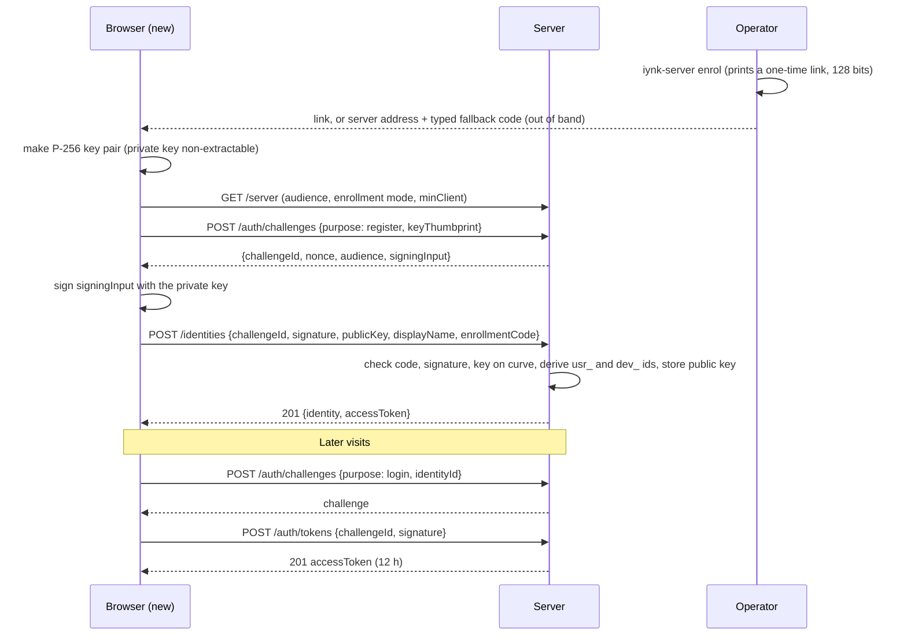
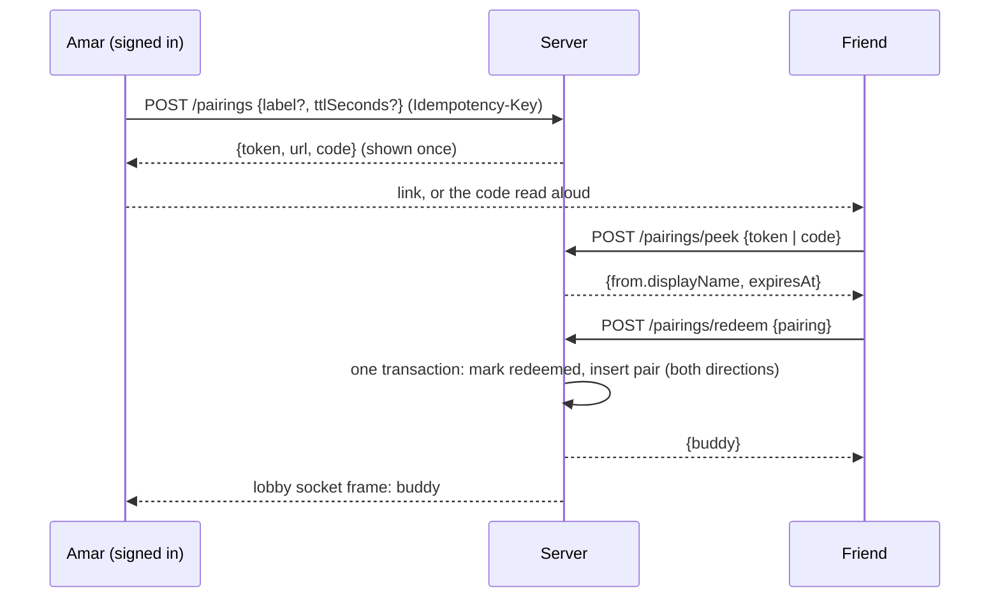

# iynk API contracts: the optional self-hosted server

Status: specification, first pass 2026-10-27, review fixes applied 2026-10-27 (see the last section). Author: API contracts design seat. ADR range used: ADR-0810 to ADR-0819, written as full files in [`ADR/`](ADR/) (the first draft used 0800 to 0809, which collided with the studio editor seat's range).
Machine-readable twin: [`schemas/openapi.yaml`](schemas/openapi.yaml) (OpenAPI 3.1; counted 2026-10-27 after the review fixes: 46 paths, 60 operations, 62 component schemas, 12 operations that take `Idempotency-Key`). This file holds what OpenAPI cannot say: the rules, the reasons, the migration of today's routes and the tests. Where this file and the YAML differ, the list "Twin deltas" in the last section says which side moves.
Upstream: BRIEF section 19.5 (adapted by D-013 to D-017), `00_EXECUTIVE/DECISION_REGISTER.md` (D-015 local-first and self-hostable, D-016 buddies not public), `01_AUDIT/SECURITY_BASELINE.md` (section 3 route inventory, D1, D2, C1 to C7, R1 to R9), `01_AUDIT/TECHNICAL_DEBT.md` (A7, B5, D5), `02_RESEARCH/TECHNICAL_RESEARCH.md` section 6 (spike exit conditions).
Contract documents this file may not contradict: `PROJECT_DATA_MODEL.md`, `schemas/project.schema.json`, `COMPONENT_SCHEMA.md`, `schemas/component.schema.json`, `SIMULATION_ARCHITECTURE.md`, and the sibling designs `REALTIME_ARCHITECTURE.md` (ADR-0500 to 0511), `AI_ARCHITECTURE.md` (ADR-0600 to 0612), `FRONTEND_ARCHITECTURE.md` (ADR-0400 to 0409). `BACKEND_ARCHITECTURE.md` (ADR-0420 to 0430) did not exist when this was written. It does now, and the differences are reconciled in the last section.
Downstream: F-004, F-005, F-012, F-016, F-088, F-089, F-092, F-101, F-116, F-118 to F-122, F-138, F-140, F-165, F-167, F-168, F-193, F-194, F-198, F-199, F-201, F-206; requirements R-007, R-008, R-010, R-011, R-012, R-037, R-039, R-075 to R-081, R-083 to R-085, R-091, R-093, R-095, R-097, R-098, R-154, R-163; journeys J-07, J-08, J-09, J-11, J-12, J-13.
Evidence labels: VERIFIED (I read or ran it), DOCUMENTED (a repo document says so), EXTERNAL (outside fact, not re-fetched), ESTIMATED, HYPOTHESIS, UNKNOWN. A number marked PROPOSAL is a default I chose; it is an operator setting, not a measurement. Nothing in this file is implemented yet.

## 0. What this file decides, in one page

| Question | Decision | Where |
|---|---|---|
| What is the API for? | An optional server a friend group runs. It stores no secret of the user, serves nothing public, and the app works without it (D-015, R-012). Everything in it is behind a feature flag the app reads from `GET /v1/server` | 1, 3 |
| Style | REST over HTTPS and JSON under `/v1`, one error envelope, cursor pages, `Idempotency-Key` on creates. Rooms use the WebSocket of REALTIME_ARCHITECTURE at `wss://host/ws`; this API only creates and manages the rooms it serves | 3, 4, ADR-0810 |
| Who is a caller? | A person is a P-256 key pair made in the browser. They enrol with a one-time code from the operator, sign a server challenge to get a 12-hour opaque bearer token, and are called an identity. No email, no password | 5, ADR-0811 |
| How do friends find each other? | A pairing link plus a typed code (R-076, R-080). Pairing makes two identities buddies. Only buddies see each other, share projects, join rooms and appear on each other's leaderboard | 5.3, 6, 7 |
| What do secrets in URLs look like? | Capability tokens of 128 bits (pairing, room invite, share), always in the URL fragment of the link the app builds, stored only as SHA-256 | 5.1, ADR-0812 |
| What is stored for a project? | Nothing. The server has no project library (RC-24, D-015). A room holds the document it was opened with as checkpoint 0, a share holds an anonymised snapshot, and assets are stored by content hash | 7, 10 |
| Sharing | A share link is an immutable read-only snapshot with its own expiry, frozen as an anonymised copy; viewers can run and fork it, not edit (R-095) | 7, ADR-0817 |
| Rooms | Created by an authenticated call, never by joining. Invites are capabilities. Everything after the first frame is REALTIME_ARCHITECTURE | 7, 8 |
| AI and search | AI: a stateless relay for providers that block browser calls (ADR-0612); keys travel in one header and are never stored. Search: typed endpoints with the same key rule. Both off unless the operator turns them on | 11, ADR-0816 |
| Import and export | The server does not import or export projects. `.iynk` and `.iynkz` open and save in the browser, and every other format is converted in the browser (ADR-0109, ADR-0815). Account deletion is in this API; account export is local | 8.4, 9 |
| What happens to today's 23 routes? | 3 versioned and key-gated (MCP, tools, OpenAPI), 5 versioned search routes, 3 replaced (buddies, leaderboard, status), 1 replaced by the relay (AI chat), 2 kept unrouted (translate, transcribe), 9 deleted (Solana x3, live, telemetry, match, plan, story, image) | 12 |
| How is it tested? | A route registry test with default deny, a contract test from `openapi.yaml`, the hostile-client suite (R-097) over HTTP, and 20 acceptance checks | 14 |

## 1. Scope, inputs and what this file does not do

In scope, from the assignment: buddy identity and invites, buddies, shared projects and share links, collaboration rooms (HTTP side), assets, AI and search proxies (kept, thin), account deletion, and the mapping of `src/app/api/**`.

Out of scope, by decision: classrooms, billing, credentials and certificates, public community publishing, public galleries, public leaderboards, telemetry upload, a marketplace. There is no endpoint that returns another person's data to someone who is not their buddy or the holder of a share capability.

BRIEF 19.5 asks that each of fourteen areas be evaluated. This is the answer for every one, so nothing is silently missing:

| BRIEF 19.5 area | Answer | Where |
|---|---|---|
| Projects | Not in this API. The server has no project library (RC-24, D-015). A project lives in the browser; a room or a share carries a copy | 7 Rooms, 7 Shares |
| Components | Not in this API. The server stores rooms and shares only (D-015, RC-24). The built-in catalogue ships inside the app and is searched locally (ADR-0108), and a custom part travels inside the project document as an `embedded` component (PROJECT_DATA_MODEL 5, `components[].definition`), so a room base or a share copy carries it. There is no `/parts` path | 7 Shares |
| Simulation runs | Not in this API, because runs execute in the browser (ADR-0005) and a run inside a room is a socket command (REALTIME_ARCHITECTURE). A saved replay is an asset with role `replay` | 7 Assets, REALTIME |
| Assets | In this API: content-addressed `PUT`, `GET`, `HEAD`, `POST /assets/query` | 7 Assets |
| Import/export | Not in this API. Both happen in the browser (ADR-0815, ADR-0109) | 8.4 |
| Classrooms | Not in this API, because classrooms, schools and institutions are shelved (D-001, D-004, D-008, D-009; D-013) | none |
| Sharing | In this API: share links (`POST /shares`, body holds the snapshot). Per-project grants left with the project library; a person joins a room by invite | 7 Shares, 7 Rooms |
| Collaboration | In this API for creating, listing, closing and inviting to rooms; the live part is the socket | 7 Rooms |
| AI assistance | In this API as one stateless relay, `POST /ai/relay`. Usage is the local meter; there is no `GET /usage` (RC-24) | 11 |
| User profiles | In this API as the identity: `GET` and `PATCH /identities/me` (display name, colour, locale, `show_online`, `show_activity`) and the buddy aliases. No public profile page, no profile search (D-016) | 7 Identities, 7 Buddies |
| Community publishing | Not in this API, because there is no public gallery, feed or marketplace (D-016, D-013). The nearest thing is a share link to buddies or to whoever holds the link | 7 Shares |
| Billing | Not in this API, because nothing is paid (D-008 shelved, D-013) | none |
| Telemetry preferences | Not in this API, because no telemetry endpoint exists (R-009, ADR-0818). Any usage-event setting is a local setting in the browser. The only server-side privacy preferences are `show_online` and `show_activity` on the identity | 4.10, 7 Identities |
| Data export and deletion | Account deletion is in this API. Export is local: there is no `POST /me/exports` (RC-24) | 9 | D-016 and R-081 forbid the old public 24-hour list; SECURITY_BASELINE D1 and D2 are closed by construction (section 14, AC-API-11).

Not in this file, on purpose:

| Topic | Owner | What this file assumes |
|---|---|---|
| The WebSocket: frames, ops, run control, presence, close codes | REALTIME_ARCHITECTURE sections 7 to 15 | The socket endpoint is `wss://host/ws`, outside `/v1` (ADR-0420; `ServerInfo.wsUrl` carries the full URL). REST stays under `/v1`. The Caddy matcher sends `/v1/*`, `/ws` and `/healthz` to the server (RECONCILIATION RC-22). It authenticates by a device-key challenge, not by the bearer token. Close and error codes are theirs |
| The project document and the op vocabulary | PROJECT_DATA_MODEL, `project.schema.json` | The API carries documents as `ProjectDocument` (a `$ref` to the schema) and never rewrites them, with one stated exception (the system `access.grant` op of 6.3) |
| Part descriptors | COMPONENT_SCHEMA, `component.schema.json` | `PartDefinition` is a `$ref`; the server stores and serves it as data |
| The AI partner's prompts, tools, ledger | AI_ARCHITECTURE | The server exposes only `POST /ai/relay` for the model call (ADR-0612) |
| Process layout, the store, packaging, observability | BACKEND_ARCHITECTURE (ADR-0420 to 0430) | The server is a separate Node process serving `/v1/*` and `/ws`; the web app has no API routes (ADR-0420). Handlers are Fetch API functions `(Request) => Response`, as today. REALTIME_ARCHITECTURE decided one embedded SQLite file (ADR-0505); the contract is neutral about the store |

How the three sibling designs shaped this one (a reading of their text, not a negotiation): REALTIME_ARCHITECTURE decided device-key socket authentication, rooms by authenticated create, invites as capabilities redeemed over HTTP, enrolment by operator code and a lobby socket for buddy presence. I adopted all five and removed my first draft's one-time socket tickets, server-sent events stream, snapshot and ops fetch endpoints and room host-control endpoints, because the socket already does those. Differences that remain are listed as Objections O-4 and O-5.

## 2. Principles

1. **The app works with no server.** No endpoint is needed for editing, running, saving or exporting a project (D-015, R-012). The server adds people: buddies, rooms and share links.
2. **Default deny.** A route that is not in the registry does not exist, and a route in it names exactly one of the classes of section 6. A new route without a class fails a test (R-007).
3. **A stranger learns nothing.** Missing, wrong, expired and revoked credentials look the same. A room, project, buddy or share that the caller may not see is 404, not 403 (R-076, REALTIME 5.2).
4. **Secrets are capabilities with an expiry.** 128 random bits, shown once, stored as a hash, carried in a URL fragment or a header, never in a path or query that a log records.
5. **The document is the user's.** The server validates a document and keeps it as sent (the one exception is the system `access.grant` op of 6.3). It does not migrate, merge or reformat (ADR-0105: a newer file is refused, not half-opened).
6. **One error shape, one pagination shape, one idempotency rule.** No endpoint invents its own.
7. **Keys stay with the user.** An AI or search key is used for one call and forgotten (R-010, R-154). It is never in a project, a room, a log, a share, an export or an error.
8. **Small and boring beats clever.** Friends-sized: tens of identities, tens of rooms, one process (REALTIME 0 item 12). Limits are low defaults an operator can raise.

## 3. Conventions

### 3.1 Transport

| Item | Rule |
|---|---|
| Base | `{origin}/v1`. The origin is the operator's, from `IYNK_PUBLIC_URL`. HTTPS only except loopback; the client refuses to send a credential or a provider key to a plain-HTTP server that is not loopback or a private-network address the person confirmed |
| Methods | `GET`, `HEAD`, `POST`, `PUT`, `PATCH`, `DELETE`. `GET` and `HEAD` are safe. `PUT` and `DELETE` are idempotent |
| Bodies | `application/json` (UTF-8, no BOM, no duplicate keys, nesting at most 32, as PROJECT_DATA_MODEL 13). Other types only where an endpoint says so: `application/vnd.iynk.project+json`, `application/vnd.iynk.container+zip`, raw asset bytes, `multipart/form-data` (none in v1; transcribe is unrouted) |
| JSON content type check | A JSON endpoint refuses any other content type with 415. This also stops a cross-site form post from being "simple" (`parseBody`, `src/lib/server/http.ts`, VERIFIED) |
| Compression | Responses gzip when `Accept-Encoding` asks. Requests may use `Content-Encoding: gzip` on `POST /rooms`, `POST /shares` and `PUT /assets/{sha256}`. Size caps apply to the decompressed stream and are checked while streaming, as `readCapped` does (VERIFIED) |
| Streaming | `POST /ai/relay` streams the provider's own body. No other endpoint streams in v1 |
| Time | UTC, milliseconds, trailing `Z`, the `Timestamp` pattern of the project schema |
| Ids | `{prefix}_{token}`: `usr` identity/actor, `dev` device, `prj` project, `rm` room, `rinv` room invite, `pair` pairing, `shr` share, `ses` session, `pat` API token, `chl` challenge, `enr` enrollment code, `job` compile job (not `cmp`, which is the component instance prefix of PROJECT_DATA_MODEL 3.2). Same grammar as document ids (ADR-0102): 2 to 6 lower-case letters, then `[a-z0-9][a-z0-9_-]{0,63}`. Encoding: every random or hash-derived token is RFC 4648 base32, lower-case, no padding (alphabet `a-z2-7`, which fits the pattern). The Crockford alphabet is used only for codes a person types (5.1). Server-made ids are the prefix plus 16 random base32 characters, except `usr` and `dev`, which come from the key (5.2). These ids live in the server's namespace; they are never document entity ids except `usr` and `prj` |

### 3.2 Versioning and compatibility

| Rule | Detail |
|---|---|
| Major in the path | `/v1`. A breaking change is `/v2`, served beside v1 for at least one minor release of the server, with `Deprecation` and `Sunset` headers on v1 responses |
| Minor in a header | Every response carries `Iynk-Api-Version: 1.N`. Within v1, changes are additive only: new optional request fields, new response fields, new endpoints, new enum values on response fields clients must treat as open. Clients ignore unknown fields. Servers reject unknown request fields (`additionalProperties: false`) so a typo is not silently dropped |
| Client version | Clients send `Iynk-Client: iynk-web/{semver}` (any client may send its own name). `ServerInfo.minClient` is the oldest accepted. The capability probe is `GET /v1/server`, liveness `GET /v1/healthz`, readiness `GET /v1/readyz`; the OpenAPI document is `/v1/openapi.json`. Older: 426 `upgrade_required` on every endpoint except `GET /server`, `GET /healthz` and `GET /readyz`, which must always answer so the app can tell the person to update (R-079) |
| Document schema | The server accepts a `schemaVersion` it lists in `ServerInfo.schemas.project`. A newer MAJOR or MINOR than the server knows is 422 `schema_too_new`. An older one is accepted as is. The server never migrates (ADR-0105: migrations are the client's, pure and idempotent, and a server-side rewrite would change the state hash) |
| Op schema | Rooms negotiate `opSchema` equal to the document MAJOR.MINOR (PROJECT_DATA_MODEL 7.4); `Room.opSchema` shows it |
| Enums | Request enums are closed. Response enums may grow; a client treats an unknown value as "other" |
| This file's own version | `openapi.yaml` `info.version` is `1.0.0-draft.1` until the first server release; then it follows the server's `apiVersion` |

### 3.3 Headers

| Header | Direction | Rule |
|---|---|---|
| `Authorization: Bearer iynk_at_...` or `iynk_pat_...` | request | Identity credential (5.1) |
| `X-Iynk-Provider-Key` | request | AI relay and search only; redacted from logs (4.10) |
| `Idempotency-Key` | request | 4.6 |
| `If-None-Match` | request | `GET /assets/{sha256}` (its `ETag` is the hash) |
| `Iynk-Client` | request | 3.2 |
| `X-Request-Id` | both | Client may send `^[A-Za-z0-9_-]{8,64}$`; the server echoes it or makes one |
| `Iynk-Api-Version`, `Retry-After`, `RateLimit-Limit`, `RateLimit-Remaining`, `RateLimit-Reset`, `ETag`, `Idempotent-Replay` | response | As named in the sections below |
| `Cache-Control` | response | `no-store` by default (as `json()` does, VERIFIED). Exceptions: `GET /server` (`public, max-age=60`); `GET /assets/{sha256}` (`private, max-age=31536000, immutable`) |

## 4. Rules for every endpoint

### 4.1 The error envelope

One body for every non-2xx JSON response (`components/schemas/Error`):

```json
{ "error": { "code": "invalid_document", "message": "The document failed validation.",
  "requestId": "req_01k8y3m9w2",
  "details": [ { "code": "V3-PIN-TWICE", "severity": "error", "path": "/nets/4/connections/2", "message": "Pin brd_uno1.D13 is a member of two nets." } ] } }
```

It is a superset of today's `{ error: { code, message } }` (`src/lib/server/http.ts:13`, VERIFIED), so the existing UI, which picks translated text by `code`, keeps working. Rules:

1. `code` is a stable snake_case string from the registry in 4.2. Clients branch on `code`, never on `message` or on status alone.
2. `message` is a short English hint for developers, at most 500 characters, with no secret, no stack, no upstream error text and no echo of user input beyond a field name.
3. `requestId` equals the `X-Request-Id` header.
4. `details` uses the project's validation diagnostic shape (`code`, `severity`, `path`, `message`, `hint`), so one renderer shows API errors and document errors (PROJECT_DATA_MODEL 9.1). At most 50 entries; `truncated: true` when more existed. `path` is a JSON Pointer into the body, or a parameter name.
5. Authentication failures are `401 unauthorized` with `details` absent and a fixed message. A missing, malformed, expired, forged, revoked or wrongly signed credential cannot be told apart (R-007, R-077). The response carries `WWW-Authenticate: Bearer realm="iynk"`.
6. Existence is not an oracle. For rooms, projects, buddies, shares and pairings, "does not exist", "not yours" and "expired" are all 404 with the same body and, for rooms and pairings, a floor of 200 ms before answering (REALTIME 5.2).
7. A 5xx never carries upstream text. The server logs it with the request id.
8. The mid-stream error of `POST /ai/relay` is the provider's own; the relay cannot rewrite a stream it forwards. A relay failure before the first byte is an ordinary envelope.

### 4.2 Error code registry

Status is what the server sends. "Retry" says what a client may do (4.5).

| Status | Code | Meaning | Retry |
|---|---|---|---|
| 400 | `bad_request` | A body field or parameter is invalid; `details` names it | no |
| 400 | `bad_json` | Not UTF-8 JSON, duplicate key, or nesting over 32 | no |
| 400 | `bad_cursor` | A cursor from another endpoint, another sort, or tampered | restart the list |
| 400 | `bad_form` | The multipart body could not be read | no |
| 401 | `unauthorized` | Any credential problem (4.1 rule 5) | sign a new challenge once, then give up |
| 403 | `forbidden` | Signed in, role too low for this action on something the caller may know exists | no |
| 403 | `permission` | The same, raised from an op or role check inside the document (reject code of PROJECT_DATA_MODEL 7.2) | no |
| 403 | `forbidden_origin` | A browser request from an origin not in `IYNK_ALLOWED_ORIGINS` (today's `forbidden_origin`, `http.ts:147`, VERIFIED) | no |
| 403 | `fork_not_allowed` | The share says `allowFork: false` | no |
| 404 | `not_found` | Does not exist, or the caller may not know it exists | no |
| 409 | `already_exists` | The thing to create already exists | no |
| 409 | `already_paired` | Pairing with oneself or twice | no |
| 409 | `last_owner` | Removing the last owner of a room | no |
| 409 | `room_open` | The project already has a live room; its id is in `details[0].path` as `/roomId/{id}` | join it |
| 409 | `room_state` | The room is not in a state that allows the call (for example reopening an open room) | no |
| 409 | `quota` | A per-identity or per-server count limit (rooms, pairings, shares, sessions, tokens) | after freeing one |
| 409 | `idempotency_in_progress` | The first call with this `Idempotency-Key` has not finished | yes, after `Retry-After` |
| 409 | `not_ready` | A result is not finished yet (for example a compile job) | yes, after `Retry-After` |
| 409 | `score_key_mismatch` | `better` or `unit` disagrees with the board's first submission | no |
| 410 | `gone` | Existed and was deleted for good | no |
| 410 | `room_closed` | The room closed and its data window passed | no |
| 413 | `too_large` | Body above the endpoint's limit (4.8) | no |
| 415 | `unsupported_media_type` | Wrong content type, or an asset whose sniffed type disagrees with its declared one | no |
| 422 | `invalid_document` | V2 to V5 failed; `details` lists the diagnostics | no |
| 422 | `schema_too_new` | Document `schemaVersion` above the server's | update the server |
| 422 | `schema_mismatch` | `opSchema` differs (rooms) | update |
| 422 | `not_a_buddy` | Granting or inviting someone who is not a buddy | pair first |
| 422 | `hash_mismatch` | Uploaded bytes do not hash to the path | no |
| 422 | `figure_not_allowed` | A part descriptor points at an HTML figure page (ADR-0204) | no |
| 422 | `idempotency_key_reuse` | Same key, different method, path or body hash | new key |
| 422 | `provider_key_missing` | The relay or a search call has no key to use | add a key |
| 422 | `relay_target_refused` | The relay will not call that host (allowlist or private address) | no |
| 426 | `upgrade_required` | Client older than `minClient` | update the app |
| 429 | `rate_limited` | A bucket is empty; `Retry-After` is set | yes, after the wait |
| 429 | `quota_exhausted` | A daily cap on a server-held key, or the search budget, is used | tomorrow, or use your own key |
| 500 | `internal` | A bug; quote `requestId` | once, with backoff |
| 501 | `feature_disabled` | The module is off (`IYNK_AI_ENABLE`, `IYNK_SEARCH_ENABLE`, `IYNK_COMPILE_ENABLE`, each default 0), or it is on without a key or toolchain (RC-28). `details[0].path` names the flag | no |
| 502 | `upstream_failed`, `upstream_busy` | A provider failed or is busy | yes, backoff |
| 503 | `store_unavailable`, `shutting_down` | The store did not answer, or the server is restarting (`Retry-After`) | yes, backoff |
| 504 | `upstream_timeout` | A provider did not answer in time | yes, once |

Differences from today's codes (VERIFIED by reading the routes): `not_configured` (503) becomes `feature_disabled` (501) because retrying a switched-off feature is useless; `db_unavailable` becomes `store_unavailable`; the chat route's `internal` and the search route's `internal_error` are one code, `internal`; `aborted` (499) is a client state, not a server answer, and is dropped; the search routes' `quota_exhausted` (429) is kept.

### 4.3 Rate limits

How the limiter works (extends `src/lib/server/ratelimit.ts`, 41 lines, VERIFIED): a sliding window per key, in memory, per process, capped at 10,000 keys with least-recently-used eviction. One process is the supported shape (F-003, R-008), so in-memory is acceptable and is documented as such. Two changes:

1. **Key choice (R-008).** The identity from the access token when there is one; otherwise the client address. "Address" in every bucket below means the address prefix, not the full address: an IPv4 address is keyed whole (/32), an IPv6 address is keyed by its /64 (the 64 high bits), and an IPv4-mapped IPv6 address (`::ffff:a.b.c.d`) is keyed as the IPv4 address. A client with a /64 owns 2^64 addresses (EXTERNAL: the usual home allocation is a /64 or larger), so keying the full address would give an attacker a fresh bucket per request and defeat `pairing.guess`, `auth.token`, `identity.register` and the room limits. A venue Wi-Fi that shares one /64 shares one bucket, which the generous `share.read` limit already allows for. `X-Forwarded-For`, `x-real-ip` and `cf-connecting-ip` are read only when `IYNK_TRUST_PROXY=1`. Today the first `x-forwarded-for` value is client-controlled (`clientIp`, `http.ts:128`, VERIFIED, SECURITY_BASELINE C7) and a missing header maps every caller to one key `unknown`. v1 uses the socket address when the proxy is not trusted, and a request with no determinable address is refused rather than shared.
2. **Counters that gate spending survive restart.** Daily caps on a server-held AI or search key live in the store, not in a closure (C3, R-008).

Every response from a limited bucket carries `RateLimit-Limit`, `RateLimit-Remaining`, `RateLimit-Reset` (seconds). A 429 adds `Retry-After` (whole seconds, at least 1) and `error.retryAfterSeconds`.

| Bucket | Default | Applies to | Basis |
|---|---|---|---|
| `public.read` | 120/min/address | `GET /server`, `/healthz`, `/readyz`, `/openapi.json` | status route today: 120/min (VERIFIED) |
| `auth.challenge` | 20/min/address | `POST /auth/challenges` | PROPOSAL |
| `auth.token` | 20/min/address; 5 failures/min/identity | `POST /auth/tokens` | PROPOSAL; REALTIME 4.4 rule 5 uses 5 failures per minute per address, then 5 minutes locked out |
| `identity.register` | 5/min/address | `POST /identities` | PROPOSAL |
| `pairing.create` | 20/h/identity | `POST /pairings` | PROPOSAL |
| `pairing.guess` | 10/min and 100/h per address; 5 wrong secrets per typed code | peek, redeem | R-076 (5 wrong secrets); the rest PROPOSAL |
| `room.create` | 6/min and 30/h per identity, 6/min per address | `POST /rooms` | REALTIME 5.2, R-075 |
| `room.invite.redeem` | 5 failures/h/identity | room invite redeem and accept | REALTIME 5.4 |
| `room.write`, `room.read` | 30/min, 60/min per identity | other room calls | PROPOSAL |
| `asset.write` | 60/min and 512 MiB/h per identity | `PUT /assets` | PROPOSAL |
| `share.read` | 120/min/address | `GET /shares/{shareRef}` and assets | PROPOSAL (a venue Wi-Fi shares one address: the limit is per address, generous) |
| `read`, `write` | 300/min, 120/min per identity | everything else, including share writes | PROPOSAL |
| `ai.relay` | 20/min/identity | `POST /ai/relay` | chat route today: 20/min per address (VERIFIED) |
| `search.web`, `search.offers`, `search.other` | 15, 20, 30 per min per identity | search | today: 15, 20, 30 per min (VERIFIED) |
| `tools` | 60/min/identity | MCP and tools | today: 60 on tools, 120 on MCP (VERIFIED) |
| `compile` | 10/min/identity | compile jobs | PROPOSAL; 501 unless `IYNK_COMPILE_ENABLE=1` |

The old instance-wide hourly budgets (`AI_BUDGET` 900 per hour, `IMAGE_BUDGET`, `src/lib/server/ai/guard.ts`, VERIFIED) existed to protect the founders' credits. They go: the user's own key is the budget (R-154), and a server-held key has a per-identity daily cap in the store.

### 4.4 Pagination

Every list returns `{ "items": [...], "nextCursor": "..." | null }` and takes `limit` (1 to 200, default 50) and `cursor`.

1. Keyset, not offset. The cursor encodes the last row's sort key and id, plus a hash of the filters, authenticated with a random 32-byte key made when the server process starts and kept in memory only (ADR-0814, RC-07; there is no signing secret, ADR-0428), so a tampered cursor is `bad_cursor` and not a database probe. It is opaque to clients. It is valid until the server restarts and not across a change of filter; after a restart a client gets `bad_cursor` and reloads the list from the first page.
2. Order is stable and documented per endpoint (newest first unless stated; ties by id), so inserts during paging cannot repeat or skip a row that existed at the start (AC-API-08 tests this).
3. No total counts. A client that needs "how many" gets it from `GET /server` limits or counts what it has.
4. Authorisation is checked on every page, not once; a grant removed mid-listing hides the rows from the next page.
5. Lists that are bounded by design (buddies at most 64, leaderboard at most 65) still use the envelope so a later raise is not a break.

### 4.5 Retries

| Situation | Client does |
|---|---|
| Network error or timeout on a `GET`, `HEAD`, `PUT`, `DELETE` | Retry. They are idempotent |
| Same on a `POST` | Retry only if it carried an `Idempotency-Key`. Otherwise ask the server what happened (list, get) before repeating |
| 429 | Wait `Retry-After`, then retry; do not retry sooner |
| 502, 503, 504 | Retry with full-jitter exponential backoff: wait `random(0, min(30 s, 0.5 s * 2^n))`, at most 5 attempts, honour `Retry-After` when present. Same rule as the one retry with jitter on 429 and 5xx that `serpapi.ts` does server side (header comment, VERIFIED) |
| 500 | One retry after backoff; then stop and show `requestId` |
| 401 | Sign a new challenge once, retry the request once. A second 401 is "sign in again" |
| 409 `idempotency_in_progress` | Wait `Retry-After`, retry with the same key |
| 412 | Not a retry: refetch, then decide (5.x in section 8) |
| 4xx otherwise | Never retried automatically |
| A relay stream that breaks | Not resumed. The browser's partner treats it as a failed turn and offers Retry |

The server never retries a client. The server's own calls to a provider: one retry with jitter on 429 and 5xx for search (today), none for the relay (the relay forwards, the browser decides, ADR-0612).

### 4.6 Idempotency keys

Header `Idempotency-Key`: 16 to 64 characters of `[A-Za-z0-9_-]`, generated by the client per user action (a random 128-bit value is enough). Accepted on every `POST` that creates or starts something (marked "Idem." in section 7).

| Case | Result |
|---|---|
| First call | Runs. The server stores `(identity, key) -> (method, path, body SHA-256, status, response body, headers)` for 24 hours |
| Same key, same method, path and body hash | The stored response again, with `Idempotent-Replay: true`. No second effect |
| Same key, anything different | 422 `idempotency_key_reuse` |
| Same key while the first call is still running | 409 `idempotency_in_progress`, `Retry-After: 1` |
| First call ended with 5xx | Not stored; the retry runs again |
| Stored response too large (over 64 KiB) | Only status and a pointer are stored; a replay of a `POST /rooms` returns the room record, not the document that was sent |

Naturally idempotent without a key: `PUT /assets/{sha256}` (content hash), `DELETE` everything, `PUT /scores/{key}` (best value kept). Room ops have their own `opId` dedup on the socket (ADR-0104). Scope of a key is the identity; two people may use the same string.

### 4.7 Concurrency on documents

The server stores no editable project document, so a document has no `ETag`, `If-Match`, 412, 428, `revision_regression` or overwrite here (RC-24, D-015). Concurrent editing goes through a room, where the server orders ops (ADR-0104, ADR-0500). The only `ETag` this API sends is on `GET /assets/{sha256}`, and it is the content hash. The earlier rules for `PUT /projects/{id}/document`, including `?overwrite=true`, are removed.

### 4.8 Limits and quotas

Values the data model already fixes are copied from PROJECT_DATA_MODEL 9.4 and 12.1 (DOCUMENTED). Others are PROPOSAL defaults, operator settings, reported by `GET /server` in `limits`.

| Limit | Default | Basis |
|---|---|---|
| Canonical document | 5,242,880 bytes | PROJECT_DATA_MODEL 9.4 |
| One asset | 16,777,216 bytes | 5.10 |
| Assets per project | 256 | 9.4 |
| Container (`.iynkz`) total / entries / one entry / compression ratio | 134,217,728 / 1,000 / 16 MiB / 100 to 1 | 12.1 (the 128 MiB is itself ESTIMATED there) |
| One op envelope | 65,536 bytes | `maxFrameBytes`, `config.js:6` |
| Body of a JSON endpoint | 256 KiB (`DEFAULT_MAX_BODY`); 5,242,880 bytes decompressed on `POST /rooms` and `POST /shares`; 8 KiB for pairing, scores, invites; 16 KiB for search; 1 MiB for the relay | `http.ts`, `buddies/route.ts`, `search/route.ts` (VERIFIED) |
| Peers per room | 8 members (`maxPeers: 8`, `config.js:5`, VERIFIED) and 8 spectators (PROPOSAL, REALTIME 5.6) | `config.js:5`; REALTIME 5.6 |
| Rooms per identity (stored) / per server (stored) / live | 10 / 100 / 50 | REALTIME 5.2 (PROPOSAL there) |
| Buddies per identity | 64 | PROPOSAL, the leaderboard bound |
| Open pairings / room invites / shares / sessions / API tokens | 20 / 20 / 20 / 20 / 10 per identity | PROPOSAL |
| Storage per identity | 2 GiB (share snapshots, room data, assets) | PROPOSAL |
| Identities per server | 100 | PROPOSAL, friends-sized |
| Closed room data | 30 days | R-083, REALTIME 5.1 |
| Idempotency record | 24 hours | PROPOSAL |

Going over a count is 409 `quota`; over a size is 413 `too_large`; over a document limit is 422 `invalid_document` with the limit named in `details`.

### 4.9 CORS, origins and response headers

| Item | Rule |
|---|---|
| Origins | `IYNK_ALLOWED_ORIGINS` is the one list for CSP `connect-src`, the API origin check and the socket origin check (R-006). A `*` list refuses to start the server (R-078) |
| CORS | Preflight and `Access-Control-Allow-Origin` only for a listed origin, with `Vary: Origin`. Allowed request headers: `authorization, content-type, idempotency-key, if-none-match, iynk-client, x-request-id, x-iynk-provider-key`. Exposed: `etag, retry-after, ratelimit-*, x-request-id, iynk-api-version, idempotent-replay`. `Access-Control-Allow-Credentials` is never sent: there are no cookies. Today three routes send `*` (SECURITY_BASELINE section 4, VERIFIED); none will |
| CSRF | Not applicable: authentication is a bearer header the browser does not add by itself, and JSON endpoints refuse non-JSON content types |
| Origin check | A request with an `Origin` header not in the list is 403 `forbidden_origin` (today `checkOrigin` compares to the host, VERIFIED). A request with no `Origin` (scripts, MCP clients, curl) passes this check and must still authenticate |
| Response headers | `X-Content-Type-Options: nosniff`, `Cache-Control: no-store` (except the two above), `Referrer-Policy: no-referrer` on share and asset routes, `Cross-Origin-Resource-Policy: same-site`. No `X-Powered-By` (F-002) |
| Assets | `image/svg+xml` is stored as sent and always served with `Content-Security-Policy: sandbox; default-src 'none'` and `Content-Disposition: attachment` unless the app asks for `?inline=1` from a sandboxed frame (PROJECT_DATA_MODEL 13: render through `` only) |

### 4.10 Logging and privacy

1. Never logged: `Authorization`, `X-Iynk-Provider-Key`, any request or response body of `/auth/*`, `/identities`, `/pairings/*`, `/room-invites/*`, `/rooms/*/invites*`, `/shares/{shareRef}`, `/ai/relay`; project text; chat; tokens, codes or secrets anywhere in a message (R-078).
2. Logged per request: time, route template (not the concrete path when it holds a token), method, status, duration, byte counts, request id, identity id (not the display name), a salted address tag (as `relay.js` `tagOf` does today, DOCUMENTED in REALTIME 4.4). The relay adds the target host.
3. Share tokens and pairing tokens are never in a path that is logged because the app puts them in a URL fragment and sends them in a body, except `GET /shares/{shareRef}` and `GET /shares/{shareRef}/assets/...`; those two route templates are logged without the token and the access log redacts the segment. A reverse proxy in front must be told the same (self-hosting guide, F-198).
4. The operator can read the store. The data-handling note (F-008) says so: documents, room ops and room events, buddy names; not keys, not chat history beyond the last 50 lines of a live room.
5. No telemetry endpoint exists. Nothing in this API receives usage events (R-009).

## 5. Identity and authentication

### 5.1 Every secret the server handles

| Secret | Made by | Form | Server stores | Lifetime | Travels in | Revoked by |
|---|---|---|---|---|---|---|
| Enrollment code | Operator, with `iynk-server enrol` (CLI only; there is no admin HTTP API) | Primary form: 128 random bits in a link `https://host/#enrol=<code>` (SYSTEM_ARCHITECTURE 10.3, ADR-0007). Fallback for a person who cannot paste a link: 12 Crockford base32 characters, 60 bits, typed. Both are the same credential: the server accepts either form in `enrollmentCode` and stores the SHA-256 of the canonical bytes | SHA-256 | 24 hours, one use | Body of `POST /identities` (the fragment is never sent to a server until the browser posts it here) | Expiry or use; the operator deletes an open one with the host CLI |
| Device key | The browser, WebCrypto ECDSA P-256 | Private key non-extractable, in IndexedDB `keys` (ADR-0502) | Public key (SPKI DER) | Until the identity is deleted | Never leaves the browser | Identity deletion |
| Challenge | Server | 32 random bytes | The nonce, until used | 60 seconds, one use | Body | Expiry |
| Access token | Server, after a good signature | `iynk_at_` + 43 base64url chars (256 bits), opaque | SHA-256 | 12 hours (1 hour to 30 days by operator). Opaque token, 12 hours, no signing secret: ADR-0007 with ADR-0811 is the identity decision and ADR-0421 is history (RC-17) | `Authorization: Bearer`, held in memory by the app | `DELETE /auth/tokens/current`, `/auth/sessions/{id}`, identity deletion |
| Personal API token | Server, on request | `iynk_pat_` + 43 chars, scopes `catalog:read`, `projects:read`, `price:read` | SHA-256 | Until revoked or its `expiresAt` | `Authorization: Bearer` | `DELETE /auth/api-tokens/{id}` |
| Pairing token | Server | 22 base64url chars (128 bits) | SHA-256 | 24 hours by default, at most 7 days | Fragment of the link; body of peek and redeem | `DELETE /pairings/{id}` |
| Pairing code | Server | `XXXX-XXXXXX` (a 4-character public channel, a 6-character secret, 30 secret bits) | SHA-256 of the secret, per channel | 10 minutes at most; deleted after 5 wrong secrets | Typed by a person; body | Same |
| Room invite token | Server | 22 base64url chars | SHA-256 | 24 hours by default, at most 7 days, 1 to 20 uses; default uses: 1 for editor, 5 for viewer | Fragment of the link; body of redeem | `DELETE /rooms/{id}/invites/{id}` |
| Share token | Server | 22 base64url chars | SHA-256 | Set by the owner; default 30 days; may be none | Fragment of the link (`#share=`); the app then sends it in the path of `GET /shares/{shareRef}` | `DELETE /shares/{shareRef}` |
| Provider key | The person, from a provider | Provider's own | Never | One call | `X-Iynk-Provider-Key` | Not applicable |

Why a typed code has a public channel: R-076 wants "wrong 5 times, the code is deleted" for a code a person types. A uniform 30-bit code cannot count wrong guesses against "the code" unless a guess can be attributed to one. The 4-character channel names which pairing the secret is checked against; a wrong secret on a real channel counts toward that pairing's 5; an unknown channel counts only against the address limit. The chance that a guesser who must stay under 10 guesses a minute hits a live pairing's 6-character secret is 5 in 2^30 per live channel they find, and finding a live channel needs about 2^20 / (live pairings) guesses at the same rate (ESTIMATED from the sizes, assuming uniform codes). The link token carries 128 bits and is the only credential that lasts a day.

### 5.2 Enrollment and sign-in



Rules:

1. **Signing input.** The UTF-8 bytes of `iynk.auth.v1`, `purpose`, `audience`, `challengeId`, `nonce` and `keyThumbprint` joined by LF. `audience` is the server's public host name from `IYNK_PUBLIC_URL`, so a hostile server that relays a challenge from a real one gets a signature the real one rejects (the same reasoning as REALTIME 4.3, which signs `iynk.ws.v2`). ECDSA P-256 with SHA-256; the signature is the 64-byte IEEE P1363 form WebCrypto returns, base64url. Node verifies it with `dsaEncoding: "ieee-p1363"` (EXTERNAL; REALTIME 4.3 makes the same assumption and plans to check it at build).
2. **Ids come from the key.** `deviceId = "dev_" + base32(SHA-256(SPKI)[0..16])` (26 characters). `identity.id = "usr_" + base32(SHA-256(SPKI)[0..10])` (16 characters). `base32` is RFC 4648, lower-case, no padding (3.1). Both are self-certifying and are the values REALTIME 4.2 uses. `keyThumbprint` is the base64url of the whole hash and equals `actors[].keyThumbprint` in a project document. A local-only actor that existed before enrolment keeps its random `usr_` id in old documents; mapping it to the identity is an ACL record on the server and an `actor` rename op (REALTIME 12), not an API concern.
3. **Constant work.** A bad signature, an unknown identity and a used challenge cost the same and answer the same 401. A challenge for an unknown `identityId` still returns a normal-looking challenge.
4. **Enrolment modes** (`IYNK_ENROL`, RECONCILIATION RC-14): `code` (default: every new device redeems an operator-issued one-time code) and `closed` (no new devices). There is no `invite` and no `open` mode. A pairing never enrols: it links two enrolled identities as buddies. The probe field stays `enrollment`, with enum `code`, `closed`. This adds a gate to R-077's "first visit gets a token" (Objection O-2).
5. **Access token use.** The app keeps it in memory and signs a new challenge after a reload or on a 401; the non-extractable key makes that silent. There are no cookies and no refresh token.
6. **Sessions.** `GET /auth/sessions` lists live tokens with the client name and last use; revoking one signs out that device. Deleting the identity revokes all.
7. **Personal API tokens** exist for tools that cannot sign a challenge (an MCP client, a script). v1 scopes are read-only (R-163). A token with `projects:read` can read exactly the projects its identity can.
8. **The socket is separate.** The WebSocket handshake signs again (`iynk.ws.v2`) so a leaked bearer token is not enough to sit in a room as that person (REALTIME 4.3). This API issues no socket ticket.

### 5.3 Pairing and the buddy graph



Rules:

1. A pairing is symmetric: after it, each is the other's buddy. Removing a buddy removes both rows, buddies-audience shares each could open, and each side's membership in rooms the other hosts, in one transaction (R-080, REALTIME 15.3).
2. A typed code and a link are two credentials for the same pairing. Deleting the code after 5 wrong secrets leaves the link valid until it expires (R-076 speaks only of the code).
3. Peek reveals the inviter's display name and the expiry. It reveals no id, no key, no buddy list.
4. Everything that makes a person visible to another goes through a pairing or an explicit capability. There is no search, directory or list of identities (D-016, R-081).
5. Display names are 1 to 24 grapheme clusters with control, zero-width and bidi-override characters stripped, as the relay does now (`protocol.js` `NAME_JUNK`, VERIFIED). Two buddies may have the same name; clients show `alias` first, then name, then a short thumbprint.
6. The leaderboard is derived at read time from the caller's buddy list, so removing a buddy removes their rows from the caller's view without touching stored scores (R-091).

### 5.4 Account lifecycle

| Event | Effect |
|---|---|
| Request by the person | `POST /identities/me/deletion` schedules deletion after the operator's grace (default 24 hours, 0 means at once) and hides the identity from buddies immediately. `DELETE /identities/me/deletion` cancels. See section 9 |
| Operator removal | `iynk-server revoke <identity>` on the host (CLI only): at once, no grace; rooms the person hosts are closed and their share links are deleted (R-077: "forget a device" leaves rooms and buddy lists) |
| Lost browser storage | The key is gone. The person enrols again (a new code) and re-pairs with each buddy; the server cannot recover an identity (R-077, stated in the data-handling note). Sensible mitigation outside the API: the app can offer an extractable key with an encrypted backup file at enrolment (Open question Q2) |
| Key rotation | Out of scope for v1. A later `PUT /identities/me/key` signed by both keys is an additive minor change |

### 5.5 Threats this section answers

| Threat | Control | Source |
|---|---|---|
| A stranger finds the URL and stores data or opens rooms | Enrolment gate; every other route needs a credential | SECURITY_BASELINE 23 of 23 routes unauthenticated; R-007; F-004 |
| Public buddy list leaks names and free text | Route deleted; no listing of identities exists | D1, D2; R-081 |
| Guessing pairing codes or room tokens | 128-bit links; typed code with channel and 5-strike deletion; per-address and per-identity limits; generic 404 | R1, R2; R-076 |
| Replay of an old invite | Single use or use count, expiry, hash lookup, generic 404 | R-097 case "replay an old invite after expiry" |
| Token leak in a log | Tokens in fragments and bodies; log redaction; short lifetime; the socket needs a signature as well | REALTIME 4.3 |
| Signature phishing by a hostile server | `audience` is in the signed bytes | REALTIME 4.3 |
| Forged `X-Forwarded-For` evades limits | Forwarded headers trusted only with `IYNK_TRUST_PROXY=1` | C7; R-008 |
| Open proxy to the AI provider and to internal hosts | Auth, allowlist, post-DNS private-address block, no redirects, 1 MiB, 120 s | C1, C4; ADR-0612; AI-T-18 |
| A hostile document or asset | Validation V2 to V5 before storing, byte caps while streaming, sniffed media type, hash check, SVG sandbox headers | PROJECT_DATA_MODEL 13 |
| Share link used as an edit capability | Share links are read-only snapshots | R-095 |
| Spend on the operator's key by a friend's runaway loop | Per-identity daily cap in the store, kill switch | F-003; R-008 |

## 6. Authorization

### 6.1 Roles

| Scope | Roles | Source |
|---|---|---|
| Server | operator (shell access to the host, CLI only), identity (a signed-in person) | this file |
| Document role | `owner`, `editor`, `commenter`, `viewer` | `project.schema.json` `Role`; in this API they apply to room members |
| Room | the project roles plus the room properties host, baton holder and runner | REALTIME 6 |
| Share | holder of a share token (read-only, fork if allowed) | R-095 |
| API token | the identity's rights limited to its scopes | 5.2 rule 7 |

### 6.2 Permission matrix

An empty cell means no. "Self" means only the caller's own record. Every "yes" also needs a valid credential (class `identity`), except where the column says otherwise.

| Action | owner | editor | commenter | viewer | non-member buddy | stranger |
|---|---|---|---|---|---|---|
| Make or revoke share links | yes | | | | | |
| List share links | yes | yes | | | | |
| Open a room (document sent inline) | yes | yes | | | | |
| Create room invites, close the room | yes (any owner); the host | host | | | | |
| Join a room | by grant or invite, with the granted role | | | | | |
| Read room events | yes | | | | | |
| Upload an asset bound to a room (`?room=`) | yes | yes | | | | |
| Read an asset (in a room whose document lists the hash) | yes | yes | yes | yes | | via share token, only listed hashes |
| Self: edit identity, sessions, tokens, pairings, scores, exports, deletion | self | | | | | |

The server stores no project, so these roles apply inside a room, and the sharer owns a share link. There is no operator HTTP surface: operator actions are `iynk-server` commands on the host (ADR-0007, SYSTEM_ARCHITECTURE 10.3). The operator is not an identity and cannot read room or share content through the API (the operator can read the store directly, 4.10 rule 4).

### 6.3 The room's access list and the document's `access` block

The document's `access` is "a mirror, not a lock" with `authority: "advisory"` (PROJECT_DATA_MODEL 5.1). For a room, the server's access list is authoritative and the mirror must agree with it. How:

1. A room invite redeemed or accepted is applied to the room's document as the data model's `access.grant` op (author kind `system`), so `revision` and `stateHash` move and the mirror changes in one transaction with the server list.
2. A `POST /rooms` body whose `access` block differs from the server list is accepted with the server's block substituted and a warning `access_overwritten`. This is a defence against a forged mirror, not a normal flow.
3. There is no op that sets `visibility` or owners. The vocabulary has only `access.grant` and `access.revoke` (VERIFIED in `project.schema.json` `$defs/Op`). This API no longer needs one: it has no `PATCH /projects/{id}/access` (RC-24), and a share link carries its own audience. Objection O-1 stays open for the data model only.

### 6.4 Visibility and the buddy rule

Rooms and invites go only to buddies of the host (422 `not_a_buddy`); a person later unpaired loses their room membership with the pairing (5.3 rule 1). Editors are not owners: they cannot add people. A share link has an audience, `link` or `buddies`, and nothing else decides who can open it.

## 7. Endpoint reference

The table below is generated from `schemas/openapi.yaml` (by a script in scratch), so it cannot drift from the file. Every operation can also answer 401 (except the public ones), 426 (except `getServerInfo`, `getHealth`, `getReadiness`), 429 and a default error; "Errors" lists the others. "Auth" is `none` (public), `optional token` (public, but a token changes the answer), `bearer` (access token or, where a scope allows, a personal API token) or `server token` (operator). Request and response names are components of `openapi.yaml`; `ProjectDocument` is `$ref: project.schema.json` and `PartDefinition` is `$ref: component.schema.json`. "Idem." marks an operation that takes `Idempotency-Key`.

### Server

Capabilities, liveness, readiness and the OpenAPI document. Public.

| Method and path | Operation | Auth | Permission | Request | Success | Errors | Rate bucket | Idem. | Features |
|---|---|---|---|---|---|---|---|---|---|
| `GET /server` | getServerInfo | none | anyone |  | 200 `ServerInfo` |  | public.read |  | F-012, F-199 |
| `GET /healthz` | getHealth | none | anyone |  | 200 `Health` | 503 | public.read |  | F-016 |
| `GET /readyz` | getReadiness | none | anyone |  | 200 `Health` | 503 | public.read |  | F-016 |
| `GET /openapi.json` | getOpenApi | none | anyone |  | 200 `object` |  | public.read |  | F-167 |

Health routes: the same two handlers are served at the root, `/healthz` and `/readyz`, for the container and proxy checks, and under `/v1` as `/v1/healthz` and `/v1/readyz`. The `/v1` ones are the ones in `openapi.yaml`.

### Auth

Challenge and signature sign-in, sessions and personal API tokens (F-004, F-005, F-206).

| Method and path | Operation | Auth | Permission | Request | Success | Errors | Rate bucket | Idem. | Features |
|---|---|---|---|---|---|---|---|---|---|
| `POST /auth/challenges` | createChallenge | none | anyone | `ChallengeRequest` | 201 `Challenge` | 400,415 | auth.challenge |  | F-005, F-206 |
| `POST /auth/tokens` | createAccessToken | none | holder of the private key | `TokenRequest` | 201 `AccessToken` | 400 | auth.token |  | F-005, F-206 |
| `DELETE /auth/tokens/current` | revokeCurrentToken | bearer | signed in |  | 204 |  | write |  | F-005 |
| `GET /auth/sessions` | listSessions | bearer | signed in (own) |  | 200 `Page of Session` |  | read |  | F-005 |
| `DELETE /auth/sessions/{sessionId}` | revokeSession | bearer | signed in (own) |  | 204 | 404 | write |  | F-005 |
| `GET /auth/api-tokens` | listApiTokens | bearer | signed in, full token only |  | 200 `Page of ApiToken` |  | read |  | F-167 |
| `POST /auth/api-tokens` | createApiToken | bearer | signed in, full token only | `ApiTokenCreate` | 201 `ApiTokenCreated` | 400,409 | write | yes | F-167 |
| `DELETE /auth/api-tokens/{tokenId}` | revokeApiToken | bearer | signed in, full token only |  | 204 | 404 | write |  | F-167 |

### Identities

A person on this server: a public key and a display name. No email, no password (F-206).

| Method and path | Operation | Auth | Permission | Request | Success | Errors | Rate bucket | Idem. | Features |
|---|---|---|---|---|---|---|---|---|---|
| `POST /identities` | registerIdentity | none | holder of an enrollment code and the private key | `IdentityRegister` | 201 `IdentityRegistered` | 400,409,422 | identity.register | yes | F-005, F-206 |
| `GET /identities/me` | getMyIdentity | bearer | signed in |  | 200 `Identity` |  | read |  | F-206 |
| `PATCH /identities/me` | updateMyIdentity | bearer | signed in | `IdentityPatch` | 200 `Identity` | 400 | write |  | F-206 |
| `POST /identities/me/deletion` | requestDeletion | bearer | signed in | `DeletionRequest` | 202 `DeletionStatus` | 400,409,422 | write | yes | F-168 |
| `DELETE /identities/me/deletion` | cancelDeletion | bearer | signed in |  | 204 |  | write |  | F-168 |

### Pairings

Links and typed codes that make two people buddies (F-206, F-138).

| Method and path | Operation | Auth | Permission | Request | Success | Errors | Rate bucket | Idem. | Features |
|---|---|---|---|---|---|---|---|---|---|
| `POST /pairings` | createPairing | bearer | signed in | `PairingCreate` | 201 `PairingCreated` | 400,403,404,409,422 | pairing.create | yes | F-206, F-138, F-122 |
| `GET /pairings` | listPairings | bearer | signed in |  | 200 `Page of Pairing` |  | read |  | F-206 |
| `DELETE /pairings/{pairingId}` | revokePairing | bearer | creator |  | 204 | 404 | write |  | F-206 |
| `POST /pairings/peek` | peekPairing | none | anyone with the token or code | `PairingRef` | 200 `PairingPeek` | 400,404 | pairing.guess |  | F-206 |
| `POST /pairings/redeem` | redeemPairing | bearer | anyone with the token or code (needs sign-in; a pairing never enrols, RC-14) | `PairingRedeem` | 200 `PairingRedeemed` | 400,404,409,422 | pairing.guess | yes | F-206, F-138 |

### Buddies

The paired list. Live presence is on the lobby socket, not here (F-138).

| Method and path | Operation | Auth | Permission | Request | Success | Errors | Rate bucket | Idem. | Features |
|---|---|---|---|---|---|---|---|---|---|
| `GET /buddies` | listBuddies | bearer | signed in |  | 200 `Page of Buddy` |  | read |  | F-138 |
| `GET /buddies/{identityId}` | getBuddy | bearer | signed in, paired |  | 200 `Buddy` | 404 | read |  | F-138 |
| `PATCH /buddies/{identityId}` | updateBuddy | bearer | signed in, paired | `BuddyPatch` | 200 `Buddy` | 400,404 | write |  | F-138 |
| `DELETE /buddies/{identityId}` | removeBuddy | bearer | signed in, paired |  | 204 |  | write |  | F-138, F-120 |

### Leaderboards

Scores shown only among buddies (F-140, D-016).

| Method and path | Operation | Auth | Permission | Request | Success | Errors | Rate bucket | Idem. | Features |
|---|---|---|---|---|---|---|---|---|---|
| `PUT /scores/{key}` | submitScore | bearer | signed in | `ScoreSubmit` | 200 `LeaderboardRow` | 400,409,422 | write |  | F-140 |
| `DELETE /scores/{key}` | deleteScore | bearer | signed in |  | 204 |  | write |  | F-140 |
| `GET /leaderboards/{key}` | getLeaderboard | bearer | signed in |  | 200 `Leaderboard` | 404 | read |  | F-140 |

### Shares

Share links (F-089).

| Method and path | Operation | Auth | Permission | Request | Success | Errors | Rate bucket | Idem. | Features |
|---|---|---|---|---|---|---|---|---|---|
| `GET /shares` | listShares | bearer | signed in (own shares only; PROPOSAL) |  | 200 `Page of Share` | 403,404 | read |  | F-089 |
| `POST /shares` | createShare | bearer | signed in | `ShareCreate` (holds the snapshot) | 201 `ShareCreated` | 400,413,422 | write | yes | F-089 |
| `DELETE /shares/{shareRef}` | revokeShare | bearer | the sharer |  | 204 | 403,404 | write |  | F-089 |
| `GET /shares/{shareRef}` | openShare | optional token | token (audience link) or buddy (audience buddies) |  | 200 `SharedProject` | 404 | share.read |  | F-089 |
| `GET /shares/{shareRef}/assets/{sha256}` | getSharedAsset | optional token | token |  | 200 `string` | 404 | share.read |  | F-089, F-201 |

### Assets

Content-addressed binary files (F-201).

| Method and path | Operation | Auth | Permission | Request | Success | Errors | Rate bucket | Idem. | Features |
|---|---|---|---|---|---|---|---|---|---|
| `POST /assets/query` | queryAssets | bearer | signed in | `AssetQuery` | 200 `AssetQueryResult` | 400 | read |  | F-201 |
| `PUT /assets/{sha256}` (optional `?room=`) | putAsset | bearer | signed in | `string` | 200 `AssetRecord` | 400,413,415,422 | asset.write |  | F-201 |
| `GET /assets/{sha256}` | getAsset | bearer | viewer+ of a room whose document lists the hash |  | 200 `string` | 404 | read |  | F-201 |
| `HEAD /assets/{sha256}` | headAsset | bearer | same as get |  | 200 | 404 | read |  | F-201 |

### Rooms

Create, list, close and invite to rooms. The socket, host commands and ops are in REALTIME_ARCHITECTURE (F-116, F-119, F-120, F-121, F-122).

| Method and path | Operation | Auth | Permission | Request | Success | Errors | Rate bucket | Idem. | Features |
|---|---|---|---|---|---|---|---|---|---|
| `GET /rooms` | listRooms | bearer | signed in |  | 200 `Page of Room` |  | read |  | F-116 |
| `POST /rooms` | createRoom | bearer | project owner or editor | `RoomCreate` | 201 `Room` | 400,403,404,409,413,422,501 | room.create | yes | F-116, F-121, F-119 |
| `GET /rooms/{roomId}` | getRoom | bearer | admitted |  | 200 `Room` | 404 | read |  | F-116 |
| `DELETE /rooms/{roomId}` | closeRoom | bearer | host or project owner |  | 204 | 404 | room.write |  | F-116, F-120 |
| `POST /rooms/{roomId}/reopen` | reopenRoom | bearer | owner |  | 200 `Room` | 404,409,410 | room.write | yes | F-116 |
| `GET /rooms/{roomId}/events` | listRoomEvents | bearer | owner |  | 200 `Page of RoomEvent` | 404 | room.read |  | F-121, F-083 |
| `POST /rooms/{roomId}/invites` | createRoomInvite | bearer | host or owner | `RoomInviteCreate` | 201 `RoomInviteCreated` | 400,403,404,409,422 | room.write | yes | F-116, F-122 |
| `GET /rooms/{roomId}/invites` | listRoomInvites | bearer | host or owner |  | 200 `Page of RoomInvite` | 404 | room.read |  | F-120 |
| `DELETE /rooms/{roomId}/invites/{inviteId}` | revokeRoomInvite | bearer | host or owner |  | 204 | 404 | room.write |  | F-120 |
| `POST /rooms/{roomId}/invites/{inviteId}/accept` | acceptRoomInvite | bearer | the named buddy |  | 200 `Room` | 404,409,410 | room.invite.redeem | yes | F-116 |
| `POST /room-invites/redeem` | redeemRoomInvite | bearer | anyone with the token (needs sign-in) | `RoomInviteRedeem` | 200 `Room` | 400,404 | room.invite.redeem | yes | F-116 |

### AI

Optional relay for providers that block browser calls (F-193, ADR-0612).

| Method and path | Operation | Auth | Permission | Request | Success | Errors | Rate bucket | Idem. | Features |
|---|---|---|---|---|---|---|---|---|---|
| `POST /ai/relay` | aiRelay | bearer | signed in + a key (forwarded or server) | `AiRelayRequest` | 200 `string` | 400,403,413,422,501,502,503 | ai.relay |  | F-193, F-003 |

### Search

Optional search proxy (F-194, F-154, F-157, F-158).

| Method and path | Operation | Auth | Permission | Request | Success | Errors | Rate bucket | Idem. | Features |
|---|---|---|---|---|---|---|---|---|---|
| `GET /search/web` | searchWeb | bearer | signed in + a key |  | 200 `SearchWebResponse` | 400,403,501,502,503 | search.web |  | F-194 |
| `GET /search/videos` | searchVideos | bearer | signed in + a key |  | 200 `SearchVideosResponse` | 400,403,501,502,503 | search.other |  | F-158 |
| `GET /search/nearby` | searchNearby | bearer | signed in + a key |  | 200 `SearchNearbyResponse` | 400,403,501,502,503 | search.other |  | F-157 |
| `GET /search/events` | searchEvents | bearer | signed in + a key |  | 200 `SearchEventsResponse` | 400,403,501,502,503 | search.other |  | F-157 |
| `POST /search/offers` | searchOffers | bearer | signed in + a key | `SearchOffersRequest` | 200 `SearchOffersResponse` | 400,403,413,501,502,503 | search.offers |  | F-154, F-194 |

### Tools

MCP and REST tools for the user's own AI tools (F-167).

| Method and path | Operation | Auth | Permission | Request | Success | Errors | Rate bucket | Idem. | Features |
|---|---|---|---|---|---|---|---|---|---|
| `POST /mcp` | mcpPost | bearer | signed in or API token (scoped) | `JsonRpcRequest` | 200 `JsonRpcResponse` | 400,403,413 | tools |  | F-167 |
| `GET /tools` | listTools | bearer | signed in or API token |  | 200 `ToolInfo[]` |  | tools |  | F-167 |
| `POST /tools/{name}` | callTool | bearer | signed in or API token (tool scope) | `ToolCall` | 200 `ToolResult` | 400,403,404,413 | tools |  | F-167 |

### Compile

Optional server compile (F-049). Decision (2026-10-27, INCONCLUSIVE spikes, reversible option kept): the two operations stay in the contract, off by default (`IYNK_COMPILE_ENABLE=0`), 501 `feature_disabled` when off or when no toolchain is installed. See 7.1 "Compile".

| Method and path | Operation | Auth | Permission | Request | Success | Errors | Rate bucket | Idem. | Features |
|---|---|---|---|---|---|---|---|---|---|
| `POST /compile/jobs` | createCompileJob | bearer | signed in | `CompileRequest` | 202 `CompileJob` | 400,413,501,503 | compile | yes | F-049 |
| `GET /compile/jobs/{jobId}` | getCompileJob | bearer | job owner |  | 200 `CompileJob` | 404,501 | read |  | F-049 |

### 7.1 Notes the tables cannot hold

**Server.** `GET /server` is the only call the app makes before it knows whether a server exists; R-012 says capabilities come from local configuration plus a probe of the optional server, not from a hosted status call. The app's address comes from `/config.json` (`IYNK_SERVER_URL`, FRONTEND_ARCHITECTURE 5.1) or from the setting the person typed. A server that answers with `features.rooms: false` makes the app show "needs a server" states, not errors (R-012, R-079).

**Projects.** The server has no project library (RC-24, D-015). A room is opened with an inline document that becomes checkpoint 0 (R-084), and a share holds an anonymised snapshot (R-095). Library sync (F-092) is not built; Open question Q1 is closed. The server computes `stateHash` itself for the room and share copies and returns it; it never trusts a client-supplied hash.

**Shares.** The token is created on the server and shown once; the app builds `{origin}/#share={token}` (FRONTEND_ARCHITECTURE 5.1 writes `#share=<shr_id>`: it must carry the token, not the share id, which is not a capability; Objection O-5). Opening needs one call, `GET /shares/{shareRef}`, returning the frozen document, the owner's display name and the list of assets to fetch. Custom parts are embedded in the document. Because the document and assets are fetched by hash, a recipient with no identity can run the project and keep it as a local project without further calls. A person who wants to keep the project saves it as a local project; the server has no project library. Audience `buddies` answers 404 to anyone else, signed in or not, so the link does not confirm itself. Revocation is immediate; a copy a viewer already downloaded stays theirs (a share cannot unshare bytes).

**Share copy.** `createShare` does not serve the project's stored document. It freezes a share copy once, at creation:

| Field of the copy | Value |
|---|---|
| `history` and `exports` | Emptied. No op, no op author and no checkpoint author survives |
| `access` | `{owners: [S], visibility: "link", grants: [], authority: "advisory"}` where `S` is the share actor id below |
| `actors` | One entry `{id: S, name: <the sharer's display name>}`. No `keyThumbprint`, no other person |
| `provenance.createdBy` | `S`. `provenance.contributors` is omitted |
| Any other field that names an actor | Mapped to `S` or dropped. The copy must pass validation V2 to V5 (V3-ACTOR included) before it is stored, or `createShare` answers 422 |
| `S` | `usr_` plus 16 fresh random base32 characters (3.1) per share. It is never the sharer's identity id, so two shares by one person cannot be linked and no share can be tied to a key |

The copy is stored in the share row with its own hash, and `SharedProject.stateHash` is the hash of the copy, not of the project. So a reader learns the sharer's display name (the `owner` field, a name the sharer chose to show) and nothing else about identities: no identity id, no thumbprint, no other contributor's name, no edit history. This is what makes the sentence in `openapi.yaml` ("a reader never learns identity ids or key thumbprints") true, which the first draft did not guarantee because the shared document carried `actors[]`, `access.owners`, `provenance.createdBy` and `history.ops[].author`. Deleting the sharer deletes the share (section 9). The cost is one extra stored document per share (up to the 5 MiB document limit; `history` is the usual bulk, so a copy is smaller than the project, ESTIMATED).

**Assets.** Content-addressed, so uploads are resumable by repetition and dedup is free. Allowed media types are the list in PROJECT_DATA_MODEL 5.10; the declared type must match the sniffed bytes. A blob nothing references is deleted after 24 hours. `POST /assets/query` answers only for hashes the caller uploaded or can reach through a room, so it is not a way to ask "does anyone have this file". Reading needs read access to a room whose document lists the hash, or a share token that lists it. A custom part descriptor lives inside the project document (`origin: embedded`), is validated with the document against `component.schema.json`, and is never executed on the server. Whether a client may run code-bearing parts is undecided: RS-15 never ran, so the default is no. A part is data only until the Worker-kill prototype in the Components phase passes (see section 16). The `/parts` paths were removed (RC-24).

**Rooms (HTTP side).** The HTTP API creates and describes rooms, makes invites and reads audit events; everything live is on the socket. The handoff:

```mermaid
sequenceDiagram
  participant H as Host browser
  participant S as Server (HTTP)
  participant W as Server (socket)
  participant G as Guest browser
  H->>S: POST /rooms {title, project, settings?}
  S-->>H: 201 Room {id: rm_..., epoch, seq}
  H->>S: POST /rooms/{id}/invites {link: true, role: editor}
  S-->>H: {token, url}  (shown once)
  H-->>G: link
  G->>S: POST /room-invites/redeem {room, token}
  S->>S: one transaction: use count + 1, ACL row, access.grant op (author system)
  S-->>G: Room
  G->>W: WebSocket, hello {device, room, sig, resume?}   (REALTIME 4.3)
  W-->>G: welcome, snapshot or tail, ready
  H->>S: DELETE /rooms/{id}
  S->>S: close the room; its data is kept 30 days (REALTIME 5.1)
```

Admission is the project's access list; a room invite is the way a row gets into it, so the list is the only thing the socket checks (REALTIME 5.4). A kicked identity cannot return with the same link (R-093). Host commands (kick, mute, lock, pass host, settings) are socket commands, not HTTP, so there is one enforcement point (REALTIME 15.3). `GET /rooms/{id}/events` is owner-only, last 1,000 events (REALTIME 15.2).

**Leaderboards.** Keys name a board: `lap.drone.canyon-run`. Buddies only, one opt-in for the leaderboard (COM 3.10, RC-65); lesson counts are not a key. The first submission fixes `unit` and `better`. The server stores one row per (key, identity) with the best value and never a free-text name; names come from the identity at read time. Times are claimed by the client (TECHNICAL_DEBT flight defect 2); `verification: replay-verified` is reserved for F-075 and never sent in v1.

**Data.** See section 9.

**Tools.** The scopes: `catalog:read` for `search_catalog`, `get_item`, `drone_calc`; `price:read` for `price_parts` (also needs a search key); `projects:read` is defined for the later project tools of AI_ARCHITECTURE 6.7 and unused in v1. `create_room` is not offered: it writes, and v1 tokens are read-only (R-163; Objection O-9).

**Compile (decided as optional and off; RS-04 and RS-05 never ran).** Options: (A) `arduino-cli` on the operator's own host, run as a separate program; (B) `avr-gcc` as WASM in the browser, which needs no endpoint. Evidence: no RS-04 or RS-05 report exists. The only measurement is RS-03 (`08_RESEARCH_SPIKES/RS-03-avr8js-differential/REPORT.md`, checked): `arduino-cli` 1.5.1 compiles Uno sketches in 1.17 to 1.40 s with an empty build cache and 0.33 to 0.56 s warm on an M4 Pro (VERIFIED, laptop, not a small VM); the first compile after install took 6.56 s. That is inside the old rule (p95 under 3 s warm, 8 s cold) on a laptop, but nothing was run on a phone or a small host, and option B was not measured (UNKNOWN). Under the reframe (D-015) the "4G phone" clause and RS-05's managed-sandbox cost clause assume scale this self-hosted app does not have. Decision: keep A as an opt-in module, off by default, with the TypeScript interpreters as the default path (ADR-0305); the two operations stay, `features.compile` (probe key `compile`) is true only when the switch is on and the toolchain is found, and nothing else depends on them. Option B is not rejected: if a browser WASM toolchain is tried and is faster, the two operations are deleted in a minor release. What would change this: a local compile timing task in the Firmware-mode phase (agent-doable), or a licence finding. `arduino-cli` is GPL-3.0 (RS-03 report) and is called as a separate program, not linked; whether that is enough is RS-17, never run, and is listed under "For Amar".

**Admin.** There are no admin paths. `iynk-server enrol` and `iynk-server revoke <identity>` run on the host and open the database file directly (BACKEND_ARCHITECTURE section 13.4). The earlier draft's `/admin/*` routes and `X-Iynk-Server-Token` were removed on 2026-10-27. The B0-only `IYNK_SERVER_TOKEN` / `X-Iynk-Server-Token` gate on the existing Next routes is defined in BACKEND 13.1, is not part of v1, and is deleted when the bearer token lands (RC-16).

## 8. Flows that cross endpoints

### 8.1 Share a project with a friend (J-08, R-095)

1. Amar picks Share, then Send link. The project lives locally, and the server stores no project (RC-24). The app uploads each asset hash with `PUT /assets/{sha256}` (optional `?room=rm_...`); uploads are idempotent and resumable by repetition. Custom parts need no upload: they are `embedded` in the document.
2. `POST /shares {document, audience: "link", expiresAt}` takes the snapshot in its body, freezes the anonymised copy of 7.1 and returns `{token, url}` once. The app copies the link.
3. The friend opens the link. The app reads `#share=`, calls `GET /shares/{shareRef}`, then fetches the listed assets, then runs the project locally. No account needed. To keep it, they save it as a local project; the server has no project library.
4. Amar can list the links (`GET /shares`: opens, last opened) and revoke any.

Without a server the same intent is a `.iynk` file (R-095, "needs a server" for a link). The app never builds a link from the browser alone.

### 8.2 Two buddies edit one project (J-09, R-081, R-084)

1. Pair once (5.3). Both browsers hold each other in their buddy list (`GET /buddies`, then the lobby socket for presence).
2. Amar: Work together. `POST /rooms {title, project}` (the document is sent inline) returns the room; `POST /rooms/{id}/invites {buddy: <actor>, role: "editor"}` sends a direct invite; the buddy's lobby socket gets an `invite` frame.
3. The buddy taps Join: `POST /rooms/{id}/invites/{inviteId}/accept`, then opens the socket. From here the document changes only by ops (ADR-0104, ADR-0500).
4. When the room closes (`DELETE /rooms/{id}`, or empty for 30 minutes then closed by the server), the server keeps the room data for 30 days (REALTIME 5.1). Each person saves the document as a local project; a guest's copy is a fork with `provenance.origin` set by the app (R-085).

### 8.3 Keep a local project in step with the server (removed)

There is no library sync (RC-24, D-015; Q1 closed). The project stays local, and a room or a share carries a copy. The section number stays so that older references still resolve.

### 8.4 Import and export (J-11, J-12, R-037, R-181)

| Intent | Where it happens | API |
|---|---|---|
| Save or open a `.iynk` file | Browser (File System Access API or download/upload) | none |
| Import `.ino`, KiCad netlist, SPICE, Wokwi diagram | Browser converter of ADR-0109, which returns a project document and a loss report | none |
| Import or export `.iynk`, `.iynkz` | Browser. The server does not import or export projects (ADR-0815, RC-24) | none |
| Export `.ino`, BOM, schematic, netlist | Browser | none |
| Export everything about me | App, local (F-168); no server job | section 9 |

Rule: the server never parses a third-party format. Each of those parsers is a small converter with its own licence question (PROJECT_DATA_MODEL 12.2, Wokwi and KiCad UNKNOWN), and keeping them in the browser means a hostile `.cir` file attacks one tab, not the friends' server.

## 9. Data export and deletion

**Account export.** There is no server export (RC-24, D-015). The server holds only the identity record, buddies, scores, share records, room data and uploaded assets. The person reads the identity and buddies through `GET /identities/me` and the buddy routes, and the app's own local export (F-168, `iynk:v1` plus IndexedDB) covers projects, progress and settings. The operator can dump the store from the host. The data-handling note (F-008) says which export covers what.

**Deletion.** `POST /identities/me/deletion {confirm: "delete <name>"}`. The grace period (default 24 hours; the operator may set 0) lets a mistake be cancelled with `DELETE /identities/me/deletion`; during it the identity is hidden from buddies and cannot create anything but can sign in. At the effective time the server, in one transaction per table group, removes: the identity, sessions, API tokens, pairings made and received, buddy rows, scores, share links, room invites, enrollment-code use record, idempotency records, and usage counters. The server holds no project of the person, so there is nothing to transfer. Rooms the identity hosts are closed; room events keep the actor id as an opaque string until the room's own erasure (30 days after close), then go. The operator's `iynk-server revoke <identity>` is the same without grace.

**What stays.** Share copies are anonymised when made and hold no identity (7.1), and the person's shares are deleted with them. A room someone else hosts keeps the person's actor entry in its own document and op log until that room is erased, 30 days after it closes (REALTIME 5.1). That is the one place a deleted person's display name can outlive deletion, and the data-handling note (F-008) says so. The erasure rewrite of surviving project documents (`actor.set`, `source: erasure`) is removed with the project library (RC-24).

## 10. What the server stores (store-neutral)

BACKEND_ARCHITECTURE owns the schema; REALTIME_ARCHITECTURE decided one embedded SQLite file (ADR-0505). This is the set of entities the contract implies, so the two can be checked against each other.

| Entity | Key fields | Notes |
|---|---|---|
| identity | id, device_id, public_key, display_name, color, locale, show_online, show_activity, created_at, deletion_effective_at | The `token_hash` ownership pattern of `db/migrations/0003_profiles.sql` is reused for sessions, not for identities |
| session, api_token | token_hash, identity, scopes?, created, last_used, expires, client | Hash only |
| enrollment_code, challenge | code_hash or nonce, expires, used_by | |
| pairing, pairing_code | token_hash, channel, secret_hash, from, status, attempts | 5 attempts per code |
| buddy | (a, b) both directions, alias_a, alias_b, paired_at | |
| share | id, owner, token_hash, audience, state_hash, allow_fork, expires, revoked, opens | `copy` is the frozen anonymised document of 7.1 and `copy_hash` its hash |
| asset, asset_ref | sha256, bytes, media_type, created; (room or share, sha256) | Blobs by hash on disk |
| room, room_member, room_invite, room_event, room_log | REALTIME 11 and 15 | |
| score | key, identity, value, unit, better, submitted_at, note | |
| idempotency | identity, key, fingerprint, response, expires | 24 hours |
| usage | identity, day, kind, n | Survives restart |
| switch | name, value | Operator kill switches |

Gone from today's schema: the `events` hypertable and its aggregates (`0001_events.sql`, `0002_aggregates.sql`, Timescale-specific), the `profiles` pool with interests, built list and "wants" free text (`0003_profiles.sql`, SECURITY_BASELINE D1), and the Solana tables if any. Rate-limit windows stay in memory.

## 11. The AI relay and the search proxy

**Position.** AI_ARCHITECTURE ADR-0600 decided the partner runs in the browser and calls the provider directly with the person's key; the server is a fallback for providers that block browser calls and for local model servers the browser cannot reach (ADR-0612). This API therefore has one AI route, `POST /ai/relay`, and no chat loop, no prompts, no translate and no transcribe. The server-side loop in `src/app/api/ai/chat/route.ts` (176 lines, `MAX_ROUNDS = 4`, VERIFIED) moves to the browser. A second-best alternative is kept reversible: if a provider turns out to allow browser calls, the relay is simply never used; if one does not, nothing else changes.

**The relay contract** (`aiRelay`, restating ADR-0612 as wire rules):

| Rule | Detail |
|---|---|
| Auth | Signed-in identity. No anonymous use (F-004, SECURITY_BASELINE C1) |
| Request | `{profile: {family: "anthropic" \| "openai-compat", baseUrl}, path: "chat" \| "models", body}`; the whole request at most 1 MiB; the key in `X-Iynk-Provider-Key` |
| Key rule | Header key, else the operator's server key for that family within the caller's daily cap, else 422 `provider_key_missing`. A server key is off by default (`serverKey` is empty in `GET /server`) and the client shows "using the host's key" when it is used |
| Target | Host on the allowlist (the presets in AI_ARCHITECTURE, plus `IYNK_AI_RELAY_HOSTS`). Private, loopback and link-local addresses refused unless `IYNK_AI_RELAY_ALLOW_PRIVATE=1`; the address is checked after DNS resolution and pinned for the connection, so a rebinding answer cannot change it; no redirects followed. Refusal is 422 `relay_target_refused` |
| Time and size | 120 seconds overall (the old `maxDuration`, VERIFIED); response streamed; the relay never buffers the whole response |
| Logging | Route, status, byte counts, duration, target host. Never the body, the key, or provider error text beyond its status |
| Switch | Off unless `IYNK_AI_ENABLE=1`; when off: 501 `feature_disabled` and probe key `aiRelay` false (RC-28) |
| Cap | Server-key calls count per identity per day in the store (an internal counter; no endpoint reads it, RC-24). Forwarded-key calls are counted for display but not capped: they cost the server nothing |

**Search.** The five search routes carry real logic (normalising SerpApi output, pack-size detection, best-offer choice, extraction, a 1-hour cache and a per-process budget in `src/lib/server/search/serpapi.ts`, VERIFIED), so they stay as typed endpoints rather than a blind relay. Changes: the key comes from `X-Iynk-Provider-Key` (a SerpApi key) or the operator's `IYNK_SEARCH_KEY`, not only from the environment; the module-level singleton at `serpapi.ts:293` becomes a factory call per key with a process-wide result cache that never holds a key; `SERPAPI_MONTHLY_BUDGET` applies only to the server key and its count survives restart (R-008, C3); GET only except `offers`, which takes up to 25 parts; nothing runs unless the person clicks (R-011). If SerpApi allows browser calls (CORS UNKNOWN) the normalisers move to the browser and these routes can be removed; the contract is the same either way. Search is off unless `IYNK_SEARCH_ENABLE=1`; when off it answers 501 `feature_disabled`.

**Prompt injection.** The relay forwards; the browser fences untrusted text (R-159). The relay adds nothing to the context.

## 12. Mapping today's 23 routes

Every file under `src/app/api/**/route.ts` (23, VERIFIED by `find`). "Class" is the R-007 allow-list class; this contract adds `public` (no credential by design, with its own capability or nothing to protect) because R-007's four classes have no place for share links and pairing codes (Objection O-8).

| # | Route today | Methods | Verdict | In v1 | Class | Reason and code consequence |
|---|---|---|---|---|---|---|
| 1 | `/api/mcp` | POST GET DELETE OPTIONS | VERSION, gate | `POST /v1/mcp` (GET and DELETE stay 405) | needs-server-token (any credential the server issued) | F-167. CORS `*` removed (SECURITY_BASELINE section 4, `mcp/http.ts`). `maxDuration = 60` was for `plan_build_night`; drop to default |
| 2 | `/api/mcp/tools/[name]` | POST OPTIONS | VERSION, gate | `GET /v1/tools`, `POST /v1/tools/{name}` | same | Same tool registry (`registry.ts`); `tools/passport.ts` and the `plan_build_night` part of `tools/together.ts` deleted with F-195; `create_room` deferred (O-9) |
| 3 | `/api/openapi.json` | GET OPTIONS | VERSION, replace content | `GET /v1/openapi.json` | public | Serves this contract (built from `openapi.yaml`), not the hand-built tool document in `src/lib/server/mcp/openapi.ts`; no CORS `*` |
| 4 | `/api/status` | GET | RETIRE, replace | `GET /v1/server` | public | Drops the Solana readiness RPC (`solanaReady`) and the `features` object keyed to the founders' keys; adds `audience`, `enrollment`, `limits`, `minClient` |
| 5 | `/api/live` | GET | RETIRE | none | removed | Public counter over the events store (F-006, R-009). Delete the route, `src/components/data/LiveCounter.tsx`, `useFeed.ts`, `src/lib/server/db/live.ts` |
| 6 | `/api/telemetry` | POST | RETIRE | none | removed | Events stay local (R-009). Delete the route and `src/lib/server/db/ingest.ts`; the client logger writes locally only |
| 7 | `/api/buddies` | GET POST DELETE | RETIRE, replace | `/pairings*`, `/buddies*` | removed | Public 24-hour list with free text (D1). Code kept unrouted until COLLAB rebuilds it (R-004 last bullet, R-081); the table is dropped in the store migration, the `token_hash` idea is reused |
| 8 | `/api/leaderboard` | GET | RETIRE, replace | `PUT /scores/{key}`, `GET /leaderboards/{key}` | removed | Public names and client-claimed times; now buddies only (D-016, R-091) |
| 9 | `/api/solana/attest` | POST | DELETE | none | removed | D-016, F-195 |
| 10 | `/api/solana/faucet` | POST | DELETE | none | removed | Same |
| 11 | `/api/solana/credentials` | GET | DELETE | none | removed | Same |
| 12 | `/api/search/offers` | GET POST | VERSION, gate | `POST /v1/search/offers` | needs-user-key | F-154, F-194. GET form dropped |
| 13 | `/api/search/web` | GET POST | VERSION, gate | `GET /v1/search/web` | needs-user-key | POST form dropped |
| 14 | `/api/search/nearby` | GET POST | VERSION, gate | `GET /v1/search/nearby` | needs-user-key | F-157 |
| 15 | `/api/search/videos` | GET POST | VERSION, gate | `GET /v1/search/videos` | needs-user-key | F-158 |
| 16 | `/api/search/events` | GET POST | VERSION, gate | `GET /v1/search/events` | needs-user-key | F-157 |
| 17 | `/api/ai/chat` | POST (SSE) | REPLACE | `POST /v1/ai/relay` | needs-user-key | The loop, prompts and tools move to the browser (AI_ARCHITECTURE 9.3, section 6). `guard.ts` budgets go |
| 18 | `/api/ai/translate` | POST | KEEP CODE, UNROUTED | none in v1 | removed for now | F-108 LATER. When enabled it becomes a browser function that calls the relay; the `⟦n⟧` masking in `prompts/translate.ts` is kept |
| 19 | `/api/ai/transcribe` | POST (multipart) | KEEP CODE, UNROUTED | none in v1 | removed for now | F-108 LATER |
| 20 | `/api/ai/match` | POST | DELETE | none | removed | Buddy matcher (D-016) |
| 21 | `/api/ai/plan` | POST | DELETE | none | removed | Build Night (D-016) |
| 22 | `/api/ai/story` | POST | DELETE | none | removed | Build Stories (D-016) |
| 23 | `/api/ai/image` | POST | DELETE | none | removed | Build Stories image; the `image` feature flag goes (F-195) |

Totals: 3 versioned and gated (rows 1 to 3), 5 versioned search routes, 3 replaced by new resources (rows 4, 7, 8), 1 replaced by the relay (row 17), 2 kept as unrouted code (rows 18, 19), 9 deleted or retired without replacement (rows 5, 6, 9 to 11, 20 to 23). 3 + 5 + 3 + 1 + 2 + 9 = 23. New resources with no predecessor: identities, auth, pairings, shares, assets, rooms, tools list, compile (pending).

FRONTEND_ARCHITECTURE 5.1 says the web app keeps only a `/config.json` route handler and every `/api/*` route leaves the app (BACKEND ADR-0420). This table is then a map from old paths to the server package's registry. R-007's test ("a test enumerates the 23 route files") should enumerate the server's route registry instead (FRONTEND_ARCHITECTURE already flags this); AC-API-02 does.

Old-URL behaviour: removed routes return the standard JSON 404, not a redirect (R-004: "no redirect keeps a dead feature alive"). `/api/status` and the three retired public reads have no consumers outside the app, so no compatibility shim is kept.

## 13. Preserve, extend or replace

From the audit's recommendations (`01_AUDIT/TECHNICAL_DEBT.md`, council CTO memo) and the sibling designs; BRIEF 3.5 asks for a reason each time.

| Subsystem and path | Verdict | Why |
|---|---|---|
| Response and body helpers, `src/lib/server/http.ts` (148 lines) | EXTEND | `json`, `fail`, `parseBody`, `readCapped`, `parseForm`, `withTimeout` work and are tested. Add `requestId`, `details`, `truncated`; make 401 generic; add gzip request streaming; make `clientIp` honour `IYNK_TRUST_PROXY`. Keep the superset error shape |
| Rate limiter, `src/lib/server/ratelimit.ts` (41 lines) | EXTEND | A sliding window with LRU eviction is enough for one process (R-008). Add identity keys, the headers of 4.3, persisted spend counters |
| Environment, `src/lib/server/env.ts` | REPLACE | It is built around the founders' Meta, Gemini, SerpApi, Solana and Postgres settings. New set below |
| Store, `src/lib/server/db/*`, `db/migrations/*` | REPLACE | Timescale hypertable and aggregates serve telemetry that is removed; `profiles` is the public pool. Store per BACKEND and REALTIME ADR-0505 |
| MCP and tools, `src/lib/server/mcp/*`, routes 1 to 3 | PRESERVE and gate | Working; one registry feeds MCP, REST and OpenAPI (header of `registry.ts`, VERIFIED). Remove two tools; add scopes; serve the new OpenAPI |
| Search, `src/lib/server/search/*`, routes 12 to 16 | PRESERVE and extend | Normalisers and cache are the valuable part; make the key per request |
| AI server, `src/lib/server/ai/*`, route 17 | REPLACE | By the relay and the browser adapters (AI_ARCHITECTURE 3, section 5 verdict table). `provider.ts` adapters move to the browser |
| Realtime relay, `server/realtime/*` | EXTEND | REALTIME_ARCHITECTURE section 2 |
| Deploy kit, `deploy/realtime/{Dockerfile,compose.yaml,Caddyfile}` | EXTEND | F-198: becomes the self-hosting kit; adds a note on redacting token path segments |
| Solana, `solana/`, `src/lib/solana`, routes 9 to 11 | DELETE | D-016 |
| Server telemetry ingest and counters | DELETE | R-009 |

Environment (R-078 and the sibling designs name most; the last column says who):

| Variable | Meaning | Named by |
|---|---|---|
| `IYNK_PUBLIC_URL` | The server's public origin; sets `audience` | this file |
| `IYNK_DATA_DIR` | One directory to back up | R-078 |
| `IYNK_ALLOWED_ORIGINS` | Browser origins | R-006, R-078 |
| `IYNK_TRUST_PROXY` | Read forwarded address headers | R-008 |
| `IYNK_ENROL` | `code` (default), `closed` | RC-14, REALTIME 5.3 |
| `IYNK_AI_ENABLE`, `IYNK_SEARCH_ENABLE`, `IYNK_COMPILE_ENABLE` | Opt-in module switches, default `0`; `501 feature_disabled` when off or without a toolchain (RC-28) | R-008 |
| `IYNK_AI_RELAY_HOSTS`, `IYNK_AI_RELAY_ALLOW_PRIVATE` | Relay allowlist | AI_ARCHITECTURE 9.3 |
| `IYNK_SERVER_KEY_ANTHROPIC`, `IYNK_SERVER_KEY_OPENAI_COMPAT`, `IYNK_SEARCH_KEY` | Optional server-held keys, off by default | AI_ARCHITECTURE 9.2 |
| `IYNK_MAX_LIVE_ROOMS` and the limits of 4.8 | Caps | REALTIME 5.2 |

## 14. Acceptance criteria and tests

Each is a check a person or CI can run against a fresh server. R-097 (the hostile-client suite) is extended with the HTTP cases here. Test ids are mine; they trace to the requirements named.

| Id | Given / When / Then | Traces to |
|---|---|---|
| AC-API-01 | `npx @redocly/cli lint schemas/openapi.yaml` exits 0 with no errors. Warnings are allowed only inside the referenced sibling schemas (section 15) | BRIEF 19.5 |
| AC-API-02 | The server's route registry is enumerated; each route has exactly one class (`public`, `needs-server-token`, `needs-user-key`, `removed`); a route with none fails the build; a route in the registry but not in `openapi.yaml`, or the reverse, fails | R-007 |
| AC-API-03 | Every operation whose security is not `[]` is called with no header, a malformed token, an expired one, a revoked one and a forged one; all answer the same status, body and `WWW-Authenticate`, within 20 ms of each other on average | R-007, R-077 |
| AC-API-04 | A fuzz run over every operation: every non-2xx JSON body validates against `Error`; every response has `X-Request-Id`; no body contains the strings `stack`, `at /`, a token, or an upstream message | 4.1 |
| AC-API-05 | A generated client or property test (for example Schemathesis, EXTERNAL tool) drives each operation from `openapi.yaml` against a test server; every response validates against the declared schema | BRIEF 19.5 |
| AC-API-06 | `POST` with an `Idempotency-Key` twice returns the same status and body with `Idempotent-Replay: true` and one effect; with a changed body 422; concurrently 409 then the stored result; after a 500 the retry runs again | 4.6 |
| AC-API-07 | Withdrawn (RC-24). The server has no document `PUT`, so there is no `If-Match`, 412, 428, `revision_regression` or overwrite to test. Concurrent editing is tested through rooms (REALTIME_ARCHITECTURE) | |
| AC-API-08 | List 1,000 rows with `limit=50` while 100 rows are inserted and 100 are deleted; no row present throughout is repeated or missed; a tampered cursor is 400; a cursor from another endpoint is 400 | 4.4 |
| AC-API-09 | With `IYNK_TRUST_PROXY` unset, a spoofed `X-Forwarded-For` does not change the bucket; set, it does; a request with no determinable address is refused; two IPv6 addresses in one /64 share a bucket and two in different /64s do not; an IPv4-mapped IPv6 address and the same IPv4 address share one; 11 distinct addresses of one /64 make 11 `pairing.guess` calls in a minute and the 11th is 429; 429 carries `Retry-After` and `RateLimit-*`; spend counters survive a restart | R-008, C3, C7 |
| AC-API-10 | The hostile-client suite over HTTP: 1,000 unknown room ids in a minute; 501 rooms; a 5 MB document; a forged, an expired and a revoked token; replay of an old pairing and room invite; guessing a pairing code (5 wrong secrets delete it, the link still works); 20 wrong enrollment codes lock the address out | R-097, R-076, R-077 |
| AC-API-11 | Identity A is not a buddy of B. A cannot list, get, grant, invite, see on a leaderboard, or learn the existence of B, B's rooms, shares or pairings; every probe answers the same 404 as a nonexistent id | D1, D2, R-081, R-091 |
| AC-API-12 | A share token: opens read-only; expires on time; revoke takes effect on the next request; audience `buddies` answers 404 to a stranger; `allowFork: false` blocks fork; the token never appears in the access log; the served copy has empty `history`, one `actors` entry whose id is not the sharer's identity id and has no `keyThumbprint`, `access.owners` equal to that id, and `stateHash` equal to the hash of the copy; two shares by one person have different actor ids | R-095, 4.10 |
| AC-API-13 | Assets: a wrong hash is 422; a PNG declared as SVG is 415; 16,777,217 bytes is 413; an oversized body is refused while streaming; an unreferenced upload is gone after 24 hours; `POST /assets/query` reports another identity's private hash as missing | PROJECT_DATA_MODEL 12.1, 13 |
| AC-API-14 | After deletion takes effect (the test advances the clock past the grace and past room erasure): a scan of every table finds no row with the actor id as subject or foreign key, and the person's share links are gone. Frozen share copies hold no identity. Room events keep the actor id as an opaque string until the room's erasure date | F-168, DET-3, section 9 |
| AC-API-15 | With a distinctive fake key in `X-Iynk-Provider-Key` for every relay and search call, the key appears in no log line, no store file, no error body and no export | R-010, R-154 |
| AC-API-16 | Relay SSRF: private, loopback, link-local and metadata addresses are refused; a hostname that resolves to a private address is refused; a redirect is not followed; a DNS answer that changes between check and connect does not change the target | AI-T-18, ADR-0612 |
| AC-API-17 | Compatibility: a client built for 1.0 works against a server reporting `apiVersion` 1.N with new optional response fields; a request with an unknown field is 400; `Iynk-Client` below `minClient` is 426 on everything except `/server`, `/healthz` and `/readyz` | 3.2 |
| AC-API-18 | `GET /v1/openapi.json` equals the bundled `openapi.yaml` (byte hash recorded in the build) | F-167 |
| AC-API-19 | Pairing: a stranger cannot pair without a token or a code; removing a buddy removes room memberships both ways, closes shared rooms and drops the leaderboard rows from the other's view in the same transaction | R-080 |
| AC-API-20 | Low-end budget (D-011, ESTIMATED targets, not measurements): `GET /server` under 2 KB; a 50-item list page under 30 KB gzip; a 1.6 MB document `GET` is at most 160 KB gzip (PROJECT_DATA_MODEL 9.6 measured 159 KB for the 1.6 MB case); all lists work on a 3G profile without a timeout under 10 s per call | D-011 |

## 15. Validation report

Run on 2026-10-27, in scratch, against the files in `schemas/` as they were before the review fixes. The lint and example rows are of that run; `openapi.yaml` has changed since (admin routes removed, readiness added), so AC-API-01 must be re-run before these rows are quoted. The operations row was recounted from the changed file:

| Check | Command | Result |
|---|---|---|
| OpenAPI lint | `npx redocly lint schemas/openapi.yaml` (`@redocly/cli` 2.71.2, Node 24.8.0) | `Woohoo! Your API description is valid.` 0 errors, 31 warnings |
| Where the warnings are | | 29 `no-required-schema-properties-undefined` in `component.schema.json` (`$defs/text`, `quantityBase`, `rating`, `parameter`, `paramValue`, `compatibility` and one `allOf/1/then/properties/visual/not`): `required` names that are not in the same subschema's `properties`, which is how its `if/then/not` conditions are written. 2 `no-unused-components` in `project.schema.json` (`Proposal`, `ReplayLog`, used on the socket and by replay files, not by HTTP). None is in `openapi.yaml`. I did not change those files (not mine). Whether the first group is a real schema defect or a linter false positive is for the component-schema seat to say |
| Examples and negatives | A script validates 28 sample bodies against the components with `jsonschema` 4.25.1 (the real `uno-blink-d12.project.json` as a `ProjectCreate` and `RoomCreate`, the `led-5mm` descriptor as a `PartDefinition`, valid and invalid pairing, room invite, share, enrolment, relay and error bodies) | 28 of 28 as expected (17 accepted, 11 refused for the right reason) |
| Cross-file refs | `project.schema.json#/$defs/{Role,Sha256,Digest,Timestamp,OpEnvelope,LossItem,FileEnvelope,DefRefName,SemVer}`, the whole of `project.schema.json` and the whole of `component.schema.json` resolve | yes |
| Operations and paths | 46 paths, 60 operations, 62 component schemas; every operation has an id, a tag, a security declaration, a rate bucket and a 4xx/default response; 12 take `Idempotency-Key` (`putAsset` is idempotent by content hash and takes no key) | VERIFIED by loading `openapi.yaml` on 2026-10-27 (second reconcile pass) |
| Not validated | No server exists. No request has run against these routes. The documented timings, sizes and limits are PROPOSAL or taken from other documents | UNKNOWN until AC-API-05 runs |

## 16. Spikes and what is pending

| Spike | State when written | Effect here |
|---|---|---|
| RS-09 op-log collaboration | PASS for convergence (40 runs, no divergence; checked). Reconnect passes on CPU only: a raw 10,000-op tail is 1.4 MB, so the 2 s budget needs gzip (268 KB) or snapshot-plus-tail (84 KB); real-network time UNKNOWN | Server-ordered op log (ADR-0500). The API carries no ops. Reconnect and snapshot semantics are the socket's. Room create and snapshot bodies may be gzip (3.1) |
| RS-04, RS-05 sketch compile | No report. RS-03 measured local compile: 1.17 to 1.40 s cold cache, 0.33 to 0.56 s warm (checked) | Compile is optional and off by default; both options are written out in 7.1 "Compile" |
| RS-15 part sandbox | Never run | Parts are data inside the project document; code-bearing parts do not run until a Worker-kill prototype passes (7.1 Assets) |
| RS-11 model choice and caching | Not run | AI_ARCHITECTURE owns it; the relay is model-neutral |
| RS-10 Vercel WebSocket limits | Moot | D-015: nothing runs on Vercel |
| RS-20 CRDT for code | Conditional | No API effect; code editing in a room is REALTIME 9 |
| RS-17 licence of `arduino-cli` | Not run; RS-03 only read the licence (GPL-3.0) | Option A is run as a separate program on the operator's host. The licence choice for iynk is D-017 and is for Amar |
| RS-01, RS-03, RS-06, RS-08, RS-12, RS-13 | RS-01, RS-03, RS-08 INCONCLUSIVE; RS-06 pass clause not met; RS-12 PASS desktop only; RS-13 PASS | Editor, interpreters, solver, physics: no API surface. They change no path or field |

Compile is settled as optional and off (7.1). If a browser toolchain later replaces it, the two compile operations are deleted and `features.compile` leaves the schema in a minor release.

## 17. Architecture decision records

Each record is a full file in [`ADR/`](ADR/). Required fields: Problem, Considered options, Decision, Technical justification, Reversibility, Known limitations. The other BRIEF 19.6 fields are included when they apply (RC-63). IDs ADR-0810 to ADR-0819. The first draft used 0800 to 0809, which the studio editor seat also claimed, and held the decisions in a table; both are fixed. Status: proposed. Where a record decides something an earlier record already covers, it says "refines" and does not decide it again.

| ADR | File | Decision in one line | Relation to other records |
|---|---|---|---|
| 0810 | [ADR-0810](ADR/ADR-0810-rest-json-v1-contract.md) | REST and JSON under `/v1`, one error envelope, cursor pages, `Idempotency-Key`; rooms on the socket at `/ws` (ADR-0420) | Uses the path and process decided in ADR-0420 |
| 0811 | [ADR-0811](ADR/ADR-0811-sign-in-by-challenge-and-opaque-bearer-token.md) | Sign-in by challenge and signature over the device key; opaque 12-hour bearer token stored as a hash | **Refines ADR-0421 (device identity), ADR-0502 (socket authentication) and ADR-0007.** Does not decide the key type or the socket handshake again. Changes the token form and lifetime (opaque, 12 h) |
| 0812 | [ADR-0812](ADR/ADR-0812-secrets-are-capabilities.md) | Every shared secret is a 128-bit capability stored as a hash (60 bits for a typed code) | Refines ADR-0007 and ADR-0503 (invites as capabilities) |
| 0813 | [ADR-0813](ADR/ADR-0813-idempotency-etag-and-explicit-overwrite.md) | `Idempotency-Key` on creating POSTs. The `If-Match` and explicit-overwrite parts are withdrawn with document `PUT` (RC-24) | Merging stays with ADR-0500 |
| 0814 | [ADR-0814](ADR/ADR-0814-signed-keyset-cursors.md) | Keyset cursors authenticated with an in-memory per-process key (RC-07), `limit` up to 200, no totals | |
| 0815 | [ADR-0815](ADR/ADR-0815-server-handles-only-iynk-files.md) | The server does not import or export projects; `.iynk` and `.iynkz` are handled in the browser (RC-24) | Refines ADR-0109 (converters in the browser) |
| 0816 | [ADR-0816](ADR/ADR-0816-ai-relay-and-search-proxy-keys-by-header.md) | One stateless AI relay and typed search routes, keys by header | Refines ADR-0612 and ADR-0425 on the wire |
| 0817 | [ADR-0817](ADR/ADR-0817-share-links-are-anonymised-snapshots.md) | A share link is an immutable read-only snapshot, served as an anonymised copy | **Refines ADR-0426 (share links).** Adds the anonymised copy and the token-in-fragment rule; does not decide the link id form again |
| 0818 | [ADR-0818](ADR/ADR-0818-no-telemetry-or-public-read-endpoints.md) | No telemetry, counter or public read endpoint exists | |
| 0819 | [ADR-0819](ADR/ADR-0819-openapi-file-is-the-contract.md) | `openapi.yaml` is the contract, served at `/v1/openapi.json` | Reconciles with ADR-0420 to 0430 |

## 18. Objections

Each says what is wrong, the evidence, and what I did anyway (the spec follows the decided direction).

| # | Against | Evidence | What I did |
|---|---|---|---|
| O-1 | PROJECT_DATA_MODEL and `project.schema.json`: no op sets `access.visibility` or owners | `$defs/Op` has `access.grant` and `access.revoke` only (VERIFIED by listing the schema). The data model says the server keeps its own ACL and "ops that change `access` are accepted only from an owner", yet visibility has no op, so the mirror cannot be kept honest | Moot for this API since RC-24: `PATCH /projects/{id}/access` is gone. Still open for the data model: an `access.set` op with `visibility` and `owners` |
| O-2 | R-077 and F-005 "the server issues a signed device token on the first visit" | F-004 and R-007 say a public URL must not give strangers service; REALTIME 5.3 already adds the gate and calls it Objection O-1 there | Enrollment code by default (`IYNK_ENROL=code`); the token is issued after enrolment and a signature. F-005 and F-206 become one flow |
| O-3 | R-077 "signed" token, R-007 "401 with an empty detail body" | An opaque random token stored as a hash does the same job with nothing to sign or rotate. An envelope with a fixed code and no `details` is not "empty" but leaks nothing | Opaque tokens; 401 with the standard envelope, fixed message, no `details` |
| O-4 | REALTIME_ARCHITECTURE 5.4 paths | It sketches `POST /api/invites/redeem {room, token}` and room-scoped asset upload `PUT /api/rooms/:id/assets/<sha256>`; the unprefixed paths clash with `/pairings/redeem` in spirit and with `/v1` in form | Used `/v1/room-invites/redeem` and `PUT /assets/{sha256}?room=`, and the socket at `/ws` (ADR-0420; RC-22). REALTIME should adopt the two REST names (its text says "sketch"); it already uses `/ws` |
| O-5 | FRONTEND_ARCHITECTURE 5.1 `#share=<shr_id>` | A share id is listed to the owner and is not a secret; the capability is the token | Link carries the token; `shr_` ids are for management only |
| O-6 | FEATURE_CATALOGUE F-165 "Postgres" and "SQLite option is an ADR" | REALTIME ADR-0505 decided one embedded SQLite file | Contract is store-neutral; section 10 lists entities only |
| O-7 | PROJECT_DATA_MODEL `Actor.name` up to 60 characters vs R-080 identity names 1 to 24 | Both are stated | Identity names use 24 (R-080 and the relay's `MAX_NAME`); the document may hold longer names from other sources. Not a conflict, noted |
| O-8 | R-007 allow-list classes | Four classes (`removed`, `local-only`, `needs-server-token`, `needs-user-key`) have no place for share-link open, pairing peek and redeem, `GET /server` | Added `public`. There is no `operator` class: operator actions are CLI commands, not routes |
| O-9 | F-167 "keep create_room" tool | R-163 says read-only by default; creating a room writes | `create_room` stays out of v1; a write scope needs F-110 and an ADR |
| O-10 | R-087 "snapshot plus tail" and my first draft | I had HTTP snapshot and op-tail endpoints; REALTIME carries both on the socket with gzip frames | Removed them here. One path, one set of tests |

## 19. Open questions

| # | Question | Why it matters | Default if unanswered |
|---|---|---|---|
| Q1 | Does Amar want library sync (`PUT document`, revisions, trash on the server), or only room bases and shares? | It is the largest part of the Projects group and the only one with a conflict story | Closed (RC-24, D-015): no library sync. The server stores rooms and shares only |
| Q2 | Should the app offer an extractable key with an encrypted backup file at enrolment? | A non-extractable key makes a lost browser a lost identity (R-077 accepts this) | Non-extractable, with the re-pair flow documented |
| Q3 | Default enrolment `code` or `invite`? | `invite` lets a friend add a friend without Amar | Closed (RC-14): `code`. `invite` is removed |
| Q4 | Deletion grace of 24 hours, or immediate? | Protects against a mis-click; costs a day of waiting | 24 hours, operator-settable |
| Q5 | Server-held AI key: allow at all, and what daily cap? | Convenience for friends against a risk to Amar's bill | Off; if on, 200,000 tokens per identity per day (PROPOSAL, no measurement) |
| Q6 | Does the `commenter` role need comment endpoints? | The role exists in the data model; nothing uses it outside rooms | No comment API in v1 |
| Q7 | Do share links need a live mode or an editor mode later? | R-095 says snapshot only | Snapshot only; additive later |
| Q8 | Is a 12-hour token right for a phone? | Shorter is safer; longer means fewer silent re-signs | 12 hours, operator-settable |
| Q9 | Should account export include projects the caller can edit but does not own? | Completeness against double copies | Closed (RC-24): there is no server export |

## 20. Traceability

| This file | Upstream | Downstream |
|---|---|---|
| 4.1 to 4.10 | BRIEF 19.5; SECURITY_BASELINE sections 3, 4 | AC-API-04, 06 to 09, 17 |
| 5 identity and auth | F-004, F-005, F-206; R-007, R-076, R-077, R-080; REALTIME 4, 5 | AC-API-03, 10, 19 |
| 6 authorization | `project.schema.json` `Role`, `Access`; PROJECT_DATA_MODEL 5.1 | AC-API-11 |
| 7 shares, assets | F-089, F-101, F-201; R-095 | AC-API-12, 13 |
| 7 rooms | F-116, F-118 to F-122; R-075, R-084, R-093 | AC-API-10 |
| 7 leaderboards | F-140; R-091 | AC-API-11 |
| 9 export and deletion | F-168; DET-3 | AC-API-14 |
| 11 relay and search | F-193, F-194, F-003; R-008, R-010, R-011, R-154; ADR-0600, ADR-0612 | AC-API-15, 16 |
| 12 route map | R-004, R-007; D-016; F-195 | AC-API-02 |
| Journeys | J-07 (relay), J-08 (8.1), J-09 (8.2), J-11 and J-12 (8.4), J-13 (self-hosting, enrolment) | |
| ADRs | ADR-0810 to ADR-0819 (files in `ADR/`) | Reconciled with BACKEND_ARCHITECTURE ADR-0420 to 0430 on 2026-10-27: the table "Cross-document alignment" in the last section lists what each side changes |

Files: `04_ARCHITECTURE/API_CONTRACTS.md` (this) and `04_ARCHITECTURE/schemas/openapi.yaml`.

## Review fixes (2026-10-27)

A review raised seven issues. Each was checked against the files it names before it was applied. Another pass had already changed parts of this file and `openapi.yaml` (the `/api/v1` prefix, the admin routes) while this fix was being written, so the log says what was already done and what this fix added.

| # | Issue | Verdict | What I did |
|---|---|---|---|
| 1 | ADR range collision with the studio editor seat; ADRs were table rows; cross-cite of ADR-0801 | Correct. Evidence: the studio editor seat also claims 0800 to 0808; ADR-0421 (device identity), ADR-0502 (socket authentication) and ADR-0426 (share links) already decide parts of 0801 and 0807 | Renumbered to ADR-0810 to ADR-0819 everywhere in this file. Wrote ten full files in `ADR/` with all twelve BRIEF 19.6 fields. ADR-0811 says it refines ADR-0421, ADR-0502 and ADR-0007; ADR-0817 says it refines ADR-0426; ADR-0812 refines ADR-0007 and ADR-0503. Section 17 is now a pointer table with the relation column |
| 2 | "Take mine" conflict path cannot be sent because 4.7 refuses a lower `revision` | Correct. A losing local copy at 12 against a server at 15 is refused by the regression rule | 4.7 now allows `PUT ...?overwrite=true` with `If-Match` equal to the stored hash, editor or owner only, stored as a new revision-list entry with `source: overwrite` (the replaced version stays readable). `revision_regression` still applies otherwise. 8.3 names the call. AC-API-07 has the 15-versus-12 case, the stale-hash, viewer, room and repeat cases |
| 3 | Account deletion and share privacy contradict the stored documents | Correct. `actors`, `access`, `provenance`, checkpoint and op authors in other owners' documents keep the person, and the first draft's share served that document | Section 9 gained the erasure rewrite (`actor.set` to `Former member`, no `keyThumbprint`, `access.revoke`, new revision `source: erasure`, retained revisions rewritten the same way) and states its limits: `actor.set` is not in opSchema 1.0 so the server edits the fields directly until 1.1, and the opaque `usr_` id stays. AC-API-14 is scoped to table rows plus that rewrite. 7.1 has a new "Share copy" paragraph: `history` and `exports` emptied, `access` reset, `actors` reduced to one random share actor with no thumbprint, `stateHash` is the copy's. Section 10 and AC-API-12 follow. The "never rewrites" claims (header, principle 5, section 1) now list the two exceptions |
| 4 | Example error, putAsset key, counts, spectator label | Correct on all four (VERIFIED in `PROJECT_DATA_MODEL.md` 9.1: rule `V3-PIN-TWICE`; `config.js:5` is `maxPeers: 8` only) | 4.1 example is `V3-PIN-TWICE` at `/nets/4/connections/2`. `putAsset` has no `Idem.` mark (4.6 already says it needs no key). The idempotent-by-key count is now **19**, not the 20 the review asked for: the review counted before the admin routes left `openapi.yaml`, which removed `createEnrollmentCode`, and counted `putAsset`, which is idempotent by content hash and takes no `Idempotency-Key` (recounted by script from the file: 19 operations carry the parameter). 4.8 labels the 8 spectators PROPOSAL (REALTIME 5.6) |
| 5 | Rate limits bypassable over IPv6; id encoding ambiguous; `cmp` collision | Correct | 4.3 keys IPv4 by /32 and IPv6 by /64, maps IPv4-mapped IPv6 to IPv4, and explains why. AC-API-09 tests it. 3.1 and 5.2: ids use RFC 4648 base32, lower-case, no padding; Crockford is for typed codes only. Compile job prefix is `job`. `exp` and the other server prefixes were checked against PROJECT_DATA_MODEL 3.2: no other collision |
| 6 | BRIEF 19.5 endpoint list not answered; `identity.id` should be `id` | Correct. `component.schema.json` requires `schema, id, version` | Section 1 has a row for each of the fourteen BRIEF 19.5 areas. Components: I chose "no listing, by `ref` and `version` only" with the reason (local catalogue, ADR-0108, D-015; a listing would let one friend enumerate another's uploads) instead of adding `GET /parts`, so the twin needs no new path. Simulation runs, classrooms, community publishing, billing and telemetry preferences each say "not in this API because" with the decision id. 7.1 uses top-level `id` |
| 7 | `/api/v1` against `/v1` everywhere else; socket path; admin routes; token TTL; enrolment code form | Correct. ADR-0420 and ADR-0006 route `/v1/*` and `/ws` to the server; SYSTEM_ARCHITECTURE 10.3 says there is no admin HTTP API | `/api/v1` and `/api/v2` are `/v1` and `/v2` in this file (the first pass was done by the earlier edit; I fixed the remaining `/api/v2`). Socket is `wss://host/ws` in sections 0 and 1. Probe is `/v1/server`, liveness `/v1/healthz`, OpenAPI at `/v1/openapi.json`. No `/admin/*` remains: 5.1, 5.4, 6.1, 6.2, 7.1, 4.3, the header and environment tables were checked; the `operator` route class is gone from AC-API-02 and O-8; the CLI is `iynk-server enrol` and `revoke`. The enrolment code is the 128-bit link form of ADR-0007 with the 12-character typed form as fallback. The access-token lifetime stays 12 hours (opaque token) and the alignment table below lists what ADR-0421 and BACKEND_ARCHITECTURE change |

### Cross-document alignment (done here, applied by the other owners)

This seat edits only its own files, so the changes below to other documents are listed, not made. After they land, ADR-0420 to 0430 and ADR-0810 to 0819 agree.

| Document | Says now | Change to |
|---|---|---|
| ADR-0421 (history) and BACKEND_ARCHITECTURE section 6 (token) | They agree with this file (RC-17). The `v1.<kid>...<mac>` HMAC form is not used | Opaque `iynk_at_` token stored as SHA-256, 12 hours, issued after a challenge signature (ADR-0811). The device key and its non-extractable storage are unchanged |
| BACKEND_ARCHITECTURE routes (`POST /enrol`, `POST /v1/devices` in SYSTEM_ARCHITECTURE 9) | Two different enrolment paths | `POST /v1/identities` with `enrollmentCode` after `POST /v1/auth/challenges`. Pairing is `POST /v1/pairings`, `/peek`, `/redeem` |
| ADR-0007, SYSTEM_ARCHITECTURE pairing code | 8 Crockford characters, 40 bits | Link token 128 bits is the credential; the typed form is `XXXX-XXXXXX` (4-character channel, 6-character secret, 5 wrong secrets delete it). Enrolment link form is kept as is |
| REALTIME_ARCHITECTURE | Unprefixed `/api/...` sketch paths | Socket stays at `/ws` (ADR-0420, RC-22); `POST /v1/room-invites/redeem`, `PUT /v1/assets/{sha256}?room=` |
| REALTIME_ARCHITECTURE O-2 | `actor.set` proposed for opSchema 1.1 | Decided: `actor.set` is an opSchema 1.1 op (PDM 7.2, RC-35). Section 9 no longer uses it (the erasure rewrite left with the project library, RC-24) |
| FRONTEND_ARCHITECTURE 5.1 | `#share=<shr_id>` | `#share=<token>` (O-5) |
| ADR-0426 | `shr_` plus 128 bits as the link id, share stored as `.iynk` | The link carries a token (the id is only for management); the stored copy is anonymised (ADR-0817) |

### Twin deltas (`schemas/openapi.yaml` must follow this file)

The YAML is owned by another pass and was not edited here. After the edits above, these differences remain, and AC-API-01 and AC-API-05 catch them if they are missed:

| In this file | The YAML needs |
|---|---|
| 4.7 and the error registry | No document `PUT` remains in either file. The error-code descriptions in `openapi.yaml` (about lines 2636 to 2646) still list `revision_regression`, `revision_unavailable` and `export_expired`; delete them. `getAsset` (about line 1351) still says "read access to a project that lists this hash"; say "a room whose document lists this hash" |
| ADR-0815 and WALKTHROUGH 330 | They still say the server imports and exports `.iynk`. Import and export stay local (RC-24) |
| 7.1 share copy | `SharedProject` description and `stateHash` text: the hash is the anonymised copy's; the document has no history and one actor |
| 5.1 enrolment | `IdentityRegister.enrollmentCode` pattern accepts the 128-bit link form (22 base64url characters) as well as the 12-character typed form |
| 3.1 ids | Compile job id pattern `^job_...` |
| 6 | No path or schema for `/admin/*` (already removed) |

### Two views on the result

A perfectionist would say a deleted person's name stays in rooms that others host until those rooms are erased, and the opaque `usr_` id stays linkable by anyone holding the key. A pragmatist would say the people affected are a few friends, the rooms erase 30 days after they close, and the id is meaningless without the key. The server no longer rewrites other people's documents (RC-24), so the choice is only whether to erase a room early on deletion; Amar can decide.

## Reconcile and spike fold-in (2026-10-27)

Each change was checked against the file as it stood. `schemas/openapi.yaml` is not edited here; the YAML must follow (Twin deltas), and its counts on line 2 and in section 15 (64 paths, 84 operations) are those of the file before this pass.

| Id | Change |
|---|---|
| RC-14 | 5.2 rule 4, the environment table and O-2: `IYNK_ENROLLMENT` renamed to `IYNK_ENROL`; modes `code` (default) and `closed`; `invite` and `open` deleted; a pairing never enrols |
| RC-16 | 7.1 Admin: added the sentence on the B0-only `IYNK_SERVER_TOKEN` gate (BACKEND 13.1, not v1, deleted when the bearer token lands) |
| RC-17 | 5.1 token row and the alignment row: "24 hours and HMAC" removed; opaque token, 12 hours, ADR-0421 is history |
| RC-20 | 5.1 room invite row: default uses 1 for editor, 5 for viewer |
| RC-22 | Sections 0, 1, 7.1 text and the ADR-0810 row, O-4 and the alignment row: socket is `wss://host/ws`; REST stays under `/v1`; cites ADR-0420 |
| RC-24 | Deleted `PUT/GET /parts/{ref}/{version}` (and the Parts heading), `GET /usage`, the four `/me/exports` rows, the `part_definition` and `account_export` tables, the `POST /projects {keepId}` share step and the account-export paragraph. Shares use `POST /shares` (body holds the snapshot), `GET /shares` (PROPOSAL, replaces the per-project list) and `DELETE /shares/{shareId}`. Custom parts travel `embedded` in the document. Server stores rooms and shares only (D-015). NOT done: the remaining `/projects*` rows, the `keepId` 409 row, `POST /projects/import`, the `project_grant` table and the `If-Match` sections stay in this file. Removing them is the rest of RC-24 and is a larger rewrite than the items assigned to this pass. 7.1 Projects says they are not part of v1 |
| RC-28 | 4.2 error registry, section 11 (AI relay and search proxy) and the environment table in section 14: `IYNK_DISABLE_*` replaced by `IYNK_AI_ENABLE`, `IYNK_SEARCH_ENABLE`, `IYNK_COMPILE_ENABLE`, default 0; `501 feature_disabled` when off or without a toolchain |
| RC-31 | 4.7 ETag hash also excludes `revision` (PDM 6.4) |
| RC-35 | Section 9, alignment row and the closing remark: `actor.set` is an opSchema 1.1 op (PDM 7.2); the server applies it with author kind `system`. Review-fix log row 3 is history and is left as written |
| RC-61 | No change: the header and section 17 already say ADR-0810 to ADR-0819 and contain no "0840" wording |
| RC-63 | Header and section 17: "twelve fields" replaced by the required six plus "others when they apply" |
| RC-65 | 7.1 Leaderboards: key example `lap.drone.canyon-run`; `board.lessons.done` and `drone.course.canyon-run` removed |
| RS-04, RS-05 | Compile is decided as an optional module, off by default, both options written out. Cites RS-03 (1.17 to 1.40 s cold cache, 0.33 to 0.56 s warm, checked). Reversible; changes if a browser toolchain is faster or the licence blocks it. Section 16 updated |
| RS-15 | Parts are data in the document; code-bearing parts do not run until a Worker-kill prototype passes. The prototype is a build task in the Components phase |
| RS-17 | Not run. The GPL-3.0 note stays; the licence choice is D-017 and is for Amar |
| RS-09 | Section 16: convergence PASS, reconnect needs gzip or snapshot-plus-tail; no API change |
| RS-01, 03, 06, 08, 12, 13 | Section 16 rows carry the checked verdicts; no API surface |
| Out-of-scope lines 31, 42, 47 | Already list classrooms, billing and marketplace as out of scope, consistent with D-013. Left as is |
| Studio wait wording | Searched for interview, pilot, Fault Lab and wait: none found in this file (line 478 is an unrelated hit) |

For Amar: the arduino-cli licence question (RS-17, with D-017), and a compile timing on the machine that will host the server.

## Reconcile, second pass (2026-10-27)

Each item was checked against the file as it stood. `schemas/openapi.yaml` is not edited here. Its counts were loaded and checked: 46 paths, 60 operations, 62 component schemas, 12 operations with `Idempotency-Key` (VERIFIED).

| Id | Change |
|---|---|
| RC-07, RC-17 | Deleted the `IYNK_SIGNING_SECRET` row. Decided once, as ADR-0814 already says: the cursor key is 32 random bytes made at process start and kept in memory, so no variable and no value in `iynk.db`. 4.4 rule 1 now says a restart invalidates cursors in flight (`bad_cursor`, reload from page 1). The ADR-0814 row in section 17 matches. ADR-0814 needs no further edit; its last known limitation is now true of this file |
| RC-22 | Review-fix row 7: `/v1/ws` and `wss://host/v1/ws` changed to `/ws` and `wss://host/ws`. No `/v1/ws` remains in this file (grep) |
| RC-25 | Rooms sequence diagram: `POST /rooms {title, project, settings?}`. 8.2 step 2 says the same. The diagram's close step no longer writes a `source: room` revision back to a project; 8.2 step 4 says the room data is kept 30 days and each person saves locally |
| RC-14 | Pairing diagram: redeem is `{pairing}`; the reply is `{buddy}`, not `{buddy, grant}`. Skipped the `grant` half of the item: `PairingRedeemed` and `PairingCreate` in `openapi.yaml` hold no grant (project grants left with RC-24), so `{buddy, grant}` would not match the contract. `PairingCreate` is `{label?, ttlSeconds?}` and peek returns `{from.displayName, expiresAt}`. `redeemPairing` auth is `bearer`. Q3 closed as `code`; `invite` removed |
| RC-26 | `PUT /assets/{sha256}` route row and the 8.1 step 1 now say optional `?room=` (`rm_...`) |
| RC-24 | Deleted the Projects table (14 operations), `forkShare`, the Data table (`importProject`, `exportProject`), the `project.write` and `export` rate buckets (`createShare` is `write`, as in the YAML), the 412 `stale_document`, 428 `precondition_required`, 409 `revision_regression`, 410 `revision_unavailable` and `export_expired` rows, and the `If-Match` header row (`If-None-Match` stays for assets). 4.7 is now a short note that documents have no concurrency control here, with the `overwrite` rules removed. 8.3 is a stub (numbering kept). 8.4 sends import and export to the browser. 7.1 Projects, 7.1 Shares (fork sentence), 7.1 Assets (access through a room, not a project), the 6.2 matrix, 6.3 (room access list), 6.4, section 9 (no `projects` or `transfer` in the deletion body, no erasure rewrite), section 10 (`project`, `project_revision`, `project_grant` rows; `share` and `pairing` rows), section 12 totals, section 14 (AC-API-07 withdrawn, AC-API-11, 13, 14, 19), the traceability rows, ADR rows 0810, 0813, 0814, 0815, O-1, Q1, Q9, 4.8 limits (projects, revisions, trash, export file) and the Twin deltas were edited to match. Counts on line 4 and in the section 15 row are now 46 / 60 / 62 / 12 |
| RS-09 | No change |

Open for the arbiter or Amar:

| Item | State |
|---|---|
| ADR-0815 file and WALKTHROUGH line 330 | Still say the server imports and exports `.iynk`. They need the same edit as 8.4 (outside this file) |
| `openapi.yaml` error-code descriptions (about lines 2636 to 2646) and `getAsset` text (about line 1351) | Still name `revision_regression`, `revision_unavailable`, `export_expired` and "a project that lists this hash". Listed in Twin deltas |
| Share paths | This file writes `GET /shares/{token}` and `DELETE /shares/{shareId}`; the YAML uses `{shareRef}` for both. Not changed here, since the item list did not name it |

## Reconcile, final nits (2026-10-27)

| Item | Change |
|---|---|
| 1 | Share routes use `{shareRef}` everywhere before the notes sections: `GET /shares/{shareRef}`, `GET /shares/{shareRef}/assets/{sha256}`, `DELETE /shares/{shareRef}`, the rate bucket row and the logging rules. The older notes above still show the old names as history |
| 2 | No change. The `IYNK_SIGNING_SECRET` row was already deleted in the second pass (no match in this file) |
| 3 | No change. 4.4 rule 1 already says a restart invalidates cursors, the server answers `bad_cursor` and the client reloads from the first page |
| 4 | Skipped. Line 19 is the "What is stored for a project?" row, which holds no F-004 wording; F-004 appears only as a feature reference. The F-004 wording lives in FEATURE_CATALOGUE, so there is nothing here to match |
| 5 | Section 7 now says `/healthz` and `/readyz` are also served at the root for container and proxy checks, and `/v1/healthz` and `/v1/readyz` are the ones in `openapi.yaml` |
