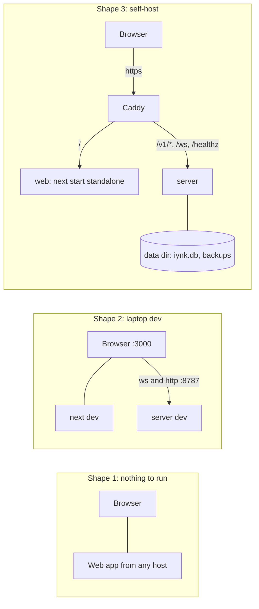
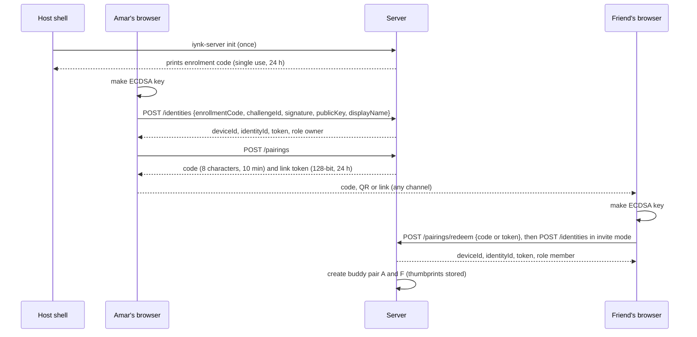

# Backend architecture

Status: specification for the build, written 2026-10-27 for BRIEF sections 14, 19 and 21 (rooms, share links, buddies, keys, compile, security, operations).
Author role: backend architecture seat. Output of one workflow step; a later pass folds in spike results that were still running.
ADR range used here: ADR-0420 to ADR-0430. The browser half is `FRONTEND_ARCHITECTURE.md` (ADR-0400 to ADR-0409).

## 0. How to read this file

This file says what the optional self-hosted server is, what it stores, who it trusts and how someone other than the author runs it. It is a specification: names, fields, limits, states, error cases and acceptance tests. It does not plan around customers, markets, pricing, accounts, schools or hosted services (D-013, D-015).

Labels: VERIFIED (read in code or docs, or reproduced), DOCUMENTED (a repo or spike document states it), EXTERNAL (an outside source states it), ESTIMATED (calculation or judgement, assumptions shown), HYPOTHESIS (a test is named), UNKNOWN (not found or not tested). "PENDING RS-xx" means the choice waits for a spike that had no `Verdict`; the options and the decision rule are given. Disposition (preserve, extend, replace) follows BRIEF 3.5.

The server is optional. With no server the whole app still edits, runs, debugs and saves (D-015, R-012). Everything below is what is added when Amar runs one.

Upstream:

| Source | Path | Used for |
|---|---|---|
| Assignment | `docs/MASTER_PLAN/BRIEF.md` sections 14, 19, 21 | scope |
| Decisions | `00_EXECUTIVE/DECISION_REGISTER.md`: D-005, D-010, D-013 to D-017 | binding constraints |
| Audit | `01_AUDIT/SECURITY_BASELINE.md` (C1 to C9, R1 to R12, A1 to A7, D1 to D7, M1 to M3, section 8 blockers, section 10 quick wins), `TECHNICAL_DEBT.md` (B5, B6, B7, D3, D5), `inventory/realtime.md`, `inventory/server-data.md`, `inventory/ai-search-mcp.md` | what exists |
| Research | `02_RESEARCH/TECHNICAL_RESEARCH.md` D5, D9, D10, D11; `tech/platform-options.md` sections 2, 5, 6 | options |
| Spikes | `RS-09` (PASS), `RS-12`, `RS-03` (compile timings); RS-04, RS-05, RS-10, RS-11, RS-17 have no report | measured results |
| Contracts | `PROJECT_DATA_MODEL.md` (sections 5.1, 7, 9.4, 12, 13), `schemas/project.schema.json`, `SIMULATION_ARCHITECTURE.md` (8.5, 17.4) | names and fields (binding) |
| Sibling contracts | `REALTIME_ARCHITECTURE.md` (4, 6, 7, 8, 11, 16), `SYSTEM_ARCHITECTURE.md` (8, 9, 10, 12), `API_CONTRACTS.md` (4, 5), `AI_ARCHITECTURE.md` 9.3, `schemas/openapi.yaml` | frames, ids, limits and names (binding where this file refers to them) |
| Product | `FEATURE_CATALOGUE.md` (F-), `PRODUCT_REQUIREMENTS.md` (R-001 to R-024, R-075 to R-098, K-SELF, K-SEC, K-KEY, BUD-10), `FEATURE_PRIORITIZATION.md` | ids and classes |

Downstream: ADR-0420 to ADR-0430 (section 1); features F-003 to F-006, F-012, F-089, F-116 to F-122, F-138, F-140, F-143, F-144, F-165 to F-167, F-193, F-194, F-198, F-199, F-206; requirements R-007 to R-012, R-022, R-075 to R-098, R-154, R-163; journeys J-07, J-08, J-09, J-13.

## 1. Summary of decisions

| ADR | Decision | Evidence | Status |
|---|---|---|---|
| ADR-0420 | The server is one separate Node process (`server/`), not Next route handlers. It owns HTTP under `/v1` (plus `/healthz` and `/readyz`), the WebSocket at `/ws`, the store, and the optional AI, search, MCP and compile modules. The web app keeps no `/api` routes and one runtime route, `/config.json`. | Next docs: handlers cannot hold WebSockets (`backend-for-frontend.md:927`); R-078 wants one process; F-199 asks the question | Decided |
| ADR-0421 | Identity is a device: a browser-made ECDSA P-256 key (self-certifying `dev_` id) plus a 12-hour random bearer token stored only as SHA-256 in a `sessions` table. The key signs a server challenge to get a token and again for the WebSocket handshake (REALTIME 4.3). Enrolment needs an enrolment code or an invite. No email, no password, no account. Buddies pair by code or link. | F-005, F-206, R-077, R-080, R-076 | Superseded as a record by ADR-0007 (enrolment, token) and ADR-0502 (socket handshake), which hold the same decision; section 6 is the server-side detail |
| ADR-0422 | Store: one SQLite file through `node:sqlite` behind a `Store` interface, `synchronous=FULL` by default (`IYNK_STORE_SYNC=normal` is an operator option), group commit per event-loop turn, forward-only SQL migrations, a backup before each migration. Postgres is a later implementation of the same interface, not built now. | R-078 asks for this ADR; F-165; Node 24.8 has `node:sqlite` (VERIFIED, prints an ExperimentalWarning) | Superseded as a record by ADR-0004 (the live decision: `FULL`, group commit, `ServerStore`); section 7 is the server-side detail. The experimental status is a recorded risk; Linux commit cost PENDING RT-1 and AX-05 |
| ADR-0423 | Rooms are server-ordered op logs. The server validates and orders ops with the same `core.apply` the browser uses, persists them with group commit, writes a checkpoint every 500 ops or 10 minutes, keeps 8 checkpoints and 20,000 envelope payloads, resumes from a 2,000-op tail window, and sends `check{seq,chain}`. Members are authenticated devices; the server enforces host, one baton per room, chat kind and limits. Frames and close codes are REALTIME 7. | RS-09 PASS; R-075, R-089, R-090; R3, R4, R6 to R9 | Decided; net, batch and cascade ops are not covered by RS-09 and must be added to the property test before COLLAB closes |
| ADR-0424 | Rate limits are in-process token buckets keyed by device, else socket address; forwarded headers are read only when `IYNK_TRUST_PROXY` says how many proxies there are. Provider usage is persisted so a restart does not reset a cap. A kill switch per module. | C6, C7, R3, R8; R-008 | Decided |
| ADR-0425 | AI and search keys live in the browser. Two transports behind one adapter: `direct` to the provider, or `relay` (`POST /ai/relay`) through the user's own server, with the key sent per request and never stored, or, when the operator sets one, a server-held key. The relay forwards only to allow-listed hosts and refuses private addresses. | F-193, F-194, R-010, R-011; C1 to C5, A1 to A7 | Decided; which providers allow direct browser calls is UNKNOWN |
| ADR-0426 | Share links are unguessable capability tokens (stored only as a SHA-256) to a stored snapshot, not live rooms. No cross-device library sync in the first release. | F-089; R-078 and R-083 do not list project sync | Decided |
| ADR-0427 | The compile service is an interface plus a disabled route. Nothing is built until RS-04, RS-05 and RS-17 report. The first release imports `.hex`. | SIMULATION_ARCHITECTURE 8.5 | PENDING RS-04, RS-05, RS-17 |
| ADR-0428 | Configuration is environment variables only; the server refuses to start on unsafe values. Operator provider keys come from a file or env, never from the database. There is no signing secret: every credential is a random value stored as a hash. | R-078, P3, S3 | Decided |
| ADR-0429 | Logs are structured JSON with a redaction rule; `/healthz` and `/readyz` are public and minimal; `/metrics` is on a separate loopback listener. `iynk-server diagnostics` makes a redacted diagnostics bundle. | R-098, R10 | Decided |
| ADR-0430 | Server and browser share `core` and `protocol` source. The server (`server/src/main.ts`) runs TypeScript directly with Node's type stripping and subpath imports (`#core/*`), with a bundled build as the fallback if the first check fails. | Node 24.8 ran a `.ts` file with no flag and no warning (VERIFIED) | Superseded as a record by ADR-0014 (repository layout, three-entry imports map, toolchain); section 14 is the server-side detail; check BA-02 |

## 2. Objections

The decisions are binding and this file follows them. These are the places where the evidence says a requirement needs a one-line change.

1. **R-007 lists four route classes: `removed`, `local-only`, `needs-server-token`, `needs-user-key`.** Share fetch and invite redemption are reached by someone who has no token yet, by design. They need a fifth class, `capability` (an unguessable id in the path, strictly rate limited, constant answer for missing or revoked). The test that enumerates routes works unchanged with five classes.
2. **F-165 and F-199 mention "project sync".** R-078 and R-083 do not list it, and with identity per device there is no account to sync across. The first release has rooms (live), shares (snapshots) and files. Library sync across a person's own devices needs a "same person" pairing that nobody has asked for (ADR-0426). Raise it again only if Amar wants one project on two machines without a file.
3. **F-199 asks whether the Next API routes stay or move.** They move (ADR-0420). The cost is moving about 78 files of `src/lib/server` (B7-07) and rewriting each route as a plain function over Web `Request` and `Response`, which most already use. R-007's "23 route files" test becomes a test over the server's route registry (FRONTEND objection 5).
4. **R-079 wants "one command" and a server that serves the app.** The app is a Next application and the server is a Node process, so one command means a compose file with three containers (web, server, Caddy), or `npm run selfhost` for two local processes. It is one command and one documented setup, but it is not one process. The alternative (the server serving a static export of the app) is blocked by the app's use of `redirects()` and `headers()` (FRONTEND section 5.2).
5. **SECURITY_BASELINE section 8 blocker 3 (child data, age and consent) and blocker 5 (credentials) do not apply here.** There is no service for strangers or minors and no credential program (D-013, D-016, COLLAB gate text). Blockers 1 (abuse control on paid and sensitive endpoints), 2 (room safety) and 6 (headers and CSP) apply and are closed by this design; R-097 is the test for 2. Blocker 4 (moderation of AI input and output) applies only in part: untrusted web text is fenced and any model action that writes into a room needs a confirmation click; provider-side moderation is not built.
6. **RS-10 (Vercel WebSockets) is moot.** Nothing depends on Vercel (D-015, F-202), so RS-10 has no decision left to make. The Fly or Durable Object options in TECHNICAL_RESEARCH D10 are also unneeded for a self-hosted single process.
7. **BUD-10 (reconnect under 2 s) was measured on loopback only.** RS-09 measured 2.8 ms for a 1,000-op tail and 22 ms for 10,000 ops, but the 10,000-op tail is 1.4 MB raw and 268 KB gzipped. On a home upload link of 10 Mbit/s that is about 0.2 s gzipped (ESTIMATED: 268 KB x 8 / 10 Mbit/s), so the snapshot-plus-tail path is needed on slow links but is not a risk on a typical one. Real-network numbers stay UNKNOWN until the COLLAB gate measures them.

## 3. What exists today and what happens to it

Everything here is VERIFIED unless marked.

| Piece | Where | Facts | Disposition |
|---|---|---|---|
| Realtime relay | `server/realtime/src/` (`relay.js` 630 lines in one closure, `room.js` 129, `protocol.js` 253, `config.js` 167, `bucket.js` 22, `log.js` 42) | JavaScript with JSDoc; `ws` 8.22.0; peer ids are chosen by the client (R4); any join creates a room (R3); snapshots from peers (R9); lab names hard-coded in `LABS` (`protocol.js:7`); memory only, a deploy drops all rooms (B5-04); 39 tests with `node --test`, outside `npm test` | **Extend**: port to TypeScript modules, keep the 39 tests as the regression suite, replace the room model (ADR-0423). Keep `bucket.js`, `log.js`, the origin policy in `config.js` and the name and chat sanitisers in `protocol.js` |
| Relay container | `deploy/realtime/Dockerfile`, `compose.yaml`, `Caddyfile` | non-root `node`, read-only root, `cap_drop: ALL`, `no-new-privileges`, 512 MB cap, Caddy HTTPS; `/metrics` is proxied to the public (R10) | **Extend** into `deploy/`; drop `/metrics` from the public route |
| Deploy scripts | `scripts/realtime-deploy.sh`, `scripts/realtime-vultr-create.sh` | root SSH `accept-new`, builds on a 1 vCPU VM, mention Vercel (B5-13) | **Replace** by `docs/SELF_HOSTING.md` (F-198) |
| Next API routes | `src/app/api/**` (23 route files) | no authentication on any (SECURITY_BASELINE section 1); CORS `*` on three | Delete the hackathon ones; move AI, search and MCP into the server package (ADR-0420) |
| `src/lib/server/ratelimit.ts` | 41 lines | in-memory sliding window, per instance, 10,000 keys, key from `clientIp` | **Extend** into the server limiter (ADR-0424); keep the bounded-key idea |
| `src/lib/server/http.ts:128-148` | `clientIp`, `checkOrigin` | `clientIp` trusts `x-real-ip`, then the first `x-forwarded-for` value (C7); `checkOrigin` passes a missing `Origin` | **Replace** the IP rule (ADR-0424); keep zod-style body caps and error helpers |
| `src/lib/server/ai/*`, `search/*`, `mcp/*` | 78 files in `src/lib/server` | shared Meta and Gemini keys in `env.ts`; counters per instance (B6-01); search budget closure variable (C3); hand-written MCP transport (B6-11) | **Extend and move** into `server/src/modules/` (sections 10 and 11); remove shared keys; make budgets persistent |
| Postgres layer | `src/lib/server/db/*`, `db/migrations/0001_events.sql`, `0002_aggregates.sql`, `0003_profiles.sql` | telemetry events, a public leaderboard, a public buddy pool of strangers' free text (D1, D2); migrations not wired into deploy (B7-05); Timescale test skipped | **Delete** all three tables and the `postgres` dependency (D-016, F-006, F-195). The token-hash ownership idea in `0003` is reused; the SQL is not |
| Solana routes and program | `src/app/api/solana/*`, `solana/` | | **Delete** (D-016) |
| Browser-side store sync | `src/lib/realtime/*` | | FRONTEND section 4.4 |

## 4. Process shape (ADR-0420)

### 4.1 Options

| Option | For | Against | Verdict |
|---|---|---|---|
| A. Next route handlers for HTTP, a separate relay for WebSocket (today) | no move of code | two processes with two deploys and two limiters; Route Handlers cannot hold a WebSocket (`backend-for-frontend.md:927`); state sits in `Map`s lost on restart; the web app's routes can be hit by anyone who finds the host | Rejected |
| B. Next custom server with `ws` attached | one process | the docs say standalone output does not trace a custom server and the two cannot be used together (`custom-server.md`, `output` docs); the Next version upgrade path gets harder; the server is welded to the web framework | Rejected |
| C. **Separate Node process for the server; the web app has no API** | one clear process for rooms, store, secrets and limits; runs the same on a laptop, a Raspberry Pi or a VM; the web app can be served by any host; matches R-078 ("one Node process provides the relay, device tokens, pairing, share links and the file-backed store") | AI, search and MCP code must move | **Chosen** |

### 4.2 Shapes it runs in



| Shape | Who | What runs | Server address the app uses |
|---|---|---|---|
| 1 | anyone, offline or on a static host | the web app only | none; "not set up" states (R-012) |
| 2 | contributors | `npm run dev` and `npm run server:dev` (`node --watch`) | `http://localhost:8787`, allowed by `IYNK_ALLOWED_ORIGINS=http://localhost:3000` |
| 3 | Amar and friends | `docker compose up` from `deploy/` (web, server, Caddy), or `npm run selfhost` for the two Node processes behind your own proxy | same origin through Caddy (`/v1/*`), so no CORS |

The Caddy file proxies `/v1/*`, `/ws` and `/healthz` to the server and everything else to the web app, sets the response headers the old file set (`Strict-Transport-Security`, `X-Content-Type-Options nosniff`, no `Server`), and does not proxy `/metrics`. Caddy gets its certificate itself, as the current file already does.

### 4.3 What the web app keeps

`/config.json` (a route handler that returns the runtime `IYNK_SERVER_URL`; `NEXT_PUBLIC_*` values freeze at build, `environment-variables.md:166`, VERIFIED). Nothing else. A web host with no Node (a plain static server) simply has no `/config.json`; the app then assumes no server.

## 5. Interfaces

### 5.1 HTTP (all under `/v1`)

Route names and operation ids follow `schemas/openapi.yaml` (served at `{origin}/v1`); `API_CONTRACTS.md` section 5 is the contract and this table must not drift from it. Rate bucket names are API_CONTRACTS 4.8. `/healthz` and `/readyz` are also answered at the root so a container health check needs no prefix, and the socket path `/ws` is not under `/v1`. Errors always have the shape `{ "error": { "code": string, "message": string, "detail"?: object } }` (SYSTEM_ARCHITECTURE 9.1, API_CONTRACTS 4.1); codes are stable and messages are not. A missing, malformed, expired, forged or revoked credential gets `401`, code `unauthorized`, the same message, no `detail` and the same timing for every cause (R-007, R-077). Bodies are JSON, UTF-8, at most 64 KiB except where stated. JSON timestamps are UTC with milliseconds and `Z`; the database stores integer milliseconds (section 6.4).

| Route | Class | Auth | Body and result | Limits (section 9) |
|---|---|---|---|---|
| `GET /server` (`getServerInfo`; the old name `/capabilities` is gone) | public | none | `{ protocol: 2, opSchema: "1.0", wsPath: "/ws", features: { rooms, shares, ai, search, compile, mcp }, enrol: "code" \| "invite" \| "open" }`. No room counts, no version string beyond `protocol` | 60 per minute per address |
| `POST /auth/challenges` (`createChallenge`) | public | none | returns `{ challengeId, nonce, expiresAt }` (60 s, single use) | 20 per minute per address |
| `POST /identities` (`registerIdentity`) | capability | enrolment code in body | `{ challengeId, signature, publicKey (SPKI DER, base64url), displayName, enrollmentCode }` returns the identity (`deviceId`, `identityId`, `role`) and an access token. Wrong, used or expired code: plain `401` | 5 per minute per address |
| `POST /auth/tokens` (`createAccessToken`) | public | signature | `{ challengeId, signature, deviceId }` returns `{ token, expiresAt }` | 20 per hour per device |
| `GET /auth/sessions`, `DELETE /auth/sessions/{sessionId}`, `DELETE /auth/tokens/current` | device | token | list and revoke the caller's own bearer tokens (rows of `sessions`) | |
| `GET /identities/me`, `PATCH /identities/me` | device | token | name (1 to 24 characters, control and bidi characters stripped) | |
| `POST /pairings` (`createPairing`) | device (member or owner) | token | `{ label?, ttlSeconds?, grant? }` returns `{ id, link, code, expiresAt }`; secrets shown once | 20 per hour per device (`pairing.create`) |
| `GET /pairings`, `DELETE /pairings/{pairingId}` | device | token | list mine; revoke | |
| `POST /pairings/peek`, `POST /pairings/redeem` | capability | link token or typed code in body | peek shows who made it; redeem creates the buddy pair (and any grant); one generic `404` for wrong, expired, used or revoked | 10 per minute per address (`pairing.guess`); pairing deleted after 5 wrong tries |
| `GET /buddies`, `GET /buddies/{identityId}`, `PATCH /buddies/{identityId}`, `DELETE /buddies/{identityId}` | device | token | list `{ identityId, displayName, thumbprint, since }`; removing closes open rooms between the two | |
| `POST /rooms` (`createRoom`) | device (member or owner) | token | `{ title, snapshot: gzip base64 of a .iynk envelope }` returns `{ roomId, epoch, seq }`. Wire cap 1 MiB, inflated with a hard limit of `IYNK_MAX_PROJECT_BYTES` + 1 KiB and refused above a 100 to 1 ratio (PROJECT_DATA_MODEL 12.1) | 6 per minute and 30 per hour per device (REALTIME 16.1) |
| `GET /rooms`, `GET /rooms/{roomId}`, `DELETE /rooms/{roomId}`, `POST /rooms/{roomId}/reopen` | device | token, host only for the last two | list mine; read; close; reopen. Pin and lock are room settings sent on the socket (REALTIME 6) | |
| `POST /rooms/{roomId}/invites`, `GET /rooms/{roomId}/invites`, `DELETE /rooms/{roomId}/invites/{inviteId}`, `POST /rooms/{roomId}/invites/{inviteId}/accept`, `POST /room-invites/redeem` | device, host for create and revoke; capability for redeem | token or invite secret | room invites (128-bit, 24 h default, revocable) | 20 per hour per device |
| `PUT /assets/{sha256}` (`putAsset`) | device | token | body up to 16,777,216 bytes, `Content-Length` required. The server hashes the bytes and refuses a mismatch with `hash_mismatch`; the `Content-Type` must be on the media-type allow-list of PROJECT_DATA_MODEL 5.10 and agree with the sniffed type; optional `?room=<id>` (the caller is an editor of that room) ties the upload to that room's project so an `asset.add` op may name it (REALTIME 8.1 rule 8). `201` stored, `200` already stored. Per-device quota 256 MiB; an upload no document lists is deleted after 24 hours | `assets.put`: 30 per minute per device |
| `GET /assets/{sha256}` (`getAsset`) | device | token | the bytes, to a viewer or higher of a room whose document lists the hash, or a reader of a project that lists it. `Cache-Control: private, max-age=31536000, immutable`, `X-Content-Type-Options: nosniff`, `ETag`, `Range` supported; SVG always served with `Content-Security-Policy: sandbox; default-src 'none'` | `assets.get`: 120 per minute per device |
| `POST /projects/{projectId}/shares` (`createShare`), `DELETE /projects/{projectId}/shares/{shareId}` (`revokeShare`) | device (owner of the project) | token | create from the stored document (section 11); the token is shown once and only its SHA-256 is stored; revoke by `shareId` | 30 per hour per device |
| `GET /shares/{token}` (`openShare`), `POST /shares/{token}/fork`, `GET /shares/{token}/assets/{sha256}` | capability | none | looks up `SHA-256(token)` and returns the stored snapshot; `404` for missing and revoked alike; `Cache-Control: private, no-store` | 120 per minute per address |
| `PUT /scores/{key}` (`submitScore`), `DELETE /scores/{key}`, `GET /leaderboards/{key}` (`getLeaderboard`) | device | token | buddies-only board (D-016): the caller and the caller's buddies only, at most 65 rows; the better of the stored and the submitted value is kept | 60 per minute per device |
| `POST /ai/relay` (`aiRelay`, ADR-0612) | needs-user-key or operator | token | stateless forward of one provider call (section 10): body `{ profile: { family, baseUrl }, path: "chat" \| "models", body }` (AI_ARCHITECTURE 9.3), key in `X-Iynk-Provider-Key`; off unless enabled; `501 feature_disabled` when off | `ai.relay`, 20 per minute per identity |
| `POST /search/web`, `/search/videos`, `/search/nearby`, `/search/events`, `/search/offers` | needs-user-key or operator | token | section 10; off unless enabled. These are web-search kinds, not the `offers` table | per-provider caps |
| `POST /compile/jobs` (`createCompileJob`), `GET /compile/jobs/{jobId}` | device | token | `501 compile_not_set_up` until ADR-0427 resolves | 6 per minute per device |
| `GET /healthz` (`getHealth`) | public | none | `{ ok: boolean, draining: boolean, store: "ok" \| "error" }` (200 or 503). No uptime and no version (section 5.3); openapi `Health` and SYSTEM 9.2 list more fields and are to follow this one (review log) | 60 per minute per address |
| `GET /readyz` (`getReadiness`) | public | none | database answers `SELECT 1` and the store is migrated | none |
| `ws /ws` | device | device-key signature in `hello` (REALTIME 4.3), not the bearer | section 5.2 | section 9 |

There is no network admin surface. Administration is the `iynk-server` command on the host (section 13.4), which opens the database file directly.

### 5.2 WebSocket

Frames, errors and close codes: REALTIME_ARCHITECTURE 7 (protocol 2). Handshake and authentication: REALTIME 4.3. Path: `/ws`. This file adds only the server-side obligations below; it defines no frame.

| Obligation | Rule | Defined in |
|---|---|---|
| Upgrade | The `Origin` must be in `IYNK_ALLOWED_ORIGINS` (section 8.2, R11) | REALTIME 4.3 |
| Hello window | The first client frame must be `hello` and must arrive within 10 s (`joinTimeoutMs`, kept). Before a valid `hello` the server sends nothing about any room or member (R2) | REALTIME 4.3, 16.1 |
| Authentication | By the device-key signature, not by the bearer token, so a leaked bearer cannot sit in a room. Auth failures are limited per address | REALTIME 4.3, 4.4 |
| Frame size | `ws` `maxPayload` is set to the client-to-server wire cap of REALTIME 7.1 (the old 640 KB value is replaced); inflation uses `maxOutputLength`; one op envelope is at most 64 KiB | REALTIME 7.1, 16.1 |
| One socket per device per room | A second socket of the same device in the same room supersedes the first | REALTIME 4.4 rule 2 |
| Baton | One holder per room (`rooms.baton_actor`). The baton gates every `source.*` op of the room, not one source file. Changes only by the commands of REALTIME 6.2 | REALTIME 6.2 |
| Revocation | A revoked device's sockets are closed with 4401 within 5 s (the server checks on its heartbeat tick) | REALTIME 7.4 |
| Divergence checks | The server sends `check{seq,chain}`; the client never sends hashes | REALTIME 8.2 |
| Shutdown | Close with 1012 and `retryAfterMs` after the room checkpoints (section 13.4) | REALTIME 11.6 |

### 5.3 Versions

| Thing | Where it is declared | Rule |
|---|---|---|
| HTTP API | path prefix `/v1` | A breaking change makes `/v2`; both may run for one release |
| Wire protocol | `hello.protocol` (REALTIME 7.2) | Equal major required; a different one closes with 4426 `upgrade_required`; the server lists the majors it speaks in `capabilities` |
| Operation vocabulary | `hello.opSchema` equals the document's `MAJOR.MINOR` | A client lower than the room is refused with `schema_mismatch` and told to update (PROJECT_DATA_MODEL 7.4) |
| Database schema | `schema_migrations` | Section 7.3 |
| Server build | neither `capabilities` nor `/healthz` prints it; `/metrics` `iynk_build_info` does | Avoids a version oracle for strangers |

### 5.4 The capability probe

`GET /v1/server` (named `capabilities` in earlier drafts) is how the app learns what is on (FRONTEND 5.5). It answers the same 200 to anyone; it names features, not counts. An operator who turns a module off gets `features.<name>: false`, and the app shows the "not set up" state with the setup steps.

## 6. Identity, enrolment and buddies (ADR-0007, ADR-0502; ADR-0421 withdrawn)

### 6.1 Instance roles

These are operator-granted instance roles on a device. They are not project roles (`owner`, `editor`, `commenter`, `viewer`), which belong to a project or room ACL (ADR-0504). The routes in section 5.1 that say "member or owner" mean these instance roles. Token format and enrolment are defined by ADR-0007; the socket handshake by ADR-0502.

| Instance role | How it is obtained | May |
|---|---|---|
| `owner` | uses the first enrolment code printed by `init` | everything a member may; `iynk-server` commands are separate (host shell); revoke any device; pin rooms |
| `member` | pairing redeemed from an owner or member, or an enrolment code | create rooms, shares, invites, pair; use AI and search modules if enabled |
| `guest` | room invite from anyone who may invite to that room | join that one room as editor or viewer; nothing else |

A guest who later pairs with someone becomes a member. Instance roles are rows on the device, checked on every request; the token does not carry the role.

Two role systems exist and stay apart. Instance roles are stored in `devices.server_role`. Room roles are the project document's `Role` (`owner`, `editor`, `commenter`, `viewer`; PROJECT_DATA_MODEL 5.1, REALTIME 6.1) and live in `room_members.role` (section 7.2). Host, baton holder and runner are room properties (`rooms.host_actor`, `baton_actor`, `runner_actor`), not roles. A spectator is a `viewer` member with `room_members.spectator = 1`.

### 6.2 Keys and tokens

| Item | Design |
|---|---|
| Device key | ECDSA P-256 made with WebCrypto in the browser, private key non-extractable, kept in IndexedDB as a `CryptoKey` (F-206). The public key is sent as SubjectPublicKeyInfo DER (91 bytes, base64url), what `exportKey("spki")` returns, as in `IdentityRegister.publicKey`. The server stores `thumbprint = base64url(SHA-256(SPKI))`, the same value as `actors[].keyThumbprint` in the project document (PROJECT_DATA_MODEL 5.1) |
| Device id | `deviceId = "dev_" + lower-case base32 of SHA-256(SPKI)[0..16]` (26 characters), self-certifying: it cannot be claimed without the key (REALTIME 4.2, API_CONTRACTS 5.2 rule 2). The server never puts a device id into a document or into a frame sent to another member |
| Why ECDSA P-256 | F-206 names it; it is the algorithm every current browser's WebCrypto supports (EXTERNAL, HYPOTHESIS for old Safari versions). Ed25519 would be a later `alg` value |
| Bearer token | `iynk_at_` plus 43 base64url characters: 256 bits from `crypto.randomBytes(32)` (API_CONTRACTS 5.1). It is opaque and nothing in it is signed. The server stores only `SHA-256(token)` in `sessions.token_hash` (section 6.4). Lifetime 12 hours: `expires_at = created_at + 43,200,000` ms (`IYNK_TOKEN_TTL_HOURS`, 1 to 720). The server therefore holds no signing secret, there is no key to rotate or leak, and the data directory holds only `iynk.db` and `backups/` (SYSTEM 10.2) |
| Verify | Hash the presented value and look it up in `sessions` joined to `devices`. Accept if the row exists, `sessions.revoked_at IS NULL`, `expires_at > now` and `devices.revoked_at IS NULL`. Every failure (no header, wrong prefix or length, unknown hash, expired, revoked) runs the same lookup (a malformed value looks up the hash of a fixed dummy value) and returns the identical `401` (BA-03). The instance role is read from the device row |
| Refresh | `POST /auth/challenges` then `POST /auth/tokens {challengeId, signature, deviceId}`. The signing input is the one of API_CONTRACTS 5.2 rule 1 (`iynk.auth.v1`, purpose, audience, challengeId, nonce and thumbprint joined by LF); the audience is the host name of `IYNK_PUBLIC_URL`, so a hostile server that relays a challenge gets a signature the real one rejects. The server inserts a new `sessions` row. No refresh token exists to steal. The challenge is single use, lives 60 s and is held in a bounded in-memory map (a restart only makes the browser ask again) |
| Socket | The WebSocket does not use the bearer token. Its handshake signs again with the device key over `iynk.ws.v2` (REALTIME 4.3), so a leaked bearer cannot sit in a room as that person. A second socket of the same device supersedes the first with 4001 (REALTIME 4.4) |
| Revoke | `iynk-server revoke <id>` runs one transaction: `devices.revoked_at = now` and `sessions.revoked_at = now` on every `sessions` row of that device. The next request fails with the generic `401`. Live sockets of the device are closed with 4401 within 5 s (the server checks on the 5 s heartbeat tick). One token is revoked by `DELETE /auth/tokens/current` or `DELETE /auth/sessions/{sessionId}`. Removing a buddy only deletes the pair and closes shared rooms (R-080); it never revokes a device |
| Lost storage | A new device; re-pair. Recovery by email is not built (R-077, stated in `docs/DATA_HANDLING.md`) |
| Theft | A stolen non-extractable key cannot leave the browser, but script running in the page can use it. That is the XSS case and is why CSP matters (FRONTEND 9). A leaked bearer works for at most 12 hours, can be revoked, and cannot enter a room |
| Database or backup leak | The attacker gets public keys and SHA-256 hashes of 128-bit and 256-bit random values. None is usable as a credential (R-077) |

### 6.3 Flows



A pairing code is 8 characters from the 32-letter Crockford alphabet (40 bits), expires in 10 minutes, is deleted after 5 wrong tries and is also limited per address (R-076). A link token is 128 random bits. Neither is the only line of defence: a code guess must also beat the per-address limit of 10 a minute. The six-character room codes of today (about 29.7 bits, R1) are removed.

Enrolment modes (`IYNK_ENROLLMENT`, the name API_CONTRACTS 5 and REALTIME 5.3 use): `code` (default: an enrolment code is required), `invite` (a pairing redemption may also enrol) and `open` (private networks only; the server logs a warning at start). Enrolment codes are made on the host with `iynk-server enroll`; one use, 24 hours. After the owner has enrolled, setting `IYNK_ENROLLMENT=code` and issuing no more codes closes enrolment; existing devices keep working.

Display names are 1 to 24 characters, stripped of control and bidi characters with the rule `protocol.js` already uses (`NAME_JUNK`). There is no avatar upload and no free-text bio (R-080).

### 6.4 Tables

All times are integer Unix milliseconds. Hashes are `BLOB` (32 bytes).

```sql
-- migration 0001_identity.sql (sketch; table and column names follow openapi.yaml. SYSTEM_ARCHITECTURE 8.3 shows an earlier sketch with different names and must be reconciled to this one)
CREATE TABLE devices (
  id TEXT PRIMARY KEY,                 -- 'dev_' + base32(SHA-256(SPKI)[0..16]), 26 characters (API_CONTRACTS 5, REALTIME 4.2); self-certifying
  identity_id TEXT NOT NULL UNIQUE,    -- 'usr_' + base32(SHA-256(SPKI)[0..10]), 16 characters; the `identityId` of openapi.yaml
  public_key BLOB NOT NULL,            -- SPKI DER, 91 bytes; the server re-derives id and identity_id from it on insert and refuses a mismatch
  thumbprint TEXT NOT NULL UNIQUE,     -- base64url(SHA-256(SPKI)), equals actors[].keyThumbprint
  name TEXT NOT NULL CHECK (length(name) BETWEEN 1 AND 24),
  server_role TEXT NOT NULL CHECK (server_role IN ('owner','member','guest')),   -- instance role (6.1), not a room role
  created_at INTEGER NOT NULL, last_seen_at INTEGER NOT NULL, revoked_at INTEGER
);
CREATE TABLE sessions (                -- one row per issued bearer token (openapi /auth/sessions)
  id TEXT PRIMARY KEY,                 -- 'ses_' + 16 base32; public, used by session listing and revoke
  device_id TEXT NOT NULL REFERENCES devices(id) ON DELETE CASCADE,
  token_hash BLOB NOT NULL UNIQUE,     -- SHA-256 of the 256-bit bearer; the token itself is never stored
  created_at INTEGER NOT NULL,
  expires_at INTEGER NOT NULL,         -- created_at + 43,200,000 (12 h)
  revoked_at INTEGER
);
CREATE INDEX sessions_by_device ON sessions(device_id);
CREATE TABLE enrollment_codes (        -- made by `iynk-server enrol`; one use, 24 h
  id TEXT PRIMARY KEY, secret_hash BLOB NOT NULL,   -- SHA-256 of the code; the code itself is never stored
  expires_at INTEGER NOT NULL, used_by TEXT REFERENCES devices(id), used_at INTEGER, revoked_at INTEGER
);
CREATE TABLE pairings (                -- openapi.yaml /pairings: link token plus typed code, optional project grant
  id TEXT PRIMARY KEY, creator TEXT NOT NULL REFERENCES devices(id) ON DELETE CASCADE,
  token_hash BLOB NOT NULL UNIQUE, code_hash BLOB NOT NULL UNIQUE,   -- SHA-256; secrets are never stored
  label TEXT, grant_project TEXT, grant_role TEXT CHECK (grant_role IN ('editor','commenter','viewer')),
  expires_at INTEGER NOT NULL, code_expires_at INTEGER NOT NULL, tries INTEGER NOT NULL DEFAULT 0, used_at INTEGER, revoked_at INTEGER
);
CREATE TABLE room_invites (            -- openapi.yaml /rooms/{roomId}/invites; REALTIME 11.1 calls this table invites
  id TEXT PRIMARY KEY, room_id TEXT NOT NULL REFERENCES rooms(id) ON DELETE CASCADE,
  creator TEXT NOT NULL REFERENCES devices(id) ON DELETE CASCADE, secret_hash BLOB NOT NULL UNIQUE,
  kind TEXT NOT NULL CHECK (kind IN ('direct','link')),
  role TEXT NOT NULL CHECK (role IN ('editor','commenter','viewer')),
  max_uses INTEGER NOT NULL DEFAULT 1, uses INTEGER NOT NULL DEFAULT 0,       -- 1 to 20 uses (API_CONTRACTS 5.1)
  expires_at INTEGER NOT NULL, revoked_at INTEGER
);
CREATE TABLE buddies (                 -- the pair table (REALTIME 11.1 calls it pairs); one table, not two
  a TEXT NOT NULL REFERENCES devices(id) ON DELETE CASCADE,
  b TEXT NOT NULL REFERENCES devices(id) ON DELETE CASCADE,
  since INTEGER NOT NULL, PRIMARY KEY (a, b), CHECK (a < b)
);
```

(`room_invites` is created in the migration after `rooms`; the sketch is grouped by topic, not by order.) A sweep deletes `sessions` rows seven days after `expires_at` or `revoked_at`.

## 7. The store (ADR-0004; ADR-0422 superseded)

### 7.1 Options

| Option | For | Against | Verdict |
|---|---|---|---|
| SQLite through `node:sqlite` | no dependency; one file to back up; transactions and WAL; `backup()` is exported (VERIFIED in Node 24.8); `VACUUM INTO` also works; both are used only inside the `Store` port | the module prints `ExperimentalWarning: SQLite is an experimental feature` in 24.8 (VERIFIED); API could change | **Chosen**, behind a `Store` interface |
| `better-sqlite3` (MIT) | stable, fast | native addon; build step per platform; a Docker image needs a compiler or a prebuilt binary | Fallback if `node:sqlite` breaks |
| Append-only log files plus snapshot files | trivial | no queries for buddies, shares, invites; hand-rolled durability | Rejected |
| Postgres | scalable | a second service to run; contradicts one process and one directory (K-SELF) | Later, same interface (R-083 "should") |

Licences (EXTERNAL, not re-checked here): SQLite is public domain; `node:sqlite` ships inside Node.js (MIT); `better-sqlite3` is MIT. Linux status: the only commit-cost numbers are from macOS (SYSTEM 8.4); the Linux run on the pinned image is experiment AX-05 (also AR-10 and RT-1) and is open, so the Linux cost is UNKNOWN. The port is called `ServerStore` in SYSTEM 8.4 and `RoomStore` in REALTIME 11.1; this file says `Store` for the one port and the SYSTEM owner fixes the name.

Risk and control: `engines.node` stays `24.x` (already in `package.json`); the `Store` interface is the only code that imports `node:sqlite`; CI runs the store tests on the pinned Node and fails on a new warning other than the known one.

### 7.2 Tables beyond identity

Room tables follow REALTIME_ARCHITECTURE 11.1 (the room contract); identity tables, pairings and room invites are in 6.4 and follow `schemas/openapi.yaml`. REALTIME's `members` is `room_members` here, its `invites` is `room_invites`, and its `pairs` is `buddies` (the same pair table, named after the `/buddies` route; there is no second table). Times are integer Unix milliseconds. Hashes are `BLOB` (32 bytes) except chain and state hashes, which are the strings the protocol carries.

```sql
CREATE TABLE rooms (
  id TEXT PRIMARY KEY,                 -- 'rm_' + 16 base32 (80 bits): an address, not a secret
  project_id TEXT NOT NULL, title TEXT NOT NULL,
  creator_device TEXT NOT NULL REFERENCES devices(id),
  host_actor TEXT NOT NULL, baton_actor TEXT, runner_actor TEXT,
  state TEXT NOT NULL CHECK (state IN ('open','locked','idle','closed','corrupt')),
  epoch TEXT NOT NULL,                 -- 8 random base32, changes on a restore (REALTIME 11.5)
  seq INTEGER NOT NULL, chain TEXT NOT NULL, state_hash TEXT NOT NULL,
  opschema TEXT NOT NULL, settings TEXT NOT NULL,   -- settings: JSON
  pinned INTEGER NOT NULL DEFAULT 0,
  created_at INTEGER NOT NULL, last_active_at INTEGER NOT NULL, closed_at INTEGER
);
CREATE TABLE room_members (            -- the server ACL; changes only with a committed access.* op or a kick
  room_id TEXT NOT NULL REFERENCES rooms(id) ON DELETE CASCADE,
  device_id TEXT NOT NULL REFERENCES devices(id) ON DELETE CASCADE,
  actor TEXT NOT NULL,                 -- 'usr_' + 16 base32, the id the document uses
  role TEXT NOT NULL CHECK (role IN ('owner','editor','commenter','viewer')),
  spectator INTEGER NOT NULL DEFAULT 0, muted INTEGER NOT NULL DEFAULT 0, banned INTEGER NOT NULL DEFAULT 0,
  name TEXT NOT NULL, color TEXT NOT NULL, joined_at INTEGER NOT NULL,
  PRIMARY KEY (room_id, device_id)
);
CREATE TABLE ops (                     -- append only
  room_id TEXT NOT NULL REFERENCES rooms(id) ON DELETE CASCADE, seq INTEGER NOT NULL,
  env BLOB,                            -- envelope JSON; NULL after compaction, the columns below stay
  author_actor TEXT NOT NULL, kind TEXT NOT NULL, target TEXT, at INTEGER NOT NULL,
  chain TEXT NOT NULL,                 -- chain_n = sha256(chain_(n-1) + canonical(envelope_n)) (REALTIME 8.2)
  PRIMARY KEY (room_id, seq)
) WITHOUT ROWID;
CREATE TABLE checkpoints (
  room_id TEXT NOT NULL REFERENCES rooms(id) ON DELETE CASCADE, seq INTEGER NOT NULL,
  state_hash TEXT NOT NULL, chain TEXT NOT NULL, doc BLOB NOT NULL,   -- gzip of the canonical document
  at INTEGER NOT NULL, kind TEXT NOT NULL CHECK (kind IN ('auto','named','genesis')),
  PRIMARY KEY (room_id, seq)
) WITHOUT ROWID;
CREATE TABLE submissions (             -- dedup record, written in the same transaction as the ops (RA-03)
  room_id TEXT NOT NULL REFERENCES rooms(id) ON DELETE CASCADE,
  device_id TEXT NOT NULL REFERENCES devices(id) ON DELETE CASCADE,
  first_op_id TEXT NOT NULL, seq0 INTEGER NOT NULL, seq1 INTEGER NOT NULL,
  inverse TEXT NOT NULL,               -- JSON Op[]; returned with ack.dup on a resend
  at INTEGER NOT NULL,
  PRIMARY KEY (room_id, device_id, first_op_id)
) WITHOUT ROWID;                       -- the last 8 per member are kept
CREATE TABLE events (                  -- the audit trail (REALTIME 15)
  room_id TEXT NOT NULL REFERENCES rooms(id) ON DELETE CASCADE, n INTEGER NOT NULL,
  at INTEGER NOT NULL, kind TEXT NOT NULL, actor TEXT, data TEXT NOT NULL,
  PRIMARY KEY (room_id, n)
) WITHOUT ROWID;
CREATE TABLE shares (
  id TEXT PRIMARY KEY,                 -- 'shr_' + 64 bits (13 base32): public, used by DELETE and listings only
  token_hash BLOB NOT NULL UNIQUE,     -- SHA-256 of a 128-bit token (22 base64url); the token is the credential and is never stored
  owner TEXT NOT NULL REFERENCES devices(id) ON DELETE CASCADE,
  created_at INTEGER NOT NULL, expires_at INTEGER, revoked_at INTEGER,
  doc BLOB NOT NULL, state_hash TEXT NOT NULL, bytes INTEGER NOT NULL
);
CREATE TABLE blobs (sha256 BLOB PRIMARY KEY, bytes BLOB NOT NULL, size INTEGER NOT NULL, mime TEXT NOT NULL, created_at INTEGER NOT NULL);
CREATE TABLE uploads (                 -- who uploaded what: the per-device quota and the 24 h cleanup of unreferenced uploads
  device_id TEXT NOT NULL REFERENCES devices(id) ON DELETE CASCADE,
  sha256 BLOB NOT NULL REFERENCES blobs(sha256), room_id TEXT REFERENCES rooms(id) ON DELETE SET NULL,
  at INTEGER NOT NULL, PRIMARY KEY (device_id, sha256)
) WITHOUT ROWID;
CREATE TABLE share_blobs (share_id TEXT NOT NULL REFERENCES shares(id) ON DELETE CASCADE, sha256 BLOB NOT NULL REFERENCES blobs(sha256),
  PRIMARY KEY (share_id, sha256));
CREATE TABLE usage (day TEXT NOT NULL, provider TEXT NOT NULL, device_id TEXT NOT NULL, requests INTEGER NOT NULL DEFAULT 0,
  input_tokens INTEGER NOT NULL DEFAULT 0, output_tokens INTEGER NOT NULL DEFAULT 0, searches INTEGER NOT NULL DEFAULT 0,
  PRIMARY KEY (day, provider, device_id)) WITHOUT ROWID;
CREATE TABLE scores (device_id TEXT NOT NULL REFERENCES devices(id) ON DELETE CASCADE, kind TEXT NOT NULL, value REAL NOT NULL,
  at INTEGER NOT NULL, detail TEXT);                                                            -- buddies-only, D-016
CREATE TABLE api_tokens (              -- personal API tokens (openapi /auth/api-tokens) and the MCP key of `iynk-server mcp-key`
  id TEXT PRIMARY KEY, kind TEXT NOT NULL CHECK (kind IN ('personal','mcp')), device_id TEXT REFERENCES devices(id) ON DELETE CASCADE,
  token_hash BLOB NOT NULL UNIQUE, scopes TEXT NOT NULL, created_at INTEGER NOT NULL, expires_at INTEGER, revoked_at INTEGER
);
CREATE TABLE schema_migrations (version INTEGER PRIMARY KEY, name TEXT NOT NULL, applied_at INTEGER NOT NULL, checksum TEXT NOT NULL);
```

Every capability the server hands out is stored only as a SHA-256: enrolment codes, pairing secrets and room invites (section 6.4), share tokens (`shares.token_hash`), bearer tokens (`sessions.token_hash`) and API or MCP tokens (`api_tokens.token_hash`). A leak of the database file or of a backup exposes none of them. A share link is therefore looked up by hash (section 11). Chat is not stored beyond the room's in-memory ring of the last 50 lines, as the relay does today (`chatBacklog: 50`) and as R-083 allows. A restart empties it. No keys and no telemetry are stored.

### 7.3 Migrations

| Rule | Detail |
|---|---|
| Files | `server/migrations/NNNN_name.sql`, forward only, numbered from 0001 |
| When | at startup, before listening, each in its own transaction; `schema_migrations` records `checksum = SHA-256(file)` and a changed checksum of an applied file stops startup |
| Newer database than binary | the server refuses to start with `db_newer_than_server` and does not touch the file (the same stance as a newer `schemaVersion`, PROJECT_DATA_MODEL 10) |
| Backup | before applying any pending migration the `Store` port writes `data/backups/pre-<version>-<timestamp>.db`; the last 3 are kept. The only code that does this is `Store.backupTo(path)`, which uses `VACUUM INTO` or `node:sqlite`'s `backup()`; no other module touches the file. A rollback is: stop, copy the backup over `iynk.db`, delete `iynk.db-wal` and `iynk.db-shm`, start the older version, as the upgrade drill in the guide says (R-098) |
| Pragmas | `journal_mode=WAL`, `synchronous=FULL`, `foreign_keys=ON`, `busy_timeout=5000`. `IYNK_STORE_SYNC=normal` is the one operator option: in WAL mode it can lose the last few commits on power failure but cannot corrupt the file (EXTERNAL, SQLite documentation), and then ack-after-durable is not guaranteed (section 8.1) |
| Seeding | none; an empty file is a valid empty server |
| Old Postgres files | `db/migrations/0001` to `0003` are deleted with their tables (section 3) |

### 7.4 Limits (PROPOSAL, configurable)

The room, socket, frame, rate and invite limits are owned by REALTIME_ARCHITECTURE 16.1 and are referenced here, not copied, so there is one place to change them. This table holds only what the server adds.

| Limit | Default | Where enforced |
|---|---|---|
| Members, spectators, sockets, frames, submissions, chat, presence, run requests, room creation rate, stored rooms per device (10) and per server (100), invites per room (variables `IYNK_MAX_MEMBERS`, `IYNK_MAX_SPECTATORS`, `IYNK_MAX_STORED_ROOMS`) | REALTIME 16.1 | join, frames, `POST /rooms` |
| Live rooms in memory | 20 until RA-08 passes (REALTIME RB-7 is ESTIMATED at 20 live rooms of 8 members on 1 vCPU and 512 MB, and RA-08 is the test that confirms it); then REALTIME's 50. Variable `IYNK_MAX_LIVE_ROOMS` | `POST /rooms`, first join |
| Room leaves memory | 10 minutes after its last member leaves (REALTIME 5.1) | sweep |
| Canonical document | 5,242,880 bytes (PROJECT_DATA_MODEL 9.4) | create, checkpoint |
| One asset; assets per document | 16,777,216 bytes; 256 (PROJECT_DATA_MODEL 9.4) | `PUT /assets/{sha256}`, `asset.add` |
| Asset quota per device | 256 MiB of `uploads` (PROPOSAL) | `PUT /assets/{sha256}` |
| Share document | at most `IYNK_MAX_PROJECT_BYTES`; its assets are uploads counted against the device quota | create |
| Shares per device | 100 (PROPOSAL) | create |
| Database file | warn at 80 percent of `IYNK_STORAGE_LIMIT_MB` (default 2,048); refuse new rooms, shares and uploads at 100 percent | create, daily check |
| Room life | 30 days after last activity unless pinned; a closed room keeps its data 30 days (R-083, REALTIME 5.1) | sweep every hour |
| Share life | `IYNK_SHARE_TTL_DAYS`, default 180, 0 means until revoked (openapi `ShareCreate` defaults an owner-chosen expiry to 30 days; the two are to be reconciled, review log) | sweep every hour |
| Unreferenced upload | deleted 24 hours after upload if no room document or share lists the hash (OpenAPI `putAsset`) | sweep every hour |

Expired rooms, shares, pairings, room invites and enrolment codes are deleted by the sweep, then unreferenced `blobs`. `VACUUM` runs only on `iynk-server compact` (it needs free disk equal to the file).

## 8. Rooms (ADR-0423)

### 8.1 Model

The server is the ordering authority for a room. It keeps in memory, per live room, the current `ProjectState`, `seq`, `chain`, `state_hash`, the last 50 chat lines, the room properties (`host_actor`, `baton_actor`, `runner_actor`) and the member table. The dedup record is not memory only: it is the `submissions` table (the last 8 submissions per member), written in the same transaction as the ops, so a crash between COMMIT and ack still returns the stored result on a resend (REALTIME 8.1 rule 4, RA-03). A room is loaded from the latest checkpoint plus the tail when its first member joins, with the chain checked at the head (REALTIME 11.6), and is dropped from memory 10 minutes after its last member leaves (REALTIME 5.1). The server imports `core` and runs the identical `apply(state, op)` (ADR-0430), so a client and the server cannot disagree about validity. Frame names below are those of REALTIME 7.3.

| Step | What happens |
|---|---|
| `submit` arrives | check frame size, the author's role (a viewer or commenter gets `permission`), the baton for any `source.*` op, the `opSchema` match |
| Dedup | look up the first `opId` in `submissions` for this member. A hit returns `commit` with `ack.dup = true` and the stored result, not `duplicate_id` (RS-09: the alternative makes an accepted op look rejected) |
| Validate | the op validator (generated standalone Ajv, no `eval`) then `apply` on a working copy with the deferred invariants at batch end |
| Commit | Group commit, one transaction per event-loop turn (SYSTEM 8.4). Ops that arrive in one turn are applied to the in-memory room state; at `setImmediate` one transaction writes the `ops` rows, the `submissions` rows, each room's `seq`, `chain`, `state_hash`, `last_active_at`, and the ACL and `events` rows an op implies. The batch limit is 256 ops or 4 MiB; the rest waits for the next turn. Only after COMMIT returns does the server send `commit` (the author gets the `ack` with the inverse, the others get the envelopes). With `synchronous=FULL` (default) every acknowledged op is on disk. With `IYNK_STORE_SYNC=normal`, ack-after-durable is not guaranteed on power loss; the room epoch break (REALTIME 11.5) applies. `node:sqlite` is synchronous, so the event loop is held for each transaction; the macOS cost is in ADR-0422 and the Linux cost is UNKNOWN until RT-1 and AX-05. If COMMIT throws, nothing is acknowledged, the affected rooms are dropped from memory and reloaded from the store, and their sockets are closed with 1012 so clients resume |
| Reject | the closed code list; state unchanged; nothing persisted |
| Checkpoint | every 500 ops or 10 minutes of activity (PROJECT_DATA_MODEL Q7): write `checkpoints`. Keep 8 checkpoints (plus named ones); retain 20,000 envelope payloads (older `ops.env` become NULL, the summary columns stay); the resume tail window is 2,000 ops (REALTIME 11.1, R-083). The tail window exceeds the checkpoint interval, as RS-09 requires. SYSTEM 8.5 states a different compaction rule (1,000 ops past the snapshot); the review log lists it for that file |
| Reconnect | by the `resume {epoch, seq, chain}` decision of REALTIME 11.4: none, tail (within 1,000 ops and 200 KB, gzip) or snapshot plus tail. A 10,000-op gap is 1.4 MB raw, 268 KB gzipped, 84 KB as snapshot plus tail (RS-09, VERIFIED) |
| Divergence | the server sends `check{seq,chain}` every 100 ops or 30 s of activity, and every fifth also carries `stateHash` (REALTIME 8.2). A client mismatch gets a snapshot; the server counts `iynk_resync_total` (R-090) |

### 8.2 Authority rules (the fixes for the room findings)

| Finding | Rule here |
|---|---|
| R1 room privacy | a room id is `rm_` plus 16 random base32 characters: an address, not a secret. Joining needs membership or a valid invite; invites are 128-bit, default 24 h, revocable, stored as hashes |
| R2 existence oracle | before a valid `hello` the server sends nothing; wrong, expired, revoked and non-member answers are all `room_unavailable` with close 4403, after the same minimum delay of 200 ms (REALTIME 5.2); no probe path exists |
| R3 room exhaustion | `POST /rooms` needs an enrolled device and is limited by REALTIME 16.1; a join to an unknown id never creates a room; the live and stored room caps of section 7.4 stay |
| R4 takeover | the member is the authenticated device (REALTIME 4.4); a frame carries no member id; a device has at most one live socket per room, a second supersedes the first with 4001; host is a database fact (`rooms.host_actor`), not a socket property |
| R5 moderation | the host can `kick` (the member is banned by device id in `room_members` and its invites revoked, so a reload does not rejoin), `lock`, `mute` and `close`. There is no report or block queue: this is a room of friends, and removing a buddy closes shared rooms (R-080) |
| R6 authorisation | roles are enforced on every frame (REALTIME 6.2): viewers and commenters cannot send graph ops; baton and host commands are checked against the table. The baton is one holder per room and gates all `source.*` ops; the host may take it back when the holder has gone |
| R7 spoofed lines | chat `kind` is set by the server; `system` cannot come from a client, and an AI-drafted line is the sender's own line with a `via` tag |
| R8 flood | the buckets of REALTIME 16.1 (per socket, submissions, chat, presence, cursor); a flood closes the socket with 4429 |
| R9 snapshot trust | the server never asks a peer for state; its own checkpoints are the only ones, built by applying validated ops. A client-supplied document is accepted only at `POST /rooms`, after the five validation passes (PROJECT_DATA_MODEL 9.1) |
| R10 admin surface | `/metrics` on a separate loopback listener |
| R11 origin | browsers must send an `Origin` in `IYNK_ALLOWED_ORIGINS`; a request with no `Origin` is accepted only when it carries a valid credential (a script of Amar's), which is how it already works for non-browser clients |
| R12 container | keep the hardening in `compose.yaml` |

### 8.3 Ephemeral channels

Presence (cursor, selection, viewport) is relayed, never stored, and dropped under back-pressure (`lossyBufferedBytes` 256 KiB, kept). Run-channel frames of a shared simulation are REALTIME 13 and are not stored. Voice and chat translation (F-108) are out of scope for the server in the first release.

### 8.4 What RS-09 covers and what it does not

RS-09 covers parts, wires, move, delete with cascade, restore and code edits with a range transform: PASS, no divergence in 36 runs (30 main runs plus 6 snapshot-path runs; the independent check reproduced 36 new runs) of about 10,900 generated and about 6,000 accepted ops per run, both injected mutants caught, dedup caught only by a hand-built unit test (VERIFIED in its report). It does not cover `net.*`, batches and their deferred invariants, `component.swap`, or concurrent `source.edit` with overlapping ranges (it converges but loses intent; PROJECT_DATA_MODEL 7.4 notes the same). The COLLAB gate requires the property test (REF-4) extended with net ops and batches before rooms are enabled by default. CRDT (Yjs) stays out unless offline multi-user merge becomes a stated need (RS-20 not run; TECHNICAL_RESEARCH D5).

## 9. Rate limits and abuse controls (ADR-0424)

### 9.1 Keys

| Situation | Key |
|---|---|
| Authenticated request or socket | `dev:<deviceId>` |
| Anything else | the peer address: `socket.remoteAddress`, IPv6 reduced to its /64 (B5-15 flags that /64 keys matter) |
| Behind a proxy | `IYNK_TRUST_PROXY=N` means N trusted proxies: take the N-th entry counting from the right of `X-Forwarded-For`. `0` (default) ignores forwarded headers entirely. A missing or short header falls back to the socket address, never to a shared key `unknown` (R-008) |

### 9.2 Limiter

A token bucket per (class, key), refill rate and burst per class in the tables of section 5.1 and 8.2, held in a bounded `Map` (10,000 keys, least recently used evicted, as `ratelimit.ts` does). The state is per process, which is the supported shape (K-SELF); this is documented, not hidden (`SECURITY_BASELINE` C6 was a problem only because several instances existed). Responses: HTTP `429` with `Retry-After`; WebSocket close 4429 (REALTIME 7.4).

### 9.3 Persistent counters and kill switches

| Item | Rule |
|---|---|
| Provider usage | each AI or search call writes `usage` (day, provider, device) before the response streams: requests, tokens when the provider reports them, searches. Caps `IYNK_AI_DAILY_REQUESTS` (default 200 per device) and `IYNK_SEARCH_MONTHLY` read from the table, so a restart cannot reset them (C3, R-008) |
| Kill switches | `IYNK_DISABLE_AI=1`, `IYNK_DISABLE_SEARCH=1`, `IYNK_DISABLE_COMPILE=1` answer `503 turned_off_by_operator`; the capability probe reports the feature off |
| Pre-auth connections | at most 32 sockets without a valid `hello` at once, each closed after 10 s |
| Request bodies | 64 KiB cap, `Content-Type` checked, read with a hard byte limit |
| Concurrency | at most 4 in-flight proxied provider calls per device, 16 per server |

### 9.4 Threats mapped (SECURITY_BASELINE rows that apply)

| Row | Control |
|---|---|
| C1, C2 free LLM proxy | no shared key exists; the server-held key mode of the relay is off by default and is behind a device token and per-device caps; the per-request key mode spends the user's own key |
| C3, C4 search budget, MCP bypass | persisted usage; MCP and REST tools are behind the device token (section 10) |
| C5 shared bucket | no internal self-call; the planner tool is removed (F-167) |
| C6 limiter per instance | one process, documented |
| C7 IP spoofing | section 9.1 |
| C8 telemetry flood | no telemetry route |
| C9 wallet drain | no wallet |
| R1 to R12 | section 8.2 |
| A1 to A5 | the model never writes a project; it returns proposals that a person accepts (PROJECT_DATA_MODEL 7.5); `ask_peer` and any room-writing tool need a confirmation click (SECURITY_BASELINE quick win 9); web text is fenced (quick win 8) |
| A6 moderation | provider-side only; not built here; friends only |
| D1 to D3 | no public pool, no leaderboard of strangers, telemetry off |
| M1 to M3 | MCP and OpenAPI need a token; CORS limited to the allow-list; the DNS rebinding `Host`/`Origin` check in `mcp/http.ts:21-33` is kept |
| X4 headers | the web app's job (FRONTEND 9); the server sets `X-Content-Type-Options`, no `Server`, and `Cache-Control: no-store` on API responses |
| P1 dependencies | the server has one production dependency (`ws`); CI runs `npm audit --omit=dev` and fails on high |

## 10. Bring-your-own keys (ADR-0425)

### 10.1 Where a key lives

In the browser, in the IndexedDB `keys` store (ADR-0106). It is never copied into a project, an export, a share, a room, a log line or an error report. The only module that reads it is the provider client, which runs in the `ai` worker (FRONTEND 8.2), so UI components and figure code never hold it. An optional passphrase wraps the stored key with AES-GCM from a PBKDF2 key (WebCrypto, EXTERNAL); it is off by default because it costs a prompt per session. Honest limit: script running in the page's origin can open the same IndexedDB, so the real defence is CSP (FRONTEND 9) and not having third-party scripts (SECURITY_BASELINE P2: none today).

### 10.2 Two transports

There are two transports behind one adapter, `direct` and `relay`. A server-held key is a mode of `relay`, not a third transport (AI_ARCHITECTURE 9.2 and 9.3 use the same names).

| Transport | Path | Where the key goes | Trust | Use when |
|---|---|---|---|---|
| `direct` | browser (ai worker) to the provider's HTTPS API | only to the provider | the provider; no server needed | the provider allows browser origins (CORS). Whether each does is UNKNOWN until tested per provider (F-193). A provider that needs an opt-in header for browser use (EXTERNAL: Anthropic's API requires one) is handled in the adapter |
| `relay`, key per request | browser to `POST /v1/ai/relay` (ADR-0612) on the user's own server, which forwards one provider request | in the header `x-iynk-provider-key`, read for that call, held in memory only, never logged or stored (R-010) | the server's operator. If a buddy uses Amar's server, the buddy's key transits Amar's machine. The settings page says so in one line | the provider blocks browsers, or a local model server is reachable from the host but not from the browser |
| `relay`, server-held key | same route, no key header | the key is in the server environment (`IYNK_AI_KEY_<FAMILY>` or `_FILE`) | the operator spends their own key; per-device daily caps; off by default; the client shows "using the host's key" | Amar lets friends use his key |

The relay request body is the one of AI_ARCHITECTURE 9.3: `{ profile: { family, baseUrl }, path: "chat" | "models", body }`. It is not a prompt server: no prompts, no loop, no tools.

The adapter (`ProviderTransport`) picks `direct` if a static table `providers.json` marks the provider as browser-callable and tested, else `relay` if the capability probe says the server has the AI module, else shows "not set up" with the steps (R-012). The provider table, models and the evaluation set belong to the AI phase (F-111, RS-11 pending); this file fixes only transport and custody.

### 10.3 The relay is an SSRF surface

A route that fetches a URL for a client lets a buddy reach Amar's network. Controls (all required):

1. Only hosts in `IYNK_AI_ALLOWED_HOSTS` (default: the provider list shipped in `providers.json`) are reachable.
2. The hostname is resolved by the server; any address in loopback, private, link-local (including `169.254.169.254`), unique-local or multicast ranges is refused. One exception: with `IYNK_AI_RELAY_ALLOW_PRIVATE=1` (the name AI_ARCHITECTURE 9.3 uses, a boolean) loopback and private addresses are allowed, but only for a host that is also named in `IYNK_AI_ALLOWED_HOSTS`, such as a local Ollama. The link-local range (cloud metadata) and multicast stay refused whatever the setting. The connection then uses the resolved address, to defeat rebinding between check and use.
3. Redirects are not followed.
4. Request body at most 256 KiB; response streamed with a hard cap of 8 MiB and a 120 s wall limit. AI_ARCHITECTURE 9.3 states 1 MiB for the request and gives no response cap; the stricter values here stand and 9.3 is to be changed to match (review log). If the AI phase measures a real context pack above 256 KiB, the limit is raised there with the measurement as the evidence.
5. Only the headers the adapter sets are forwarded; the client's other headers are dropped.

Search (F-194) uses the same module shape with `IYNK_SEARCH_*` and a persisted monthly budget; the browser-side BYO path is the same two transports.

### 10.4 What stays in the browser

A local usage meter: the `ai` worker counts requests and, when the response reports it, tokens, per provider per day, in the repository `progress` store, and the settings page shows them (F-003). The meter is advice for the person; the server's `usage` table is the enforcement for the operator's key.

### 10.5 MCP and REST (F-167)

Moves to `server/src/modules/mcp/` in the AI phase. It needs a device bearer token or an API token (`api_tokens`: a personal token from `/auth/api-tokens`, API_CONTRACTS 5.1, or the MCP key of `iynk-server mcp-key`, SYSTEM 10.3; both are random values stored as SHA-256); the five tools that survive F-195 (`search_catalog`, `get_item`, `drone_calc`, `price_parts`, `create_room`) become calls over the same module registry. The hand-written transport (B6-11) is replaced by `@modelcontextprotocol/sdk` (already a dependency at 1.32.2) when that phase starts. Every tool declares its `readOnlyHint` truthfully (today all are `true`, including ones that spend money).

## 11. Share links (ADR-0426)

| Item | Rule |
|---|---|
| What it is | an immutable snapshot of one project at one revision, stored as a gzip `.iynk` envelope (PROJECT_DATA_MODEL 12.1) plus its assets by content hash |
| Credential | a 128-bit random token (22 base64url characters). The server stores only `SHA-256(token)` in `shares.token_hash`, like every other capability in this file. The row also has a public id, `shr_` plus 64 random bits (openapi `shareId`), that is not a credential: it is what `DELETE /v1/projects/{projectId}/shares/{shareId}` and an owner's list use |
| Link | `https://<app>/<lang>/studio#share=<token>`. The fragment is not sent to the web server or in `Referer`. The app then calls `GET /v1/shares/{token}` (`openShare`); the server hashes the path value and looks it up by `token_hash`. The log line records the route template, not the token. openapi `ShareCreated.url` is `{origin}/s/{token}`, a path form that would send the token to the web server; it is to be changed to the fragment form (review log) |
| Create | `POST /v1/projects/{projectId}/shares` (`createShare`) for a project stored on the server. The server runs the five validation passes, strips `history` and `access.grants` beyond owners, refuses secrets by the shape scan (PROJECT_DATA_MODEL 13), enforces section 7.4 limits, and returns `{ shareId, token, url, expiresAt }`. The token is shown once and cannot be recovered; a lost link is revoked by id and made again |
| Open | `GET /v1/shares/{token}` (`openShare`) returns the stored bytes; assets come from `GET /v1/shares/{token}/assets/{sha256}`. The app loads them through the `project` worker like any file (untrusted), sets `provenance.origin` to the share, and opens a fork. The owner's `actors` entry is kept; the opener becomes a new actor |
| Visibility | `link` (PROJECT_DATA_MODEL 5.1). No listing, no search, no public gallery |
| Revoke | `DELETE /v1/projects/{projectId}/shares/{shareId}` (`revokeShare`) marks `revoked_at`; the next `GET` is `404` like a missing token; a sweep removes the bytes |
| Expiry | section 7.4 |
| Live work | a room, not a share |

Not built: library sync (Objection 2), a public project catalogue, comments.

## 12. Compile service (ADR-0427, PENDING RS-04, RS-05, RS-17)

Options and the measured numbers are in SIMULATION_ARCHITECTURE 8.5; this file adds only the server side.

| Item | Decision |
|---|---|
| First release | `import-hex`. `POST /v1/compile/jobs` returns `501 { error: { code: "compile_not_set_up", message } }`. The capability probe reports `compile: false` |
| Interface | `CompileService` as in SIMULATION_ARCHITECTURE 8.5 (`CompileRequest`, `CompileResult`). The server module implements `compile(request, signal)`; the browser adapter hides which option is behind it |
| If option A (arduino-cli on the user's own server) wins RS-04 | run it as a child process pool of size 1 (configurable), never in the server's own process, with: no network, 30 s wall, 1 GiB memory, 1 MiB output, 256 KiB source and 32 files, a vendored library allowlist (no downloads at compile time), a cache key `sha256(files + fqbn + library versions + toolchain version)`, and the caps enforced by a rootless container or an `nsjail`-class sandbox (TECHNICAL_RESEARCH D9: Docker rootless alone is not a boundary) |
| Licence stance (HYPOTHESIS, not legal advice; RS-17 has no answer) | arduino-cli is GPL-3.0 or a paid licence. The repository and its image do not bundle it. The operator installs it (documented) and points `IYNK_COMPILE_BIN` at it, so iynk calls it as a separate tool and does not distribute it. If RS-17 says that is not enough, option C stays |
| Decision rule | from TECHNICAL_RESEARCH section 6, RS-04: pass if p95 click-to-running is under 3 s warm and under 8 s cold on a 4G phone with no licence blocker; fail if either path is over 15 s cold or a licence blocker appears. RS-03 measured the compile alone at 0.33 to 0.56 s warm and 1.17 to 1.40 s cold on a laptop; phone and network time are UNKNOWN |
| Why it stays reversible | the app depends only on `CompileService`; the first release already works without it |

## 13. Secrets, configuration, environments, operations (ADR-0428, ADR-0429)

### 13.1 Configuration

Environment variables only. Defaults are the safe choice. Unknown or unsafe values stop the server with one line saying which (R-078). The old names (`REALTIME_ALLOWED_ORIGINS`, `TRUST_PROXY`, `MAX_ROOMS` and the like) are errors too, so a stale `.env` fails at start instead of running open (REALTIME 17.2).

| Variable | Default | Meaning |
|---|---|---|
| `IYNK_DATA_DIR` | `./data` | holds `iynk.db` (with its `-wal` and `-shm` files) and `backups/`, nothing else. Created with mode 0700 |
| `IYNK_PUBLIC_URL` | none (required) | the public address of the server; its host name is the audience in challenges and the base of invite links (REALTIME 17.2) |
| `IYNK_HOST`, `IYNK_PORT` | `127.0.0.1`, `8787` | bind address. Binding a non-loopback address is allowed only with `IYNK_ALLOWED_ORIGINS` set and `IYNK_TRUST_PROXY` set or `IYNK_ALLOW_DIRECT=1` |
| `IYNK_ALLOWED_ORIGINS` | none (required) | comma list of exact origins; `*` is refused. Feeds CORS, the WebSocket origin check and, in the web app, CSP `connect-src` (R-006) |
| `IYNK_TRUST_PROXY` | `0` | number of trusted proxies (section 9.1) |
| `IYNK_ENROLLMENT` | `code` | `code`, `invite` or `open` (API_CONTRACTS 5; REALTIME 5.3). `open` is for private networks and logs a warning at start |
| `IYNK_TOKEN_TTL_HOURS` | `12` | lifetime of a bearer token, 1 to 720 (API_CONTRACTS 5.1) |
| `IYNK_STORE_SYNC` | `full` | SQLite `synchronous`: `full` or `normal` (sections 7.3, 8.1) |
| `IYNK_MAX_LIVE_ROOMS`, `IYNK_MAX_STORED_ROOMS`, `IYNK_MAX_MEMBERS`, `IYNK_MAX_SPECTATORS`, `IYNK_MAX_PROJECT_BYTES` | 20, 100, 8, 8, 5242880 | R-078 list; same names as REALTIME 16. SYSTEM 12.2's single `IYNK_MAX_ROOMS` is replaced by the live and stored pair |
| `IYNK_STORAGE_LIMIT_MB`, `IYNK_SHARE_TTL_DAYS` | 2048, 180 | section 7.4 |
| `IYNK_LOG_LEVEL` | `info` | `debug`, `info`, `warn`, `error` |
| `IYNK_METRICS_ADDR` | `127.0.0.1:9464` | second listener; empty turns it off |
| `IYNK_DISABLE_AI`, `IYNK_DISABLE_SEARCH`, `IYNK_DISABLE_COMPILE` | `0`, `0`, `1` (compile stays off until ADR-0427 resolves) | kill switches |
| `IYNK_AI_ENABLE`, `IYNK_SEARCH_ENABLE` | `0` | turn the optional modules on |
| `IYNK_AI_DAILY_REQUESTS`, `IYNK_SEARCH_MONTHLY` | 200 per device, unset | persisted caps read from `usage` (section 9.3) |
| `IYNK_AI_KEY_<FAMILY>` / `_FILE`, `IYNK_SEARCH_KEY_<PROVIDER>` / `_FILE` | none | server-held key mode of the relay |
| `IYNK_AI_ALLOWED_HOSTS`, `IYNK_AI_RELAY_ALLOW_PRIVATE` | shipped list, `0` | section 10.3 |
| `IYNK_COMPILE_BIN` | none | section 12 |
| `IYNK_ALLOW_ROOT` | `0` | the server refuses to run as root otherwise |
| `IYNK_SERVER_TOKEN` | none | Slice BE-0 only (section 16). At least 32 random bytes (for example `openssl rand -base64 48`), sent as `X-Iynk-Server-Token` (API_CONTRACTS 5.1), compared in constant time (`crypto.timingSafeEqual` over the SHA-256 digests of both values, so length does not leak). It gates the remaining Next AI, search and MCP routes from B0 until COLLAB and is read by the Next process, not the server package. Slice BE-1 deletes it: the server package treats it as a removed variable and `check-config` says so, because a device bearer token does the job from then on |

The web app's variables are `IYNK_SERVER_URL` and `IYNK_ALLOWED_ORIGINS` (runtime) and, in B0 only, `IYNK_SERVER_TOKEN`; all `VERCEL_*` and `META_*`, `GEMINI_*`, `SOLANA_*`, `DATABASE_URL` names go away (F-202, F-195). `.env.example` is rewritten to match this table.

### 13.2 Secrets

There is no signing secret, no `secret.key` and no secret rotation. Every credential is a random value whose SHA-256 is stored, so the data directory is the only state and a restore needs nothing else.

| Secret | Where | Rule |
|---|---|---|
| Bearer token | `sessions.token_hash` (SHA-256 only) | 256 random bits, 12 hours, revoked by setting `revoked_at` (section 6.2). Never logged |
| Enrolment code, pairing code and link token, room invite token, share token, API and MCP tokens | `enrollment_codes.secret_hash`, `pairings.token_hash` and `code_hash`, `room_invites.secret_hash`, `shares.token_hash`, `api_tokens.token_hash` | only the SHA-256 is stored; the value is shown once |
| Enrolment code from `init` or `enrol` | printed once to the terminal (not to the log stream) | single use, 24 h |
| Operator provider keys | env or `_FILE` (Docker secrets) | never in the database, never in a response |
| User provider keys in relay mode | request header, memory only for the call | redaction list includes `authorization`, `x-iynk-provider-key`, `x-iynk-server-token`, `cookie` |
| `IYNK_SERVER_TOKEN` (slice BE-0 only) | environment of the Next process | at least 32 random bytes, compared in constant time, deleted in BE-1 (section 13.1) |
| Repository | `.gitignore` keeps `.env*` (VERIFIED); CI runs a secret scan (R-017, F-001) | the history scan found no key shapes (SECURITY_BASELINE section 9) |

### 13.3 Environments

| Environment | Store | Clock and ids | Notes |
|---|---|---|---|
| dev | `./data-dev` | real | `node --watch`; origin `http://localhost:3000` |
| test | in-memory SQLite (`:memory:`) per test | injected `Clock` and `Ids` | an ephemeral port per test; the same code path as production |
| self-host | the data volume | real | compose with a read-only root, `cap_drop: ALL`, `no-new-privileges`, non-root user, a 512 MB memory cap (all in today's compose) |
| exposed to the internet | as self-host | real | the guide adds a checklist: TLS only, no `open` enrolment, no further enrolment codes issued after your friends enrol (`IYNK_ENROLLMENT=code`), `/metrics` unreachable, backups scheduled |

### 13.4 Operating it

The commands are the whole admin surface and are the list of SYSTEM_ARCHITECTURE 10.3, adopted unchanged (`enroll`, the spelling REALTIME 5.3 and API_CONTRACTS 5.1 use, is accepted as an alias of `enrol`). The entry point is `server/src/main.ts` and the deploy kit is under `deploy/` (SYSTEM 12.1).

| Command | Effect |
|---|---|
| `iynk-server enrol [--name n]` | prints a one-time enrolment link `https://host/#enrol=<code>` to the terminal, not to the log stream |
| `iynk-server devices`, `iynk-server revoke <id>` | list devices; revoke one (it leaves rooms and buddy lists, and all its sessions are revoked) |
| `iynk-server rooms`, `iynk-server close <room>` | list or close rooms |
| `iynk-server mcp-key [--revoke]` | issue or revoke the MCP key |
| `iynk-server backup`, `iynk-server restore <file>` | `backup` writes `backups/iynk-<ts>.db` with `VACUUM INTO` (or `backup()`), and only through the `Store` port, safe while running; `restore` replaces `iynk.db` while the server is stopped |
| `iynk-server check-config` | parse the environment, print every unsafe or missing value, exit non-zero (R-078) |

Two commands are not in SYSTEM 10.3 and are added here, pending that file adopting them: `iynk-server diagnostics` (section 13.5) and `iynk-server compact` (runs `VACUUM`).

| Task | How |
|---|---|
| First run | `iynk-server init` is an alias for first-time setup: it creates the data directory (mode 0700), runs `check-config`, runs migrations, and prints the first enrolment code and the URL to paste into the app. The device that redeems that code on an empty server becomes `owner` |
| More friends | `iynk-server enrol` prints a code; the device that redeems it becomes a `member`. Or an existing member makes a pairing in the app (section 6.3) |
| Backup | copy the data directory while stopped, or `iynk-server backup` while running |
| Restore | stop, replace `iynk.db`, delete `iynk.db-wal` and `iynk.db-shm`, start. Devices and buddies come back. A session issued after the backup is not in the old file, so that browser signs a new challenge with its key and gets a new token without a prompt (section 6.2) |
| Upgrade | pull the new image, start; backup is automatic before a migration; the server refuses clients with an incompatible `protocol` and says which version to use |
| Shutdown | `SIGTERM`: stop accepting, `/healthz` answers 503 with `draining: true`, checkpoint every open room, close sockets with 1012 and `retryAfterMs` (REALTIME 11.6), flush, exit within `shutdownGraceMs` (5 s today, 15 s `stop_grace_period` in compose) |
| Uninstall | stop the containers and delete the volume; nothing else is on the machine |

### 13.5 Observability (ADR-0429)

**Logs.** One JSON object per line on stdout (the `log.js` shape extended): `ts`, `level`, `msg`, `req` (random id), `route` (the template, never the path with ids), `status`, `ms`, `dev` (first 8 hex characters of the device id hash), `room` (same). Never logged: tokens, invite and pairing secrets, the provider key header, document text, chat text, source code, IP addresses at `info` (addresses appear only in `warn` lines about abuse, as a /64 hash). A test fails if a canary secret placed in a request shows up in any log line (BA-09).

**Health.** `GET /healthz` is liveness and a store check, body `{ ok, draining, store }` (process up; 503 while draining). `GET /readyz` is readiness (database answers, migrations current). Both are public and print nothing else.

**Metrics.** Prometheus text on the separate listener:

| Metric | Type | Labels |
|---|---|---|
| `iynk_build_info` | gauge | `version`, `node`, `protocol` |
| `iynk_rooms`, `iynk_sockets` | gauge | `state` for sockets (`authed`, `pending`) |
| `iynk_ops_total` | counter | `result` (`ok`, reject code) |
| `iynk_op_apply_seconds`, `iynk_commit_seconds` | histogram | |
| `iynk_frames_dropped_total` | counter | `reason` |
| `iynk_resync_total` | counter | `reason` |
| `iynk_rate_limited_total` | counter | `class` |
| `iynk_ai_requests_total`, `iynk_search_requests_total` | counter | `provider`, `status` |
| `iynk_store_bytes`, `iynk_blob_bytes` | gauge | |
| `iynk_event_loop_lag_seconds` | histogram | |

No label ever holds a device id, room id, address or provider key. All instrumentation goes through three functions (`obs.count`, `obs.time`, `obs.gauge`), so an exporter can be swapped later without touching call sites; OpenTelemetry is not built (the web app's `instrumentation.ts` hook is also unused).

**Diagnostics.** `iynk-server diagnostics` writes a tarball with versions, config with secrets replaced by `<set>` or `<unset>`, migration state, table row counts, the last 1,000 log lines (already redacted), the metrics snapshot and the output of `PRAGMA integrity_check`. A self-hoster can attach it to a bug report without reading it first.

**Alerts.** None built in. The guide gives three suggested checks a person can run from cron: `/healthz` not 200, disk use over 80 percent, `iynk_event_loop_lag_seconds` p95 over 100 ms.

## 14. Code sharing and build (ADR-0014; ADR-0430 superseded)

| Question | Decision |
|---|---|
| Shared code | `src/core` and `src/protocol` (FRONTEND 4). The server imports them with Node subpath imports declared in the root `package.json`: `"imports": { "#core/*": "./src/core/*.ts", "#protocol/*": "./src/protocol/*.ts", "#project/*": "./src/project/*.ts" }` (the three-entry map of ADR-0014; this file's earlier two-entry map is withdrawn). TypeScript with `moduleResolution: bundler` understands the `imports` field (EXTERNAL) |
| Running TypeScript | Node 24.8 ran a plain `.ts` file with no flag and no warning (VERIFIED, `node /tmp/t.ts`). The rules are the type-stripping rules: no enums, namespaces or parameter properties (enforced by `erasableSyntaxOnly` in `server/tsconfig.json`), `import type` for types, and explicit `.ts` extensions in relative imports (enforced by `allowImportingTsExtensions`, which needs `noEmit`, already set) |
| Does the web app's bundler accept the same sources? | `.ts` extension imports under Turbopack are UNKNOWN. Check BA-02: build the web app and run the server from the same `src/core` files. If it fails, fall back to a bundled server build (`esbuild` as one new dev dependency) producing `server/dist/server.mjs`; nothing else in this file changes |
| Generated validators | `scripts/gen-validators.mjs` writes standalone Ajv modules for the project and op schemas into `src/core/validate/` (committed or built before test; PROJECT_DATA_MODEL ADR-0110). No `eval` at run time |
| Production image | `node:24-alpine` (or the version `engines` pins), non-root user, `npm ci --omit=dev` inside `server/` (one dependency, `ws`), `COPY server src/core src/protocol`, `CMD ["node", "server/src/main.ts"]`. No compiler in the image |
| Layout | `server/src/main.ts`, `server/src/{http,ws,store,auth,rooms,shares,assets,limits,obs}/`, `server/src/modules/{ai,search,mcp,compile}/`, `server/migrations/`, `server/test/` |
| Dependencies | production: `ws`. Dev: types. `zod` is not needed on the server: bodies are validated by generated Ajv code from `server/schemas/*.json`, the same way as documents |

## 15. Testing the server

All server tests run in the Vitest `pure` project (FRONTEND 13) with `environment: node`, so one `npm test` covers them (B5-16 fixed). The 39 existing `node --test` relay tests are ported as the first suite; they are the regression record for behaviour that is kept.

| Layer | What | Notes |
|---|---|---|
| Unit | session mint and lookup (every failure cause gives the same answer), rate buckets, config validation (every refusal in 13.1), migrations, `Store` contract tests run against `node:sqlite` and against a memory implementation | injected `Clock`, `Ids`, `Rng` |
| Contract | HTTP route registry test: every route file has a class (`public`, `capability`, `device`, `needs-user-key`, `operator`, `removed`) and a limiter entry; adding a route without both fails | replaces R-007's file-count test |
| Integration | start the real server on an ephemeral port with an in-memory database; speak real WebSocket frames with `ws`; two and five clients | |
| Hostile client (R-097) | scripted attacks, one test per R/C row of section 9.4, titled with the row id: host takeover, baton from non-holder, chat `kind: ai`, 600 frames in 5 s, 1,000 unknown room joins in a minute, a room past the live-room cap, a 5 MB snapshot, a snapshot with an unknown op kind, a forged token, an expired token, a revoked token, an expired invite replayed, a decompression bomb, `X-Forwarded-For` spoofing with `IYNK_TRUST_PROXY=0` | each must be refused and the room must keep working |
| Property (REF-4) | the RS-09 harness ported, extended with net ops and batches (section 8.4) | 36 runs (30 + 6), about 10,900 generated and about 6,000 accepted ops per run; no divergence; both mutants caught; a dedicated dedup unit test |
| Durability | kill the process with `SIGKILL` mid-batch and between COMMIT and ack, restart, reconnect, resend: no acknowledged op lost, no half batch, exactly one copy of a resent op and `ack.dup` (RA-03) | uses the `Store` on a temp file with `synchronous=FULL` |
| Load | the existing `server/realtime/test/load.js` ported; restart under load with 5 members and 10,000 ops resumes within BUD-10 | scheduled, not per push |
| Drills | backup and restore, upgrade with a migration and a rollback, graceful shutdown | scripted, run at the COLLAB gate (R-098) |
| Leak | canary secret appears in no log line, no metrics label, no `diagnostics` bundle | BA-09 |

## 16. Slices and acceptance

Slices are placed in D-014 phases. Each ends with a stop for Amar's OK.

| Slice | Phase | Content | Exit tests | Features, requirements |
|---|---|---|---|---|
| BE-0 | B0 | Delete status, telemetry, live, leaderboard, buddies and Solana routes, the Postgres layer and its migrations; gate the remaining Next AI, search and MCP routes behind one static `IYNK_SERVER_TOKEN` (F-004 says "server token set at setup"; defined in 13.1, deleted in BE-1), remove CORS `*`, fix `clientIp` with `IYNK_TRUST_PROXY`; keys UI stores keys in the browser; `/config.json`; rewrite `.env.example` and delete the Vercel and Vultr scripts | route-class test over the remaining routes; FA-10; BA-11 | F-003, F-004, F-006, F-012, F-193, F-194, F-195, F-202; R-004 to R-012, R-022 |
| BE-1 | COLLAB | `server/` package: config, store, migrations, identity and sessions, capabilities, limiter, logs, health; delete `IYNK_SERVER_TOKEN`; ADR-0430 check; the 39 relay tests ported | BA-01 to BA-04, BA-09 | F-005, F-199 (part), F-206; R-077, R-078 (part) |
| BE-2 | COLLAB | rooms on the op log, group commit, checkpoints, retention, `check` frames, baton, host controls, assets; hostile-client suite; property test with nets | BA-05 to BA-08 | F-116 to F-122, F-165; R-075, R-076, R-082 to R-090, R-093, R-094, R-097 |
| BE-3 | COLLAB | shares, buddies list, buddies-only scores, compose and Caddy, `docs/SELF_HOSTING.md`, drills, metrics, diagnostics | BA-10 to BA-14 | F-089, F-138, F-140, F-143, F-144, F-198; R-079, R-081, R-091, R-095, R-096, R-098 |
| BE-4 | AI partner | move AI, search and MCP modules into `server/src/modules`; relay transport (per-request key and server-held key); SSRF guard; persisted usage | BA-15 to BA-17 | F-105, F-111, F-112, F-154, F-167, F-193, F-194; R-153 to R-163 |
| BE-5 | Export and build (or earlier) | compile module per RS-04, RS-05, RS-17 | BA-18 | F-049; R-103 |

Acceptance criteria (BA-xx). Each is a test with a number.

| ID | Criterion | Threshold | Links |
|---|---|---|---|
| BA-01 | A fresh data directory: `init` creates the data directory (mode 0700) and the database, runs `check-config` and prints an enrolment code; the server refuses `*` in `IYNK_ALLOWED_ORIGINS`, a data directory that is not writable, a data directory open to group or others, a newer database, root, and a removed variable (`IYNK_SECRET`, `IYNK_SERVER_TOKEN`, an old `REALTIME_*` name) | 6 of 6 refusals have a clear one-line message | R-078 |
| BA-02 | The same `src/core` files build in the web app and run in the server process with no flag and no warning other than the known SQLite one | pass; else switch to the bundled build | ADR-0430 |
| BA-03 | Bearer tokens: missing, malformed, expired, forged (unknown hash) and revoked tokens all give the same `401` with the same body and no `detail`, and indistinguishable timing. After a token is issued, a byte search of `iynk.db` and its `-wal` file for the token string finds nothing | 5 of 5 cases; the median response time of each case, over 1,000 requests per case, differs from the others by less than 2 ms | R-077, R-007 |
| BA-04 | Pairing: a wrong code 5 times deletes the pairing; an expired code and a used code give the same error as a wrong one; a link works once | all cases pass | R-076, R-080 |
| BA-05 | Room commit path on the target machine (RT-1, REALTIME 21): `iynk_commit_seconds` with `synchronous=FULL` and group commit | p99 under 10 ms at 400 ops per second aggregate over 20 rooms | ADR-0423 |
| BA-06 | `SIGKILL` during a stream of ops, restart, reconnect: every acknowledged op is present, no batch is half applied, members resume | 0 lost, 0 partial in 50 kills, including kills between COMMIT and ack (a resend then returns `ack.dup`) | R-078, R-083 |
| BA-07 | Reconnect after a drop: a 1,000-op tail and a 10,000-op gap on a loopback link and on a link shaped to 10 Mbit/s and 80 ms | under 2 s in both (BUD-10); the shaped result is recorded as the first real-network number | BUD-10, R-087 |
| BA-08 | The hostile-client suite of section 15 | every attack refused, the room continues; names carry the SECURITY_BASELINE row ids | R-097 |
| BA-09 | A canary secret sent as a token, a provider key header, a chat line and a document appears in no log line, metric label or diagnostics bundle | 0 occurrences | R-078, R-010 |
| BA-10 | Share: create, open in a second browser, revoke, open again; the missing and revoked answers are byte-identical. After create, a byte search of `iynk.db` and `iynk.db-wal` for the share token string finds nothing (only its hash is stored) | pass; 0 occurrences | R-095 |
| BA-11 | Route classes: every route is registered with a class and a limiter entry; a route added without them fails the test; no response carries `Access-Control-Allow-Origin: *` | pass | R-007 |
| BA-12 | Server stopped mid-session: the browser keeps editing, shows the banner, queues up to 1,000 batches, resumes on return | pass | R-088 |
| BA-13 | Backup, restore, upgrade with a migration, rollback and graceful shutdown drills on a clean machine by following `docs/SELF_HOSTING.md` only | all pass | R-079, R-098 |
| BA-14 | Engine files are served with Brotli through the documented Caddy file; first load of the Yosys engine on a link shaped to 20 Mbit/s | transfer at or near the 12.5 MB Brotli size (RS-12: 5.3 s at 20 Mbps) | FRONTEND 8.3 |
| BA-15 | The relay refuses a request to `127.0.0.1`, `10.0.0.1`, `169.254.169.254`, a name that resolves to them, a host not on the allow-list, and a redirect to a private address | 5 of 5 refused unless `IYNK_AI_RELAY_ALLOW_PRIVATE=1` and the host is on `IYNK_AI_ALLOWED_HOSTS`; `169.254.169.254` is refused in every setting | ADR-0425 |
| BA-16 | The persisted usage cap survives a restart: spend the daily cap, restart, the next call is still refused | pass | R-008 |
| BA-17 | With `IYNK_DISABLE_AI=1` every AI route answers `503 turned_off_by_operator` and the probe reports `ai: false` | pass | R-008, R-012 |
| BA-18 | Compile (only if built): the caps of section 12 hold against a source with an infinite include loop, a 2 GB output and a fork bomb | process killed within 30 s, host unaffected | ADR-0427 |

## 17. Unknowns and what would settle them

| Unknown | Settled by |
|---|---|
| Whether `node:sqlite` stays stable across Node 24.x minors, and its commit cost on Linux under group commit (the only numbers are from macOS, ADR-0422) | BA-05 (RT-1) and AX-05; the `Store` interface is the exit |
| Whether `.ts` imports shared with the web app work under Turbopack | BA-02 |
| Real-network reconnect on a home link and on mobile data | BA-07 and the COLLAB gate on Amar's network |
| Which AI providers allow direct browser calls | a per-provider test in the AI phase (RS-11) |
| Compile path, licence stance and cost | RS-04, RS-05, RS-17 |
| Whether Caddy serves `.br` files as the guide assumes | BA-14 |
| Whether net ops and batches survive the property test | BE-2 exit |
| Whether Amar wants one project on several of his own devices | his answer; Objection 2 |
| Behaviour with more than 20 live rooms (the load test used a 14-core Mac; 20 is the default until RA-08 passes) | RA-08 and the scheduled load job on a small VM |

## 18. Traceability

| This file | Upstream | Downstream |
|---|---|---|
| Section 4 (process) | D-015, F-199, R-078, `backend-for-frontend.md`, `custom-server.md` | ADR-0420 |
| Sections 5 and 6 (interfaces, identity) | REALTIME 4 and 7, API_CONTRACTS 4 and 5, SYSTEM 9 and 10, `schemas/openapi.yaml` | ADR-0420, ADR-0421 |
| Section 6 (identity) | F-005, F-206, R-077, R-080, R-076, R4, R5 | ADR-0421; F-138 |
| Section 7 (store) | R-078, R-083, F-165, B5-04, B7-05 | ADR-0422 |
| Section 8 (rooms) | RS-09, PROJECT_DATA_MODEL 7, R-075, R-089, R-090, R1 to R12 | ADR-0423; F-116 to F-122 |
| Section 9 (limits) | C1 to C9, R-008, R-075 | ADR-0424; F-003 |
| Section 10 (keys) | F-193, F-194, R-010, R-011, C1 to C5, A1 to A7, M1 to M3 | ADR-0425 |
| Section 11 (shares) | F-089, R-095 | ADR-0426 |
| Section 12 (compile) | SIMULATION_ARCHITECTURE 8.5, RS-03, RS-04, RS-05, RS-17 | ADR-0427; F-049 |
| Section 13 (ops) | R-078, R-098, P3, S3, R10 | ADR-0428, ADR-0429; F-198 |
| Section 14 (build) | Node 24.8 check, PROJECT_DATA_MODEL ADR-0110 | ADR-0430 |

ADR files: `ADR/ADR-0420-server-process.md` to `ADR/ADR-0430-shared-code-and-build.md`.

## Review fixes (2026-10-27), round 1

Evidence read: `API_CONTRACTS.md` section 5 (line 374, id derivation) and 4.8 (rate buckets), `schemas/openapi.yaml` (operationIds, `IdentityRegister.publicKey`, `PairingCreate`, servers url `{origin}/v1`, its own review log), `REALTIME_ARCHITECTURE.md` (line 22, 223, 855), `SYSTEM_ARCHITECTURE.md` 8.3.

| Issue | Verdict | What changed |
|---|---|---|
| 1 (1) Device id | Applied | `devices.id` is now `dev_` + base32(SHA-256(SPKI)[0..16]). Added `public_key BLOB` (SPKI DER, 91 bytes, replaces `public_jwk`), `identity_id` (`usr_` + base32(SHA-256(SPKI)[0..10])), and the rule that the server re-derives both ids on insert. Section 6.2 now says the key is sent as SPKI DER, as `IdentityRegister.publicKey` does, not as a JWK, and the thumbprint is over the SPKI. |
| 1 (2) Names | Applied, with one correction | The issue said openapi uses `/api/v1`, `/health` and `/scores`. That was already fixed in openapi.yaml (its log: `{origin}/v1`, `/healthz`, `/readyz`), so `/v1` and `/healthz` stay. Route table 5.1 rewritten to the openapi paths and operation ids: `/auth/challenges`, `/identities`, `/auth/tokens`, `/pairings*` (replaces `/invites`, `/pair`, `offers`), `/buddies/{identityId}`, `/rooms/{roomId}/invites*`, `/projects/{projectId}/shares`, `/shares/{token}`, `PUT /scores/{key}` and `GET /leaderboards/{key}` (scores in openapi are keyed, not `GET/POST /scores`; the `scores` table name stays), `POST /ai/relay` (ADR-0612), `/search/{web,videos,nearby,events,offers}`, `/compile/jobs`, `/healthz`, `/readyz`, `ws /v1/ws`. Section 10.2 and 11 paths follow. Table `offers` split into `enrollment_codes`, `pairings` and `room_invites`, matching the three openapi resources. Related names aligned to API_CONTRACTS 5: `IYNK_ENROLLMENT` (`code`, `invite`, `open`) replaces `IYNK_ENROL`; the host command `iynk-server enroll` replaces the setup token. |
| 1 (3) Member cap | Applied | Limits now list editors and commenters 8 (`IYNK_MAX_MEMBERS`) and spectators 8 (new `IYNK_MAX_SPECTATORS`), per REALTIME lines 22, 223, 855. Room caps also aligned to REALTIME 16 (`IYNK_MAX_LIVE_ROOMS` 20, `IYNK_MAX_STORED_ROOMS` 100) in place of `IYNK_MAX_ROOMS` 500. |
| 1 (4) Single schema | Partly applied | The "schema issue below" was not in my task text, so I could not read which schema it picked. BACKEND sections 6.4 and 7.2 now use openapi names and are the version I have kept. `SYSTEM_ARCHITECTURE.md` 8.3 still has a different sketch (`enrolments`, `invites`, `ops`, `snapshots`, `assets`, `laps`, `kv_cache`, integer timestamps, `token_hash` on devices). It is not mine to edit; whoever owns the schema decision must pick one. Remaining differences inside this file: tables `room_ops`, `room_snapshots`, `blobs`, `scores` versus SYSTEM_ARCHITECTURE `ops`, `snapshots`, `assets`, `laps`. Unresolved: `projects` and `project_access` tables that openapi `/projects` implies are not in 7.2 either (server-stored projects are not in the F-199 minimum). |

## Review fixes (2026-10-27)

Second review round. The file was edited by an earlier round (kept above as "round 1") while this round was being prepared, so every fix was applied to the file as it stood after round 1. Evidence read: `REALTIME_ARCHITECTURE.md` 4.2 to 4.4, 5, 6, 7.1, 7.4, 8.1, 8.2, 11, 16.1, 17, 18, 21; `SYSTEM_ARCHITECTURE.md` 8.3 to 8.5, 9, 10, 12.2; `API_CONTRACTS.md` 4.1, 5.1, 5.2; `AI_ARCHITECTURE.md` 9.3; `schemas/openapi.yaml` (`putAsset`, `getAsset`, `aiRelay`, `createShare`, `Health`, `Identity`); `RS-09/REPORT.md`; `ADR/ADR-0004`, `ADR-0007`, `ADR-0014`, `ADR-0505` and the earlier review notes in `ADR-0421` and `ADR-0422`.

| Issue | Verdict | What I did |
|---|---|---|
| 1 Token design [blocker] | Applied | 6.2: bearer is `iynk_at_` plus 43 base64url characters (256 random bits, the form of API_CONTRACTS 5.1), stored only as SHA-256 in a new `sessions` table (id, device_id, token_hash, created_at, expires_at = +12 h, revoked_at); verify path gives one identical 401 for every failure; refresh and socket handshake keep the ECDSA challenge (REALTIME 4.3); revoke sets `revoked_at` on every session row of the device in one transaction. 6.4: `devices.epoch` and TEXT dates removed. 13.2: signing secret, `kid`, rotation and `secret.key` deleted; 13.1: `IYNK_SECRET[_FILE]` deleted, data directory holds `iynk.db` and `backups/` only. Section 1 row, `rotate-secret` and the old Objection 1 deleted (objections renumbered; the two "Objection 3" references now say 2). BA-01 (no secret-file refusal; refuses a data directory open to others and removed variables instead) and BA-03 updated. ADR-0421 was already marked superseded by ADR-0007 in round 1; this round adds the follow-up note there. |
| 2 WebSocket table [blocker] | Applied | The frame table and close-code paragraph are gone. 5.2 now says "Frames, errors, close codes: REALTIME_ARCHITECTURE 7 (protocol 2). Path: /ws" and keeps only server obligations (hello within 10 s, `maxPayload` and 64 KiB envelope by reference, one socket per device per room, revocation close, shutdown close). `simhash`, `hashcheck` and `pr_` peer ids removed; 8.1 Divergence is the server-sent `check{seq,chain}`; the baton is one holder per room gating all `source.*` ops (8.2 R6). ADR-0420 and the 5.1 table use `/ws`; `GET /server` reports `protocol: 2`. Close codes in the file now use REALTIME 7.4 (4429, 4401, 4001, 1012). |
| 3 Roles, ids, tables [high] | Applied, with one correction | `devices.role` is `server_role` (round 1 had already fixed the `dev_` id and added `identity_id`); `room_members.role` is `owner/editor/commenter/viewer` with `actor`, `spectator`, `muted`, `banned`, `name`, `color`; `rooms.id` is `rm_` + 16 base32 and the rooms table follows REALTIME 11.1 (`host_actor`, `baton_actor`, `runner_actor`, `state`, `epoch`, `seq`, `chain`); new `ops` (with `chain`, `author_actor`), `checkpoints`, `submissions`, `events`; every date is INTEGER ms. Dedup (8.1) is the persisted `submissions` table, last 8 per member, written in the commit transaction. Correction: I did not add a table `pairs` because round 1 and openapi already have `buddies` with the same columns (REALTIME's `pairs`); 7.2 says they are one table. REALTIME's `invites` is kept as round 1's `room_invites` (openapi name), with `kind`, `max_uses` and `uses` added. |
| 4 Share link plaintext [high] | Applied | `shares(id 'shr_' + 64 bits, token_hash BLOB UNIQUE = SHA-256 of a 128-bit token, owner, ...)`. Link `https://<app>/<lang>/studio#share=<token>`; `GET /shares/{token}` looks up by hash; revoke uses the public `shareId`. BA-10 gained the step: a byte search of `iynk.db` and its WAL for the token finds nothing. Same hash-only rule now stated for bearer tokens (BA-03). |
| 5 Durability [high] | Applied | 7.3: `synchronous=FULL`, `IYNK_STORE_SYNC=normal` as the operator option; 8.1 Commit: one transaction per event-loop turn, batch limit 256 ops or 4 MiB, ack after COMMIT, and "with normal, ack-after-durable is not guaranteed on power loss; the room epoch break (REALTIME 11.5) applies". A COMMIT failure drops the room from memory and closes sockets with 1012. BA-06 now includes kills between COMMIT and ack. Note for the REALTIME owner: REALTIME 11.2 and ADR-0505 still say `synchronous=NORMAL`. |
| 6 Retention and limits [medium] | Applied | 7.4 now references REALTIME 16.1 instead of copying and keeps only server-side additions; live rooms default 20 until RA-08 passes (variable `IYNK_MAX_LIVE_ROOMS`); 8.1 Checkpoint row: every 500 ops or 10 min, keep 8 checkpoints, retain 20,000 envelope payloads, resume tail window 2,000; memory eviction 10 min; R8 uses REALTIME's buckets. The 32 MiB share limit is replaced by the 5 MiB document limit plus separately uploaded assets. Not changed: SYSTEM 8.5 still says compact when 1,000 ops past the snapshot, which differs from REALTIME 11.1; that file's owner decides. |
| 7 Asset route [high] | Applied | 5.1 has `PUT /assets/{sha256}` (`putAsset`: body at most 16,777,216 bytes, hash verified, MIME allow-list, per-device quota 256 MiB, bucket `assets.put`) and `GET /assets/{sha256}` (`getAsset`: viewer or higher of a room or reader of a project that lists the hash); 7.2 has `blobs`, `uploads` (quota) and `share_blobs`; share assets via `GET /shares/{token}/assets/{sha256}`. |
| 8 AI relay [high] | Applied | 5.1 and 10.2 use `POST /ai/relay` with the AI_ARCHITECTURE 9.3 body; transports are `direct` and `relay` (server-held key is a relay mode); `IYNK_AI_RELAY_ALLOW_PRIVATE` is a boolean, but I limited it: it only admits loopback and private addresses for a host that is also on `IYNK_AI_ALLOWED_HOSTS`, and the link-local range (cloud metadata) stays refused (BA-15). The stricter limits stay (256 KiB request, 8 MiB response, 120 s). `IYNK_SERVER_TOKEN` is defined in 13.1 (at least 32 random bytes, constant-time compare, B0 to BE-1, deleted in BE-1). Still open outside this file: AI_ARCHITECTURE 9.3 and `openapi.yaml` `aiRelay` say a 1 MiB request limit and need to be changed to match. |
| 9 Operator commands and layout [medium] | Applied in part | 13.4 adopts the SYSTEM 10.3 command list unchanged (`enrol`, `devices`, `revoke`, `rooms`, `close`, `mcp-key`, `backup`, `restore`, `check-config`), with `init` as a first-run alias and `enroll` accepted as an alias (REALTIME 5.3 and API_CONTRACTS spell it that way). `diagnostics` and `compact` are kept as two additions, marked as pending SYSTEM adoption. Backup is `VACUUM INTO` or `backup()` only through the `Store` port. Paths are `server/src/main.ts` and `deploy/`. NOT applied: keeping `IYNK_ENROL=invite|closed` as the single variable. Round 1 had already moved to `IYNK_ENROLLMENT` with `code`, `invite`, `open`, which is the name used by REALTIME 5.3 and 17.2 and by API_CONTRACTS 5.1 and 5.2 (three documents against one), and the issue's own premise says REALTIME uses it. Reverting would reintroduce a name no other contract document has. `open` stays a documented private-network mode with a start-up warning. |
| 10 Acceptance and schema [medium] | Applied, with one disagreement left open | BA-05 is the single RT-1 line (p99 under 10 ms at 400 ops per second aggregate over 20 rooms); BA-03 says "median over 1,000 requests per case differs by less than 2 ms"; 8.4 and the Property row say "36 runs (30 + 6), about 10,900 generated and about 6,000 accepted ops per run" (the RS-09 verdict line says 40 runs; its independent check says 36 new runs; I used the figure the issue asked for). Error schema is `{error:{code,message,detail?}}`. `/healthz` is `{ok, draining, store}`. Left open: openapi `Health` (`status`, `version`, `uptimeSeconds`, ...) and SYSTEM 9.2 (`ok, store, uptimeS, version`) differ from the issue's shape; I followed the issue (no version or uptime for strangers) and the 5.1 row says the other two are to follow. |
| 11 ADR headings [medium] | Applied to 8 of 11 | ADR-0420, 0423, 0424, 0425, 0426, 0427, 0428 and 0429 now have Technical justification, Performance data, Cost implications, Licensing, Security implications, Reversibility, Migration plan and Known limitations (format of ADR-0505); ADR-0420, 0423, 0425, 0429 name their sibling records ADR-0003, ADR-0500/0505, ADR-0008/0612, ADR-0010. Not applied to ADR-0421, ADR-0422 and ADR-0430: round 1 marked 0421 and 0422 as superseded by ADR-0007 and ADR-0004, and ADR-0014 supersedes 0430; the live records already carry all twelve headings (read), and expanding a withdrawn record makes a second copy to keep in step. ADR-0430 got the superseded status that ADR-0014's review note asked for. For ADR-0422 the two requested facts (node:sqlite and better-sqlite3 are MIT, EXTERNAL; Linux benchmark AX-05 is open) are in BACKEND 7.1 and in the ADR-0422 file for the ADR-0004 editor. BACKEND section 1 and the headings of sections 6, 7 and 14 now say which record is live. |

Cross-document differences found while doing this and not mine to edit: pairing code shape (API_CONTRACTS 5.1 `XXXX-XXXXXX`, 30 bits, against this file and SYSTEM, 8 characters, 40 bits); `ShareCreated.url` in openapi is the path form `{origin}/s/{token}`, which would send the token to the web server, where this file uses the fragment form; openapi `createShare` assumes a server-stored project (`/projects/{projectId}/shares`), which this file has no table for (open since round 1); REALTIME 4.4 says superseded sockets close with 4409 while its table 7.4 says 4001 (this file uses 4001 from the table); SYSTEM 12.x describes metrics as JSON, this file as Prometheus text; the ADR index `ADR/README.md` still lists ADR-0430 and ADR-0421/0422 without the new status.
