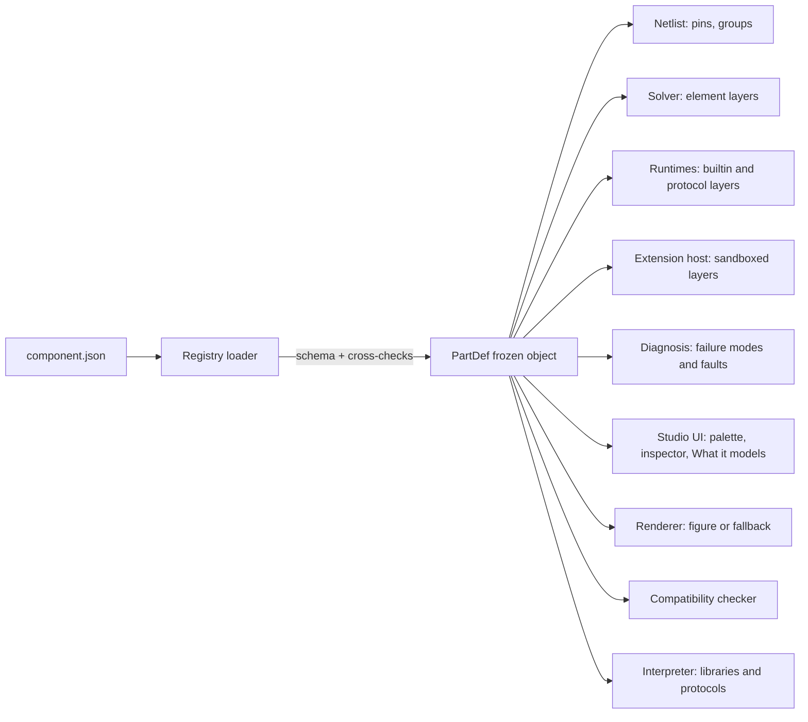
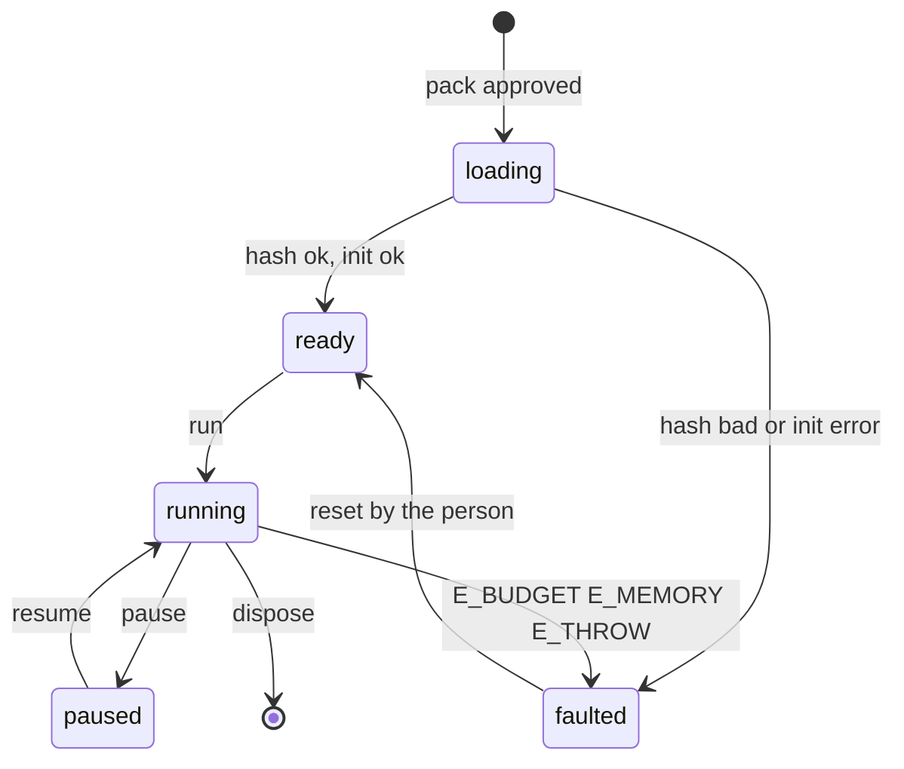
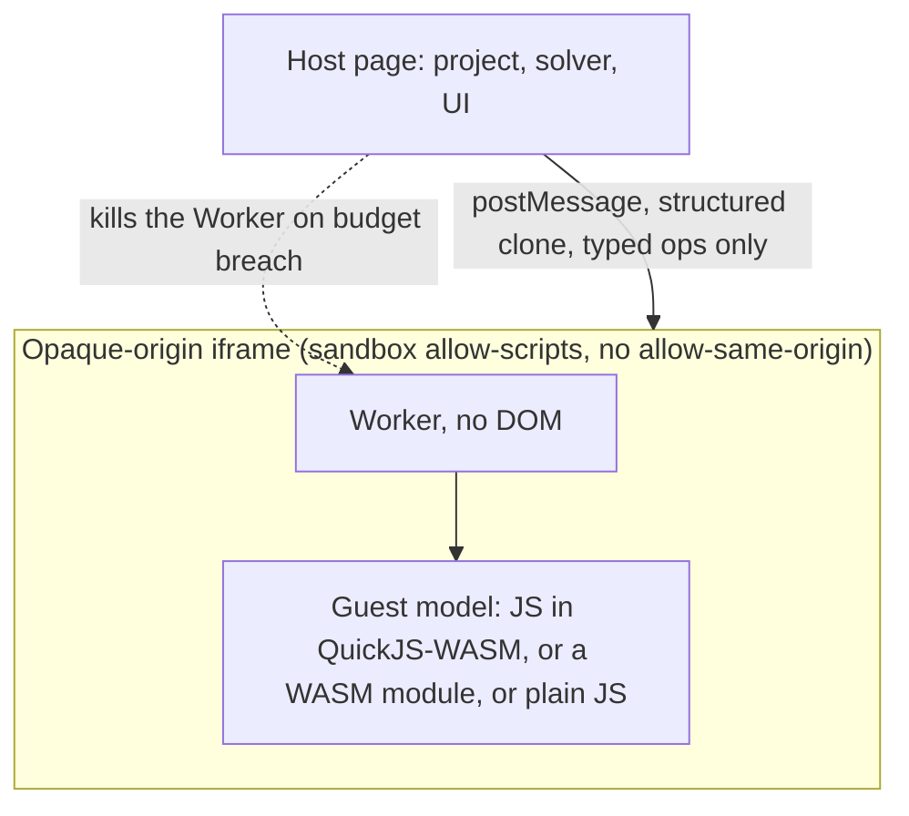

# Component schema and extension boundary

Status: specification, first pass, 2026-10-27. Author: component-schema design pass (ADR range 0200 to 0299).
Files: this document, `schemas/component.schema.json` (JSON Schema draft 2020-12), four examples in
`schemas/examples/components/` (three converted, one new for the mechanics block), and the checking scripts in `schemas/tools/`.

Reading order: section 1 for the decision, section 4 for the format, section 9 for custom parts and the code
boundary, section 12 for the ADRs. Evidence labels follow the brief: VERIFIED (I ran or read it), DOCUMENTED (a
project document says so), EXTERNAL (a third-party source), ESTIMATED (calculation with stated assumptions),
HYPOTHESIS, UNKNOWN. A choice that waits for a spike that has not reported is marked **PENDING RS-xx**.

## 1. The decision in one page

A component is one JSON file, validated by one JSON Schema, loaded lazily by id and version. The file holds
everything the rest of the app needs to know about a part: its pins, its limits, how the simulator should treat it,
how it can break, what it looks like, where each number came from and under which license it may be used.

Five rules shape the format.

1. **Every number has a place and a source.** A rating has three separate slots: what the maker printed, what iynk
   assumed, and what a person measured on a bench. The model reads exactly one slot, named in the file. (ADR-0201)
2. **Behaviour is layered and named, not hidden in code.** A part lists layers (analog, protocol, power, thermal,
   optical). Each layer is a built-in solver element, a subcircuit, a registered behaviour, a truth table, a sandboxed
   extension, or an explicit "not modelled yet". (ADR-0202)
3. **Failure is data with a derivation.** Every threshold says how it was obtained and whether the engine really
   evaluates it today or only scripts it. Failures carry the cause and symptom ids of the shared diagnosis record
   (D-010). (ADR-0203)
4. **Art is optional, the fallback is not.** Every part can be drawn from its pins and dimensions alone. The
   existing hand-inked figures stay as the premium art for core parts. (ADR-0204)
5. **Custom parts come in two modes.** Beginner mode writes only declarative data and needs no sandbox. Advanced
   mode runs a deterministic model under a fixed API, inside a sandbox, with declared permissions and hard limits.
   Which sandbox technology holds the code is **PENDING RS-15**; the API does not depend on the answer. (ADR-0206)

What this pass produced and checked (all VERIFIED by running `schemas/tools/`, ajv 8.17.1 in strict mode):

| Check | Result |
|---|---|
| Schema compiles in strict mode | yes |
| Three converted parts (`core.led-5mm`, `core.l298n-module`, `core.gy521-mpu6050`) validate | 3 of 3 |
| Cross-reference checks (section 6.2) on the three parts | pass |
| Deliberately broken documents rejected | 34 of 34 (list in section 6.3) |
| Well-formed extension layer and a local part with sanitised SVG art accepted | yes |

## 2. Upstream and downstream

| Direction | Item |
|---|---|
| Brief | §9.1 library, §9.2 specifications, §9.3 custom editor, §9.4 marketplace (deferred), §10.2 tiers, §19.6 ADR format |
| Decisions | D-007 honest fidelity labels, D-010 diagnosis record and "descriptor is the seam", D-011 low-end budgets, D-013 to D-017 (open-source lab for Amar and friends, local-first, extras removed, license later) |
| Audit | `01_AUDIT/inventory/figure-engine.md` (part contract, solver elements), `01_AUDIT/TECHNICAL_DEBT.md` (A-items on closed ids and constants in code; B2-08 figure iframe has no `sandbox`; B3-02 closed catalogue), `01_AUDIT/SECURITY_BASELINE.md` X3 |
| Research | `02_RESEARCH/tech/platform-options.md` section 5 (sandbox options), `02_RESEARCH/TECHNICAL_RESEARCH.md` D8 and spike table row for RS-15 |
| Spikes | RS-08 (solver is DC only, 80 circuits match ngspice; piecewise-linear device models differ from realistic SPICE), RS-13 (physics determinism, PASS), RS-15 **not reported**, no REPORT.md exists |
| Requirements | R-028 (unknown part placeholder), R-029 (descriptor), R-030 (open ids), R-031 (netlist from connectivity), R-FID-1 to R-FID-3, R-131 to R-138, R-072 |
| Features | F-096, F-097, F-098, F-099, F-101, F-102, F-103 (out of scope), F-220, F-073, F-213, F-216, F-011, F-025, F-076, F-078, F-082 |
| Journeys | J-04 add and wire components, J-06 meet a simulated fault, J-08 share with a friend, J-11 import |
| Parallel documents | `SIMULATION_ARCHITECTURE.md` (tiers section 4.1, units 5.1, `dmath` and seeds 5 and 6, devices 9.2, failure records 13.3, cause ids 13.4, fidelity registry 16; ADR-0301 to ADR-0314) and `schemas/project.schema.json` (already refers to `core.led-5mm`-style ids, `localId` and `key` from this schema). Reconciled in 4.17 |
| Downstream | Project document spec (parts reference `id@version`), solver spec (element table in 4.9), runtime spec (`builtin` refs), diagnosis spec (failure modes), Studio palette, `docs/FIGURES*.md` |
| ADRs | ADR-0200 to ADR-0208 in section 12 |

Out of scope here: the project document, the netlist algorithm, the solver internals, the diagnosis record's full
shape, the AI partner's operations. This file defines only what a part contributes to them.

## 3. What exists today, and what this pass does with it

Rule from BRIEF §3.5: keep working code until a replacement is measurably better.

| Subsystem | Today (VERIFIED) | Verdict | Why and how |
|---|---|---|---|
| Part art in `figures/parts/*.js` (29 files) and `figures/modules/*.js` (12) | Hand-inked 3D figures built by `figures/tools/cfbuild.py` into 80 static pages under `public/figures/` | **Preserve** | Working, deterministic builds (`figure-engine.md`: rebuilt pages are byte-identical). Descriptors point at them by `visual.breadboard.figure`. Only core parts may ship such a page (executable HTML, see 4.14 and ADR-0204) |
| Pin and leg geometry inside figure code (`B.part legs, span`, `pins: p => ...`) | Duplicated: drawn in the figure, re-stated in docs | **Extend** | The descriptor owns pin ids and positions. `cfbuild.py` already has a `@cf data NAME path.json` directive (`figures/tools/cfbuild.py:14,187`) that inlines JSON as `window.NAME`, so a figure can read its pins from the descriptor instead of repeating them. One source of truth |
| `elec(p)` objects in part files (`{type:'led', vf, imax}`) and the 12 element types read by `figures/engine/bench-solve.js:88-113` | Parameters live in JS beside the drawing; constants like LED `rd = .5` (`bench-solve.js:102`) are not parameters at all | **Extend** | Keep the solver and its 126 tests. The descriptor supplies the same parameters as data with provenance. Make `rd` a parameter. The element list in 4.9 is the solver's contract |
| `B.module({...})` blocks (`power`, `faults`, `elec`, `pcb`, `holes`) | One JS object per module mixes art, electrical facts and fault strings | **Extend** | Split: art stays, electrical facts and faults move to the descriptor, `legacy_id` keeps old fault strings such as `cold:J2` working |
| `I2CDevice` classes in `src/lib/interp/devices.ts` (Mpu6050, Pca9685, Ssd1306, Lcd1602, GenericI2C, HcSr04) | Register-level devices with constants (gyro bias) in code | **Preserve and reference** | Become `builtin` models: `device:i2c/mpu6050@1`. Constants move into descriptor parameters with sources |
| Power-tree rules in `figures/engine/bench.js` (~225 to 290: regulators, dropout, current limits, brown-out) | Rules, not solver elements (`figure-engine.md`) | **Preserve, name** | Referenced as `builtin` refs (`power:linear-regulator@1`) until the solver gets regulator and capacitor stamps (SIM phase) |
| Closed unions of ids (`BoardId` declared twice, five `as const` arrays in `src/content/ids.ts`) | Adding a part means editing types | **Replace** (R-030) | Ids become registry strings. Closed unions stay only for catalogue items bound to figure files until LABS moves them |
| Fact sheets `docs/facts/*.md` | Human-readable sources with `[n]` citations | **Preserve** (F-099) | They stay the long-form evidence. Descriptor `sources[]` cite them with section numbers |
| Drone calculator part set (`src/lib/drone/design.ts`, `designInput` throws on unknown keys) | Closed 3 x 3 x 3 dropdowns | **Replace later** | F-073 and F-216 need descriptors for motors, props and batteries. Section 10 lists what the schema still lacks for them |

## 4. The descriptor format

### 4.1 File, location, identity

| Item | Rule |
|---|---|
| File | `component.json`, UTF-8, no comments, one part version per file. Maximum 256 KiB |
| Repo location for core parts | `parts/<id>/<version>/component.json`, plus `tests/*.json` and optional `art/`. A build step writes `public/parts/` and a generated `public/parts/index.json` (id, version, name, category, tier, status, bytes, sha256) so the palette searches without loading every file |
| Location for custom parts | IndexedDB store `parts`, key `id@version`, and a `parts/` folder inside the project folder on disk (D-015). A project export embeds the descriptors of non-core parts it uses |
| Schema tag | `"schema": "iynk.component/1"`. A file with unknown fields or a newer schema is refused with "made by a newer iynk", the same path as a newer project document (R-027) |
| `id` | `<namespace>.<slug>`, lower case, hyphens inside each half: `core.led-5mm`. `core` is reserved for the repo. `local` is for the person's own parts. Imported packs keep their ids but cannot use `core` |
| `identity.legacy_ids` | The ids the figure and interpreter code use today (`led`, `l298n`, `mpu6050`), so old projects and lessons resolve |
| `version` | Semantic version. See 4.16 and ADR-0205 |

Descriptor size (MEASURED on the three examples, minified JSON): LED 12.0 KB, MPU-6050 module 24.0 KB, L298N module
28.8 KB; gzipped 4.5, 8.3 and 9.1 KB. These sizes include long rationales; the 256 KiB cap leaves a large margin
(ESTIMATED: a board with 40 pins and 60 ratings stays under 80 KB).

### 4.2 Units and text

- **Base units only.** Files never hold prefixed units. Write `0.02` with unit `A`, never `20 mA`. The enum is closed
  (`V A ohm F H W Hz s degC C_per_W mm g N_m rad_per_s deg deg_per_s g0 lux ratio percent 1 bit byte ppm`). The UI picks
  the prefix. Reason: a prefix is the commonest unit bug in hand-written part data, and the closed enum makes it a
  schema error (test "prefixed unit (mA)" in 6.3).
- **Lengths** are millimetres, resolution 0.01 mm. Pin positions use the part frame: origin bottom-left, +x right,
  +y up, +z up from the board, the same frame `docs/facts/*.md` use.
- **Quantity** is `{unit, value}` or `{unit, min?, typ?, max?}` with at least one of the three, never both forms.
- **Text** is `{ "i18n_key"?, "en": "...", "<lang>"?: "..." }`. Core parts give a key (strings live in
  `src/i18n/content/<lang>/parts/`, the same pattern as `src/i18n/content/en/robotics/*.json`) and the English fallback.
  Custom parts give inline translations only. `en` is always required, so a missing translation never shows a key.

### 4.3 Sources

`sources[]` is the list of documents the rest of the file cites. Elsewhere a citation is `{src, loc}` where `loc` is a
page, table, figure or `file:line`.

| Field | Meaning |
|---|---|
| `kind` | `datasheet`, `application-note`, `schematic`, `product-page`, `reseller-guide`, `library`, `photo`, `measurement`, `fact-sheet`, `lesson`, `standard`, `own-estimate` |
| `reliability` | `primary` (the maker's own document, read in full; a mirror of it counts), `secondary` (reseller, mirror excerpt, third party), `unverified` (from memory or a snippet) |
| `retrieved`, `revision`, `url` | Required in practice for datasheets. iynk cites datasheets and does not redistribute them |

A part with `identity.generic = false` must list at least one source of kind `datasheet`, `schematic`,
`product-page` or `reseller-guide` (schema rule). A generic part (a 5 mm LED, a red L298N board with no maker) says
so with `generic: true` and cites what it has. This keeps "no datasheet exists" an explicit statement, not an omission.

### 4.4 Identity

`manufacturer`, `model`, `mpn?`, `refdes_prefix?` (`^[A-Z]{1,4}$`: R, C, D, U, Q, J, SW, BT, M; the editor numbers parts R1, R2 and so on; when absent the editor derives a prefix from `category`, which is the Studio O-S3 table, a PROPOSAL until Studio fixes it), `generic`, `kind` (`ic module discrete board electromechanical sensor actuator
connector mechanical instrument virtual`), `category` (the §9.1 list: microcontroller, dev-board, passive,
semiconductor, sensor, actuator, motor-driver, power, display, communication, mechanical, robotics, drone, fpga,
instrument, virtual), `description`, `chip?` (the IC on a module), `primary_source`, `lifecycle`
(`active nrnd obsolete unknown`; the MPU-6050 is `nrnd` per `docs/facts/mpu6050.md`), `legacy_ids`, `tags`.

### 4.5 Pins, groups, connectors, dimensions

| Block | Fields and rules |
|---|---|
| `pins[]` | `id` (letter first, letters digits underscore, max 32), `name?`, `designator` (the label printed on the real part), `type`, `class`, `polarity?`, `position {x,y,z?}`, `connector?`, `logic_family?`, `pull?`, `note?` |
| `pin.type` | `power_in power_out power_io ground digital_in digital_out digital_io open_drain analog_in analog_out passive mechanical nc` |
| `pin.class` | `power ground digital analog passive bus mechanical nc`: the coarse role the netlist and project document use (R-029 lists six of these). `type` is finer; both are required so the checker can tell an open-drain bus pin from a push-pull output |
| `pin.pull` | `{kind: internal or on-board, to: up or down, rating, rail?, unless_parameter?}`. The resistance is a rating key, not a copy. The loader stamps it as a resistor. `unless_parameter` ties it to a build option, so "R6 left out" removes the pull-down |
| `groups[]` | Pins that are internally one net (`internal-short`, breadboard `strip`, ground `plane`). Used by the netlist (R-031). Breadboards and the Uno's GND pins use them. None of the three examples needs one |
| `connectors[]` | `{id, kind, gender?, pitch?, pins[]}`. Kinds: header, screw-terminal, jst, usb, barrel, breadboard-leg, solder-pad, wire-lead, jumper, other. A pin may be listed in several connectors (the L298N's `V5` is on the power terminal and on both enable headers) |
| `dimensions` | `package`, `body {w,h,d}`, `board {w,h,thickness,corner_radius,mounting_holes[]}`, `height_total`, `mass`, `accuracy` (mm; 0.3 for values read from a photo, 1.0 where the figure file says plus or minus 1 mm), `source` |

Large pin counts (a breadboard has hundreds) are produced by a pattern in the generator that writes the file; the
schema allows up to 1024 pins and 256 groups (a full 830-point breadboard is about 838 holes in about 130 strips, Studio O-S7; project.schema.json `Interface` mirrors both caps, and an `InterfaceGroup` holds up to 256 pins) and the file stays plain data. A pattern language inside the schema is not added: it
would need its own interpreter and error cases (YAGNI until a board needs it, HYPOTHESIS that generating the JSON is
enough).

### 4.6 Ratings: three slots with provenance

This is the answer to BRIEF §9.2 "distinguish manufacturer-stated ratings from simulation assumptions and
experimentally validated behaviour".

`ratings` is an object keyed by a stable name (`vs_abs_max`, `forward_current_continuous`). Each entry:

| Field | Meaning |
|---|---|
| `measure`, `role` | What kind of quantity (`voltage current power temperature frequency resistance capacitance time thermal_resistance torque rate acceleration ratio other`) and its role (`abs_max abs_min operating recommended threshold characteristic consumption thermal timing`) |
| `scope` | `{part: true}`, `{pins: [...]}` or `{layer: "..."}`: what the number applies to |
| `manufacturer` | **Stated.** A quantity plus a required `source`, optional `conditions`. Only for a number a maker printed |
| `simulation` | **Assumed.** A quantity plus a required `rationale` and `confidence` (`low medium high`), optional `derived_from` (rating slots it was computed from, as `key.slot`) and `source` |
| `measured` | **Bench-measured.** A quantity plus required `source`, `method`, `samples` (integer, at least 1) and `date`. The UI says "bench-measured", never "validated" (D-007, R-FID-1 copy check) |
| `used_by_model` | `manufacturer`, `simulation`, `measured` or `none`. The slot the simulator reads. Must name a slot that exists (schema rule). `none` means shown to the person, read by no model |

Reading rules:

1. The model reads only the slot named by `used_by_model`. A model parameter points at a rating with `from_rating` (and
   `pick: min|typ|max|value`) or `by_parameter` (choose the rating by an instance parameter, as the LED does for colour).
   A literal parameter must carry its own `rationale`. This leaves no unsourced number in a model.
2. The UI shows every present slot side by side under three labels: "Stated by the maker", "iynk's assumption",
   "Bench-measured", and marks which one the simulation uses. The L298N's `quiescent_current_vs` shows two slots on
   one rating (maker typical 50 mA, simulation 50 mA taken from it).
3. A `simulation` value outside a present `manufacturer` range needs a rationale that says why (loader warning S-12).
4. Changing `used_by_model` or any slot the model reads is a behaviour change (ADR-0205).
5. For a failure threshold whose rating has `used_by_model: none`, the loader reads the first present slot in the order
   manufacturer, simulation, measured. This is allowed only when the failure mode's `implemented_as` is `scripted` or
   `not-implemented`, so a documented-only limit does not force a model to read it.

What the examples show about real data (VERIFIED in the files):

| Part | Ratings | Only manufacturer | Only simulation | Both | `used_by_model: none` |
|---|---|---|---|---|---|
| LED | 9 | 0 | 9 | 0 | 0 |
| L298N module | 24 | 15 | 7 | 2 | 10 |
| MPU-6050 module | 16 | 11 | 4 | 1 | 8 |

The LED has no maker slot at all because a generic 5 mm LED has no datasheet; the fact sheet itself says maker values
"vary" and one is "unverified". The tool does not invent one. The L298N and MPU-6050 show the other side: many
datasheet limits that no model reads yet (10 and 8 ratings). They stay in the file so the person sees them, and so the
next model upgrade has the source ready.

### 4.7 Protocols, power, parameters, physical channels

| Block | Fields and rules |
|---|---|
| `protocols[]` | `{id, kind, role, pins {signal: pinId}, params?, speed_max?, status}`. Kinds: i2c spi uart onewire pwm servo-pwm step-dir gpio analog usb can i2s swd jtag custom. `speed_max` is a rating key. `status` is `modelled` or `not-modelled-yet`: the second must produce a named diagnostic when a program uses it, never a silent value (R-FID-3, `spi-not-modelled`). The MPU-6050 lists its auxiliary I2C master as `not-modelled-yet` |
| `power.inputs[]` | `{id, pins, ground, voltage (rating key), current? (rating key), condition?}` |
| `power.outputs[]` | `{id, pin, nominal, source, dropout?, current_max?, condition?}`. The L298N's `+5V` pin is an output only while the 5V-EN jumper is fitted, and says so |
| `power.consumption[]` | `{id, mode, rating}` per operating mode |
| `power.protection[]` | `{kind, present, note?, source?}` for reverse polarity, overcurrent, overtemperature, overvoltage, short circuit, undervoltage lockout, ESD, flyback. A `present: false` entry is a fact people need ("no reverse-polarity protection anywhere") |
| `parameters[]` | Values the person sets on a placed instance. `kind`: `variant` (which product, the LED colour), `build-option` (a jumper or a left-out resistor), `setting` (a dial), `environment` (an outside condition). `type`: enum (needs `values`), number (needs `min`, `max`, `unit`), boolean. `affects` names the pins, layers or ratings that change |
| `physical_inputs[]`, `physical_outputs[]` | Non-electrical channels: acceleration in, light out, torque out. `{id, unit, axes 1|3, range, world_channel}`. `world_channel` is the name in the world or environment model that drives or reads it (`imu.accel`) |
| `internal_nets` | Named internal rails that layers read or drive and that are not pins (`V3V3` on the MPU module) |

### 4.8 Behaviour layers

`behaviour.layers[]` is the answer to "which solver element or behavioural model implements it". Each layer has an
`id`, a `domain` (`analog digital protocol power mechanical thermal optical environment`), optional `reads` and
`drives` (pin ids, channel ids, parameter ids, layer ids, internal nets), and a `model` with a `kind`:

| `model.kind` | Meaning | Who may use it | Needs a sandbox |
|---|---|---|---|
| `element` | One primitive of the solver, with a map from its terminals to pins and parameters | any mode | no |
| `subcircuit` | Instances of elements or other components (pinned to an exact `id@x.y.z`) joined by nets | any mode, core and local | no |
| `logic` | A combinational truth table over named pins, an optional delay, an output drive rating | beginner mode | no |
| `builtin` | A behaviour iynk ships in code, named `domain:name@major` (for example `device:mpu6050@1`, resolved in the device registry of `SIMULATION_ARCHITECTURE.md` 9.2), with parameters. The major is the behaviour contract | core parts only | no (it is first-party code) |
| `extension` | A sandboxed model. Manifest in 9.4 | advanced mode, never auto-run | yes |
| `none` | Explicitly not modelled, with a reason | any | no |

`builtin` is how the existing hand-written models enter the format without rewriting them. Each carries an
`implementation.path` and note naming where the code is today. Six refs appear in the examples:
`optical:power-law-brightness@1` (inline at `figures/engine/bench-bb.js:211`), `module:l298n-bridge@1`
(`figures/modules/l298n.js:40-60`), `device:mpu6050@1` (`src/lib/interp/devices.ts:21-102`),
`power:linear-regulator@1` (shared by both modules, `figures/engine/bench.js` around line 257),
`thermal:series-steady@1` and `indicator:rail-led@1`.

### 4.9 Solver elements the descriptor may name

First group: exists in `figures/engine/bench-solve.js:88-113` (VERIFIED by reading). Second group: needs solver work in the
SIM phase and a transient capable engine (RS-08 part b, the RC/RLC/buck accuracy run, was **not run**; RS-07 libngspice
is not reported). A descriptor may name these elements now; on a solver that lacks one the layer loads as
`none` and the part shows "not modelled yet" (R-FID-1).

| Element | Status | Terminals the solver reads |
|---|---|---|
| `wire`, `res`, `pot`, `button`, `led`, `diode`, `npn`, `motor`, `servo`, `stepper`, `sensor`, `buzzer` | Exists | per kind, for example `led`: anode, cathode; parameters `vf`, `rd`, `imax` |
| `capacitor`, `inductor`, `voltage_source`, `current_source`, `switch`, `pnp`, `mosfet_n`, `mosfet_p`, `zener`, `opamp`, `regulator_linear` | Planned. **PENDING** SIM phase and the RS-07/RS-08b decision | to be fixed in the solver spec |

Model quality note (VERIFIED, RS-08 REPORT): the in-house solver matches ngspice with matched device models to 10
digits on 80 circuits, but its piecewise-linear LED, 1N4007 and TIP120 models differ from realistic SPICE models in six
of 20 cases by more than 5 percent (the report's node-voltage errors reach 12 to 21 percent in the low-current LED, 1N4007 and TIP120
cases and 41 percent for the stalled motor; the LED current at 0.3 mA is 7 percent off). That is why every element-based part is tier T1 until a test says more.

### 4.10 Failure modes and injectable faults

Two blocks, because two different things happen.

**`failure_modes[]`** are thresholds the part crosses by itself: an LED burns above a current, a regulator dies above
35 V. Fields: `id`, `cause_id`, `symptom_ids[]`, `when[]` (all conditions must hold), `effect`, `derivation`,
`basis`, `source?`, `implemented_as`, `hints[]`.

- `when[]` item: `{measure, target, op, threshold, for?}`. `measure`: `pin_voltage`, `pin_voltage_reverse`,
  `pin_current`, `pin_current_peak`, `part_power`, `junction_temperature`, `case_temperature`, `stall_duration`,
  `supply_time_out_of_range`. `threshold` is `{rating, pick?, factor?}` or `{literal}`. A factor lets the LED say
  "2.5 times the continuous rating" without a second number.
- `effect`: `state` (`burnt open_circuit short_circuit degraded latched_off thermal_cutout derated reset reads_zero`),
  `latched` (true until replaced or reset), `recovers_when`, `detail`.
- `derivation` is required text: how the threshold was obtained and what was judged.
- `basis`: `manufacturer`, `simulation-assumption`, `measured`.
- `implemented_as`: **`threshold`** (the model evaluates `when`), **`scripted`** (the behaviour exists but a timer or an
  injected fault flag drives it, not these quantities), **`not-implemented`** (documented only). This field exists
  because the first conversion found real cases of the second and third (below). Without it a threshold in the file
  would claim more than the engine does.
- `hints[]`: up to three, `level` 1 to 3, the hint ladder of D-010.

**`injectable_faults[]`** are faults the person or a lesson applies: a cold joint, a left-out jumper, the wrong supply
voltage. Fields: `id`, `kind` (`open_pin short_pins missing_part reversed_supply wrong_supply_voltage cold_joint
stuck_level wrong_value reversed_part floating_pin option_removed overload other`), `target {pins?, parameter?, rail?}`,
`value?`, `cause_id`, `symptom_ids`, `legacy_id`, `hints`. These replace the fault strings the figure engine uses
today (`cold:J2`, `missing:JPA`, `wrong-voltage:bench:36`, `reverse-polarity:bench`, `stall`), found at
`figures/modules/l298n.js` `faults:` and `figures/engine/bench.js:161,227,292`. `legacy_id` keeps lessons that name
them working.

Both blocks use `cause_id` and `symptom_ids` from the shared diagnosis record `{cause_id, symptom_id, evidence,
hint_level}` (D-010). The part supplies the catalogue side (which causes and symptoms this part can produce, with hint
text). Evidence is produced at run time by the diagnosis layer, not stored in the part. Because they live in the
descriptor, "faults on any circuit" (D-014) works for any placed part, not only for the 12 benches.

What the first conversions found (VERIFIED against the code):

| Part | Finding | Where |
|---|---|---|
| L298N | The overtemperature cut-out is a timer, not a temperature: after 6 s with the stall fault set, outputs are off for 2 s of every 5. The computed junction temperature is not read. Marked `implemented_as: scripted` | `figures/modules/l298n.js:56` |
| L298N | The bridge assumes a fixed 0.6 A motor and 3 ohm winding instead of reading the attached motor. Both are listed as simulation-slot ratings with confidence `low` and as a known gap | `figures/modules/l298n.js:25-26,40-47` |
| L298N | No numeric test of the drop fit or the truth table; existing tests check text and ids | `src/content/robotics/l298n.test.ts` |
| MPU-6050 | The figure prints its own simpler sample text; the register model in `devices.ts` is a separate implementation | `figures/modules/mpu6050.js:55-62` |
| MPU-6050 | The datasheet's noise, drift and DLPF are not modelled; only a constant gyro bias is | `src/lib/interp/devices.ts:33` |
| MPU-6050 | 5 V on a 3.3 V logic pin is documented as a real failure and is not implemented (`not-implemented`) | `docs/facts/mpu6050.md` section 3.6 |
| LED | One fixed 0.5 ohm slope for every colour and current; RS-08 shows 0.299 mA modelled against 0.321 mA realistic at 0.3 mA | `bench-solve.js:102`, RS-08 case C08 |
| LED | The 13.6 mA brightness reference and 0.55 exponent are the Learn Arduino lesson's curve (third-party content, D-017 check) | `figures/parts/led.js:3-4` |

### 4.11 Simulation block, tier and status

| Field | Rule |
|---|---|
| `tier` | The tier the author asserts, numbered and defined as in `SIMULATION_ARCHITECTURE.md` 4.1: `T0` illustration (scripted outcome), `T1` teaching model, `T2` calculated model (cited parameters, tolerance bands, a convergence report and a comparison with an independent engine), `T3` runs firmware; `none` for a part that is not modelled. The fidelity registry CI fails a tier the evidence does not support (its section 16.3). The PRD's tier table lists T1 to T3 and "none" with a different T2 name; see Objections 6. All three examples are T1 |
| `status` | `modelled`, `partly-modelled`, `not-modelled-yet` (R-FID-2). `not-modelled-yet` forces tier `none` (schema rule). A part that is not `not-modelled-yet` must have `what_it_models` and at least one test (schema rule). T3 needs a test of kind `bench-measurement`, `ngspice-comparison` or `golden-trace` (schema rule) |
| `what_it_models[]`, `not_modelled[]` | Plain sentences. They feed the "What it models" panel (D-007). Wording rule: the words "validated", "verified against hardware", "accurate", "exact" and "real" about simulation output fail the copy check (R-FID-1) |
| `validity[]` | Ranges the model was checked or fitted over, with units |
| `known_gaps[]` | `{id, text, evidence}`: gaps the author knows about and the file or line that shows them |
| `solver_requires[]` | Element kinds the layers use. The loader checks the running solver provides them (S-10) |
| `tests[]` | `{id, kind, file, source?, tolerance?, state?, note?}`. `kind`: `datasheet-point ngspice-comparison bench-measurement golden-trace property conformance`. `state: to-write` marks a test the conversion still owes; the PARTS gate fails any part that has one (R-131 gate) |

Why all three are T1. The T2 entry bar (`SIMULATION_ARCHITECTURE.md` 4.1 and 16.3) needs tolerance bands, a convergence report and a
comparison with an independent engine on a named corpus. None of the three has one. The LED comes closest (RS-08 compares the solver
with ngspice, but with the solver's own piecewise-linear devices it matches to 10 digits and with realistic devices it is off by 7 percent
at 0.3 mA). The MPU-6050 register model uses datasheet constants and has no tolerance or noise. The L298N bridge has fitted parameters,
but its load is a hard-coded guess and its thermal cut-out is a timer; reading the load from the attached motor and driving the cut-out from
junction temperature are what would be needed first. These are decisions made by reading the code, not measured results.

Reference tests (the REF-6 rule: each part has at least one model test against a source). Today's state across the
three examples: LED 2 tests exist (a golden trace at `figures/engine/bench-solve.test.mjs`, an ngspice comparison from
RS-08); MPU-6050 1 exists and 1 is `to-write`; L298N 0 exist and 2 are `to-write`. So the L298N does not yet meet REF-6.

### 4.12 Software and compatibility

**`software.environments[]`**: per language (`arduino-cpp c cpp micropython python verilog vhdl none`), a list of
libraries `{name, version?, install?, url?, license?, source?, iynk_support, note?}`. `iynk_support` is `supported`,
`partial` or `unsupported`; `unsupported` must give a named diagnostic when a program includes it, not silence.
Example: Adafruit MPU6050 2.2.9 is listed `unsupported` because it needs BusIO and Unified Sensor classes the
interpreter does not run (HYPOTHESIS; the interpreter's coverage was not re-tested in this pass, check against
`inventory/interp.md` before relying on it).

**`compatibility.rules[]`**: `{id, kind, severity (error|warning|info), params, message}`. Kinds and required params:

| Kind | Required params | Check |
|---|---|---|
| `logic_level_mismatch` | `pin`, `limit_rating` | The pin's driven level (outputs: `typ` of the rating) or tolerance (inputs: the abs max) against every pin it connects to. L298N `V5` into a 3.3 V pin is an error |
| `voltage_window` | `pin`, `rating` | The voltage on the pin's net against the rating's range |
| `needs_pullup` | `pin`, `min_ohms`, `max_ohms` | The net has a pull resistor in range, from `pull` or from other parts |
| `bus_address_unique` | `protocol` | No two devices on one bus share an address |
| `current_budget` | open | Sum of consumers on a rail against its supply limit |
| `jumper_state` | `parameter`, `value` | A build option should be in a given state, optionally above a voltage |
| `needs_common_ground` | open (`pin`) | The part's ground is joined to the controller's ground |
| `custom_warning` | open | A message with a pointer to where it applies |

Rules are data, so the AI partner (later phase) and the diagnosis layer read the same ones.

### 4.13 Visual

| Field | Rule |
|---|---|
| `visual.breadboard` | `{figure {kind part|module|board, id, path, sha256?, engine}, legs[], span[min,max]}`. Points at the existing built page. `legs` is the pin order of `B.part legs`; `span` is `B.part span` (columns the legs spread over). Core parts only |
| `visual.schematic` | `{symbol, pin_sides}`. `symbol`: `generated resistor led diode capacitor inductor switch transistor-npn motor ic-box module-box` |
| `visual.fallback` | **Required.** `{renderer, label, body_colour, show_pin_labels}`. Renderers: `generic-two-lead`, `generic-dip`, `generic-header-module`, `generic-terminal-module`, `generic-box` |
| `visual.assets[]` | `{path, media_type, sha256, license, attribution?}`. `image/svg+xml`, `image/png`, and `text/html` for core only |

**Generic fallback renderer contract.** It draws from `pins[].position`, `dimensions` and the fallback block only, with
no per-part code. `generic-two-lead` draws a body and two leads; `generic-dip` a rectangle with pin stubs on two sides
following the pin positions; `generic-header-module` the board outline (`dimensions.board`), the connector row and the
label; `generic-terminal-module` the same with terminal blocks; `generic-box` a box with stubs by `schematic.pin_sides`.
The pin positions are the hit targets for wiring in every case, so a part with the fallback wires exactly like one with
art. CI renders each core part with the fallback and with the figure and fails if a pin falls outside the figure's bounds
by more than the descriptor's `dimensions.accuracy` (a test to write; not run).

**Why only core parts may ship an HTML figure.** Today a figure page is executable HTML in an iframe with no `sandbox`
attribute, same origin (`SECURITY_BASELINE.md` X3; `TECHNICAL_DEBT.md` B2-08; DOCUMENTED: `TECHNICAL_DEBT.md` B2-08 cites `FigureFrame.tsx:351-357`; I did not re-read that file).
That is acceptable for first-party files and is not acceptable for a pack from a friend. The schema therefore rejects
`visual.breadboard` and `text/html` assets when `provenance.origin` is `local-user` or `imported-pack`. They use
`image/svg+xml` or `image/png`, which the loader sanitises (no script, no `foreignObject`, no external references, size
cap) and renders through an `img` element, or they use the fallback. Two tests in 6.3 cover this.

### 4.14 Provenance, license, review

| Field | Rule |
|---|---|
| `license` | **Required** (R-138). SPDX expression or `LicenseRef-*`. While D-017 is open, core parts use `LicenseRef-iynk-pending`; one codemod replaces it when the license is chosen |
| `license_scope` | Optional split for `descriptor`, `art`, `model` |
| `attribution[]`, `authors[]` | Text and links. Datasheet numbers are cited, not redistributed |
| `origin` | `core`, `local-user`, `imported-pack` |
| `third_party_content` | True if text, numbers or art came from a third-party site and still need the D-017 check. The LED sets it true (the brightness curve and colour values come from the Learn Arduino lesson); the loader can list every part with it true before the repo is published |
| `review` | `{status: unreviewed|ci-checked|human-reviewed, by?, date?}`. A statement about process, never about physical truth |
| `changelog[]` | `{version, date, note, behaviour_change}` |

### 4.15 How the pieces are read



The loader returns a frozen `PartDef` with pins indexed by id, ratings resolved to the slot the model reads, and
`from_rating` references replaced by numbers. Nothing downstream re-reads the JSON. The solver never sees provenance.

### 4.16 Versioning

| Rule | Detail |
|---|---|
| Registry is immutable per `id@version` | Same id and version with different bytes is refused. The project document stores `{ref: "core.led-5mm", version: "1.0.0"}` per instance and one `dependencies.components[]` entry with `origin` (PROJECT_DATA_MODEL 5.3, ADR-0107). There is no `ref@version` string form in the project. A `digest` of the canonical descriptor is stored for `library` and `embedded` parts only; a mismatch blocks load. `builtin` parts carry no digest: they are pinned by the app version and checked by the CI interface-drift test (the shipped examples' interface snapshot must equal the shipped descriptor) |
| Patch (`x.y.Z`) | Text, sources, art, notes. The golden traces must be unchanged |
| Minor (`x.Y.0`) | New optional data, a new parameter with a default that keeps old behaviour, a new test |
| Major (`X.0.0`) | Any change to the pin set, to a slot the model reads beyond the declared tolerance, to a layer, or to a failure threshold |
| Project pins | A project keeps loading with the version it pinned (R-029: `led@1` keeps version 1 behaviour). Upgrading is an explicit action that shows the descriptor diff and the golden-trace differences |
| Missing part | Falls back to the R-028 placeholder: kept on save, pins taken from the wires that touch it, labelled "unknown part" |
| Deprecation | `lifecycle` is about the real part; a descriptor may be superseded by adding `supersedes` in a later minor. Not modelled yet in the schema (YAGNI) |

### 4.18 Mechanics block (schema 1.1)

Optional top-level `mechanics` object, added as a minor of schema 1 (ROBOTICS_ARCHITECTURE 6.1 and DRONE_ARCHITECTURE 6.1 asked for it; ADR-0710 depends on it). The `schema` tag stays `iynk.component/1`; the block is optional, so every 1.0 descriptor stays valid. A reader that does not know the block would refuse the file under the unknown-field rule, which is the intended "made by a newer iynk" path.

Names and units are those of the two architecture documents, not new ones: the unit is in the field name and is a base unit (`r_ohm`, `l_henry`, `j_kgm2`, `torque_stall_nm`, `speed_s_per_60deg`), or one of the hobby units already in the unit enum or named in the field (`mm`, `g`, `deg`, `kv_rpm_per_v`, `capacity_mah`). A value that is a plain number here is not a `quantity` object: there is no min/typ/max triple, and the one source for the sub-block is its `source` (a `sourceRef`). Tolerance is a later minor (section 10).

| Sub-object | Fields (required in bold) | Read by |
|---|---|---|
| `motor` | **`r_ohm`**, `l_henry`, `kv_rpm_per_v` or `ke_vs_per_rad` (**one of them**; kt equals ke in SI and is stored once), `j_kgm2`, `b_nms_per_rad`, `i_noload_a`, `v_nominal`, `v_max`, `i_stall_a`, `i_max_a`, `i_burst_a`, `torque_stall_nm`, `stator_mm [2]`, `gear {ratio, efficiency, backlash_deg?, j_out_kgm2?}`, `mass_g` | RB-E-DRIVE, robot checker (F-213), drone solve (DRONE 6.2) |
| `servo` | **`stall_torque_nm`**, **`speed_s_per_60deg`**, `speed_rad_per_s` (derived), `pulse_min_us`, `pulse_max_us`, `angle_range_deg`, `deadband_us`, `i_stall_a`, `i_idle_a`, `mass_g` | RB-E-DRIVE |
| `stepper` | **`steps_per_rev`**, **`holding_torque_nm`**, **`r_ohm`**, **`i_rated_a`**, `l_henry`, `j_kgm2`, `pullout [{rpm, torque_nm}]`, `mass_g` | RB-E-DRIVE |
| `driver`, `encoder`, `wheel` | `driver {kind, decay, vdrop_v, i_max_a, pwm_max_hz}`; `encoder {counts_per_rev, channels, index}`; `wheel {diameter_mm, width_mm, mass_g, mu, crr}` | robotics 6 to 9 |
| `prop` | **`diameter_mm`**, **`pitch_mm`**, **`ct0`**, **`cp0`**, `blades`, `mass_g`, `j_kgm2`, `ct_vs_j [{j, ct}]`, `cp_vs_j [{j, cp}]` (2 to 16 points), `rpm_max`, `reverse_thrust_factor` | DRONE 6.2 |
| `esc` | **`i_cont_a`**, **`protocol`** (`pwm oneshot dshot150 dshot300 dshot600`), `i_burst_a`, `channels`, `brake`, `efficiency`, `v_max`, `mass_g` | DRONE 6.1 |
| `battery` | **`cells`** (series), **`capacity_mah`**, **`r_cell_ohm`**, `parallel`, `c_continuous`, `c_burst`, `chemistry` (`lipo lihv liion nimh lifepo4 alkaline`), `ocv_table`, `mass_g` | DRONE 6.1, robot power check |
| `frame`, `fc` | `frame {mass_g (required), wheelbase_mm, arm_count, prop_max_in, cd_area_m2 [3]}`; `fc {gyro, loop_hz_max (both required), accel, baro, mag, mass_g}` | DRONE 6.1 |
| `sensor` | **`query`** (`ray-fan surface-sample contact joint body-rates`), `beam_deg`, `rays`, `range_min_mm`, `range_max_mm`, `noise_sigma_mm`, `noise_sigma_ratio`, `period_s`, `latency_s`, `echo_max_angle_deg`, `footprint_mm`, `channels` | ROBOTICS 8 |
| `mass_g` | Whole-part mass when no sub-object gives it | both |

Differences from the two source documents, so nobody is surprised: `sensor` is new (ROBOTICS 8 lists the numbers in a table but had no field names); `battery.parallel`, `chemistry` extra values and `motor.stator_mm` were added or widened; the drone `fc`, `esc` and `frame` blocks are as in DRONE 6.1 except that fields the drone document marks required in prose are required here only where a solve cannot run without them. The loader refuses a model run that needs a missing field and names it (DA-03); a part with only some fields is `partly-modelled`. Unit-only checks are in the schema; "is this motor physically consistent" (for example `ke` against `kv`) is a loader rule, not a schema rule (UNKNOWN until the loader exists). Example: `schemas/examples/components/dc-gear-motor.component.json`, whose numbers are labelled iynk assumptions.

### 4.17 Relation to the simulation architecture

`SIMULATION_ARCHITECTURE.md` was written in parallel and defines the layers this schema feeds. Where the two describe the same
thing, one of them is the authored source and the other is generated, so nothing is stated twice.

| Topic | Simulation architecture | This schema | Settled as |
|---|---|---|---|
| Fidelity registry (its section 16, ADR-0310): one `FidelityEntry` per model with `implements`, `mocked`, `unsupported`, `parameterSources`, `validation`, `operatingRange`, `knownFailureCases` | Hand-authored JSON under `sim/registry/entries/` | The descriptor's `simulation` block and `ratings` hold the same facts for a part | **The descriptor is the authored source for entries of kind `part-model`.** A build step writes `part-model:<id>@<major>` from it: `what_it_models` to `implements`, `mocked` to `mocked`, `not_modelled` to `unsupported`, `validity` to `operatingRange`, `known_gaps` to `knownFailureCases`, ratings to `parameterSources`. Entries for engines, runtimes, devices, buses, sensors, environment and rules stay hand-written. `validation` records (n, passed, worst error) are written by CI from `tests[]`; a descriptor never states a result. (ADR-0208) |
| `ParameterSource.type` (datasheet, fit, measurement, assumption, numerical) | Five values | Three slots | `manufacturer` is `datasheet`; a `simulation` slot with `derived_from` is `fit`; a `simulation` slot without it is `assumption`; `measured` is `measurement`. `numerical` is for engine settings, not parts. The registry's T2 rule lets an `assumption` stand only for a secondary parameter, so a rating may carry `primary: true` |
| Failure records (its 13.3): `FailureModel` with a safe-expression `trigger`, `window`, `outcome`, `derivation`, `referenceData`, `validRange`, `threshold` | Registry records | `failure_modes[]` | The descriptor is the authored form; the loader compiles it. `when` becomes the trigger text (for the LED: `peak(i(A)) > 2.5 * rating.forward_current_continuous`), `for` becomes `window`, `effect` becomes `outcome`, `derivation` and `source` become `derivation` and `referenceData`. Not in the descriptor yet: `threshold.distribution` (part spread; a later minor adds an optional `spread`), `assumptions[]` (carried in `derivation`). Missing in the registry record: `implemented_as`. Compiled records marked `scripted` show "scripted, not computed" in the panel (AC-CS-13); `not-implemented` ones are not compiled |
| Units (its 5.1): SI base, field-name suffixes, time in integer ns, radians | Engines | Files hold base units plus `mm`, `deg`, `deg_per_s`, `g0` | The loader converts once, at the boundary, as its rule 1 says. Prefixed text such as `4k7` is for people typing in the UI and is parsed there; descriptor files stay prefix-free so they need no parser |
| Tolerance (its 5.1 rule 2): `{nominal, tol, dist}` | Per value | `min`/`typ`/`max` on ratings; numeric parameters have none | Gap, section 10: add `tolerance` to numeric parameters |
| Devices (its 9.2): `device:mpu6050@1` as data plus a registered behaviour | Device spec JSON with registers and `expr` | A `builtin` layer with that ref | The ref resolves in their device registry. The descriptor carries only parameters and sources. I add no register-map kind here, so the format is defined once, in their document |
| Sensors (its 12.2): `sensor:tmp36@1` | Registry | A `builtin` layer | Same |
| Cause ids (its 13.4): closed core list plus `x-` ids | Registry | `cause_id`, `symptom_ids` strings | Loader rule S-17 |
| `dmath`, `rng(seed, stream)`, snapshots, budgets, 2 s kill (its ADR-0301, 0303, 0311, 0312; BUD-12) | Engines | The extension ABI | 9.5 to 9.7 use them. `math.*` is `dmath`; the guest's random stream is `ext:<partId>`; `snapshot` and `restore` are the engine snapshot contract; the worker is killed when it does not answer within 2 s |
| Tiers (its 4.1): T0 to T3 and a separate bench-checked mark | Four tiers | `tier` enum T0 to T3 and `none` | Adopted. `measured` slots feed the bench-checked mark only through a registry `bench` record |

## 5. Mapping the existing code to the format

| Existing | Becomes | Notes |
|---|---|---|
| `B.part(name, {legs, span, params, elec, draw, tag})` in `figures/parts/*.js` | `pins` (legs), `visual.breadboard.legs/span`, `parameters`, a layer of kind `element`, art stays | `params.color` array becomes an enum parameter |
| `elec: p => ({type:'led', vf, imax})` | `behaviour.layers[].model` kind `element`, params as `from_rating` | `rd` becomes a parameter |
| `B.module({id, pcb, holes, silk, parts, power, faults, elec, modes, xr, tags})` | `dimensions.board`, `connectors`, `power`, `injectable_faults`, `protocols`; `silk, traces, xr, tags, modes` stay in the figure | `modes` are demo programs: they belong with lessons, not the part |
| `power.sources / rails / mcu` | `power`, layers of `builtin` regulators, `failure_modes` for min and max rail | Example: L298N `mcu.min 6.5` is the rating `vs_min_for_logic` |
| `faults: ['cold:J2', 'missing:JPA', ...]` | `injectable_faults` with `legacy_id` | Seven in the L298N, four in the MPU-6050 |
| `I2CDevice` classes | `builtin` model `device:<name>@1` plus `protocols[]` | Registry of built-in refs sits in the runtime spec |
| `docs/facts/<part>.md` | `sources[]` and `loc` strings | The sheet keeps the long text |
| `src/content/ids.ts` unions | Registry strings (R-030) | Keep a derived union only for catalogue items bound to figures |

**Conversion tool (planned, not built).** `scripts/part-draft.mjs` reads a figure file and its fact sheet and writes a
draft descriptor with every `rationale` and `source` set to `TODO`. A draft with a `TODO` fails the schema test, so a
person must fill provenance by hand; the tool cannot invent a source. The three examples in this pass were written by
hand to learn what the tool must ask for. Counting what the hand conversions surfaced: 2 known gaps for the LED, 3 for
the L298N, 2 for the MPU-6050, plus three `to-write` tests. Effort for the remaining 26 parts, 9 modules and 12 boards:
UNKNOWN (not estimated; set after the tool exists and one more conversion round is timed).

Order of conversion (follows R-029 and R-131): first the parts the Uno-first Studio needs (Uno R3, LED, resistor, push
button, buzzer, potentiometer, one I2C display), then the rest of the 29 parts, then the modules, then the other 11
boards in STUDIO (R-072).

## 6. Validation

### 6.1 JSON Schema (static)

`schemas/component.schema.json`, draft 2020-12, `$id` `urn:iynk:schema:component:1`. Checked with Ajv 8.17.1 using
`strict: true`, `strictRequired: false` (the `text` object requires `en`, which a `patternProperties` entry defines),
`strictTypes: "log"`, `allowUnionTypes: true`. Every object closes with `additionalProperties: false` or
`unevaluatedProperties: false`, except `x_*` keys at the top level, which tools may use.

Conditional rules the schema enforces: non-generic parts cite a datasheet-class source; `used_by_model` names an
existing slot; the three slot types require their provenance fields; status and tier agree; modelled parts need tests;
T3 needs a reference test; enum parameters need `values` and number parameters need a range; literal model parameters
need a rationale and cannot also have `from_rating`; extensions need limits within caps; local and imported parts cannot
carry figure pages; compatibility rules need their kind's params.

### 6.2 Cross-reference checks (loader and CI)

JSON Schema cannot check references. `schemas/tools/semantic.mjs` implements S-01 to S-09, S-11, S-13, S-14 and the coverage half of S-10, and passes on all
three examples. S-12, S-15, S-16 and the solver half of S-10 need the running app and are not in the script:

| Id | Check |
|---|---|
| S-01 | Pin, source, layer, parameter ids unique; connector and group pins exist |
| S-02 | Every `{src}` citation resolves to a `sources[]` id; `primary_source` exists |
| S-03 | Rating scopes name existing pins and layers; `derived_from` names existing `key.slot` |
| S-04 | Every `from_rating`, `by_parameter.map`, power, protocol, pull, rule and threshold rating key exists |
| S-05 | The `pick` member (`min typ max value`) exists in the slot the rating is used from |
| S-06 | Model parameter unit equals the rating unit |
| S-07 | Every value of an enum parameter used by `by_parameter` has a mapping |
| S-08 | Layer `reads` and `drives` resolve to a pin, channel, parameter, layer, protocol or internal net |
| S-09 | Failure and fault targets and parameters exist |
| S-10 | `solver_requires` covers the element kinds the layers use; the running solver provides them (loader only) |
| S-11 | Pin positions lie inside the board outline when one is given |
| S-12 | A `simulation` slot outside a present `manufacturer` range has a rationale that mentions it (loader warning) |
| S-13 | Extension permissions `param.read:x` and `world.*:x` name existing parameters and channels |
| S-14 | `visual.breadboard.legs` are pins |
| S-15 | `core` namespace only with `origin: core`; id and version not already installed with different bytes (loader only) |
| S-16 | Extension `sha256` equals the hash of the file at `entry`; dependencies match their hashes (loader only) |
| S-17 | For parts that are not `core`, every `cause_id` and `symptom_id` is either in the shipped core registry or starts with `x-` (`SIMULATION_ARCHITECTURE.md` 13.4; loader only) |

Two real catches while writing the examples: the L298N cut-out threshold pointed at a rating no model reads (fixed by the
rule in 4.6 item 5), and the MPU-6050 `affects` list named a protocol id the first draft of S-08 did not know. Both
were found by the checker, not by reading.

### 6.3 Negative tests

`schemas/tools/negative.mjs` mutates the examples and requires rejection. 34 of 34 rejected, 2 positive cases accepted:
no license; no status; no fallback; manufacturer slot with no source; simulation slot with no rationale or confidence;
measured slot with no method; `used_by_model` naming an empty slot; a rating with no slot; prefixed unit; `value` with
`min`; non-generic part with no datasheet; modelled part with no tests; `not-modelled-yet` with a tier; T3 with no
reference test; unknown pin type; unknown solver element; literal parameter with no rationale; parameter with both
`from_rating` and `value`; enum parameter with no values; number parameter with no range; failure mode with no
derivation or no `implemented_as`; extension with no limits, with a `net.fetch` permission, with a `../` path, with
1 GiB of memory; bad version; bad id; unknown top-level field; compatibility rule missing params; string pin
position; imported part with a figure page; imported part with an HTML asset.

### 6.4 Load-time behaviour and errors (R-028)

| Situation | Behaviour |
|---|---|
| File fails the schema | Part not installed. The error lists the first 20 problems with JSON paths. A project that uses it shows the placeholder |
| Unknown element kind or builtin ref | Layer loads as `none`; the part shows "not modelled yet" and the panel lists it |
| Extension file missing or hash differs | Layer becomes `none`; message names the file; code never runs |
| Newer `schema` or unknown field | Refused: "made by a newer iynk"; original bytes kept |
| Same id and version, different bytes | Refused; both hashes shown |
| Descriptor over 256 KiB, pack over limits | Refused with the limit named |

### 6.5 CI gates

| Gate | Phase |
|---|---|
| Schema test on every descriptor; S-01 to S-09, S-11, S-13, S-14 | CORE (the descriptor lands with the first parts) |
| No `TODO` anywhere; every part has `fallback` | CORE |
| Copy check on `what_it_models` and `not_modelled` (R-FID-1 banned words) | CORE |
| Every part has at least one non-`to-write` test (REF-6) | PARTS gate |
| `third_party_content` list is empty or each entry reviewed (D-017) | before publishing the repo |
| Fallback render covers every pin (4.13) | PARTS |

## 7. Performance and size budgets (D-011)

| Budget | Value | Label |
|---|---|---|
| Descriptor size, typical | under 32 KB minified, 256 KiB hard cap | MEASURED on three, cap is a proposal |
| Palette index | one file with one row per part, loaded once | design rule |
| Cold load of one descriptor and validation | under 5 ms on the reference laptop | ESTIMATED: the examples are 12 to 29 KB and Ajv compiles once; not measured. Measure in the first implementation |
| Validation runs in the loader, not per frame | rule | design rule |
| Extension step cost and memory | see 9.6 | PENDING RS-15 |

Nothing in the descriptor adds per-frame work: the solver sees the same element objects it sees today.

## 8. Security notes for the format

1. A descriptor is data. It is parsed as JSON and validated before use. Text is rendered as text, never HTML (R-028).
2. URLs in `sources` and `attribution` are links the person clicks, never fetched by the app.
3. `relPath` rejects absolute paths and `..`. Pack files are resolved inside the pack (9.9).
4. Local and imported parts cannot reference a built page; art is sanitised SVG or PNG (4.13).
5. `builtin` refs are looked up in a registry the app ships. An imported part may name a `builtin` ref only if the
   loader's allow-list contains it; unknown refs make the layer `none`. It cannot make the app load code.
6. `extension` layers never run without the steps in 9.8.

## 9. Custom components and the extension boundary

Applies BRIEF §9.3. Marketplace (§9.4) is deferred: F-103 is out of scope and F-220 (packs shared with buddies)
replaces it (section 9.9).

### 9.1 Two modes

| | Beginner mode | Advanced mode |
|---|---|---|
| Output | A descriptor with `element`, `subcircuit`, `logic` or `none` layers only | A descriptor with an `extension` layer plus a model file |
| Code | None | A deterministic model written against the API in 9.5 |
| Runs in | The normal solver, no sandbox | The sandbox in 9.6 |
| Features | F-101, R-134 | F-102, R-135 |
| Default state | On | Off until the person turns on "code parts" in settings |
| Risk | Bad data, caught by validation | Code, contained by the boundary |

### 9.2 Beginner mode

The editor is a form over the schema, with live validation (the schema is static, so it runs in the page).

| Step | The person does | Written to the descriptor |
|---|---|---|
| 1 | Names the part, picks a category | `id` (`local.<slug>`), `identity`, `description` |
| 2 | Adds pins, sets type and label, places them on a generic body | `pins[]` with positions |
| 3 | Joins pins that are one net, if any | `groups[]` |
| 4 | Sets limits: supply range, pin voltage max, current max | `ratings` in the **simulation** slot; the editor fills `rationale` with "set by you, not checked against a datasheet" and `confidence: low`. The person may paste a datasheet number into the **manufacturer** slot, which then requires a `sources[]` entry |
| 5 | Chooses a model template | See below |
| 6 | Sets size and look | `dimensions`, `visual.fallback` (renderer, colour, label); optional SVG or PNG upload, sanitised |
| 7 | Sets the license (default `LicenseRef-local-private`; export warns) | `provenance` |

Model templates, each producing a valid layer:

| Template | Layer written |
|---|---|
| Resistor-like, switch, LED-like (diode) | `element` `res`, `button`, `led`, `diode` with parameters from the form |
| Digital truth table | `logic`: inputs, outputs, up to 256 rows with `0 1 x` inputs and `0 1 z` outputs, optional delay, output drive rating |
| Analog sensor following a world value | `element` `sensor` plus a `physical_input` channel |
| Not modelled | `none` with a reason; the part places and wires but the simulator says "not modelled yet" |

Defaults and limits: `simulation.tier` `T1`, `status` `partly-modelled`, `not_modelled` pre-filled with "everything the
form does not set"; a generated golden-trace test from the form's example (so REF-6 holds); at most 32 pins, 64
parameters, 256 table rows. Beginner mode cannot write `builtin` or `extension` layers. Sequential logic (flip-flops,
counters, state machines) is advanced mode: a truth table has no memory (stated limit; HYPOTHESIS that combinational
templates cover the first parts people make, to be checked with real use).

### 9.3 Advanced mode: contents of a code part

A code part is a descriptor whose layer is `{"kind": "extension", ...}` plus these files beside it:

```
parts/local.pulse-stretcher/1.0.0/
  component.json
  model.js          (or model.wasm)   the model; JS source must be readable, not minified past 2x its size
  tests/*.json      part tests (9.7)
  LICENSE-MODEL     license text if different from the descriptor
```

### 9.4 The manifest

The manifest is the `extension` model object inside the descriptor (one file, one hash):

| Field | Rule |
|---|---|
| `abi` | `iynk.model/1`. The API version this model targets. The app refuses a model whose ABI it does not support |
| `entry`, `sha256`, `language` | File, its hash, `js` or `wasm` |
| `permissions[]` | Closed list, below. Anything not listed is denied |
| `limits` | `memory_bytes` (65,536 to 67,108,864), `ops_per_step` (1,000 to 100,000,000), `step_wall_ms` (1 to 1,000), optional `events_pending` (to 4,096), `state_bytes` (to 1 MiB) |
| `uses_rng` | If true, the instance gets a seeded stream (9.6) |
| `bundle_size_bytes` | At most 512 KiB |
| `dependencies[]` | Vendored libraries inside the bundle, each with exact version, sha256 and SPDX license. No other dependency mechanism exists |

Permissions (a pattern in the schema; a name outside it is rejected):

| Permission | Grants |
|---|---|
| `pin.read` | Read the solved voltage on a declared pin |
| `pin.drive` | Set a declared pin's source (hi-Z, voltage with output resistance, or current) |
| `pin.watch` | Be called on edges of a declared pin |
| `time.schedule` | Schedule a callback after a virtual delay |
| `bus.i2c.slave`, `bus.i2c.master`, `bus.spi.slave`, `bus.spi.master`, `bus.uart.slave`, `bus.uart.master` | Take part in the bus the descriptor's `protocols[]` declares |
| `param.read:<id>` | Read a declared parameter |
| `world.read:<channel>`, `world.write:<channel>` | Read or write a declared physical channel |
| `rng` | Draw from the instance's seeded stream |
| `log` | Write rate-limited lines to the part's log panel |
| `state.snapshot` | Provide `snapshot` and `restore` (required for replay; mandatory in practice, see 9.6) |

There is no network permission, no storage permission, no DOM, no clock, no random without `rng`, and no way to
request one. The schema rejects a `net.fetch` permission (negative test).

### 9.5 The API surface

Types are written in TypeScript for reading; the real contract is the host function table the sandbox exposes.

```ts
// exported by the model
init(ctx: { params: Record<string, number|string|boolean> }): void
step(t_ns: number, dt_ns: number): void              // each solver tick while the part is active
onEdge?(pin: string, level: 0|1, t_ns: number): void // needs pin.watch
onWake?(tag: number, t_ns: number): void             // needs time.schedule
onI2CWrite?(bytes: Uint8Array): void                 // needs bus.i2c.slave
onI2CRead?(n: number): Uint8Array
snapshot(): Uint8Array                               // at most state_bytes
restore(state: Uint8Array): void

// imported from the host, the whole surface
pin.read(id): { v: number, hiz: boolean }
pin.drive(id, d: {mode:'hiz'} | {mode:'v', v:number, r_ohm:number} | {mode:'i', i:number, v_limit?:number}): void
pin.watch(id, edge: 'rise'|'fall'|'both', vth?: number): void
time.now(): number                                   // virtual nanoseconds, integer
time.schedule(delay_ns: number, tag: number): void
param.read(id): number|string|boolean
world.read(channel): number | number[]
world.write(channel, value: number | number[]): void
rng.next(): number                                   // [0,1), per instance, seeded
math.sin|cos|tan|atan2|exp|log|pow|sqrt(...): number // deterministic implementations
log(level: 'info'|'warn', text: string): void
fault(failureModeId: string): void                   // raise a failure mode the descriptor declares
```

Rules on the surface: ids must be declared in the descriptor; a call on an undeclared id fails. `pin.drive` needs
`r_ohm >= 0.1` (a zero-ohm source would make the matrix singular; the value is a proposal, ESTIMATED from the solver's
own `PIN_R = 25` and `RAIL_R = 0.5` at `bench-solve.js:11`, not tested). `time.schedule` needs `delay_ns >= 1000`.
Errors are codes, never exceptions across the boundary: `E_PERMISSION E_UNKNOWN_ID E_RANGE E_BUDGET E_MEMORY
E_STATE_SIZE E_EVENTS_FULL E_THROW`. Anything else the guest tries (a global such as `fetch`, `document`, `Date`,
`localStorage`, `SharedArrayBuffer`, `importScripts`, dynamic `import()`) does not exist in its environment; for the
QuickJS and WASM options that is true by construction, for the plain Worker option it must be removed and tested.

An instance's life:



On `faulted` the part's pins go hi-Z, the host records `{t, part, code}` in the run trace and the op log, a diagnostic
names the part, and the rest of the circuit keeps running (a setting can pause the run instead).

A worked toy (shows the shape, not a shipped part): an analog sensor whose output voltage follows a world channel.

```js
// model.js for local.temp-probe, permissions: pin.drive, world.read:temp_c, param.read:gain
let gain = 0.01;                                      // volts per degree
export function init(ctx) { gain = ctx.params.gain; }
export function step(t, dt) {
  const c = world.read('temp_c');                     // degrees C from the environment model
  pin.drive('OUT', { mode: 'v', v: Math.max(0, Math.min(3.3, 0.5 + gain * c)), r_ohm: 10 });
}
export function snapshot() { return new Uint8Array(0); }
export function restore() {}
```

(In the real API `Math.max` and `Math.min` are fine; only transcendental functions go through `math.*`.)

### 9.6 Execution boundary and limits

Layers, from outside in:



Options (platform-options.md section 5; verdicts here are mine unless a label says otherwise):

| Option | Isolation | CPU cap | Memory cap | Deterministic budget | Network absence | Maturity |
|---|---|---|---|---|---|---|
| A. Opaque iframe + Worker + plain JS | Opaque origin; MDN calls `allow-scripts` with `allow-same-origin` on same-origin content "strongly discouraged" [EXTERNAL, S63] | Wall clock only, via `terminate()` | None in browsers (UNKNOWN whether a 2 GB allocation kills only the worker; this is what RS-15 tests) | **No.** A wall-clock kill depends on machine speed, so two machines can fault at different ticks | Needs a CSP `connect-src 'none'` that the worker inherits (HYPOTHESIS, to test); otherwise `fetch` exists | Browser features |
| B. A plus QuickJS compiled to WASM (`quickjs-emscripten` 0.32.0, MIT) running the guest | Same container; the guest has no host objects at all | Interrupt handler counts work units | Engine memory limit; WASM memory bounded | **Yes**, if the unit is defined and counted in the engine (UNKNOWN until measured) | By construction: the guest has no `fetch` to remove | Library exists; "no speed number gathered" (platform-options.md) |
| C. A plus a WASM module (Rust, AssemblyScript) as the guest | Same; imports are exactly the table in 9.5 | No built-in fuel in browsers; needs instrumented code or a step budget | `WebAssembly.Memory` maximum | Partly: IEEE doubles, no threads; NaN bit patterns can differ; fuel needs a build step | By construction | Authors need a toolchain; harder for beginners and for review |
| D. SES / Hardened JS alone | Object capabilities | Cannot stop loops | Cannot stop growth | No | Removes globals but does not bound work | Not enough on its own (platform-options.md) |
| E. Extism or WASM component model | Capability based, host timers | Host timers | Host limits | Likely | By construction | Extism on npm is `2.0.0-rc13` from 2025-05-14 [EXTERNAL]; WASI 0.3 status UNKNOWN. Not now |
| F. No code parts, data only | n/a | n/a | n/a | n/a | n/a | Always available; this is the shipping state until the decision |

**Decision: PENDING RS-15.** The register's exit condition for RS-15 (`TECHNICAL_RESEARCH.md` section 6, row 16) is: a
red team of an infinite loop, a 2 GB allocation, a message flood and a `fetch` to the parent origin; pass means the
host stays responsive, no cookie or storage access, and the worker is killed in under 2 s. The row says to run it only
if code extensions are in scope. No `REPORT.md` exists yet (checked: the directories under `08_RESEARCH_SPIKES/` are
RS-01, 03, 06, 08, 09, 12, 13). The decision rule I take from that exit condition:

1. Run the red team against A and B (and C if a toolchain is chosen). Add one check the condition lacks: storage and
   cookie reads from inside the sandbox must fail.
2. An option that fails any case is out.
3. Among passing options prefer the one with a **deterministic budget** (B, then C, then A), because replay (D-014)
   needs a fault at the same virtual tick on every machine. This criterion is my addition; the register does not
   have it (see Objections).
4. If only A passes, code parts ship as "non-replayable": a budget fault is recorded in the op log with its tick and
   replays use the recorded fault instead of re-measuring. That is a weaker guarantee and the file says so.
5. If none passes, F stays and F-102 is cut.

**Proposed companion spike RS-15b (not run; my proposal, thresholds are mine and unfounded until measured).** Port the
`Mpu6050` class to the ABI as a QuickJS guest. Pass: 10,000 I2C reads, p95 host-to-guest call cost at most 0.2 ms and
at most 10 times the native TypeScript class on the RS-01 reference laptop; identical final state hash on two
browsers; a deliberate infinite loop faults at the same step count on both. Without these numbers B is a design
preference, not a decision.

Until the spike reports, the `ModelHost` interface (init, step, events, snapshot, restore, dispose, with the 9.5 table)
is the only thing the app depends on, so A, B and C stay swappable (ADR-0206).

Limits (all PROPOSAL, none measured; the schema caps are the hard ceiling, the defaults are what the editor writes):

| Limit | Default | Hard cap (schema) | Why |
|---|---|---|---|
| Guest memory | 8 MiB | 64 MiB | Enough for register maps and small buffers; an I2C OLED framebuffer is 1 KiB |
| Work per step | 200,000 units | 100,000,000 | Unit defined by the chosen option (PENDING RS-15b) |
| Wall time per step | 20 ms | 1,000 ms | Watchdog; at 60 Hz a step must leave the frame most of its 16.7 ms. Breach kills the worker |
| Pending scheduled events | 1,024 | 4,096 | Stops a self-rescheduling loop |
| Snapshot size | 64 KiB | 1 MiB | Replay and room-sync size |
| Log lines | 10 per second per part | n/a | Message flood control |
| Host calls per step | 256 | n/a | Flood control on `pin.drive` and `world.write` |
| Code parts per project | 32 | n/a | Bound on workers (each is a thread); UNKNOWN on a low-end phone, test in RS-01-class devices |
| Bundle size | 128 KiB | 512 KiB | Review has to read it |
| Host kill time | under 2 s | n/a | From the RS-15 exit condition |

Timing of the whole thing is protected from side channels by not exposing a clock: the guest sees only virtual time.

### 9.7 Determinism rules

The aim: the same project, inputs and seed give the same outputs on any browser, so a replay can be compared byte for
byte (DET-1).

1. **Virtual time only.** `time.now()` is an integer count of virtual nanoseconds. No `Date`, no `performance`, no timers.
2. **Seeded randomness only.** `rng.next()` is a named stream `ext:<partId>` from the simulation architecture's `rng(seed, stream)`
   (sfc32 seeded by SplitMix32 of the project seed XOR an FNV-1a hash of the stream name, its section 6.5), so adding a part cannot change
   another part's numbers. No `Math.random`.
3. **Deterministic math.** `math.sin cos tan atan2 exp log pow` are the project's `dmath` module (ADR-0303 in the simulation
   architecture: fdlibm-style algorithms built only from `+ - * /`, `sqrt`, `floor`, `abs`), not `Math.*`. Reason: engines differ in the last bit
   for these functions. VERIFIED in this repo: `TECHNICAL_DEBT.md` A12 found raw simulation state diverging from step 12 (Chromium) or step 1
   (WebKit) because `Math.sin`, `cos`, `atan2` and `exp` differ between engines (one macOS arm64 machine, Firefox not run). Rapier's
   documentation gives the same warning [EXTERNAL, platform-options.md]. `dmath`'s adoption gate (SA-12, bit-identical on 1,000,000 inputs per
   function in four engines) is not yet run, so until it passes, extension determinism is class N (reproducible to a tolerance), not B
   (bit exact). Arithmetic and `sqrt` follow IEEE 754 double and are fine.
4. **Event order.** Callbacks at the same virtual time run ordered by (time, instance id, per-instance sequence).
5. **State is explicit.** All state that affects output is in `snapshot()`. `restore(snapshot())` at any step gives the
   same continuation. A model that keeps hidden state fails the conformance suite.
6. **No iteration-order dependence on host objects.** Parameters arrive as a plain object with a fixed key order.
7. **Faults are deterministic if the budget is.** With an engine that counts work (B, C) the fault tick repeats; with
   wall-clock only (A) it does not, which is why A is the weakest option.

Reference for what already works: RS-13 (physics) showed identical snapshot hashes after 10,000 steps on two browsers on
one CPU architecture, so cross-browser hash equality is achievable for engines built for it (VERIFIED in that report;
not evidence about this boundary).

### 9.8 Test harness

Two layers. **Part tests** are JSON the author writes. **Conformance** is the standard suite the harness always runs.

Part test format (`iynk.parttest/1`):

```json
{
  "test": "iynk.parttest/1",
  "id": "led_220_5v",
  "kind": "golden-trace",
  "setup": { "parameters": { "color": "red" }, "wiring": [ { "from": "SRC.5V", "via_ohm": 245 }, { "to": "A" }, { "pin": "K", "to": "GND" } ] },
  "steps": [ { "t_ns": 0, "expect": { "A.current_a": { "value": 0.01222, "tol_rel": 0.01 } } } ],
  "source": { "src": "rs08", "loc": "case C06" }
}
```

(Shape only. The 245 ohm is the 220 ohm resistor plus the Uno pin's 25 ohm output resistance, giving 12.22 mA with a 2.0 V
red LED and 0.5 ohm slope: (5 - 2.0) / 245.5 = 12.22 mA, which matches RS-08 case C06, 12.220 mA. VERIFIED by arithmetic
against the report.)

Conformance suite, run on the author's machine, on import and in CI for core parts:

| Id | Check | Pass |
|---|---|---|
| T-01 | Schema and cross-checks (S-01 to S-17) | none fail |
| T-02 | Permission audit: every host call made during the tests is in the manifest, and every permission is used | no extras |
| T-03 | Determinism: run the part tests twice, and with a different tick order for unrelated parts | identical state hash |
| T-04 | Snapshot and restore at 10 random steps | identical continuation hash |
| T-05 | Budget: worst-case work per step over the tests | at most the declared limit |
| T-06 | Fuzz: 10,000 steps of random legal pin voltages and parameters | no fault, no NaN on outputs |
| T-07 | Hostile subset of the RS-15 red team run on the model itself | host responsive, faults raised, worker killed in time |
| T-08 | Reference: at least one `datasheet-point`, `ngspice-comparison` or `bench-measurement` test (REF-6) | present and passing, or the part is labelled `partly-modelled` with the gap stated |

The harness result is shown as a count ("passed 7 of 8 conformance checks") and the review status stays at most
`ci-checked`. It does not say validated.

### 9.9 Versioning and dependencies for code parts

- The model targets one `abi`. A new ABI major ships alongside the old for as long as any installed part targets it.
- Dependencies are vendored into the bundle with exact versions and hashes. There is no download at load time, no
  package manager inside the sandbox, and no transitive resolution. A model that needs a library includes it, within the
  512 KiB cap, and lists its license.
- A `subcircuit` may use other components only by exact `id@x.y.z`. Cycles are an error. Nesting depth at most 4.
- A project pins the part by `id@version` and the descriptor hash. A code part never updates itself. The person sees a
  diff (descriptor, permissions, model source) and approves again when the hash changes.

### 9.10 Review, publishing and sharing (marketplace deferred)

D-013 says this is Amar's lab and his friends'. There is no public store. The process is a ladder of trust.

| Level | Where it comes from | What happens before it runs |
|---|---|---|
| Core | The repo: pull request, CI (T-01 to T-08), human review of permissions and source | Ships with the app |
| Local | The person's own library | Beginner mode: nothing extra. Code parts: the "code parts" setting must be on |
| Imported pack | A `.iynkpack` from a buddy (room, link or file) | Validation; a dialog showing every part, the license and source fields, the permission list and the model hashes; conformance suite run in the sandbox; explicit approval per pack hash; never auto-update |

**Pack format (`.iynkpack`, F-220, R-137):** a zip holding `pack.json` (`{pack: "iynk.pack/1", id, version, components
[{id, version, sha256}], files [{path, bytes, sha256}], license, authors, created}`), `components/<id>/<version>/…`, art,
models and tests. Import limits: 8 MiB compressed, 32 MiB uncompressed, ratio at most 20, 200 files, no symlinks, no
absolute or `..` paths, no duplicate paths, every file's hash matches. Import is atomic: any failure leaves the library
unchanged (R-137 "malformed pack fails with a message and no state change"). A pack that contains code is refused
unless "code parts" is on (R-137). `core` ids are refused.

**Quality labels** are mechanical facts shown on a part, never judgements: `schema valid`, `has tests`, `tests pass`,
`has reference test`, `code: yes or no`, `permissions: <list>`, `third-party content: yes or no`. The words
"validated", "certified" and "verified" are not used (D-007).

**Rooms and the AI partner.** The optional server (D-015) only relays operations and stores room metadata; it never runs
a model. A pack arriving through a room is an import and goes through the same dialog on each buddy's machine. The AI
partner, when it exists, proposes a new code part as a reviewable operation like any other edit; the person approves it
and the model still runs only after the code-parts approval.

**What a public marketplace would need** (kept for the startup question later, not planned): signed publisher
identity, a moderation queue and takedown, abuse reports, a server-side re-run of the conformance suite in an isolated
runner, malware scanning, per-publisher quotas and a license audit. None of it is built or specified now.

### 9.11 Threat table for code parts

| Threat | Defence | Tested by |
|---|---|---|
| Infinite loop | Work budget (B, C) plus wall watchdog; worker terminated | RS-15, T-07 |
| Memory bomb | Engine or WASM memory limit; worker terminated | RS-15, T-07 |
| Message flood to the host | The guest has no `postMessage`; only the host-call table, with a per-step call cap | RS-15 |
| Network exfiltration | No network API in the guest; opaque origin; CSP on the frame as a second layer | RS-15 (`fetch` to parent origin) |
| Cookie, storage or DOM access | Opaque origin, no `allow-same-origin`, worker has no DOM | RS-15 (storage read added) |
| Timing side channels | No clock, no `SharedArrayBuffer`, virtual time only | review, T-02 |
| Output flooding the log or the trace | Log rate limit, trace caps (the 20,000-edge cap, R-FID-3) | T-07 |
| Hidden behaviour in minified code | Readable source required, hashes recorded, diff shown on change | review |
| Supply chain | Dependencies vendored, hashed, licensed; no load-time fetch | S-16 |
| Zip bomb, path traversal | Pack limits in 9.10 | pack import tests |
| Malicious SVG art | Sanitised, rendered through `img`, no script | art import test |
| Auto-run of a received part | Per-hash approval; setting off by default | UI test |

## 10. What the schema still lacks (for later phases)

| Gap | Needed by | Plan |
|---|---|---|
| Mechanical and aerodynamic data: inertia, friction, gear ratio, thrust and torque curves, prop maps, battery internal resistance and discharge curve | F-073, F-213, F-216, robotics and drone creation | **Done in schema 1.1 (section 4.18).** The block holds part data only; the flight model form still waits for RS-14, which changes no field here. The `mechanical` domain, `physical_*` channels and `builtin` refs are already in place |
| Curves and tables (a motor's torque-speed line, a battery curve) | motors, batteries | A `tables` block of named monotone tables with units, referenced from parameters. Not added now: no example needs one |
| Breadboard and board pin patterns | Breadboard, Uno | Generated by tooling (4.5) |
| Board-specific data: memory map, peripherals, boot behaviour | R-072, 11 boards | `kind: board` uses the same blocks; MCU runtimes are `builtin` refs such as the interpreter or `avr8js` (RS-03 PASS for correctness, device half INCONCLUSIVE). RS-06 failed the real-time clause for `rp2040js`, so the Pico profile stays on the TypeScript MicroPython interpreter (PRD) |
| Supersession and deprecation fields | long-lived libraries | Later minor |
| Measured data import | bench measurements | `measured` slot and `bench-measurement` tests exist; a bench-report file format is not specified |

## 11. Acceptance criteria

| Id | Given, when, then |
|---|---|
| AC-CS-01 | Given the schema, When compiled with Ajv 8 in strict mode, Then it compiles. (Done) |
| AC-CS-02 | Given the four example descriptors, When validated and cross-checked, Then all pass. (Done) |
| AC-CS-03 | Given the 44 broken documents, When validated, Then all are rejected. (Done) |
| AC-CS-04 | Given any descriptor without `visual.fallback` or without `simulation.status`, When CI runs, Then it fails (R-029). |
| AC-CS-05 | Given the 29 parts and 12 modules, When PARTS ends, Then each has a descriptor that passes S-01 to S-17 and the catalogue figures still render (R-131). |
| AC-CS-06 | Given a project pinning `{ref: core.led-5mm, version: 1.0.0}`, When a 1.1.0 is installed, Then the project still loads 1.0.0 and offers an upgrade with a diff. |
| AC-CS-07 | Given a descriptor naming an element the solver lacks, When the project loads, Then the part shows "not modelled yet" and the project still opens. |
| AC-CS-08 | Given a project containing an unknown part id, When it loads, Then the placeholder appears and saving keeps the part (R-028). |
| AC-CS-09 | Given a person making a part in beginner mode, When they finish the seven steps, Then a valid descriptor is saved, the part can be placed and wired, and its panel says "set by you, not checked against a datasheet" (R-134). |
| AC-CS-10 | Given an imported pack with a code part and "code parts" off, When imported, Then it is refused with that reason and the library is unchanged (R-137). |
| AC-CS-11 | Given a hostile model (infinite loop, 2 GB allocation, call flood, `fetch`), When it runs, Then the app stays responsive, the part faults with a code, and no storage or network access occurred. Applies once RS-15 passes; **PENDING RS-15**. |
| AC-CS-12 | Given any code part, When the same project and seed are run twice, Then the state hashes at every 100th step are equal (DET-1 style). **PENDING RS-15b** for the option. |
| AC-CS-13 | Given a failure mode with `implemented_as: scripted`, When its panel is shown, Then the text says the cut-out is scripted and not computed. |
| AC-CS-14 | Given any part whose rating has both a maker and a simulation slot that differ, When the panel opens, Then both are shown with their sources and the used slot is marked. |

## 12. Architecture decision records

Each ADR is its own file in `ADR/` and follows the BRIEF §19.6 twelve-field template. IDs ADR-0200 to ADR-0208.

| ADR | Title | File |
|---|---|---|
| ADR-0200 | Part descriptor format and location | `ADR/ADR-0200-part-descriptor-format-and-location.md` |
| ADR-0201 | Ratings with manufacturer, simulation and measured slots | `ADR/ADR-0201-ratings-with-manufacturer-simulation-and-measured-slots.md` |
| ADR-0202 | Layered behaviour with named model kinds | `ADR/ADR-0202-layered-behaviour-with-named-model-kinds.md` |
| ADR-0203 | Failure modes as data, with derivation and implementation status | `ADR/ADR-0203-failure-modes-as-data.md` |
| ADR-0204 | Art by reference, with a mandatory generic fallback | `ADR/ADR-0204-art-by-reference-with-a-mandatory-generic-fallback.md` |
| ADR-0205 | Versioning, pinning and immutability | `ADR/ADR-0205-versioning-pinning-and-immutability.md` |
| ADR-0206 | Extension boundary: API first, container pending RS-15 | `ADR/ADR-0206-extension-boundary-api-first-container-pending-rs-15.md` |
| ADR-0207 | Sharing without a marketplace: packs and a trust ladder | `ADR/ADR-0207-sharing-without-a-marketplace-packs-and-a-trust-ladder.md` |
| ADR-0208 | The descriptor is the authored source for part-model and failure-model registry entries | `ADR/ADR-0208-descriptor-is-source-for-registry-entries.md` |

## 13. Objections

These do not change what is specified; the spec follows the decided direction.

1. **R-029 field names.** R-029 lists `name` as an i18n key, `role` with six values, and `model.fidelity`. This schema uses a `text` object
   (key plus English, or inline translations, because a custom part has no key), `type` (13 values) plus `class` (the six
   R-029 roles and two more), and `simulation.status`. Evidence: the checker needs finer pin types than six roles (an
   open-drain bus pin versus a push-pull output), and custom parts cannot have catalogue keys. Suggested: amend R-029 to
   match, or add the old names as aliases in the loader.
2. **D8 says QuickJS only "where CPU and memory caps are required".** `TECHNICAL_RESEARCH.md` D8 recommends the plain
   iframe plus Worker with a capability API, and QuickJS where caps are needed. Replay (D-014) needs the fault to occur at
   the same virtual tick everywhere, and a wall-clock kill does not do that. Caps are therefore always needed for code
   parts, so the default should be a counting engine. HYPOTHESIS until RS-15b measures it.
3. **RS-15's exit condition has no determinism or storage check.** The condition (loop, 2 GB, flood, parent fetch; host
   responsive; no cookie or storage access; kill under 2 s) would pass a plain Worker that cannot give reproducible
   faults. Suggested: add RS-15b (9.6) and a storage-read case.
4. **F-096 KEEP covers executable figure pages.** KEEP is right for core parts. `TECHNICAL_DEBT.md` B2-08 notes the figure
   iframe has no `sandbox`; imported content must not reuse that path. The schema enforces it; the register should say so.
5. **License placeholder in every file.** `LicenseRef-iynk-pending` appears in every core descriptor until D-017 is decided.
   That is a mechanical replace, but the repo should not be published while it remains. CI gate in 6.5.
6. **Tier names disagree between the PRD and the simulation architecture.** The PRD table lists T1 educational approximation, T2 component
   behavioural model (naming the I2C devices as T2 today) and T3, with "none"; `SIMULATION_ARCHITECTURE.md` 4.1 defines T0 to T3 with a T2 entry bar
   (comparison with an independent engine, tolerance bands, convergence report) and puts the I2C devices at T1. This schema follows the second, because it is
   stricter and CI-enforceable, and so labels the MPU-6050 module T1. The PRD wording should be updated.
7. **Hand-written registry entries per part would duplicate the descriptor.** ADR-0310 as written has an author write a `FidelityEntry` per model.
   For parts that repeats the descriptor's `simulation` block and ratings. Proposed fix: generate part entries (ADR-0208).

## 14. Open questions and pending items

| Item | Status | What closes it |
|---|---|---|
| Container for code parts | **PENDING RS-15** (no REPORT.md) | Red team result, then 9.6 rule |
| Work-unit definition, step cost, determinism of faults | **PENDING RS-15b** (proposed, not run) | Run it |
| Transient elements (capacitor, inductor, MOSFET, op amp) | **PENDING** SIM phase, RS-07, RS-08 part b | Solver spec |
| License text for the repo | D-017, Amar decides later | Replace the placeholder, run the third-party content check |
| Mechanics block for robot and drone parts | Added in 1.1 (section 4.18); RS-14 may add fields in a later minor | Section 10 |
| Conversion effort for the remaining 26 parts, 9 modules, 12 boards | UNKNOWN | Time one more round with the draft tool |
| Interpreter coverage of the libraries listed in `software` | UNKNOWN | Check against `inventory/interp.md`; run a sample sketch per library |
| Fallback renderer pin containment test | Not written | PARTS gate |
| Whether the 11 board descriptors need a `base` or `family` mechanism | UNKNOWN | After the Uno and Nano descriptors exist |
| `primary` flags, failure `spread`, parameter `tolerance` | Needed for T2, not for T1 | When the first part is raised above T1 |
| Generator from descriptor to registry entry and `FailureModel` | Not built | Registry owner, ADR-0208 |

## 15. Files and how to reproduce

| File | Purpose |
|---|---|
| `04_ARCHITECTURE/COMPONENT_SCHEMA.md` | This document |
| `04_ARCHITECTURE/schemas/component.schema.json` | The schema |
| `04_ARCHITECTURE/schemas/examples/components/led-5mm.component.json` | LED, from `figures/parts/led.js`, `docs/facts/la-components.md` section 4, `bench-solve.js` |
| `04_ARCHITECTURE/schemas/examples/components/l298n-module.component.json` | L298N module, from `figures/modules/l298n.js`, `docs/facts/l298n.md` |
| `04_ARCHITECTURE/schemas/examples/components/mpu6050-gy521.component.json` | MPU-6050 on a GY-521, from `figures/modules/mpu6050.js`, `src/lib/interp/devices.ts`, `docs/facts/mpu6050.md` |
| `04_ARCHITECTURE/schemas/examples/components/dc-gear-motor.component.json` | Hobby DC gear motor with a `mechanics` block (schema 1.1); numbers are iynk assumptions |
| `04_ARCHITECTURE/schemas/tools/validate.mjs`, `semantic.mjs`, `negative.mjs`, `package.json` | Schema validation, cross-reference checks, mutation tests |

To reproduce: `cd schemas/tools && npm install` (installs ajv 8.17.1; the repo's own `node_modules/ajv` is version 6.15.0, an ESLint
dependency, and does not support draft 2020-12), then `node validate.mjs ../examples/components/*.json`,
`node semantic.mjs ../examples/components/*.json` and `node negative.mjs`. Scratch copies and outputs are under `/Users/amar/iynk-master-plan-scratch/design/component-schema/`.

What this pass did not do: it did not build the registry loader, the draft converter, the fallback renderer or any
sandbox; it did not run RS-15; it did not measure load time; it did not check the interpreter's library coverage; and the
datasheet numbers in the examples are copied from the repo's fact sheets, which mark some values unverified (kept
unverified in the files through `reliability` and `confidence`).

## Review fixes (2026-10-27)

| # | Issue | What was done |
|---|---|---|
| 1 | Section 4.16 and ADR-0205 said the project stores `ref: "core.led-5mm@1.0.0"` and the file's sha256, and that a hash mismatch blocks load; builtin parts have no digest in PDM | Accepted. Checked PROJECT_DATA_MODEL 5.3 and ADR-0107: the project stores `{ref, version}` and `origin`; `digest` exists only for `library` and `embedded`; builtin parts are covered by the CI interface-drift test. Section 4.16, AC-CS-06 and ADR-0205 (Decision, Technical justification, Security, Migration plan) now say this. The `ref@version` string form is removed from the project description; `id@version` remains only as shorthand for registry identity |
| 2 | ADR-0200 to ADR-0208 existed only as headings in section 12 | Accepted. Each is now `ADR/ADR-0200-*.md` to `ADR/ADR-0208-*.md` with the twelve BRIEF §19.6 fields (Problem, Constraints, Considered options, Decision, Technical justification, Performance data, Cost implications, Licensing, Security implications, Reversibility, Migration plan, Known limitations). Section 12 is a pointer table. Content is unchanged except ADR-0205. ADR ids and names are unchanged, so citations in other documents still resolve |


## Review fixes (2026-10-27)

| # | Issue | What was done |
|---|---|---|
| 1 | Open Studio requests: no `refdes_prefix`, caps too small for a breadboard, British spelling | Applied. `identity.refdes_prefix` (`^[A-Z]{1,4}$`, optional) added. `pins` maxItems 512 to 1024 and `groups` 128 to 256 in `component.schema.json`; mirrored in `project.schema.json` (`Interface.pins` 1024, `Interface.groups` 256, `InterfaceGroup.pins` 128 to 256). `licence` renamed `license` and `licence_scope` `license_scope` everywhere in this file, the schema (also `sources[].license`, `software...libraries[].license`, `visual.assets[].license`, model `license`), the three examples, `semantic.mjs` and `negative.mjs`. Checked: 1024 pins with 256 groups validates; 1025 pins and 257 groups are rejected. The prose in this file now says "license" throughout. Not changed: other architecture documents that use British "licence" in prose (they do not name schema fields) |
| 2 | No `mechanics` block | Applied as section 4.18: optional top-level `mechanics` with `motor`, `servo`, `stepper`, `driver`, `encoder`, `wheel`, `prop`, `esc`, `battery`, `frame`, `fc`, `sensor` and `mass_g`. The review text named fields `kv, R, L, J, kt, ke, no_load_A`, `stall_torque_N_m`, `speed_rad_per_s`; I used the names the two consuming documents already fixed (`r_ohm`, `l_henry`, `j_kgm2`, `ke_vs_per_rad`, `i_noload_a`, `stall_torque_nm`, `speed_s_per_60deg`, and `prop` not `propeller`) so ROBOTICS 6.1 and DRONE 6.1 need no edits; `speed_rad_per_s` is kept as an optional derived field, and `kt` is not stored because kt equals ke in SI (ROBOTICS 6.1). The issue asked for `ct/cp table`; the drone document's `ct_vs_j` and `cp_vs_j` are used. Plain numbers with the unit in the field name are used instead of `quantity` objects, which is how both consuming documents define them. `schemas/examples/components/dc-gear-motor.component.json` added (generic hobby gear motor; numbers marked iynk assumptions, status `not-modelled-yet`). Eleven new mutation tests in `negative.mjs` (44 of 44 rejected); `semantic.mjs` now resolves `mechanics.*.source`. Not done: an ADR for the block (the 0200 range is open; ADR-0710 in the drone document carries the decision) and the cross-field consistency check (ke against kv), which belongs to the loader |
