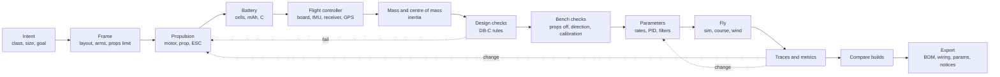

# Drone architecture

Status: specification for the DRONE build phase, written 2026-10-27 for BRIEF sections 12 (12.1 simulation research, 12.2 safety and responsible use) and the drone parts of 19.3.
Author role: drone architecture seat. ADR range used: ADR-0710 to ADR-0716 (robotics uses ADR-0700 to ADR-0707, see `ROBOTICS_ARCHITECTURE.md`).

## 0. How to read this file

This file says how iynk turns the Drone Lab from a catalogue of 13 crafts into design-to-flight for any multirotor: what the calculator and flight model compute today, how parts become data, how a build is checked, how it flies, how faults and noise enter, how flights are recorded and compared, what a flight-controller firmware simulation would add, and what the safety and dual-use rules are. It is a specification. It names files, fields, units, limits and acceptance criteria. It does not plan around customers, markets, pricing or classrooms (D-013).

Labels: VERIFIED (read in code, or run by me in a scratch script, with the file named), DOCUMENTED (a repo or spike document states it), EXTERNAL (an outside source states it, or I recall it and have not re-fetched it; those are marked "recalled"), ESTIMATED (calculation or judgement, assumptions shown), HYPOTHESIS (a test is named), UNKNOWN (not found or not tested). "PENDING RS-xx" means the choice waits for a spike with no verdict.

Upstream:

| Source | Path | Used for |
|---|---|---|
| Assignment | `docs/MASTER_PLAN/BRIEF.md` sections 12, 12.1, 12.2, 3.5 | scope |
| Decisions | `00_EXECUTIVE/DECISION_REGISTER.md`: D-007, D-010, D-011, D-013 to D-017 | binding constraints |
| Contracts | `PROJECT_DATA_MODEL.md` (3, 4, 5.8, 5.11, 5.14, 7, 12.2), `schemas/project.schema.json`, `COMPONENT_SCHEMA.md` (4.6, 4.10, 10), `SIMULATION_ARCHITECTURE.md` (5.4 to 5.6, 6, 11, 12, 13, 17) | names, fields, clock, phases, the `FlightModel` interface |
| Audit | `01_AUDIT/inventory/drone-calc-lab.md`, `flight.md`; `TECHNICAL_DEBT.md` A12, B3-03, B3-09 to B3-12, B3-18 | what exists |
| Research | `02_RESEARCH/TECHNICAL_RESEARCH.md` D7 and spike table; `tech/platform-options.md` (flight rows); `tech/compliance-safety.md` 5 and 6; council `robotics-aero.md` (background) | options, safety sources |
| Spikes | RS-13 (replay-related determinism, PASS for physics engines); RS-14 never ran (no folder, no report). Under D-014 the build does not wait for it: the offline PX4 SIH comparison is a Drone-phase verification task (section 13.3) and the rigid model ships with the "not checked" label until it reports | |
| Product | `03_PRODUCT/FEATURE_CATALOGUE.md` F-010, F-063 to F-075, F-156, F-209, F-216 to F-218; `PRODUCT_REQUIREMENTS.md` R-147, R-148, R-172 to R-180, R-024, BUD-13; `FEATURE_PRIORITIZATION.md` classes | ids |

Downstream:

| Kind | Ids |
|---|---|
| ADRs | ADR-0710 to ADR-0716 (section 1) |
| Features | F-010, F-063 to F-075, F-156, F-209, F-216, F-217, F-218, F-186 |
| Requirements | R-024, R-147, R-148, R-172 to R-180, R-FID-1 to R-FID-6, DET-2, DET-4 |
| Journeys | J-03 (start an original project, here: a drone), J-06 (meet a fault), J-09 (two buddies), J-12 (export a physical build) |
| Acceptance ids | DA-01 to DA-26 (section 15) |

Evidence from my own runs (all in `/Users/amar/iynk-master-plan-scratch/design/robotics-drone/`, Node 24.8.0, Apple M4 Pro, one machine). They are prototypes of the equations in this file, not checks against hardware or against any firmware:

| Script | What it ran | Result (VERIFIED as a prototype) |
|---|---|---|
| `quad.mjs` | A 6-DoF quadrotor (0.65 kg, arm 79.5 mm, 12 N per motor, quaternion attitude, rotor first-order lag 30 ms, rate PID at 1 kHz, mixer). Hover; then a 100 deg/s roll-rate step at 0.1 s. Illustrative parameters, untuned gains | Hover command 0.3645 equals `sqrt(W / (n T_max))` = 0.3645. Step response: 10 to 90 percent rise 85 ms, overshoot 26 percent (gains were not tuned; the number only shows that tuning matters). RK4 at 1 kHz agrees with a 10 kHz reference to 1.5e-12 rad/s; semi-implicit Euler at 1 kHz to 2.4e-6 rad/s. Two runs are bit-identical. 1.92 microseconds per step including the PID and logging |
| `prop.mjs` | Closed-form motor and propeller solve (section 6.2) for an illustrative 1750 Kv motor (R 0.045 ohm, I0 1.6 A), 0.1295 m propeller, Ct0 0.20, Cp0 0.14, 16 V | duty 0.3, 0.5, 0.7, 1.0 give 8003, 13100, 17893, 24398 rpm; thrust 1.23, 3.28, 6.13, 11.39 N (1161 gf); motor current 4.8, 10.3, 17.8, 31.7 A. Torque-balance residual 1e-15 N·m. (Ct0 and Cp0 were chosen so full throttle lands near a plausible 5-inch class; they are not measured values. Pack resistance of 0.02 ohm was applied to one motor's current only) |

## 1. Summary of decisions

| ADR | Decision | Evidence | Status |
|---|---|---|---|
| ADR-0710 | Drone parts are data in part descriptors (a `mechanics` block with keys `bldc`, `rotor`, `esc`, `battery`, `frame`, `fc`; `mechanics.motor` stays ROBOTICS's brushed-DC key, see 6.1). The 3 x 3 x 3 catalogue picks and the per-craft constants `k`, `pf`, `gPerW`, `flyFactor` stay only as the labelled `legacy-calc` model for the 13 migrated crafts. A craft has exactly one thrust source: `legacy-calc` or `parts`. | drone-calc-lab.md "Reusability" and defects 3, 4 | Decided |
| ADR-0711 | Propulsion is a physical model with a closed-form motor and propeller solve, a battery with internal resistance and open-circuit curve, and a datasheet fit that produces an error band from its residuals. Every output carries tier T1 and the assumptions that produced it. | `prop.mjs`; R-173, R-FID-6 | Decided; the real error against hardware is UNKNOWN |
| ADR-0712 | Two flight models behind the `FlightModel` interface of ADR-0309: `flight-game@1` (the existing model, preserved, labelled "tuned to feel") and `multirotor-rigid@1` (new: rotor ODE, 6-DoF rigid body, sensors, estimator, rate-loop controller). User builds can fly on either. | `quad.mjs`; flight.md | Decided; rigid-model comparison with PX4 SIH is a Drone-phase task (13.3); until it reports the label is "teaching model, not checked" |
| ADR-0713 | The flight controller is iynk's own implementation of a cascaded angle/rate PID with a Betaflight-style mixer, written from public documentation, not copied from GPL firmware. CLI `set` commands bind to controller parameters instead of canned flight patches. | cli.ts patches; council Q13 | Decided; licence question open |
| ADR-0714 | Faults and failures: every drone fault is an operation on the model or the environment and its effect falls out of the dynamics; no scripted rotation rates. Wind, noise and sensor failures are seeded and recorded in the replay. | flight.md "Faults" | Decided |
| ADR-0715 | Real-firmware simulation: PX4 SIH is used first as an offline oracle for RS-14; a local bridge to PX4 or ArduPilot SITL on the user's machine is an optional later slice; nothing hosted (D-015). Decision rule below. | platform-options flight rows; D-015 | Decided as an option; S0 runs offline in the Drone phase and does not gate Studio or any earlier phase |
| ADR-0716 | Safety and responsible use are data and tests: eight notice ids shown at fixed points, a written content rule with enforcement points (part kinds, modes, AI tools, templates, export headers), and banned-phrase checks. Simulation is never described as certification. | BRIEF 12.2; compliance-safety.md 5, 6 | Decided; the legal reading is UNKNOWN and needs a lawyer |

## 2. Objections

The decisions are binding and this file follows them. These are places where evidence says a contract, a rule or a classification needs a change.

1. **F-074 is classed LONG-TERM RESEARCH, but F-217 and F-218 need most of it.** F-217 plots "attitude, motor outputs, battery sag"; F-218 needs IMU and GPS noise and sensor failures. The current model has one lumped thrust and no sensors (flight.md, VERIFIED), so it has no motor outputs to plot and nothing to put noise on. The in-browser rigid model with sensors (this file's `multirotor-rigid@1`) is a prerequisite for both. Proposal: split F-074 into F-074a (TypeScript rigid model, rate loop, sensors; NEAR-TERM inside DRONE) and F-074b (PX4 or ArduPilot SITL; stays research; the S0 oracle run is an offline Drone-phase task, 13.3). Without the split the DRONE gate cannot be passed honestly.
2. **SIM_ARCH 11.2 models a rotor as a first-order lag with `tau_m` from `J_rotor, R, ke`.** A fixed time constant is wrong for a propeller load, where drag torque grows with the square of speed, so the response is faster at low speed than at high speed. The rotor equation `J_r dw/dt = tau_motor(w, V) - Q(w)` is cheap and integrates with the rest in RK4. Proposal: section 7.1 uses the ODE; the first-order lag with exact discretisation stays as the fallback for a part descriptor with no rotor inertia, labelled "assumed time constant".
3. **SIM_ARCH 11.2 says `kT` is set so that full-throttle static thrust equals the calculator's per-motor thrust.** That is right for the 13 migrated crafts, where the calculator is the only thrust source, and wrong for user parts, where thrust comes from the propulsion model. If both sources exist for one craft the hover test ("hover throttle equals the calculator's value") can pass while the rigid model flies another thrust. Rule (ADR-0710): one thrust source per craft. For `legacy-calc` crafts the calculator sets `kT`. For `parts` crafts the propulsion model does.
4. **`domain.set` replaces the whole domain.** Same problem as robotics Objection 2: two buddies tuning different PID values in one drone would overwrite each other. Use the proposed `domain.patch` (RFC 7396 merge patch) for all drone edits; `domain.set` for import and migration only.
5. **COMPONENT_SCHEMA section 10 has no `mechanics` block.** It says one comes "once RS-13 and RS-14 fix the model forms". RS-13 has passed; RS-14 never ran, but it only affects the flight model, not the part data. Section 6.1 proposes the drone half of the block now. The part data needs a home before F-073 can start.
6. **R-180 says "final state hashes are equal" for flight replay in Chromium and WebKit.** A12 measured that display frames (`frameOf`) agree across Node, Chromium and WebKit but raw state differs after 1 step (WebKit) or 12 steps (Chromium) because `Math.sin`, `cos`, `atan2` and `exp` differ in the last bit (TECHNICAL_DEBT A12, VERIFIED, one arm64 machine). The rigid model uses `exp` (rotor discretisation) and quaternion normalisation. R-180 must name the hash class (ADR-0303): class B only after `dmath` passes SA-12; class N (tolerance) before.
7. **R-174 says the whole range works with a user-built drone, "replay equals the original run".** Medal times (`parOf`, `registry.ts:~277`) are per course, with gold at 0.85 and bronze at 1.4 times the silver time, and silver tuned for the game model with a calibrated craft. A rigid-model lap is not comparable with a game-model lap. Rule: ghosts, bests and medals are keyed by `(course, model id)`. A user build flying the game model keeps the medals; the rigid model has bests only.
8. **The existing crafts `swarm`, `delivery`, `agrihex`, `longrange`, `vtol` have not been checked against the content rule of R-024.** F-063 says PRESERVE with a "review against F-010" note. This file lists what each does and proposes handling (section 12.3), but the decision is Amar's, and the legal reading is UNKNOWN.
9. **The CLI emulator's "effects" are canned patches (`angleLimit`, `boardYaw`, `tailReverse`, `cli.ts`).** Once a real controller exists a `set` command should change a controller parameter. The 34 CLI tests assert the old effect shape; they need new expectations, not new behaviour for the unchanged settings. Listed as a migration cost in section 14.
10. **PRD BUD-13 (physics step under 1 ms at 20 bodies) was written for robots.** The flight model has its own budget: one 1 kHz step costs 1.92 microseconds in the prototype, so the binding cost is rendering. Proposal: a separate BUD for flight, "model plus controller plus sensors under 50 microseconds per step at 6x throttle" (DA-22).

## 3. What exists, and what happens to it

BRIEF 3.5: preserve working code until a replacement is measurably better. Numbers below are from `drone-calc-lab.md` and `flight.md` (VERIFIED there; I re-read the cited lines where noted).

### 3.1 What the calculator computes (`src/lib/drone/calc.ts:151`, 344 lines, zero imports)

| Output | Formula | Constants |
|---|---|---|
| Pack voltage | `cells * 3.7` | fixed, no sag |
| Static thrust per motor | `k * sz * pf * krpm²`, `krpm = kv * V / 1000` (capped for VTOL) | `k` is one hand-tuned scalar per craft (1.06 quad5, 0.00304 whoop, 550 agrihex) in `models.ts` |
| Max current | `n * thrust / (maxGPerW * eff) / V` | `maxGPerW` 1.7 to 4.2 g/W per craft |
| Hover throttle | `sqrt(AUW / (n * thrust))` | assumes thrust proportional to throttle squared |
| Hover current | `AUW / (gPerW * eff) / V` | constant g/W per craft, 3.4 to 9.5 |
| Flight minutes | `usable * Ah / hoverA * 60`, then `* flyFactor` (0.42 to 0.92) | per-craft fudge |
| Wing and VTOL cruise | `L/D`, fixed efficiency 0.36 | |
| Checks | 9: over-spin, weak, cannot hover, hover-high (>0.6), ESC over-current, battery over-current (C rating or 45 A per Li-ion cell), prop clash (octo only), tail-heavy wing, short flight (<2 min) | `HOVER_THR_LIMIT 0.6`, `LIION_CELL_A 45`, `SHORT_FLIGHT_MIN 2` |

What it is not: a model of any specific motor or propeller. The 342 golden rows were captured from the original third-party site's own calculator output (`calc.test.ts:20-26`), not from thrust stands. They prove the port is faithful to that site, not that the physics is right. Defects that matter here: no input validation (`mah = 0` gives `Infinity`, B3-03), wing top speed uses static thrust (overstated), constant g/W ignores load, no battery sag, prop clash for one craft only (`armRadiusMm` appears once in `models.ts:148`, VERIFIED), `designInput` throws on any pick not in the 3 x 3 x 3 list (`design.ts:17-19`).

### 3.2 What the flight model computes (`src/lib/flight/sim.ts`, 1,028 lines)

Condensed from `flight.md` (VERIFIED there; lines 20, 606, 630-631 re-read by me):

| Aspect | Present model |
|---|---|
| Body | point mass; yaw, pitch, roll set by first-order lag toward stick target; no inertia, no body rate state, no quaternion |
| Integration | semi-implicit Euler, fixed `STEP = 0.01` s (`sim.ts:20`), `v += a dt; p += v dt` (`630-631`) |
| Controller | none: angle-mode lag, acro rate with expo `v(1-e) + v³e`, altitude hold and position hold as P laws |
| Thrust | `s.thrust = f * tmax * kV * fade` (`606`), `tmax` from the calculator's static thrust; `kV = (V/Vnom)²` |
| Drag | `a = -drag * v_rel * (|v_rel| + 1)`, same on all axes, `drag` 0.045 |
| Battery | 11-point open-circuit table per chemistry, `IR = k / Ah` per cell, I·R sag, 0.5 s cut-off (`battery.ts:1-92`); tuned to the calculator's hover and max amps |
| Wind | mean plus two sines of the step counter |
| Sensors | none |
| Faults | booleans that inject fixed rotation rates (900, 500 deg/s after 0.25 s or 1.5 s) |
| Replay | the `{step, action}` log is re-simulated from `origin`; bit-identical in one engine; raw state differs by one ulp across engines (A12) |
| Cost | 0.50 to 0.63 microseconds per step; the figure's SVG rebuild is the real cost |

Other parts: crash replay (`crash.ts`), ghosts (`ghost.ts`), daily challenge, 22 courses (21 with medals), touch sticks and gamepad, autopilot modes and demo route (`route.ts`), CLI emulator (`cli.ts`, 667 lines, four dialects), bench and arming rules (`bench.ts:66-83`: 5 blocking rules, warnings, an always-true throttle rule), budget optimiser (`optimize.ts`), BOM (`bom.ts`).

### 3.3 Disposition

| Subsystem | Disposition | Reason |
|---|---|---|
| `calc()`, `designChecks`, constants | **Extend**: add input guards with typed errors (DA-01); keep as `legacy-calc@1` for the 13 migrated crafts; do not touch the 342 golden rows | pure, tested, needed for LABS parity (R-148). Provenance of constants is a publish gate (F-197) |
| Thrust and energy model behind it | **Replace** for user builds with ADR-0711; the old model is not deleted until all 13 crafts have part data that reproduce their hover and max-current values within a stated tolerance | the audit recommends replace; BRIEF 3.5 requires a measurable improvement first |
| `designInput`, `isDesignPick`, optimiser | **Extend**: accept a list of component ids instead of catalogue keys; the 27-combination enumeration becomes a search over the parts library | blocks real use today (`optimize.ts:114`) |
| `sim.ts` | **Preserve then split** by craft class (SA-13, ADR-0309): `multirotor.ts`, `wing.ts`, `vtol.ts`, `tricopter.ts`, `swarm.ts`, `autopilot.ts`, `scoring.ts`, `battery.ts`, `events.ts`. Behaviour does not change; the 96 flight tests are the guard | god module (1,028 lines, 100-field state) |
| Game model as `flight-game@1` | **Preserve** as a selectable model and the default for the 13 templates | its value is the coupling to the catalogue (flight.md); fast; deterministic in one engine |
| Rigid-body model | **New**: `multirotor-rigid@1` | no 6-DoF, no PID, no sensors today |
| `battery.ts` | **Extend**: the same code serves both models and the robot battery element; the single `IR_AH` constant becomes a per-part `r_cell_ohm` | best-modelled piece (flight.md) |
| Collision `world.ts:139` `collide` (sphere against solids once per step) | **Replace** by the swept test (SA-13, DA-11); gates already use segment tests | tunnelling hypothesis B3-18 |
| CLI emulator `cli.ts` | **Preserve** parser, tables, dialects; **replace** the canned "effects" with parameter bindings (ADR-0713) | pure and tested; effects are the weak part |
| Bench tests, arming rules | **Preserve** the rule logic (`armingRules`); change the source of its inputs from figure-reported state to test results stored in the project (recomputed or marked stale on a document change; a learning aid, not a gate, not tamper-proof) | forgeable credential finding (council W10; D-016 removes the passport, the rule logic stays) |
| Figures (`figures/drones/*.js`, 5,070 lines) | **Preserve** for the 13 templates; add a generic parametric craft figure for user builds (section 5.5) | per-craft hand-inked figures cannot draw an arbitrary build |
| Flight view (SVG chase and FPV) | **Preserve**; extend the craft-drawing input to take a generic craft | SVG is adequate for the stylised range (council) |
| Ghosts, medals, daily challenge, crash replay | **Preserve**; key by `(course, model id)` (Objection 7) | |
| MCP `drone_calc` | **Extend** to the parts-based calculator | |

## 4. The design-to-flight workflow



| Step | Inputs | Computed outputs | Checks (section 8) | Features |
|---|---|---|---|---|
| Frame | layout (`x`, `plus`, `h`, `custom`), motor mounts, arm lengths, frame body mass, maximum prop size | motor spacing, adjacent prop clearance, projected area per axis | DB-C-06, DB-C-07 | F-216, F-086 later |
| Propulsion | motor, prop, ESC from descriptors | thrust and current curves, rpm, efficiency (g/W) at each throttle, max thrust at loaded voltage | DB-C-03, DB-C-05, DB-C-11 | F-073, F-216 |
| Battery | cells, capacity, C rating, internal resistance, chemistry | open-circuit and loaded voltage, sag at full throttle, usable energy | DB-C-04, DB-C-10, DB-C-14 | F-216 |
| Flight controller | board descriptor, IMU, receiver, GPS, camera and other masses | wiring (from the nets), sensor list | the electrical checks of the editor (F-028, F-029) | F-216, F-065 |
| Mass and CG | all component masses and mount positions | all-up weight, centre of mass, inertia tensor | DB-C-08, DB-C-13 | F-216 |
| Design checks | all of the above | hover throttle, thrust-to-weight, hover current, flight time range, endurance and speed envelope | DB-C-01, DB-C-02, DB-C-09 | F-216, F-064 |
| Bench checks | the simulation with props off | motor direction result, spin-up current, calibration state, smoke-stopper power-up | arming rules (section 8.2) | F-066 |
| Parameters | FC parameter table (rates, PID, filters, failsafe) | derived loop rates, expected response | DB-C-12 | F-067, F-216 |
| Fly | course, wind, seed, model | flight, events, crash cause | | F-068 to F-072 |
| Traces and metrics | the recorded flight | rise time, overshoot, hover drift, min voltage, peak current, saturation | | F-217 |
| Compare | two builds, one scripted test | per-metric differences, first difference marked | | F-217, F-073 |
| Export | the project | BOM CSV with MPNs, wiring sheet, parameter dump, notices | | F-160, F-161, F-090 |

User journeys: J-03 (start from a blank drone or a template), J-06 (fault on the build), J-09 (two buddies tuning one drone), J-12 (export a physical build).

## 5. The drone in the project document

### 5.1 Conventions

| Item | Rule |
|---|---|
| Body frame | the contract frame: +x forward, +y left, +z up (FLU), as the drone content already uses for motor positions (`MotorPos`, "+x nose, +y left", PDM 5.8). PX4 and ArduPilot use forward-right-down (FRD) with north-east-down (NED). Conversion for any exchange: `(x, y, z)_FRD = (x, -y, -z)`. Quaternion conversion is a fixed rotation by 180 degrees about x. It lives in one module and has a round-trip test |
| Units | layout in mm; domain fields use the suffix rule of PDM 4.1 (`_m`, `_mps`, `_ns`, `_us`, `_rpm_per_v`); engine: SI |
| Time | integer ns clock; flight step `1/step_hz` s, default 1 kHz (rigid) or 100 Hz (game) |

### 5.2 Where data lives

| Data | Home |
|---|---|
| Frame plates, arms, stack: bodies with mass and shape; every part has a `mount` (position and orientation in the frame) | `mechanical` (PDM 5.8) |
| Motors, props, ESCs, battery, FC board, receiver, GPS, camera, wiring | `components`, `boards`, `nets` |
| Motor slots (which motor, which prop, which ESC channel, spin direction), FC parameters, flight model choice, environment, course choice | `domains.drone.data` (below) |
| Part numbers and performance data | part descriptors (6.1) |
| Saved bench-check results | `tests` (F-221), written by runs with the document hash; stale when it changes; user-editable, not tamper-proof |
| Last flight traces | `assets` (role `trace`), hash-addressed, outside the state hash |

### 5.3 `domains.drone.data` (schemaVersion "1.0")

```ts
export interface DroneData {
  kind: 'multirotor' | 'legacy-craft';          // legacy-craft: the 13 migrated crafts keep their own model
  legacy?: { contentId: string; calcModelId: string; flightModelId: 'flight-game@1' };  // set only for legacy-craft
  thrustSource: 'legacy-calc' | 'parts';        // exactly one (Objection 3)
  motors: MotorSlot[];                          // 3 to 12
  battery: string;                              // component id
  controller: string;                           // board id of the flight controller
  fcParams: FcParams;                           // 5.4
  flight: {
    model: 'flight-game@1' | 'multirotor-rigid@1';
    step_hz: 500 | 1000 | 2000;                 // rigid model only; default 1000; game model is 100. Range = SIM_ARCH 6.2 (0.5 to 2 ms)
    pid_hz: 500 | 1000 | 2000;                  // default 1000; must divide step_hz and not exceed it
  };
  environment: DroneEnvironment;                // 9.2
  course: { builtin: string } | CourseSpec;     // an existing course id, or a user course (cap 64 solids, 32 gates, field up to 2,000 m)
  bench: { propsOff: true };                    // bench checks always run with props off
}
export interface MotorSlot {
  id: string;                                   // local id
  motor: string; prop: string; esc: string;     // component ids; motor has `mechanics.bldc`, prop has `mechanics.rotor`
  esc_channel: number;                          // index on a multi-channel ESC
  mount: string;                                // mnt_ id: position and orientation of the motor axis
  spin: 'cw' | 'ccw';                           // as seen from above, motor direction
  prop_spin: 'cw' | 'ccw';                      // the propeller's handedness; equal to spin when correct
}
```

Rules: the number of slots and their mounts define the mixer; `mount` orientation must have its thrust axis within 90 degrees of body +z (no inverted rotors in v1); `prop_spin != spin` is allowed because it is a fault the person can inject or make by mistake (DB-C-11 names it); a `legacy-craft` has no `motors` array beyond what its content gives.

### 5.4 Flight-controller parameters

`FcParams` is a flat table with groups: `rates` (roll, pitch, yaw: `rc_rate`, `expo`, `super_rate` as the existing acro law needs), `pid` (P, I, D, feed-forward per axis), `filters` (gyro low-pass Hz, D-term low-pass Hz, optional notch is `not-modelled-yet`), `mixer` (`airmode`, `idle_percent`, `thrust_linearisation`), `angle` (`limit_deg`, `strength`), `failsafe` (`rx_loss_action`: `drop` or `land`, `delay_ms`), `modes` (which switches exist). Names follow the CLI's setting names where the CLI has them (`p_roll`, `i_roll`, `d_roll` and so on) so one table serves the CLI, the controller and the export. Every entry has a range from the settings tables in `cli.ts` (`parseValue` limits, `cli.ts:~195`); a value outside its range is rejected with the range shown. Defaults are per craft class and come from the template, with a source note ("iynk default for 5-inch freestyle, not Betaflight's").

Gains are in iynk units. The Betaflight internal scale factors are not copied (they sit in GPL-3.0 firmware source; whether numeric constants are protected is the open question Q13 of the council memo). The CLI shows the unit it uses. A mapping to Betaflight's displayed units can be added after counsel answers Q13 (section 13).

### 5.5 Generic craft figure

The 13 hand-inked figures cover only the 13 templates. A user build is drawn by a parametric SVG craft generated from the document: arms as lines from the stack to each motor mount, motor circles, propeller discs with their real diameter (and a clash highlight where two discs overlap), body plates as rounded rectangles from the frame bodies, a battery block and camera block from component masses and mounts, colour from a fixed palette by role. It reuses the flight view's `Palette` and ink style (`DRONES[content.id].palette`, `registry.ts:164`) with a default palette when none exists. The figure is the host-side drawing of document data, so it can show the CG and thrust vectors as overlays. It is not a 3D model and does not claim to be (a 3D view is F-086, LATER).

## 6. Parts and propulsion (ADR-0710, ADR-0711)

### 6.1 Part data (`mechanics` block, proposal to COMPONENT_SCHEMA 10)

```ts
export interface DroneMechanics {
  bldc?: {                           // brushless motor; key owned by DRONE. `mechanics.motor` (brushed DC) is owned by ROBOTICS 6.1
    kv_rpm_per_v: number;            // unit named by the `_rpm_per_v` suffix (PDM 4.1): rpm per volt is the hobby unit; ke = 60 / (2 pi kv) V s/rad is derived
    r_ohm: number; i0_a: number;     // winding resistance, no-load current at the reference voltage
    v_max: number; i_max_a: number; i_burst_a?: number;
    j_rotor_kgm2?: number;           // rotor + bell inertia
    mass_g: number; stator_mm?: [number, number];
  };
  rotor?: {                          // propeller; owned by DRONE
    diameter_mm: number; pitch_mm: number; blades: number; mass_g: number;
    j_kgm2?: number;                 // propeller inertia
    ct0: number; cp0: number;        // static thrust and power coefficients: T = ct0 rho n² D⁴, P = cp0 rho n³ D⁵, n in rev/s
    ct_vs_j?: { j: number; ct: number }[];     // advance-ratio table, optional (2 to 16 points)
    cp_vs_j?: { j: number; cp: number }[];
    rpm_max?: number;                // rating, used by the over-spin check
    reverse_thrust_factor?: number;  // wrong-direction fraction, default 0.4 (the existing game value, assumption)
  };
  esc?: { i_cont_a: number; i_burst_a?: number; channels: number; protocol: 'pwm'|'oneshot'|'dshot150'|'dshot300'|'dshot600'; brake: boolean; efficiency: number; v_max: number; mass_g: number };
  battery?: BatteryBlock;            // shared key and shape, see below
  frame?: { wheelbase_mm: number; arm_count: number; prop_max_in: number; mass_g: number; cd_area_m2?: [number, number, number] };
  fc?: { gyro: string; accel: string; baro?: string; mag?: string; loop_hz_max: number; mass_g: number };
}
/** Shared by DRONE and ROBOTICS. One shape, one battery code path (`src/lib/flight/battery.ts`, ROBOTICS 7.6). */
export interface BatteryBlock {
  cells: number; capacity_mah: number; c_continuous: number; c_burst?: number;
  r_cell_ohm: number; mass_g: number; ocv_table?: number[];     // 11-point open-circuit table by state of charge
  chemistry: 'lipo' | 'lihv' | 'liion' | 'nimh' | 'alkaline';   // the last two are used by robots only
}
```

Key ownership in the shared `mechanics` block (the COMPONENT_SCHEMA 10 proposal is one block with disjoint keys):

| Key | Owner | Shape | Read by |
|---|---|---|---|
| `mechanics.motor` | ROBOTICS 6.1 | brushed DC (`r_ohm`, `l_henry`, `ke_vs_per_rad`, gear) | `RB-E-DRIVE` and the robot solver only |
| `mechanics.servo`, `stepper`, `driver`, `encoder` | ROBOTICS 6.1 | as there | robot checks |
| `mechanics.bldc` | DRONE | brushless (`kv_rpm_per_v`, `r_ohm`, `i0_a`) | drone solver and DB-C checks only |
| `mechanics.rotor`, `esc`, `frame`, `fc` | DRONE | below | drone only |
| `mechanics.battery` | shared (`BatteryBlock`) | above | both; ROBOTICS 7.6 uses this shape rather than its own |

`RB-E-DRIVE` accepts only `motor`, `servo` or `stepper`, so a part with a `bldc` block and no `motor` block fails it, and the drone checks never read `motor`. A part that carries both a `motor` and a `bldc` block is a loader error (`E-MECH-KEY-CLASH`, names the part). The loader validates each key against its owner's schema. The `MotorSlot` fields `motor` and `prop` below stay as component ids (they point at a part whose `mechanics.bldc` and `mechanics.rotor` blocks are read).

All numbers follow the three-slot rule (COMPONENT_SCHEMA 4.6): maker-stated, iynk assumption, bench-measured, each with a source. The loader refuses a model run that needs a missing field and names it (DA-03). A part with only some fields is allowed in the library as `partly-modelled` (R-FID-2); the builder shows which outputs it blocks.

Data sources for the shipped parts: manufacturer datasheets and published propeller test data (the UIUC propeller database is the obvious one; its licence and coverage are UNKNOWN, council Q12 and the council's own admission that it did not verify them). Open data with a clean licence for many motors is also UNKNOWN. First library target: 10 motors and 10 propellers with redistributable data (council Q12); if that target cannot be met the library ships fewer parts and the builder's entry form is the main path.

### 6.2 Closed-form motor and propeller solve (static)

A brushless motor with its ESC is treated as an equivalent DC motor driven by `V_eff = duty * V_pack` (ESC efficiency folded in as a factor). SI quantities: `ke = kt = 60 / (2 pi kv)`, `rho` air density (section 9.2), `n = w / (2 pi)`.

```
Thrust       T = kT w²,    kT = ct0 rho D⁴ / (4 pi²)
Prop torque  Q = kQ w²,    kQ = cp0 rho D⁵ / (8 pi³)
Motor torque tau = kt (I - I0),  I = (V_eff - ke w) / R
Balance      tau = Q   gives   kQ w² + (kt ke / R) w - kt (V_eff / R - I0) = 0
Positive root  w = ( -b + sqrt(b² + 4 kQ c) ) / (2 kQ),  b = kt ke / R,  c = kt (V_eff / R - I0)
```

If `c <= 0` the rotor does not turn (`w = 0`). One square root; no iteration; deterministic; the torque residual in the prototype is 6e-16 N·m (`prop.mjs`). Pack sag couples back through the battery: `V_pack = OCV(soc) - R_pack I_pack`, `I_pack = sum(duty_i I_i) + I_idle`. The static solver iterates this fixed point three passes, fixed count (the prototype converges to 3 significant digits in three passes; DA-04 tests the residual of the final pass, so a bad part cannot hide behind the count). The dynamic model (section 7.1) uses the previous step's pack voltage instead, so no algebraic loop exists.

Illustrative result (prototype table in section 0): a 1750 Kv motor on a 5.1-inch propeller at 16 V gives 11.39 N and 31.7 A at full throttle and 24,398 rpm. These are illustrative parameters; no claim is made that any real 2306 motor does this.

Axial inflow: thrust falls as the craft climbs or flies forward. With advance ratio `J = v_ax / (n D)` (`v_ax` the airspeed component along the thrust axis): if the descriptor has `ct_vs_j`, interpolate linearly; otherwise `ct(J) = ct0 max(0, 1 - J / (0.9 P / D))`, a linear fall to zero near the ideal-screw advance ratio `P / D` (propeller theory, EXTERNAL; the 0.9 and the straight line are iynk assumptions flagged on the screen). `cp` stays at `cp0` in the default form. This matters at the speeds a race quad reaches; for a hover calculation it is zero.

### 6.3 Datasheet fit and the error band

Most manufacturers publish a table: throttle (or rpm), voltage, thrust in grams, current in amps, for one or a few props. The entry form takes those rows (`{v, throttle, thrust_g, current_a}`, up to 32 rows) and fits. Method:

1. Known from the motor: `kv, R, I0` (or fit `R` from two current points if missing).
2. Unknown: `ct0`, `cp0` (two scalars). For each row compute `w` from the motor and `V_eff` with `cp0` as a free parameter via the closed form, then thrust `kT w²` with `ct0` free.
3. Minimise the sum of squared relative errors in thrust and current by a fixed-iteration Gauss-Newton with a fixed starting point `(ct0, cp0) = (0.12, 0.06)` and at most 50 iterations (deterministic), then report convergence.
4. Output: fitted `ct0`, `cp0`, the RMS relative residual in thrust and in current, the voltage and throttle range of the rows, and a flag `fitted` on the part.
5. The error band shown on every output is the larger of the two residuals, and the output is labelled "within the range of your data" or "outside the range of your data" (R-FID-6). The band is the fit's disagreement with the supplied rows; it says nothing about how well the data matches a real part. The UI says that in one sentence.

For comparison eCalc states +/-15 percent (EXTERNAL, council memo citing `competitors/drone.md`; not re-fetched). iynk states no accuracy until bench data exist (F-163, F-184); the cheapest check is council Q2: 10 motor and propeller combinations against manufacturer tables.

### 6.4 Endurance and current

Hover time is computed by stepping the battery model at 1 s intervals: at each step find the throttle that makes thrust equal weight (the closed form inverted by bisection over duty with 40 fixed iterations, since `T(duty)` is monotone), take the pack current, update capacity used and OCV, and stop when loaded cell voltage reaches the cut-off for the chemistry (`LIMITS` in `battery.ts:11`, DOCUMENTED there: lipo low 3.5 V, cut 3.2 V per cell) or capacity used reaches the usable fraction (default 0.8 as the legacy `usable`; editable). This replaces the constant g/W and `flyFactor`. The result is a range, `[time at the fit's upper-current band, time at the lower band]`, not one number. A "typical flying" figure is not given unless a duty profile is chosen by the person (hover only is the default and is labelled "hover only").

### 6.5 Legacy mapping

For a migrated craft with `thrustSource: 'legacy-calc'`, `calc()` runs unchanged (`CalcInput` is already data, drone-calc-lab "Reusability"). The new checks that need geometry (prop clash, CG) use the craft's mounts. When the person replaces a legacy part by a library part, the craft's `thrustSource` flips to `parts` for the whole craft with a visible message, never per part.

## 7. Flight dynamics (ADR-0712)

### 7.1 `multirotor-rigid@1`

State: `p` (m), `v` (m/s), `q` (unit quaternion body to world), `w_b` (body rates, rad/s), `omega_i` (rotor speeds, rad/s), battery state, sensor states, estimator state, controller state. Equations (form from SIM_ARCH 11.2, refined; SI; body frame FLU):

```
Translation   m dv/dt = R(q) (sum_i T_i) e_z - m g e_z,w + F_drag + F_wind
Rotation      J dw_b/dt = sum_i (r_i x T_i e_z) + sum_i s_i Q_i e_z - w_b x (J w_b) - sum_i s_i J_r (dω_i/dt) e_z - w_b x sum_i s_i J_r ω_i e_z
Rotor         J_r dω_i/dt = tau_motor(ω_i, V_eff,i) - Q_i(ω_i)           (ODE, Objection 2)
Quaternion    dq/dt = q ⊗ (0, w_b) / 2, renormalised every step
Drag          F_drag = -R(q) [ cdA_x, cdA_y, cdA_z ] 0.5 rho |v_rel|^... per axis + rotor linear drag -k_lin (v_rel,plane)
Wind          v_rel = v - v_wind (section 9.2)
```

`J` is the full symmetric 3 x 3 inertia tensor from section 7.3, not a diagonal (a built drone with an off-centre battery has products of inertia). The two rotor gyroscopic terms are included; with the usual alternating spin directions their sum is small in hover and non-zero in a yaw manoeuvre. `s_i = +1` for CCW, `-1` for CW as seen from above. Each rotor's `T_i` and `Q_i` use `ct(J)` and `cp0` of section 6.2 with the rotor's own `omega_i`. A rotor whose motor is failed has `tau_motor = 0` and spins down by prop drag.

The ESC brake flag: if `V_eff < ke omega`, current would be negative. With `brake = false` the ESC freewheels (`tau_motor = 0`, spin-down by prop drag only); with `brake = true` negative current is allowed up to `-i_cont`. Descriptors state the flag; the default `true` is an assumption (active freewheeling is common in modern ESCs, EXTERNAL recalled; the screen labels it).

Integration: RK4 over `(p, v, q, w_b, omega_i)` at a fixed step (default 1 kHz); controller and sensor outputs held constant across the step. The prototype shows semi-implicit Euler at 1 kHz agrees with a 10 kHz RK4 reference to 2.4e-6 rad/s on the step response while RK4 at 1 kHz agrees to 1.5e-12 (`quad.mjs`). So Euler would also be adequate in that scenario; RK4 is kept as margin for hard manoeuvres and costs under 2 microseconds a step in the prototype. A test (DA-08) checks both against the reference on a harder scenario (a flip) before the choice is final. Reversal: switch to Euler if RK4 shows no benefit there and the cost matters.

Step guards (SIM_ARCH 6.4): warn when a time constant in the model is below 5 steps (rotor time constant under 5 ms at 1 kHz is a warning, since the discretisation dominates).

### 7.2 Step order inside one flight tick (ties to SIM_ARCH 5.5)

All at phase P5 for the model; sensors sample at P4 of the same timestamp from the last step.

1. Sensor sampling at their rates: gyro and accelerometer at `step_hz` by default; barometer 50 Hz; GPS 10 Hz with latency; each with seeded noise and bias.
2. Estimator update (complementary attitude filter, barometer altitude filter, GPS position filter).
3. Outer loops at their own rates: angle loop at `pid_hz / 2` (500 Hz at the default `pid_hz` of 1000), altitude hold 50 Hz, position hold and mission at 10 Hz. These produce attitude or rate setpoints.
4. Rate PID at `pid_hz` (section 7.4).
5. Mixer, desaturation, idle clamp, protocol quantisation (DShot 11-bit throttle levels: command rounded to 1/2000).
6. Rotor and battery update through the RK4 step. Pack voltage for `V_eff` comes from the previous step.
7. Environment: wind and density update (9.2).
8. Collision against the world (swept test, section 7.5) and event emission.

### 7.3 Mass, centre of mass, inertia

From the document: each component and frame body has `mass_g` and a mount. Treat each as a rigid piece with its own inertia (from its shape as in robotics section 4.4 rule 3). Then:

`M = sum m_i`, `c = sum m_i r_i / M`, `J = sum_i ( J_i + m_i ( |d_i|² I3 - d_i d_iᵀ ) )` with `d_i = r_i - c`, where `J_i` is the piece's own inertia rotated into the body frame. The tensor is symmetric; its principal moments must be positive and satisfy the triangle inequality (`DB-E-INERTIA`). Test (DA-17): a two-box assembly with analytic answer, equality to 1e-9 relative. The body frame origin is moved to the centre of mass for the dynamics; mounts keep their document coordinates. The CG is shown on the figure and its offset from the centroid of the motor axes in X and Y is an input to DB-C-08.

### 7.4 Controller (ADR-0713)

Structure (cascaded, per axis for roll, pitch, yaw):

```
angle mode:  rate_sp = clamp( angle_strength * (angle_sp - angle_est), +-rate_max )         (P on angle, outer loop)
acro mode:   rate_sp = rates(stick)    with the existing expo law  v(1-e) + v³ e,  times super-rate
rate loop:   e = rate_sp - gyro_filtered
             P = kp e,  I += ki e dt  (clamped, anti-windup by conditional integration),  D = kd * lowpass( d(-gyro)/dt ),  FF = kff d(rate_sp)/dt
             torque_cmd = P + I + D + FF
mixer:       motor_cmd_i = throttle_cmd + sum_axes mix[i][axis] * torque_cmd[axis]   (rows from the geometry, 7.6)
desaturate:  if any motor_cmd outside [idle, 1], shift all by the overflow (airmode on) or clip yaw first (airmode off)
```

Throttle: `thrust_linearisation` in `[0, 1]` maps the stick to command by `cmd = (1 - a) x + a sqrt(x)`-style curve (an iynk form so that thrust is closer to linear in stick; `a` default 0). Derivative on measurement with a first-order low-pass at the filter cutoff; gyro low-pass; both Hz from `fcParams`. Notch filters and RPM filtering are `not-modelled-yet` and say so in the "What it models" panel. Mode controllers that exist as P laws in the game model (altitude hold `sim.ts:556`, position hold, RTL and mission with the P velocity controller of gain 2.2) are reused unchanged as outer loops producing angle setpoints, so the autopilot demo laps and mission courses still work on the rigid model.

The mixer matrix comes from the motor slots: for motor `i` at body position `(x_i, y_i)` with spin `s_i`, the roll row is `+y_i / L`, pitch row `-x_i / L`, yaw row `s_i`-weighted, with `L` the mean arm length (normalisation so unit torque command gives comparable authority; the matrix is computed, not typed, so any layout works: `x`, `plus`, `h`, hex, octo). A layout with fewer than 3 independent rows (for example 3 motors with no tail servo) is rejected with `DB-E-MIXER` unless the tricopter tail servo is present (legacy tricopter keeps the game model).

### 7.5 Collision and landing

A swept test: the craft's collision sphere (radius from the frame: `max(0.03, arm length + prop radius / 2)`, the present rule, `registry.ts:~190`) moves along the segment `p(t) to p(t+dt)` against each solid inflated by the radius (box, cylinder, cone, as `Solid` in `world.ts`); the first hit time within the step is the contact. A hit with normal speed below `v_land` (default 1.5 m/s, an iynk assumption) and tilt below 20 degrees with throttle reduced is a landing; otherwise a crash event with impact speed, angle and the object hit. After a crash, powered flight ends and the craft comes to rest by a simple rule (zero velocity along the normal, friction on the tangent); full tumble physics can be added by handing the body to the robotics physics engine after impact, which is LATER and not needed for the crash explanation. SA-13 and DA-11 reproduce the tunnel first with the old code.

### 7.6 Fixed-wing, VTOL, tricopter, swarm

Not rebuilt. They stay in `flight-game@1` as `wing.ts`, `vtol.ts`, `tricopter.ts`, `swarm.ts` after the module split. Reason: they are 4 of the 13 crafts, each needs its own aerodynamic and servo model, and none is needed to deliver design-to-flight for multirotors, which is where the part data and checks apply. They are labelled "teaching model, tuned to feel".

## 8. Checks, bench tests, arming

### 8.1 Design checks

Each returns `{id, result: 'ok'|'warn'|'fail', value, limit, limitingPart, formula, assumptions, tier}` and maps to a cause id for the shared record `{cause_id, symptom_id, evidence, hint_level}` (D-010). The first nine are the existing `designChecks` generalised from per-craft constants to part data. Thresholds that are per-craft constants today (`minTW`, `HOVER_THR_LIMIT`) become craft-class data in the template, with a source note.

| Id | Question | Rule | Existing code |
|---|---|---|---|
| DB-C-01 | Can it hover, and with what margin? | thrust-to-weight at full throttle at loaded voltage: fail below 1.0, warn below the class minimum (default 2.0, iynk default, editable per class) | "cannot hover", "weak" |
| DB-C-02 | Is hover throttle too high? | warn above 0.6 (`HOVER_THR_LIMIT`) | `hover-high` |
| DB-C-03 | ESC current | max motor current at loaded voltage against `esc.i_cont_a`; burst against `i_burst_a` | `ESC over-current` |
| DB-C-04 | Battery current | sum of motor currents against `c_continuous * Ah`; Li-ion cells against 45 A per cell (`LIION_CELL_A`); burst against `c_burst` | `battery over-current` |
| DB-C-05 | Over-spin and voltage rating | no-load rpm `kv * V_full` against `rotor.rpm_max`; pack full voltage (`4.2 * cells` for lipo) against `bldc.v_max`, `esc.v_max` | `over-spin` |
| DB-C-06 | Prop clash | for each pair of adjacent motors, distance between axes against `r_a + r_b + clearance` (default clearance 5 mm); for coaxial pairs, vertical offset against a minimum. Generalises the octo-only `armRadiusMm` rule (Defect 5) | `prop clash` (1 craft) |
| DB-C-07 | Prop size against frame | prop diameter against `frame.prop_max_in` | new |
| DB-C-08 | Centre of mass | CG offset from the centroid of motor axes in X and Y, as a fraction of the mean arm length: warn above 5 percent, fail above 12 percent (both ESTIMATED defaults: the mixer can trim a small offset by running unequal motors and the check measures how much thrust headroom that eats, shown as value); height of the CG against the motor plane reported, not judged | `tail-heavy` (wing only) |
| DB-C-09 | Flight time | warn below `SHORT_FLIGHT_MIN` (2 min) | `short flight` |
| DB-C-10 | Voltage sag | at full throttle the loaded cell voltage against the chemistry's `cut`; warn below `low` | new |
| DB-C-11 | Spin layout | `sum(s_i Q_i)` at hover within 5 percent of the mean `|Q|` total (yaw balance); `prop_spin != spin` anywhere fails and names the motor | new; relates to the game's "props swapped" |
| DB-C-12 | Loop rates | `step_hz` in {500, 1000, 2000}; `pid_hz` divides `step_hz`; `pid_hz` not above the controller's `loop_hz_max`; gyro filter cutoff below Nyquist of `pid_hz` | new |
| DB-C-13 | Mass notice | AUW above 250 g: informational chip "registration and Remote ID rules may apply where you fly" (threshold from EASA C0 and US registration practice, EXTERNAL; not legal advice) | new |
| DB-C-14 | Part ratings | any part used outside a maker-stated rating slot (COMPONENT_SCHEMA 4.6) | new |
| DB-E-INERTIA, DB-E-MIXER, DB-E-FIELD | structural errors: inertia not positive definite; mixer rank under 3; a model-required field missing (named) | error | `calc` returns `Infinity` today |

Input guards (B3-03, DA-01): `calc` and the new solvers reject non-finite and out-of-range values with `{error: 'out-of-range', field, value, min, max}`; no `NaN` or `Infinity` ever leaves a solver. Ranges come from the part schema.

### 8.2 Bench checks and arming

The present arming logic (`bench.ts:66-83`) is kept: five blocking rules (built, capacitor fault, smoke test, motor check, accelerometer calibration), warnings (FC arrow reversed, props swapped, other mistakes), and the always-true throttle rule. What changes is where the inputs come from:

| Rule | Today | New |
|---|---|---|
| built | figure-reported assembly steps | the project's assembly checklist (guide steps with `done` conditions evaluated against the document) |
| smoke | a flag the figure reports | a run: power-up through a modelled current-limited supply; passes when the simulated current stays under the limit and no part is over-rated |
| motors | a flag | a run with props off: each motor is spun at 10 percent; the simulated rotation direction (from the ESC phase order fault state) is compared with `spin`; mismatch lists the motor |
| acc | a flag | a calibration action that sets the estimator's accelerometer offsets from the level pose; uncalibrated means the estimator is run with the nominal bias |
| fcArrow, props | flags | derived from the document: the FC mount yaw against forward; `prop_spin != spin` |

Results are written to `tests` by the runs (with the document hash they were run against), not typed by hand. They are recomputed, or marked stale, when the document hash changes (moving the FC mount, swapping a motor; same mechanism as the stale-test rule of F-221). They are not tamper-proof: the project JSON is user-editable and its hash is not signed, so anyone can edit a stored result. The app never uses them as a security gate. Arming rules are a learning aid only, and nothing outside the person's own session depends on them. This preserves the 78 bench tests' teaching intent and removes the client-only credential (council W10) by removing the credential, not by making it unforgeable.

## 9. Environment, sensors, noise

### 9.1 Sensors and estimator

Sensors follow the `SensorModel` format (SIM_ARCH 12.2) with extra fields for drift. Defaults are iynk assumptions; every default is shown and flagged; the shipped IMU, barometer and GPS parts cite datasheet figures in their descriptors when the library is built (UNKNOWN now).

| Sensor | Model | Parameters |
|---|---|---|
| Gyro | `w_meas = w_b + b_g + n_g`; bias `b_g` random walk; noise Gaussian; quantised to the register; low-pass of the sensor | noise density, bias instability, range, sample rate |
| Accelerometer | specific force `R(q)^T (a - g)` plus bias plus noise; vibration injection optional | |
| Barometer | `h_meas = h + b_b + n_b`, drift as random walk; update 50 Hz | |
| GPS | position and velocity at 10 Hz (default), latency 100 ms (default), noise per axis; fix lost below a satellite count schedule | |
| Magnetometer | later (needs the environment field) | |
| Receiver | stick inputs with link-loss events from the fault schedule | |

Estimator: Mahony-style complementary filter for attitude from gyro and accelerometer with a gain; a first-order blend for altitude from baro and vertical acceleration; GPS blended into position and velocity with fixed gains. No EKF in v1 (`not-modelled-yet`). The estimator is the reason a gyro bias or a wrong IMU orientation produces a physically meaningful failure.

### 9.2 Environment

`DroneEnvironment` is the stored (document) form. The engine type is `EnvironmentState` of SIM_ARCH 12.1 (camelCase, SI, `WindModel`). The document uses snake_case with a unit suffix (PDM 4.1); one function, `toEnvironmentState(env: DroneEnvironment): EnvironmentState`, converts and is the only place the two meet. The engine never reads `DroneEnvironment`.

```ts
export interface DroneEnvironment {
  temperature_degC: number;           // default 15
  pressure_pa: number;                // default 101325 at sea level; density follows the ideal gas law  rho = p / (287.05 (T + 273.15))
  altitude_msl_m: number;             // field height; pressure falls with the standard-atmosphere law (EXTERNAL) when no pressure is given
  wind: { mean_mps: [number, number, number]; gust: { kind: 'none' | 'ou'; sigma_mps: number; tau_s: number }; discrete?: GustEvent[] };
  sensorFailures: { at_ns: number; sensor: 'gyro'|'accel'|'baro'|'gps'|'rx'; mode: 'dropout'|'stuck'|'bias'|'noise'; magnitude?: number; duration_ns?: number }[];  // up to 32; integer ns on the sim clock, like every other time
}
```

| `DroneEnvironment` (document) | `EnvironmentState` (engine, SIM_ARCH 12.1) | Conversion |
|---|---|---|
| `temperature_degC` | `temperatureCelsius` | copy |
| `pressure_pa` | `pressurePa` | copy; if absent, computed from `altitude_msl_m` |
| `wind.mean_mps` | `wind.mean` (`Vec3`) | copy |
| `wind.gust.kind` | `wind.gust.kind` | copy |
| `wind.gust.sigma_mps` | `wind.gust.sigma` | copy |
| `wind.gust.tau_s` | `wind.gust.tauS` | copy |
| `wind.discrete` | drone-only (no field in `EnvironmentState`); the flight model reads it from the converted record's extension slot | passed beside, not merged |
| `altitude_msl_m` | none (used only to derive `pressurePa`) | consumed in conversion |
| `sensorFailures[]` | not environment: becomes `InputEntry` records of `kind: 'fault'`, `at = at_ns` (and a clearing entry at `at_ns + duration_ns`) | emitted into the input log at run start |
| (none) | `lightLux`, `surfaces`, `obstacles`, `magneticFieldTesla` | defaults from SIM_ARCH 12.1; the course supplies obstacles |

A unit test (DA-26) round-trips every field and fails if a field is added to either side without a row here.

Wind: the mean plus an Ornstein-Uhlenbeck gust per axis with exact discretisation from stream `wind` (SIM_ARCH 12.1); optional discrete gusts of the "1 - cosine" shape (`v = v_g / 2 (1 - cos(pi t / T))`, a standard discrete gust shape, EXTERNAL recalled) with amplitude and duration; wind shear is `not-modelled-yet`; turbulence spectra (Dryden or von Karman) are `not-modelled-yet`. Density scales rotor thrust and drag; at 15 degC sea level `rho = 1.225 kg/m³` (arithmetic from the formula). All streams are named (`wind`, `sensor:<id>`), so adding a consumer never changes another's numbers. The present two-sine wind (`sim.ts:292-301`) stays in `flight-game@1`.

## 10. Faults and failures (ADR-0714)

Faults are operations on the model or the environment (SIM_ARCH 13.2) and are recorded in the replay at the time they are applied. Their effect must come from the dynamics, never from a scripted rotation rate. The rigid model contains no constants like 900 or 500 deg/s; a grep test (DA-10) enforces it.

| Fault (cause) | Operation | What the dynamics do |
|---|---|---|
| Motor out | `param` on the slot: `tau_motor = 0` | thrust of that rotor falls with its spin-down; on a quad the controller saturates and the craft tumbles; on a hex or octo it may hold altitude and drift in yaw, depending on the mixer (no fault-tolerant mixer in v1) |
| Motor direction reversed (ESC phase swap) | `swap-phase` on two motor phases | the rotor turns the other way; thrust follows `reverse_thrust_factor`; yaw torque flips sign; symptom derived by the `motor-direction-reversed` detector |
| Propeller swapped (handedness) | `param` on the slot: `prop_spin != spin` (cause `props-swapped`, a row of SIM 13.4) | same as above through `ct` and the sign of `Q` |
| Propeller damaged | `param` on `ct0` (factor) | thrust loss and imbalance, torque disturbance |
| FC orientation wrong | `mount` on the FC (yaw) | the estimator's attitude frame differs from the motors' frame, so a roll command produces pitch (or reversed roll): positive feedback in the loop, flip on take-off (derived, DA-10) |
| Gyro bias, noise, dropout | `sensor` fault (failure schedule) | drift or oscillation through the estimator and the D term |
| GPS loss | sensor failure | position-hold modes fall back to attitude mode or trigger failsafe per `fcParams.failsafe` |
| Receiver link loss | sensor failure `rx` | failsafe stage: `drop` (motors off) or `land` (descent at a set rate) |
| Battery sag and depletion | battery state and `degrade` | voltage-limited thrust, throttle compensation, cut-off (existing 0.5 s rule) |
| ESC desync | thermal and over-KV integrator (the game's `overKv` idea, `sim.ts:577-590`, as a state) | seeded desync pulses cause brief thrust dropouts on one rotor; probability from the state, stream `fault:<id>` |
| Over-current, brown-out of the FC | electrical layer | FC reset: controller state lost for a reboot time (descriptor), craft uncontrolled during it |
| Gusts | environment | disturbance torques and forces |

Cause ids: the only list is SIM_ARCH 13.4 (45 ids, closed, plus `x-` extension ids). The drone ids there are `hover-throttle-too-high`, `thrust-to-weight-low`, `esc-overcurrent`, `battery-overcurrent`, `prop-clash`, `cg-offset`, `motor-direction-reversed` (was `motor-direction-wrong`), `props-swapped`, `fc-orientation-wrong`, `battery-sag-reset` (was `battery-sag-brownout`), `esc-desync`, `motor-out`, `controller-oscillation`, `gps-lost`, `link-lost`, `sensor-drift`; SIM 13.4 owns each detector and this section adds none. Evidence uses the `Evidence` record with `provenance`, `tier`, `modelIds`. The crash explanation card ("Here's why", `crash.ts:109` and `causeOf`, `crash.ts:56`) keeps its three-step hint ladder and gets its cause from the recorded fault state and trace (the largest contributing cause before the crash), not from a log-based guess alone.

Faults on the 13 legacy crafts keep the boolean flags of `CraftFaults` (`types.ts:25-33`) in `flight-game@1`.

## 11. Replay, traces, comparison

### 11.1 Replay

A flight is the project document hash, the seed, the model id and version, the input log (stored as `InputEntry[]` of SIM_ARCH 6.7, see the mapping below; the game model's `{step, action}` form is the legacy format and is converted on load), and the engine versions. `ReplayRecord` of SIM_ARCH 6.7 gets `versions.models['multirotor-rigid@1'] = '1.0.0'` and `versions.dmath`. Checkpoints: a state hash every 1,000 ms of simulated time. Hash class: class N before `dmath` passes SA-12 (compare quaternion, position, rates with 1e-9 relative tolerance), class B after (Objection 6). Replay is re-simulation (flight.md, VERIFIED for the game model); ghosts, crash replay and the daily challenge read the same record.

**Input log mapping.** The stored form is `InputEntry {at: SimTime, seq, kind, target, value}` sorted by `(at, seq)` (SIM_ARCH 6.7). The game model's `{step, action}` (`sim.ts:1008`) maps as follows.

| Field | Game model (`flight-game@1`, 100 Hz) | Rigid model (`multirotor-rigid@1`) |
|---|---|---|
| `at` | `step * 10_000_000` ns | `step * (1_000_000_000 / step_hz)` ns (integer for 500, 1000, 2000 Hz: 2,000,000 / 1,000,000 / 500,000 ns) |
| `seq` | order of actions within one step, from 0 | same |
| `kind` | `'control'` for stick and switch actions; `'fault'` for fault and sensor-failure events | same |
| `target` | `'stick'` (roll, pitch, yaw, throttle axes) or `'switch'` (arm, mode, and so on) | same |
| `value` | the action payload (axis values in [-1, 1], switch state) | same |

Legacy logs (ghosts, medals and crash replays saved as `{step, action}`) are converted to `InputEntry[]` on load by one function and are never written back in the old form. The conversion has a round-trip test in DA-07: a legacy log converts to entries and back to the identical `{step, action}` list, and replaying either gives the same checkpoint hashes.

### 11.2 Traces

```ts
export interface FlightTrace {
  version: 1; modelId: string; docHash: string; seed: number;
  rate_hz: number;                      // stored rate: 100 by default
  t0_ns: number; n: number;
  channels: { id: string; unit: string; data: Float32Array }[];
}
```

Channels (default set, up to 48): position, velocity, attitude (roll, pitch, yaw in degrees from the quaternion), body rates, setpoints, per-motor command and speed, per-motor current, pack voltage and current, state of charge, estimator error against truth, wind. Storage: 40 channels x 100 Hz x 60 s x 4 bytes = 0.96 MB per minute (arithmetic); full-rate (1 kHz) windows of 2 s are kept around events (a crash, a fault) and the person's marks. Traces go to `assets` by hash, outside the state hash. Cap: 20 MB per trace, 8 traces kept per project. Plotting is the instrument layer (F-054 family); a trace is data, not state.

### 11.3 Metrics (the same code computes them for plots and for comparison)

For a step in a setpoint at `t_s` with final value `y_f`: rise time 10 to 90 percent, overshoot `(y_max - y_f)/y_f`, settling time to 2 percent, steady-state error; for hover: position drift RMS over a window, altitude error; for the battery: minimum pack voltage, peak current, energy used; for the controller: motor saturation fraction (time any motor is at the limits), mean command spread. The definitions are fixed in code and cited on the screen.

### 11.4 Comparison

Two designs are compared on a scripted bench-flight set, run headless in an analysis worker with the same seed:

| Test | Script | Output |
|---|---|---|
| Hover hold | level hover 30 s | drift RMS, current, voltage |
| Rate step | 100 deg/s roll, pitch, yaw steps | rise, overshoot, settling |
| Punch-out | full throttle climb 2 s | peak thrust, peak current, min voltage, climb rate |
| Endurance | hover to cut-off, time-accelerated | time to cut-off (a range) |
| Max speed | level flight at the trim angle where horizontal thrust equals drag, solved by 8 fixed Newton passes | speed, power |

The first-difference marker for two flight traces (R-175): align by time; at each sample compute the maximum normalised difference of attitude (degrees), position (cm) and motor commands (percent); the first sample where any exceeds its threshold (defaults 1 degree, 5 cm, 3 percent, editable) is marked, with the channel that crossed. Deterministic and cheap. Antisymmetry test: comparing A to B gives the negative of B to A (DA-13).

Flight envelope (BRIEF 12.1): from the same machinery, a table per build: maximum climb rate, maximum level speed, maximum bank angle at constant altitude (`acos(1 / (T:W))`), maximum payload (the mass at which hover throttle reaches 0.8), best-endurance speed. Every entry is labelled with the model tier and the assumptions (inflow loss form, drag area defaults), and none is called a limit of a real aircraft.

## 12. Safety and responsible use (ADR-0716, BRIEF 12.2)

### 12.1 Principle

Simulation is not certification. Nothing the drone lab shows is a guarantee that a design will fly, fly safely or be legal. The words "safe", "certified", "validated", "guaranteed" and "approved" are not used about a build, a result or a flight; a CI grep (DA-14) checks every shipped string.

### 12.2 Notices (data, not scattered copy)

`SafetyNotice { id, topic, text_key, trigger, placement, source_label }`. Draft English wording (to be reviewed by a person, then translated; the safety text is reviewed first, F-172). The wording is lab guidance, not product certification.

| Id | Topic (BRIEF 12.2) | Draft text | Shown when | Source and label |
|---|---|---|---|---|
| SN-1 | Lithium battery hazards | "Charge LiPo packs only with a balance charger, never unattended, in a fireproof bag or box. Retire a swollen or damaged pack. Store near 3.8 V per cell." | a battery component is in the build; on BOM export; on the first-flight panel | EXTERNAL (community sources); HYPOTHESIS until a second source is cited (compliance-safety.md 5.1) |
| SN-2 | Propeller injury | "Take propellers off for every bench test. Wear eye protection when flying. Never try to catch a flying drone." | the bench tab; the first-flight panel | HYPOTHESIS (standard practice, unsourced); injury data context in compliance-safety.md 5.2 (EXTERNAL) |
| SN-3 | High-current electrical systems | "A battery pack can deliver very high current into a short circuit. Power a new build the first time through a current-limited supply or a smoke stopper." | the bench tab; wiring export | HYPOTHESIS |
| SN-4 | Flight stability | "This craft is stable because the simulation says so. A real craft with the same numbers may not be." | the fly tab header; flight traces | iynk statement of the model limit |
| SN-5 | Physical testing | "Test in this order: props off, then a tether or very low hover over soft ground, then open space away from people." | the first-flight panel; export | HYPOTHESIS |
| SN-6 | Operational regulations | "Registration, Remote ID, height limits, line-of-sight and age rules depend on where you fly. Check your national authority. This simulator does not make anyone legal to fly." | the first-flight panel; export; AUW over 250 g chip | EXTERNAL (EASA open category and US pages, partly unreachable: compliance-safety.md 5.4); US details UNCONFIRMED |
| SN-7 | Autonomous control limits | "Autonomous modes here are teaching models. They do not detect obstacles, people or other aircraft." | any autopilot or mission mode; export | iynk statement |
| SN-8 | Not certification | "This simulation does not certify a design and does not predict that a real aircraft will fly, or fly safely." | every builder output, trace, comparison and export header | iynk statement |

Placement rules: SN-8 on every output and as the first line of every export; the first-flight panel (SN-1, 2, 3, 5, 6) is a panel the person opens from the export step and from the build's checklist and it is shown before the first BOM or parameter export in a project (a one-time local acknowledgement stored in settings, not a gate on simulation). Mains voltage is never taught; the notice SN-3 stays in extra-low voltage (compliance-safety.md 5.3, HYPOTHESIS).

### 12.3 Dual-use content rule

The rule (R-024) is: the project builds no guidance for weaponised, harmful or illegal craft, and the AI partner refuses it. Legal analysis in `compliance-safety.md` section 6 is a HYPOTHESIS that public beginner content is "published" under 15 CFR 734.7 and outside the EAR, with risk growing for payload release at targets, target tracking, long-range navigation, swarming and encrypted links; ITAR VIII(a)(5) flags UAVs specially designed for a defense article and range of 300 km or more (EXTERNAL; this is not legal advice and a lawyer's reading is UNKNOWN).

Engineering enforcement points, so the rule is testable and not a sentence in a document:

| Point | Rule |
|---|---|
| Part registry | no part kind or `category` for munitions, weapon mounts, or release mechanisms designed to aim at a target; a `restricted: true` flag exists in the registry and CI fails if any shipped part, template or AI tool uses it |
| Flight modes | allowed: stabilise, angle, acro, altitude hold, position hold, return home, land, waypoint mission within the simulated field. Not built: follow-me, target tracking or pursuit of a person or vehicle, loiter on a moving target, terrain following below 5 m |
| Scale | the simulated field is at most 2,000 m by 2,000 m; mission range cap 2 km; hobby-scale speeds. A user course beyond that is refused with the reason |
| Links | no model or guidance for encrypted, anti-jam or long-range datalinks |
| Swarm | formation flight of up to 8 simulated craft at lab scale (the Crazyflie-class indoor case) is the limit; no collision-avoidance or targeting claims |
| Templates | each of the 13 crafts is reviewed against this table; the review result is recorded in `provenance.thirdParty[]`-style data for the content and CI checks for restricted flags |
| AI partner | the AI tool schema has no operation that adds a restricted part, mode or course; the system prompt states the rule; a refusal test set of at least 20 prompts runs in CI (F-111 evaluation set) |
| Exports | the parameter and BOM headers carry SN-8; no exported file contains mission or targeting data |

Review of the five flagged crafts (what exists; proposed handling; the decision is Amar's, with counsel if he chooses):

| Craft | What the content and sim do (from drone-calc-lab.md, flight.md, council W9) | Proposed handling |
|---|---|---|
| `swarm` | kinematic followers on formation slots around a leader; Crazyflie and cflib flavour; not simulated craft | keep as lab-scale formation; label as kinematic; cap at 8 |
| `delivery` | payload drop (parcel), cellular MAVLink link wording, "beyond line of sight" prose | keep the payload as a mass change at a landing pad; remove or rewrite beyond-line-of-sight prose and any aiming of drops; no aimed release scoring |
| `agrihex` | spray mission | keep as area coverage over farmland; no release logic beyond a spray on/off |
| `longrange` | range and efficiency flying | keep within the mission range cap; wording reviewed for regulatory claims (SN-6) |
| `vtol` | tilt transition to wing flight | keep as a mechanics lesson; no payload or autonomy additions |

## 13. SITL and real-firmware options (ADR-0715; RS-14 not yet run)

### 13.1 Facts and recall

| Option | Licence | What it is | Source label |
|---|---|---|---|
| PX4 SIH | BSD-3-Clause | physics runs inside PX4 as a C++ module, headless, no external dependencies; quad, hex, plane, VTOL, rover | EXTERNAL (platform-options S56, loaded page) |
| PX4 with an external simulator over the "Simulator MAVLink API" (HIL sensor, GPS and actuator messages, lockstep option) | BSD-3-Clause for PX4 | a simulator feeds sensor data to PX4 and reads actuator outputs | EXTERNAL recalled, not fetched; verify before building |
| ArduPilot SITL | GPL-3.0 | native executable with built-in vehicle physics; external physics through a JSON interface | licence EXTERNAL (platform-options S55); JSON interface EXTERNAL recalled |
| Betaflight SITL | GPL-3.0 | SITL build of the firmware | EXTERNAL (platform-options S77, build details not loaded) |
| Any of the above in a browser | | no WASM or browser build found | UNKNOWN beyond the research dossier's search |

### 13.2 What each would add (value) and cost

| Level | Description | Value | Cost (ESTIMATED; assumptions) |
|---|---|---|---|
| S0 offline oracle | Run PX4 SIH on Amar's machine as a developer tool: scripted step inputs for 3 crafts, record rise time and overshoot, compare with `multirotor-rigid@1` (this is RS-14 itself). No runtime dependency | Tells how far the TypeScript model is from a real controller and plant; calibrates the label; cheap | about 1 week for RS-14 (TECHNICAL_RESEARCH: "about 1 week, ESTIMATED by me"); no maintenance |
| S1 local bridge | A helper program on the user's machine runs PX4 SITL (or ArduPilot) and exchanges sensor and actuator messages with the page over a local WebSocket in lockstep; the page's rigid model supplies the plant and the 3D scene; firmware supplies the controller | The person tunes real firmware parameters against the simulated craft and exports a parameter file that was tested on the real controller code; also MAVLink ground-station labs | 4 to 6 engineer-weeks ESTIMATED. Assumptions: MAVLink v2 framing is implemented in a small TypeScript module (message set limited to about 10 HIL messages, one vehicle type); helper in Node (about 800 lines); lockstep at 250 to 1,000 Hz over loopback; PX4 build supplied by the user; no QoS (excludes the protections below, which add about 2 to 3 days, ESTIMATED) |
| S2 hosted | A server runs SITL for users | | **Excluded.** D-015 forbids a hosted dependency, and TECHNICAL_RESEARCH's per-session cost figures (ESTIMATED, CPU load UNKNOWN) do not apply to a self-hosted friends' server that must still be safe against abuse |

Requirements for S1 (the helper is a local WebSocket server, so any web page the user visits could try to reach it; all of these are mandatory and tested by DA-25):

1. Binds `127.0.0.1` (and `::1`) only. It refuses to start if configured for `0.0.0.0`, `::` or any non-loopback address, and says why.
2. A per-session random token (at least 128 bits from the OS random source) is generated at start and printed in the helper's terminal. The person pastes it into the page. Every connection must present it in its first message; connections without a correct token are closed within 1 s with code 1008, and the comparison is constant time. The token is never stored in the project document.
3. The `Origin` header of the upgrade request must equal the configured iynk page origin (the self-hosted server's origin, or `http://localhost:<port>` for the dev build); any other or missing Origin is rejected with HTTP 403 before the upgrade completes.
4. Message size is capped (64 KB) and rate is capped (1,000 messages per second per connection, enough for 1 kHz lockstep); over either limit the connection is closed. Messages are validated against the HIL message set before use. The helper exposes only the allowlisted message types.
5. One connection at a time; a second is refused.
6. Browser reality: Chromium and Firefox allow `ws://127.0.0.1` from an https page (loopback is treated as potentially trustworthy, EXTERNAL recalled, verify); Safari blocks `ws://` from https pages (EXTERNAL recalled, verify). So S1 is documented as working from the local dev build or an `http://localhost` page in Safari, and the page says so instead of failing silently.

The same requirements apply to the rosbridge helper of ROBOTICS 11.3, which today lists topic allowlists but no rule on who may connect; this file does not edit that one (see Review fixes).

Risks of S1: it ties iynk to the message sets and version behaviour of software it does not control; lockstep over a WebSocket adds jitter that a deterministic replay cannot capture (S1 runs are tagged "not replayable"); the GPL firmware stays a separate process the user runs and iynk never links or bundles it (so no licence obligation arises from iynk's code; this reading is HYPOTHESIS and needs a lawyer if firmware is ever shipped together with iynk).

### 13.3 Decision rule (RS-14 never ran; S0 is a Drone-phase task)

RS-14's exit condition (TECHNICAL_RESEARCH section 6): pass if the TypeScript model is within 15 percent of PX4 SIH on rise time and overshoot for 3 craft; RS-14b (SITL CPU under 50 percent of a shared vCPU) concerned hosted cost and no longer decides anything since S2 is excluded. No RS-14 report exists (VERIFIED: `08_RESEARCH_SPIKES/` has no RS-14 folder; DP-01 is an author-run prototype and not a verdict). RS-14b concerned hosted cost, which D-015 removed. Decision: S0 (PX4 SIH on Amar's machine, scripted step inputs, 3 crafts) is built as an offline verification task in the Drone phase (D-014 order). It does not block Studio or any earlier phase. What would change it: a pass sets the label to the measured X; a fail sends the model back for investigation.

- If RS-14 passes (within 15 percent on both metrics for 3 craft): the label of `multirotor-rigid@1` becomes "checked against a flight-controller simulation on 3 craft, within X percent" using the measured X, never "validated" (D-007). S1 stays optional.
- If RS-14 fails on a metric: the model is investigated first (gains mapping, filter delays, motor response are the likely contributors; the prototype's untuned 26 percent overshoot shows the controller alone can move the result by more than the 15 percent threshold). The label stays "Rigid-body teaching model, not checked against flight-controller firmware". S1 is considered only if Amar wants real-firmware tuning.
- Until RS-14 reports, the label is the second one, and `FlightModel` being an interface keeps the choice reversible: a SITL-backed model could be a third implementation without changing the UI.

## 14. Migration and execution

### 14.1 Where it runs

SimWorker (SIM_ARCH 17): the rigid model costs about 2 microseconds per 1 kHz step in the prototype (0.2 percent of a core); sensors, estimator and controller add an unmeasured amount (ESTIMATED under 10 microseconds per step; DA-22 measures it at 6x throttle). The headless comparison and envelope jobs run in the analysis worker and may take seconds; they report progress, are cancellable, and cap at 600 simulated seconds per test. The rendering (SVG chase and FPV views, `iso.js:272-315`, `fpv.js:218`) is the real cost and is unchanged. State to the view at most 30 per second.

### 14.2 Migration steps (preserve first)

1. Add input guards and tests to `calc` (DA-01) and fix nothing else.
2. Split `sim.ts` (SA-13) with the 96 tests as guard; add the swept collision (DA-11).
3. Convert the 13 crafts to drone projects (LABS, R-147, R-148): `kind: 'legacy-craft'`, calculator as `legacy-calc@1`, flight as `flight-game@1`, bench and CLI intact; the 342 golden rows and 445 (really 384 calculator) tests pass.
4. Add part descriptors and the propulsion model; the drone builder (F-216) flies user builds on the game model first through an adapter `calcFromBuild(doc)` that produces the `CalcOutputs` the game model expects. This gives R-174 (user builds on the whole range) before any rigid-body work.
5. Add `multirotor-rigid@1` with sensors, estimator, controller; traces and comparison; environment and failures.
6. Replace the CLI effects with parameter bindings; update the 34 CLI tests' expectations where an effect changed.
7. RS-14 and the label.
8. Export (BOM, parameter dump, notices).

## 15. Acceptance criteria

Class: B bit-exact, N tolerance. "Baseline device" is chosen after the RS-01 follow-up (UNKNOWN today).

| Id | Given, when, then | Class | Links |
|---|---|---|---|
| DA-01 | Given 10,000 seeded random inputs including zeros, negatives, `NaN` and `Infinity` for every field of `calc` and the propulsion solver, When run, Then each returns a value or `{error:'out-of-range', field}`; no output contains `NaN` or `Infinity` | B | B3-03 |
| DA-02 | Given the 13 crafts as projects, When tests run, Then the 342 golden rows, the 96 flight tests and the per-craft content tests pass unchanged | B | R-147, R-148, SA-13 |
| DA-03 | Given a motor, propeller and battery entered by the person, When one required field is missing, Then the builder names it and blocks only the outputs that need it; with all fields it returns hover throttle, thrust-to-weight, hover current and a flight-time range with tier T1 and the assumption list | n/a | R-172, R-173 |
| DA-04 | Given 10,000 random parts inside the schema ranges, When the closed-form solve runs, Then the torque residual is under 1e-9 N·m and thrust is non-decreasing in duty | N | 6.2 |
| DA-05 | Given synthetic datasheet rows generated from a known model plus 3 percent noise, When fitted, Then thrust at held-out throttle points is within 5 percent, and the displayed band covers the actual error at 90 percent of held-out points | N | 6.3, R-FID-6 |
| DA-06 | Given a `parts` craft on a nominal pack, When the rigid model hovers, Then its hover command equals the propulsion model's value within 1 percent; given a `legacy-calc` craft, hover throttle equals the calculator's (existing test) | N | Objection 3 |
| DA-07 | Given the same project, seed and input log run ten times, Then every 1,000 ms checkpoint hash is identical; and given a legacy `{step, action}` log, When converted to `InputEntry[]` and back, Then the list is identical and both replay to the same hashes; in Chromium and WebKit the state agrees within 1e-9 relative (class N), and equals exactly after `dmath` passes SA-12 (class B) | B / N | R-180, A12 |
| DA-08 | Given a flip manoeuvre scenario, When run at 1 kHz with RK4 and with semi-implicit Euler against a 10 kHz reference, Then both errors are recorded; RK4 stays within 1e-6 rad/s of the reference (prototype 1.5e-12 on the step scenario) | N | 7.1 |
| DA-09 | Given a rate step trace, When the metrics code and an independent script compute rise time, overshoot and settling time, Then they agree to 1 sample | n/a | 11.3 |
| DA-10 | Given the FC mount rotated 180 degrees in yaw, When the build takes off, Then it flips on take-off through the controller; and a grep of the rigid model sources finds no constant rotation rate used to produce a fault | n/a | ADR-0714 |
| DA-11 | Given a 20 m/s run at a pole of radius 0.08 m, When run with the old collision, Then it tunnels; with the swept test it stops | B | SA-13, B3-18 |
| DA-12 | Given a recorded flight and a replay with one stick action changed at 3.2 s, When compared, Then the first-difference marker lands within one sample of 3.2 s and names the channel | n/a | R-175 |
| DA-13 | Given two builds and the bench-flight set, When compared A to B and B to A, Then each metric difference is exactly negated and the report lists identical assumptions | B | R-175 |
| DA-14 | Given every drone page and export, When opened, Then SN-8 is present, and a grep of shipped strings finds none of "safe to fly", "certified", "validated", "guaranteed", "approved" | n/a | D-007, 12.1 |
| DA-15 | Given the part registry, templates, flight modes and AI tool schema, When CI runs, Then no item has `restricted: true` or is a banned mode, and the 20-prompt refusal set passes | n/a | R-024, R-179 |
| DA-16 | Given the 13 frames, When the generalised prop-clash rule runs on all 342 default builds, Then it agrees with the existing octo check, gives no false alarm on a default build, and flags a prop 10 percent larger than the motor spacing allows | n/a | Defect 5 |
| DA-17 | Given a two-box assembly with an analytic centre of mass and inertia tensor, When computed, Then equality holds to 1e-9 relative | N | 7.3 |
| DA-18 | Given the five bench-flight tests on the quad5 build, When run headless, Then they finish in under 20 seconds on the baseline device and give identical numbers on ten runs | B | 11.4 |
| DA-19 | Given a project with FC parameters, When exported as a CLI dump and re-imported through the emulator, Then the parameters are equal and every parameter without an exact mapping appears in the loss list | n/a | ADR-0713 |
| DA-20 | Given a craft flown on the game model, When the fly tab opens, Then it says the model is tuned to feel and cannot teach PID tuning, and its ghosts and medals are separate from the rigid model's | n/a | Objection 7 |
| DA-21 | Not yet run (RS-14); Drone-phase task: given 3 crafts, When the step response of `multirotor-rigid@1` is compared with PX4 SIH, Then rise time and overshoot are each within 15 percent; otherwise the label rule of 13.3 applies | N | R-177 |
| DA-22 | Given the rigid model, controller, sensors and estimator, When run at 1 kHz and at 2 kHz (the top of the allowed range) at 6x throttle in a Worker, Then the mean step is under 50 microseconds at each rate; if 2 kHz misses, 2000 is removed from the allowed `step_hz` | N | Objection 10 |
| DA-23 | Given a motor-out fault on a hex and on a quad, When flown ten times, Then each outcome (time airborne, tumble) repeats exactly, and the diagnosis names `motor-out` with the motor id and trace evidence. That a hex survives longer than a quad is a HYPOTHESIS: the comparison is printed from the measured runs, not asserted | B | 10 |
| DA-24 | Given the generic craft figure, When drawn for each of the 13 layouts, Then props, arms and motor positions match the document mounts to 0.5 mm in the SVG coordinates | n/a | 5.5 |
| DA-25 | Given the S1 helper running, When a connection arrives with a wrong Origin, with no token, with a wrong token, or as a second client, or the helper is configured for `0.0.0.0`, Then the first four are refused (403 or close 1008) and no message is processed, and the last makes the helper exit with an error; a connection with the right Origin and token works; an oversize or over-rate message closes the connection | n/a | 13.2 S1 |
| DA-26 | Given any `DroneEnvironment`, When `toEnvironmentState()` runs, Then every row of the 9.2 mapping table holds, the sensor failures become `fault` `InputEntry` records with integer ns, and a field present on either type but missing from the table fails the test | n/a | 9.2 |

## 16. Build slices

Effort ESTIMATED for one engineer who knows the repo (tests and a docs page included), assuming the project core, the part descriptor and the SimWorker exist. Not measured velocity. Each slice stops for Amar's OK (D-014). The LABS phase (moving the 13 crafts into projects) comes first and is outside these slices.

| Slice | Content | Gate | Effort |
|---|---|---|---|
| D0 | Calculator guards (DA-01), swept collision and module split (SA-13, DA-11), safety notices SN-1 to SN-8 and content rule enforcement (DA-14, DA-15) | DA-01, DA-02, DA-11, DA-14, DA-15 | 3 to 4 weeks |
| D1 | `mechanics` block, part descriptors for a first set, closed-form propulsion, battery update, datasheet fit, endurance, checks DB-C-01 to DB-C-14, builder UI, generic figure, BOM | DA-03, DA-04, DA-05, DA-16, DA-17, DA-24 | 5 to 7 weeks |
| D2 | `calcFromBuild`, user builds on the game model; ghosts and medals keyed by model; optimiser over the parts library | DA-02, DA-20 | 2 to 3 weeks |
| D3 | Rigid model, sensors, estimator, controller, mixer, parameter bindings, CLI integration | DA-06, DA-07, DA-08, DA-10, DA-22, DA-23 | 6 to 8 weeks |
| D4 | Traces, metrics, comparison, bench-flight set, envelope, first-difference marker | DA-09, DA-12, DA-13, DA-18 | 3 to 4 weeks |
| D5 | Environment and failure models, sensor failure schedule, failsafe | DA-10 extended, DA-23, DA-26 | 2 to 3 weeks |
| D6 | RS-14 oracle run and label (DA-21) | pass or label rule | 1 week |
| D7 | Export: parameter dump, wiring sheet, notices, loss list (DA-19) | DA-19 | 1 to 2 weeks |
| D8 | Optional S1 local SITL bridge | DA-25 and its own tests | 4 to 6 weeks, only on a stated need |

D0 to D7: about 23 to 32 engineer-weeks, ESTIMATED. The audit's own estimates were 3 to 6 weeks for the part data and model replacement plus 3 to 6 weeks for the rigid body and controller (drone-calc-lab "Required refactoring", flight.md debt table); the larger figure here includes the builder, checks, traces, environment and export work that those estimates did not cover.

## 17. Risks and unknowns

| Id | Risk or unknown | What settles it |
|---|---|---|
| DK-1 | Real accuracy of the propulsion model (no hardware data in the repo; the golden rows are a third party's output) | council Q2: 10 motor and propeller combinations against manufacturer tables; bench data (F-163, F-184) |
| DK-2 | Redistributable motor and propeller data may not exist in volume (licence and coverage of public propeller databases UNKNOWN) | council Q12; entry form is the fallback |
| DK-3 | Provenance of the legacy constants and the 342 golden rows (third-party site; licence UNKNOWN; hackathon rule) | F-197 before publishing; rewrite from datasheets |
| DK-4 | GPL question for the CLI emulator's tables and for any Betaflight-unit gain mapping (council Q13) | a lawyer's opinion; until then iynk units |
| DK-5 | TypeScript model against PX4 SIH (RS-14) | S0 |
| DK-6 | Cross-engine determinism of the rigid model (`exp`, trigonometry) | SA-12 and `dmath` |
| DK-7 | Sensor and estimator defaults are unsourced | datasheet citations when the library is built |
| DK-8 | Ground effect, rotor-rotor interaction, blade flapping, motor heating, ESC timing, vibration are not modelled | listed in the "Not modelled yet" panel; later work |
| DK-9 | The legal reading of the dual-use rule and the regional rules in SN-6 (FAA pages returned HTTP 403 to the researcher) | a lawyer and primary sources |
| DK-10 | Rendering cost of the SVG view with generic crafts of many motors | measure on the baseline device (RS-01 follow-up) |

## 18. Fidelity and honest labels (D-007)

| Layer | Tier | "What it models" | "Not modelled yet" |
|---|---|---|---|
| Calculator `legacy-calc` | T1 (labelled "third-party constants, not checked against hardware") | closed-form hover, thrust and current with per-craft constants | load-dependent efficiency, battery sag, real parts |
| Propulsion `parts` | T1 | brushless motor as DC equivalent, propeller coefficients with a linear inflow loss, battery internal resistance and open-circuit curve, error band from the fit | motor heating, ESC timing and desync physics beyond the integrator, propeller stall, ground effect, rotor-rotor interaction |
| `flight-game@1` | T1 | tuned point-mass flight with angle-lag attitude | PID tuning, rate loop, inertia, sensors |
| `multirotor-rigid@1` | T1 | 6-DoF rigid body, rotor ODE, battery, drag per axis, wind with gusts, sensors with noise and bias, complementary estimator, cascaded PID, mixer | EKF, notch and RPM filters, flexible frame, vibration, blade flapping, ground effect |
| Fixed-wing, VTOL, tricopter, swarm | T1 (game) | as the game model | all of the above |
| Safety checks (DB-C) | T1 | rules over computed quantities with stated thresholds | regulations and injury |

Each row becomes a fidelity registry entry (ADR-0310). Until RS-14 reports the label is the "not checked" one; after it, the label of `multirotor-rigid@1` is chosen by the rule in 13.3.

## 19. Traceability

| This file | Brief | Decision | Features and requirements | ADR |
|---|---|---|---|---|
| 3 Disposition | 3.5, 12 | D-014 | F-063 to F-072; R-147, R-148 | ADR-0710, ADR-0712 |
| 4 Workflow | 12 | D-013 | F-216, F-073, F-156, F-160; R-172, R-173 | ADR-0710 |
| 5 Document | 8.3 | D-010 | F-216; R-172 | ADR-0710 |
| 6 Propulsion | 12.1 | D-007 | F-073, F-216, F-064; R-173, R-FID-6 | ADR-0711 |
| 7 Dynamics | 12.1 | D-007 | F-074 (split), F-068; R-174, R-177 | ADR-0712, ADR-0713 |
| 8 Checks | 12 | D-010 | F-066, F-216; R-172, R-179 | ADR-0710 |
| 9 to 10 Environment, faults | 12.1 | D-010 | F-209, F-218; R-176 | ADR-0714 |
| 11 Replay, traces | 12.1 | D-011 | F-069, F-217, F-186; R-175, R-180, DET-4 | ADR-0712, ADR-0714 |
| 12 Safety | 12.2 | D-007, D-017 | F-010, F-066; R-024, R-179 | ADR-0716 |
| 13 SITL | 12.1 | D-015 | F-074b; R-177 | ADR-0715 |

## Review fixes (2026-10-27)

| # | Issue | Verdict | What changed |
|---|---|---|---|
| 1 | `mechanics.motor` clash with ROBOTICS 6.1 | Applied. Confirmed: ROBOTICS 6.1 defines `motor` as brushed DC (`r_ohm`, `l_henry`, `ke_vs_per_rad`) and `RB-E-DRIVE` accepts `motor`, `servo` or `stepper` | DRONE keys renamed to `bldc` (motor) and `rotor` (prop); `esc`, `frame`, `fc` kept (no ROBOTICS key of that name). Section 6.1 now has an ownership table, `E-MECH-KEY-CLASH`, and says `RB-E-DRIVE` sees only `motor`, `servo`, `stepper`. `battery` stays a shared key with one `BatteryBlock` shape (chemistry widened with `nimh`, `alkaline` for robots). References in DB-C-05, ADR-0710 and `MotorSlot` updated. ROBOTICS 7.6 describes the battery in prose only and has no type, so it needs one sentence pointing at `BatteryBlock`; I did not edit that file |
| 2 | Step rates outside SIM 6.2 | Applied. SIM 6.2 row: 1 ms default, 0.5 to 2 ms | `step_hz: 500 | 1000 | 2000`, `pid_hz: 500 | 1000 | 2000`, default 1000 for both, `pid_hz` divides `step_hz`; 7.2 text states the 500 Hz angle loop is at the default; DB-C-12 checks the sets; DA-22 now measures 1 kHz and 2 kHz and drops 2000 if it misses |
| 3 | `DroneEnvironment` vs `EnvironmentState` | Applied | 9.2 now calls the document type the stored form, adds the field-mapping table and the single `toEnvironmentState()` function, and changes `at_s`/`duration_s` to integer `at_ns`/`duration_ns`. Sensor failures become `fault` `InputEntry` records. `wind.discrete` and `altitude_msl_m` have no engine field and are listed as such. New test DA-26 |
| 4 | Input log vs replay contract | Applied | 11.1 stores `InputEntry[]` and has the mapping table (`at = step*10_000_000` for game, `step*(1e9/step_hz)` for rigid, `kind: 'control'`, `target: 'stick'|'switch'`). Legacy `{step, action}` logs convert on load; DA-07 gained the round-trip test |
| 5 | "Cannot be forged" | Applied. Correct for a local-first project with a user-editable, unsigned document | Reworded in 3.3, 5.2 and 8.2: results are recomputed or stale on a hash change, are not tamper-proof, never a security gate, and arming rules are a learning aid |
| 6 | S1 helper protection | Applied | 13.2 lists six requirements (loopback bind only, refuse `0.0.0.0`, per-session token, Origin check, size and rate limits, one client, Safari note); DA-25 tests them; D8 cites DA-25. The Safari and loopback-from-https behaviours are EXTERNAL recalled and marked verify. ROBOTICS 11.3 has the same gap: it needs the same rules, but I did not edit that file |

## Reconcile and spike fold-in (2026-10-27)

| Id | Change |
|---|---|
| RC-42 | 5.2 units row now reads: layout in mm; domain fields use the suffix rule of PDM 4.1. The claim that the whole document is mm is removed. The `kv_rpm_per_v` comment (234) no longer calls it an exception. Line 451 already uses `at_ns` and `duration_ns`, so it needed no change |
| RC-43 | Section 10 cause-id list replaced by a pointer to SIM 13.4. Renames: `motor-direction-wrong` to `motor-direction-reversed`, `battery-sag-brownout` to `battery-sag-reset`. `props-swapped` kept: it is a row in SIM 13.4 (checked, line 1457) |
| RC-45 | Section 10 table: motor out and propeller swapped/damaged use `param`; FC orientation uses `mount`; gyro faults use `sensor`; direction reversal uses `swap-phase`. `value`, `stuck` and `mech.set` removed |
| RC-54 | 11.1 key is now `versions.models['multirotor-rigid@1']` |
| RS-14 | Never ran (no report). Every PENDING RS-14 mention (sources table, ADR-0712, ADR-0715, issue 1, item 5 of the open list, section 13 heading and 13.3, DA-21, closing line) now says it has not run. Decision: the offline PX4 SIH oracle (S0) is a Drone-phase verification task and gates nothing earlier; the label stays "teaching model, not checked" until it reports. `FlightModel` stays an interface, so the choice is reversible |
| RS-13 | No change here: Rapier determinism applies at the Robotics phase, and the drone flight model is plain TypeScript |
| Skipped | No wording found that makes Studio wait for interviews, a pilot or Fault Lab; no customer or market planning found. Other spikes (RS-01, 03, 06, 08, 09, 12) do not touch this file |

## Reconcile, final nits (2026-10-27)

- Section 9 `sensorFailures` mode list: `'noise-x10'` is now `'noise'` with an optional `magnitude` number, the form SIMULATION_ARCHITECTURE 13.2 uses (`noise` multiplies the noise sigma by `magnitude`, default 10).
