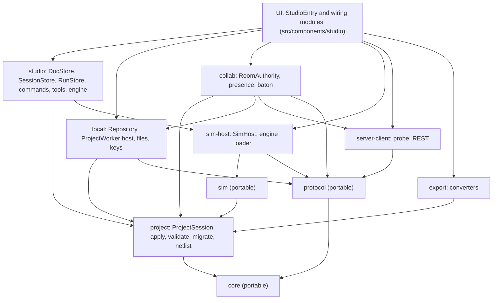
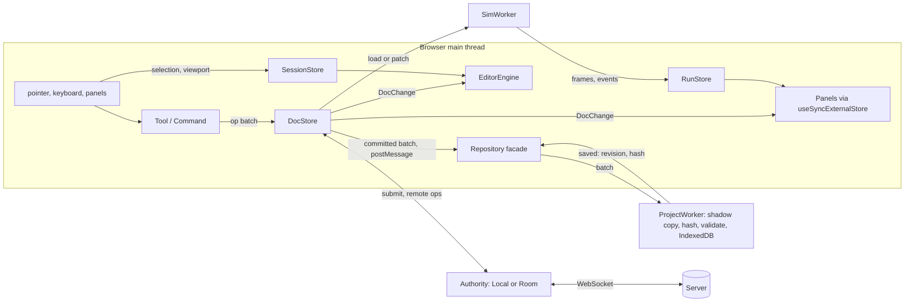

# Frontend architecture

Status: specification for the build, written 2026-10-27 for BRIEF sections 7, 8, 19 and 22 (the browser side of the platform).
Author role: frontend architecture seat. Output of one workflow step; a later pass folds in spike results that were still running.
ADR range used here: ADR-0400 to ADR-0409. The backend half is `BACKEND_ARCHITECTURE.md` (ADR-0420 to ADR-0430).

## 0. How to read this file

This file says how the iynk browser app is put together: which modules exist and who may import whom, where state lives, how the editor engine is separated from React, how workers and WASM engines load, how Next.js 16.4 is used, what the bundles may weigh, how strings load, how the app works offline and where tests plug in. It is a specification. It names files, fields, limits and acceptance tests. It does not plan around customers, markets, pricing or classrooms (D-013).

Labels: VERIFIED (read in code or docs, or reproduced), DOCUMENTED (a repo or spike document states it), EXTERNAL (an outside source states it), ESTIMATED (calculation or judgement, assumptions shown), HYPOTHESIS (a test is named), UNKNOWN (not found or not tested). "PENDING RS-xx" means the choice waits for a spike that had no `Verdict` when this was written; the options and the decision rule are given. "Disposition" is preserve, extend or replace, taken from the audit (BRIEF 3.5).

Next.js rule from `AGENTS.md`: every Next API named below was checked in `node_modules/next/dist/docs/` (version 16.4.3). Where a behaviour was not in those docs it is marked UNKNOWN and given a test.

Upstream (what this builds on):

| Source | Path | Used for |
|---|---|---|
| Assignment | `docs/MASTER_PLAN/BRIEF.md` sections 7, 8, 10, 19, 22 | scope |
| Decisions | `00_EXECUTIVE/DECISION_REGISTER.md`: D-007, D-010, D-011, D-013 to D-017 | binding constraints |
| Audit | `01_AUDIT/TECHNICAL_DEBT.md` (A2, A6, A7, A10, A11, B1 to B5, D1 to D5), `PERFORMANCE_BASELINE.md` (B1 to B5, P1, P2), `SECURITY_BASELINE.md` (X3, X4, P4), `TEST_COVERAGE.md` | what exists |
| Spikes | `08_RESEARCH_SPIKES/RS-01` (INCONCLUSIVE), `RS-03`, `RS-09`, `RS-12`, `RS-13` (`REPORT.md` each) | measured results |
| Contracts | `04_ARCHITECTURE/PROJECT_DATA_MODEL.md`, `schemas/project.schema.json`, `COMPONENT_SCHEMA.md`, `SIMULATION_ARCHITECTURE.md` (sections 17.1, 17.2) | names and fields (binding) |
| Product | `03_PRODUCT/FEATURE_CATALOGUE.md` (F-), `PRODUCT_REQUIREMENTS.md` (R-, BUD-, DET-, K-), `FEATURE_PRIORITIZATION.md` | ids and classes |

Downstream: ADR-0400 to ADR-0409 (section 1); features F-014, F-079 to F-083, F-087, F-092, F-094, F-171, F-176, F-180, F-203, F-204; requirements R-005, R-006, R-019, R-020, R-033, R-034, R-040, R-041, R-052 to R-054, R-068, R-074; journeys J-01, J-03, J-04, J-05, J-09. `BACKEND_ARCHITECTURE.md` shares the protocol package (section 4.3) and the capability probe (section 5.5).

## 1. Summary of decisions

| ADR | Decision | Evidence | Status |
|---|---|---|---|
| ADR-0400 | No module taxonomy of its own: the modules, paths and import matrix are SYSTEM_ARCHITECTURE 5.2 and 5.3 (`core`, `project`, `parts`, `sim`, `sim-host`, `local`, `export`, `studio`, `ai`, `collab`, `server-client`, `content`, UI, `labs (legacy)`), plus one `protocol` row for wire types shared with the server. Enforced by lint zones and `src/architecture.test.ts` (SYSTEM AR-02), not by convention. New code goes in the new modules; legacy lab code stays where it is until its phase. | A2 (28 type imports from components into lib), B4-07, B7-07 | Decided |
| ADR-0401 | Studio is a client-side application mounted by one static page per language, `/[lang]/studio`. The open project is chosen by the URL fragment (`#/prj_...`), which never reaches any server. Nothing about a project is server-rendered. | D-015, A11, Next static export limits (section 5.2) | Decided |
| ADR-0402 | Three external stores by lifetime: `DocStore` (the React-facing adapter over SYSTEM's `ProjectSession`, which stays the only mutator), `SessionStore` (selection, tool, viewport, drafts), `RunStore` (simulation frames). One `Command` layer turns every UI gesture, keyboard shortcut, AI proposal and buddy edit into an op batch. The `dispatch` monkey patches are deleted. | D5, B4-02, B4-04, B4-05, RS-09 | Decided |
| ADR-0403 | The editor engine is an imperative class behind an `EditorEngine` interface that consumes a pure `DrawList` built from the document. It emits intents, never ops, and React renders chrome only. SVG with level of detail and culling is the first renderer. | RS-01 (INCONCLUSIVE; LOD turned p95 25 ms into 10 ms on one laptop) | Decided, with a reversible interface; renderer choice PENDING RS-01 on real devices |
| ADR-0404 | Every worker speaks one versioned RPC envelope (`createRpcPort` in `src/protocol`). Each owning module creates its own `Worker`. The `ProjectWorker` lives as long as the tab and does all save work. WASM engines are static files described by a build-time manifest, fetched with integrity checks, shown with their size first, and cached after first use. An in-thread host with the same interface exists for tests. | SIMULATION_ARCHITECTURE 17.2, RS-12, RS-13, `check-client.ts:25-38` | Decided |
| ADR-0405 | CSP is a header from `next.config.ts` using hashes (Next's experimental SRI), not nonces, because nonces force dynamic rendering and are incompatible with the static shell. The header set is the one in SYSTEM_ARCHITECTURE 7.4. The inline theme boot script moves to a same-origin file. | Next docs `content-security-policy.md` lines 38, 181, 397; X4 | Decided in principle; whether Next's own inline scripts pass is UNKNOWN and gated by check FA-05 |
| ADR-0406 | Offline uses a small hand-written service worker with a build-versioned precache of the shell and runtime caching for engines and figures. `experimental.useOffline` is not enabled in the first release. | R-040, Next docs `offline-support.md` (experimental, retries requests, caches nothing) | Decided |
| ADR-0407 | Bundle and idle-CPU budgets are numbers in `budgets.json`, read from `route-bundle-stats.json` and a Playwright run, and fail CI on a rise of more than 10 percent. | R-019, BUD-04 to BUD-07, PERFORMANCE_BASELINE | Decided; numbers are PROPOSALs |
| ADR-0408 | Studio strings arrive as props from the static per-language page (one `studio` namespace); heavier text (part names, lesson prose) loads as per-language JSON chunks on demand, English as fallback. No string is built by concatenation. | `src/i18n/server.ts`, K-I18N, B4 (95 to 104 KB gzip per language) | Decided |
| ADR-0409 | Testing seams: the portable modules (`core`, `project`, `protocol`, `sim`) run in Node with no DOM; every worker, transport, repository, clock and random source is an injected interface with an in-memory implementation; the renderer is tested on its `DrawList`. | A13, B4-13, B5-16 | Decided |

## 2. Objections

The decisions are binding and this file follows them. These are the places where evidence says a requirement or a neighbouring document needs a one-line change.

1. **R-006 and R-040 pull against how Next 16.4 builds pages.** R-006 asks for "no `unsafe-inline` for scripts" with the boot script "allowed by nonce or hash". The Next docs say a nonce needs dynamic rendering and that Partial Prerendering is incompatible with nonce CSP (`content-security-policy.md` lines 38 and 397, VERIFIED). The repo runs with `cacheComponents: true` (`next.config.ts:5`) and every page under `[lang]` is declared static (`layout.tsx:24`). So the nonce path would undo the static shell. This file takes the hash path (ADR-0405). Whether Next's own inline flight-data scripts pass under a hash policy is UNKNOWN; check FA-05 settles it before B0 closes. If it fails, the fallback is a nonce on Studio and the home page only, accepting a server render per request for a thin shell.
2. **R-079 says the server address is "a setting in the app, not a rebuild"; R-006 says an origin list drives CSP `connect-src`.** A static CSP header can only allow origins it lists. So a typed-in address outside the list is blocked by the browser. This file takes SYSTEM 7.4: `connect-src` lists the server origin, the shipped AI adapter origins and `IYNK_CONNECT_ORIGINS`, and `IYNK_ALLOWED_ORIGINS` stays the server's own list of origins that may call it (section 9.2). Adding a new origin costs one restart of the `web` container, not a rebuild and not a server restart. It asks R-079 to say so in its acceptance text.
3. **SIMULATION_ARCHITECTURE 17.2 has no message for changing a running project.** The host messages are `load`, `control`, `step`, `speed`, `input`, `probe`, `debug`, `snapshot`, `restore`, `replay`. An edit while a run is open needs either a full `load` (the run restarts) or a hot patch of parameter changes. This file classifies ops by simulation impact (section 6.5) and asks the simulation seat to add `{ t: 'patch', ops: SimPatch[] }` for the `param` class. Without it every parameter tweak restarts the run, which is correct but slower.
4. **BUD-05 (400 KB gzip for the project home) is reachable only by removing three things.** The 727 KB transferred today minus the wallet chunk (139 KB gzip) minus CodeMirror (187 KB gzip) is 401 KB (ESTIMATED arithmetic from `PERFORMANCE_BASELINE.md` section 1; the chunks are counted once each). Dropping the 39 KB polyfill chunk (B5, if `browserslist` allows) gives about 362 KB. So the budget has about 10 percent headroom at best, and CI must watch it from the first commit that removes the wallet.
5. **R-007 asks for a test that lists the 23 route files under `src/app/api`.** B0 deletes the hackathon routes; the AI, search and MCP routes stay, closed by `IYNK_SERVER_TOKEN`, until COLLAB moves them to `server/` (BACKEND BE-0, SYSTEM ADR-0003). From COLLAB the web app keeps one route handler (`/config.json`). So the R-007 test lists the remaining `src/app/api` files until COLLAB, then the server's route registry. Same intent, two lists in sequence.
6. **R-053 and BUD-01 assume 500 parts in one view are drawn at once.** RS-01 shows 47,097 art elements is what hurts, not the part count, and that the hand-drawn SVG filter was dropped from the measurement (RS-01 caveats). The editor therefore must not apply that filter to parts in the canvas, and the budget must be stated in drawn elements as well (section 7.4).
7. **Neighbouring documents need small edits so the names agree** (this file cannot change them):
   - SYSTEM 5.3 has the `protocol` row (imports `core`; imported by `server`, `server-client`, `collab`, `local`) but not the three importers this file needs for the RPC envelope: `sim-host` (`createRpcPort` for the `sim`, `analysis` and `hdl` workers), `ai` (the `ai` worker) and UI. Either those cells are added, or `rpc.ts` moves to a small `src/core/rpc.ts` and `protocol` keeps only wire types.
   - BACKEND section 14 lists the Node subpath imports `#core/*` and `#protocol/*`; the server also imports `project` (it runs `apply`, SYSTEM 7.1) and `parts`, so `#project/*` and `#parts/*` are needed.
   - SYSTEM 6.9 `undo(): ApplyResult | null` has no author argument, while R-034 and PROJECT_DATA_MODEL 7.4 want per-author undo.
   - The probe has three names: `GET /v1/capabilities` (SYSTEM 6.1, 9.2; BACKEND 5.4), `GET /v1/server` (the `openapi.yaml` server base is `{origin}/v1`) and `GET /api/v1/server` (API_CONTRACTS sections 3 and 7, `ServerInfo`). This file uses `GET /api/v1/server` as assigned. The feature keys also differ: SYSTEM 6.1 `aiProxy`, `mcp` against `openapi.yaml` `aiRelay`, `tools`. This file uses the `openapi.yaml` keys.
   - SYSTEM 7.4 says camera, microphone and geolocation are "limited to self" in the Permissions-Policy table but gives no value; this file uses `camera=(), microphone=(), geolocation=(), serial=(self)` (nothing uses the first three).

## 3. What exists today, and what it forces

Everything here is VERIFIED unless marked.

| Fact | Where | Consequence |
|---|---|---|
| Each lab has its own store: a pure reducer plus `createXStore` with `getState`, `subscribe`, `dispatch` | `src/lib/boardlab/store.ts:209` (reducer), `:317` (create); `src/lib/robotics/store.ts` (reducer with effects); `src/lib/dronelab/store.ts` | Two store styles (B4-02). The shape `LabStore` (`src/components/dock/types.ts:6`) is a good seam to keep for the adapter in section 6.6 |
| Two modules overwrite `store.dispatch` on the object they are given | `src/components/dock/LabRoom.tsx:50,59`; `src/lib/realtime/store-sync.ts:143,153` | B4-04. The op log removes the need (ADR-0402) |
| The live interpreter run is on the main thread; only the check job has a worker, with an in-thread fallback | `src/lib/boardlab/engine.ts:164`; `src/lib/interp/check-client.ts:25-38`, `check.worker.ts` (13 lines) | The fallback is the model for the in-thread host (ADR-0404) |
| A worker is created with `new Worker(new URL('./check.worker.ts', import.meta.url), { type: 'module' })` and builds under Turbopack | `src/lib/interp/check-client.ts:38` | This is the pattern for every worker. The Turbopack docs also list `new Worker()` among the expressions that take magic comments (`08-turbopack.md:130`) |
| `cacheComponents: true`, `partialPrefetching: true`; all routes under `[lang]` static | `next.config.ts:5-6`; `src/app/[lang]/layout.tsx:24` (`ensureStatic = "navigation"`) | Studio's page must also be static (ADR-0401) |
| Language redirects live in `next.config.ts` `redirects()` | `next.config.ts:41-62` | A static export would lose them (Next docs list redirects, headers and proxy as unsupported there). Keep `next start` (section 5.2) |
| An inline script is rendered in `<head>` for theme and settings | `src/app/[lang]/layout.tsx:59` (`SettingsBootScript`) | It is the only first-party inline script (SECURITY_BASELINE P2); ADR-0405 moves it to a file |
| No `next/dynamic` or `React.lazy` anywhere in `src` | `PERFORMANCE_BASELINE.md` B2 (grep) | Everything heavy is in first load today (section 11) |
| First load of a lesson page is 2.2 MB raw, 701 KB gzip; the landing page downloads 2.29 MB raw in 23 scripts although its first-load list says 530 KB | `PERFORMANCE_BASELINE.md` section 1 (B1, B3) | Budgets start from these numbers |
| The cause of the extra late chunks is not read from source. HYPOTHESIS: `partialPrefetching: true` makes Next fetch client chunks of linked routes | `PERFORMANCE_BASELINE.md` B1 | Check FA-03 measures it before any rule is written |
| Idle main-thread use on landing and lesson pages is 48 to 65 percent of a core and 100 percent at 4x throttle (24 fps) | `PERFORMANCE_BASELINE.md` P1; suspect `figures/vendor/colorfigures/core.js:480` (`art.innerHTML` every frame) | The editor must not copy this pattern; BUD-04 is the gate |
| 80 figure HTML files, 24.7 MB raw, 8.1 MB gzip; the 100 KB engine is inlined into each | `PERFORMANCE_BASELINE.md` section 2 | Too big to precache; cache on use (section 10) |
| UI strings: 11 namespaces, 6 languages, loaded on the server with a dynamic `import()` per language and namespace, passed to client components as props | `src/i18n/namespaces.ts`; `src/i18n/server.ts:11-18`; `src/i18n/client.tsx` | The pattern is right for a static page; Studio adds one namespace (ADR-0408) |
| Vitest runs under jsdom for every file; its `include` covers `src/**`, `figures/**`, `scripts/**` only | `vitest.config.mts` | `server/**` and the DOM-free layers need their own project (section 13) |
| `server/realtime` tests (39) run with `node --test` outside `npm test` and `npm run check` | TECHNICAL_DEBT B5-16, `server/realtime/package.json` | Move into CI (BACKEND section 15) |

## 4. Module structure (ADR-0400)

This file adds no module taxonomy of its own. The module names, paths and the allowed-import matrix are SYSTEM_ARCHITECTURE 5.2 and 5.3 (ADR-0001), and BACKEND imports the same names. This section says what the browser app puts in each module, which one row SYSTEM 5.3 needs added, and how the rule is enforced.

### 4.1 Where each frontend concern lives

| Concern | Module | Path | Portable (SYSTEM 5.2) |
|---|---|---|---|
| ids, units, canonical JSON (RFC 8785), synchronous SHA-256, seeded PRNG, `Result`, size limits | core | `src/core/` | yes |
| `ProjectSession`, `apply`, inverse ops, validators V1 to V5 (generated Ajv standalone, op and project), migrations, netlist derivation, state hash, `opImpact.ts`, `touched.ts`, the `Authority` interface and `LocalAuthority` | project | `src/project/` | yes |
| wire frame types, HTTP body types, protocol version, the RPC envelope (`RpcPort`, `createRpcPort`, `createInlinePort`) | protocol (SYSTEM 5.2, 5.3) | `src/protocol/` | yes |
| one converter per format: `export(project) -> {bytes, loss[]}` and `import` (ADR-0109) | export | `src/export/` | yes |
| part descriptors, registry, generic art fallback | parts | `src/parts/` | yes, loaders no |
| orchestrator, engines, interpreters, solver | sim | `src/sim/` | yes |
| `SimHost` (creates and kills the `sim`, `analysis` and `hdl` workers), `HostToSim` / `SimToHost`, engine manifest and `loadEngine`, frame throttling, watchdog | sim-host | `src/sim-host/` | no |
| `Repository` (IndexedDB and memory), the `ProjectWorker` entry and its host, files, keys, local logs, service worker glue, `env.ts` wrappers | local | `src/local/` | no |
| room client, `RoomAuthority`, offline queue, presence, baton, transports | collab | `src/collab/` | no |
| capability probe and `ServerState`, REST client | server-client | `src/server-client/` | no |
| the `ai` worker, provider adapters, `DirectTransport` | ai | `src/ai/` | model-facing parts yes |
| `DocStore`, `SessionStore`, `RunStore`, `Command`, tools, `EditorEngine` and `DrawList` | studio | `src/studio/` | no |
| React panels, `StudioEntry` and the wiring modules (`simLink.ts`, `repositoryLink.ts`, `authorityLink.ts`) | UI | `src/components/studio/` | no |
| the legacy labs until they are moved in | labs (legacy) | `src/lib/{boardlab,robotics,dronelab,flight,hw,progress}`, `src/components/{boardlab,robotics,dronelab,flight,dock}` | mixed |
| strings and static content | content | `src/i18n/`, `src/content/` | data |

SYSTEM 5.2 and 5.3 now carry the `protocol` row: it imports `core` only, and `server`, `server-client`, `collab` and `local` import it. This file's RPC envelope (`createRpcPort`, ADR-0404) also needs `sim-host`, `ai` and UI to import `protocol`, which the SYSTEM 5.3 matrix does not allow yet and says "no other module needs it" (Objection 7).



Rules that follow:

1. **Types flow down, never components into lib.** The 28 `import type` lines from `components` into `lib` that audit A2 counted (and `lib/boardlab/store.ts` importing from `components/dock`) are fixed when a module moves, by moving the type to the lower module. `LabStore` moves to `src/lib/labs/store-types.ts` (the `labs (legacy)` row) and the old path re-exports it.
2. **Portable modules stay runnable in Node.** The server imports `core`, `project`, `parts` and `protocol` to validate and order ops (BACKEND ADR-0423, ADR-0430). If one of them touches a browser global, the server breaks, so the lint and the headless test (FA-02) catch it.
3. **Wiring happens only in UI.** `studio` may not import `local`, `collab` or `ai`, and `sim-host` may not import `studio`. `StudioEntry` creates the `ProjectSession`, `DocStore`, `Repository`, `Authority` and `SimHost` and joins them with three small modules: `repositoryLink.ts` (committed batch to `Repository.save`), `authorityLink.ts` (batch to `Authority.submit`, remote ops back to `DocStore`) and `simLink.ts` (section 6.5). Each is under 100 lines and holds no state.
4. **`app` is thin.** A page does three things: pick the language, load strings, render one client entry component. No project logic lives in `src/app` (SYSTEM 6.1: pages only).

### 4.2 Enforcement

SYSTEM 5.3 names the mechanism. This file adds the frontend-specific zones.

| Mechanism | What it catches | Status |
|---|---|---|
| ESLint `no-restricted-imports` zones in `eslint.config.mjs`, one per matrix row, plus `src/architecture.test.ts` reading every import statement and failing with the module pair and the file (SYSTEM AR-02) | wrong-direction imports; the test also tells `import type` from a value import, which the matrix cells marked "(types)" need and lint alone cannot | DOCUMENTED (SYSTEM 5.3); to be added in B0 slice FE-0 |
| ESLint `no-restricted-globals` and `no-restricted-properties` inside `src/core`, `src/project`, `src/protocol`, `src/sim`, `src/export` and the portable parts of `src/parts` and `src/ai` for `window`, `document`, `localStorage`, `Worker`, `Date.now`, `performance.now`, `Math.random`, `crypto.getRandomValues` (the `sim` list is SA-11) | impure code in portable modules | SA-11 DOCUMENTED |
| A Vitest project named `pure` that runs `src/core`, `src/project`, `src/protocol`, `src/sim`, `src/export`, the portable parts and `server` with `environment: node` and no `jsdom` | accidental DOM use fails at runtime | to be added; the Vitest 5 project syntax is checked when the config is written (Vitest 5.0.3 installed, VERIFIED) |
| `tsconfig.portable.json` (SYSTEM 5.4, AR-03) | a portable folder using `@/`, a non-erasable construct, or a DOM type | DOCUMENTED |
| Imports inside portable folders are relative with a `.ts` extension. Browser-only code keeps the `@/*` alias. `server/` reaches portable code through Node subpath imports (`#core/*`, `#project/*`, `#parts/*`, `#protocol/*` in `package.json` `imports`, BACKEND ADR-0430) | alias leaking into server code | design; BACKEND section 14 lists `#core/*` and `#protocol/*` only and needs `#project/*` and `#parts/*` added (Objection 7) |

### 4.3 Directory tree (target)

```
src/
  core/           ids.ts units.ts canon.ts hash.ts prng.ts result.ts limits.ts
  project/        session.ts (ProjectSession) authority.ts (Authority, LocalAuthority) touched.ts opImpact.ts
                  validate.ts (generated Ajv standalone, op and project) apply/ (one file per op group)
                  migrate/ netlist.ts
  protocol/       ws.ts (frames) http.ts (request and response bodies) version.ts rpc.ts (envelope, RpcPort, createRpcPort, createInlinePort)
  parts/          (SYSTEM 5.2; descriptor validation, registry; loaders in parts/browser/)
  sim/            clock/ engines/ interp/ solver/ flight/ physics/ orchestrator.ts
  sim-host/       sim-host.ts protocol.ts (HostToSim, SimToHost) sim.worker.ts analysis.worker.ts hdl.worker.ts
                  engines/ (manifest.ts, loader.ts)
  local/          repository/ (indexeddb, memory) project-host.ts project.worker.ts files/ keys/ env.ts sw/
  collab/         room-client.ts room-authority.ts transports/
  server-client/  capabilities.ts probe.ts rest.ts
  ai/             ai.worker.ts adapters/ (SYSTEM 6.8)
  studio/         doc-store.ts session-store.ts run-store.ts commands/ tools/ engine/ (types, drawlist, svg-renderer)
  components/studio/  StudioEntry.tsx panels/ wiring/ (simLink.ts, repositoryLink.ts, authorityLink.ts)
  i18n/           messages/<lang>/studio.json content/<lang>/parts/*.json
  app/[lang]/studio/page.tsx  ...
public/
  sw.js                       the service worker (section 10)
  boot.js                     theme and settings boot script (ADR-0405)
  engines/<id>@<ver>/...      WASM engines, a build product, gitignored (section 8.3)
server/                       the self-hostable server (BACKEND)
```

The `compile` worker (section 8.2) has no module until ADR-0013 is settled (PENDING RS-04).

### 4.4 Disposition of what exists

| Subsystem | Disposition | Reason |
|---|---|---|
| `src/lib/interp` | extend, move to `src/sim/mcu/*` and `src/sim/core` in CORE (SYSTEM 15.1) | clean, tested, no dependencies (`interp.md`); SIMULATION_ARCHITECTURE 18.1 |
| `src/lib/interp/check-client.ts` and its in-thread fallback | extend, move to `src/sim-host/` | becomes `createInlinePort` and the first RPC message type (section 8.1) |
| Lab stores (`boardlab`, `robotics`, `dronelab`) | preserve until "Labs moved in", then replace by the mapping in section 6.6 | they work and have tests; their action vocabulary is the spec for the replacement |
| `LabRoom.tsx`, `store-sync.ts` | replace in COLLAB | monkey patches (B4-04), whole-text baton (B5-07) |
| `src/lib/realtime` transports (`transport.ts`, `ws-transport.ts`, `broadcast-transport.ts`) | extend, move to `src/collab/transports/` | the interface is right; `room.ts` action order is replaced by the op-log client (section 6.4) |
| `src/lib/realtime/room.ts` | replace the ordering and baton parts; preserve presence, chat and reconnect timers | B5-07, B5-09, B5-10 |
| `src/lib/progress/storage.ts` (`iynk:v1` in `localStorage`) | extend, move to `src/local/progress.ts`: migrate into IndexedDB `progress` (ADR-0106); keep only `settings` in `localStorage` for the boot script | B7-06 |
| `src/i18n/*` | preserve | works, 0 missing keys (A9) |
| `figures/*` and `FigureFrame.tsx` bridge | preserve | the best-defined API in the repo (A6); used by legacy labs and as premium part art (ADR-0204 of the component schema) |
| `src/components/dock/LabDock.tsx` and its panels | extend: lazy-mount panels; remove the Solana import | B2, B6-16 |
| `src/lib/server/*`, `src/app/api/*` | delete the hackathon routes in B0; move the rest to `server/` in COLLAB (BACKEND section 3, SYSTEM 15.1) | 78 mixed files (B7-07) |

## 5. Routes, rendering and caching under Next 16.4

### 5.1 Route table

| Route | Rendering | Content | Notes |
|---|---|---|---|
| `/[lang]` | static shell, per language | project home: new project, open project, open from file, continue, templates, first run (F-174, F-175) | the project list is read from IndexedDB in the browser, so the HTML is identical for everyone |
| `/[lang]/studio` | static shell, per language | mounts `<StudioEntry>` (client). Selected project from `#/<prj_id>`; room invite from `#room=<invite>`; share link from `#share=<shr_id>` | one page, no dynamic segment (ADR-0401) |
| `/[lang]/boards`, `/robotics`, `/drones` and their children | unchanged (static) | the legacy labs | removed from navigation when moved into Studio; redirects to templates then |
| `/[lang]/settings` | static shell | keys, server address, data export and wipe, telemetry switch, language, theme | F-168, F-176, F-193 |
| `/config.json` | route handler, evaluated per request | `{ "server": "https://..." \| null, "protocol": 1 }` from the runtime env `IYNK_SERVER_URL` | the only route handler the web app adds. It exists because `NEXT_PUBLIC_*` values are frozen at build (Next docs `environment-variables.md:166`, VERIFIED); the app must also work with the file absent from a plain static host (it then falls through to the same-origin probe, section 5.5) |
| `/sw.js`, `/boot.js` | static files in `public/` | service worker and boot script | headers in section 5.3 |
| `/engines/*` | static files | WASM engines | section 8.3 |

B0 deletes the hackathon routes (status, telemetry, live, leaderboard, buddies, Solana, story, image, match, plan) and the pages `/[lang]/passport`, `/verify` and `/together` (D-016, R-004). The AI, search and MCP routes stay, closed by `IYNK_SERVER_TOKEN`, until COLLAB moves them to `server/` (BACKEND BE-0, SYSTEM ADR-0003). `/config.json` is the only route handler the web app adds.

### 5.2 Why Studio is a static client page

| Option | Verdict |
|---|---|
| A. `/[lang]/studio/[projectId]` dynamic segment | Rejected. Project ids exist only in the browser. The page would need `generateStaticParams` with no real values, or a request-time render that sends the id to the server, which D-015 and the data-handling note (F-008) forbid for no benefit |
| B. Query string `?p=prj_...` | Rejected. The id would reach any proxy log and every `Referer` |
| C. Fragment `#/prj_...` | **Chosen.** Never sent to a server or in `Referer`; one prerendered page per language; works from a plain static host |
| D. `output: 'export'` for the whole app | Rejected for now. The Next docs list redirects, headers and proxy as unsupported in a static export (`static-exports.md:278-300`), and the app uses `redirects()` for language negotiation. Studio itself would survive the move, so the choice stays reversible: nothing in `studio` needs a Node request |

`StudioEntry` is a client component loaded with `next/dynamic` and `ssr: false` from a client wrapper (the docs say `ssr: false` is not allowed directly in a Server Component, `lazy-loading.md:94`, VERIFIED). The server page only renders the shell (header, a "loading Studio" frame sized to avoid layout shift) and passes the `studio` strings as props.

### 5.3 Caching and headers

| Resource | `Cache-Control` | Why |
|---|---|---|
| `/_next/static/*` (hashed) | Next default (immutable) | VERIFIED default behaviour is Next's; the service worker caches it cache-first |
| `/engines/<id>@<ver>/*` | `public, max-age=31536000, immutable` | path contains id and version; content also checked by sha256 (section 8.3) |
| `/figures/*` | `public, max-age=300, must-revalidate` (exists, `next.config.ts:23-30`) | unchanged for legacy labs |
| `/sw.js` | `no-cache, no-store, must-revalidate`, `Content-Type: application/javascript`, `Content-Security-Policy: default-src 'self'; script-src 'self'` | taken from the Next PWA guide (`progressive-web-apps.md:636-666`, VERIFIED) |
| `/boot.js` | `public, max-age=0, must-revalidate` | tiny; must change with the build |
| HTML pages | Next default for the static shell | the shell holds no user data |
| `/config.json` | `no-store` | runtime value |

`cacheComponents` stays on. Studio adds no `use cache` functions: there is no server data to cache. `partialPrefetching` stays set explicitly (the docs warn that leaving it unset logs a warning, `cacheComponents.md`). Links to heavy routes get `prefetch={false}` if check FA-03 confirms B1's hypothesis. `proxy.ts` (the Next 16 name for middleware, VERIFIED `16-proxy.md`) is not used in the first release: language negotiation stays in `redirects()` and CSP is a static header.

`experimental.useOffline` is not enabled (ADR-0406). `instrumentation.ts` is not used by the web app; observability is a server concern (BACKEND ADR-0429).

### 5.4 Build output for a self-hoster

`output: 'standalone'` (VERIFIED in `output.md`) produces `.next/standalone/server.js` for the Docker image. The docs note that `public/` and `.next/static` are not copied by default and must be copied by the image build. The standalone output does not trace a custom server, so the web app uses the stock one. `NEXT_DIST_DIR` and `IYNK_BUILD_SKIP_TYPECHECK` in `next.config.ts` are agent-workflow settings; the `!process.env.VERCEL` test is removed with F-202.

### 5.5 The capability probe

The app learns what the optional server offers in this order, and stops at the first step that gives an address:

1. The address saved in Settings.
2. The `server` value in `/config.json` from its own origin (set from `IYNK_SERVER_URL`).
3. One same-origin `GET /api/v1/server` with a 2 s timeout. This finds the compose stack, where Caddy serves the app and the server on one origin and `IYNK_SERVER_URL` is not set (SYSTEM 4 compose file). `404`, a timeout, a network error, or a `200` whose body is not a `ServerInfo` with `software.name === 'iynk-server'` (a static host that answers every path with its HTML page) all mean "none".

With an address from step 1 or 2 the app calls `GET <address>/api/v1/server` once per session with the same 2 s timeout. The response is `ServerInfo` (API_CONTRACTS section 7 `getServerInfo`, `schemas/openapi.yaml`), including `minClient`, `apiVersions` and `features`; the app sends `Iynk-Client: iynk-web/<semver>` (API_CONTRACTS section 3). BACKEND section 5.4 describes the same probe under the name `/v1/capabilities`. Step 3 is a request to the page's own origin, so a fresh browser still sends nothing to any other origin (R-009, R-012; FA-10). The page's own origin may answer it `404` once per session; that single status is the only failed request FA-10 allows.

The probe lives in `src/server-client/` and produces SYSTEM 6.1's `ServerState` (`none`, `unreachable`, `needs-enrol`, `ready`). Every server-backed surface reads `useCapability(feature)`, where `feature` is a key of `ServerInfo.features`: `identities | buddies | projects | shares | rooms | assets | aiRelay | searchProxy | compile | tools`. It returns `{ state: 'on' | 'off' | 'none' | 'unreachable' | 'needs-enrol', fix: string }`: `on` when the server is `ready` and the flag is true, `off` when it is `ready` and the flag is false (the operator turned it off), the others from `ServerState`. The `fix` is a one-line step rendered from `studio` strings. The names follow `openapi.yaml` `ServerInfo`; SYSTEM 6.1's `ServerCapabilities` spells two of them differently (`aiProxy`, `mcp`) and the contract documents must settle one list (Objection 7).

## 6. State management (ADR-0402)

### 6.1 Today and target

| | Today | Target |
|---|---|---|
| Where state lives | one store per lab page, created inside the page component | `DocStore` per open project, `SessionStore` per editor, `RunStore` per run; all created by `StudioEntry` and disposed with it |
| How state changes | `dispatch(action)` through a hand-written reducer per lab | UI gesture to `Command` to op batch to `DocStore.commit()` to `ProjectSession.apply()` (SYSTEM 6.9) |
| Who else can change it | rooms and the AI by wrapping `dispatch` | rooms, AI proposals, undo and import use the same `commit()` with a different `author.kind` |
| History | none | op log with per-author undo (R-034) |
| Persistence | ad hoc `localStorage` keys | repository interface over IndexedDB, run inside the per-tab `ProjectWorker` (ADR-0106, SYSTEM 6.9) |

### 6.2 The three stores



| Store | Holds | Changes through | Observed by | Not in it |
|---|---|---|---|---|
| `DocStore` | a reference to the `ProjectSession`; `state` and `revision` are read through it and never copied; `lastSaved` (`{ revision, hash, writtenAt }`, reported by the `ProjectWorker`); `confirmedSeq` (from the `Authority`); `proposals` | `commit(batch)`, `applyRemote(envelopes)`, `undo()`, `redo()` and `replaceSession(snapshot)`; every one of them ends in a `ProjectSession` call | engine, panels, and through the wiring modules the repository, authority and sim host | selection, viewport, anything transient; a second copy of the document |
| `SessionStore` | selected ids, active tool, viewport (`originMm`, `mmPerPx`), hover id, drag preview, open panels, focus ring, unsent drafts, current view id | direct setters | engine, panels | anything that must survive a reload except panel layout (kept in `localStorage`, a per-viewer convenience) |
| `RunStore` | run status, `SimTime`, snapshot frames (30 per simulated second at most), serial lines (ring of 200, as `SERIAL_KEEP` today), probe traces (ring buffers per SIMULATION_ARCHITECTURE 14.4), diagnostics, check results | messages from the SimWorker | panels | document data |

All three expose `getState`, `subscribe(listener)` and are read in React with `useSyncExternalStore` (the pattern the repo already uses, VERIFIED in `useLab.ts`). No state library is added. Selectors are plain functions; a selector must return a stable reference when nothing relevant changed, and a lint-free test (FA-04) fails a panel that re-renders on an unrelated op.

`DocStore.subscribe` delivers a `DocChange`, not just a tick. The type lives in `src/project/touched.ts` so `sim-host` and the server can use it without importing `studio`:

```ts
export interface DocChange {
  from: number;            // revision before
  to: number;              // revision after
  ops: Op[];               // applied ops, in order; envelopes (seq, server-stamped author) arrive with the Authority ack
  touched: Touched;        // computeTouched(before, after): the engine redraws only these
  origin: 'local' | 'remote' | 'undo' | 'redo' | 'load' | 'ai';   // 'load': session replaced, rebuild everything, ignore touched
}
export interface Touched { components: Set<string>; nets: Set<string>; wires: Set<string>; views: Set<string>; sources: Set<string> }
/** Pure. Walks the top-level entity maps of two immutable states and lists the ids whose value is not `===`. */
export function computeTouched(before: ProjectState, after: ProjectState): Touched;
```

`ApplyResult` in SYSTEM 6.9 is `{ ok, revision, inverse }` and does not return which entities a cascade reached (a `component.remove` also removes its wires and net memberships). So `touched` is not read from `apply`. It is computed by `computeTouched`, which relies on `apply` returning structural sharing: an entity the op and its cascade did not change keeps its reference. FA-01 tests that property. If SYSTEM 6.9 later adds `touched` to `ApplyResult`, `computeTouched` stays as the test oracle. Cost: one pass over the entity maps per commit; ESTIMATED under 1 ms at 500 parts, measured by FA-04's harness.

### 6.2.1 How DocStore relates to ProjectSession

SYSTEM 6.9 declares `ProjectSession.apply(op | op[], author)` the only mutator (ADR-0104). `DocStore` does not repeat it:

1. `DocStore` is the React-facing adapter over `ProjectSession`. `commit(batch, { author })` calls `session.apply(batch, author)` and nothing else mutates state. `getState()` returns `session.state`; there is no `state` field to assign.
2. On `ok`, `commit` calls `computeTouched(before, after)`, builds the `DocChange` (origin `local`, `ai` or `undo`), notifies subscribers in the same task, then hands the batch to the wiring modules: `repositoryLink` posts it to the `ProjectWorker` (section 8.2) and `authorityLink` calls `Authority.submit`. On `!ok` it returns the `RejectCode` and notifies no one.
3. `applyRemote(envelopes)` calls `session.apply(ops, author)` for ops from a room (origin `remote`). `undo()` and `redo()` call `session.undo()` and `session.redo()`. SYSTEM 6.9 shows these without an author argument, while R-034 wants per-author undo; the stacks stay inside `ProjectSession` and the signature gap is Objection 7.
4. `replaceSession(snapshot)` creates a new `ProjectSession` from a snapshot (open, room resync, rebuild after a rejection) and swaps the reference. Subscribers get one `DocChange` with origin `load`. No code outside `src/project/session.ts` assigns session state.

### 6.3 Commands

One registry, one shape, used by the toolbar, the keyboard, the command palette, the non-pointer wiring path (R-058), AI proposals and tests:

```ts
export interface Command<A = void> {
  id: string;                         // 'wire.finish', 'part.rotate', 'source.format'
  label: string;                      // an i18n key in the studio namespace
  enabled(ctx: CommandContext): boolean;
  plan(ctx: CommandContext, args: A): OpBatch | { reject: 'noop' | RejectCode };
}
```

`CommandContext` gives read-only `state`, `selection`, `viewport`, `now()` and `newId(prefix)` (injected so tests are deterministic). `plan` is pure. The caller runs `docStore.commit(batch, { author })`. A tool (select, wire, place, pan) is a small state machine in `SessionStore` that turns intents from the engine into commands; it never touches `DocStore` directly.

Drag preview: while the pointer is down, the tool sets `SessionStore.preview` (a list of transient placements). The engine draws it. On release, one `view.place` batch is committed. This matches PROJECT_DATA_MODEL 7.4 ("a drag sends one `view.place` on release; live drag feedback to buddies is an ephemeral presence message, not an op").

### 6.4 The authority seam (local and room)

`DocStore` does not know whether it is in a room. The wiring module `authorityLink` talks to an `Authority` (interface and `LocalAuthority` in `src/project/authority.ts`, `RoomAuthority` in `src/collab/`). The batch has already been accepted by `session.apply` when it is submitted, so `submit` orders it; it does not validate it for the local view.

```ts
export interface PendingBatch { batchId: string; base: number; author: Author; ops: Op[] }   // no seq: the ordering authority assigns it
export interface Authority {
  /** Local: stamps envelopes from the local counter and resolves at once. Room: queues the batch and resolves when the server acks (its seq, its stamped author) or rejects. */
  submit(batch: PendingBatch): Promise<{ ok: true; envelopes: OpEnvelope[]; inverse: Op[] } | { ok: false; reject: RejectCode }>;
  onRemote(handler: (envelopes: OpEnvelope[]) => void): () => void;
  onResync(handler: (snapshot: ProjectSnapshot) => void): () => void;
  readonly mode: 'local' | 'room';
}
```

`OpEnvelope.seq` is "assigned by the ordering authority (the room server, or the local counter when working alone)" (`project.schema.json` `$defs/OpEnvelope`). `DocStore` never assigns it. In a room the envelope's `seq` and `author` are the server's, read from the ack; a pending batch has neither. `DocStore.confirmedSeq` follows the authority; `session.revision` counts confirmed plus pending (optimistic) batches, and the two are equal in local mode.

- `LocalAuthority` (default): `seq = previous + 1`, `base = seq - 1`, no network. The local project is its own ordering authority, which the schema allows. This is the whole app when there is no server (R-012).
- `RoomAuthority` (COLLAB): the optimistic client of RS-09. It keeps `confirmed` (server order only) plus a queue of pending batches replayed on top; one batch in flight; a rejection drops the pending batch and rebuilds the view (`DocStore.replaceSession` from `confirmed` plus the remaining queue, replayed through the pure `apply`); dedup by `opId`; on reconnect it sends its last `seq` and receives a tail or a snapshot plus tail. This is PROJECT_DATA_MODEL 7.4, not a new design. The server half is BACKEND ADR-0423.
- When the server is unreachable mid-session the authority switches to `offline-queue` mode: edits apply locally, a banner shows, up to 1,000 pending batches queue, then room editing pauses while local editing continues (R-088).
- Text of source files: one writer at a time through the baton (R-094); `source.edit` carries `baseSeq` (PROJECT_DATA_MODEL 7.2). The code panel greys out and says whose baton it is. Today a room member without the baton edits locally and nothing warns them (B4-14, VERIFIED in the walk); the greyed panel fixes that.

### 6.5 Linking the document to the simulation

`simLink.ts` (the UI wiring module of section 4.1) subscribes to `DocStore`, classifies each `DocChange` by simulation impact with `classifyImpact` from `src/project/opImpact.ts`, and calls the `SimHost` of `src/sim-host/`. `studio` does not import `sim-host` for this and `sim-host` does not import `studio`. The class is a function of the op kinds in the batch, not of the cascade, so it does not depend on `touched`:

| Class | Ops (PROJECT_DATA_MODEL 7.2) | Action |
|---|---|---|
| `none` | `view.*`, `wire.*`, `junction.*`, `label.*`, `meta.set`, `guide.set`, `access.*`, `mech.set` (when no run uses mechanics) | nothing |
| `param` | `component.set` with `params` only, `board.set` with `params`, `param.set`, `input.set`, `fault.set` | send `patch` to the SimWorker (requires the protocol addition in Objection 3); until then, `load` |
| `source` | `source.edit`, `source.add`, `source.remove`, `source.rename` | mark the run `stale`; the next Run (or Reload) recompiles; a setting "restart on code change" is off by default |
| `structural` | `net.*`, `component.add`, `component.remove`, `component.swap`, `board.*`, `sim.set`, `runtime.*`, `dep.set` | stop the run, rebuild the `SimNetlist` (`project/netlist.ts`), mark `stale` |

The mapping lives in one table in `src/project/opImpact.ts` so the server could use it later. A test asserts every op kind in the schema has a class (FA-06). Worker equivalence (SA-01) and the 2 s kill (SA-10) are simulation acceptance tests; the frontend adds only that a killed worker is recreated from the current document without losing it (FA-07).

### 6.6 Moving the legacy lab stores onto the model

Each lab store action goes to exactly one place. This table is the spec for the "Labs moved in" phase and the check that no state is duplicated. Source: `BoardLabAction` at `src/lib/boardlab/store.ts:71-103`.

| Legacy action | Goes to | Op or note |
|---|---|---|
| `code/replace` | `DocStore` | `source.edit` (minimal range from a text diff; a whole-file replace is `pos 0, del len, ins text`) |
| `code/reset` | `DocStore` | `source.edit` restoring the rendered template |
| `param/set` | `DocStore` | `param.set` |
| `variant/set` | `DocStore` | `component.swap` or `board.set` |
| `power/set` | `DocStore` | `component.set` on the supply |
| `fault/trigger`, `fault/clear` | `DocStore` | `fault.set` with `enabled` (this is why "Break it" is undoable, PROJECT_DATA_MODEL 7.2) |
| `run/start`, `run/stop`, `run/phase`, `run/error`, `run/tick` | `RunStore` and SimWorker `control` | not document data |
| `serial/*` | `RunStore` (lines, baud) and SimWorker `input` (send) | `serial/send` is logged in the replay log, not the op log |
| `input/set`, `input/request` | SimWorker `input` | a live value is replay data (`ReplayLog.events`), not an edit; defining an input is `input.set` |
| `checks/*` | `RunStore` | results of tests, not document data |
| `view/set`, `exploded/set`, `part/select` | `SessionStore` | |
| `figure/state` | deleted | the figure becomes a renderer of the document; legacy figures keep their bridge until replaced |
| `assembly/done`, `assembly/reset` | repository `progress` store | per-person progress, outside the project (ADR-0106) |
| `sync/hydrate` | deleted | rooms use snapshot plus tail |

`BenchState` (robotics) and the drone store follow the same rule. Their effect handlers inside `BenchWorkspace.tsx` (B4-03) become `Command`s and `SimHost` subscriptions.

## 7. The editor engine boundary (ADR-0403)

### 7.1 Why a boundary

RS-01 measured the cost: what hurts is the number of drawn art elements (47,097 for 500 parts), and level of detail turned p95 in the fit view from 25 ms to about 10 ms on one laptop. The first renderer may not survive real devices (INCONCLUSIVE). React cannot reconcile 47k elements per pan frame. So the canvas is owned by an imperative engine, React renders chrome only, and the renderer is replaceable.

### 7.2 The interface

```ts
export interface EditorEngine {
  mount(host: HTMLElement, opts: { reducedMotion: boolean; dpr: number }): void;
  unmount(): void;
  /** Build everything from a document (open, resync, undo of a large batch). */
  setDocument(state: ProjectState, view: ViewId): void;
  /** Incremental update from DocStore. Redraws only change.touched. */
  applyChange(change: DocChange, state: ProjectState): void;
  setViewport(v: Viewport): void;          // originMm: {x,y}; mmPerPx: number
  setSelection(ids: readonly string[]): void;
  setPreview(p: Preview | null): void;     // transient placements, ghost wire; never committed
  hitTest(pointMm: PointMm, opts?: { radiusPx?: number; kinds?: HitKind[] }): Hit[];
  focusRing: FocusModel;                   // keyboard and screen-reader path (R-058, R-070)
  on<E extends keyof EngineEvents>(e: E, h: EngineEvents[E]): () => void;
  readonly stats: { lastFrameMs: number; p95Ms: number; elements: number; culled: number; lod: 'detail' | 'outline' };
}

export interface EngineEvents {
  pointer: (e: { kind: 'down' | 'move' | 'up' | 'wheel'; pointMm: PointMm; buttons: number; modifiers: Modifiers }) => void;
  hover: (hit: Hit | null) => void;
  intent: (i: Intent) => void;             // 'move-selection' | 'begin-wire' | 'extend-wire' | 'finish-wire' | 'box-select' | ...
  viewport: (v: Viewport) => void;
}
```

Rules:

1. The engine reads the document and the session; it never writes either. It emits intents. Only tools turn intents into commands (section 6.3).
2. Units are millimetres and ids, exactly as `views` stores them (PROJECT_DATA_MODEL 4.1, 5.7). Pixels exist only inside the engine and in `Viewport.mmPerPx`.
3. The engine is the only code that touches the canvas DOM. Panels, inspector, palette and toolbar are React.

### 7.3 DrawList: the testable half

`buildDrawList(state, viewId, viewport, quality): DrawList` is a pure function in `studio/engine/drawlist.ts`. It returns, for the visible region only, an ordered list of primitives (`part`, `outline`, `wire`, `junction`, `label`, `handle`) with their transforms and the art asset id. It applies viewport culling and level of detail. The SVG renderer is about a few hundred lines that diff the previous list against the new one and set attributes. A Canvas or WebGL renderer would consume the same list. This is what keeps RS-01's open question reversible (reversal cost: one renderer file).

Level of detail, from RS-01: when a part is smaller than a threshold on screen, draw an outline rectangle instead of its art. The threshold in RS-01 is not stated in the report; start at 12 CSS px on the longer side (HYPOTHESIS) and tune with the harness.

### 7.4 Budgets that make the boundary useful

| Item | Value | Basis |
|---|---|---|
| Frame time p95, 500 parts and 1,000 wires, desktop Chromium 1x | under 20 ms | BUD-01; RS-01 LOD measured 10.3 to 10.7 ms |
| Same at 4x CPU throttle | under 33 ms | BUD-02; known miss: LOD zoom 34.1 ms at 4x, 58 ms at 6x (MEASURED) |
| Same at DPR 2 | under 20 ms in pan, fit and zoom | BUD-03; LOD 9.2 ms |
| Drawn art elements in view | start at 10,000 (HYPOTHESIS); the harness records p95 against element count and the number is set from that curve | RS-01: 47,097 elements fails; 0 data between |
| Part art in the canvas | flat, filter-free; the hand-drawn `feTurbulence` filter is applied only to the hovered or selected part and in figure panels | RS-01 caveats: the filter (a 580 KB data URL per page) was dropped from the measurement |
| Idle main-thread use of an open project, nothing running | under 5 percent of a core at 1x, under 25 percent at 4x | BUD-04; the engine draws only on change, never in a free-running `requestAnimationFrame` loop |
| Engine code | no `innerHTML` rebuild per frame | P1 root cause (suspected) |

### 7.5 Pending

| Open | Settled by | Rule |
|---|---|---|
| Does SVG with LOD hold p95 under 20 ms on a mid-range phone and a school-grade Chromebook? | RS-01 re-run on devices (Amar has none yet, UNKNOWN) | Pass: both under 20 ms. Fail trigger: either over 33 ms, then Canvas 2D with cached bitmaps or Pixi for the part layer, behind the same interface. RS-01 shows naive full-redraw Canvas is worse than SVG, so the replacement must cache |
| Does WebKit pan-fit with LOD reach 20 ms? | same | measured 22 ms on desktop WebKit (BUD-03 text); needs work either way |

## 8. Workers and WASM loading (ADR-0404)

### 8.1 One envelope, one port

SIMULATION_ARCHITECTURE 17.2 fixes the sim messages (`HostToSim`, `SimToHost`) and the `v: 1` envelope that follows the figure bridge. This section defines the transport under them so every worker, not only the sim, behaves the same.

```ts
// src/protocol/rpc.ts (portable: names no Worker global, takes a structural WorkerLike)
export interface WorkerLike {
  postMessage(msg: unknown, transfer?: unknown[]): void;
  terminate(): void;
  onmessage: ((e: { data: unknown }) => void) | null;
  onerror: ((e: unknown) => void) | null;
}
export interface RpcPort<Req extends { t: string }, Ev extends { t: string }> {
  call<R extends Req>(msg: R, opts?: { signal?: AbortSignal; timeoutMs?: number; transfer?: unknown[] }): Promise<AckOf<R>>;
  on(handler: (ev: Ev) => void): () => void;
  /** terminate() after a grace period; resolves once the worker is gone. Default grace 2000 ms (BUD-12, ADR-0311). */
  kill(graceMs?: number): Promise<void>;
  readonly state: 'starting' | 'ready' | 'dead';
}
export function createRpcPort<Req extends { t: string }, Ev extends { t: string }>(w: WorkerLike, opts?: PortOptions): RpcPort<Req, Ev>;
export function createInlinePort<Req extends { t: string }, Ev extends { t: string }>(handle: WorkerHandler<Req, Ev>): RpcPort<Req, Ev>;
```

The module that owns a worker creates it, because a bundler only follows `new Worker(new URL('./x.worker.ts', import.meta.url))` when the literal is at the call site: `src/sim-host/` creates `sim`, `analysis` and `hdl`; `src/local/project-host.ts` creates `project`; `src/ai/` creates `ai`. Each passes the result to `createRpcPort`.

- Every message has `v: 1`, and calls have a numeric `id`. An `ack` or `error` with the same `id` resolves or rejects the call. `error` carries `{ kind, message, hint? }` (the sim shape).
- A worker that has not sent `ready` within 10 s is killed and the call fails with `worker_start_timeout` (ESTIMATED limit; tune from the start-time measurement in BUD-06).
- A worker that dies is not restarted by the port. The owner (`SimHost`, `ProjectHost`) recreates it from the current document and reports `worker_restarted` to the UI (FA-07).
- Typed arrays cross by transfer. No `SharedArrayBuffer`, so no cross-origin isolation headers are needed (SIMULATION_ARCHITECTURE 17.2; a self-hosted deployment stays simple).
- The owner creates each worker with `new Worker(new URL('./x.worker.ts', import.meta.url), { type: 'module' })`, the pattern at `check-client.ts:38`. Each worker file is a separate entry, so Turbopack emits a separate chunk that is not in the page's first load.
- `createInlinePort` (the in-thread host): the same `RpcPort` interface, running the worker's `handle()` function in the calling thread through `queueMicrotask`. Used by jsdom tests, by SA-01 (worker equals in-thread), and as the fallback when `Worker` is undefined (as `check-client.ts:25-37` already does). It has no preemption, so it enforces the engine's own statement caps and nothing else.

### 8.2 The workers

| Name | File | Created | Count | Holds | Protocol | Notes |
|---|---|---|---|---|---|---|
| `sim` | `sim-host/sim.worker.ts` | when a project's Run is pressed | one per open run | orchestrator, interpreters, DC solver, avr8js (opt-in), Rapier (robotics) | `HostToSim` / `SimToHost` | caps and 2 s kill: SIMULATION_ARCHITECTURE 8.8 |
| `project` | `local/project.worker.ts`, hosted by `local/project-host.ts` | when the first project is opened or created in the tab | one per tab, alive until the tab closes; `ProjectHost` recreates it if it dies (section 8.1) | the shadow copy of the committed state, canonicalise and hash, the standalone project validator (102 KB gzip, 55 KB brotli, PROJECT_DATA_MODEL 9.6), migrations, zip reader and writer, every IndexedDB read and write of the repository, the write to a bound file | `ProjectReq` / `ProjectEv` | SYSTEM 6.9 and 7.1: the work that must not block a frame. Parses outside the main thread as PROJECT_DATA_MODEL 13 requires. Own-database opens validate with the cheap path first (section 8.4) |
| `check` | existing `check.worker.ts` | per check run | one per job | `runChecks` | existing `{ job, budgetMs }`; becomes a `HostToSim` message in SIM-0 | `check-client.ts` is the precedent |
| `analysis` | `sim-host/analysis.worker.ts` | on the "Analyse" button | one, terminated when done | ngspice WASM | `AnalysisReq` | 20.3 MB JS, 5.7 MB gzip (SIMULATION_ARCHITECTURE 17.1); needs RS-07 for stepping |
| `hdl` | `sim-host/hdl.worker.ts` | on "Inspect" in a Verilog project, desktop only | one | Yosys (YoWASP) and DigitalJS | `HdlReq` | 12.5 MB brotli, 662 to 725 MB renderer memory (RS-12); refused when `navigator.deviceMemory` is 4 or less |
| `ai` | `ai/ai.worker.ts` | when a browser-direct AI call is made | one | provider client, so the keys are not read by UI code | `AiReq` | see BACKEND ADR-0425 |
| `compile` | module chosen with ADR-0013 | only if compile option B (browser avr-gcc) is chosen | one | avr-gcc WASM | `CompileService` | PENDING RS-04; not built until then |

Main thread only, on purpose: the editor engine, the `ProjectSession` and `apply` for a local gesture (the editor needs the new state in the same frame, SYSTEM 7.1), and `computeTouched`. Nothing else about saving runs there.

**Save path.** `Repository.save(batch)` always posts the committed batch to the `ProjectWorker`; it never canonicalises, hashes, validates or touches IndexedDB on the main thread. Canonicalise plus hash is 3.84 ms at 500 parts and 18.5 ms at the 2,000-part limit in Node (VERIFIED, PROJECT_DATA_MODEL 9.6). 18.5 ms already exceeds a 16.7 ms frame on a fast desktop and is ESTIMATED 4x to 6x slower on a Chromebook, so it cannot share the thread with the editor. The messages:

| Message | Direction | Fields | Meaning |
|---|---|---|---|
| `open` | main to worker | `projectId`, `state`, `revision` | one structured clone of the state when a project opens or a session is replaced; the worker keeps it as the shadow copy |
| `commit` | main to worker | `fromRevision`, `toRevision`, `ops: OpEnvelope[]` | the committed batch; the worker folds it into the shadow copy with the same `apply`. The clone is the size of the ops, not of the document |
| `saved` | worker to main | `revision`, `hash`, `writtenAt` | after canonicalise, hash, validate and the two-slot IndexedDB write (ADR-0106); `DocStore.lastSaved` is set from it |
| `save_failed` | worker to main | `kind: 'quota' \| 'blocked' \| 'conflict' \| 'validation'`, `detail` | quota stops autosave with a banner (SYSTEM 6.9); `conflict` is the second-tab revision and hash check (R-035) |
| `hash_mismatch` | worker to main | `revision`, `workerHash` | the main thread replies with `open` carrying its snapshot; the worker's copy is rebuilt from it and the event goes to the local error log. The main-thread session stays the one source of truth |

Autosave coalesces batches: it saves 500 ms after the last commit, when the tab becomes hidden, or on `pagehide` (PRD acceptance text for BUD-08, PROPOSAL). Whether an IndexedDB transaction started by the worker finishes after the page has gone is UNKNOWN; FA-08 includes a close-the-tab case. Whether `createWritable()` on a user-picked file handle works inside a Worker in every supported browser is UNKNOWN; the fallback is that the worker returns the bytes and the main thread streams them to the handle, which is asynchronous I/O and costs no frame time.

Memory: the shadow copy doubles the document in RAM, at most the 1.6 MB canonical size limit (PROJECT_DATA_MODEL 9.6) twice, small against BUD-11.

Measured so far: the hash cost only. IndexedDB write time is UNKNOWN until FA-08. FA-08 keeps the 50 ms p95 save threshold (BUD-08) and adds a second one: main-thread tasks during a save stay under 8 ms each. A save may not cost a frame.

### 8.3 WASM engines as static files

Engines are not bundled by Turbopack. They are files under `public/engines/<id>@<version>/`, produced at build time by `scripts/build-engines.mjs` from pinned npm packages, listed in `public/engines/manifest.json`. The loader is `src/sim-host/engines/loader.ts`:

```ts
export interface EngineManifestEntry {
  id: 'rapier' | 'jolt' | 'ngspice' | 'yosys' | 'avr8js' | string;
  version: string;                         // pinned; also in every replay record (ADR-0308)
  files: { path: string; sha256: string; bytes: number; brotliBytes?: number; kind: 'wasm' | 'js' | 'data' }[];
  requires: { wasm?: ('exnref' | 'simd' | 'threads')[]; minDeviceMemoryGb?: number; desktopOnly?: boolean };
  license: { spdx: string; reviewed: boolean };   // D-017: an engine with reviewed=false is not copied to a published build
  budget: { wireBytes: number; rawBytes: number };
}
```

`loadEngine(id)`:

1. Reads the manifest entry. If `requires` is not met (feature detection, never user-agent), returns `{ ok: false, reason: 'device', detail }` and the UI says why (for example Yosys: "needs more memory than this device reports").
2. Returns the sizes first (`wireBytes`) so the UI can ask before downloading (R-110).
3. Fetches each file with `integrity: 'sha256-...'` and streams it into Cache Storage (`iynk-engines-v1`) while reporting progress. The sha256 values are produced by the build, so a CDN or proxy cannot swap a file.
4. Compiles with `WebAssembly.compileStreaming` inside the worker that will use it, so the module never exists on the main thread.
5. On the next visit, reads from Cache Storage with no network (R-040).

Budgets: Rapier split build 0.88 MB brotli (Jolt 0.61 MB) against BUD-14's 1.0 MB wire and 4 MB raw (RS-13 report, HYPOTHESIS budget); ngspice 5.7 MB gzip; Yosys 12.5 MB brotli, 79.7 MB raw; avr8js size UNKNOWN until measured (SIMULATION_ARCHITECTURE 17.1). RS-12's load times (2.3 s at 50 Mbps, 5.3 s at 20 Mbps, 10.3 s at 10 Mbps) assume Brotli is served. Next's `compress` option is gzip; engine files are therefore stored precompressed (`.br`) and served by the reverse proxy in the self-hosting stack (BACKEND section 4.2). Whether Caddy's `file_server` with `precompressed br gzip` does this as expected is EXTERNAL; check BA-14 verifies it on the documented setup.

Not in the first release: code-bearing parts. RS-15 (sandbox red team) has no report. Parts are data only (COMPONENT_SCHEMA ADR-0206, TECHNICAL_RESEARCH D8); the engine loader is the only place WASM enters the app.

### 8.4 Validation paths

| Input | Path | Why |
|---|---|---|
| Op from a local command | `apply()` per-op checks (existence, quota, permission) in the main thread; the deferred invariants at batch end | trusted code, microseconds |
| Op from a room, AI proposal, or paste | op validator first (the small generated one, size UNKNOWN until built; expected a small fraction of the 102 KB project validator), then `apply()` | untrusted |
| Document from IndexedDB (own, written by this app) | load, then a `project` version check and hash compare; full V2 to V5 only in the `project` worker, once per open, off the interaction path | cheap open (BUD-09) without trusting disk blindly |
| Document from a file, container, share link, room snapshot | `project` worker: byte-length check before `JSON.parse`, depth 32, duplicate-key rejection, V1 to V5 (PROJECT_DATA_MODEL 13) | untrusted |

## 9. Security headers and CSP (ADR-0405)

### 9.1 Decision

| Option | Result |
|---|---|
| Nonce in `proxy.ts` | Needs dynamic rendering for every page; PPR incompatible (docs lines 38, 181, 397). Rejected as the default |
| Hashes through `experimental.sri` (`algorithm: 'sha256'`) plus a static `Content-Security-Policy` header | **Chosen.** The docs say it keeps static generation (lines 456-520). It is experimental, App Router only, and "cannot handle dynamically generated scripts" |
| `'unsafe-inline'` for scripts | Rejected (R-006) |

The header set is SYSTEM_ARCHITECTURE 7.4, copied so the two documents cannot drift. It is applied to `/(.*)` through `headers()` in `next.config.ts` (the existing function already returns the `/figures/:path*` block, so this adds a block rather than replacing it):

```
Content-Security-Policy: default-src 'self'; script-src 'self' 'wasm-unsafe-eval' <build-emitted sha256 hashes>;
  worker-src 'self' blob:; connect-src 'self' <server origin> <shipped adapter origins> <IYNK_CONNECT_ORIGINS>;
  img-src 'self' data: blob:; style-src 'self'; style-src-attr 'unsafe-inline'; frame-src 'self'; frame-ancestors 'self';
  object-src 'none'; base-uri 'none'; form-action 'self'
X-Content-Type-Options: nosniff
Referrer-Policy: strict-origin-when-cross-origin
Permissions-Policy: camera=(), microphone=(), geolocation=(), serial=(self)
```

| Directive part | Source | Why |
|---|---|---|
| `<server origin>` | the origin of the saved address, of `/config.json` `server`, or none for a same-origin server (covered by `'self'`) | the configured server; read when `next.config.ts` loads from `IYNK_SERVER_URL` |
| `<shipped adapter origins>` | the AI provider adapters' declared API origins (SYSTEM 6.8, AI 9.1) | browser-direct AI calls (`via: direct`) |
| `<IYNK_CONNECT_ORIGINS>` | runtime env, comma list of exact origins | a local model server such as `http://localhost:11434`, or another server a buddy runs; compose passes it to the `web` container (SYSTEM 12) |
| `serial=(self)` | SYSTEM 7.4 | Web Serial for the hardware twin (F-159); without a stated policy the browser default applies, and an explicit one lets a self-hoster tighten it |
| `microphone=()` | voice is LATER (F-108) | no feature uses it; denying it is the safe default |
| `script-src` hashes | emitted by `experimental.sri` at build | SYSTEM 7.4 writes `'sha256-<boot hash>'`; with the boot script moved to `/boot.js` (section 9.4) no hash is needed for it, and the only hashes left are whatever Next emits (FA-05) |

`'wasm-unsafe-eval'` lets the engines compile WebAssembly without allowing `eval` (EXTERNAL: CSP Level 3 keyword). `style-src 'self'` with `style-src-attr 'unsafe-inline'` lets React set `style` attributes without allowing inline `<style>` elements. Whether Next or the app emits inline `<style>` elements, and the figures' inlined CSS (section 9.3), are UNKNOWN until FA-05. If FA-05 finds them, the fallback is `style-src 'self' 'unsafe-inline'` for pages, recorded here as a known gap, and `/figures/:path*` excluded from the `/(.*)` block so two CSP headers do not intersect. `X-Powered-By` is removed with `poweredByHeader: false` (VERIFIED option exists, `poweredByHeader.md`).

### 9.2 Where the server address comes from

Two variables with two meanings, as in SYSTEM 12.2:

| Variable | Read by | Meaning |
|---|---|---|
| `IYNK_ALLOWED_ORIGINS` | the server | origins that may call the server: CORS, the WebSocket origin check, the room origin list (BACKEND 13.1). It does not feed the page's CSP |
| `IYNK_CONNECT_ORIGINS` | the web app, when `next.config.ts` loads | extra origins the page may connect to: `connect-src` |

A server address typed into Settings whose origin is not the page's own, not the configured server and not in `IYNK_CONNECT_ORIGINS` is blocked by the browser. The app detects this (a failed `fetch` plus a `securitypolicyviolation` event for the origin) and shows "this site's policy does not allow that server; add its origin to `IYNK_CONNECT_ORIGINS` in `deploy/.env` and restart the web container". It never edits the policy at runtime. The restart is of the `web` container only; rooms live in the `server` container (SYSTEM ADR-0003), so adding a buddy's server or a local model server does not drop a room. That is the cost of a static header: one edit and one container restart per new origin, no rebuild.

### 9.3 Figures

Figures are same-origin iframes that the host trusts (X3). Their inlined CSS is the reason for the `style-src` question in section 9.1. Until the figure engine is replaced, they stay first-party only, enforced by a test that fails when `public/figures` holds a file the figure build did not produce (SECURITY_BASELINE quick win 2). They load no network resources. When user-supplied art can appear, the iframe gets `sandbox="allow-scripts"` and moves to its own origin; that is a later phase and not designed here.

### 9.4 The boot script

`SettingsBootScript` (`layout.tsx:59`) sets theme and settings before paint to avoid a flash. It becomes `/boot.js`, a blocking `<script src="/boot.js">` in `<head>` (a same-origin file passes `script-src 'self'`). It reads the `settings` field of the `iynk:v1` blob in `localStorage` (`src/lib/settings/theme.tsx:11`, VERIFIED). Progress moves to IndexedDB (section 4.4), so `settings` gets its own `localStorage` key (`iynk:settings`) and the script reads that; a migration copies the old field once. A synchronous read before first paint is the one thing IndexedDB cannot do, which is why settings stay in `localStorage`.

### 9.5 The check that decides (FA-05)

Build with `experimental.sri` and the header above. Load `/en`, `/en/studio`, one lesson page and one figure in Chromium with `securitypolicyviolation` logged, then type an unlisted server address into Settings and confirm the block message of section 9.2 appears and a listed one connects. Pass: zero violations. If Next's inline flight-data scripts violate `script-src 'self'`, try an explicit allow-list of `'sha256-...'` values emitted at build; if that cannot be automated, use nonces on `/[lang]` and `/[lang]/studio` only through `proxy.ts` and accept request-time rendering of those two thin shells. Record the outcome in this section.

## 10. Offline (ADR-0406)

R-040 asks that after one online load the home page, library, editor and a run work with no network. `experimental.useOffline` does not do that: it keeps failed navigations, prefetches and Server Actions pending and retries them when the network returns, and it caches nothing (`offline-support.md`, VERIFIED). A service worker is needed.

| Aspect | Decision |
|---|---|
| File | `public/sw.js`, hand-written, under 300 lines, no Workbox dependency. Registered by `local/sw/register.ts` after first paint |
| Scope | `/` |
| Versioning | `CACHE = 'iynk-shell-' + BUILD_ID`. `BUILD_ID` comes from `generateBuildId` in `next.config.ts` (an option documented in `generateBuildId.md`; the exact return contract is read when it is set). Old caches are deleted on `activate` |
| Precache list | generated by `scripts/gen-sw-manifest.mjs` from `.next/diagnostics/route-bundle-stats.json` for `/en`, `/en/studio` and `/en/settings` (all languages are not precached; a language page is cached on first visit), plus `boot.js`, the CSS, `sim.worker` and `project.worker` chunks (`project.worker` first, because the worker lives for the whole session). Budget for the precache: under 1.5 MB gzip (ESTIMATED from section 11; the shell is 400 KB, the sim worker about 150 KB, the rest is slack) |
| Runtime caching | `/_next/static/*`: cache-first. Navigation requests: network-first with a 3 s timeout, then cache. `/engines/*`: Cache Storage owned by `loadEngine` (section 8.3), not by the worker. `/figures/*`: stale-while-revalidate, cap 200 MB by `navigator.storage.estimate()` with least-recently-used eviction (24.7 MB raw for all 80 figures today, so a normal user holds a fraction). Anything under the server origin (`/api/v1/*`, WebSocket): never cached |
| Update | a new worker installs and waits. The page shows "A new version is ready, reload" (no forced `skipWaiting`, so a Studio session is never reloaded under the user). The server refuses clients with an incompatible `protocol` (R-079); the banner explains it |
| Client navigation offline | UNKNOWN whether Next's RSC payload requests (`?_rsc=`) can be served from the worker cache. Fallback that must work: a failed RSC fetch triggers a hard navigation, which the worker answers from the cached HTML. Test FA-09 |
| Persistence | on first project save the app calls `navigator.storage.persist()` once and shows the answer (ADR-0106) |

## 11. Bundle and runtime budgets (ADR-0407)

### 11.1 Starting point (MEASURED, `PERFORMANCE_BASELINE.md` section 1)

| Chunk | Raw | Gzip | Fate |
|---|---|---|---|
| React DOM and Next client | 229,627 B | 71,939 B | stays |
| React core | 168,793 B | 46,522 B | stays |
| Wallet stack (`wallet-adapter`, web3.js) | 467,464 B | 139,467 B | deleted with F-195 |
| CodeMirror | 566,690 B | 186,578 B | lazy: loaded when a code panel mounts |
| zod and shared app code | 304,842 B | 94,340 B | split: the `project` validators move to the `ProjectWorker`; zod stays for the server and settings forms only |
| Interpreter and lesson runtime | 249,046 B | 82,797 B | moves into the `sim` worker chunk (`src/sim`) |
| Polyfills (core-js) | 112,594 B | 39,490 B | removed if `browserslist` allows |
| Stylesheet | 102,424 B | 19,743 B | stays |
| One-language UI dictionary (hi, fr, es, de, zh) | 284,000 to 402,000 B | 95,000 to 104,000 B | lazy; stays lazy (B4) |

### 11.2 Budgets (PROPOSAL until Amar confirms at the B0 gate)

| Budget | Value | Basis |
|---|---|---|
| First-load JS, project home, gzip transferred | 400 KB (BUD-05) | arithmetic in Objection 4 |
| First-load JS, `/[lang]/studio` shell, gzip | 450 KB | framework 118 KB + `core`, `project` (without the validator) and stores 60 KB (ESTIMATED) + shell, commands and engine 200 KB (ESTIMATED; RS-01: the vanilla core is 1.6 KB gzip, xyflow with React 131 KB gzip, so a custom engine leaves room) + CSS 20 KB + `studio` strings 15 KB (ESTIMATED) |
| Code editor chunk | loads after first paint, on the first code panel mount; 190 KB gzip ceiling | measured 187 KB |
| `sim` worker chunk, gzip | 150 KB | the interpreter chunk is 83 KB today; the orchestrator and DC solver add (ESTIMATED) |
| `project` worker chunk, gzip | 110 KB | validator 102 KB (PROJECT_DATA_MODEL 9.6) plus migrations |
| UI dictionary per language per route group, gzip | 120 KB | measured 95 to 104 KB, 15 percent headroom |
| Lazy engines | per manifest `budget` | Rapier and Jolt: BUD-14; others as measured |
| Regression gate | fail on a rise of more than 10 percent over the last recorded value | R-019 |

Runtime budgets are BUD-04, BUD-06 (Run start under 2 s at 1x and 4 s at 4x), BUD-07, BUD-08, BUD-09, BUD-11. BUD-01 to BUD-03 run as a scheduled Playwright job because frame timing is noisy under load (PRODUCT_REQUIREMENTS 3.1 note).

### 11.3 How CI reads them

`scripts/perf-budget.mjs` reads `.next/diagnostics/route-bundle-stats.json` (the file the audit used because Next 16.4 prints no First Load column, VERIFIED in `PERFORMANCE_BASELINE.md` section 1), gzips each listed chunk, sums per route, compares with `budgets.json` and `budgets.last.json`, and prints a table. A second job drives Chromium through Playwright with CDP `Emulation.setCPUThrottlingRate` at 1 and 4 and records idle main-thread use, Run-to-Running time and the lazy-fetch list (the late chunk fetches of B1 would show here). The first run records the baseline. The script is the only new CI code the budgets need.

## 12. i18n loading (ADR-0408)

| Rule | Detail |
|---|---|
| Strings for Studio chrome | one new namespace `studio` (`src/i18n/messages/<lang>/studio.json`), added to `NAMESPACES`. The static `[lang]/studio` page calls `getMessages(lang, 'studio')` and passes it to `<StudioEntry messages={...}>`; the client reads it with `useT(messages)` (the existing pattern, `src/i18n/client.tsx`). English defines the keys; the parity test (A9, 0 missing today) covers the new files |
| Part names, descriptions, pin names | `Text` objects in component descriptors (`{ i18n_key?, en, <lang>? }`, COMPONENT_SCHEMA line 106). Core parts keep their strings in `src/i18n/content/<lang>/parts/*.json`, loaded on demand by `loadPartText(lang, ids)` with a dynamic `import()` of one JSON per language; a miss falls back to `en`, then to the id, and logs once to the local error log |
| Project text (titles, guide, comments) | `LocalizedText` inside the document (PROJECT_DATA_MODEL 5.13); shown in the viewer's language if present, else `meta.locale`, else `en` |
| Language switch in Studio | changes the URL path segment, which loads a different static page. The open project survives because it is addressed by the fragment and held in IndexedDB. Unsaved code edits are flushed to the `journal` store (PROJECT_DATA_MODEL 12.1) before navigation (`pagehide` flush) |
| No concatenation | message ids with ICU-style parameters through the existing `createTranslator`; a lint rule forbids template literals that build sentences from translated fragments (K-I18N) |
| Layout | 40 percent longer text must not break the toolbar (K-I18N): the toolbar overflows into a menu; a Playwright test with `de` and `hi` checks the editor at 1,280 and 390 px |
| Right-to-left | not in the first release (F-179 is LATER); engine geometry is language independent so adding it does not touch the canvas |
| Cost | each language dictionary stays lazy; budget 120 KB gzip per route group (section 11.2) |

## 13. Testing seams (ADR-0409)

The audit's testing findings that drive this: 22 pages and the four workspaces are loaded by no unit test (B4-13); coverage of UI is thin; `server/realtime` tests sit outside `npm test`; the solver tests need a figure page and jsdom (A13); engine unit tests that call `advance()` many times exhaust memory in jsdom (PERFORMANCE_BASELINE section 4).

| Seam | Interface | Real implementation | Test implementation | What it unlocks |
|---|---|---|---|---|
| Time | `Clock { nowMs(): number; setTimeout(...) }` for host code; `SimTime` for engines | `performance.now`, timers | manual clock | autosave debounce, reconnect backoff, worker timeouts without sleeping |
| Randomness and ids | `Ids { next(prefix): string }`, seeded `Rng` | `crypto.getRandomValues` | counter and seed | stable snapshots, stable `opId` for dedup tests |
| Workers | `RpcPort` (section 8.1) | `createRpcPort(new Worker(...))` | `createInlinePort` | SA-01 equivalence; jsdom component tests that Run a sketch |
| Repository | `Repository { load, save, journal, list, trash, backups }`; `journal` maps to the `journal` store of PROJECT_DATA_MODEL 12.1, which SYSTEM 8.1 and ADR-0106 do not list yet | IndexedDB (ADR-0106, SYSTEM 8.1) | in-memory map; an IndexedDB fake (for example `fake-indexeddb`, EXTERNAL, not yet a dependency) for the transaction tests | crash-between-write tests (two-slot), two-tab revision check |
| Transport | `Transport` (existing, `src/lib/realtime/transport.ts`) | WebSocket, BroadcastChannel | in-memory pair with scripted drops, delay and reorder | RS-09 property test in CI (REF-4) |
| Server probe | `ServerProbe` | `fetch` | scripted capability answers | every "not set up" state (R-012) |
| Engine loader | `loadEngine(id)` | manifest and Cache Storage | returns a stub engine | tests that need Rapier without 0.88 MB |
| Renderer | `DrawList` (section 7.3) | SVG renderer | compare lists | editor behaviour without a browser; the budget harness uses the real renderer |
| Files | `FileAccess { open, saveAs, saveInPlace }` | File System Access, download and upload | in-memory | R-037 fallbacks |
| Keys | `KeyStore` | IndexedDB `keys` | in-memory | proves a key never reaches an export, a share, a log or a room (R-010) |
| Clipboard, matchMedia, `navigator.storage` | thin wrappers in `local/env.ts` | browser | stubs | jsdom gaps |

Test layers:

| Layer | Runner | Environment | Contents |
|---|---|---|---|
| Pure | Vitest `pure` project | node | `core` (canonical bytes, hash, ids), `project` (apply, cascade, undo, `computeTouched`, migrations, the 12 broken variants of PROJECT_DATA_MODEL 9.6), `sim` (SA-xx), `protocol` (frame validation), `export`, `server` (all of BACKEND section 15) |
| Component | Vitest default project | jsdom | panels, commands (with a recording `DocStore` over an in-memory `ProjectSession`), the keyboard path |
| Property | Vitest with a seeded generator (fast-check in RS-09, MIT) | node | RS-09 ported: five editors, drops, resends, snapshot path, no divergence, the two mutants caught (REF-4) |
| End to end | Playwright | Chromium, WebKit, Pixel 7 profile (as `playwright.config.ts` has) | M1 walk: new project, place Uno and LED, wire, code, run, save, reload, reopen; offline reload (FA-09); two browsers in a room against a real server process (COLLAB) |
| Performance | Playwright + CDP | Chromium | section 11.3 and BUD-01 to BUD-03 (scheduled) |
| Accessibility | `@axe-core/playwright` (installed) plus keyboard-only scripts | Chromium | ACC-1 for each new surface (K-A11Y) |

Headless core harness (R-052): `npm run test:core` runs the `pure` project in under 30 s on a laptop (target, ESTIMATED), needs no browser and no server, and is what an AI agent or a contributor runs first.

## 14. Build slices and acceptance

Slices are placed in the D-014 phases. Each ends with a stop for Amar's OK. Effort is not estimated here where no source gives one.

| Slice | Phase | Content | Exit tests | Features, requirements |
|---|---|---|---|---|
| FE-0 | B0 | delete wallet, telemetry, buddy-pool, live counter, stories UI; lazy-load CodeMirror and dock panels; externalise the boot script; CSP and headers (SYSTEM 7.4 set); `poweredByHeader: false`; module lint zones and `architecture.test.ts` (SYSTEM AR-02) with the `protocol` row; same-origin capability probe; `budgets.json` and `perf-budget.mjs`; FA-03 prefetch check; FA-05 CSP check | FA-03, FA-05, FA-10; BUD-05 baseline recorded | F-002, F-014, F-195, F-202, F-204; R-004, R-005, R-006, R-019, R-020 |
| FE-1 | project core | `core`, `project` and `protocol` modules (`ProjectSession`, `computeTouched`, `Authority`); `DocStore`, `SessionStore`, `Repository` (memory first, then IndexedDB inside the `ProjectWorker`); `createRpcPort`, `createInlinePort`; the per-tab `project` worker and `ProjectHost`; wiring modules; headless harness | FA-01, FA-02, FA-04, FA-07, FA-08 | F-076, F-083, F-087, F-092, F-200, F-203; R-033, R-034, R-035, R-041, R-052 |
| FE-2 | project core | service worker and `/config.json`; engine manifest and `src/sim-host/engines/loader.ts` (no engines yet) | FA-09, FA-11 | F-094; R-040 |
| FE-3 | Studio editor | `studio` module, `EditorEngine` with SVG renderer and LOD, tools, commands, panels, `studio` namespace | FA-06, FA-12; BUD-01 to BUD-04, BUD-08, BUD-09 | F-079 to F-082, F-171, F-176; R-053 to R-058, R-068, R-074 |
| FE-4 | Collaboration | `RoomAuthority`, presence, baton UI, offline queue, capability probe UI | FA-13 plus BACKEND BA-xx | F-116, F-121, F-122; R-084 to R-090, R-094 |
| FE-5 | Labs moved in | the mapping of section 6.6, one lab at a time (board first), figures kept as part art | FA-14 | F-032 to F-037, F-057, F-063; R-140 to R-148 |

Acceptance criteria (FA-xx). Each is a test with a number.

| ID | Criterion | Threshold | Links |
|---|---|---|---|
| FA-01 | `ProjectSession` is the only mutator and `DocStore` only adapts it: a grep-based test (in `src/architecture.test.ts`) finds no write to a `ProjectSession`'s state or revision, and no import of `project/apply` internals, outside `src/project/session.ts`, and finds no assigned `state` field on `DocStore`; replaying the op log from empty gives the live state hash; an entity that an op and its cascade did not change is `===` before and after `apply` (what `computeTouched` relies on) | 0 violations; equal hash on 20 recorded sessions; reference identity holds for every untouched entity over 100 generated ops | DET-4, R-033, ADR-0104 |
| FA-02 | `core`, `project`, `protocol`, `sim`, `export` and the portable parts of `parts` and `ai` import and run under Node with no DOM global defined; `server/` imports them through `#core/*`, `#project/*`, `#parts/*`, `#protocol/*` | all `pure` tests pass; the lint zones and `architecture.test.ts` report 0 violations | ADR-0400, SYSTEM AR-02 |
| FA-03 | Prefetch check: on the landing page with `partialPrefetching` true and false, record the JS fetched in the first 3 s | the rule written into section 5.3 follows the data; target: landing JS transferred at or below BUD-05 | PERFORMANCE_BASELINE B1 |
| FA-04 | Selector stability: a panel subscribed to a selector does not re-render on an op that does not touch it | 0 extra renders over a 200-op script | ADR-0402 |
| FA-05 | CSP: Chromium loads `/en`, `/en/studio`, a lesson and a figure under the section 9.1 header; a server origin in `IYNK_CONNECT_ORIGINS` connects and an unlisted one shows the section 9.2 message; a Web Serial request is not blocked by the policy | 0 `securitypolicyviolation` events on the four pages; 2 of 2 origin cases; 1 of 1 serial case | R-006, X4, F-159 |
| FA-06 | Every op kind in `project.schema.json` `$defs/Op` has a simulation impact class | 55 of 55 kinds | section 6.5 |
| FA-07 | Kill the `sim` worker during a run, and separately the `project` worker: the owner recreates each from the current document and the project is unchanged | `sim` back to `ready` in under 3 s at 1x; `project` worker rebuilt from the main-thread snapshot with the next `saved` hash equal to the main thread's; document hash unchanged | BUD-12, ADR-0404 |
| FA-08 | Autosave and open on a 500-part, 1,000-wire project, with the `ProjectWorker` doing canonicalise, hash, validate and the IndexedDB write | save under 50 ms p95 (BUD-08), measured from commit to `saved`; main-thread long tasks during save under 8 ms each, measured with CDP tracing task durations (the Long Tasks API only reports tasks over 50 ms, EXTERNAL, so it cannot show this); open under 1 s at 1x, 3 s at 4x (BUD-09); the IndexedDB write time is recorded for the first time; a close-the-tab case records whether the last batch survives | UNKNOWN today; SYSTEM 6.9, 7.1 |
| FA-09 | Offline: load `/en/studio` online once, go offline, reload, open a saved project, edit, run an Uno blink, save | works; engines not yet cached say why; client-side navigation offline falls back to a hard navigation | R-040 |
| FA-10 | A fresh browser with no server and no keys makes no request to any origin but its own, and no failed request except the one same-origin `GET /api/v1/server` that may answer `404` (section 5.5) | 0 cross-origin requests; 0 failed requests other than that one `404`; the page shows "not set up" states; with the compose stack and `IYNK_SERVER_URL` unset, the probe finds the server | R-009, R-012 |
| FA-11 | `loadEngine` rejects a file whose sha256 differs, refuses an engine whose `requires` is unmet, and reports `wireBytes` before fetching | 3 of 3 cases | ADR-0404 |
| FA-12 | Keyboard-only: place a part and wire two pins with no pointer | completes in under 40 key presses on the Uno blink project | R-058, WCAG 2.5.7 |
| FA-13 | The RS-09 property test runs in CI against `RoomAuthority` with an in-memory transport | 0 divergence in 40 runs of about 10,900 ops; both mutants caught | REF-4, R-089 |
| FA-14 | Each legacy action in section 6.6 has a destination, and the converted lesson's checks give the same results as before | 102 of 102 reference runs (SA-01) | R-140 |

## 15. Unknowns and what would settle them

| Unknown | Settled by |
|---|---|
| Whether SVG with LOD holds p95 under 20 ms on a phone and a Chromebook | RS-01 on devices (Amar's hardware, UNKNOWN) |
| Whether Next's inline scripts pass a hash CSP | FA-05 |
| Whether `partialPrefetching: true` causes the late chunk fetches | FA-03 |
| Whether Next RSC requests can be served from a service worker cache | FA-09 |
| IndexedDB write time for a 500-part project, and whether a worker transaction finishes after `pagehide` | FA-08 |
| Size of the op-only validator and of avr8js | first build of each |
| Turbopack handling of `.ts` extension imports shared with server code | BACKEND check BA-02 (the fallback is a bundled server build) |
| Whether browser-direct AI calls are allowed by each provider | per-provider test in the AI phase (RS-11) |
| Whether Next or the app emits inline `<style>` elements that `style-src 'self'` blocks | FA-05 |
| Behaviour on iOS Safari and ChromeOS | real devices |

## 16. Traceability

| This file | Upstream | Downstream |
|---|---|---|
| Section 4 (modules) | A2, B4-07, B7-07, D-010, SYSTEM 5.2 and 5.3 | ADR-0400; all code in later phases |
| Section 5 (routes, caching, probe) | D-015, F-174, F-202, Next docs, API_CONTRACTS `ServerInfo` | ADR-0401; R-005, R-009, R-012, R-020 |
| Section 6 (state) | D5, B4-02, B4-04, RS-09, PROJECT_DATA_MODEL 7, SYSTEM 6.9 (ADR-0104) | ADR-0402; F-083, F-121; R-033, R-034, R-085 to R-090 |
| Section 7 (engine) | RS-01, R-053, BUD-01 to BUD-04 | ADR-0403; F-079; R-053, R-074 |
| Section 8 (workers, WASM) | SIMULATION_ARCHITECTURE 17, SYSTEM 6.9 and 7.1, RS-12, RS-13 | ADR-0404; F-203, F-044; R-041, R-043, R-110 |
| Section 9 (CSP) | X4, P4, R-006, SYSTEM 7.4 | ADR-0405; F-002 |
| Section 10 (offline) | R-040, D-011 | ADR-0406; F-094 |
| Section 11 (budgets) | PERFORMANCE_BASELINE, D-011, R-019 | ADR-0407; F-204, F-014 |
| Section 12 (i18n) | K-I18N, A9, COMPONENT_SCHEMA | ADR-0408; F-171 |
| Section 13 (testing) | A13, B4-13, B5-16, R-052 | ADR-0409; F-180 |

ADR files: `ADR/ADR-0400-module-layers.md` to `ADR/ADR-0409-testing-seams.md`.

## Review fixes (2026-10-27)

| # | Issue | What was done | Evidence read |
|---|---|---|---|
| 1 | [high] Module taxonomy conflicts with SYSTEM ADR-0001 | Rewrote 4.1, 4.2 and 4.3 on the SYSTEM 5.2 names and the 5.3 matrix. The mapping is in the 4.1 table: ids, units, canonical JSON, hash go to `src/core`; apply, validators, migrations, netlist, `opImpact`, `touched`, `ProjectSession`, `Authority` go to `src/project`; frame types and the RPC envelope go to `src/protocol`; `Repository`, the `ProjectWorker`, files, keys, service worker glue go to `src/local`; `SimHost`, the sim, analysis and hdl workers and the engine loader go to `src/sim-host`; the room client and `RoomAuthority` go to `src/collab`; the probe goes to `src/server-client`; the AI worker goes to `src/ai`; stores, commands, tools and the engine go to `src/studio`; wiring goes to UI. `labs (legacy)` kept as the SYSTEM row. Updated section 1 (ADR-0400, 0402, 0404, 0405, 0409 rows), 4.4 paths, 8.1 to 8.3 paths, 10, 13, 14 (FE-0 to FE-3), FA-02 and the traceability table. One real difference from the review's wording: SYSTEM 5.2 has no `protocol` row, so 4.1 states the row (imports `core` only) and Objection 7 asks the SYSTEM owner to add it. The shared RPC code cannot live in `sim-host` because `local` may not import it (SYSTEM 5.3), so it is in `protocol` and each owner creates its own `Worker`, which a bundler needs anyway. | SYSTEM_ARCHITECTURE 5.2, 5.3, 5.4, 15.1; BACKEND 14 and ADR-0430 |
| 2 | [high] Where save work runs contradicts SYSTEM 6.9 and 7.1 | Deleted the "Main-thread-only on purpose" paragraph. 8.2: the `project` worker is one per tab, alive until the tab closes, holds a shadow copy and does canonicalise, hash, validate and every IndexedDB and bound-file write. `Repository.save(batch)` always posts the committed batch. Added the five worker messages (`open`, `commit`, `saved`, `save_failed`, `hash_mismatch`), the 500 ms autosave coalescing from the PRD text, and two UNKNOWNs (a transaction after `pagehide`, `createWritable()` in a worker). The 6.2 diagram edge D to R is now "committed batch, postMessage" to a Repository facade, then to the `ProjectWorker`. FA-08 keeps 50 ms p95 and adds "main-thread tasks during save under 8 ms each". The Long Tasks API reports only tasks over 50 ms, so FA-08 names CDP tracing task durations as the measure. FA-07 now also kills the `project` worker. | SYSTEM 6.9, 7.1; PROJECT_DATA_MODEL 9.6 (3.84 ms and 18.5 ms); PRODUCT_REQUIREMENTS BUD-08 and line 502 |
| 3 | [medium] DocStore.commit and Authority.submit duplicate ProjectSession.apply | Added 6.2.1: "DocStore is the React-facing adapter over ProjectSession; commit(batch) calls session.apply(batch, author) and nothing else mutates state". `DocStore` keeps no `state` field. Instead of extending SYSTEM's `ApplyResult` (this file cannot edit SYSTEM), named the pure function `computeTouched(before, after)` in `src/project/touched.ts`, which compares entity references; `DocChange` moved to `src/project/touched.ts`. 6.4: `Authority.submit` takes a `PendingBatch` with no `seq`; `LocalAuthority` stamps from the local counter as the schema allows; `RoomAuthority` takes `seq` and `author` from the server ack. `DocStore.confirmedSeq` is separate from `session.revision`. FA-01 now greps for writers of `ProjectSession` state outside `src/project/session.ts` and tests reference identity of untouched entities. The impact classes in 6.5 depend on op kinds, not on cascade, so they need no `touched`; `simLink.ts` in UI does the classification because `studio` and `sim-host` may not import each other. | SYSTEM 6.9; `project.schema.json` `$defs/OpEnvelope` (`seq` description); PROJECT_DATA_MODEL 7.4 |
| 4 | [high] CSP would break required features | 9.1 now carries the SYSTEM 7.4 set: `connect-src 'self' <server origin> <shipped adapter origins> <IYNK_CONNECT_ORIGINS>`, `style-src 'self'; style-src-attr 'unsafe-inline'`, `base-uri 'none'`, `Permissions-Policy: camera=(), microphone=(), geolocation=(), serial=(self)`. Removed the microphone conditional (voice is F-108, LATER). 9.2 renamed the page variable to `IYNK_CONNECT_ORIGINS` and keeps `IYNK_ALLOWED_ORIGINS` for the server only; it also says adding an origin costs a restart of the `web` container, which does not drop rooms. Objection 2, FA-05 (now also tests an allowed and a blocked server origin and Web Serial) and ADR-0405 follow. The review said an unlisted typed-in address "forces an operator restart"; that stays true by design of a static header, and the file now says so plainly. One difference: SYSTEM 7.4 shows `script-src ... 'sha256-<boot hash>'`; with the boot script moved to `/boot.js` that hash is not needed, so the file lists build-emitted hashes only. Added the inline `<style>` and figure CSS risk as UNKNOWN until FA-05. | SYSTEM 7.4, 6.8, 12.1 (compose), 12.2; AI_ARCHITECTURE 9.1; BACKEND 13.1 |
| 5 | [high] Capability probe and route list conflict with SYSTEM | 5.5 order is now saved address, `/config.json` server value, then one same-origin `GET /api/v1/server` with a 2 s timeout; `404`, a timeout or a non-`ServerInfo` body means none. 5.1 footnote reworded as assigned, including "`/config.json` is the only route handler the web app adds". Objection 5 now describes both periods (routes until COLLAB, registry after). `useCapability` keys are the `ServerInfo.features` keys from `openapi.yaml`. FA-10 allows the single same-origin probe `404`. Service worker never-cache path is `/api/v1/*`. Not applied as written: the review gave the probe path as `/api/v1/server`, but the contracts disagree on it (`/v1/capabilities` in SYSTEM and BACKEND, `{origin}/v1` in `openapi.yaml`, `/api/v1` in API_CONTRACTS). I used the assigned path and listed the conflict in Objection 7 for the contract owners. | SYSTEM ADR-0003, 6.1, 12; BACKEND 4.3, BE-0; API_CONTRACTS 3, 7, 12; `openapi.yaml` `ServerInfo` |
| 6 | [medium] ADR-0400 to ADR-0409 use the short template | Rewrote all ten to the 12 fields of ADR-0505 (Problem, Constraints, Considered options, Decision, Technical justification, Performance data, Cost implications, Licensing, Security implications, Reversibility, Migration plan, Known limitations). Performance data comes from RS-01, RS-12, RS-13, PROJECT_DATA_MODEL 9.6 and PERFORMANCE_BASELINE; licences for avr8js, Rapier, Jolt, ngspice and Yosys come from TECHNICAL_RESEARCH and are marked EXTERNAL; Vitest, Playwright, axe, ESLint and Next licences were read from `node_modules`. ADR-0405 lists the experimental status of Next SRI first among its known limitations (docs line 460). No number was invented: unmeasured items say UNKNOWN or ESTIMATED with the basis. Another agent appended a "Review fixes" block to ADR-0400 after my write; I left it as is. | ADR-0505; RS reports; `node_modules/*/package.json` |

Open follow-ups for other documents are in Objection 7: the SYSTEM `protocol` row, BACKEND `#project/*` and `#parts/*`, SYSTEM `undo()` author argument, one name for the probe path and feature keys.

## Review fixes (2026-10-27)

| Issue | What I did |
|---|---|
| 1. Module table and import matrix used `src/host`, `src/protocol` as an unlisted row, `labs-legacy`, and omitted project, parts, local, export, collab, server-client | Checked against SYSTEM_ARCHITECTURE 5.2 and 5.3. Section 4.1 (the issue says section 5; the module table is section 4.1 in this file) already used `core`, `project`, `parts`, `sim`, `sim-host`, `local`, `collab`, `server-client`, `ai`, `studio`, UI and `labs (legacy)`. Remaining gaps fixed: added the missing `export` row and its edges in the diagram; marked `protocol` as a SYSTEM 5.2 row (it exists there now) instead of "new row". The file has no separate import matrix; it points to SYSTEM 5.3. |
| 1b. `protocol` importers | SYSTEM 5.3 lets only `server`, `server-client`, `collab` and `local` import `protocol`. This file also needs `sim-host`, `ai` and UI. Rewrote the note and Objection 7 to say so, with the alternative of moving `rpc.ts` to `src/core`. |
| 1c. Repository `journal` store | PROJECT_DATA_MODEL 12.1 defines the `journal` store (line 1241) but SYSTEM 8.1 and ADR-0106 do not list it. I kept `journal` (the editor's crash recovery needs it, and the language-switch flush in section 12 uses it) and noted the source; SYSTEM 8.1 and ADR-0106 need the store added (their owners' fix). |
