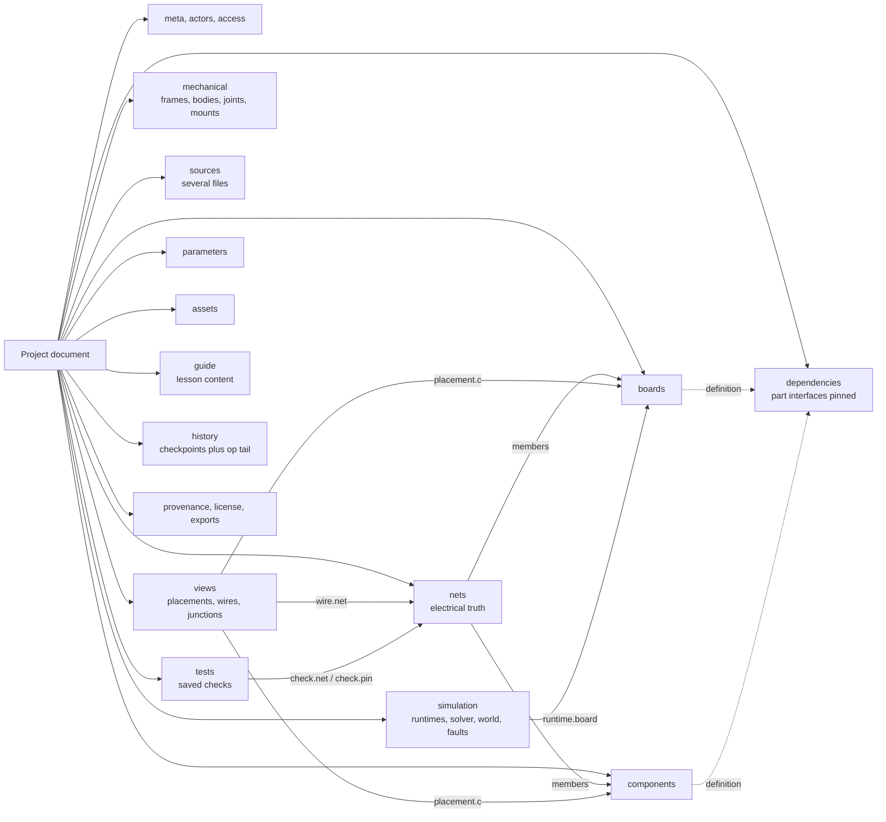
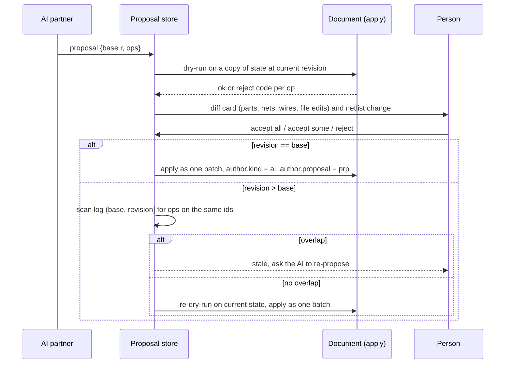
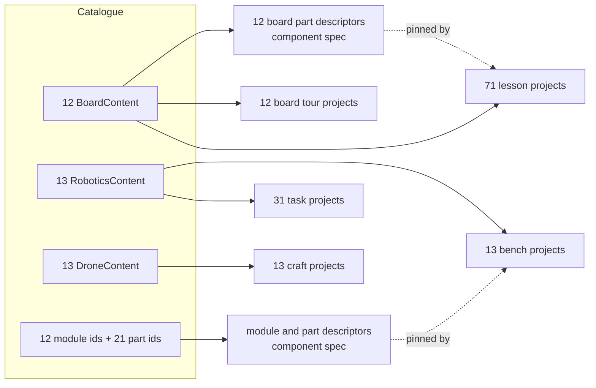

# iynk project data model

Written 2026-10-27 by the project-data-model seat. Status: specification for build phase CORE (D-014). Nothing in this file is built yet. The review fixes of 2026-10-27 are logged at the end ("Review fixes") and listed as amendments in section 15.1.

Upstream: `BRIEF.md` sections 8.3 and 8.4 and 19.6; `00_EXECUTIVE/DECISION_REGISTER.md` (D-010, D-013 to D-017); `01_AUDIT/TECHNICAL_DEBT.md` changes D1 and D5 and findings A1, A5, A8, A11, A12; `08_RESEARCH_SPIKES/RS-09-op-log-collab/REPORT.md`; `03_PRODUCT/PRODUCT_REQUIREMENTS.md` section 7 (R-025 to R-052).
Downstream: features F-076 (canonical project document), F-077 (converter), F-083 (operation log), F-087, F-088, F-089, F-090, F-091, F-092, F-093, F-097 (part descriptor, owned by the component spec), F-200, F-201, F-203, F-221, F-211. ADRs: `04_ARCHITECTURE/ADR/ADR-0100` to `ADR-0110`. Machine-readable form: `04_ARCHITECTURE/schemas/project.schema.json` (JSON Schema draft 2020-12). Examples: `04_ARCHITECTURE/schemas/examples/*.project.json`. The part descriptor schema is `04_ARCHITECTURE/schemas/component.schema.json`, written by another seat; this file only depends on its id, pin, group, parameter and unit rules.

Evidence labels: VERIFIED (read in source or measured by a command I ran), DOCUMENTED, EXTERNAL, ESTIMATED, HYPOTHESIS, UNKNOWN, PENDING RS-xx.

## 0. What this file decides, in one page

| Question | Decision | Where |
|---|---|---|
| What is a project? | One JSON document, schemaVersion `1.1`, validated by one JSON Schema file | sections 2, 8, ADR-0100 |
| What is the electrical truth? | The `nets` array. A net lists the pins on it. Nothing else creates a connection | section 5.6, ADR-0101 |
| What is a drawn wire? | A view object that points at a net and at pins that are members of that net. It never adds a member | section 5.7, ADR-0101 |
| What is a breadboard? | A surface for a view. Where a leg sits is layout. A strip that holds two different nets is a validation error | section 5.7, ADR-0101 |
| How are things named? | Prefixed ids (`cmp_...`, `net_...`), never reused, never derived from position or order | section 3, ADR-0102 |
| Units? | Base units, as in the component schema. Geometry in millimetres, angles in degrees, authored timelines in milliseconds | section 4, ADR-0103 |
| How do bytes become stable? | RFC 8785 canonical JSON, sorted set arrays, quantised geometry, one state hash that excludes history, exports, `updatedAt` and `revision` | section 6, ADR-0103 |
| How does the document change? | Only through one pure `apply(state, op)` function. Rooms, undo, AI proposals, import and replay all call it | section 7, ADR-0104 |
| How does the format change? | `schemaVersion` plus a chain of pure, idempotent migrations. A newer file is refused, not half-opened | section 10, ADR-0105 |
| Where does it live? | IndexedDB for the working copy, `.iynk` and `.iynkz` files for the copy you own | section 12, ADR-0106 |
| How are parts referenced? | `{ref, version}` plus a pinned interface snapshot in `dependencies` | section 5.3, ADR-0107 |
| How do the 38 catalogue items convert? | 12 board definitions go to the part library; 12 board tours, 71 lessons, 31 practice tasks, 13 benches and 13 crafts become 140 projects | section 11, ADR-0108 |
| How do other formats connect? | Each format is a small converter that returns a loss report. No round trip is promised until a test passes | section 12, ADR-0109 |
| How is it validated? | Five passes. Schema through Ajv with standalone code (no `eval`), then references, limits and hygiene in plain code | section 9, ADR-0110 |

## 1. Principles

These are the rules every later choice in this file follows.

| # | Principle | Why (evidence) |
|---|---|---|
| P1 | The net list is the electrical truth. Views are projections. | BRIEF 8.3: "A visual position must not be confused with an electrical connection." Audit A5: today the netlist is a by-product of the drawing and a typo in a hole name silently drops a wire (`figures/engine/bench-solve.js:41-42`, `:55`, VERIFIED). |
| P2 | A drawn wire must name the net it realises. A net may have no drawing. | BRIEF 8.3: "A rendered cable must correspond to an explicitly modeled connection." |
| P3 | Derived data is not stored. | One source of truth. Fidelity tier, "what it models" text, solver results, run traces, netlist text exports, thumbnails are recomputed. Only caches that cost real time are allowed, and only in the container. |
| P4 | Ids are immutable and carry no meaning. | An id used by a check, a fault, a room op or an AI proposal must still point at the same thing after a move, a rename or a merge. Derived ids (R-031's "smallest pin key") change when pins join a net, so they cannot be used. |
| P5 | One change function. | Audit D5: four systems invent four ways to change a lab. The document changes only through ops (section 7). |
| P6 | Same content, same bytes, same hash. | DET-3 and DET-4 in `PRODUCT_REQUIREMENTS.md`. Cross-engine float drift is VERIFIED for flight state (`TECHNICAL_DEBT.md` A12), so stored values are never computed by `Math.sin` and friends. |
| P7 | Open registries, closed structure. | Part ids, engine ids, device ids and cause ids are strings from registries. The shape of the document is closed (`additionalProperties: false`), with one namespaced `ext` escape hatch. |
| P8 | Local first, server optional (D-015). | The document is complete without a server. The server only orders ops and stores copies. |
| P9 | Untrusted by default. | A document can come from a buddy, a room snapshot, an import or an AI. It is validated before use and never evaluated (section 13). |

## 2. The document at a glance



### 2.1 Top-level fields

All fields are in `project.schema.json`. "Req" means required.

| Field | Req | Type | Meaning | BRIEF 8.3 item | Features |
|---|---|---|---|---|---|
| `format` | yes | const `"iynk.project"` | Format tag | identity | F-076 |
| `schemaVersion` | yes | `"1.1"` | MAJOR.MINOR of the schema this document was written against | schema version | F-076 |
| `id` | yes | `prj_...` | Project id, set at creation, never changes. A fork gets a new id | identity | F-088 |
| `revision` | yes | integer | Count of ops applied since genesis. The only revision counter. It is outside the state hash (6.4), so undo and restore return to the earlier hash while `revision` keeps counting up | revision history | F-083 |
| `meta` | yes | object | `title`, `description`, `kind`, `tags`, `locale`, `createdAt`, `updatedAt`, `thumbnail` | identity | F-092 |
| `actors` | yes | array | People named anywhere in the document: `id`, display `name`, optional `keyThumbprint` | owners | F-206 |
| `access` | yes | object | `owners`, `visibility`, `grants`, `authority: "advisory"` | owners and permissions | F-121, F-122 |
| `boards` | yes | array | Programmable boards: part instance plus `firmware` binding | board instances | F-076 |
| `components` | yes | array | Every other part instance | component instances | F-097 |
| `nets` | yes | array | Electrical nets: id, optional name, class, member pins | electrical nets, pin definitions | F-078 |
| `views` | yes | array | Schematic, breadboard, board and mat views: placements, wires, junctions, labels | coordinate systems (2D) | F-081 |
| `mechanical` | no | object | Frames, bodies, joints, mounts in 3D | mechanical relationships, transforms | F-213 |
| `sources` | yes | array | Source files, several | source files | F-038 |
| `simulation` | yes | object | Seed, duration, runtimes, solver, physics, environment, world, faults, instruments | simulation configuration | F-047 |
| `parameters` | yes | array | Named project parameters that component parameters can bind to | parameters with canonical units | F-087 |
| `assets` | yes | array | Binary files by hash: images, meshes, datasheets, replay logs | assets | F-201 |
| `dependencies` | yes | object | Pinned part interfaces, libraries, minimum app version | dependencies | F-097 |
| `tests` | yes | array | Saved test cases with checks | saved test cases | F-221 |
| `guide` | no | object | Authored lesson, bench or craft content | (catalogue content) | F-032, F-133 |
| `domains` | no | object | `robotics` and `drone` data owned by those specs | (labs) | F-057, F-063 |
| `history` | yes | object | Checkpoints and a bounded tail of ops | revision history | F-093 |
| `exports` | no | array | Last exports with hash and loss codes | export metadata | F-090 |
| `provenance` | yes | object | Origin, migrations, third-party content, contributors | provenance | F-197 |
| `license` | yes | object | SPDX id or `LicenseRef-...`, holder | licensing | D-017 |
| `ext` | no | object | Namespaced extension data | none | none |

Coverage check against BRIEF 8.3: identity and schema version (yes), owners and permissions (`access`, advisory), board instances (`boards`), component instances (`components`), pin definitions (`dependencies.components[].interface.pins`, a pinned snapshot of the part descriptor), electrical nets (`nets`), mechanical relationships (`mechanical`), coordinate systems and transforms (`views[].placements`, `mechanical.frames`, section 5.8), source files (`sources`), simulation configuration (`simulation`), component parameters (`components[].params`, `parameters`), assets (`assets`), dependencies (`dependencies`), saved test cases (`tests`), revision history (`history`), export metadata (`exports`), provenance and licensing (`provenance`, `license`). Stable ids, canonical units, deterministic serialisation and migration rules are sections 3, 4, 6 and 10.

### 2.2 What is deliberately not in the document

| Not stored | Why | Recomputed from |
|---|---|---|
| Fidelity tier and the "What it models" list (D-007) | Derived from the parts in use; storing it lets it drift from the parts | `dependencies` and the part descriptors |
| Solver results, pin traces, serial output, `RunTrace` | Runtime output, large, changes every run | A run |
| Netlist text, schematic SVG, BOM CSV | Exports | `nets`, `views`, `components` |
| Viewport, selection, panel layout | Per-viewer state; two buddies must not fight over it | `localStorage`, per viewer |
| Compiled firmware | A cache | `sources` plus the compile service (PENDING RS-04) |
| API keys, tokens, wallet data | Secrets never enter a project (R-154) | not applicable |
| Progress (done flags, quiz answers) | Belongs to a person, not a project | Progress store (`iynk:v1`), migrated once (section 11.6) |

## 3. Identity

### 3.1 Two id classes

| Class | Pattern | Unique within | Used for | Generated |
|---|---|---|---|---|
| Entity id | `<prefix>_<token>` where prefix is 2 to 6 lowercase letters and token matches `[a-z0-9][a-z0-9_-]{0,63}`; at most 72 characters | the whole document, across all entity kinds | everything an op, a wire, a check or a room can point at | Project: `prj_` plus a lowercase ULID (26 characters, time sortable). Others: prefix plus 16 random base32 characters (80 bits) from `crypto.getRandomValues` |
| Local id | `[A-Za-z0-9][A-Za-z0-9_-]{0,47}` | its parent collection only | world inputs, tests, checks, quiz questions, tuple items that nothing else points at | the author, or the converter |

Readable ids such as `cmp_led1` or `net_gnd` are valid. They are used in the examples and by the catalogue converter (section 11) so that diffs can be read. Random ids are used for everything created at run time, so two buddies who both add a part offline cannot collide. RS-09 found 1 in 30 randomised part adds reusing an existing id on purpose and the server rejected each one (`duplicate_id`, VERIFIED in `RS-09/REPORT.md`); with 80-bit random ids the honest-client collision rate is negligible (ESTIMATED: about 4 in 10^13 for a million ids, by the birthday bound).

### 3.2 Prefixes

| Prefix | Entity | Prefix | Entity |
|---|---|---|---|
| `prj` | project | `src` | source file |
| `usr` | actor | `ast` | asset |
| `brd` | board instance | `par` | project parameter |
| `cmp` | component instance | `rtm` | runtime |
| `net` | net | `flt` | fault |
| `vw` | view | `ins` | instrument |
| `wir` | wire | `frm` | frame |
| `jct` | junction | `bdy` | body |
| `lbl` | label | `jnt` | joint |
| `op` | op envelope | `mnt` | mount |
| `prp` | AI or buddy proposal | `grp` | view group |

### 3.3 Ids that are not ours

| Id | Owner | Rule |
|---|---|---|
| Part id (`ref`) | component spec | Matches `component.schema.json` `componentId`: `namespace.name`, lowercase, for example `core.led-5mm`. `core.` is the shipped library. User parts use their own namespace |
| Part version | component spec | Exact semver string `1.0.0`. A document pins one version; a newer part version never changes an old project silently (R-029) |
| Pin id | component spec | Matches `localId` in `component.schema.json`: starts with a letter, letters, digits and underscore, at most 32. The printed label is a separate `designator` |
| Parameter key | component spec | `[a-z][a-z0-9_]{0,47}`, for example `ohms`, `color` |
| Refdes | this spec | `R1`, `U1`, `LED1`. A human label, unique across boards and components, editable. Never used as a reference |
| Device and engine ids | registries | Open strings such as `iynk-interp`, `avr8js`, `iynk-mna`, `bme280` |
| Cause id | D-010 | Open string from the cause registry |

### 3.4 Pin ids of the 12 catalogue boards (rule C-PIN)

The catalogue has no pin ids. It has `PinRow { header, pin, label, net }` (`src/content/schema.ts`). The converter assigns ids with a fixed rule so that conversion is deterministic. The component spec owns the real `core.uno-r3` descriptor; if it chooses other ids, only this rule changes.

1. Walk `pinout` in documented order.
2. The first row that carries a `net` name takes that name as its id, cleaned: runs of non-alphanumeric characters become `_`, and a leading digit gets a `P` prefix (`5V` becomes `P5V`, `3V3` becomes `P3V3`, `J2.16` becomes `J2_16`).
3. A later row with the same `net` (a second GND, an ICSP header pin that repeats D12) gets `<header>_<pin>` (`POWER_6`, `ICSP_1`).
4. All pins that share one `net` name go into one `internal-short` group in the interface.

VERIFIED by running the rule over all 12 board pinouts (scratch `design/data-model/lib.mjs`): no id collision on any board. Uno R3: 44 rows, 44 unique ids, 6 groups (GND 5 pins, 5V 3 pins, and the pairs D11, D12, D13, RESET). ESP32 DevKitC: 38 rows, 38 ids, 1 group (GND 3 pins). Largest: DE10-Lite 144 rows, Nucleo F401RE 114 rows with 27 groups.

#### Rule C-LEG: leg, rail and hole names of the figure parts

The figure parts name legs with characters a pin id cannot hold (`'+'`, `'-'` in `figures/parts/aa-holder-4.js:25`, `'V+'` in `servo-sg90.js:44`, `'+VS'` in `tmp36.js:42`), some with bare digits (`'1'`, `'2'` in `resistor.js`, `push-button.js`), and the Board Bench breadboard names its rails `T+`, `T-`, `B+`, `B-` (`figures/engine/bench-bb.js:17`, VERIFIED). A pin id is `^[A-Za-z][A-Za-z0-9_]{0,31}$`, so C-PIN alone cannot convert the 71 lessons and 13 benches. The converter applies this fixed table, first match wins.

| Legacy name | Id | Why |
|---|---|---|
| `+` | `PLUS` | |
| `-` | `MINUS` | |
| `V+` | `VPLUS` | |
| `+VS` | `PLUS_VS` | |
| rail `T+`, `T-`, `B+`, `B-` | `RAIL_TP`, `RAIL_TN`, `RAIL_BP`, `RAIL_BN` | Rail names of the breadboard surface |
| rail hole `T+12`, `B-3` | `RAIL_TP12`, `RAIL_BN3` | Rail id followed by the column number |
| any other run of non-alphanumeric characters | one `_`, ends trimmed | As C-PIN |
| a name that starts with a digit | `P` prefix (`1` becomes `P1`) | As C-PIN; not in the review's text, added because 8 parts use digit legs (`fsr402`, `ldr`, `npn-2n2222`, `potentiometer`, `push-button`, `resistor`, `wire`) and a bare digit is not a valid id |
| letters and digits (`A`, `K`, `GND`, `a14`) | unchanged | |

The interface pin keeps the old spelling in its `legacy` field (5.3), so a figure command or a lesson text that says `V+` still finds the pin. VERIFIED by running the table over every `legs: [...]` declaration in `figures/parts/*.js` (27 parts declare legs; `breadboard.js` declares none; scratch `design/fixreview/cleg.mjs`): no collision inside a part, and every result matches the pin id pattern. Required test: a unit test that reads every file in `figures/parts/` and the four rail names, converts each leg, and fails on a collision inside one part or on an id that does not match the pattern; because it reads the directory, a new part file is covered without editing the test.

### 3.5 Pin addresses

A pin is addressed everywhere by the pair `{c, p}`: `c` is a board or component instance id, `p` is a pin id from that instance's definition. A pin belongs to at most one net.

## 4. Units and numbers

### 4.1 Unit system

The unit list is the component schema's `unit` enum, so both documents use one system: **base units only, no prefixes** (write `0.02` for 20 mA). The field name or the declared `unit` says which unit applies.

| Quantity | Unit | Written as | Notes |
|---|---|---|---|
| Voltage, current, resistance, capacitance, inductance, power | V, A, ohm, F, H, W | `ohms: 220`, `volts: 5` | Parameter keys come from the part descriptor; its `unit` tells the editor what to show |
| Frequency | Hz | `hz` | |
| Length (layout and mechanical) | millimetre | fields end `_mm` | Exception to SI metres, chosen to match breadboard pitch 2.54 mm, the component schema and every figure file |
| Angle | degree | fields end `_deg` | |
| Temperature | degC | `_degC` | Celsius, not kelvin: every ambient range in the catalogue is Celsius (`temperature-c`, VERIFIED in `WorldQuantity`) |
| Mass | gram | `mass_g` | Same as the component schema. Physics converts to kg at the engine boundary |
| Torque | N_m | | |
| Light | lux | | |
| Dimensionless | `1`, `ratio`, `percent` | | |
| Authored time (checks, world script, test length, run length) | millisecond | `t`, `atMs`, `withinMs`, `runMs`, `duration_ms` | The catalogue's own unit, kept so `Check` and `WorldEvent` stay reusable unchanged (audit D1). Not in the component unit list; it is a document-only unit |
| Engine time (replay log, traces) | integer nanosecond | `tNs` | The orchestrator clock (F-047). `tNs = round(t * 1e6)`; an authored value with a fraction below 1 ns is rejected |

Named exceptions to "base unit": millimetre, degree, degC, gram, millisecond. Each has a reason above. There are no others. A `Unit` value outside the component schema's list is a schema error.

### 4.2 Number rules

| Rule | Detail |
|---|---|
| Finite | No NaN, no Infinity. JSON cannot carry them; a writer that meets one fails the save |
| No negative zero | `-0` is written `0` |
| Integers | Counts, indices, seeds and `tNs` are integers within +-(2^53 - 1) |
| Decimals | Written as the shortest decimal that round-trips a double (ECMAScript `Number::toString`, which RFC 8785 requires). `7.62` stays `7.62`; exponent form appears only where the language prescribes it (`1e-7`, `1e+21`) |
| Quantisation at write | Lengths to 0.001 mm (`Math.round(v * 1000) / 1000`), angles to 0.01 degree, authored time to 0.001 ms. The quantised value is the nearest double to a short decimal, so it prints short and round-trips exactly. Writers never store a value computed by trigonometry; they store the pose parameters (position, rotation) and compute derived positions at draw time |
| Ranges | Layout +-1,000,000 mm; component parameter literals +-1e15; seeds 0 to 4,294,967,295. Out of range is a schema error |

Why not integers everywhere? `PRODUCT_REQUIREMENTS.md` R-026 says "numbers as integers". Integer micrometres would give the same determinism. Decimal millimetres with quantisation is chosen because files stay readable and diffable and match the part descriptors; the determinism argument is the same (section 6.3, ADR-0103). This is listed as Objection O-3 for Amar to settle.

## 5. Entities

Field tables list every property. "Req" is required. Types are JSON Schema types; patterns are in the schema file. Arrays marked "set" are sorted by the key shown (section 6.2).

### 5.1 `meta`, `actors`, `access`

| Field | Req | Type and rule |
|---|---|---|
| `meta.title` | yes | string, 1 to 120 |
| `meta.description` | no | string, at most 2,000 |
| `meta.kind` | yes | `project`, `template`, `lesson`, `challenge`, `bench`, `craft` |
| `meta.tags` | no | up to 16 lowercase slugs |
| `meta.locale` | yes | BCP 47 tag of the language the author wrote in (`en`) |
| `meta.createdAt`, `meta.updatedAt` | yes | UTC timestamp with milliseconds and `Z`. `updatedAt` is set to the `at` of the last accepted op and is outside the hash (section 6.4) |
| `meta.thumbnail` | no | asset id of a PNG. A cache the container may regenerate |
| `actors[]` (set by `id`) | yes, at least 1 | `{id: usr_..., name (1 to 60), keyThumbprint?}`. `keyThumbprint` is the base64url SHA-256 of the person's public key (F-206); absent for a purely local person. Added or changed only by `actor.set`, removed only by `actor.remove` (7.2). Every actor id named by `access`, `provenance.createdBy`, `provenance.contributors` or a checkpoint `author` must be in this array (V3-ACTOR) |
| `access.owners` | yes | 1 to 8 actor ids |
| `access.visibility` | yes | `private`, `buddies`, `link` |
| `access.grants[]` | yes | `{actor, role}` with role `owner`, `editor`, `commenter`, `viewer` |
| `access.authority` | yes | const `advisory` |

`access` is a mirror, not a lock. Anyone who holds the file can edit it locally; the document cannot enforce anything against its holder. Only a self-hosted server that hosts a room enforces roles, and it keeps its own copy of the access list. Ops that change `access` (`access.grant`, `access.revoke`, `access.set`) and ops that change `actors` (`actor.set`, `actor.remove`) are accepted from an owner, or from `author.kind = "system"` acting for a request the server has already validated: a room invite redeemed with a valid token (REALTIME 5.4), a grant or revoke made through the owner's REST route (API 7.1), or a fork made by a buddy (STUDIO_EDITOR 4.2; the fork is a new project whose first ops are `actor.set` and `access.set` for its new owner). Anyone else gets `permission`. This is how a joiner who is not yet an owner gets a name and a grant into the document: the server writes `actor.set` and `access.grant` as one batch (7.3), because V3-ACTOR is a deferred invariant and a grant that names an actor not yet in `actors` is valid only inside that batch. In a local-only project the app is the authority and the one person is the owner, so every access op is accepted. The last owner cannot be removed or revoked (`invariant`), and `access.set` cannot leave `owners` empty. Account deletion on a server is a batch of `access.revoke`, `provenance.set` (drop the contributor entry), `access.set` (hand ownership on) and `actor.remove`; because `actor.remove` is rejected `referenced_by` while a checkpoint `author` names the actor, the deletion routine first compacts history (5.15) and rewrites the author of the remaining checkpoints to the acting owner in the store (history is outside the state hash, so no hash changes). This is stated in the file as `authority: "advisory"` so no tool treats it as a security boundary. Spectators in a room are a room property, not stored.

### 5.2 `parameters`

A project parameter is a named value that component parameters and lesson chips can bind to. It is how one slider drives an LED colour or a resistor value in several places.

| Field | Req | Rule |
|---|---|---|
| `id` | yes | `par_...` |
| `name` | yes | identifier `[a-zA-Z][a-zA-Z0-9_]{0,31}`; the name used by `{{p:name}}` tokens in a lesson starter (section 5.13) |
| `kind` | yes | `number`, `choice`, `toggle` |
| `unit` | no | component-schema unit; numbers only |
| `value` | yes | number, string or boolean, matching `kind` |
| `min`, `max`, `step` | no | numbers only; `value` must lie in range and on the step grid (V3-PARAM-RANGE) |
| `options[]` | no | choices only: `{value, label}` |
| `label` | no | text |

A component parameter value is a literal or `{ "param": "par_x" }`. A bound value reads the parameter's current value. A binding to a missing parameter is a reference error (V3-PARAM-REF). `param.remove` is rejected while anything binds to it (`referenced_by`).

### 5.3 `dependencies`

| Field | Req | Rule |
|---|---|---|
| `components[]` (set by `ref` then `version`) | yes | One entry per distinct `{ref, version}` used by any board or component |
| `components[].ref` | yes | part id (`core.led-5mm`) |
| `components[].version` | yes | exact semver |
| `components[].origin` | yes | `builtin` (ships with the app, pinned by app version), `library` (the user's local library), `embedded` (the project carries the whole descriptor) |
| `components[].digest` | for `library` and `embedded` | `sha256:` plus the hash of the canonical JSON of the full descriptor. Catches a descriptor edited under the same version |
| `components[].interface` | yes | The pinned snapshot: `role` (`board`, `part`, `surface`), `pins[]` (pin table below), `groups[]` (`internal-short`, `strip`, `plane`), `params[]` (`id`, `type`, `unit`, `default`, `values`, `min`, `max`), `body_mm`, `mount`. Caps: 1,024 pins, 256 groups, 512 pins per group, 64 params |
| `components[].definition` | no | The full descriptor, only in the bare JSON form and only for `embedded`. The `.iynkz` container keeps it under `definitions/` |
| `libraries[]` | yes | Software libraries the sources need: `name`, optional `version`, `ecosystem` (`arduino`, `micropython`, `python`, `npm`, `builtin-shim`), optional `digest` |
| `requires` | no | `minApp` semver, `features[]` the app must have (for example `peripheral-i2c`) |

Why a snapshot of the interface (decision in ADR-0107):

1. Validation and the netlist need pin ids even when the part library is not loaded: a buddy's project that uses a custom part must still open. R-028 asks for a placeholder labelled "unknown part"; with the snapshot the placeholder has real pins, not pins guessed from wires.
2. A part version that changes a pin cannot change what an old document means. The document records what it was built against.
3. The snapshot is derived data. It is regenerated from the descriptor when a part is added or its version is bumped. For `builtin` parts a CI test compares the snapshot of every shipped example with the shipped descriptor; for `library` and `embedded` parts the digest does the same job. If they disagree the load reports `V6-INTERFACE-DRIFT` and uses the descriptor.

The interface carries only what structure and drawing need. Ratings, behaviour, artwork, failure modes and models stay in the descriptor (component spec).

**Interface pins.** The first draft pinned only `id`, `designator`, `type`, `net` and `header`. That is not enough to open a buddy's project when the part is missing (reason 1 above): nothing can be drawn or hit-tested without a position, and a breadboard cannot be checked without its holes and strips (STUDIO_EDITOR O-S8). The snapshot therefore carries the following, with the names and units of `component.schema.json` `pin`.

| Field | Req | Rule |
|---|---|---|
| `id` | yes | pin id (3.3) |
| `designator` | no | label printed on the real part, at most 20 |
| `type` | yes | component-spec pin type (`power_in`, `ground`, `digital_io`, `passive`, `nc` ...) |
| `class` | yes | `power`, `ground`, `digital`, `analog`, `passive`, `bus`, `mechanical`, `nc`: the coarse role the netlist and the electrical rules check use |
| `polarity` | no | `anode`, `cathode`, `positive`, `negative` |
| `position` | yes for role `surface`; otherwise yes whenever the descriptor has one | `{x, y}` in millimetres in the part frame (origin bottom-left of the body, +x right, +y up, resolution 0.01 mm; transform to a view in 5.7). A pin without a position is drawn by the fallback renderer's layout |
| `legacy` | no | 1 to 16 characters: the figure's spelling of the leg, rail or hole (rule C-LEG, 3.4) |
| `net`, `header` | no | legacy catalogue fields, as before |

Interface-level fields: `body_mm {w, h}` is the body rectangle in the part frame (`dimensions.body` w and h of the descriptor; `dimensions.board` w and h for a board), required for every role, so a placeholder can draw its outline. `mount` is `free` (placed anywhere), `breadboard` (the descriptor has a connector of kind `breadboard-leg`: the part needs a surface in a breadboard view, STUDIO_EDITOR 6.4) or `surface` (a `solder-pad` connector and no `breadboard-leg`: it needs a perfboard-type surface; no such surface ships yet, so the editor treats it as free, HYPOTHESIS); the writer derives it from the descriptor's connectors.

**A surface lists its holes and strips.** For role `surface`, `pins` lists every hole (the hole name is the pin id, so `legs` and hole wire ends point at interface pins; legacy rail names follow C-LEG) and `groups` lists every strip as a `strip` group, rails included. A hole is an interface pin of the surface; it is never a net member (5.7, the holes paragraph). Without them rules B1, B2, V3-HOLE and V3-STRIP-SHORT cannot run. The `core.breadboard-half` snapshot has 400 pins (30 columns by 10 rows plus 4 rails of 25 holes) and 64 groups (60 column strips and 4 rails); the full board has about 838 holes and 130 strips (STUDIO_EDITOR O-S7, from `bench-bb.js:8-19`), mini 170 holes. The old caps (512 pins, 128 groups) cannot hold the full board, so the caps are raised to 1,024 pins, 256 groups and 512 pins per group, and `component.schema.json` must raise its own caps in the same change (its `pins` maxItems 512 to 1,024, `groups` 128 to 256, and a maxItems 512 on a group's `pins`). Cost, ESTIMATED from one canonical pin entry of about 98 bytes: about 40 KB for the half breadboard and about 83 KB for the full one, against the 5 MiB cap. That raises the 54 percent dependency share in the starter project (ADR-0107); the writer may drop the snapshot of a `builtin` surface only when the loader ships the descriptor, which is the case for every shipped part. V6-SURFACE-EMPTY (9.1) makes an empty surface snapshot an error.

### 5.4 `boards`

A board is a part instance that also runs a program.

| Field | Req | Rule |
|---|---|---|
| `id` | yes | `brd_...` |
| `definition` | yes | `{ref, version}`; must match a `dependencies.components` entry whose interface role is `board` |
| `refdes` | yes | `U1` style; unique across boards and components |
| `label` | no | at most 60 |
| `variant` | no | variant id from the descriptor (`pico-w`) |
| `params` | no | map of parameter key to literal or `{param}` |
| `powerInput` | no | id of one of the descriptor's power inputs (`usb`, `jack`, `pin5`); decides which supply rule applies |
| `firmware` | no | `{language, entry, sources[], libraries[], defines, top, ports}`; `entry` and `sources[]` are source ids; Verilog uses `top` and `ports` (top-level port to board pin ids, bit 0 first, as `CodeTemplate.ports` does today) |
| `ext` | no | namespaced extension data |

A document may hold up to 16 boards. A source file belongs to at most one board's firmware (`Source.board`).

### 5.5 `components`

| Field | Req | Rule |
|---|---|---|
| `id` | yes | `cmp_...` |
| `definition` | yes | `{ref, version}` in `dependencies` |
| `refdes` | yes | unique across boards and components |
| `label` | no | at most 60 |
| `params` | no | map of parameter key to literal or `{param}`. Keys must exist in the interface; a key the interface does not declare is V3-PARAM |
| `locked` | no | true: the editor refuses to move or delete it; ops from tools still apply |
| `ext` | no | |

Runtime state (a button being held, an LED burnt out, a pot position) is not a component field. It belongs to the run (world inputs and the solver). A burnt part is a result, not a design choice. A deliberate defect is a fault (section 5.11).

### 5.6 `nets`: the electrical truth

```json
{ "id": "net_d12", "name": "D12", "class": "signal",
  "connections": [ {"c": "brd_uno", "p": "D12"}, {"c": "cmp_res1", "p": "P1"} ] }
```

| Field | Req | Rule |
|---|---|---|
| `id` | yes | `net_...`. Stable. Never derived from members |
| `name` | no | 1 to 64 characters; unique among nets. Two nets with the same name are never merged implicitly |
| `class` | no | `signal`, `power`, `ground`, `analog`. A hint for drawing and for the electrical rules check; not used by the solver |
| `connections` | yes | 1 to 2,000 pin addresses `{c, p}`, sorted by `c` then `p` |

Rules (checked by V3, enforced by ops):

| Rule | Statement |
|---|---|
| N1 | Every pin address resolves: `c` is a board or component id and `p` is in that instance's interface |
| N2 | A pin is a member of at most one net |
| N3 | Net names are unique |
| N4 | Two pins are electrically joined if and only if they are in the same net, or in the same `internal-short` group of the same instance, or the part's electrical model joins them (a closed switch). Nothing else joins pins: not a coordinate, not a wire that is drawn, not a breadboard hole |
| N5 | A pin that is in no net is unconnected. A net with one member is allowed: it is a named stub, and the electrical rules check warns |
| N6 | Net membership is by pin, not by position. Moving a part never changes a net |
| N7 | The solver, the interpreter pin adapter, the checks and the electrical rules check read `nets` and nothing in `views` |
| N8 | `internal-short` groups and `strip` groups of a part are part knowledge from the descriptor. They are not repeated in `nets`. Example: the push button's pins `P1` and `P2` are one group, so `net_5v` lists `P1` only (see the converted lesson) |
| N9 | An empty net cannot exist (`connections` has `minItems: 1`). `net.disconnect` that would remove the last member of a net which a check, a fault or a label names is rejected `referenced_by`; any other `net.disconnect` that empties a net deletes the net with its wires and junctions (nothing else can point at them). `net.delete` is the explicit form: it also deletes the faults and labels that name the net and is still rejected while a check names it |
| N10 | Dangling reference is impossible by construction: ops cascade (section 7.4) and V3 rejects any document that has one (R-028 recovery path applies when it still happens) |

Removing a part whose pins are named by checks is a multi-step edit. `component.remove` and `board.remove` are rejected `referenced_by` while any check names one of the instance's pins or a net that the removal would empty; the rejection carries `refs[]`, the JSON Pointers of every referrer (`/tests/0/checks/2`, `/simulation/faults/1`). Each `/tests/<n>` path names a `test.set` op that is needed first. This is always the case in a lesson project, whose tests name the board's pins. The editor therefore does not send the removal alone: it builds one batch (7.3) of one `test.set` per affected test (the test without the named checks, or with them retargeted, as the person chooses in a confirmation card) followed by the removal. Programs and the AI use the same two-step path; a bare removal that is rejected is a normal answer, not an error.

Net-first rather than wire-first (R-031 as written) is Objection O-1.

### 5.7 `views`

A view is one drawing of the circuit. It stores where things are drawn and which drawn lines realise which net.

| Field | Req | Rule |
|---|---|---|
| `id` | yes | `vw_...` |
| `kind` | yes | `schematic`, `breadboard`, `board`, `mat`; fixed at creation, defined below |
| `name` | yes | 1 to 60; changed by `view.set` |
| `surface` | breadboard views | the breadboard component whose holes and strips this view uses; changed by `view.set` only while the view has no `legs` and no `hole` wire end |
| `placements[]` | yes | up to 2,000: `{c, x_mm, y_mm, rotation_deg?, mirrored?, layer?, legs?, hidden?}` |
| `wires[]` | yes | up to 5,000 (below) |
| `junctions[]` | no | up to 5,000: `{id: jct_, net, x_mm, y_mm}`; a drawn T-point on a net |
| `labels[]` | no | up to 1,000: `{id: lbl_, text, x_mm, y_mm, net?}` |
| `groups[]` | no | up to 256: `{id: grp_, name?, members[]}`; `name` 1 to 60; `members` 2 to 2,000 ids, each the `c` of a placement or the id of a wire, junction or label of the same view. A member is in at most one group; groups do not nest. A group moves, locks and copies as one and may be drawn as a titled box. A group carries no electrical meaning and never changes a net (G1) |

Placement coordinates are millimetres in the view's own plane, x to the right, y down (the screen convention the editor draws in), rotation counter-clockwise in degrees, quantised (section 4.2). A breadboard placement may carry `legs`: a map from pin id to hole name on the surface (`{"A": "c14", "K": "c15"}`). `legs` is layout and never creates a connection.

**Part frame to view frame (rule P-XFORM).** A pin position in an interface (5.3) or a descriptor is in the part frame: millimetres, origin at the bottom-left corner of `dimensions.body` (of `dimensions.board` for a board), +x right, +y up. A view is y down. One formula maps a pin to a view point, and every renderer, hit-test and checker uses it:

```
p_view = T + R(theta) * M * ( x_part, -y_part )
T      = ( placement.x_mm, placement.y_mm )          where the part's origin lands
M      = diag(-1, 1) if placement.mirrored, else identity
R(a)   = [[ cos a, sin a ], [ -sin a, cos a ]]       a = placement.rotation_deg, counter-clockwise on screen (y down)
```

The order is fixed: flip y, mirror, rotate, translate. The mirror axis is the part's own vertical axis through its origin (the line `x_part = 0`), applied before rotation, so a mirrored part extends to -x of `T` before rotation. A tool that mirrors "about the body centre" must in the same `view.place` op move `T` by `R(theta) * (w, 0)` (plus when switching `mirrored` on, minus when switching it off), `w` being `body_mm.w`. The body rectangle is transformed the same way, corner by corner. For rotations of 0, 90, 180 and 270 the implementation uses the exact values (cos, sin) of (1, 0), (0, 1), (-1, 0), (0, -1), never `Math.cos`, so no float noise is stored or compared (4.2). Golden vectors (T = (100, 50), pin at part position (2.54, 5.08); VERIFIED with scratch `design/fixreview/xf.mjs`):

| Vector | rotation_deg | mirrored | p_view |
|---|---|---|---|
| X1 | 0 | no | (102.54, 44.92) |
| X2 | 90 | no | (94.92, 47.46) |
| X3 | 90 | yes | (94.92, 52.54) |
| X4 | 180 | yes | (102.54, 55.08) |

Check of X2 by hand: the pin is 2.54 right of and 5.08 above the origin; rotating counter-clockwise by 90 degrees on screen sends "right" to "up" and "up" to "left", so the pin ends up 5.08 left of and 2.54 above `T`: (94.92, 47.46). CI recomputes all four.

**View kinds.**

| Kind | Meaning | Rules |
|---|---|---|
| `schematic` | Symbols and drawn wires. Free parts | Rotations are multiples of 90 degrees (V3-ROT, warning) |
| `breadboard` | A `surface` and parts with `legs` in holes | `surface` required; rules B1 to B6 |
| `board` | The pin map of one board: its pins with names, roles and the net each is on, and live pin state while running. Read-mostly | Exactly one placement, of a board instance; no wires, junctions or `legs`; labels allowed; no `surface` (V3-VIEW-BOARD). A "wire this pin to ..." action in this view writes its wire in another view |
| `mat` | 2D bench placement: where boards, modules, a battery and so on lie on a table. The 2D step of the mechanical story | Placements with any `rotation_deg` from 0 up to 360 (free angles are allowed in this kind only, quantised to 0.01 degree, 4.2); no `surface`, no `legs`; wires optional (W1 to W5 apply), absent in the first Studio phase, where nets show as air wires; never read by the solver (N7) |

Groups: G1, a group has no electrical meaning. G2, removing a member (`view.unplace`, `wire.remove`, `junction.remove`, `label.remove`) removes it from its group in the same op, and a group left with fewer than two members is deleted in that op. G3, `view.remove` deletes the view's groups. V3-GROUP checks all three.

A wire:

| Field | Req | Rule |
|---|---|---|
| `id` | yes | `wir_...` |
| `net` | yes | the net this wire realises. Must exist |
| `from`, `to` | yes | a wire end: `{kind: "pin", c, p}`, `{kind: "junction", id}` or `{kind: "hole", surface, hole}` |
| `route_mm` | no | 1 to 256 waypoints `[x, y]` between the ends; absent means the renderer routes it. The document never holds an empty array: `wire.route` with `route_mm: []` clears the field (so the schema gets `minItems: 1`) |
| `color` | no | one of the ten jumper colours the Board Bench draws (`WireColor`); changed by `wire.set` |

Wire rules:

| Rule | Statement |
|---|---|
| W1 | `wire.net` exists. A wire cannot exist without a net (P2) |
| W2 | A `pin` end must be a member of `wire.net`. This is the "references a net connection, never the other way round" rule |
| W3 | A `junction` end must be a junction of the same view and the same net |
| W4 | A `hole` end must name the view's surface; the hole's strip must not carry legs of any other net (rule B2 below) |
| W5 | A wire adds no member to any net. Removing a wire never changes a net. Disconnecting is a net op (`net.disconnect`, `net.split`) |
| W6 | A net with n members may be drawn with fewer than n - 1 wires. The undrawn remainder is shown as a thin "air wire" (ratsnest). The editor can offer "route the rest" |
| W7 | A wire may not join two ends that are the same pin |
| W8 | Views are independent. Deleting a wire in the schematic does not touch the breadboard view |

Breadboard rules, which exist because a breadboard conducts by position and the brief forbids confusing position with connection:

| Rule | Statement |
|---|---|
| B1 | Strips come from the surface descriptor (`strip` groups of hole names). The example half breadboard has, for column c, an upper strip (rows a to e) and a lower strip (rows f to j), plus rails |
| B2 | All legs placed in holes of one strip, plus all wire ends at holes of that strip, must belong to one net, or to no net yet. Two different nets on one strip is `V3-STRIP-SHORT`. This is the check that catches "two legs dropped in the same column" |
| B3 | Two legs in one strip that are in no net at all is `V3-STRIP-IMPLIED` (warning): they look connected and electrically are not recorded as connected. The editor turns it into a `net.connect` when the person confirms |
| B4 | One hole holds one leg (V3-HOLE-TWICE) |
| B5 | The editor writes the placement and the net change as one batch (section 7.3), so the document is never in a state where a leg sits in a strip with no matching net membership after the batch commits |
| B6 | A leg in a hole whose strip has no net yet creates no net: nothing is connected until a second pin joins |

Why holes are not pins in `nets`: a breadboard has 300 to 830 holes; putting them into nets would add hundreds of members that carry no electrical meaning beyond the strip, tie the netlist to one board layout, and make the schematic view show breadboard holes. Strips are layout knowledge held in the descriptor. The converted lesson shows the result (section 11.4): 5 nets, no hole in any of them.

### 5.8 `mechanical`

Optional. Absent in an electronics-only project.

| Field | Rule |
|---|---|
| `frames[]` | `{id: frm_, name, parent, pose}`; `parent` is `world` or another frame; the parent graph is a forest (no cycle, V3-FRAME-CYCLE) |
| `bodies[]` | `{id: bdy_, name, frame, mass_g?, shape?, component?}`; shape is `box` (`size_mm`), `cylinder`, `sphere` or `mesh` (an asset id) |
| `joints[]` | `{id: jnt_, kind, parent, child, origin, axis, limits?, drive?}`; kind `fixed`, `revolute`, `continuous`, `prismatic`, `wheel`; `parent` and `child` are body ids; `drive` names the motor component |
| `mounts[]` | `{id: mnt_, component, frame, pose}`: where a board or component sits in a frame |

A pose is `{position_mm: [x, y, z], rpy_deg: [roll, pitch, yaw]}`, roll about x, pitch about y, yaw about z, applied about the fixed axes of the parent frame (the URDF convention, EXTERNAL; chosen so URDF export is direct).

The implicit root frame `world` is right-handed with +x forward, +y left, +z up, which is the convention the drone content already uses for motor positions ("+x nose, +y left", `src/content/schema.ts` `MotorPos`, VERIFIED) and ROS REP-103 (EXTERNAL). Units are millimetres and degrees; mass is grams. Physics converts to SI at the engine boundary.

2D layout (views) and 3D placement (mounts) are separate on purpose: a schematic has no height, and a robot chassis has no breadboard. A component may appear in both.

Joint `limits` units follow the joint kind (amendment A-8, section 15.1). For `revolute`, `continuous` and `wheel`: `min` and `max` in degrees, `effort` in N*m, `velocity` in degrees per second. For `prismatic`: `min` and `max` in millimetres, `effort` in N, `velocity` in millimetres per second. `fixed` has no limits. A body may carry `inertia_g_mm2` (principal moments, g*mm^2) and `com_mm` (centre of mass offset from the body frame, mm); absent means the physics engine derives them from `shape` and `mass_g`. `inertia_g_mm2` is `[Ixx, Iyy, Izz]`, each at least 0; the triangle inequality is a physics-loader check (`RB-E-INERTIA`), not a schema rule. A `fixed` joint must not carry `limits` (schema `if`/`then`). `effort_n` stays in the schema as a deprecated alias for one release; a `limits` object that has both `effort` and `effort_n` is rejected by V3-LIMITS.

The robotics and drone specs own what goes on top (wheel radius, motor constants, flight parameters). They live in `domains.robotics` and `domains.drone` (section 5.14).

### 5.9 `sources`

| Field | Req | Rule |
|---|---|---|
| `id` | yes | `src_...` |
| `path` | yes | relative POSIX path; at most 255; no leading `/`; no `.` or `..` segment; none of `\ : * ? " < > |` or control characters; NFC; unique ignoring case (V3-PATH). A path is a label, never a filesystem location: importers must resolve it inside a sandbox directory and refuse anything that escapes it |
| `language` | yes | `arduino-cpp`, `micropython`, `python`, `verilog`, `c`, `cpp`, `xdc`, `qsf`, `json`, `markdown`, `text` |
| `role` | yes | `firmware`, `testbench`, `constraint`, `config`, `doc` |
| `board` | no | the board whose firmware uses it |
| `content` | yes | the text, UTF-8, LF line ends, at most 262,144 UTF-8 bytes (V4) |
| `ext` | no | |

At most 20 sources per document. Text is stored whole in the document so ops can edit it (`source.edit`) and the document is complete in one file. Folder-form export (section 12.2) writes each source as a real file for git and for the Arduino IDE.

Line ends are normalised to LF on load and on paste. Trailing newline is the author's.

### 5.10 `assets`

| Field | Rule |
|---|---|
| `id` | `ast_...` |
| `path` | same path rule as sources |
| `mediaType` | `type/subtype`, from the allow-list `image/png`, `image/jpeg`, `image/svg+xml` (sanitised on import, SVG rules below), `image/webp`, `model/gltf-binary`, `model/stl`, `application/pdf`, `application/octet-stream`, `application/json`, `text/plain` |
| `bytes` | 0 to 16,777,216 |
| `sha256` | content hash. The asset bytes live outside the document, addressed by this hash (IndexedDB `assets` store, or `assets/<sha256>` in the container) |
| `role` | `image`, `model`, `binary`, `datasheet`, `replay`, `other` |
| `license`, `origin` | optional, for provenance |

A document never contains asset bytes. A missing asset is a load warning, not an error. Two assets with the same hash share one stored blob.

**SVG rules (the control behind "sanitised").** An SVG is script-capable content, so the three places that touch it each have one job.

| Place | Rule |
|---|---|
| Client, on import (file pick, drop, container open, share link, room fetch, part upload) | Parse as XML (no DOCTYPE, no entities, at most 1,048,576 bytes), then sanitise with DOMPurify under the SVG profile, pinned in the lockfile (proposed pin 3.2.4; EXTERNAL, not installed or run here, and the ADR confirms the newest patch release without an open advisory before the first release). Allow-list of elements: `svg g path rect circle ellipse line polyline polygon text tspan defs linearGradient radialGradient stop clipPath mask symbol title desc`, plus `use` only with an `href` that starts with `#`. Allow-list of attributes: geometry, presentation (`fill`, `stroke`, `opacity`, `transform`, `d`, `viewBox` ...), `id`, `class`, and `style` only when no declaration contains `url(`, `image-set(`, `expression(`, `@import` or a backslash escape. Never allowed: `script`, `foreignObject`, `style` elements, `animate*`, `set`, `image`, `a`, any `on*` attribute, any `href` or `xlink:href` that is not `#local`, any `data:` URI. If the file cannot be made clean the import is refused with `V5-SVG`; if elements or attributes were removed, the import succeeds with a loss item `svg-stripped` per removal and the asset's `sha256` is that of the sanitised bytes |
| Foreign bytes (container, room, share link, server fetch) | The client sanitises on first store and accepts the asset only if the sanitiser leaves the bytes identical; any change means someone sent a file that was not clean, and the asset is refused with `V5-SVG`. A clean exporter's output is stable under the sanitiser, so this costs nothing for honest files |
| Server | Never sanitises and never parses. It stores the bytes by hash and serves them with `Content-Security-Policy: sandbox; default-src 'none'` (API_CONTRACTS asset route) and `X-Content-Type-Options: nosniff`. The server is not the control; the client is, and the CSP is the second line |
| Rendering | Only through `` or an `` of the served URL, never inline in the page, never as `<object>` or `<iframe>`. An `` SVG runs no script and loads no external resource even if the sanitiser missed something |

The test corpus and the expected outcome of each case are in 9.5.

### 5.11 `simulation`

| Field | Req | Rule |
|---|---|---|
| `seed` | yes | integer 0 to 2^32 - 1. The only randomness source (DET-5). Same project, same seed, same run |
| `duration_ms` | yes | default run length, 0 < d <= 3,600,000 |
| `runtimes[]` | yes | `{id: rtm_, board, engine, options?}`; `engine` is an open registry id such as `iynk-interp`, `avr8js`, `rp2040js`, `yosys-digitaljs`. One per board that runs code |
| `solver` | yes | `{engine, options?}`; open id, `iynk-mna` today, `ngspice-wasm` possible (PENDING RS-07 and RS-08 part b) |
| `physics` | no | `{engine, step_hz, options?}`; `rapier` or `jolt`, open id (PENDING the physics ADR; RS-13 passed both) |
| `environment` | no | `ambient_degC`, `light_lux`, `supply_V` |
| `world.inputs[]` | yes | up to 128 `WorldInput` (below) |
| `world.script[]` | yes | up to 10,000 `{t, input, value}` (`WorldEvent`, unchanged; `t` in ms) |
| `faults[]` | yes | up to 200 faults (below) |
| `instruments[]` | no | up to 64: `{id: ins_, kind, target, settings}`; kinds `voltmeter`, `ammeter`, `oscilloscope`, `logic-analyzer`, `serial-monitor`, `serial-plotter`, `multimeter` |

Engines are strings on purpose. RS-06 FAILED the CPU clause for `rp2040js` on MicroPython (0.54x to 0.78x real time, VERIFIED in its report), RS-03 passed `avr8js` on desktop and left devices open, RS-01 is INCONCLUSIVE on rendering, and RS-07 has no report yet. None of those results needs a schema change: a document names the engine it was built with, the app maps the name to an implementation, and an unknown name falls back to `iynk-interp` with a visible notice or refuses to run, as the person chooses.

**World input** = catalogue `WorldInput` with three changes: `part` becomes `component` (a component id, not a figure part id), `pins` become pin addresses of board pins, and `label` is text instead of a text key. `quantity`, `device`, `min`, `max`, `step`, `default`, `gesture` are unchanged. `device` is the catalogue `DeviceModel` union unchanged (11 kinds), plus one new kind `{kind: "registry", device, address?, options?}` for a peripheral whose behaviour comes from the device registry (F-208), for example `bme280`. `pins` is a bridge for the existing interpreter, which wants board pin names: once the orchestrator derives device pins from the nets (F-047) the field is optional and ignored if present.

**Fault** = `{id: flt_, cause_id, symptom_ids[], kind, target, params?, enabled, note?, injectable?}` (`cause_id` and `symptom_ids` required in `$defs/Fault`; the hint level of D-010 is not stored, the diagnosis record takes it from the part's entry or from the person's progress). `cause_id` and `symptom_ids` are the D-010 record fields under the same names and the same pattern as the component spec (`^[a-z][a-z0-9-]*(\.[a-z0-9-]+)*$`); the first draft's `cause` field is renamed `cause_id`. `symptom_ids` is required and may be empty for a fault the person made up (the diagnosis then has only evidence). `injectable` is `{component, id}`: the instance and the `id` of the entry in that part's `injectable_faults` the fault was made from, so "break it on any circuit" (D-014, F-030) is one lookup: the editor lists the part's `injectable_faults`, and a `fault.set` copies `cause_id` and `symptom_ids` from the entry, maps `kind` with the table below, builds `target` from the entry's `target.pins`, and copies `value` into `params.value` as a quantity. `kind` is the catalogue `FailureKind` plus `open-wire`, `wrong-connection`, `stuck-level` and `wrong-value` (17 values), so every kind a part can inject has a project kind. `target` is one of a component and optional pin, a net, or a pair of nets (swap). A disabled fault is stored but inert; "Break it" (F-030) adds or enables one through an op; "Restore" disables it and the document hash returns to its earlier value (R-125).

Mapping from a part's declared fault to a project fault (component.schema.json `injectable_faults[]` to `$defs/Fault`). The two enums differ on purpose: the part enum uses underscores and says how a part is broken; the project enum uses hyphens and also covers faults of a circuit. Fields copied unchanged: `cause_id`, `symptom_ids`. Field set from the entry: `injectable = {component: the instance, id: the entry's id}`.

| Part `injectable_faults[].kind` | Project `Fault.kind` | Target built from the part's entry |
|---|---|---|
| `open_pin` | `open-wire` | `{component, pin}` |
| `short_pins` | `short` | `{component}` and `params.pins` (the two pin ids) |
| `missing_part` | `missing-part` | `{component}` |
| `reversed_supply` | `reverse-polarity` | `{component}` (the part's power input) |
| `wrong_supply_voltage` | `wrong-voltage` | `{component}`, `params.value` |
| `cold_joint` | `cold-solder` | `{component, pin}` |
| `stuck_level` | `stuck-level` (new) | `{component, pin}`, `params.value` is the level |
| `wrong_value` | `wrong-value` (new) | `{component}`, `params.parameter`, `params.value` |
| `reversed_part` | `reversed-part` | `{component}` |
| `floating_pin` | `floating-input` | `{component, pin}` |
| `option_removed` | `config` | `{component}`, `params.parameter` |
| `overload` | `overcurrent` | `{component}` or the rail's net |
| `other` | `config` | as the entry says |

Project kinds with no part counterpart (`brownout`, `level-mismatch`, `boot-strap`, `thermal`, `wrong-connection`) are faults of a circuit or of the environment and have no `injectable`. With the library present, V6-FAULT-DRIFT (warning) fires when a fault's `injectable` does not resolve or its `cause_id`, `symptom_ids` or mapped `kind` differ from the entry.

The catalogue's `FailureMode` objects (trigger, effect, figure command) describe how a *part* breaks. They move into the part descriptor, not the project (section 11.2).

### 5.12 `tests` and checks

A test case is `{id, name, runMs, script?, faults?, checks[]}`. A project may hold up to 64 test cases and each up to 200 checks. `script` replaces `simulation.world.script` for this test; `faults` lists fault ids enabled for it.

A check is the catalogue `Check` union unchanged, with three additions: every check has an `id` (local) and `visibility` (`visible` or `hidden`, F-221), its `label` is text instead of a text key, and two kinds are new.

| Kind | Fields (all from the catalogue except where noted) |
|---|---|
| `runs` | `minMs` |
| `serial` | `match`, `regex`, `minCount`, `byMs?` |
| `pin-level` | `pin`, `level` (0 or 1), `atMs` |
| `pin-toggles` | `pin`, `periodMs` [min, max], `minCycles` |
| `pwm` | `pin`, `duty` [min, max], `atMs` |
| `tone` | `pin`, `hz` [min, max], `atMs` |
| `servo` | `pin`, `deg` [min, max], `atMs` |
| `responds` | `after` (a `WorldEvent`), `pin`, `withinMs`, `mode`, `v` |
| `code` | `must[]`, `mustNot[]`; new optional `source` to scope it to one file |
| `state` | `atMs`, `equals` (legacy figure state; migrated labs only) |
| `node-voltage` (new) | `net`, `volts` [min, max], `atMs` |
| `supply-current` (new) | `net`, `amps` [min, max], `atMs` |

`pin` is the board pin id (or its legacy net name) in the project's only board, or in `board` when the project has several. The checks evaluate a `RunTrace` exactly as `src/lib/interp/checks.ts` does today, which is why the catalogue kinds are not renamed. Unit mixing is the main risk here: the catalogue uses milliseconds, volts use volts, amps use amps, and the field names say which (`Ms` suffix).

### 5.13 `guide`

Optional authored content: the lesson, bench or craft text. Learners see it; the solver does not read it.

| Field | Source in the catalogue | Rule |
|---|---|---|
| `kind` | (new) | `lesson`, `bench`, `craft`, `challenge`, `tour` |
| `order`, `level` | `Lesson.n`, `Lesson.level` | |
| `title`, `lede` | `title`, `lede` text keys | text |
| `steps[]`, `hints[]` | `steps`, `hints` | up to 64 and 32 text items |
| `pins[]` | `Lesson.pins` | `{pin, to, role, color}`; `pin` is a documentation label such as `D0-D13`, not a pin id |
| `callouts[]`, `specs[]`, `features[]` | same names | `callouts[].target` is a figure part id or component id |
| `quizzes[]` | `Lesson.quiz`; `RoboticsContent.quizzes`; `DroneContent.quizzes` | Up to 16 quizzes, a sequence in authored order. Each `{id, afterStep?, questions[]}`: `afterStep` is the local id of the `assembly[]` build step the quiz follows (catalogue `Quiz.afterStep`; absent means end of the guide); `questions` is 1 to 32 items `{id, q, options[], answer, why}`, `options` 2 to 8, `answer` the index of the correct option. A lesson's single quiz becomes a one-item array |
| `sub`, `hint` | `RoboticsContent.sub`, `hint`; `DroneContent.sub`, `hint` | `Text`. The subtitle line and the one-line hint a bench or craft page shows under its title |
| `overview` | `overview` of `BoardContent`, `RoboticsContent`, `DroneContent` | `Text`. The longer introduction of a tour, bench or craft |
| `variants[]` | `Lesson.variants` | Up to 16 board variant ids (1 to 32 characters) the lesson applies to; `boards[0].variant` is the first |
| `starter` | `Lesson.code` | `{source, template, splices}`: `template` is the code with `{{p:name}}` tokens; `splices` maps parameter name to value to code text. The source file holds the rendered default |
| `serialSample` | `Lesson.serial` | `{baud, lines[]}` |
| `assembly[]` | `BoardContent.assembly` | catalogue `BuildStep` objects as data, for the legacy figure |
| `references[]` | `Source[]` | datasheet citations `{title, url}` |
| `legacyFigure` | `FigureRef` | `{page, circuit?, variant?, sheets?}`: keeps the old figure usable until the Studio renderer replaces it (R-144, R-152) |

Text: every user-facing string is `Text`, either a plain string in `meta.locale` or `LocalizedText` (an object of locale tag to string with `en` required). This replaces the catalogue's `TextKey` indirection into `src/i18n/content/<lang>/<lab>/<id>.json`. The converter reads all six languages (`en es fr de zh hi`) and inlines them. Code comments with `{{t:key}}` are rendered in English only; comment translations are a recorded loss (section 11.5).

### 5.14 `domains`

`domains.robotics` and `domains.drone` are `{schemaVersion, data}` envelopes. The core validates the envelope only. The robotics spec and the drone spec define `data` and their schemas, and their migrations run through the same chain (section 10). Until those specs exist, the converter puts the catalogue's `DroneContent` and `RoboticsContent` fields that have no home here (flight, design, firmware CLI, courses) into `data` with text keys resolved (section 11.3).

### 5.15 `history`

| Field | Rule |
|---|---|
| `baseRevision` | revision of the state just before the first retained op (equal to `revision` when `ops` is empty) |
| `baseChain` | hash-chain value at `baseRevision`. Genesis is `sha256("iynk.chain.v1:" + projectId)` |
| `checkpoints[]` | up to 256: `{revision, kind (auto or named), label?, at, author, stateHash, store}`. The snapshot bytes are not in the document: `store` says whether they are in the container (`history/<revision>.json`) or the local database. `stateHash` lets anyone check a restored snapshot |
| `ops[]` | up to 1,000 op envelopes since the last compaction (section 7) |

The head document is always complete state. History is optional enrichment: a document with `ops: []` and no checkpoints is fully valid. Retention (how many checkpoints, how old) is a store policy, not a format rule. Named versions (F-093) are checkpoints with `kind: "named"`. Auto checkpoints are written every 500 ops or 10 minutes of editing, whichever is first (ESTIMATED defaults, adjustable).

Why the op log is not simply "all ops forever": RS-09 measured 929 KB for a 15,492-op log against 14 KB for the matching state snapshot (VERIFIED in its Yjs table), so the log is compacted into checkpoints and only a tail is kept.

### 5.16 `exports`

Up to 32 records of the last exports: `{format, at, appVersion, sha256, revision, loss[]}`. They answer "what did I send to the bench last Tuesday, and what did it lose?" (F-090). `sha256` is the hash of the exported bytes, `loss` the loss codes (section 12.2). Outside the state hash.

### 5.17 `provenance` and `license`

| Field | Rule |
|---|---|
| `provenance.createdBy`, `createdWith` | actor id; `{app: "iynk", version}` |
| `provenance.origin` | one of `blank`; `template {template}`; `fork {project, revision, stateHash}`; `import {format, fileName?, sha256, loss[]}`; `migration {catalogue {lab, id, child?}, tool, at}`; `ai-generated {model?, proposal?}` |
| `provenance.migrations[]` | every schema migration applied: `{from, to, at, app}`, up to 64 |
| `provenance.thirdParty[]` | up to 200 items of content that came from somewhere else: `{id, kind, what, source {title, url?}, license?, review}`; `review` is `unchecked`, `cleared`, `rewritten`, `not-needed`. D-017 and F-197: every migrated lesson starts `unchecked`, and the publish gate counts `unchecked` items. The gate is only workable because `provenance.set` (7.2) can move an item from `unchecked` to `cleared` or `rewritten`; before the review fixes no op could change `review` |
| `provenance.contributors[]` | `{actor, role}` with role `author`, `editor`, `reviewer`, `ai-assisted` |
| `license` | `{spdx, holder?, url?}`. D-017: the app licence is undecided, so new projects carry the one placeholder `LicenseRef-iynk-pending`, the same string as `component.schema.json`, its three examples and `openapi.yaml`, so that the licence decision is a single codemod over one string. An earlier draft used `LicenseRef-iynk-unspecified`; that spelling is retired. It is still a valid `LicenseRef`, so nothing is rejected, but the writer changes it to `-pending` on the next save. `LicenseRef-local-private` is kept only for parts a person makes for themself in the local library (beginner mode of the component editor): it is never a project licence and a part with it cannot be exported to a pack or published. A forked project keeps the source's `license` until its owner changes it |

## 6. Deterministic serialisation

### 6.1 Two forms of the same value

| Form | Used for | Rules |
|---|---|---|
| Canonical | hashing, op envelopes on the wire, the chain, the IndexedDB value | RFC 8785 (JSON Canonicalization Scheme): UTF-8, no whitespace, object keys sorted by UTF-16 code unit, ECMAScript number formatting, minimal string escapes |
| Pretty | `.iynk` files and anything a person might diff | The same value: same key order, same numbers, same strings; two-space indent, one array item per line, `\n` line ends, one trailing newline, no BOM. `parse(pretty) == parse(canonical)` always |

Both are produced by one function with a flag; a test serialises each of the 140 converted projects both ways and checks that the canonical form of the pretty output equals the canonical form (property test, section 9.5). The examples in `schemas/examples/` are pretty form, and the validation script checks that each file is byte-identical to what the writer would produce (pass V1, VERIFIED, 3 of 3).

### 6.2 Array order: sets are sorted, sequences are not

Every array is either a *set* (order carries no meaning, so it is sorted) or a *sequence* (order is data, so it is kept). A writer sorts sets; a reader accepts any order but a re-save rewrites in canonical order.

| Array | Kind | Sort key (ascending, by UTF-16 code unit) |
|---|---|---|
| `actors`, `boards`, `components`, `nets`, `views`, `sources`, `parameters`, `assets`, `tests` | set | `id` |
| `nets[].connections` | set | `c`, then `p` |
| `views[].placements` | set | `c` |
| `views[].wires`, `junctions`, `labels`, `groups` | set | `id` |
| `views[].groups[].members` | set | string |
| `dependencies.components` | set | `ref`, then `version` |
| `dependencies.libraries` | set | `name` |
| `mechanical.*` | set | `id` |
| `simulation.runtimes`, `faults`, `instruments` | set | `id` |
| `simulation.world.inputs` | set | `id` |
| `tests[].checks` | set | `id` |
| `access.grants` | set | `actor` |
| `provenance.thirdParty`, `contributors` | set | `id`, `actor` |
| `history.checkpoints` | sequence | creation order |
| `history.ops`, `exports` | sequence | `seq`, creation order |
| `simulation.world.script` | sequence | `t`, then input id, then original order (stable) |
| `views[].wires[].route_mm` | sequence | route order |
| `guide.steps`, `hints`, `quizzes`, `quizzes[].questions`, `quizzes[].questions[].options`, `variants` | sequence | authored order |
| `boards[].firmware.sources` | set | source `id` (the entry file is named separately in `entry`) |
| `meta.tags` | set | string |

Two documents that differ only in set order are equal after a save. This is what makes "same content, same hash" true across tabs, buddies and tools.

### 6.3 Strings, numbers, absence

| Topic | Rule |
|---|---|
| Encoding | UTF-8, no BOM. A lone surrogate is a parse failure |
| Normalisation | Ids, names, labels, paths and all `Text` strings are NFC at write. `sources[].content` is stored as given with line ends normalised to LF; it is not NFC-normalised, because string literals in code must not change (this differs from R-026, Objection O-3) |
| Numbers | Section 4.2. Quantise first, then print the shortest round-trip decimal. The test vector below shows why: `0.1 + 0.2` prints `0.30000000000000004` while the quantised `0.3` prints `0.3` |
| Absence | An optional field that has no value is omitted. `null` is forbidden, with one legacy exception (`StateCond` values, kept so migrated figure conditions survive) |
| Booleans, enums | Lowercase literals as in the schema |
| Timestamps | `YYYY-MM-DDTHH:mm:ss.sssZ`, UTC, milliseconds, always `Z` |
| Duplicate keys | A parse with a duplicate key is rejected (a plain `JSON.parse` keeps the last one, which would let two readers disagree; the reader uses a duplicate-key-safe pass) |
| Depth | At most 32 levels of nesting |

Test vector (VERIFIED: the hash was recomputed on 2026-10-27 with `node` and with `python3`, both give the same value; every conforming implementation must reproduce it):

```
input   {"z":[3,{"b":2,"a":1}],"a":"é","n":[0,-0,7.62,1e-7,1e23,0.1+0.2,0.3]}
canon   {"a":"é","n":[0,0,7.62,1e-7,1e+23,0.30000000000000004,0.3],"z":[3,{"a":1,"b":2}]}
sha256  726a7d3b30b104e1d8ff1dc2b8184d9855e408419492c85ce39981959c0bc7e1
```

(`-0` became `0`; keys sorted; `1e23` printed `1e+23`, the ECMAScript form.) What is hashed: the UTF-8 bytes of the `canon` line, exactly 82 bytes (`é` is the two bytes C3 A9, precomposed NFC), no trailing newline, no quotes around the line. The `input` line is a JavaScript object literal, not JSON text (`0.1+0.2` is an expression, `-0` and `1e23` are number literals), so a test builds the value in code and does not parse the line. The first draft printed `cb9f1057...786b7f` here, which no implementation can reproduce (review issue 2); it was a stale value from an earlier scratch run and is withdrawn. Required CI test `canonical-vector`: builds the value, asserts the `canon` string equals the line above and the SHA-256 of its UTF-8 bytes equals the hash above, in the browser build and in Node.

### 6.4 The state hash and the chain

**State hash.** `stateHash(doc) = sha256(canonical(doc with history, exports, meta.updatedAt and revision removed))`, lower-case hex. It identifies content, not a position in the history. It is the hash in `.iynk` files, in checkpoints, in fork provenance and in room snapshots, and the same function serves the store, the file format, the room and the tests (R-026).

Why `history` and `exports` are outside it: a checkpoint's `stateHash` lives inside `history`, so including history in the hash it points at would be circular. The retained tail of ops differs between two copies of the same state (one trimmed, one not), and they must hash equal. This is Objection O-3 against R-026, which excludes only `updatedAt`.

Why `revision` is outside it: every way of returning to an earlier content appends ops, so `revision` is always larger afterwards. Undo (the inverse ops are new ops), Restore of a fault (5.11, R-125: "the hash returns to its earlier value"), restoring a checkpoint (verified by comparing the restored state's hash with the checkpoint's `stateHash`), the acceptance line STU-04 ("undo restores the earlier `stateHash`") and the Studio gesture round-trip property (STUDIO_EDITOR 14.3) are all equalities that a hash containing `revision` can never satisfy. The first draft listed `history`, `exports` and `updatedAt` only and so promised hash equalities that were impossible; the example hashes in 9.6 were then recomputed under this definition. `revision` stays in the document (2.1) as the ordering counter, and it is compared separately wherever order matters: the API's `If-Match` carries the state hash as the ETag (API_CONTRACTS 4.7), so two states with equal content but different `revision` have the same ETag, and a client that must not move backwards is stopped by the separate `revision_regression` check (409), not by the ETag. A sync decision that needs "same content" compares hashes; one that needs "newer" compares `revision`.

**Hash chain.** `chain_n = sha256(chain_(n-1) + canonical(envelope_n))` where `+` joins the two as ASCII strings, `chain_0` is `sha256("iynk.chain.v1:" + projectId)` and `envelope_n` is the op envelope (section 7.1). The server and each client compare their chain at an agreed `seq` now and then (RS-09 did this every 1,000 steps and caught injected bugs, VERIFIED). A mismatch means divergence and triggers a snapshot resync. Test vector:

```
chain_0    6193a5a80a5088dbc239c4307bca5df7230dda9949008bfbf2f7a42990d3dd2f   (project id prj_demo)
envelope   {"at":"2026-01-01T00:00:00.000Z","author":{"actor":"usr_a","kind":"user"},"base":0,"op":{"k":"meta.set","set":{"title":"x"}},"opId":"op_a1","seq":1}
chain_1    a150f3e269ed521037247bdc0160f368cb05130b896c8caeab9f6c96df75dd7c
```

**Cost** (VERIFIED, Node 24.8.0, Apple M4 Pro, median of 20; script `design/data-model/validate/bench.mjs`; the document is a converted-lesson shape scaled with synthetic resistors and nets): canonicalise plus hash 3.8 ms for 500 components and 1,000 nets (340 KB canonical), 18.5 ms for 2,000 components and 5,000 nets (1.6 MB), which is the largest document the limits allow. R-026 proposes under 20 ms for 500 parts and 1,000 wires: met with 5x headroom on this machine. On a device 4x slower (ESTIMATED by scaling, not measured: RS-01 and RS-03 only throttle CPU as a proxy) the 500 and 1,000 case is about 15 ms and the largest case about 74 ms, so hashing runs in the worker at save, checkpoint, file write and room snapshot, not on every keystroke. Per-op integrity uses the chain, which costs one hash of one op.

Option held in reserve and not adopted: hash each top-level section separately and hash the list of section hashes, so a save recomputes only the sections an op touched. It changes the state-hash definition, so it would be a `schemaVersion` minor bump. Adopt it only if the worker measurement on a real low-end device misses BUD-08.

## 7. Operations

One pure function changes the document: `apply(state, op) -> { state', inverse[] } | { reject: code }`. It lives in one module, runs in the browser, the worker, the relay and the tests, and is the only way `boards`, `components`, `nets`, `views` and the rest change. Decision and rejected alternatives: ADR-0104.

### 7.1 Envelope

```json
{ "opId": "op_e5f6a7b8", "seq": 142, "base": 141,
  "author": { "actor": "usr_amar", "kind": "user" },
  "at": "2026-10-26T18:03:40.000Z", "batch": "b17",
  "op": { "k": "fault.set", "fault": { "id": "flt_swap", "...": "..." } } }
```

| Field | Rule |
|---|---|
| `opId` | `op_...`, unique per author; the server de-duplicates resends by it |
| `seq` | the revision after this op. Assigned by the ordering authority: the room server in a room, the local counter alone. `seq = previous revision + 1`, no gaps |
| `base` | the revision the author saw. Ops are applied against current state; `base` matters for `source.edit` (text transform), for proposals (staleness) and for undo |
| `author.kind` | `user`, `ai`, `system` (migrations, converters), `import` |
| `author.proposal` | proposal id when the op came from an accepted proposal |
| `author.model` | optional, at most 80 characters: the model name when `author.kind` is `ai` (amendment A-9, so attribution survives the local proposal store being purged) |
| `at` | informational; ordering never depends on it |
| `batch` | ops with the same batch id commit together or not at all (7.3) |
| `op.k` | the kind; `op` is a closed object per kind, defined in the schema (`$defs/Op`) |

An envelope is at most 64 KiB serialised, the same cap as the relay's frame limit (`server/realtime/src/config.js:6`, `maxFrameBytes: 64 * 1024`, VERIFIED). The relay's state-snapshot frame cap is 512 KiB plus 1 KiB (`config.js:8`, VERIFIED), so a snapshot of a large project must be sent gzipped: a document at the size limit is 1.6 MB canonical and 159 KB gzipped (section 9.6), which fits; the relay config needs the new cap and a compressed frame type (COLLAB).

### 7.2 The vocabulary (schema opSchema 1.1)

64 kinds in `opSchema` 1.1 (counted in the schema file: `$defs/Op` has 64 `oneOf` branches): the 55 of the first draft (opSchema 1.0) plus 9 added by the review fixes of 2026-10-27 (`actor.set`, `actor.remove`, `access.set`, `wire.set`, `view.set`, `group.set`, `group.remove`, `provenance.set`, `domain.patch`; section 15.1). Fields are required unless marked `?`.

| Group | Kind | Fields | Effect and cascade |
|---|---|---|---|
| meta | `meta.set` | `set {title?, description?, kind?, tags?}` | |
| | `license.set` | `license` | |
| | `provenance.set` | `thirdParty?`, `contributors?`, `remove?` | Upserts the given `provenance.thirdParty` items by `id` and `provenance.contributors` items by `actor`; `remove {thirdParty?: ids[], contributors?: actors[]}` deletes entries. This is the only op that can change a third-party item's `review` (`unchecked` to `cleared`, `rewritten` or `not-needed`, D-017, F-197). Contributors must be in `actors` (V3-ACTOR) |
| | `guide.set` | `guide` | replaces the guide |
| | `domain.set` | `domain`, `value` | replaces `domains.<domain>`; for import and migration only |
| | `domain.patch` | `domain`, `patch` | RFC 7396 merge patch applied to `domains.<domain>.data` (a null value removes a key; nulls exist in ops, never in the document). Two buddies who change different keys both keep their edit. Robotics and drone editors use only this op (ROBOTICS Objection 2, DRONE Objection 4). `schemaVersion` of the domain changes only through `domain.set` |
| access | `access.grant` / `access.revoke` | `actor`, `role` / `actor` | Owner, or `author.kind = system` for a server-validated invite or route (5.1); else `permission`. The actor must be in `actors` at batch end (V3-ACTOR). The last owner cannot be revoked |
| | `access.set` | `visibility?`, `owners?` | Owner, or system for a server-validated request (5.1). `visibility` is `private`, `buddies` or `link`; `owners` replaces the owner list (1 to 8 actor ids, all in `actors`); the result must keep at least one owner (`invariant`) |
| actor | `actor.set` | `actor {id, name, keyThumbprint?}` | Upsert by `id`. Same authority as `access.set`. Used by invite redeem, fork-by-buddy and a buddy renaming themself |
| | `actor.remove` | `id` | Same authority. Rejected `referenced_by` while `access.owners`, `access.grants`, `provenance.createdBy`, `provenance.contributors` or a checkpoint `author` names the actor; `refs[]` lists them |
| board | `board.add` | `board` | needs dependency entry (`unknown_definition`) |
| | `board.remove` | `id` | cascades: its pins leave their nets (N9: a net left empty is deleted with its wires and junctions, or the op is rejected `referenced_by` when a check, a fault or a label names that net); placements, wires with a pin end on it, mounts, world inputs bound to it, faults aimed at it, instruments, its runtime. Sources keep existing with `board` cleared. Rejected with `referenced_by` while a check names its pins or a net it would empty; `refs[]` lists the `/tests/<n>` paths, and the editor sends the `test.set` ops that fix them in the same batch (5.6) |
| | `board.set` | `id`, `set?`, `params?`, `firmware?` | `set` and `params` are RFC 7396 merge patches (a null value removes the key; nulls exist in ops, never in the document) |
| component | `component.add` / `component.remove` / `component.set` | `component` / `id` / `id`, `set?`, `params?` | removal cascades like `board.remove`, with the same `referenced_by` rule and the same editor batch |
| | `component.swap` | `id`, `definition`, `pinMap` | Replaces the part's definition. Every connected pin must appear in `pinMap` (`missing_pin_map`); parameters absent from the new interface are dropped |
| net | `net.create` | `net` | members must exist and be free (`pin_in_use`) |
| | `net.connect` | `net`, `pin`, `move?` | adds a pin. If the pin is in another net: `pin_in_use`, unless `move: true`, which first disconnects it |
| | `net.disconnect` | `pin` | removes the pin from its net; wires with a pin end there are deleted. If the net would be empty it is deleted with its wires and junctions, unless a check, fault or label names it, in which case the op is rejected `referenced_by` (N9) |
| | `net.merge` | `into`, `from` | moves all members; rewrites `net` in wires, junctions, labels, faults and checks; deletes `from`. Both must exist |
| | `net.split` | `net`, `into`, `pins` | moves `pins` to the new net `into`. Wires wholly inside one side follow it; wires that cross the cut are deleted; junctions follow their wires; orphan junctions are deleted |
| | `net.rename` | `id`, `name?`, `class?` | |
| | `net.delete` | `id` | cascades its wires, junctions, labels, and any fault that named it; rejected with `referenced_by` while a check names it |
| view | `view.add` / `view.remove` | `view` / `id` | removal deletes the view's wires, groups and everything in it |
| | `view.set` | `id`, `name?`, `surface?` | Renames, or changes the breadboard `surface`. A surface change is rejected `referenced_by` while the view has any `legs` or `hole` wire end. `kind` never changes |
| | `view.place` | `view`, `placement` | upsert. Placing legs in holes is checked at batch end (B2) |
| | `view.unplace` | `view`, `c` | also removes legs, and the part from its group (G2) |
| | `wire.add` / `wire.route` / `wire.remove` | `view`, `wire` / `view`, `id`, `route_mm` / `view`, `id` | W1 to W4 checked. `wire.route` with `route_mm: []` clears the route: the field becomes absent and the renderer routes (the document never stores an empty array). Removing a wire never changes a net (W5) and removes it from its group |
| | `wire.set` | `view`, `id`, `color?` | Sets the wire's drawing attributes; today only `color`, and an omitted `color` clears it to the default. It cannot change `net`, `from` or `to` (those are a remove plus an add in one batch) |
| | `group.set` / `group.remove` | `view`, `group {id, name?, members[]}` / `view`, `id` | Upsert by `id`; members must exist in the view and be in no other group (V3-GROUP). Removal deletes the group only, never its members. No effect on nets |
| | `junction.add` / `junction.remove` | `view`, `junction` / `view`, `id` | removing a junction deletes wires attached to it and removes it from its group |
| | `label.set` / `label.remove` | `view`, `label` / `view`, `id` | removal also removes it from its group |
| mechanical | `mech.set` | `collection`, `value` | upsert by the value's `id`; acyclic frames; joints reference bodies |
| | `mech.remove` | `collection`, `id` | frame removal is rejected while children, bodies or mounts use it (`referenced_by`) |
| source | `source.add` / `source.remove` | `source` / `id` | removal clears `firmware.sources` and `entry` references to it; rejected if it is a firmware `entry` (`referenced_by`) |
| | `source.rename` | `id`, `path` | |
| | `source.edit` | `id`, `baseSeq`, `pos`, `del`, `ins` | text range edit. `baseSeq` is the `seq` of the last edit of this file the author had seen. The server transforms the range over every later `source.edit` of the same file (server order wins ties); a `baseSeq` older than the retained tail is `stale_base`. Offsets count UTF-16 code units. A whole-file replace is `pos 0, del len, ins text` |
| simulation | `sim.set` | `key`, `value` | `key` in `seed`, `duration_ms`, `solver`, `physics`, `environment` |
| | `runtime.set` / `runtime.remove` | `runtime` / `id` | |
| | `input.set` / `input.remove` | `input` / `id` | |
| | `script.set` | `script` | replaces the whole world script |
| | `fault.set` / `fault.remove` | `fault` / `id` | `fault.set` with `enabled` toggles; this is how "Break it" is undoable |
| | `instrument.set` / `instrument.remove` | | |
| parameter | `param.set` / `param.remove` | `parameter` / `id` | removal rejected while anything binds to it |
| tests | `test.set` / `test.remove` | `test` / `id` | `test.set` replaces the whole test case including its checks |
| assets, deps | `asset.add` / `asset.remove` | `asset` / `id` | |
| | `dep.set` / `dep.remove` | `dependency` / `ref`, `version` | Dependencies are keyed by `{ref, version}` and several versions of one part can coexist, so removal names both. Rejected while an instance uses that exact version (`referenced_by`) |

Reject codes (a closed list; a rejected op changes nothing, RS-09 invariant): `malformed`, `duplicate_id`, `missing_target`, `missing_pin`, `pin_in_use`, `unknown_definition`, `missing_pin_map`, `referenced_by`, `invariant` (a batch-end rule failed; the message carries the V3 rule id), `quota` (a limit in section 9.4), `permission`, `stale_base`, `schema_mismatch`. A rejection is `{code, message, refs?}`; for `referenced_by`, `refs` is the list of JSON Pointers of every referrer, so a tool can build the ops that clear them (N9, `actor.remove`).

Mapping from the draft vocabulary in `PRODUCT_REQUIREMENTS.md` R-033:

| R-033 kind | This spec |
|---|---|
| `addPart`, `delPart` | `component.add`, `component.remove` (and `board.*`) |
| `movePart` | `view.place` |
| `setProp` | `component.set` |
| `addWire` | one batch: `net.create` or `net.connect` or `net.merge` as needed, then `wire.add`. A new wire between two unconnected pins creates a net; a wire onto an existing net joins it |
| `delWire` | `wire.remove` alone (drawing only), or `wire.remove` plus `net.disconnect` or `net.split` (cut the connection). The editor chooses; the default for Delete on a wire is the second |
| `setWireRoute` | `wire.route` |
| `editFile` | `source.edit` |
| `replaceFile` | `source.edit` over the whole range, or `source.remove` plus `source.add` |
| `setSetting` | `sim.set`, `meta.set` |
| `setBoard` | `component.swap` / `board.set` |

### 7.3 Batches

The editor often needs several ops to mean one thing: dropping a resistor leg into a breadboard hole is `view.place` (with `legs`) plus `net.connect`. Ops with the same `batch` id are applied in order, atomically:

1. Apply each op to a working copy. Per-op checks (existence, quotas, permission) run immediately.
2. After the last op, run the *deferred invariants*: N1 to N3, W1 to W4, B2, B4 and the reference rules. Between ops they may be broken.
3. If anything fails, the whole batch is rejected and the state is unchanged.
4. If it passes, the batch commits as consecutive revisions `r+1 ... r+k` and is delivered to a room as one message so no foreign op lands inside it.

Undo of a batch is the inverse batch, applied atomically.

### 7.4 Order, rebase, undo, dedup

These follow RS-09 (PASS: no divergence in 40 randomised runs of about 10,900 generated ops each, about 436,000 in total, with dropped connections, offline editing, resends and the snapshot path; reconnect for a 1,000-op tail 2.8 ms and for a 10,000-op tail 22 ms on localhost, VERIFIED in its report).

| Topic | Rule |
|---|---|
| Authority | Local-only: the app is the authority; `seq` is a local counter; `base = seq - 1`. In a room: the server orders and validates; clients apply optimistically and rebuild their view on a rejection |
| Optimistic client | `confirmed` state (server order only) plus a queue of pending ops replayed on top; one op (or batch) in flight at a time; a rejection drops the pending op and rebuilds |
| Dedup | The server keeps, per client, the last `opId` and its result. A resend of the same `opId` returns the stored result. RS-09 showed random testing does not catch a missing dedup (only a hand-built unit test did), so a dedicated unit test is required |
| Inverse | The server (or the local store) computes the inverse against the pre-state and returns it with the ack. An inverse is a list of ordinary ops (for `component.remove` it re-adds the part, then re-connects pins, re-places, re-adds wires). A `source.edit` inverse carries the original `seq` as `baseSeq` so it transforms over later edits |
| Undo | Per author, last in first out, in memory only (R-034). An inverse that is now invalid (the part was deleted by someone else) is dropped and the stack entry is lost. Known limit (RS-09): undoing a move after someone else moved the same part moves it back to the old spot. Redo across authors is not provided |
| Text edits | Single-writer is the supported case (a baton for code, R-094). The RS-09 range transform converges but does not keep intent when ranges overlap with concurrent edits (the report says so). If concurrent code editing proves necessary, a text CRDT for source files only is the escape hatch; the graph stays on the op log (ADR-0104, HYPOTHESIS from the report) |
| Coalescing | A drag sends one `view.place` on release. Live drag feedback to buddies is an ephemeral presence message, not an op. RS-09 caps one client at about 1 / RTT ops per second with one op in flight (about 10 per second at 100 ms) |
| Compaction | When `history.ops` exceeds 1,000: write a checkpoint snapshot to the store, drop the oldest ops, advance `baseRevision` and `baseChain`. Retention must exceed the checkpoint interval (RS-09 found a harness error when it did not) |
| Reconnect | A client sends its last `seq`; the server answers with the tail if retained, else the latest checkpoint plus the tail after it. A 10,000-op tail is 1.4 MB raw, 268 KB gzipped, 84 KB as snapshot plus tail (VERIFIED in RS-09), so long gaps use the snapshot and all tails are compressed |
| Version | A room negotiates `opSchema` equal to the document's `MAJOR.MINOR`. A client with a lower minor than the room is refused with `schema_mismatch` and told to update |

### 7.5 AI and buddy proposals

A proposal is `{id: prp_, base, author {actor, model?}, rationale?, promptVersion?, contextHash?, steps[], status}` (`$defs/Proposal`), kept outside the document (in the room or the local store). `steps` is 1 to 12 ordered steps, each `{id, label?, ops[], dependsOn?[]}` with 1 to 40 ops; a step is applied as one batch and "accept some" selects whole steps (AI_ARCHITECTURE 7.4). The 120-op total and 32 KiB limits of the AI host are checked by the host, since JSON Schema cannot sum across arrays; the schema ceiling is 12 x 40 = 480 ops (the first draft's flat `ops` array of 500 is gone). `promptVersion` is at most 40 characters and `contextHash` a sha256 (amendment A-9). `status` is the nine states of AI_ARCHITECTURE 7.3: `draft`, `invalid`, `open`, `accepted`, `partial`, `rejected`, `stale`, `superseded`, `expired`; `ProposalRecord.state` in the local store uses the same names, so nothing needs mapping. The AI partner never writes to the document directly (F-110, R-157).



An overlap check needs the log since `base`; if the retained tail does not reach back that far the proposal is `stale` (HYPOTHESIS that this is rare: proposals are accepted within minutes). Proposals from a buddy use the same path with `author.kind = user`.

### 7.6 Replay log

A simulation replay is not the edit history. It records what drove a run so it can be repeated and checked (A12, DET-1, DET-4, F-047). `$defs/ReplayLog`:

```json
{ "format": "iynk.replay", "version": 1,
  "project": { "id": "prj_...", "revision": 142, "stateHash": "..." },
  "engines": { "iynk-interp": "0.1.0", "iynk-mna": "0.1.0" },
  "seed": 7,
  "events": [ { "tNs": 2000000000, "kind": "input", "data": { "input": "temp", "value": 30 } } ],
  "checkpoints": [ { "tNs": 1000000000, "hash": "..." } ] }
```

It is stored as an asset (`role: "replay"`), or as a `.iynkreplay` file. To replay: load the project at `stateHash` (or the checkpoint that matches), start the named engines with `seed`, feed `events` at their `tNs`, compare `checkpoints`. Engine versions are recorded because the audit showed `Math.sin`, `cos`, `atan2` and `exp` differ in the last bit between Node, Chromium and WebKit, so a hash match is only promised for the same engine build on the same architecture; across builds the promise is "the same visible result", compared with a tolerance (A12, VERIFIED; RS-13 showed a fixed-step physics engine can match across the three engines, which is the model to follow).

## 8. Schema file and tooling

| Item | Decision |
|---|---|
| Source of truth | `04_ARCHITECTURE/schemas/project.schema.json`, JSON Schema draft 2020-12, `$id: urn:iynk:schema:project:1.1`. It also holds `Op`, `OpEnvelope`, `Proposal`, `ReplayLog` and `FileEnvelope` as `$defs` so rooms, the AI adapter and the file loader share them |
| Strictness | Every object is closed (`additionalProperties: false`) except `ext` and the opaque `domains.*.data` and part `definition`. The schema compiles under Ajv 8.20.0 strict mode (VERIFIED) |
| TypeScript types | Generated from the schema at build time into `src/project/types.ts` (tool choice is an implementation detail; `json-schema-to-typescript` is the usual one, EXTERNAL, not run here). No hand-written duplicate type. This replaces R-025's "zod schema" (Objection O-2) |
| Runtime validator | Ajv in standalone mode, compiled at build time to a module with no `eval` and no `new Function`. Measured size: 925 KB source, 102 KB gzip, 55 KB brotli (VERIFIED). It loads inside the simulation worker and the store worker, not in the first-load bundle (BUD-05) |
| HTTP bodies | The existing route-level zod stays; a route that accepts a project calls the same standalone validator |
| Registry data | Part ids, engine ids, device ids and cause ids are registry strings. A registry lookup failure is a *runtime* diagnostic, not a schema error, so documents with future ids still load (R-028 placeholder path) |
| Examples as tests | The three documents in `schemas/examples/` plus the 140 converted projects (section 11) are the fixture corpus. Each is validated and round-tripped in CI (REF-3) |

## 9. Validation, limits and measured behaviour

### 9.1 Five passes (six with a part library)

| Pass | What | Runs where | Failure means |
|---|---|---|---|
| V1 canonical bytes | Re-serialise the parsed document with the writer and compare bytes | file open, test | Warning only: "edited outside iynk" (R-037). The document still loads |
| V2 schema | JSON Schema 2020-12 through standalone Ajv: types, patterns, enums, required fields, per-array limits | every load, every op that carries an entity, every import | Error. The load goes to the recovery view (R-028) |
| V3 references and invariants | Rules the schema cannot say: ids unique across kinds, every reference resolves, nets and wires obey N and W rules, breadboard strips obey B rules, history is continuous | every load; incrementally at the end of every batch | Error, or warning where marked |
| V4 limits | Totals the schema cannot say: canonical size, UTF-8 bytes per source, counts | every load and every op | Error. Edits that would cross a limit are refused with the limit named |
| V5 hygiene | No key named `__proto__`, `constructor` or `prototype` anywhere; no secret-shaped strings in an export (warning); SVG assets pass the sanitiser unchanged (`V5-SVG`, 5.10) | every load, every import | Error |
| V6 library | Needs the part descriptors: the pinned interface matches the descriptor; the descriptor's version and digest match; a fault's `injectable` resolves | when the library is available | Warning: `V6-INTERFACE-DRIFT`, `V6-UNKNOWN-PART` (placeholder), `V6-DIGEST`, `V6-FAULT-DRIFT`. Error: `V6-SURFACE-EMPTY` (a snapshot with role `surface` and empty `pins`, any origin; also a schema condition, 5.3), because rules B1, B2 and V3-HOLE cannot run without holes and strips |

A diagnostic is `{code, severity, path, message, hint?}`; `path` is a JSON Pointer. These are *validation* diagnostics. The D-010 diagnosis record `{cause_id, symptom_id, evidence, hint_level}` is a different thing (a fault found while running) and is not produced here.

### 9.2 The V3 rules

"Proto" means implemented in the prototype validator `design/data-model/validate/validate.mjs`, which was run on the three examples and 12 broken variants (section 9.6). Everything else is specified and not yet implemented.

| Rule | Statement | Sev | Proto |
|---|---|---|---|
| V3-ID-DUP | An id appears once across all entity kinds | error | yes |
| V3-ACTOR | Owners, grants, contributors, `provenance.createdBy` and checkpoint authors name actors in `actors`. Deferred to batch end, so `actor.set` plus `access.grant` is valid as one batch | error | yes (owners, grants, contributors) |
| V3-DEF | Every board and component `definition` has a `dependencies.components` entry (same ref and version) | error | yes |
| V3-DEP-DUP | One dependency entry per `{ref, version}` | error | yes |
| V3-DEP-UNUSED | A dependency that nothing uses | warn | yes |
| V3-REFDES | Refdes unique across boards and components | error | yes |
| V3-PARAM | A component sets only parameter keys its interface declares | error | yes |
| V3-PARAM-REF | A `{param}` binding names an existing parameter | error | yes |
| V3-PARAM-RANGE | A parameter value lies in `[min, max]` and on the step grid; an interface number param value in range | error | no |
| V3-PIN | Every pin in a net exists on its instance's interface | error | yes |
| V3-PIN-TWICE | A pin is in at most one net (N2) | error | yes |
| V3-NET-NAME | Net names unique (N3) | error | yes |
| V3-PLACE | Every placement names an existing instance | error | yes |
| V3-LEGS, V3-LEG | `legs` only in breadboard views, only for existing pins | error | yes |
| V3-HOLE, V3-HOLE-TWICE | A hole name is a pin id of the surface's interface; one leg per hole (B4) | error | yes |
| V3-GROUP | Group members exist in the same view, are in at most one group, and a group has at least two (G1 to G3) | error | no |
| V3-VIEW-BOARD | A `board` view has exactly one placement, of a board instance, and no wires, junctions or legs; only breadboard views have `surface` | error | no |
| V3-ROT | Rotations in schematic, breadboard and board views are multiples of 90 degrees | warn | no |
| V3-FAULT-SHAPE | `cause_id` matches the pattern; `injectable.component` exists | error | no |
| V3-WIRE-NET | A wire's net exists (W1) | error | yes |
| V3-WIRE-END | A pin end is a member of the wire's net (W2) | error | yes |
| V3-WIRE-JCT | A junction end exists in the view on the same net (W3) | error | yes |
| V3-WIRE-SURFACE | A hole end names the view's surface (W4) | error | yes |
| V3-WIRE-SELF | A wire does not join a pin to itself (W7) | error | no |
| V3-STRIP-SHORT | One strip, two nets (B2) | error | yes |
| V3-STRIP-IMPLIED | Two legs share a strip but no net joins them (B3) | warn | yes |
| V3-PATH | Source and asset paths valid and unique ignoring case | error | yes (sources) |
| V3-SRC-BOARD, V3-FW | A source's board exists; a board's firmware entry and sources exist and the entry is in the list | error | yes |
| V3-RT | A runtime names an existing board | error | yes |
| V3-INPUT-DUP, V3-INPUT, V3-INPUT-PIN, V3-SCRIPT | World inputs unique, bound to an existing component and pins; every script event names an input | error | yes |
| V3-FAULT | A fault target names existing components, pins or nets | error | yes |
| V3-CHECK-DUP, V3-CHECK-PIN, V3-CHECK-NET, V3-CHECK-SRC, V3-CHECK-INPUT | A check's id is unique in its test; its pin exists on the named (or only) board; its net, source and input exist | error | yes |
| V3-GUIDE | `guide.starter.source` exists | error | yes |
| V3-TOKEN | No `{{p:` or `{{t:` token outside `guide.starter` | error | yes |
| V3-FRAME, V3-FRAME-CYCLE, V3-BODY, V3-MOUNT | Mechanical references resolve; frames form a forest | error | yes |
| V3-LIMITS | A joint `limits` object does not carry both `effort` and `effort_n` | error | yes |
| V3-HIST-SEQ, V3-HIST-HEAD, V3-HIST-CP | Retained ops are consecutive from `baseRevision + 1`, the last equals `revision`, no checkpoint is ahead | error | yes (plus a chain fold, which the prototype recomputes) |
| V4-SIZE | Canonical size at most 5,242,880 bytes | error | yes |
| V4-SOURCE | Each source at most 262,144 UTF-8 bytes | error | yes |
| V5-KEY | Forbidden key names | error | yes |
| V5-SVG | An `image/svg+xml` asset fails the sanitiser or is changed by it (5.10) | error | no |

### 9.3 Load behaviour (R-028)

| Situation | Behaviour |
|---|---|
| Fails V2, V3 (error) or V4 | The first 20 diagnostics with paths; a recovery view with the raw JSON and each source's text; "export raw". The stored record is never deleted or rewritten |
| Part not in the library | Instance kept as a placeholder labelled "unknown part" with the pins of its pinned interface; saved back unchanged |
| Wire end missing | Reported with an offer to remove the wire. The load never silently drops data |
| Asset missing | Warning; the asset entry stays |
| Engine id unknown to this build | The runtime is shown as "engine not available"; Run offers the default engine or stops |
| Newer `schemaVersion` | Refused, original bytes untouched (section 10) |

### 9.4 Limits

Values are the `PRODUCT_REQUIREMENTS.md` section 7.3 PROPOSAL, kept so the two files agree, plus the ones that file does not give. They are defaults chosen with headroom over the RS-01 test scene (500 parts, 1,000 wires); none comes from a device measurement. Raising one is a minor schema bump.

| Limit | Value | Enforced by |
|---|---|---|
| Canonical document | 5,242,880 bytes | V4 |
| Boards / components | 16 / 2,000 | schema |
| Nets; connections per net | 5,000; 2,000 | schema |
| Views; placements, wires, junctions, labels per view | 16; 2,000, 5,000, 5,000, 1,000 | schema |
| Sources; bytes per source | 20; 262,144 | schema, V4 |
| Assets; bytes per asset | 256; 16,777,216 | schema |
| Container (`.iynkz`) total | 134,217,728 bytes (ESTIMATED default, no measurement behind it) | import |
| Parameters; tests; checks per test | 256; 64; 200 | schema |
| World inputs; script events; faults; instruments | 128; 10,000; 200; 64 | schema |
| History ops retained; checkpoints | 1,000; 256 | schema |
| One op envelope | 65,536 bytes (the relay's `maxFrameBytes`) | op validation |
| One room snapshot frame | 513 KiB today (`maxStateFrameBytes`); send gzipped | relay config |
| JSON nesting depth | 32 | parser |
| Text per string | 4,000 characters (localized text), 240 (labels) | schema |

### 9.5 Tests the format needs

| Test | What | Source |
|---|---|---|
| Round trip | save, close, reopen, file save, reopen: equal state hash | DET-3 |
| Order independence | the same content built with shuffled set order and key order serialises to the same bytes (property test, 1,000 random documents) | R-026, R-031 |
| Replay equals live | apply the log from empty or from a checkpoint: equal state hash | DET-4, REF-4 |
| Convergence | randomised ops from 5 clients with drops, resends and snapshot resume: no divergence. RS-09's test is the starting point | REF-4 |
| Migration | every migration run on the previous version's real output; run twice gives the same bytes | R-027 |
| Corpus | the 140 converted projects (section 11) and the three examples validate and round trip | REF-3 |
| Interface drift | for every builtin part, the interface in the shipped examples equals the descriptor | section 5.3 |
| Canonical vector | rebuild the 6.3 vector in code; canon string and SHA-256 equal the documented values (browser build and Node) | 6.3 |
| Hash equalities | apply any op then its inverse: equal `stateHash`, different `revision`; restore a checkpoint: hash equals the checkpoint's `stateHash`; Break it then Restore: equal hash (R-125, STU-04) | 6.4 |
| Example hashes | recompute the three example hashes and the monitor checkpoint hash in 9.6 and compare with the table | 9.6 |
| Part-frame transform | the four golden vectors X1 to X4 for each implementation of the formula (renderer, hit-test, checker) | 5.7 |
| C-LEG | convert every `figures/parts/*.js` leg and the rail names; fail on a collision or an invalid id | 3.4 |
| Surface completeness | each builtin surface snapshot lists every hole and strip of its descriptor | 5.3 |
| Fault mapping | every component `injectable_faults[].kind` maps to a project `Fault.kind` | 5.11 |
| Hostile input | the V5 cases, a 33-deep nesting, a path with `..`, a 100 MB asset claim, a zip with 10,000 entries, and the SVG corpus below | section 13 |

**SVG corpus and expected outcomes.** "Stripped" means the import succeeds with a loss item `svg-stripped` per removal; "foreign" means bytes that arrive from a container, room, share link or server, which are refused if the sanitiser would change them (5.10).

| # | Input | Local import | Foreign copy |
|---|---|---|---|
| S1 | `<script>alert(1)</script>` inside the svg | stripped | refused, `V5-SVG` |
| S2 | `onload`, `onclick` or any `on*` attribute | attribute stripped | refused, `V5-SVG` |
| S3 | `<foreignObject>` with HTML inside | refused, `V5-SVG` | refused, `V5-SVG` |
| S4 | `<style>` element, or `style="fill:url(http://x/y)"` | element or attribute stripped | refused, `V5-SVG` |
| S5 | `<image href="https://...">`, `<use href="http://...#a">` | element stripped | refused, `V5-SVG` |
| S6 | `href="data:text/html,..."` on any element | element stripped | refused, `V5-SVG` |
| S7 | `<a href="javascript:...">` | element stripped | refused, `V5-SVG` |
| S8 | `<!DOCTYPE svg [<!ENTITY a "...">]>` (entity expansion) | refused, `V5-SVG` | refused, `V5-SVG` |
| S9 | not well-formed XML, over 1,048,576 bytes, or sniffed type is not SVG | refused, `V5-SVG` | refused, `V5-SVG` |
| S10 | `<animate attributeName="href" values="javascript:...">`, `<set>` | element stripped | refused, `V5-SVG` |
| S11 | clean SVG: paths, gradients, local `<use href="#id">`, `fill` and `stroke` | accepted, bytes unchanged | accepted |
| S12 | the output of S1 to S7 imported a second time | accepted, no further loss (idempotent) | accepted |

Each case also asserts the rendering rule: the asset is shown only through ``, and a page-level script counter stays at zero.

### 9.6 What was run for this file (VERIFIED, 2026-10-27)

Environment: Apple M4 Pro, macOS, Node 24.8.0, Ajv 8.20.0 and ajv-formats 3.0.1 (both MIT). Scripts and outputs are under `/Users/amar/iynk-master-plan-scratch/design/data-model/` (`validate/validate.mjs`, `validate/bench.mjs`, `validate/results-*.txt`). Load average during timing was 2.9 to 3.2.

**Schema.** `project.schema.json` (1.1) is 73,541 bytes minified, 80 definitions, 64 op branches, and compiles under Ajv 8.17.1 strict mode (re-measured 2026-10-27 after the second review pass; the earlier 64 KB and 79 definitions were the 1.0 file).

**Examples.** All three pass V1 canonical bytes, V2 schema, V3 references and invariants, V4 limits and V5 hygiene.

| Example | File bytes (pretty) | Canonical bytes | State hash, first 16 hex (6.4, without `revision`) | Components, nets |
|---|---|---|---|---|
| `uno-blink-d12.project.json` | 19,089 | 8,945 | `33ff7b0e7520cc15` | 3, 3 |
| `env-monitor-esp32.project.json` | 27,443 | 13,768 | `ef32f599631b1a3a` | 5 (plus 1 board), 5 |
| `lesson-uno-r3-button.project.json` | 51,662 | 28,564 | `1f6c95022ebf5736` | 5 (plus 1 board), 5 |

Hash values after the second review pass (VERIFIED, 2026-10-27, scratch `design/fixreview/h.mjs`, computed over the example files as they stand at `schemaVersion` 1.1, with `revision` removed per 6.4; file and canonical byte columns re-measured). They replace the first-pass values `65632459b98f7fb5`, `2534cfb4bf4a0600`, `d033bde8063c9567` and the withdrawn draft values that included `revision`. The examples now carry the 1.1 shapes (`cause_id`, `symptom_ids`, licence `-pending`); they still lack the A-11 interface pin fields (empty surface `pins`), so the hashes change again when A-11 lands. The CI test "Example hashes" (9.5) makes the table self-checking.

The monitor example carries a real two-op history: the checkpoint at revision 140 stores the state hash of the document with the two ops undone (value now `097630efe2ac0c752bc7ad7a4650ebe1e9f1a820cf67cf4d461af110aa6d127c`; the first-pass value `06cbe6e02930f08e52a6631a79de18c2913709b13354cc51be8abcad58767035` predates the 1.1 fault shape, the first-draft one `890b8430dd678ee46a64e5c8d9785cfac89c7bb822513a4a6d27d034b55275bb` included `revision` 140), and the prototype applied the `source.edit` and `fault.set` ops to that state and reproduced the final document hash before writing the file. The 140 earlier ops are not in the file, so `baseChain` there is a labelled placeholder.

**Broken variants.** Twelve mutations of the converted lesson were all rejected, each by the pass that should catch it (V2: id pattern, negative duration, path traversal; V3: wire end not in its net, strip short, pin in two nets, unknown pin, unknown definition, dangling check pin, duplicate refdes, history gap; V5: `__proto__` key). Output: `validate/results-negative-detail.txt`.

**Other definitions.** Eleven cases against the shared `$defs` (script `validate/defs-test.mjs`, output `validate/results-defs.txt`): a `FileEnvelope` around the ESP32 example validates and one with a bad project is rejected; the two history ops validate as `OpEnvelope`; a three-op `Proposal` (`net.split`, `net.connect` with `move`, `wire.add`) validates; a proposal with an unknown op kind or an extra field inside an op is rejected; a `ReplayLog` validates and one with a fractional `tNs` is rejected; a `node-voltage` check validates and a `pin-level` check with `level: 2` is rejected. All 11 behave as expected.

**Speed and size.** Synthetic documents built from the converted-lesson shape (resistors, two-pin nets, one drawn wire per net). Median of 20 runs; the p95 column is in the results file.

| Components | Nets | Wires | Canonical bytes | gzip bytes | JSON.parse ms | Ajv validate ms | Canonicalise ms | Canonicalise + SHA-256 ms |
|---|---|---|---|---|---|---|---|---|
| 5 | 4 | 4 | 4,710 | 1,865 | 0.02 | 0.05 | 0.05 | 0.05 |
| 100 | 200 | 200 | 68,832 | 7,072 | 0.26 | 0.15 | 0.92 | 0.83 |
| 500 | 1,000 | 1,000 | 340,175 | 35,898 | 1.29 | 0.63 | 3.42 | 3.84 |
| 2,000 (limit) | 5,000 (limit) | 5,000 (limit) | 1,642,929 | 158,789 | 6.07 | 2.14 | 16.45 | 18.50 |

Reading: at the RS-01 scene size, parse plus validate costs about 2 ms and canonicalise plus hash about 4 ms, against proposals of 50 ms for autosave (BUD-08), 1 s to open (BUD-09) and 20 ms to hash (R-026). The document at the limit is 1.6 MB canonical, a third of the 5 MB cap, so the cap is not the first limit anyone reaches. What is not measured: IndexedDB write time (UNKNOWN), any phone or Chromebook (UNKNOWN; scaling by 4x is ESTIMATED), the standalone validator's start-up cost in a worker (UNKNOWN; its size is VERIFIED at 925 KB source, 102 KB gzip, 55 KB brotli).

## 10. Schema versions and migrations

### 10.1 Version numbers

`schemaVersion` is `"MAJOR.MINOR"`. This file defines `1.1`. The first draft was `1.0`; it never shipped, so there is no 1.0 to 1.1 migration (the rename of `Fault.cause` to `cause_id` and of `Joint.limits.effort_n` to `effort` are edits, not migrations; the `effort_n` alias is read for one release in case a hand-written file uses it).

| Change | Bumps | Examples |
|---|---|---|
| Add an optional field; add an enum value; add an op kind; raise a limit | MINOR | a new instrument kind, a new check kind, limit 2,000 to 4,000 components |
| Remove or rename a field; change meaning; change canonical form, hash domain or id rules; tighten a limit | MAJOR | switching the state hash to per-section hashing |

Before CORE ships, edits to this file are edits, not migrations. The first migration exists only after the first public release of a document.

### 10.2 Rules

| # | Rule |
|---|---|
| M1 | A migration is a pure function `(doc) -> doc` from version a to the next version b. No clock, no random numbers, no I/O, no reading of the part library |
| M2 | Migrations compose into a chain. The loader runs the chain from the document's version to the app's version |
| M3 | Idempotent and stable: running a migration on its own output is a no-op; the state hash after migration is the same on every run (R-027) |
| M4 | Each migration ships with a fixture: a real document written by the previous version (never hand-made) and the expected output. CI fails without it |
| M5 | A document newer than the app is refused: "made by a newer iynk, version N". The original bytes stay untouched in the library as an unopened item with "save as raw file". It is never half-opened (R-027). This includes a newer MINOR |
| M6 | An older document is migrated in memory. The original is kept as a backup in the local `backups` store until the person saves, then the backup stays for 30 days. The save appends `{from, to, at, app}` to `provenance.migrations` |
| M7 | `history.ops` is discarded on a MAJOR migration (an old op cannot be replayed by the new `apply`). Checkpoints survive, because each stored snapshot records its own `schemaVersion` and is migrated when restored |
| M8 | There are no down-migrations. A person who wants an older app to read a document exports the older format if the app still offers it, or keeps the file |
| M9 | `domains.*` data migrates by its owner's chain, keyed by `domains.<name>.schemaVersion`. Part descriptors migrate by theirs; a project's pinned part version means a part migration never rewrites a project |
| M10 | A room needs every participant at the same `MAJOR.MINOR`; mismatches get `schema_mismatch` at join |

### 10.3 What stays outside the chain

`ext` data is preserved verbatim by every migration that does not own the namespace. A top-level field a migration does not know is an error, not silently dropped (the document is closed).

## 11. Converting the 38 catalogue items

Upstream: `01_AUDIT/TECHNICAL_DEBT.md` D1, `03_PRODUCT/FEATURE_CATALOGUE.md` F-077, `PRODUCT_REQUIREMENTS.md` R-032, R-139, REF-3. Decision record: ADR-0108.

### 11.1 What exists (VERIFIED by running `node scripts/gen-content-index.mjs --emit <lab>/<id>` for all 38 items, 2026-10-27; outputs in scratch `design/data-model/emit/`, 2.3 MB)

| Lab | Items | Children | Counts |
|---|---|---|---|
| Board | 12 boards | 71 lessons (57 with a figure circuit, 14 on the bare board) | 134 assembly steps, 144 failure modes, 71 quizzes |
| Robotics | 13 benches | 31 practice tasks | 272 steps, 106 faults, 66 quizzes |
| Drone | 13 crafts | 22 courses | 173 build steps, 49 quizzes |

Inside the 102 lessons and tasks that carry checks: 461 checks (runs 45, pin-level 108, pin-toggles 20, code 62, responds 26, pwm 64, serial 119, tone 7, servo 10, and none of `state`), 101 parameter chips (65 number, 35 choice, 1 toggle; 13 bound to a figure part; 6 with `keepApart`), 388 `{{t:}}` and 105 `{{p:}}` tokens in starter code, 19 distinct libraries, 10 Verilog lessons with a `top`, and all 11 `DeviceModel` kinds in use (button 31, switch 19, pot 12, mpu6050 7, network 6, hc-sr04 6, divider 3, linear 2, qtr-rc 2, onboard 1, tmp36 1). The 461 matches the audit's count (F-032).

### 11.2 Targets



140 projects in all: 12 + 71 + 13 + 31 + 13. A board item yields one reusable part descriptor and several projects that pin it. A lesson project does not contain the board's data; it contains a pinned interface and its own circuit.

### 11.3 Type by type

Every exported type in `src/content/schema.ts` and `ids.ts` has a destination. "Unchanged" means the shape is reused as is; the TypeScript type or the interpreter code that reads it keeps working.

| Catalogue type | Destination | What changes |
|---|---|---|
| `Locale`, `Lab` | `LocaleTag`; `provenance.origin.catalogue.lab`, `meta.kind` | `Locale` becomes any BCP 47 tag; six ship |
| `TextKey` | removed | Resolved by the converter into `Text` (inline, six languages) |
| `Palette`, `ItemMeta` (`fig`, `palette`, `tags`) | `meta.tags`; `ext["x-iynk-legacy"]` for `fig` and `palette` | Not used by Studio |
| `Language` | `Firmware.language` (4 values), `Source.language` (11) | Widened |
| `WireColor` | `Wire.color`, `guide.pins[].color` | Unchanged |
| `LedColor` | LED part parameter `color` | Component spec owns it |
| `Source` (`title`, `url`) | `guide.references[]` | Unchanged shape |
| `StateCond` | `StateCond` (checks `state`, `guide.assembly[].done`) | Unchanged |
| `BridgeCommand`, `FigureState` | inside `guide.assembly[]` objects (command); `FigureState` is runtime and not stored | Legacy figure only |
| `FigureKind`, `FigurePage`, `Sheet`, `FigureRef` | `guide.legacyFigure {page, circuit, sheets}` | `FigurePart[]` and `PartRole` move to part descriptors |
| `Mcu`, `Connector`, `PowerInput`, `PowerRail`, `BoardPower`, `PinCap`, `PinRow`, `OnboardLed`, `OnboardControl`, `OnboardDisplay`, `BoardVariant`, `InterpTarget` | board part descriptor | Not in the project; the project pins an interface and a `variant` |
| `Wireable` | board descriptor (`compatibility`); also seed for "wire it for me" and wiring hints | Not in the project |
| `FailureKind`, `FailureTrigger`, `FailureEffect`, `FailureMode` | part descriptor (`failure_modes`, `injectable_faults`); `Fault.kind` reuses the `FailureKind` values | 144 board failure modes go to the board descriptors, 106 bench faults to bench data (below) |
| `BuildStep` | `guide.assembly[]` | Unchanged objects |
| `CodeTemplate` | `sources[]` (rendered default) plus `guide.starter` (template, splices); `libraries` to `firmware.libraries` and `dependencies.libraries`; `top`, `ports` to `firmware.top`, `firmware.ports` | Template split in two (5.13) |
| `ChipTarget`, `ParamChip` | `parameters[]` (kind `number`, `choice`, `toggle`), `guide.starter.splices`, a `{param}` binding on the target component's parameter | `keepApart` becomes `Parameter.keepApart` |
| `DeviceModel` | `DeviceModel` | Unchanged (11 kinds), plus `registry` |
| `WorldQuantity`, `PinMode` | unchanged | |
| `WorldInput` | `simulation.world.inputs[]` | `part` to `component`, `pins` to pin addresses, `label` to text |
| `WorldEvent`, `WorldModel` | `simulation.world.script[]` | `WorldEvent` unchanged (`t` in ms) |
| `RunTrace` | not stored | Runtime output |
| `Check` (10 kinds) | `tests[].checks[]` | Unchanged kinds; plus `id`, `visibility`; `label` to text |
| `SerialSpec` | `guide.serialSample` | `sample` renamed `lines` |
| `Lesson` | one lesson project | `n` to `guide.order`; `level`; `runMs` to `tests[0].runMs`; `variants` to `guide.variants` and `boards[0].variant`; the rest as listed in this table |
| `BoardContent` | descriptor plus one tour project | `assembly` to the tour's `guide.assembly`; `lessons` to 71 projects; `serial` to the tour's `guide.serialSample`; `title`, `tagline`, `overview` to the tour's `guide` |
| `Quiz`, `QuizQuestion` | `guide.quizzes[]` | Unchanged; several per project now allowed |
| `BenchMode` | one source per mode (`role: firmware`) plus `domains.robotics.data.modes[]` {id, instant, bytes, serial, source id} | `defaultMode` to `domains.robotics.data` |
| `StatusField`, `CurrentModel` | `domains.robotics.data.status`, `.current` | The current model is derived from the nets by the solver once F-045 exists; kept as data until then |
| `PracticeTask` | one task project (kind `challenge`) | `starter` to source and `guide.starter`; `solution` to `ext["x-iynk-solution"]` (a project with a hidden solution must not be shared by default); `board` to `boards[0]`; `circuit`, `world`, `runMs`, `checks` as for lessons |
| `RoboticsContent` | one bench project | `board` to `boards[0]` (null: none); `modules` and `parts` to `components`; `figure` to `legacyFigure`; `power` to `domains.robotics.data.power`; `steps` to `guide.assembly`; `faults` (106) to `simulation.faults` as instances plus `domains.robotics.data.faultRules` (trigger and effect) until part descriptors own them; `quizzes` to `guide.quizzes`; `sources` to `guide.references`; `title`, `sub`, `hint`, `overview` to `guide` |
| `DroneClass`, `Firmware`, `FrameLayout`, `PhysicsClass`, `DroneTestKind`, `RangeHitKind` | `domains.drone.data` | Enums stay in the drone spec |
| `DroneFrame`, `MotorPos` | `domains.drone.data.frame` | Positions are mm from the frame centre, +x nose, +y left: already the `world` convention, so a later move into `mechanical.mounts` is direct |
| `DroneDesign`, `DesignPick`, `DronePart`, `DroneBuildStep`, `DroneWire`, `DroneTest`, `CliSnippet`, `CliEmulator`, `FirmwareConfig`, `FlightMode`, `FlightLook`, `FlightConfig`, `RangePrim`, `Goal`, `ParTimes`, `Course` | `domains.drone.data` | Text keys resolved. `DroneWire` has no pins (module level), so a craft project has no nets. `DroneBuildStep` also to `guide.assembly` |
| `DroneContent` | one craft project | `quizzes` to `guide.quizzes`; `title`, `sub`, `hint`, `noun`, `overview`, `practice` to `guide` and `domains.drone.data` |
| `DesignToCalcInput`, `AnyContent` | none | Function and union types used by code only |
| `BOARD_IDS`, `ROBOTICS_IDS`, `DRONE_IDS`, `MODULE_IDS`, `PART_IDS` (closed `as const` unions) | the part registry and `provenance.origin.catalogue.id` | Open strings (R-030). The unions stay only for figure-bound items until LABS moves them |

### 11.4 Net extraction and the worked example

Rule: a converted circuit gets its nets by running the same union-find the figure engine runs today, then replacing hole and leg nodes by pins.

1. Nodes are breadboard strips, rails, board header pins and part legs, as in `figures/engine/bench-solve.js:44-60` (`netlist()`/`uni()`).
2. Union the ends of every wire; union the pins named by a net name with that net's header pin.
3. Resolve figure header references to board pin ids. Board Lab circuits use `<header>.<index>` strings (`IOH.5`, `POWER.6`) or net names (`D2`, `A0`). The figure's `IOH` index counts from the SCL end, so `IOH.n` is content pin `11 - n` (VERIFIED by comparing the figure comment "IOH.5 = D13, IOH.4 = GND beside D13" with the pinout; `POWER` is 1-based and matches). Resolution goes through the pinout and rule C-PIN.
4. Each resulting class with two or more members becomes a net. A pin alone in its class is simply unconnected. A class with a board pin takes the board pin's legacy net name as its `name`; an unnamed class gets the id `net_` plus its sorted member keys.
5. Part internal joins (a push button's legs 1 and 2) are not nets: they are `internal-short` groups of the part (N8).
6. The hole each leg sits in becomes `placements[].legs`; each drawn wire becomes a `wire` whose `net` is the class it belongs to and whose ends are pins or holes. The figure's `holes` list is layout; nothing in `nets` mentions a hole.

Worked example: Uno R3 lesson `button` (`lesson-uno-r3-button.project.json`), run through `make-examples.mjs` (the prototype converter). Input: `emit/board-uno-r3.json` lesson `button` and the circuit object copied from `figures/boards/uno-r3.js` (4 parts, 5 wires). Output nets:

| Net id | Name | Members |
|---|---|---|
| `net_5v` | 5V | board `P5V`, button `P1` (and `P2` through the part's own group) |
| `net_d2` | D2 | board `D2`, button `P3`, pull-down `RES1.P1` |
| `net_gnd` | GND | board `GND`, `RES1.P2`, LED `K` |
| `net_d13` | D13 | board `D13`, `RES2.P1` |
| `net_led1a_res2p2` | none | LED `A`, `RES2.P2` |

That is what the lesson text says in prose ("Follow 5V to one side of the button and D2 to the other. The 10 kΩ resistor ties D2 to GND"), and a hand check of the 4 parts and 5 wires against the strips gives the same five classes (VERIFIED by reading, and by the prototype producing it without manual edits). The converted document keeps the 5 drawn wires as breadboard-view wires (4 board-to-hole, 1 hole-to-hole), the colour chip as the parameter `par_color` bound to the LED, the two chips' code splices in `guide.starter`, 4 checks, a 4-event world script, the quiz and the text in six languages. Not run: the check-parity test (the same 4 verdicts on the old and the new path), because the interpreter adapter that reads `nets` does not exist yet. The 56 other lessons with circuits, the 14 bare-board lessons and the 13 bench circuits were not converted (UNKNOWN effort per item; the bench circuits live in figure files with their own power-tree rules, `figures/robotics/*.js`, which the converter must run through the figure engine rather than re-derive).

### 11.5 What is lost or changed

| Item | Loss | Mitigation |
|---|---|---|
| Comment translations in starter code (`{{t:key}}` renders English only) | Non-English comments | Recorded per project as loss `code-comments-en-only`; a later step can store per-locale sources |
| Figure hole names as electrical truth | None: now layout | |
| Wire colours `IOH.n` style refs | Replaced by pin ids | |
| Bench current model (`CurrentModel`), power-tree rules in figure files | Not netlist-derived yet | Kept as `domains.robotics.data` until the solver (F-045) replaces it; project tier stays T0/T1 as the fidelity spec says |
| Drone wiring edges (module level) | No pins, no nets | `domains.drone.data.wiring`; pin-level drone electronics are a DRONE-phase design |
| `RunTrace` fixtures, figure state | Not stored | |
| Hidden solutions | In `ext`, outside checks | Not exported by default |
| Anything copied from the three third-party sites | Provenance unknown | Each project gets `thirdParty` item `unchecked`; F-197 must clear or rewrite before publishing (D-017) |

### 11.6 Progress and settings

`iynk:v1` in `localStorage` holds `{done, quiz, best, settings}` keyed by `board:<board>:lesson:<lesson>` and similar (`src/lib/progress/keys.ts`, VERIFIED). It is not part of any project. A one-time import writes progress into the IndexedDB `progress` store keyed by the converted project id (`prj_<board>-<lesson>`), keeps `settings` where they are, and marks the key `iynk:v1:imported` (R-143). The old key is left in place for one release as a backup.

### 11.7 Acceptance

REF-3 and R-139: each of the 140 projects validates, round-trips, and its netlist equals the figure circuit's netlist (compared as sets of sets of pins after mapping), and the check engine returns the same verdicts as on the old pages for all 71 lessons (R-141). An item that uses a part with no descriptor is listed in a report with the part name and not dropped (R-032).

## 12. Storage, files, import and export

### 12.1 Working copy and files (ADR-0106)

| Layer | Content | Rule |
|---|---|---|
| IndexedDB `iynk` | Stores `projects` (id to `{doc, hash, writtenAt}`), `index` (id to `{name, updatedAt, hash, board, size, hasFileCopy, archived}`), `trash`, `backups`, as R-035; plus `assets` (sha256 to blob), `revisions` (`projectId:revision` to snapshot), `journal` (below), `progress`, `proposals`, `keys` | Two-slot write (new record written before the old is replaced); the `index` row updates in the same transaction; a save compares `revision` and `hash` first so a second tab does not overwrite (R-035). Keys (AI, search) live in `keys` and are never copied into a project, export or room |
| `.iynk` file | The R-037 envelope: `{format: "iynk.file", version: 1, hash, project}` in pretty form. `hash` is the state hash of `project` | Open verifies the hash: a mismatch is a warning ("edited outside iynk"), not a refusal. The hash detects accidents, not tampering, because anyone can recompute it |
| `.iynkz` container | A zip: `project.iynk`, `assets/<sha256>`, `definitions/<ref>@<version>.json`, `history/<revision>.json`, `manifest.json` (`{format: "iynk.container", version: 1, entries: [{path, bytes, sha256}]}`) | The portable, complete copy with binaries and history. Deterministic writer: entries sorted by path, fixed timestamp 1980-01-01, no extra fields. Identity is the state hash inside `project.iynk`, not the zip bytes (deflate output can change between library versions) |
| Save in place | File System Access API where it exists (Chromium; EXTERNAL, not tested here). Elsewhere download and upload | The library marks projects with no file copy (R-037, `hasFileCopy`) |
| Folder export | A directory: `project.iynk`, plus each source as a real file at its `path`, `assets/` | An *export*, for git and for the Arduino IDE, not a second source of truth. Re-import folds edited sources back by path. A folder-per-project primary layout is an open question (R-037 follow-up) |
| Share | With the self-hosted server: a link to a stored copy (D-015, F-089). Without it: send a `.iynk` file. A URL payload (`#p=` base64url of gzip of the canonical document without `history`) is possible only for the smallest projects: measured gzip sizes are 2.3 KB (Uno blink, 3.1 k characters encoded), 3.6 KB (ESP32 monitor, 4.8 k characters) and 11.1 KB (converted lesson, 14.8 k characters) | VERIFIED sizes (scratch). Whether a URL payload is worth building is an open question; many chat apps truncate long URLs (EXTERNAL, not checked) |

Three details the Studio depends on (STUDIO_EDITOR 4.2 and 4.4):

| Item | Rule |
|---|---|
| `journal` store | Key `projectId`; value `{baseRevision, edits: [{src, pos, del, ins, t}], writtenAt}`: the text edits of the code editor not yet committed to the document, appended per keystroke burst (300 ms) so a crash between autosaves loses at most one burst. Cleared in the same transaction that writes the document containing those edits. On open, a non-empty journal whose `baseRevision` equals the stored `revision` is replayed as `source.edit` ops; if it does not match, it is copied to `backups` and dropped. Not part of the document, not synced, not exported |
| `archived` | A boolean on the `index` row only. Library-only: it hides the project from the default list and from search. It is outside the document and outside the state hash, and a copy opened on another device does not carry it |
| Persistence | At the first save the app asks `navigator.storage.persist()` once and records the answer in settings. When it is refused, or the quota estimate passes 80 percent (PROPOSAL, STUDIO_EDITOR 4.4), the library shows a one-time note offering an `.iynkz` export. Browser behaviour is EXTERNAL and untested here; the note is the fallback, not a guarantee |

A document holds no asset bytes and no absolute paths. An unknown MIME type, a zip entry whose path escapes the container, more than 1,000 entries, any entry above 16 MiB, a total above 128 MiB, or a compression ratio above 100 to 1 is refused on import (section 13).

### 12.2 Other formats and their losses (ADR-0109)

Principle: each format is a small converter with two functions, `export(project) -> {bytes, loss[]}` and `import(bytes) -> {project, loss[]}`. A loss is `{code, severity, path?, message}` (`$defs/LossItem`); the exported codes are copied into `exports[].loss` and the imported ones into `provenance.origin.loss`. The person sees the list before saving. **None of these converters exists yet, and none has been tested. Every "preserved" and "lost" statement below is design intent (HYPOTHESIS) until the acceptance test in the last column passes** (BRIEF 8.4: "Never promise seamless interchange without testing it").

| Format | Dir | Phase and feature | Preserved (intent) | Lost (intent) | Acceptance test | Licence and risk |
|---|---|---|---|---|---|---|
| `.iynk` envelope | both | CORE, F-201 | Everything | Nothing | Round trip equal hash (DET-3) | Own format |
| `.iynkz` container | both | CORE, F-201 | Everything including assets, definitions, history | Nothing | Round trip; hostile zip cases | Zip library licence to be checked when chosen (UNKNOWN) |
| Arduino sketch (`.ino`, `.h`, `.cpp`) | export | EXPORT, F-090 | Firmware sources of one board as a sketch folder; library list in a header comment; a tier banner (F-090: "may not compile as exported") | Wiring, nets, parameters, tests, guide; code from `{{p:}}` templates is the rendered default | Open the export in `arduino-cli compile` for a set of 20 projects (needs RS-04 compile path) | `arduino-cli` is GPL-3.0 (RS-03 report); we call it as a separate tool, not link it (RS-17 pending) |
| Arduino sketch | import | EXPORT, F-091 | Source text; board guess from `#include`s and pin use | Wiring (none in a sketch), library versions; unsupported constructs are listed with line and column | The 50-sketch coverage test named in F-091; coverage UNKNOWN today | Imported code keeps the author's licence in `provenance.thirdParty` |
| MicroPython `.py`, Python | both | EXPORT | Source text as files | Wiring, parameters | Round trip of the 10 shipped MicroPython and Python lessons' sources | |
| Verilog `.v`, `.sv`, constraints `.xdc`, `.qsf` | both | EXPORT | Sources, `top`, `ports` mapped to constraint lines (the XDC and QSF mapping the catalogue already has in `CodeTemplate.ports`) | Simulation settings; no bitstream is produced or promised | Elaborate 10 of 10 shipped designs with Yosys WASM after export (RS-12 PASS is the baseline) | Yosys and DigitalJS licences checked in RS-12 |
| BOM CSV | export | EXPORT, F-160 | One row per distinct part: refdes list, part id and version, value from parameters, MPN from the descriptor, quantity | Virtual parts (supplies, breadboards, instruments) are flagged `not-purchasable`; prices only with the user's search key | Totals equal a hand count for the 3 examples | |
| Netlist text | export | EXPORT, F-210 | `refdes.pin` per net, net names, classes | Everything visual | Compare with the document's `nets` | |
| Schematic and wiring diagram SVG, PDF | export | EXPORT, F-210 | One view as drawn, in one language | Interactivity, other views, localisation beyond one language | Visual diff against the editor view for 3 examples | |
| KiCad netlist (`.net`, S-expression) | export, import | EXPORT, F-211 | Components (value, reference), nets and names, pin numbers | Footprints (we hold none), placements, drawn wires, simulation, sources. Import maps symbols to parts by value and name; unmapped parts become placeholders | Export then open in KiCad, import then compare nets as sets of sets (needs KiCad installed; UNKNOWN) | Format is text; KiCad is GPL, we only read and write the file (EXTERNAL, check before shipping) |
| SPICE netlist (`.cir`) | export, import | EXPORT, F-211, with F-046 | R, C, L, V, I, D and Q elements with parameters, node names from nets | MCU behaviour (an MCU pin becomes an ideal source or an open node), digital parts, faults, sources. Import parses R, C, L, V, I, D lines; `.subckt` is reported unsupported | Run the exported netlist in ngspice and compare node voltages with the in-house solver on the 20 RS-08 circuits (RS-08 has them) | ngspice licences when bundled: PENDING RS-07 |
| Wokwi `diagram.json` | import, maybe export | EXPORT, F-211 "where the format and its licence allow" | Parts that map to our parts, connections as nets (union-find over their `connections`), colours | Positions, parts we lack, attributes with no equivalent, sketch libraries | Import 10 public diagrams (UNKNOWN which; licence unchecked) | UNKNOWN. The file format and any part data must be checked before any code is written; never copy their part definitions |
| URDF | export, import | ROBOT | Frames, bodies, joints, masses (g to kg), meshes as assets | Electronics | Round trip of 3 robot templates | URDF is an open XML format (EXTERNAL) |
| Firmware binary (`.hex`, `.bin`) | import (asset) and export | SIM (R-102) and EXPORT | Bytes as an asset with role `binary`, bound to a board runtime | Source mapping | avr8js runs the imported Blink hex (RS-03 did this locally) | Compile path PENDING RS-04 |
| Replay log (`.iynkreplay`) | both | SIM | Everything in `ReplayLog` | | Replay reproduces recorded checkpoints on the same engine build | Own format |
| JSON Schema | export | CORE | The schema itself, for the user's own tools, MCP and OpenAPI (F-167) | | Schema compiles | Own |

Not planned, and why: Fritzing `.fzz` (heavy bundle, parts licence UNKNOWN), Eagle or Altium files, Gerber (no footprints). Each could be added later as another converter.

## 13. Security of the document

The code is public (D-013), documents travel between friends, and some arrive from a room or an AI. Baseline fixes stay in `01_AUDIT/SECURITY_BASELINE.md`; this section only covers what the data model itself must guarantee.

| Threat | Control in the format or the loader |
|---|---|
| Oversized or deeply nested input | The loader checks byte length (5 MiB for a bare document, section 9.4) before `JSON.parse`, parses in a worker, rejects nesting beyond 32, and rejects a duplicate key |
| Prototype pollution | V5 forbids the keys `__proto__`, `constructor`, `prototype` anywhere. Schema `propertyNames` patterns already constrain `params`, `ext` and `registers` keys; free-key objects (`splices`, `options`) are caught by V5. In-memory maps keyed by id use `Map` or null-prototype objects |
| Code execution | Nothing in a document is evaluated. Source text is data for the interpreters and the compile service, which have their own limits (D4, R-043). The Ajv validator is compiled ahead of time so the app needs no `unsafe-eval` (audit X1: the app has no `eval` or `new Function` today, VERIFIED, and keeps it) |
| Script injection through text | Every `Text`, label, name and comment is rendered as text, never as HTML (R-028). `image/svg+xml` assets are sanitised by the client on import with a strict allow-list (or refused with `V5-SVG`), are never sanitised by the server, are served with a CSP `sandbox`, and are rendered through `` only (5.10; outcomes for the hostile corpus in 9.5) |
| Path traversal and zip-slip | `path` fields are labels (rules in 5.9). Exporters write only inside a chosen directory, re-check each resolved path, refuse reserved device names on Windows (`CON`, `NUL`, ...) and case-insensitive collisions |
| Zip bombs | Limits in 12.1, enforced while streaming, not after unpacking |
| Secrets in documents | Keys never enter a project. An export runs a secret-shape scan (`sk-`, `AIza`, PEM headers, long hex) over text and warns before writing. The `keys` store is outside every export path |
| Forged ownership | `access` is advisory (5.1). A hosted room keeps its own ACL and checks `permission` on ops |
| Hostile room snapshot or hostile peer | A snapshot is validated through V2 to V5 before it replaces local state (audit R9). A valid but hostile state is still possible from a member with edit rights; the server-ordered op log and the host's authority (COLLAB) are the control, not this file |
| AI-written ops | Ops only (F-110). Dry-run on a copy, schema validation, permission and limit checks, preview, `baseRevision`. Tool output and file text enter the model's context fenced as untrusted data (R-159) |
| Privacy | A document holds a display name per actor and no email, no device id, no IP. Telemetry (opt-in, F-006) never includes document content |
| Third-party content | `provenance.thirdParty[]` with `review` state; a publish step refuses projects with `unchecked` items when the licence is public (D-017) |
| Replay logs and containers from outside | Same validation as projects; a replay log is a request to run code with inputs, so it runs under the same run limits |

## 14. Pending results and open questions

### 14.1 Spike results and what they leave open

| Spike | Result as of 2026-10-27 | What this spec does with it | Reversal cost |
|---|---|---|---|
| RS-01 editor rendering | INCONCLUSIVE (no phone or Chromebook; full-art SVG misses p95 20 ms in two of five interactions even on the M4 Pro) | Views store millimetres and ids only; nothing depends on SVG, Canvas or WebGL. A level-of-detail renderer needs no data | None |
| RS-03 avr8js | PASS on correctness and desktop speed (6.1 to 7.5x real time); devices INCONCLUSIVE | `runtimes[].engine` is an open string; compiled hex is an asset, not a field | None |
| RS-04 compile | PENDING (no report; RS-03 measured about 1.2 to 1.4 s per cold compile and flagged arduino-cli GPL-3.0) | No `firmware.build` field. When the path is chosen it is a MINOR addition | Minor bump |
| RS-06 rp2040js + MicroPython | FAIL on the CPU clause (0.54 to 0.78x real time) | rp2040js is not a default runtime; the open engine id lets a differential-test runtime exist without a default | None |
| RS-07 stepping libngspice | PENDING (no report) | `solver.engine` open; SPICE export defined; no transient fields | Minor bump |
| RS-08 MNA vs ngspice | (a) DC linear solve PASS (20 of 20 within 2 percent on matched models); realistic device models FAIL (10 of 20 within 2 percent); (b) transient not run, INCONCLUSIVE | Document stores no solver internals; `solver.options` is free for tolerances and the per-circuit ngspice cross-check. Capacitor and inductor are component-spec work | None |
| RS-09 op log | PASS for convergence under drops, resends and snapshot resume; reconnect passes by CPU on loopback and needs gzip or snapshot on slow links | Adopted as the model (ADR-0104). RS-09's test document had wires between part pins and no nets, so the net ops, batches and cascades in 7.2 are NOT covered by its result. They must be added to the property test before COLLAB relies on them (HYPOTHESIS that they pass) | Low: ops are a vocabulary |
| RS-12 Yosys WASM | PASS on 10 of 10 designs, desktop only, memory 662 to 725 MB renderer | `yosys-digitaljs` is a runtime id for "inspect"; no Yosys output is stored | None |
| RS-13 physics | PASS: identical hash in Node, Chromium and WebKit; both engines fit the speed bar | `physics.engine` open; the pose and mass fields do not depend on the engine | None |

### 14.2 Open questions

| # | Question | Default taken here | Who decides |
|---|---|---|---|
| Q1 | Quantised decimal millimetres or integer micrometres for stored geometry? | Quantised decimals (O-3) | Amar |
| Q2 | Is a folder-per-project layout wanted as a primary format? | No; export only | Amar (R-037 follow-up) |
| Q3 | Build the URL-payload share for the smallest projects? | No until the server share exists | Amar |
| Q4 | Keep comment translations in starter code? | No (English only, recorded loss) | Amar |
| Q5 | Do the part ids used by the examples (`core.resistor`, `core.uno-r3`, ...) match the component spec? | Only `core.led-5mm` exists in `schemas/examples/components/` today; the others are assumed | Component spec seat |
| Q6 | How many real Arduino sketches fall inside the interpreter subset? | UNKNOWN; affects import (F-091) | The 50-sketch test |
| Q7 | Checkpoint cadence and retention | 500 ops or 10 minutes; keep 256 | Tune after use |

## 15. Objections

I built to D-013 to D-017 and D-010, D-011. I have no objection to any of them. The objections below are to *drafts* in `PRODUCT_REQUIREMENTS.md`, which says its field names and units are proposals to be fixed by an ADR. Each has evidence. They need a one-line change in that file after Amar agrees.

| # | Draft | Objection | Evidence | What this spec does instead |
|---|---|---|---|---|
| O-1 | R-025, R-031, R-033: wires are stored; the netlist is derived from wires and part groups; `addWire`, `delWire` are ops | The assignment, BRIEF 8.3 and audit change D1 say the net list is the truth and a wire references a net connection | BRIEF 8.3 ("A rendered cable must correspond to an explicitly modeled connection"); audit A5 (typo in a hole name silently drops a wire, `bench-solve.js:41-42`); derived net ids ("smallest pin key", R-031) change when pins join, so a check, a fault or a room op pointing at a net would break. F-078 says nets derive "from stored connections"; this spec reads that as the stored net membership, which fits | Nets stored with stable ids; wires reference nets; `addWire` becomes a batch (section 7.2). R-031's property test still holds and gets stronger: moving a part or re-routing a wire cannot change nets because they are not derived from either |
| O-2 | R-025: "a zod schema and a TypeScript type derived from one definition" | JSON Schema as the definition, types generated | Zod is in the repo (4.6.7, VERIFIED `package.json:47`), but the schema must also validate op unions, serve the self-hosted server, MCP and OpenAPI tools (F-167) and external editors; JSON Schema is the shared language; standalone Ajv avoids `eval` (audit X1) | One definition (the schema file), generated types, standalone Ajv, route-level zod unchanged. The acceptance text of R-025 ("one definition used by store, loader, room and tests") still holds |
| O-3 | R-026: numbers as integers, strings NFC, hash excludes only `updatedAt` | Keep decimals with quantisation; NFC for names not for code; also exclude `history`, `exports` and `revision` | A hash that includes `history` is circular for checkpoints and differs between a trimmed and an untrimmed copy of the same state; a hash that includes `revision` can never return to an earlier value, because undo, restore and checkpoint restore all append ops (the first draft promised those equalities and was wrong, review issue 1); NFC on source text could alter string literals; integer micrometres would work but cost readability | Sections 4.2, 6.3 and 6.4 (ADR-0103). Q1 asks Amar to choose between decimal and integer |
| O-4 | R-037: `.iynk` is a JSON envelope only; F-201 says "project document plus assets" | Both are right at different sizes | Assets are binary and do not belong in the JSON | `.iynk` (envelope) and `.iynkz` (container) |
| O-5 | R-025 `board.kind = "uno-r3@1"`; R-029 `led@1` | Use `{ref, version}` with the component spec's id and semver | `schemas/component.schema.json` (written by another seat) defines `componentId` as `namespace.name` and `version` as semver | Section 3.3 |

### 15.1 Accepted amendments for schema 1.1

Other seats asked for changes to this contract, and the review of 2026-10-27 added more. All are accepted here so that this file is the single contract. Nothing has shipped (10.1: before CORE ships, edits are edits, not migrations), so the schema file carries them as `schemaVersion` `1.1` and `opSchema` `1.1`, the "1.1" that ROBOTICS_ARCHITECTURE, AI_ARCHITECTURE and STUDIO_EDITOR ask for: exactly the rows of this table. `project.schema.json` and the three examples are brought in line (review fixes of 2026-10-27, second pass, at the end of this file). Still open: `component.schema.json` caps and the interface pin fields of A-11 and A-14, which sit in the part schema and in `InterfacePin`; this file wins until they land.

| # | Amendment | Asked by | This file | Schema or other file to change |
|---|---|---|---|---|
| A-1 | op `domain.patch {domain, patch}` (RFC 7396 on `domains.<d>.data`); `domain.set` for import and migration only | ROBOTICS Obj 2, DRONE Obj 4 | 7.2 | `$defs/Op` |
| A-2 | `views[].groups[] {id grp_, name?, members[]}`, prefix `grp`, ops `group.set`, `group.remove`, rules G1 to G3 | STUDIO O-S1, BRIEF 8.2 | 3.2, 5.7, 7.2 | `View`, `Op`, id patterns |
| A-3 | op `wire.set {view, id, color?}`; `wire.route` with `[]` clears; `route_mm` `minItems 1` | STUDIO O-S2 | 5.7, 7.2 | `Wire`, `Op` |
| A-4 | op `view.set {id, name?, surface?}`; view kinds `board` and `mat` defined | STUDIO O-S6 | 5.7, 7.2 | `Op` |
| A-5 | ops `actor.set`, `actor.remove`, `access.set {visibility?, owners?}`; system authority for server-validated access ops | API O-1, REALTIME O-2, review issue 3 | 5.1, 7.2 | `Op` |
| A-6 | op `provenance.set {thirdParty?, contributors?, remove?}` | D-017, F-197 | 5.17, 7.2 | `Op` |
| A-7 | op `dep.remove {ref, version}` | review issue 4 | 7.2 | `Op` |
| A-8 | Joint `limits`: units by joint kind, `effort_n` renamed `effort` (alias `effort_n` accepted for one release); `Body.inertia_g_mm2`, `Body.com_mm` | ROBOTICS Obj 1 | 5.8 | `Joint`, `Body` |
| A-9 | `OpEnvelope.author.model`; `Proposal.author.model`, `Proposal.promptVersion`, `Proposal.contextHash`. `Proposal` becomes `steps[]` (12 x 40 ops) with the nine statuses of AI_ARCHITECTURE 7.3 | AI Obj 1 and 2, review issue 1 | 7.1, 7.5 | `OpEnvelope`, `Proposal` |
| A-10 | `Fault`: `cause` renamed `cause_id`; `symptom_ids[]`; `injectable {component, id}`; kinds `stuck-level`, `wrong-value`; kind mapping table | D-010, review issue 9 | 5.11 | `Fault` |
| A-11 | Interface pins: `class`, `polarity?`, `position`, `legacy?`; interface `body_mm`, `mount`; surface lists holes and strips; caps 1,024 / 256 / 512 | STUDIO O-S7, O-S8, review issue 5 | 5.3 | `InterfacePin`, `InterfaceGroup`, `ComponentDependency`; `component.schema.json` caps |
| A-12 | `stateHash` excludes `revision` | review issue 1 | 6.4 | schema `revision` description; example hashes; monitor checkpoint `stateHash` |
| A-13 | Single licence placeholder `LicenseRef-iynk-pending` | D-017, review issue 11 | 5.17 | `License` description; the three examples |
| A-14 | Rule C-LEG and the `legacy` pin field | review issue 10 | 3.4, 5.3 | `InterfacePin` |
| A-15 | `guide.quizzes[]` is the only quiz field (documentation fix, schema already right) | review issue 8 | 5.13, 6.2 | none |

Count: the op vocabulary goes from 55 to 64 kinds (A-1 to A-7: `domain.patch`, `group.set`, `group.remove`, `wire.set`, `view.set`, `access.set`, `actor.set`, `actor.remove`, `provenance.set`). ADR-0104 (operation log) states the count and the access authority and is updated to match. ADR-0103, ADR-0106 and ADR-0107 carry the hash, store and interface changes.

### 15.2 Objections raised by other seats, status

Each of these is resolved in the schema file (`opSchema` 1.1). The owner of the raising document should change its text from "pending" to the op name; this file does not edit them.

| Raised in | Objection | Status | Where |
|---|---|---|---|
| STUDIO_EDITOR O-S1 | No entity for grouping | Resolved: `views[].groups[]`, ops `group.set`, `group.remove` | `$defs/Group`, `$defs/View.groups`, `Op` |
| STUDIO_EDITOR O-S2 | No `wire.set`; empty route undefined | Resolved: `wire.set {view, id, color?}`; `wire.route` with `[]` clears; stored `route_mm` has `minItems 1` | `Op`, `Wire.route_mm` |
| STUDIO_EDITOR O-S6 | No way to rename a view or change its surface | Resolved: `view.set` | `Op` |
| API_CONTRACTS O-1 | No op sets `access.visibility` or owners | Resolved: `access.set {visibility?, owners?}` (the 501 `/pending/O-1` answer in API_CONTRACTS 478 can go) | `Op` |
| ROBOTICS Objection 1 | Joint limits without units; `effort_n` misnamed; no inertia or centre of mass | Resolved: `Joint.limits.effort` with units by kind in the field descriptions; `Body.inertia_g_mm2`, `Body.com_mm` | `Joint`, `Body` |
| ROBOTICS Objection 2, DRONE Objection 4, ADR-0701, ADR-0713, RA-20 | `domain.set` replaces the whole domain | Resolved: `domain.patch {domain, patch}` | `Op` |
| AI_ARCHITECTURE Objection 1 and 2 | No model or prompt attribution; four proposal statuses | Resolved: `OpEnvelope.author.model`, `Proposal.promptVersion`, `contextHash`, nine statuses, `steps[]` | `OpEnvelope`, `Proposal` |

Section 15's own O-1 (net-first connectivity) is a different objection and stands.

## 16. Traceability

| Source | Items |
|---|---|
| Brief | 8.1 (lifecycle, via ops and storage), 8.3 (all items, section 2.1 table), 8.4 (section 12.2), 19.6 (the ADRs) |
| Decisions | D-010 (document first), D-011 (budgets in 9.6), D-013 to D-017, D-007 (fidelity not stored) |
| Audit | A1, A5, A8, A11, A12; D1, D5; security X1, R9 |
| Spikes | RS-01, RS-03, RS-06, RS-08, RS-09, RS-12, RS-13 (section 14.1) |
| Features | F-076, F-077, F-083, F-087 to F-093, F-097, F-200, F-201, F-203, F-221, F-210, F-211, F-109, F-110, F-121, F-133 |
| Requirements | R-025 to R-040 (this file is the "ADR fixes the names" that `PRODUCT_REQUIREMENTS.md` 7.3 asks for), R-041, R-051, R-085 to R-089 (op transport), R-139 to R-141, R-143, R-157, R-158 |
| Journeys | J-03 (start a project), J-04 (add and wire), J-08 (share), J-09 (two buddies), J-10 (author a lesson), J-11 (import), J-12 (export) |
| Review | Fixes of 2026-10-27 in the last section, amendments in 15.1 |
| ADRs | ADR-0100 document, 0101 net-first connectivity, 0102 identifiers, 0103 units and canonical bytes, 0104 operation log, 0105 versions and migrations, 0106 storage and files, 0107 part references, 0108 catalogue conversion, 0109 import and export, 0110 validation |
| Artifacts | `schemas/project.schema.json`; `schemas/examples/uno-blink-d12.project.json`, `env-monitor-esp32.project.json`, `lesson-uno-r3-button.project.json` |

## Review fixes (2026-10-27)

Fourteen issues came back from review. I checked each against the other documents named in it. All fourteen are right and all are applied to this file and to the ADRs listed; none was rejected. What I did not change is stated at the end.

| # | Sev | Issue | What I did | Evidence |
|---|---|---|---|---|
| 1 | high | `stateHash` included `revision`, so undo, restore, STU-04 and checkpoint verification could not give equal hashes | 6.4 now removes `revision` as well as `history`, `exports`, `meta.updatedAt`. Added the reason and the ETag consequence: `If-Match` carries the state hash, so `revision` is compared separately (`revision_regression`). Updated 0, 2.1, O-3 and its evidence cell, 9.6 hashes, ADR-0103 | Recomputed with `design/fixreview/h.mjs`: first drafts `f77c5f2db6827615`, `9bd83afe9598a898`, `85f8196326d3621d` become `65632459b98f7fb5`, `2534cfb4bf4a0600`, `d033bde8063c9567`; the monitor checkpoint `890b8430...` becomes `06cbe6e02930f08e52a6631a79de18c2913709b13354cc51be8abcad58767035`. The old monitor value reproduces only with revision 142 in the hash, as the reviewer said. API_CONTRACTS lines 144, 149, 249 confirm the ETag is the state hash |
| 2 | high | The 6.3 test vector hash cannot be reproduced | Replaced with `726a7d3b30b104e1d8ff1dc2b8184d9855e408419492c85ce39981959c0bc7e1`, stated the exact bytes (82 bytes UTF-8, no newline), noted the input is a JS literal not JSON, added CI test `canonical-vector` (9.5) | node and python3 both give `726a7d3b...` for the canon line |
| 3 | high | No op for `actors[]`, `access.visibility`, `access.owners`; system-authored access ops contradicted "owner only" | Added `actor.set`, `actor.remove`, `access.set`; 5.1 now accepts access and actor ops from an owner or from `author.kind = system` for a server-validated request, with the batch rule for V3-ACTOR; last owner protected; account deletion sequence; V3-ACTOR now deferred and also covers `createdBy` and checkpoint authors; count 55 to 64 in 7.2, 15.1 and ADR-0104 | API_CONTRACTS 445-447 and objection O-1; REALTIME 205, 252, 962 |
| 4 | high | Op gaps from STUDIO O-S1, O-S2, O-S6; no review mutation; `dep.remove` keyed by `ref` only | Added `wire.set`, `view.set`, `group.set`, `group.remove`, `provenance.set`; `views[].groups[]` and prefix `grp`; `route_mm: []` means absent (and `minItems 1`); `dep.remove {ref, version}`; 5.7 now defines `board` and `mat` views and groups rules G1 to G3; V3-GROUP, V3-VIEW-BOARD, V3-ROT | STUDIO_EDITOR lines 630, 598-607, 802-812 and its objections O-S1, O-S2, O-S6 |
| 5 | high | Interface lacked position, class, polarity, body size, mount; surfaces had no holes; caps too small | 5.3 now has an interface pin table (`class`, `polarity?`, `position`, `legacy?`), `body_mm`, `mount`; a surface must list every hole and strip; caps 1,024 / 256 / 512 with the matching `component.schema.json` change named; `V6-SURFACE-EMPTY` error; size estimate; hole is an interface pin, never a net member. Reason 1 for the snapshot now holds | `component.schema.json` pin has `class`, `polarity`, `position`, connector kind `breadboard-leg`; `bench-bb.js:8-19` for 400 / 838 / 170 holes; STUDIO O-S7, O-S8 |
| 6 | high | No part-frame to view-frame transform | 5.7: formula `p_view = T + R(theta) * M * (x_part, -y_part)`, fixed order, mirror axis through the origin, exact cos and sin for quarter turns, how to mirror about the centre, four golden vectors X1 to X4, CI test | Vectors computed with `design/fixreview/xf.mjs`; X2 checked by hand in the text. I gave four vectors, not three, to cover mirror with 180 degrees |
| 7 | med | N9 and `net.disconnect` contradicted `minItems 1` and left dangling references | N9 rewritten; `net.disconnect`, `board.remove`, `component.remove` rows updated; rejection carries `refs[]`; paragraph says the editor batches the `test.set` ops | Schema `Net.connections` minItems 1 |
| 8 | med | Guide quiz field disagreed with the schema | 5.13 and 6.2 now say `guide.quizzes[]` (sequence, authored order, up to 16, item `{id, afterStep?, questions[]}`); added `sub`, `hint`, `overview`, `variants` rows | Schema `Guide.properties`; `src/content/schema.ts:471-476` (`Quiz.afterStep` is a build step id) |
| 9 | med | Fault record disagreed with D-010 and the part's injectable faults | Renamed `cause` to `cause_id`, added `symptom_ids[]`, `injectable {component, id}`, a 13-row kind mapping table, two new project kinds (`stuck-level`, `wrong-value`) so every part kind maps, V6-FAULT-DRIFT. I chose a mapping table plus two kinds rather than identical enums because the project kinds also cover circuit-level faults (brownout, thermal) that no part injects | `component.schema.json` `injectableFault`; `src/content/schema.ts:213-215` |
| 10 | med | Legacy leg and rail names do not fit the pin id rule | Rule C-LEG in 3.4 with the reviewer's table, plus one addition: leading digits get a `P` prefix (8 parts use legs `1`, `2`, `3`, `4`); `legacy` field on the interface pin; CI test | Ran over all 27 parts that declare legs: no collision, all valid (`design/fixreview/cleg.mjs`) |
| 11 | med | Three licence placeholders | One placeholder `LicenseRef-iynk-pending` in 5.17; `LicenseRef-local-private` kept only for local parts and never a project licence; old spelling retired | `component.schema.json:1384`, `openapi.yaml:16` use `-pending` |
| 12 | med | SVG handling stated but not specified | 5.10: client sanitises on import (DOMPurify SVG profile, element and attribute allow-list, `style` rule), foreign bytes accepted only if unchanged, server never sanitises and serves with CSP sandbox, render only through ``; `V5-SVG`; 9.5 corpus S1 to S12 with expected outcomes; 13 updated. The library version is a proposed pin (3.2.4), EXTERNAL and not run here, flagged for the ADR | `openapi.yaml` asset route (line 2072) already stores as sent and serves with CSP sandbox |
| 13 | med | IndexedDB stores lacked `journal`, `archived`, persistence | 12.1: `journal` store, `archived` on the `index` row (library-only, outside the document), persistence note; ADR-0106 updated | STUDIO_EDITOR lines 203, 228, 234 |
| 14 | med | Section 15 and 7.2 did not record other seats' changes | New 15.1 table A-1 to A-15 with the schema file each needs; op count 64; Joint units in 5.8; Proposal fields in 7.1 and 7.5; ADR-0104 updated | ROBOTICS_ARCHITECTURE lines 60-67, DRONE_ARCHITECTURE line 60, AI_ARCHITECTURE lines 48-50 |

**Not changed, and why.** I edited only this file and ADR-0103, ADR-0104, ADR-0106, ADR-0107 and ADR-0108. `schemas/project.schema.json`, `schemas/component.schema.json`, `schemas/openapi.yaml`, the three examples, STUDIO_EDITOR and the other contract documents were outside my files, so they still carry the pre-review shapes; 15.1 lists what each needs, and the example hash table in 9.6 is computed over the example files as they stand. The schema companion changes are: `revision` description (outside the hash), `Op` (nine new kinds, `dep.remove` with `version`), `View.groups`, `Wire.route_mm` minItems 1, `InterfacePin` and `ComponentDependency.interface` (new fields, caps, `if role = surface then pins minItems 1`), `Fault` (`cause_id`, `symptom_ids`, `injectable`, two kinds), `Joint` and `Body`, `OpEnvelope.author.model`, `Proposal`, `License` description. Not run: DOMPurify (not installed), the SVG corpus, any Ajv validation of the amended shapes; the amended rules are specification, not implementation.

## Review fixes (2026-10-27), second pass: schema file

Two issues came back against `schemas/project.schema.json`. Both were right. The schema, the three examples and this file are now one contract at `schemaVersion` `1.1` and `opSchema` `1.1`.

| # | Sev | Issue | What I did | Evidence |
|---|---|---|---|---|
| 1 | high | The schema lacked ops and fields that other binding specs depend on; the Proposal had four statuses and a flat 500-op list | Added to `$defs/Op`: `domain.patch`, `wire.set`, `group.set`, `group.remove`, `access.set`, and the other four 15.1 ops (`actor.set`, `actor.remove`, `view.set`, `provenance.set`), so the file has 64 branches as 7.2 says. `dep.remove` now needs `version`. `wire.route` accepts `[]`; `Wire.route_mm` has `minItems 1`. New `$defs/Group` (prefix `grp`) and `View.groups`. `Provenance` gained `thirdParty` and `contributors`. `Joint.limits.effort` replaces `effort_n` (kept as a deprecated alias), per-kind units in descriptions, a `fixed` joint rejects `limits`. `Body.inertia_g_mm2` and `Body.com_mm`. `OpEnvelope.author.model`. `Proposal` is now `steps[1..12]`, each `{id, label?, ops[1..40], dependsOn?}`, with `promptVersion`, `contextHash` and the nine statuses. `$id` and `description` say 1.1; examples carry `schemaVersion` `"1.1"`. Mirrored here in 7.2, 7.5, 5.8, 8, 10.1, 15.1, new 15.2 | Op count checked by script: 64 branches. Ajv 8.17.1 strict mode compiles the schema. Forty-one targeted cases pass (every new op valid and one invalid each, 12 and 13 steps, 40 and 41 ops, all nine statuses and a bogus one, inertia with two values, a fixed joint with limits), script `design/schema-fix/t.mjs`. The three examples validate (`design/schema-fix/v.mjs`) |
| 2 | med | `Fault` used `cause`, a different kind enum and no symptom, so a part's declared fault could not be mapped | Renamed `cause` to `cause_id` (same pattern as `component.schema.json`), added required `symptom_ids[]` (may be empty), added `injectable {component, id}` (the second of the two options in the issue; the part enum is kept, not copied), added kinds `stuck-level` and `wrong-value` so every part kind maps. The mapping table in 5.11 now has its own lead-in sentence (it was glued to a paragraph and would not render as a table) | Part kinds in `component.schema.json` `injectableFault.kind` (13 values) against the table (13 rows). In the examples: `flt_led_rev` is `led.reversed` / `led.dark` with `injectable {cmp_led1, reversed}`, matching `examples/components/led-5mm.component.json` lines 331 to 337; `flt_swap` is a circuit fault, `i2c.sda-scl-swapped` / `i2c.no-ack`, no `injectable` |

Side effects of the bump, all recomputed: the three examples' `license.spdx` is now `LicenseRef-iynk-pending` (A-13), `cause` became `cause_id` plus `symptom_ids` in the faults and in the history `fault.set` op of the monitor example, and the state hashes changed (9.6 table). The monitor checkpoint `stateHash` is now `097630efe2ac0c752bc7ad7a4650ebe1e9f1a820cf67cf4d461af110aa6d127c`; the script rebuilds the revision-140 state and reproduces it.

**Deliberately not done.** (a) A-11 and A-14 (`InterfacePin` position, class, polarity, `legacy`, `body_mm`, `mount`, the surface rule and the raised caps) change `component.schema.json` as well; they are outside this issue and still open. (b) The 120-op and 32 KiB totals of a proposal are not in the schema because JSON Schema cannot sum across arrays; the AI host checks them (AI_ARCHITECTURE P1). (c) AI_ARCHITECTURE 7.2 and Objection 2, STUDIO_EDITOR O-S1 and O-S2 and API_CONTRACTS 478 still describe the old shapes; their owners should follow 15.2. (d) Step ids are not checked unique and `dependsOn` is not checked to resolve; both are V3 rules for the proposal path, not schema rules. (e) The V3-LIMITS check is specified but there is no validator code yet.
