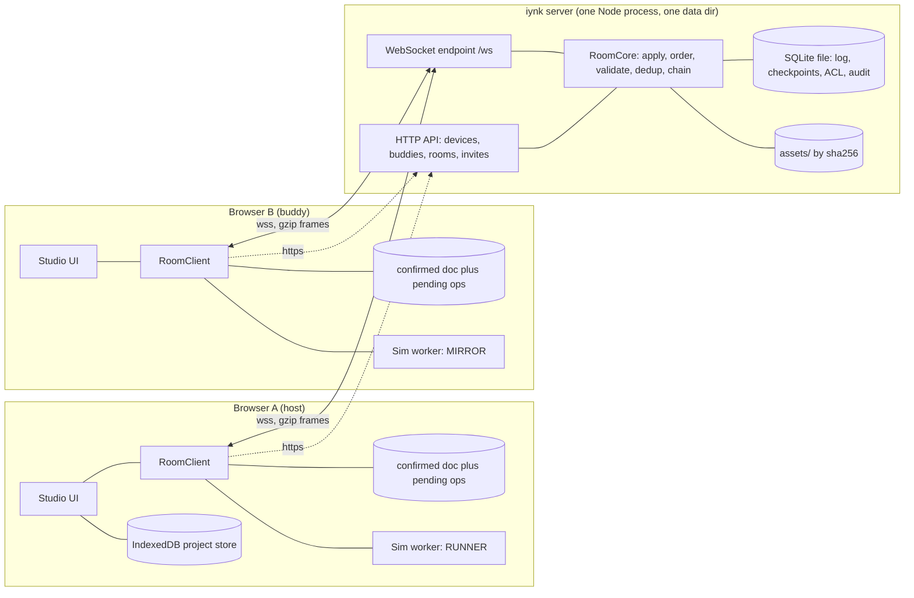
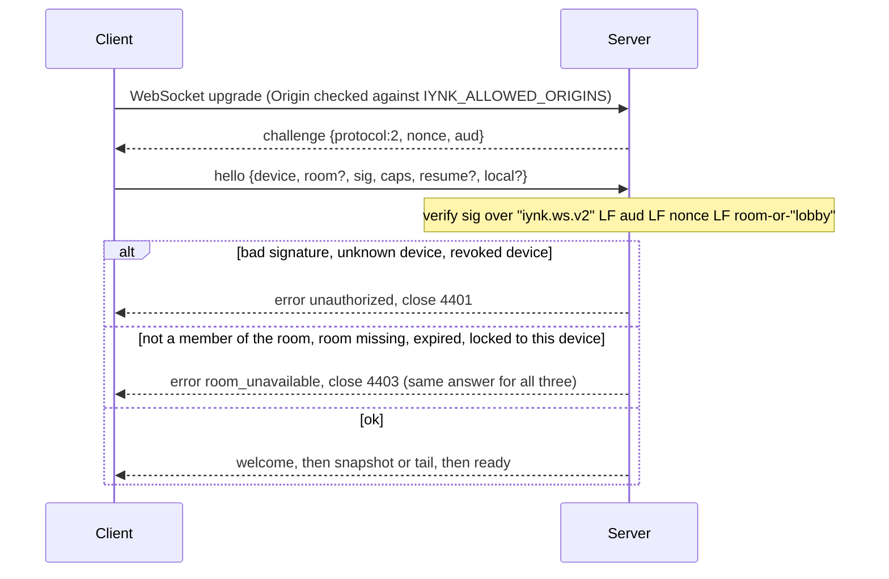
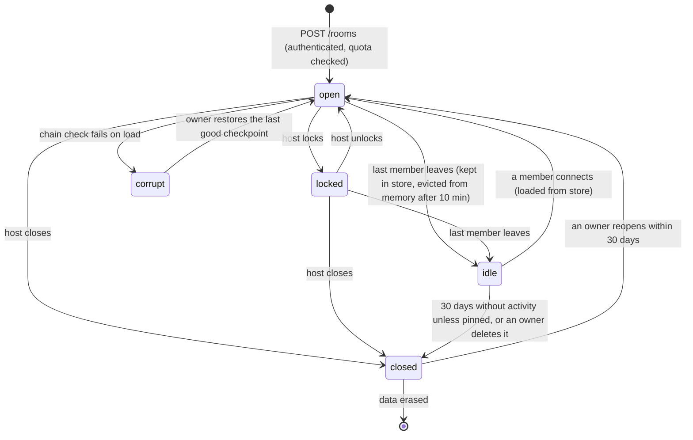
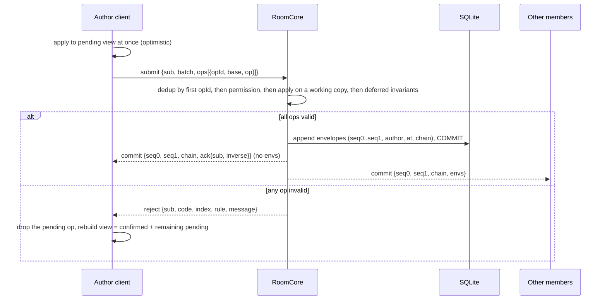
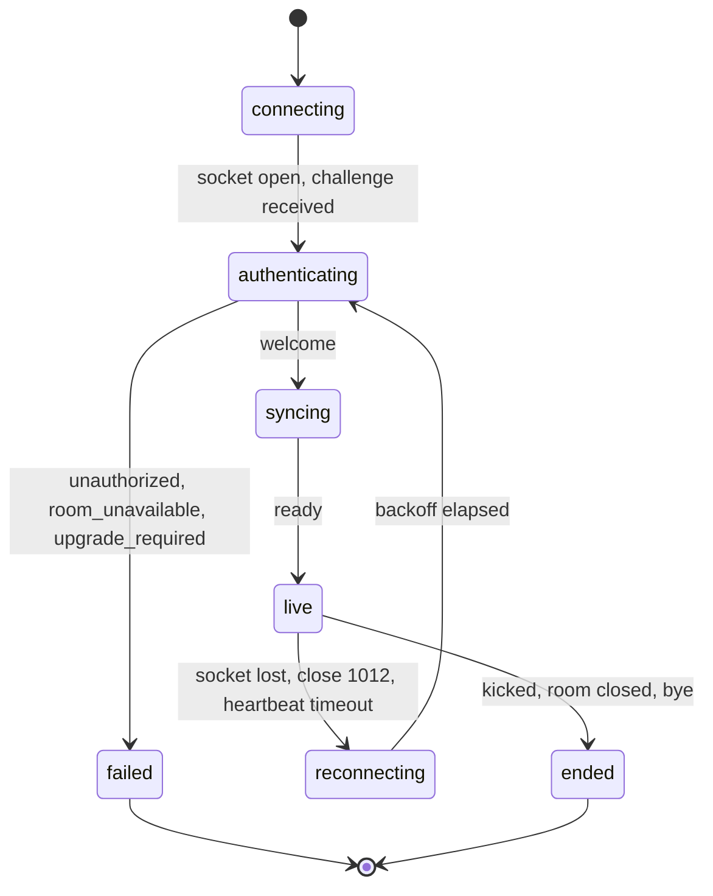
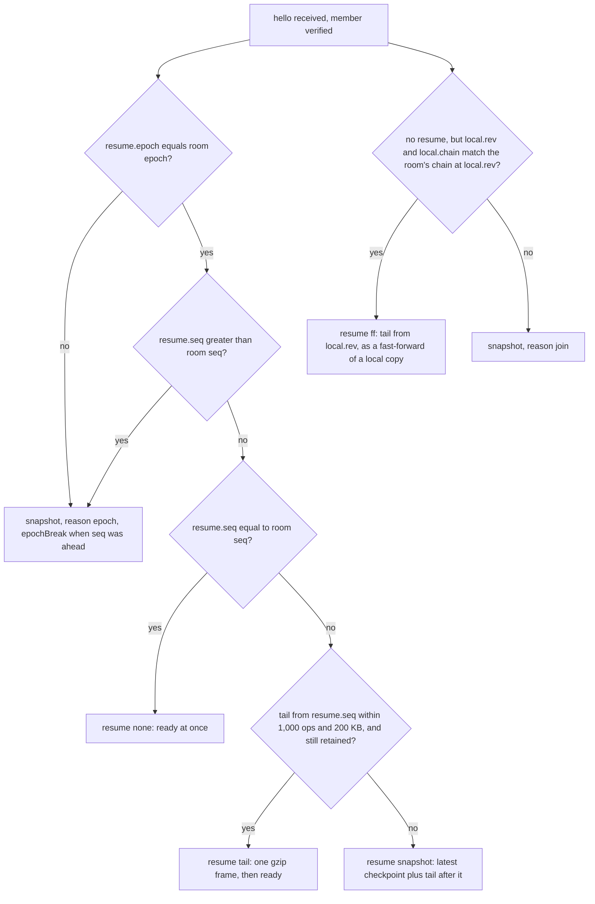

# iynk realtime architecture: rooms on any project

Written 2026-10-27 by the realtime-architecture seat. Binding inputs: `00_EXECUTIVE/DECISION_REGISTER.md` (D-013 to D-017, D-007, D-010, D-011), `BRIEF.md` section 14 and 19.5, `PROJECT_DATA_MODEL.md` (op format, ids, hash chain, limits), `schemas/project.schema.json`, `SIMULATION_ARCHITECTURE.md` (replay record, determinism classes, section 17.4 rooms), `03_PRODUCT/PRODUCT_REQUIREMENTS.md` (R-075 to R-098, BUD-10), `01_AUDIT/SECURITY_BASELINE.md` (R1 to R9), the spike `08_RESEARCH_SPIKES/RS-09-op-log-collab/REPORT.md`, and the code in `server/realtime` and `src/lib/realtime`.

Decisions have ids ADR-0500 to ADR-0511 (files in `ADR/`). Acceptance criteria have ids RA-01 and up (section 20). Evidence labels: VERIFIED (read in code or reproduced), DOCUMENTED (a repo document says so), EXTERNAL (outside fact, not tested here), ESTIMATED (arithmetic from stated numbers), HYPOTHESIS, UNKNOWN. Items marked PROPOSAL are my defaults, with no measurement behind them.

## 0. The decisions in one page

| # | Decision | Status | ADR |
|---|---|---|---|
| 1 | The project document is changed in a room only by the 55-kind op vocabulary through one pure `apply`, ordered by the server. No CRDT for the graph. A text CRDT for source files is held in reserve with a stated trigger. | Decided (RS-09 PASS) | 0500 |
| 2 | One wire protocol, version 2: JSON text frames, gzip binary frames above 4 KiB, a closed list of frame types, error codes and close codes. The v1 relay protocol is retired. | Decided | 0501 |
| 3 | Sockets are authenticated by a device key (ECDSA P-256 challenge and response). The server derives the member from the key. The client never chooses its id. Closes R4. | Decided | 0502 |
| 4 | Rooms are created through an authenticated call, never by joining. Joining needs membership; an invite is a 128-bit capability redeemed once over HTTP. A stranger learns nothing. Closes R1, R2, R3. | Decided | 0503 |
| 5 | Roles: owner, editor, commenter, viewer (the document's roles) plus the room properties host, baton holder and runner. Every op is permission-checked inside `apply`. Spectators are viewers. | Decided | 0504 |
| 6 | The server holds the authoritative document and the log in one embedded SQLite file. Peers no longer supply snapshots. Restart recovers rooms. Closes R9. | Decided; durability and throughput numbers PENDING RT-1 | 0505 |
| 7 | The server never simulates. One member, the runner, owns simulation time. Everyone else mirrors the same run from the same ordered document, seed and runner-stamped input log. Host frames are the fallback display. | Decided; cross-machine behaviour PENDING RT-2, DET-2, SA-12 | 0506 |
| 8 | Cursors, selections, viewports and typing marks are ephemeral frames, coalesced by the server. Chat is text only, server-typed, rate limited. | Decided | 0507 |
| 9 | Offline editing is rebase by replay of a bounded pending queue. When replay is not wanted or not possible, the local work becomes a fork. No offline merge engine. | Decided | 0508 |
| 10 | An audit trail of room events, plus the op log with server-stamped authors, serves "who did what". Host controls are kick, lock, mute, pass host, close. No public moderation. | Decided | 0509 |
| 11 | Hostile-client defences are enforced by the server and each one has a named test (R-097). | Decided | 0510 |
| 12 | The room host is a module of the single self-hostable server (F-199): one Node process, one data directory, one documented setup. Friends-sized: 8 editors and 8 spectators per room, tens of rooms. | Decided | 0511 |

## 1. Scope and non-scope

In scope (BRIEF 14, 19.5 websocket part): shared canvas and code editing, cursors and presence, synchronised simulator controls and shared simulation state, conflict resolution, roles, host permissions, spectators, invite links, team ownership, reconnection, latency, offline editing, version conflicts, audit history, hosting inside the self-hosted server, authentication of sockets, fixes for SECURITY_BASELINE R3 and R4 (and R1, R2, R5 to R9 because they share the cause).

Out of scope here: buddy pairing UX and key exchange (F-206 owns the ceremony; this file uses its result), share-link storage (F-089, touched in section 17 only where a room converts into one), AI proposals (PROJECT_DATA_MODEL 7.5 owns them; a room carries their accepted ops), voice (F-108, LATER), classroom assignments (BRIEF 14 asks to "integrate with educational group assignments where useful": none, D-013 shelves classrooms), a public lobby or room list (D-016).

Downstream features: F-116 shared rooms, F-117 chat, F-118 relay, F-119 relay authority, F-120 host controls, F-121 rooms on user projects, F-122 helper joins, F-123 CRDT or OT (answer: not in v1, section 8.4), F-138 buddies, F-140 buddies-only leaderboard (reads lap rows through the lobby API only), F-165 server store, F-199 self-hostable server, F-198 setup guide, F-005 device token, F-206 buddy identity. Journeys: J-08 (share with a friend), J-09 (two buddies editing). Requirements: R-075 to R-098, R-022, R-088, BUD-10, REF-4, DET-3, DET-4.

## 2. What exists today and what happens to it

All VERIFIED by reading the files named.

| Piece | Facts | Disposition | Why |
|---|---|---|---|
| `server/realtime/src/relay.js` (630 lines) | HTTP plus `ws` 8.22.0 server; origin check (`:93`), total and per-IP connection caps (`:98-106`), heartbeat, backpressure cut at 4 MiB (`maxBufferedBytes`, `config.js:33`), graceful drain with close 1012, `/healthz` and `/metrics` | EXTEND | The socket plumbing is sound and tested. The room logic inside it is replaced |
| `relay.js:219-299` `join` | Any join to an unknown code creates a room (R3). A second join with an existing peer id replaces that member's socket and inherits its place (`:231,248-264`), and the host is the first key of a Map (`room.js:47-50`) so replacing the host's id makes the attacker host (R4, reproduced 2026-10-27 in SECURITY_BASELINE "Gap fixes") | REPLACE | The identity model is the defect |
| `relay.js:306-381` `pump`, `ask`, `onState` | A joiner's state is a snapshot supplied by another peer, cap 512 KiB, never validated (R9) | REPLACE | The server will hold the document |
| `relay.js:383-388` `onAction` | Stamps a per-room `seq`, appends any JSON object up to 64 KB to the log, broadcasts. No validation, no dedup, no rejection | REPLACE with `submit`/`commit` (section 8) | RS-09 added exactly these three and passed |
| `room.js` | `appendAction`, bounded log (2,048 entries, 1 MiB), `canReplayFrom`, `actionsAfter`, chat backlog 50, ban set of 64 ids (by client-chosen id) | REPLACE | Becomes `RoomCore` over a store |
| `protocol.js` | Frame parser that rebuilds every frame from known fields; grapheme-safe text caps; name and chat junk stripping; `LABS` enum and 6-character room ids (`:7,9`); client-chosen chat `kind` (`:6`, R7) | EXTEND | Keep `capText`, `line`, `name`, the NAME_JUNK and CHAT_JUNK regexes and the "rebuild from known fields" rule. Replace the frame set |
| `bucket.js`, `log.js` | Token bucket; structured logger | PRESERVE | |
| `config.js` | H7 numbers: 8 peers, 64 KiB frames, 60 frames/s, 20 Hz streams, 15 s heartbeat, 45 s timeout, 30 min room TTL (`:4-14`), 500 rooms and 64 sockets per IP (`:29,31`) | EXTEND | New limits in section 16 |
| `server/realtime/test/*` | 39 tests (4 expiry, 2 ordering, 7 limits, 15 protocol, 3 host, 8 snapshot), plus `load.js` | EXTEND | Keep ordering, limits, protocol-shape and expiry tests; rewrite host and snapshot tests; add the hostile suite (R-097) |
| `deploy/realtime/{Dockerfile,compose.yaml,Caddyfile}` | Non-root, read-only root, `cap_drop: ALL`, `mem_limit: 512m`, Caddy automatic HTTPS; compose requires `REALTIME_ALLOWED_ORIGINS` | EXTEND | Becomes the self-hosting kit (section 17) |
| `src/lib/realtime/{room,store-sync,shared-actions}.ts` (915 lines) | Client room, two `dispatch` monkey-patches, whole-text baton, `room/baton` accepted from any sender (`room.ts:589-597`, R6) | REPLACE | D5: replaced by the op-based `RoomClient` |
| `src/lib/realtime/{ws-transport,broadcast-transport,transport}.ts` | WebSocket and BroadcastChannel transports behind one interface | EXTEND | The interface stays; `RoomCore` also runs behind the BroadcastChannel transport for two tabs and for tests (section 3.2) |
| `src/lib/realtime/{identity,probe,translate}.ts` | Self-chosen name and colour in `localStorage`; `probe` joins as a hidden peer to read a roster (R2); chat translation | identity EXTEND (device key lives in IndexedDB `keys`), `probe` DELETE, `translate` PRESERVE | |
| `src/components/realtime/*` | Avatars, pointing cursors, room bar, invite dialog, chat panel | PRESERVE the look, rework data flow | |
| `src/app/api/buddies`, `src/app/[lang]/together/Buddies.tsx`, `src/app/api/ai/match` | Public 24-hour pool with free text | DELETE (D-016, R-081) | |

BRIEF 3.5 check: nothing here is deleted until the replacement passes the acceptance tests of section 20. The v1 relay keeps working for the lab pages until the Studio rooms ship (phase LABS), but it is not deployed by the self-hosting kit (R-022).

## 3. Architecture

### 3.1 Who runs what



Trust boundaries: the browser is untrusted by the server; the server is trusted by its operator's friends only for what it stores. Nothing in a room passes through any third-party service (D-015).

### 3.2 `RoomCore`: one module, three homes

`RoomCore` is a pure, transport-free class: input is `(member, frame)`, output is a list of `(recipient, frame)` and a list of store writes. It contains the permission table, `apply` (imported from the shared op module of ADR-0104), dedup, inverse computation, the hash chain and the run-log ordering. It runs in three places:

1. the Node server, behind `ws` and the SQLite store;
2. a test harness with a virtual network, the RS-09 `sim.js` pattern, so the property test of REF-4 runs the real code (about 436,000 generated ops in the spike);
3. the BroadcastChannel transport, where one tab of the same browser acts as the room leader for two tabs of one profile (existing behaviour, kept; no server, no auth, same-origin only).

This is how a rule is written once and tested under the same conditions that RS-09 tested.

### 3.3 Two socket scopes

The same endpoint, handshake and frame grammar serve two scopes, chosen by `hello.room`:

| Scope | Purpose | Frames |
|---|---|---|
| room | one project's session | sections 7 to 13 |
| lobby | one per device while the app is open: buddy presence, incoming room invites, nothing else | `buddies`, `buddy`, `invite` (section 5.5) |

## 4. Identity and socket authentication (ADR-0502, fixes R4)

### 4.1 What is wrong today

The client picks `peer.id` (`protocol.js` `peerRecord`, pattern `^[A-Za-z0-9_-]{1,64}$`), and the relay trusts it. Bans, hosts and batons are all keyed on that string (`room.js:121-128`). Reproduced: a third socket that joins with the host's exact id gets the host's seat and then kicks the guest (SECURITY_BASELINE R4).

### 4.2 The model

| Term | Definition |
|---|---|
| Device | A browser profile that registered with this server. Its identity is a P-256 key pair made with WebCrypto, private key non-extractable, stored in IndexedDB `keys` (F-206). `deviceId = "dev_" + lower-case base32 of the first 16 bytes of SHA-256(SPKI public key)` (26 characters). Self-certifying: the id cannot be claimed without the key |
| Actor | The person in documents: `usr_` plus 16 lower-case base32 characters. For a device that registered here it is derived the same way from the key (first 10 bytes of the same hash, 16 characters) so every peer can recompute it from `keyThumbprint`. A local-only actor created before the person ever used a server keeps its random `usr_` id; the server's ACL maps the device to whichever actor id the room granted |
| Member | A device that is in a room's ACL, with an actor id and a role |
| Session | One live socket of a member. At most one per member per room |

Document fields used: `actors[].id`, `actors[].name`, `actors[].keyThumbprint` (the base64url SHA-256 of the public key, PROJECT_DATA_MODEL 5.1). The server never puts a device id into a document or a frame sent to another member; others see the actor id, name and colour only.

### 4.3 Handshake



Signature: ECDSA with P-256 and SHA-256 over the UTF-8 bytes of `"iynk.ws.v2\n" + aud + "\n" + nonce + "\n" + (room ?? "lobby")`. WebCrypto returns the raw IEEE P1363 form (r then s); Node verifies it with `crypto.verify("sha256", data, {key, dsaEncoding: "ieee-p1363"}, signature)` (EXTERNAL, check at build). `aud` is the server's public host name, so a malicious server that relays a challenge from a real one gets a signature that the real one rejects. The nonce is 32 random bytes, single use, valid for the 10-second hello window (`joinTimeoutMs`, `config.js:22`, VERIFIED). Verification costs well under a millisecond (HYPOTHESIS; measure in RA-05).

Why a signature and not the bearer token of R-077: the token (F-005) authorises HTTP calls and is stored on the server as a hash; if it leaks (a log, a proxy) it must not also be enough to sit in a room as that person. The key never leaves the browser. Both are issued at device registration. This refines R-077; it does not contradict it.

### 4.4 Rules that close R4

1. The member id is the authenticated device. The `hello` carries no peer id, name or role to trust. Display name and colour come from the ACL record (set at pairing, F-206/R-080) and can be changed by the member through `presence` with the same junk stripping and 24-grapheme cap as today (`protocol.js` `name()`).
2. A second socket from the same device in the same room supersedes the first: the old one gets `error superseded` and close 4409 (the old code 4001). This is safe because it needs the key. The new session keeps the member's role, baton and runner status; it must resume from `resume.seq`.
3. A different device can never take over a seat, the host role or the baton. Host and baton are fields of the room keyed by actor, changed only by the commands in section 6.
4. Bans are by device id, stored in the room ACL, so a new random id does not help (SECURITY_BASELINE R5). Revoking a device on the server (R-077) drops it from every room and buddy list.
5. Auth failures are limited to 5 per minute per source address, then that address is refused for 5 minutes (PROPOSAL). Failures are logged with a salted address tag, as `relay.js` already does (`tagOf`, `relay.js:74`).

Local-only use needs none of this: with no server the app has no devices and no rooms (D-015, F-012).

## 5. Rooms, invites and buddies (ADR-0503, fixes R1, R2, R3)

### 5.1 Lifecycle



`closed` rooms keep their data for 30 days (R-083) so a late buddy can still fork; after that the server erases the log, checkpoints, ACL and assets of the room. A member keeps whatever copy they saved.

### 5.2 Creating a room (R3)

```
POST /rooms   Authorization: Bearer <device token>      (base /api/v1, as in openapi.yaml)
{ "project": <document at revision r, without history>, "title": "Blink with Mina", "settings": { "codeMode": "baton", "runControl": "editors" } }
201 { "room": "rm_7k3q...", "epoch": "a1b2c3d4", "seq": 0 }
```

- The body definition is `RoomCreate` in `schemas/openapi.yaml` (`title` required; exactly one of `projectId` or `project`; optional `settings`). The example above is one valid instance. No extra field is needed: `RoomSettings` there already carries `codeMode` and `runControl` (VERIFIED, openapi.yaml `components.schemas.RoomSettings`). All routes in this file are relative to the base `{origin}/api/v1`.
- A room id is `rm_` plus 16 random base32 characters (80 bits). It is an address, not a secret: knowing it grants nothing (section 5.4).
- The document is validated by passes V1 to V5 (PROJECT_DATA_MODEL 9.1) and the limits of 9.4 before it is stored. Over the document limit (5,242,880 bytes canonical) the answer is `quota`.
- The server stores it as checkpoint 0 and sets `seq = project.revision`. The creating device becomes owner, host and `room.creator`.
- Quotas (all configuration; defaults PROPOSAL): 6 creations per minute and 30 per hour per device, 10 stored rooms per device, `IYNK_MAX_LIVE_ROOMS` 20 rooms in memory (the RB-7 estimate for 512 MB; raise only after RA-08 measures), 100 stored rooms per server. Today's 500-room cap with 30-minute empty-room TTL (`config.js:29,14`) is what made R3 possible: a junk room cost the attacker one socket and held a slot for 30 minutes. Now a junk room costs an enrolled device (section 5.3), a quota slot and a row, and cannot be made by joining.
- Joining an id that does not exist, has expired, or where the device is not a member returns the same `room_unavailable` and close 4403 after the same minimum delay of 200 ms, so existence is not an oracle (R2).

### 5.3 Who can reach the server at all

Registration of a device is the F-005 call. On a friends server it must not be open to the internet by default: a public URL would let strangers store data and open sockets (the same reasoning as F-004 for AI routes). Default: `IYNK_ENROL=invite`. The operator runs `iynk-server enrol` (prints a one-time code, valid 24 hours, single use) and gives it to a friend; the friend's browser sends it with its public key to register. `IYNK_ENROL=closed` stops all new enrolment (existing devices keep working). There is no open mode, on a private network or elsewhere (SYSTEM ADR-0007, BACKEND 6.3, R-007): open registration would bring back R3 (junk rooms from enrolled strangers) and storage abuse. This adds a gate to R-077's "first visit gets a token" (Objection O-1).

### 5.4 Invites are capabilities

| Kind | How it is made | How it is used | Default limits |
|---|---|---|---|
| direct (to a paired buddy) | `POST /rooms/{roomId}/invites {buddy: actor, role}` | The buddy's lobby socket receives `invite`; the buddy taps Join. No secret in a URL | 24 h, one redemption by that device |
| link | `POST /rooms/{roomId}/invites {link: true, role, maxUses, ttl}` | Returns `{token}` (128 bits, base64url, 22 characters). The app builds `https://<app>/#/join/<room>.<token>`; the token sits in the URL fragment so it is not sent to any server, log or Referer header (EXTERNAL browser behaviour) | 24 h, 1 use for editor, 5 for viewer, at most 7 days and 20 uses |

Redeeming: `POST /room-invites/redeem {room, token}` with the device token. On success the server, in one transaction, increments the use count, inserts the device into the room ACL with the invited role, writes an `access.grant` op (author kind `system`) so the document mirrors the grant, and returns `{room}`. The device then opens the room socket like any member. A wrong, expired or revoked token returns one generic error and counts against 5 tries per device per hour. Only the SHA-256 of a token is stored. The host or any owner can revoke an invite, and removing a member ends their access even if an invite is still valid.

The six-character codes of today (31^6, about 29.7 bits, R1) are gone. Two people in the same room can still type a short code for pairing (R-080), but a pairing code is not a room credential.

### 5.5 Buddies and the lobby

The lobby socket (`hello` without `room`) delivers, to a device, only things about its paired buddies:

```ts
{ t: "buddies", list: [{ actor, name, color, online: boolean, activity?: { room: RoomId, title: string } }] }
{ t: "buddy",   actor, patch: Partial<Buddy> }       // online, activity
{ t: "invite",  room: RoomId, from: Actor, title: string, role: Role, expires: string }
```

`activity` is sent only if that buddy turned on "show what I'm working on" (default off). Unpairing deletes the pair and closes shared sessions for the removed person (R-080). There is no directory, search or listing of strangers (D-016, R-081). The buddy leaderboard (F-140) is a REST read over the same pairing table; no socket frames.

### 5.6 Room size

8 editors and commenters (`maxPeers: 8`, `config.js:5`, VERIFIED) plus 8 spectators (PROPOSAL). The join order that defined "host" is gone; host is explicit (section 6).

## 6. Roles, host, baton, spectators and team ownership (ADR-0504)

### 6.1 Terms

| Term | Where it lives | Meaning |
|---|---|---|
| Role: `owner`, `editor`, `commenter`, `viewer` | Document `access.grants` and `access.owners` (PROJECT_DATA_MODEL 5.1); the server ACL mirrors it | What a member may do to the document |
| Spectator | Room property | A member whose role is `viewer` and who joined as a spectator. Spectators count against `maxSpectators`, not `maxPeers`. Not stored in the document beyond the grant |
| Host | `room.host` (an actor) | The member who runs the session: kick, lock, mute, close, baton grant, run policy. Explicit, not "first in the Map" (the cause of R4's takeover) |
| Creator | `room.creator` | The owner who opened the room. Always allowed to reclaim host. Keeps the project id at close |
| Baton holder | `room.baton` (an actor or null) | The one member whose `source.*` ops are accepted while `codeMode` is `baton` |
| Runner | `room.runner` (an actor or null) | The member whose browser owns simulation time (section 13). Default: the host |

Team ownership: `access.owners` holds 1 to 8 actors, and every owner may grant and revoke (`access.*` ops), close, delete and reopen the room, and reassign host. The last owner cannot be revoked (PROJECT_DATA_MODEL 7.2). A project with two owners therefore has no single point of failure in the room. The stored room counts against the quota of the creating device only.

### 6.2 Permission table

Enforced by `RoomCore` before `apply` for ops, and in the command handler for commands. A denied request returns `permission` (or `not_baton`) and changes nothing. VERIFIED gap today: the relay enforces none of this (`relay.js:383-388`; SECURITY_BASELINE R6).

| Action | owner | editor | commenter | viewer (spectator) |
|---|---|---|---|---|
| Read the document, see presence, receive chat | yes | yes | yes | yes |
| Send chat | yes | yes | yes | yes, unless muted |
| Send cursor and selection | yes | yes | yes | no by default; host can allow (`settings.spectatorCursors`) |
| Graph ops (`board.*`, `component.*`, `net.*`, `view.*`, `wire.*`, `junction.*`, `label.*`, `mech.*`, `param.*`, `test.*`, `asset.*`, `dep.*`, `guide.*`, `domain.*`, `meta.*`) | yes | yes | no | no |
| `sim.*`, `runtime.*`, `input.*`, `script.*`, `fault.*`, `instrument.*` ops | yes | yes | no | no |
| `source.edit`, `source.add`, `source.remove`, `source.rename` | baton holder (or any editor when `codeMode` is `open`) | same | no | no |
| `license.set`, `access.grant`, `access.revoke` | yes | no | no | no |
| Run requests (start, pause, resume, stop, reset, step, speed, input) | per `runControl` (6.4) | per `runControl` | no | no |
| Kick, lock, mute, close, reassign baton or runner, change settings | host only | no | no | no |
| Pass host | host | no | no | no |
| Reclaim host | creator only | | | |
| Delete room, reopen room | any owner | no | no | no |

Commenter and viewer differ only in that a commenter may be promoted later to carry comment ops when the document gets them (UNKNOWN: the schema has no comment op today). Until then both are read-only with chat.

Baton rule (R-094, refined in Objection O-5): the baton gates `source.*` ops on the server. It does not gate pointing, selection, the canvas, or the run controls. Request, grant, release:

- `baton.request`: any editor; the holder and host are told. No holder means the baton goes to the first requester at once.
- `baton.grant {to}`: the holder or the host. `baton.release`: the holder. `baton.take`: the host only, which is how a host recovers a baton from someone who walked away.
- A holder who disconnects keeps the baton for 30 seconds (PROPOSAL), then it is free and the host is told. R6 today: any peer could send `room/baton`; here only these commands change it.

### 6.3 Host succession

If the host's session ends, a 60-second grace period runs (PROPOSAL). If the host returns, nothing changes. If not, the host becomes the longest-present owner, else the longest-present editor; if none is present the room has no host (still safe: roles are enforced, the baton and runner stay as they were, kick and lock wait). The creator can `host.claim` at any time. The grace period avoids a host reshuffle on a phone sleeping for 20 seconds.

### 6.4 Settings

| Setting | Values | Default | Changed by |
|---|---|---|---|
| `codeMode` | `baton`, `open` | `baton` | host |
| `runControl` | `editors` (any editor may use any control), `host` (only host and runner; others may request) | `editors` | host |
| `spectatorCursors` | boolean | false | host |
| `locked` | boolean | false | host |
| `maxMembers`, `maxSpectators` | integers up to the server caps | 8, 8 | host (down only) |

`open` code mode allows concurrent typing in different files, or the same file, with the server range transform of RS-09. It is off by default because intent is only roughly kept when ranges overlap (section 8.4). Every change of a setting is an event in the audit trail and a message to the room.

## 7. Wire protocol, version 2 (ADR-0501)

### 7.1 Framing and compression

- WebSocket, path `/ws`, one JSON object per text frame with a string field `t`. The parser keeps today's rule: every frame is rebuilt from its known fields, and nothing unvalidated reaches another member (`protocol.js` header comment).
- Frames larger than 4 KiB go as binary: byte 0 is `0x01` (gzip), the rest is gzip of the UTF-8 JSON text. Both ends inflate with a hard output cap (server side `zlib.gunzip` with `maxOutputLength`; browser `DecompressionStream("gzip")` with a counted reader; EXTERNAL, supported in current browsers, check Safari). A frame that inflates past its cap closes the socket with 4413. This is the "gzip or snapshot plus tail" condition of the RS-09 independent check: the 10,000-op tail is 1,425 KB raw and 268 KB gzipped (VERIFIED, RS-09).
- Why not WebSocket `permessage-deflate`: `relay.js:59` turns it off, and the `ws` library documents that it fragments memory under load (EXTERNAL, ws README). Application-level gzip is chosen per frame, only where it pays. Reversible: it is a capability flag (`caps: ["gzip"]`).
- Caps (inflated / wire): client to server 512 KiB / 128 KiB; one op envelope 64 KiB (PROJECT_DATA_MODEL 7.1); server to client snapshot 6 MiB / 1 MiB (5 MiB document limit plus framing; the largest allowed document gzips to 159 KB, PROJECT_DATA_MODEL 9.6); every other server frame 256 KiB. The v1 caps were 64 KB, and 512 KiB plus 1 KiB for state (`config.js:6,8`).

### 7.2 Versions

| Version | Where | Rule |
|---|---|---|
| `protocol` (integer, 2) | `challenge`, `hello` | Major. A different value closes with 4426 `upgrade_required` and a message saying which side must update. Additive changes (a new optional field, a new frame type gated by a capability) do not bump it |
| `caps` | `hello` | Strings the client understands: `gzip`, `cursors`, `chat`, `run`, `lobby`. The server sends a frame type only if the client announced its capability |
| `opSchema` ("1.0") | `hello`, `welcome` | PROJECT_DATA_MODEL 7.4: equal `MAJOR.MINOR`, else `schema_mismatch` with the side that must update |
| `schemaVersion` | document | Migrations are ADR-0105. A room runs one schema version for its life; to upgrade, an owner closes the room, upgrades the project locally and opens a new room, whose `origin` names the old one |
| `app` | `hello` | Informational string for logs and the "who has which version" line in the member list |

Unknown frame `t` from a client: `bad_type` error, frame dropped, socket kept (after 20 in a minute: closed 4429). Unknown `t` from the server: the client ignores it and logs once.

### 7.3 Frame catalogue

Types are normative. `Actor` is `usr_...`; `Seq` is a non-negative integer revision (equal to the document's `revision`); `Time` is a UTC timestamp with milliseconds and `Z`; `Op` is `$defs/Op` of the project schema; `Envelope` is `$defs/OpEnvelope`.

Server to client:

```ts
type Challenge = { t: "challenge"; protocol: 2; nonce: string; aud: string; serverTime: Time };

type Welcome = {
  t: "welcome"; protocol: 2; opSchema: "1.0";
  room: { id: RoomId; project: ProjectId; title: string; epoch: string; seq: Seq; chain: string;
          state: "open" | "locked"; settings: RoomSettings };
  you: { actor: Actor; m: number; role: Role; spectator: boolean; host: boolean };
  members: Member[];                      // see Member below
  host: Actor | null; baton: Actor | null; runner: Actor | null;
  resume: "none" | "tail" | "snapshot" | "ff";
  epochBreak?: true;                      // the client was ahead of the server (11.5)
  run: RunState | null;
  chat: number;                           // count of chat frames that follow (at most 50)
  limits: { submitPerSec: number; maxEnvelopeBytes: number; maxPending: number };
};
type Member = { actor: Actor; m: number; name: string; color: string; role: Role; spectator: boolean;
                online: boolean; host: boolean; baton: boolean; runner: boolean; status?: string; app?: string };

type Snapshot = { t: "snapshot"; reason: "join" | "resume" | "resync" | "epoch";
                  seq: Seq; chain: string; stateHash: string; doc: ProjectDocument };  // no history.ops
type Tail     = { t: "tail"; from: Seq; to: Seq; envs: Envelope[]; chain: string };     // from is the first seq in envs
type Ready    = { t: "ready"; seq: Seq };                // after this the client may submit

type Commit = { t: "commit"; seq0: Seq; seq1: Seq; chain: string;
                envs?: Envelope[];                       // omitted in the author's own copy
                ack?: { sub: number; inverse: Op[]; dup?: true } };   // author's copy only
type Reject = { t: "reject"; sub: number; code: RejectCode; index?: number; rule?: string; message: string };
type Check  = { t: "check"; seq: Seq; chain: string; stateHash?: string };               // every 100 ops or 30 s
type Presence = { t: "presence"; m: number; patch: PresencePatch };
type Cursors  = { t: "cursors"; c: [m: number, view: string, x_mm: number, y_mm: number][] };
type Chat     = { t: "chat"; id: string; m: number; text: string; lang: string; kind: "text" | "system"; at: Time };
type Event    = { t: "event"; at: Time; kind: EventKind; by?: Actor; data?: Record<string, unknown> };
type Error    = { t: "error"; code: ErrorCode; message: string; retryable: boolean; retryAfterMs?: number; ref?: string };
type Pong     = { t: "pong" };
// run channel (section 13)
type RunEv   = { t: "run.ev"; rseq: number; tNs: number; kind: "pin"|"analog"|"serial"|"param"|"fault"|"control"; target: string; value: unknown };
type RunTick = { t: "run.tick"; tNs: number };
type RunCheck= { t: "run.check"; tNs: number; hb: string; hd: string };
type RunFrame= { t: "run.frame"; tNs: number; frame: unknown };       // fallback display, at most 16 KiB
type RunReq  = { t: "run.req"; from: Actor; id: string; req: string; args: unknown };  // runner only
// lobby scope (section 5.5): buddies, buddy, invite
```

Client to server:

```ts
type Hello = {
  t: "hello"; protocol: 2; app: string; opSchema: "1.0";
  device: DeviceId; room?: RoomId; sig: string; caps: string[];
  resume?: { epoch: string; seq: Seq; chain: string };   // last confirmed state
  local?: { rev: Seq; chain: string };                    // a local copy of the same project id (fast-forward)
  engines?: Record<string, string>;                       // for run mirroring (section 13)
};
type Submit  = { t: "submit"; sub: number; batch?: string;
                 ops: { opId: string; base: Seq; op: Op; kind?: "user" | "ai"; proposal?: string }[] };
type Resync  = { t: "resync"; reason: "chain" | "hash" | "apply"; seq: Seq; chain: string };
type PresenceUp = { t: "presence"; patch: PresencePatch };
type CursorUp   = { t: "cursor"; view: string; x_mm: number; y_mm: number };
type ChatUp     = { t: "chat"; id: string; text: string; lang: string };
type Cmd        = { t: "cmd"; id: string; name: CmdName; args?: Record<string, unknown> };
type RunReqUp   = { t: "run.req"; id: string; req: "start"|"pause"|"resume"|"stop"|"reset"|"step"|"speed"|"input"; args?: unknown };
type RunEvUp    = { t: "run.ev"; kind: RunEv["kind"]; tNs: number; target: string; value: unknown };   // runner only
type RunTickUp  = { t: "run.tick"; tNs: number };                                                        // runner only
type RunCheckUp = { t: "run.check"; tNs: number; hb: string; hd: string };                               // runner only
type Ping       = { t: "ping" };
type Bye        = { t: "bye" };

type PresencePatch = { name?: string; status?: string | null; view?: string; sel?: string[];   // at most 16 ids
                       focus?: string | null; typing?: string | null; vp?: { x: number; y: number; zoom: number } };
type CmdName = "baton.request" | "baton.grant" | "baton.release" | "baton.take" | "host.pass" | "host.claim"
             | "member.kick" | "member.mute" | "room.lock" | "room.settings" | "room.close" | "room.pin"
             | "runner.set" | "run.detach";
```

Everything the user can do with a role change is an op (`access.grant`, `access.revoke`), so the document and the ACL cannot drift. Invites and redemption are HTTP (sections 5.2 to 5.4), not socket frames, so a token never sits in a WebSocket log.

### 7.4 Error and close codes

Error frames carry a closed `code`. `retryable` tells the client whether to resend as is, retry later, or give up.

| Code | Meaning | Retry |
|---|---|---|
| `bad_json`, `bad_frame`, `bad_type`, `too_large` | Malformed, unknown type, over a cap | no |
| `unauthorized` | Bad signature, unknown or revoked device | no |
| `room_unavailable` | Missing, expired, closed, not a member (one code for all) | no |
| `room_full`, `locked` | Member cap reached; room locked to new members | later |
| `kicked`, `superseded` | Removed by host; newer session of the same device | no |
| `upgrade_required`, `schema_mismatch` | Protocol or `opSchema` differs | no |
| `not_ready` | `submit` before `ready` | wait |
| `permission`, `not_baton`, `not_runner` | Role, baton or runner check failed | no |
| `run_state` | Run request invalid in the current run state | no |
| `rate_limited` | Over a bucket; carries `retryAfterMs` | later |
| `quota` | A PROJECT_DATA_MODEL 9.4 limit, or a room quota | no |
| Op reject codes | `malformed`, `duplicate_id`, `missing_target`, `missing_pin`, `pin_in_use`, `unknown_definition`, `missing_pin_map`, `referenced_by`, `invariant`, `stale_base`, `schema_mismatch` (PROJECT_DATA_MODEL 7.2) | no |

Close codes: 1012 server restarting (client retries with backoff from `retryAfterMs`); 1013 server busy; 4000 hello timeout (kept from `joinTimeoutMs`); 4001 `superseded`; 4003 `kicked`; 4004 `room_full`; 4401 `unauthorized`; 4403 `room_unavailable`; 4413 too large; 4426 `upgrade_required`; 4429 `rate_limited`; 4500 `room_corrupt`. Codes 4009 and 4010 of v1 (`wrong_item`, `snapshot_unavailable`) disappear with their features.

## 8. Operations: ordering, validation, dedup, undo, divergence (ADR-0500)

### 8.1 The path of one edit



Rules, all from RS-09 and PROJECT_DATA_MODEL 7.3 and 7.4:

1. The server assigns `seq = previous + 1` with no gaps, stamps `author.actor` from the authenticated member (never from the frame), stamps `at` from its own clock, and keeps `base` as sent. Client-supplied `author.kind` may only be `user` or `ai` (with a `proposal` id, for attribution); `system` and `import` are rejected as `permission`.
2. A submission with several ops and one `batch` commits atomically or not at all; the deferred invariants run at the end of the batch; it is delivered as one `commit` so no foreign op lands inside it.
3. A rejected submission changes nothing and leaves no trace in the log (RS-09 counted 129,024 rejections across 30 runs without divergence).
4. Dedup: the server keeps, per member and room, the last 8 submissions as `(first opId, seq0, seq1, inverse)` in the store. A resent first `opId` returns `commit` with `ack.dup = true` and the stored result, not `duplicate_id` (the RS-09 dedup unit test shows the alternative makes an accepted op look rejected). A dedicated unit test is required because random testing does not catch its absence (RS-09, VERIFIED, independent check agreed).
5. The client sends one submission at a time, as RS-09 did. The server tolerates up to 4 unacknowledged submissions per socket and answers more with `rate_limited`.
6. `inverse` is computed by the server against the pre-state and returned only to the author. Undo is per author, last in first out, in memory, and an inverse that no longer applies is dropped (RS-09 limits restated: undoing a move after someone else moved the same part puts it back at the old position; no cross-author redo).
7. Coalescing is a client duty: a drag sends one `view.place` on release; a slider sends `component.set` on release; live drag position is ephemeral (`PresencePatch.focus` plus `cursors`). Without it a client is capped near 1 / RTT submissions per second (about 10 per second at 100 ms).
8. Assets: an op that names an asset (`asset.add`) is accepted only after the blob was uploaded with `PUT /rooms/{roomId}/assets/{sha256}` (this route is not yet in openapi.yaml and must be added there) (checks size 16,777,216 bytes, hash, MIME allow-list, quota). Op frames never carry binary.

### 8.2 The chain and divergence checks (R-090)

`chain_n = sha256(chain_(n-1) + canonical(envelope_n))`, genesis from the project id (PROJECT_DATA_MODEL 6.4). The server sends `check {seq, chain}` every 100 ops or 30 seconds of activity (R-090 proposal). A client that has applied exactly up to `seq` compares its own chain; a client with newer pending ops compares the confirmed chain it recorded at `seq`. A mismatch sends `resync {reason: "chain"}` and the server answers with a snapshot (reason `resync`) and the client reports the event to its local error log (R-009). Every fifth `check` also carries `stateHash` (cost: 3.8 ms for 500 parts and 1,000 nets, 18.5 ms at the largest allowed document, VERIFIED on an M4 Pro in PROJECT_DATA_MODEL 6.4; ESTIMATED 4x slower on a small server) which an idle client compares in its worker. A failure of `apply` on a server-ordered envelope (the server accepted what the client cannot apply) sends `resync {reason: "apply"}`.

### 8.3 What RS-09 proved and what it did not (REF-4 gate)

RS-09 (PASS): no divergence in 36 runs (30 + 6), about 10,900 generated and about 6,000 accepted ops per run, with 5 clients, drops, resends, undo and snapshot resume; the checker caught a missing cascade and a skipped op; dedup was proved only by a hand-built unit test. Reconnect: PASS by CPU on loopback (2.8 ms for 1,000 ops, 22 ms for 10,000), and under 2 seconds on a slow link only with gzip or snapshot plus tail. Not covered, and a gate before COLLAB relies on it (the same caveat is in PROJECT_DATA_MODEL 14.1):

| Gap | Required before COLLAB ships | Criterion |
|---|---|---|
| RS-09's document had parts and wires, no nets | Port the property test to the full 55-kind vocabulary: nets, batches, cascades (`board.remove`, `net.merge`, `net.split`), `component.swap` | RA-01 |
| Persistence, auth, multi-room, rate limits, restart | Built in this design; tested with a crash injected between COMMIT and ack | RA-03, RA-04, RA-06 |
| Real networks, mobile sleep, proxies, phones | Measure on a real home network and on a phone (BUD-10) | RA-09 |
| Text intent | Decide `open` code mode only after a manual two-typist trial | RA-13 |

### 8.4 CRDT or operational transform: the answer for F-123

BRIEF 14 asks whether globally ordered operations suffice or whether selected document types need a CRDT or OT. Answer, with the evidence:

| Document part | Choice | Evidence |
|---|---|---|
| Graph: boards, components, nets, views, wires, faults, parameters | Server-ordered op log with validation at apply time | RS-09 ran the same scenarios in Yjs 13.6.33 (VERIFIED, reproduced by the independent check): a part delete racing a wire add converged to a dangling wire; two offline adds of one id silently overwrote; a concurrent move was lost without notice; undo after a remote overwrite had no visible effect. The op log rejected 69,874 `missing_part` and 25,814 `dangling_wire` cases without divergence. The independent check adds that a CRDT plus a post-merge sweep can enforce the invariants, so the real difference is where the rule lives (one server place, versus every replica) |
| Source text | Same op log, `source.edit` with a range transform over later edits, behind a baton by default | RS-09: converges, intent only roughly kept (a delete range spanning a concurrent insert also deletes it; unsent edits are shifted only against remote ops). Yjs `Y.Text` preserved both concurrent inserts ("AAhelloBB") |
| Offline merge of long sessions | Not offered; rebase by replay or fork (section 12) | RS-20 (Yjs offline merge) was never run and TECHNICAL_RESEARCH row 20 says to run it only if the product requires multi-user offline. D-013 does not |

Trigger to add a text CRDT for source files only: a manual trial (RA-13) with two people typing in one file for 10 minutes in `open` mode in which either person reports lost or misplaced text more than twice. Cost then: a new `source.ytext` op kind carrying Yjs updates for one file, the graph unchanged, a minor schema bump (ADR-0500 reversibility). Until the trigger fires, no CRDT code is shipped, as BRIEF 14 asks ("do not introduce complex distributed editing systems without evidence").

## 9. Code editing in a room

- `codeMode: "baton"` (default, R-094): the holder's `source.edit` ops are accepted; everyone else sees the file read-only with the holder's name and a caret. The holder's keystrokes are coalesced client-side into one `source.edit` per 250 ms burst or on blur (PROPOSAL; at 10 submissions per second the server load is nothing, 5,700 applied per second were measured with 5 clients in RS-09).
- `codeMode: "open"`: any editor's `source.edit` is accepted. `baseSeq` is the `seq` of the last edit of that file the author had seen; the server transforms the range over each later `source.edit` of the same file, server order wins ties; a `baseSeq` older than the retained tail is `stale_base` and the client re-reads the file and retries. Offsets are UTF-16 code units; the shared module counts in code units on both sides, which avoids the surrogate-pair split RS-09 notes.
- A run always uses the sources at the `run.start` revision (section 13); typing after that does not touch the run.
- Compile (Build) runs in the browser or on the operator's compile service (RS-04, PENDING); a room only ever shares source and the resulting hex as an asset when the runner uploads it.
- Paste and format operations are one `source.edit` over a range. A whole-file replace is `pos 0, del len, ins text`.

## 10. Presence, cursors, selection, chat (ADR-0507)

| Item | Frame | Rate and size | Persisted |
|---|---|---|---|
| Name, status, view, selection, focus (the part being dragged), typing mark, viewport | `presence` patch | at most 5 per second per member; `sel` at most 16 ids; status 80 graphemes, name 24 | no |
| Pointer | `cursor` up, `cursors` down | up at most 15 Hz with burst 10; the server batches a room's cursors into one frame at 15 Hz and drops a member's older sample | no |
| Chat | `chat` | 2 per second, burst 5; text only; 500 graphemes; junk and bidi characters stripped (`protocol.js` `CHAT_JUNK`); the server sets `kind` (`text` from clients, `system` from the server); last 50 lines replayed to a joiner; kept in memory only | no |

Evidence for the batch: today each cursor is a frame to every peer at up to 20 Hz (`config.js:11`). With 8 members that is 8 x 7 x 20 = 1,120 frames per second per room (ESTIMATED arithmetic). A batched frame per recipient at 15 Hz is 15 x 8 = 120 frames per second per room, a tenfold cut, with about 160 bytes each at 8 entries (ESTIMATED) so roughly 19 KB/s outbound for the room. Spectator cursors are not sent unless the host allows it, and a member who is the only one present gets none.

Cursor coordinates are millimetres in the view's own coordinate system (PROJECT_DATA_MODEL 4.1), quantised to 0.1 mm, plus the view id, so a cursor means the same place on every screen and at any zoom. The 0..1 page fractions of today (`protocol.js` `cursor`) do not survive a pan.

Chat kinds: `voice` and `ai` are removed from the client-writable set (R7). A person who wants to share an AI answer pastes it as text. Voice and per-reader translation are LATER (F-108); the `lang` field stays so translation can be added without a protocol bump.

Presence is for people, not for state: it never changes the document, is not replayed after a reconnect (the server resends the current `members` list instead), and a viewer who loses a few cursor samples sees nothing wrong. Cursor and presence frames are the only lossy ones: under backpressure above 256 KiB queued they are dropped (`lossyBufferedBytes`, kept), and above 4 MiB the socket is cut and the client resumes (kept).

## 11. Reconnection, snapshots, persistence (ADR-0505)

### 11.1 What the server keeps

One SQLite database file per server (`node:sqlite`, built into Node 24; the repo already requires Node 24, `server/realtime/package.json` `engines`; its stability flag is EXTERNAL and must be checked at build, with `better-sqlite3` (MIT) as the named replacement behind the same `RoomStore` interface). Tables, in plain terms:

| Table | Columns | Notes |
|---|---|---|
| `rooms` | `id`, `project_id`, `title`, `creator_device`, `host_actor`, `baton_actor`, `runner_actor`, `state`, `epoch`, `seq`, `chain`, `settings` (JSON), `pinned`, `created_at`, `last_active_at` | One row per room |
| `members` | `room`, `device`, `actor`, `role`, `spectator`, `name`, `color`, `muted`, `banned`, `joined_at` | The server ACL. Changes to roles come only from committed `access.*` ops and from kick, in one transaction with the op |
| `ops` | `room`, `seq`, `env` (envelope JSON, nullable after compaction), `author_actor`, `kind`, `target`, `at`, `chain` | Append only. After compaction `env` is NULL and the summary columns stay |
| `checkpoints` | `room`, `seq`, `state_hash`, `chain`, `doc` (gzip blob), `at`, `kind` | A snapshot every 500 ops or 10 minutes with activity (R-083, PROJECT_DATA_MODEL 14.2 Q7); the latest 8 kept plus named ones |
| `submissions` | `room`, `device`, `first_op_id`, `seq0`, `seq1`, `inverse` (JSON), `at` | Last 8 per member, for dedup |
| `invites` | `id`, `room`, `token_sha256`, `kind`, `role`, `max_uses`, `uses`, `expires_at`, `revoked` | Token never stored |
| `events` | `room`, `n`, `at`, `kind`, `actor`, `data` | The audit trail (section 15) |
| `devices`, `pairs` | owned by F-005 and F-206 | Same file, same transactions as invite redemption |

Large blobs (assets) are files named by SHA-256 under `data/assets/`, referenced by `asset.add` ops; a room's assets are deleted with the room unless another room or a share link uses the hash. One data directory contains the database, the WAL files, `assets/` and the server's signing secret file: back up by stopping the server and copying the directory, or while running with `VACUUM INTO` (EXTERNAL SQLite feature). This answers R-078's "one data directory to back up".

Why SQLite and not append-only files or Postgres: the ACL, invite redemption, the op append and the audit event must commit together or not at all (a redeemed invite without its ACL row is a stranded friend); R-078 asks for durability across restart in one directory; Postgres is optional (F-165) and its setup is the thing D-015 wants to avoid for a friends server. Append-only files give none of the atomicity. Cost: commit latency and ops throughput on a small VPS disk are UNKNOWN, so RT-1 measures them (section 21). The reversibility is cheap because everything goes through `RoomStore`.

Size (ESTIMATED from RS-09: 929 KB for 15,492 ops, about 60 bytes per op as JSON, and 14 KB for a state snapshot): 20,000 retained ops is about 1.2 MB per room. Defaults: keep envelope payloads for the latest 20,000 ops per room, then null `env` of the oldest, keep summary columns; keep 8 checkpoints. The resume tail window is 2,000 ops (R-083).

### 11.2 Durability

An op is acknowledged after the transaction that appended it returns from COMMIT (WAL). `synchronous = FULL` by default (`IYNK_STORE_SYNC`, SYSTEM 8.3, ADR-0004); with `normal` the epoch break below applies. Either mode survives a process crash and a graceful restart. With `normal`, a power loss or kernel crash can lose the last few commits but cannot corrupt the file (EXTERNAL SQLite guarantee for WAL with NORMAL). The case where an acknowledged op disappears is handled as an epoch break (11.5), not ignored. Checkpoints are computed on the main thread (18.5 ms at the largest document on an M4 Pro, ESTIMATED 4x slower on a small VPS, so about 75 ms every 500 ops); if RT-1 shows a stall above 100 ms the work moves to a `worker_threads` worker.

### 11.3 Client states



While `reconnecting`, editing continues against the local view (section 12). The banner appears 3 seconds after the loss (PROPOSAL): "Room is offline, your changes are kept" (R-088).

### 11.4 Resume decision

On `hello` the server decides, in this order (the member sent `resume {epoch, seq, chain}` and optionally `local {rev, chain}`):



The 1,000-op or 200 KB threshold is R-087's. Measured basis (RS-09, localhost, Node client): a 1,000-op tail 2.8 ms and 143 KB raw (27 KB gzipped), a 10,000-op tail 22 ms and 1,425 KB raw (268 KB gzipped), snapshot plus tail 1.4 ms and 84 KB. Arithmetic, not measured: 1,425 KB at 5 Mbit/s is about 2.3 s, 268 KB gzipped about 0.4 s, 84 KB about 0.13 s. Therefore all tails are gzipped and any gap beyond the threshold uses the snapshot, which meets BUD-10 (under 2 s) by arithmetic on a 5 Mbit/s link and is UNKNOWN on a real network until RA-09 runs.

The `ff` path is the local-copy join: a buddy who earlier forked the project and still has revision 120 with chain `c120` joins a room now at 140; if the room's recorded chain at 120 equals `c120` the server sends only the 20 ops; otherwise it sends a snapshot and the client keeps its old copy as a separate project (section 12.3). Chain values at a given seq are available from the retained `ops.chain` column and the checkpoints.

### 11.5 Epoch

`epoch` is 8 random base32 characters set when the room is created and changed when the server restores a room from a checkpoint older than a sequence it had acknowledged (data loss after a power cut or an owner restoring a `corrupt` room). A client whose `resume.epoch` differs, or whose `seq` is ahead of the room's, gets a snapshot with `epochBreak`. It then does what section 12.2 says for a long gap: it rebuilds `confirmed` from the snapshot and re-queues the ops that it had seen acknowledged beyond the snapshot, before its other pending ops, using their original `opId`s (dedup records were lost with the epoch, so they apply fresh). Ops that no longer validate are reported to the person.

### 11.6 Restart and shutdown

- Graceful stop: stop accepting sockets, send `error` (retryable) and close 1012 with `retryAfterMs: 2000`, flush the WAL, close the database. This is the existing drain (`relay.js` `close`, kept).
- Start: no rooms are loaded eagerly. On the first authenticated `hello` for a room, `RoomCore` loads the latest checkpoint and the ops after it, replays them through `apply`, and checks the stored chain at the head. A mismatch marks the room `corrupt`, refuses joins with 4500, and shows the owner "restore the last good checkpoint" (loads the newest checkpoint whose chain verifies, new epoch).
- Clients reconnect with backoff 0.5 s, 1, 2, 4, 8, then every 15 s, each with random jitter of plus or minus 30 percent; a hidden tab slows to every 30 s (PROPOSAL). The jitter stops 8 members hitting a restarted server in the same second.
- Run state is not persisted: a restart halts the current run for everyone with the visible reason "server restarted" (section 13.7).
- The restore drill of R-098 (5 members, 10,000 ops, restart, resume within BUD-10) is acceptance RA-06.

## 12. Offline edits and version conflicts (ADR-0508)

### 12.1 What "offline" means here

Two situations, one mechanism:

| Case | Example | Handling |
|---|---|---|
| Brief loss | Wi-Fi drops for 40 seconds, the person keeps wiring | The pending queue grows; on reconnect it is resent in order |
| Long gap | Laptop closed overnight, room still open for others | Resume uses a snapshot (the tail is gone or large); the pending queue is replayed against the new state |

The mechanism is the optimistic client of RS-09: `view = confirmed + pending`. Nothing new is invented for offline; the queue is simply allowed to be long.

### 12.2 Rebase by replay

On `ready`, if the client has pending ops (including a submission that was in flight when the socket died, resent first with the same `opId`):

1. Rebuild `confirmed` from the snapshot or tail.
2. Replay pending submissions in order, one at a time. Each is validated by the server exactly like a live edit. A rejection drops that submission (a whole batch is dropped together) and moves on.
3. Collect the drops into one list with plain reasons: "R3 was deleted by Mina while you were offline, so your change to R3's value was dropped". Reason text is built from the reject `code` and the author of the conflicting op, found in the tail.
4. Show the list once, with a button "Keep a copy of my version" that forks the pre-rebase local state (12.3).

Limits: the pending queue holds at most 1,000 submissions (R-088). At the limit, room-bound editing pauses with a banner; local editing is never blocked because the local project store is the source of truth for the person's own copy (R-088, ADR-0106). Consecutive unsent `view.place` of the same component are merged into one before sending, and the same for repeated `component.set` of one parameter; the merge never crosses a batch or another op on the same id.

What this does not do: it does not merge two people's concurrent long sessions semantically. Two edits to the same part while apart resolve by server order and the second is either valid (applied) or invalid (dropped, listed). This is the stated trade against a CRDT (section 8.4). Q-R1 in section 22 asks Amar whether that is enough.

### 12.3 Forks

A fork is a new project id with `meta.origin = {room, project, revision, chain}` (F-088). Forks happen when:

| Trigger | What is forked | Who keeps the original id |
|---|---|---|
| The person chooses "Keep a copy of my version" after a rebase | Local state before replay | the room's project keeps its id |
| `resume` is a snapshot and the local copy under the same id is not a prefix of the room (chain differs) | The old local copy | the room copy becomes a separate library entry marked shared; the person chooses which to keep |
| The room closes (R-085) | Each member's local state at the closing revision | the creator's library keeps the project id; every other member gets a new id with `origin` |
| A queue overflow or offline period over 24 hours (PROPOSAL) and the person declines replay | The local state | as above |

R-085 says the joiner's local store holds the project "under the same project id marked as shared". This design keeps that only while the room is open, and forks at close and on a chain mismatch, so two diverging copies never share an id (Objection O-6 states the evidence).

### 12.4 Version conflicts

| Conflict | Detected by | Result |
|---|---|---|
| Concurrent edits to the same entity | `apply` on the server | Later op in server order either applies (a move, a value) or is rejected (`missing_target`, `pin_in_use`, `referenced_by`, `invariant`); reject carries the rule id (PROJECT_DATA_MODEL V3 rules) |
| Stale text edit | `source.edit.baseSeq` older than the retained tail | `stale_base`; client re-reads the file, re-applies the user's text change as a new edit if it still fits, else shows both |
| Stale AI proposal | `base` and the overlap scan (PROJECT_DATA_MODEL 7.5) | `stale`; the partner re-proposes |
| Client app older or newer than the room | `hello.opSchema`, `protocol` | `schema_mismatch` or `upgrade_required`, no editing |
| Peer applies something the server did not: divergence | `check` chain and hash | `resync` with a snapshot |
| Part definitions differ between machines | The document pins interfaces (ADR-0107); `dep.set` travels in the log | A member who lacks an embedded part receives its descriptor from the document; a `library` part not present locally renders as the "unknown part" placeholder with real pins (R-028) |

## 13. Simulation in rooms: where it runs and who owns time (ADR-0506)

### 13.1 Decision

| State | Authority | Where it runs |
|---|---|---|
| The project document (parts, wires, code, faults, settings) | The server's ordered log | The server stores and orders; every client applies |
| Run controls and world inputs | The runner stamps them; the server orders them | Runner's browser stamps, server orders and fans out |
| Simulation state (node voltages, MCU registers, serial text, physics) | None is authoritative. Each member computes the same run from the same inputs. The runner is the reference for time and for hash checks | Each member's simulation worker. The server never simulates (D-015; SIMULATION_ARCHITECTURE 17.4) |
| Fallback display | The runner | Runner streams frames; used only for a member who cannot mirror |

This refines SIMULATION_ARCHITECTURE 17.4. That section says peers simulate locally from the same ordered operations and the same replay log, with hashes every 1,000 ms of simulated time and the host's frames as fallback. It does not say how two people's button presses get one agreed instant in virtual time. Without that, two browsers receive the same press at different virtual times and diverge from the first press. The mechanism below fills the gap (Objection O-4).

### 13.2 The mechanism: runner-clocked lockstep

```mermaid
sequenceDiagram
  participant M as Member (presses a button)
  participant S as Server
  participant R as Runner (sim worker)
  participant F as Other members (mirrors)
  R->>S: run.ev control start {atSeq, seed, versions}
  S-->>M: run.ev rseq 1
  S-->>F: run.ev rseq 1
  Note over R,F: everyone starts at t=0 from the document at atSeq with the same seed
  loop every 100 ms of wall time
    R->>S: run.tick tNs
    S-->>F: run.tick tNs (horizon: mirrors never simulate past it)
  end
  M->>S: run.req input {target: btn1, value: 1}
  S->>R: run.req (forwarded to the runner only)
  R->>R: stamp = runner's next yield time + 1 ms
  R->>S: run.ev input {tNs: stamp, target: btn1, value: 1}
  S-->>M: run.ev rseq 2
  S-->>F: run.ev rseq 2
  Note over F: queue sorted by (tNs, rseq); applied when the mirror's time reaches tNs
  R->>S: run.check {tNs, hb, hd} every 1,000 ms of simulated time
  S-->>F: run.check
```

Why this is correct (argument, not measurement):

1. Mirrors only simulate up to the latest `run.tick` they have received, and the runner publishes a tick only for a time it has already simulated. So a mirror's time never exceeds the runner's time at the moment of the last tick.
2. The runner stamps every input at a time strictly greater than any time it has already published (its own next yield time plus 1 ms), and sends the `run.ev` before any tick at or beyond the stamp. The server forwards in arrival order over one TCP stream per member, so every mirror receives the event before it can reach the stamp.
3. All members apply the events in the same total order `(tNs, rseq)`, so the same inputs reach the deterministic engines at the same virtual times. The engines are deterministic by SIMULATION_ARCHITECTURE 6: class B for digital, MCU and serial; class N for analog and flight within a tolerance; class B for Rapier on the same build.

Cost: a mirror shows the run about one network delay plus up to 100 ms behind the runner (HYPOTHESIS, no measurement), and a member's own button press takes effect after the request reaches the runner and the event returns: about two network round trips through the server (ESTIMATED; the pressing member's widget is drawn pressed at once and the circuit reacts when the event arrives). RT-2 measures both on two real devices.

Run events reuse the `InputEntry` kinds of the replay record (`pin`, `analog`, `serial`, `param`, `fault`, `control`, SIMULATION_ARCHITECTURE 6.7), so a room run's log is a valid `ReplayRecord` input list; the runner can save it as a replay asset (`asset.add` with role `replay`, PROJECT_DATA_MODEL 7.6).

### 13.3 Run state machine

States are the orchestrator's: `idle`, `running`, `paused`, `halted`, `done` (SIMULATION_ARCHITECTURE 6.7). Events and valid transitions:

| Event (kind `control`, target) | From | To | Notes |
|---|---|---|---|
| `start` `{atSeq, seed, speed, versions}` | idle, done, halted | running | `atSeq` is the document revision the runner has applied; mirrors start only after they have applied that revision |
| `pause`, `resume` | running / paused | paused / running | Any member allowed by `runControl` may request; the runner stamps |
| `step` `{unit, n}` | paused | paused | Units `ns, event, cycle, line, statement` (6.7) |
| `speed` `{x}` | running, paused | same | 0.01 to 100, or 0 for as fast as the budget allows. One room speed. The achieved speed is the runner's `behindReal` report |
| `stop`, `reset` | any | idle | |
| `halt` (system) | running | halted | Reasons: `edited` (a sim-affecting op committed, see 13.4), `server-restarted`, `log_full`, `error`. A runner that leaves does not halt the run; it pauses it (13.5) |

An invalid request answers `run_state` to the requester and has no effect, so two people pressing Start together produce one start and one `run_state` message.

### 13.4 Edits while a run is active

A committed op is either live-safe (`view.*`, `wire.route`, `label.*`, `meta.*`, `guide.*`, `asset.*` for non-sim assets, `mech` without bodies) or sim-affecting (everything else). Sim-affecting ops during `running` or `paused` halt the run with reason `edited` at the commit's `seq` on every member, because halting is a function of the ordered stream and needs no extra message. Two exceptions are inputs, not edits: `fault.set` and `input.set`/`script.set` are applied by the runner as stamped `fault` and `param` events with reference to the commit seq (SIMULATION_ARCHITECTURE 13.2: a fault is applied at P0 and recorded in the replay log). Whether the single-user Studio halts or restarts on an edit is that spec's choice; the room mirrors the local rule because the rule is a function of the ordered stream (UNKNOWN: confirm with the Studio spec; Q-R2).

### 13.5 Choosing and changing the runner

- Default runner: the host. `runner.set {to}` by the host; the runner can also hand over. Members whose devices cannot keep up (the browser reports `behindReal` below 1 for a sustained 5 s) are shown a hint to ask the host to move the runner to a faster device (BUD-07, RS-03: avr8js runs 6.1 to 7.5x real time on an M4 Pro and about 1.7x at 4x CPU throttle; rp2040js runs at 0.54 to 0.79x real time (RS-06: pass clause not met, no feature missing)).
- If the runner's session ends: the run halts for everyone as `paused` at the last published tick `T`, not `halted`. Every mirror is simulating toward exactly `T` (its horizon) and stops there, so all are at the same instant. The host (or the grace-period rule of 6.3) names a new runner; it continues from `T` with `resume`.
- Runner moves while running: the new runner must be a member whose mirror reached the last published tick (it reports `atTick` in its `runner.accept`). The command is refused otherwise.

### 13.6 Divergence, detach and the fallback display

- `run.check` carries two hashes: `hb` (class B state: events, MCU registers, serial) and `hd` (class D: display values, rounded). Mirrors compare when they reach `tNs`. Analog and flight state is class N across JavaScript engines (A12), so until SA-12 (`dmath`) and DET-2 pass on Firefox and x86-64, mirrors compare only `hd` for analog, flight and physics, exactly as SIMULATION_ARCHITECTURE 17.4 says.
- A mirror whose hash differs sets itself `diverged`, tells the room's event log (not the others' screens), and switches that member's display to `run.frame` from the runner, with a "Watching {runner}'s run" label (honest fidelity labelling, D-007).
- `run.frame` is at most 16 KiB and 10 per second (ESTIMATED worst case 160 KB/s per fallback member, so it is capped to the members that need it; the server sends it only to members who asked with `run.detach {mode: "frames"}`).
- `run.detach {mode: "own"}` lets a member leave lockstep and run a private copy of the circuit from the current document revision with their own inputs, for trying something without disturbing the room; "Rejoin" restarts mirroring from the runner's current state by replay.
- A mirror whose engine versions differ from the runner's (`hello.engines` against `run.ev start.versions`) cannot be compared: it goes straight to the frame fallback with the label.

### 13.7 Late joiners and restarts

A joiner during a run receives `RunState {runId, state, runner, atSeq, seed, speed, horizonNs, versions, rseq}` in `welcome`, then the run log so far (`run.ev` frames, at most 50,000 entries per run, then the run halts with `log_full`; ESTIMATED 3 MB in memory at 60 bytes per entry) and replays it to catch up: interpreter runs re-run in 3 to 13 ms per 10 virtual seconds for an Uno blink (SIMULATION_ARCHITECTURE 6.7, from `interp.md`); avr8js runs at 6.1 to 7.5x real time on an M4 Pro so a 60 s run costs about 10 s to catch up (flagged "catching up"); analog engines and flight have full snapshots, so the runner can send one on request. While catching up the joiner sees the frame fallback. The run log lives in server memory; a restart ends the run (`halt: server-restarted`).

### 13.8 Disagreement table

BRIEF 14 asks what happens when users disagree over execution controls, components, or code.

| Disagreement | Rule | What the people see |
|---|---|---|
| Two people press Start, Stop or Reset at once | Server order of requests at the runner; later request invalid in the new state gets `run_state` | "Mina started the run" then "Stop was ignored: already stopped" |
| One pauses while another steps | Both valid in order: pause then step is allowed; step while running is `run_state` | Attribution lines in the run log strip |
| Someone wants a different speed | One room speed; any editor may set it when `runControl` is `editors`; last write in order wins; the host can restrict to `host` | "Speed 0.5x set by Amir" |
| A member wants to try something without the room | `run.detach own` | A "private run" tag; nothing is sent |
| Two people edit the same part | Server order; a later move wins; a later set on a deleted part is rejected and listed | A brief highlight on the part with the editor's colour |
| One deletes a part the other is wiring | Cascading delete is atomic; the wire op is rejected `missing_target` | "R3 was deleted by Mina" and the wire disappears from the pending view |
| Two people rename or resize the same thing | Last in order wins | |
| Two people want to type the same file | `codeMode` baton: one at a time, others request; `open`: both type, range transform | Holder's name and caret; in `open` mode both carets |
| A member's engine version differs | Frame fallback | Label |
| The runner and a member disagree on state | Runner is the reference | "Watching {runner}'s run" |
| Someone edits during a run | The run halts with a reason shown to all | "Run stopped: Mina changed R3" |

There are no locks on components. A lock held by a member who disconnects strands the part; presence marks (`focus`) show who is touching what, and the server order settles the rest. Hard locks are reconsidered only if RA-13 or the two-person walk shows that soft marks fail.

## 14. Latency and performance budgets

Budgets are PROPOSALS unless a source is given. Real networks, phones and Chromebooks are UNKNOWN: RS-09 ran in Node on an M4 Pro over loopback. The browser-side numbers need RA-09 and RA-10.

| ID | Budget | Source or basis |
|---|---|---|
| RB-1 | Server cost of one accepted op (validate, apply, append, chain, fan-out) p99 under 5 ms with 8 members | RS-09: ack latency p50 0.6 ms, p95 0.73 ms, p99 1.05 ms with 5 clients on one core (1.28 ms in the independent check); core 52,000 to 57,700 ops/s. Adds SQLite COMMIT, which is UNKNOWN until RT-1 |
| RB-2 | Author sees own edit: 0 ms (optimistic) | RS-09 client design |
| RB-3 | Another member sees an edit: one-way network delay plus RB-1 | Arithmetic; HYPOTHESIS |
| RB-4 | Reconnect to `ready` after a drop: under 2 s on a home network | BUD-10, RS-09 exit condition |
| RB-5 | Cold join with a 500-part project: under 3 s on a home network (snapshot about 84 KB to 159 KB gzipped, then `ready`) | ESTIMATED from RS-09 snapshot-plus-tail 84 KB and PROJECT_DATA_MODEL 9.6 (159 KB at the largest document) |
| RB-6 | Server memory per live room under 3 MB at a 500-part project; per socket under 100 KB | ESTIMATED: document 340 KB canonical (PROJECT_DATA_MODEL 6.4) held once plus 2,000 recent envelopes at about 0.5 KB each plus buffers; no measurement |
| RB-7 | A 1 vCPU, 512 MB server holds 20 live rooms of 8 members each | ESTIMATED from RB-1 and RB-6; the existing `mem_limit: 512m` and `server/realtime/test/load.js` give the harness. Confirmed or corrected by RA-08 |
| RB-8 | Cursor traffic per room under 25 KB/s outbound with 8 members | ESTIMATED in section 10 |
| RB-9 | PROPOSAL (not a measured limit): mirror lag behind the runner under 400 ms at 100 ms round trip; a member's own input takes effect within 600 ms | HYPOTHESIS from section 13.2 (ticks 100 ms, two server hops); RT-2 measures |
| RB-10 | Client main-thread cost of applying a `commit` under 2 ms p95 at 500 parts, and the room code adds under 20 KB gzip to first load | PROPOSAL; D-011 and BUD-05 (400 KB budget) govern |

Network emulation for tests must act below the browser: DevTools throttling has not applied to WebSocket frames in Chromium (EXTERNAL, recheck), so latency, loss and bandwidth are injected with a delaying TCP proxy (for example toxiproxy) or the OS traffic shaper between the browser and the server. D-011 asks for low-end devices on slow connections: RA-09 runs at 4x CPU throttle and 3G-class bandwidth through the proxy.

## 15. Audit history and host controls (ADR-0509)

### 15.1 Two records

| Record | What | Who writes | Retention |
|---|---|---|---|
| Edit history | The op log: every envelope with server-stamped `author`, `at`, `seq`, `base`, `batch` and the op | `RoomCore` on commit | Payload for the latest 20,000 ops; summary rows (`seq`, actor, kind, target, time) after that; checkpoints with `author` and `stateHash` |
| Room events | `room.open`, `member.join`, `member.leave` (with reason), `invite.create`, `invite.redeem`, `invite.revoke`, `role.change`, `baton.*`, `host.*`, `runner.*`, `run.start` and other run controls, `member.kick`, `member.mute`, `room.lock`, `room.settings`, `room.close`, `resync`, `rate_limited`, `reject_burst` (more than 20 rejections in a minute from one member) | `RoomCore` | With the room: erased when the room is erased |

Not recorded: chat text, cursor positions, presence, document content outside ops, IP addresses (a salted tag appears in server logs only, as `relay.js:74` does today), device ids in any frame to members.

### 15.2 Who can read it

Any member sees the member-visible part in the app: "who changed what, when" as a list grouped by batch, "undo my last change", and a named-version restore (`checkpoints`, F-093) for owners. Only owners can fetch `GET /rooms/{roomId}/events` (JSON, last 1,000, paged). The operator can read the SQLite file; the data-handling note (F-008) says so plainly: a friend who runs the server can read the room's ops and events, and cannot read AI keys, which never enter a room (R-154, PROJECT_DATA_MODEL 12.1).

### 15.3 Host controls (F-120, R-093)

| Command | Effect | Enforced by |
|---|---|---|
| `member.kick {actor}` | Close 4003, device marked `banned` in `members`, invite uses it consumed stay consumed; cannot rejoin even with a valid link | `RoomCore` (host only) |
| `member.mute {actor, on}` | The member's chat frames get `permission`; presence and edits continue | host |
| `room.lock {on}` | New joins refused with `locked`; existing members stay | host |
| `room.close` | Everyone gets `event room.close`, sockets end with a final snapshot offer; state `closed` | host or any owner |
| `host.pass`, `host.claim`, `baton.take`, `runner.set` | Section 6 | host / creator |
| Block list | A member's local list of devices to hide chat and cursors from; client-side only (the old "report and moderation workflow" is out of scope, SECURITY_BASELINE R5 is closed by device-keyed bans) | client |

A removed buddy (unpaired) loses access to every shared room immediately: the pair deletion removes their ACL rows in the same transaction and closes their sockets (R-080).

## 16. Limits and hostile-client defences (ADR-0510)

### 16.1 Limits

Values already in the code are marked VERIFIED with the line; the rest are PROPOSALS and are server configuration.

| Limit | Value | Basis |
|---|---|---|
| Members per room (editors and commenters) / spectators | 8 / 8 | `config.js:5` VERIFIED / PROPOSAL |
| Total sockets / per address | 2,000 / 64 | `config.js:30-31` VERIFIED; friends-sized default lowered to 200 / 16 (PROPOSAL) |
| Frames per second per socket | 60, flood close after 600 drops in 5 s | `config.js:9,36-37` VERIFIED |
| Submissions per second per member | 20, burst 40 | PROPOSAL (a client sends about 10 per second at most) |
| Chat | 2 per second, burst 5, 500 graphemes | R-075 |
| Cursor in / presence in | 15 Hz burst 10 / 5 per second | PROPOSAL (today 20 Hz burst 10, `config.js:11,21`) |
| Run requests in | 20 per second per member; mirrors' slider streams are coalesced to 10 per second per input | PROPOSAL |
| Client to server frame, inflated / wire | 512 KiB / 128 KiB; op envelope 64 KiB | section 7.1; PROJECT_DATA_MODEL 7.1 |
| Pending submissions per socket | 4 | PROPOSAL |
| Auth failures | 5 per minute per address, then 5 minutes refused | PROPOSAL |
| Hello window | 10 s | `config.js:22` VERIFIED |
| Heartbeat / dead peer | 15 s / 45 s | `config.js:12-13` VERIFIED |
| Backpressure: lossy frames stop / socket cut | 256 KiB / 4 MiB queued | `config.js:33` and neighbour VERIFIED |
| Room creation | 6 per minute, 30 per hour per device | R-075 (6 per minute) / PROPOSAL |
| Stored rooms per device / per server; live rooms | 10 / 100; 50 | PROPOSAL |
| Active invites per room; token tries per device | 20; 5 per hour | PROPOSAL |
| Run log entries per run | 50,000 | ESTIMATED memory bound |
| Asset upload | 16,777,216 bytes each, 256 per document | PROJECT_DATA_MODEL 9.4 |
| Document | 5,242,880 bytes canonical | PROJECT_DATA_MODEL 9.4 |

### 16.2 Hostile-client suite (R-097)

The suite is a script that plays a hostile client against a fresh server in CI. Every row is a test whose title contains the SECURITY_BASELINE id. Each case must be refused and the room must continue with the honest members unaffected.

| Test | Attack | Defence | Expected |
|---|---|---|---|
| `R4 host takeover` | Join with the host's actor or an old peer id; replay a captured `hello` | Signature over a fresh nonce and `aud`; server-derived identity; supersede only with the key | `unauthorized` 4401; host unchanged |
| `R4 forged hello` | Valid key, wrong device id; revoked device | Device id equals hash of the key; revocation list | 4401 |
| `R3 room flood` | 1,000 joins to unknown ids in a minute; 501 rooms created | Joining never creates; creation needs an enrolled device and quotas | `room_unavailable` after the minimum delay; `quota` at the cap; honest user can still create |
| `R3 junk rooms from one device` | Create 11 rooms | 10 stored rooms per device | `quota` |
| `R1 R2 guess` | Probe 10,000 room ids; try random invite tokens | 80-bit ids, 128-bit tokens, one answer for missing and forbidden, token tries limited | Nothing learned; 5 tries then `rate_limited` |
| `R6 baton theft` | Non-holder sends `source.edit`; non-host sends `baton.take`, kick, lock, close | Permission table (6.2) in `RoomCore` | `not_baton` / `permission` |
| `R6 role escalation` | Viewer submits `component.add`; editor submits `access.grant` | Permission before `apply` | `permission` |
| `R7 spoofed system chat` | Chat with `kind: "system"` or `"ai"` | Client has no `kind`; the server sets it | Stored as `text` |
| `R8 chat flood` | 60 chat lines per second | 2 per second bucket | `rate_limited`; after 600 drops in 5 s socket closed 4429 |
| `R9 hostile snapshot` | Send a `state` frame (v1) or a snapshot-shaped payload | No frame accepts a document from a client; the server holds the document | `bad_type` |
| `R9 hostile op` | Op with unknown kind, `__proto__` key, 5 MB body, deep nesting, dangling wire | V1 to V5, size caps, `apply` invariants | `malformed` / `too_large`; no log entry |
| `flood frames` | 600 frames in 5 s | Existing bucket | Closed 4429 |
| `gzip bomb` | 1 KB gzip inflating to 1 GB | `maxOutputLength` | Closed 4413 |
| `forged or expired token` | Invite after expiry or after revoke; reused single-use | Hash lookup, expiry, uses | Generic failure |
| `oversize snapshot` | N/A for clients; 5 MB document at room creation | Document limit | `quota` |
| `replay of an acked op` | Resend an old submission | Dedup returns the stored result | `commit` with `ack.dup`, log unchanged |
| `slow reader` | A member that never reads | 4 MiB cut | Socket closed, room unaffected |

### 16.3 Other abuse notes

- A member with edit rights can still make valid but unwelcome edits (delete everything). Controls: per-author attribution, `Undo my last change`, named checkpoints the host can restore, and kick. PROJECT_DATA_MODEL 13 states the same limit.
- Text from a buddy's chat, comments, source files and part fact sheets enters the AI partner's context as fenced untrusted data (R-159); room content never contains keys.
- The server logs no tokens, invite secrets, source text or chat (R-078). Metrics are on a loopback or separate port only.
- CSRF and origin: HTTP calls use bearer tokens, not cookies, so cross-site request forgery does not apply; the WebSocket origin check against `IYNK_ALLOWED_ORIGINS` stays (it is `originAllowed`, `relay.js:93`), and a `*` list makes the server refuse to start (R-078).

## 17. Hosting inside the self-hosted server (ADR-0511, D-015)

### 17.1 Process model

One Node process (`server/`) with these modules: `http` (REST for devices, buddies, rooms, invites, shares, assets), `ws` (rooms and lobby), `RoomCore`, `RoomStore` (SQLite), `limits`, `admin` (CLI: `enrol`, `devices`, `rooms`, `revoke`, `backup`). Single process, single writer, no clustering and no external queue: a friends-sized group (8 editors and 8 spectators per room, tens of rooms) is far below what one core does (RS-09: 52,000 to 57,700 ops/s in the core). Scaling out would need sticky routing by room id; it is not planned (UNKNOWN need).

### 17.2 Configuration

Environment variables (R-078's list, `IYNK_` prefix; the v1 names `REALTIME_ALLOWED_ORIGINS`, `TRUST_PROXY`, `LOG_LEVEL`, `MAX_ROOMS` map to these and the old names print an error, so a stale `.env` fails at start instead of running open):

| Variable | Default | Meaning |
|---|---|---|
| `IYNK_DATA_DIR` | `/data` | The one directory to back up |
| `IYNK_ALLOWED_ORIGINS` | none (required) | Exact origins of the app; `*` refuses to start |
| `IYNK_PUBLIC_URL` | none (required) | Becomes `aud` in the handshake and the base of invite links. Device tokens are random and stored hashed, so there is no signing secret (BACKEND 13.1 must list this variable) |
| `IYNK_ENROL` | `invite` | `invite` or `closed` (5.3) |
| `IYNK_STORE_SYNC` | `full` | SQLite `synchronous`, `full` or `normal` (11.2) |
| `IYNK_TRUST_PROXY` | `0` | Read the address from the last `X-Forwarded-For` entry, as `relay.js` `clientIp` does |
| `IYNK_MAX_LIVE_ROOMS`, `IYNK_MAX_STORED_ROOMS`, `IYNK_MAX_MEMBERS`, `IYNK_MAX_SPECTATORS`, `IYNK_MAX_PROJECT_BYTES` | 20, 100, 8, 8, 5242880 | Section 16 |
| `IYNK_LOG_LEVEL` | `info` | |

Unknown or unsafe values stop the start with a message naming the variable (kept from `loadConfig`).

### 17.3 Setup, TLS, backup, upgrade

- Setup: `docker compose up` in the extended `deploy/realtime/` kit, or `npm run server`. Caddy with automatic HTTPS stays (`Caddyfile`). The app is pointed at the server in a setting, not a rebuild (R-079).
- Secure context: the device key uses WebCrypto `crypto.subtle`, which browsers expose only in secure contexts (HTTPS or localhost; EXTERNAL, check). A server on a bare LAN address over plain HTTP would break pairing. The guide must give two ways to HTTPS: a domain name with Caddy, or Caddy's `tls internal` with the root certificate installed on the friends' devices (EXTERNAL; Caddy docs). Objection O-3 lists this as a self-hosting risk for F-198.
- Backup: stop, copy the data directory, start elsewhere; buddies reconnect (epoch unchanged). Online: `VACUUM INTO`. Restore drill is RA-06.
- Upgrade: `protocol` and `opSchema` checks refuse an incompatible client; the SQLite schema has a `user_version` migration table; the guide gives a rollback note (copy the data directory first).
- Observability: structured logs without secrets; `/healthz`; `/metrics` with rooms, live members, frames per second in and out, queue sizes, store size, commit latency histogram (new; RT-1 needs it).
- Data handling note (F-008) says what the server stores: devices (public key, name), buddy pairs, rooms (ops, checkpoints, members), invites (hashes), assets. It does not store chat beyond 50 lines in memory, keys, IP addresses, or run state.

### 17.4 Share links and room exit (adjacent)

R-095's read-only share link stores an immutable snapshot of the project under a 128-bit token. A room can offer "Share a snapshot" at any revision: the server copies the checkpoint's document (without `history`) into the share table. Owners only. This is the only way room data leaves a room besides a member's own copy.

## 18. Migration and build slices

Order inside COLLAB follows F-119 first, as FEATURE_PRIORITIZATION requires. Each slice touches at most 5 files for review (the repository rule), tests included in the count only where they are the point of the slice. Slices S1 to S3 need no document model; S4 onward need the CORE phase (`apply`, schema, store).

| Slice | Result | Files (indicative) | Done when |
|---|---|---|---|
| S1 Authority on the v1 relay | Close R4, R3, R6, R7, R8 on the existing relay: server-issued ids with resume secret, explicit host, baton enforced, `kind` set by the server, chat bucket, creation by an authenticated call. A stop-gap that keeps the 39 tests green | `relay.js`, `room.js`, `protocol.js`, `config.js`, a new hostile test | R-097 rows R3, R4, R6, R7, R8 pass; 39 tests still pass or are replaced one for one |
| S2 Device identity and enrolment | Device keys, registration, the signature handshake, token and revoke | server `devices`, `src/lib/realtime/identity.ts`, handshake in `relay.js`, tests | RA-05 |
| S3 Store and `RoomStore` | SQLite file, rooms, members, invites, events; restart test | `store.js`, `rooms-http.js`, `relay.js`, tests | RA-06 |
| S4 `RoomCore` and the op path | `submit`/`commit`/`reject`, dedup, inverse, chain, checkpoints, tail and snapshot resume, gzip frames | `room-core.js`, `protocol.js`, `store.js`, test harness, property test | RA-01 to RA-04 |
| S5 Client `RoomClient` | Optimistic client over the shared `apply`, reconnect, pending queue, rebase report | `room-client.ts`, `ws-transport.ts`, Studio store hook, tests | RA-02, RA-07 |
| S6 Presence, cursors, chat, roles in the UI | Members list, cursors in mm, baton UI, host controls, invite dialog | `src/components/realtime/*`, `RoomBar` | RA-10, RA-11 |
| S7 Run channel | Runner, ticks, input events, checks, fallback, detach | `run-channel.js`, sim worker hooks, tests | RA-14, RA-15 |
| S8 Hardening and operability | Hostile suite complete, load test, backup and upgrade drills, guide | tests, `deploy/`, `docs/SELF_HOSTING.md` | RA-08, RA-16 |

Removal list when S5 lands (D5): the two `dispatch` monkey-patches (`LabRoom.tsx:50,59`, `store-sync.ts:143,153`), `shared-actions.ts`, the baton-in-actions code at `room.ts:589-597`, `probe.ts`, and the public buddies route and page (D-016). `server/realtime/test/snapshot.test.js` (8 tests) is deleted with peer-supplied snapshots; the host tests are rewritten.

Effort (ESTIMATED, assumptions: the document model, `apply` and schema exist from CORE; one engineer; RS-09's prototype of about 700 lines is reused): S1 2 to 4 days; S2 3 to 5 days; S3 4 to 6 days; S4 1.5 to 2.5 weeks; S5 1 to 2 weeks; S6 1 to 2 weeks; S7 2 to 3 weeks; S8 1 week. About 8 to 12 weeks in total. These are judgement ranges, not measurements. ADR-0104 estimates 3 to 5 person-weeks for the op log itself, which is the S4+S5 share.

## 19. Data privacy of the room layer

Short because there are no customers (D-013) but the code is public and friends are real people:

- No email, password or profile. A device is a public key and a display name.
- The server holds the project text of every room it hosts; the operator can read it. The note says so.
- Frames never contain device ids, IP addresses or keys. Logs carry a salted address tag.
- AI and search keys live in the browser's `keys` store and never enter a room, op, snapshot or export.
- Deleting a room deletes its rows and assets in one transaction. Revoking a device deletes its sockets, ACL rows and pairs.

## 20. Acceptance criteria

Each is Given/When/Then in short form with a number. "Gate" says which phase gate it belongs to (COLLAB gate of PRODUCT_REQUIREMENTS 9.4 unless noted).

| ID | Criterion | Pass condition | Covers |
|---|---|---|---|
| RA-01 | Convergence over the full vocabulary (REF-4). The RS-09 property test is ported to `RoomCore` and the real `apply`, with nets, batches, cascades and `component.swap` added; 5 clients, drops, resends, undo, snapshot resume | 40 runs of at least 10,000 generated ops: zero divergence; replica chain and state hash equal the server's; no dangling wire; no acked op lost; both RS-09 mutants (missing cascade, skipped op) detected; a net-cascade mutant also detected | R-089, DET-3, DET-4, RS-09 gap |
| RA-02 | Offline edits converge | Clients disconnect for random periods up to 24 simulated hours and edit; after reconnect all replicas equal the server; dropped submissions are exactly the rejected ones; the pending queue never exceeds 1,000 | R-088, section 12 |
| RA-03 | Dedup and durability | Hand-built unit test: reply lost, op pushed out of the tail, resend returns `ack.dup`, not `duplicate_id`. Crash test, run with `IYNK_STORE_SYNC=full` and `normal`: kill the process between COMMIT and ack, restart, resend: exactly one copy in the log | R-089, 8.1 |
| RA-04 | Resume paths | Table-driven test over the decision flow of 11.4: none, tail, snapshot, ff, epoch break, ahead-of-server; all end with equal state and a report of dropped pending ops | R-087 |
| RA-05 | Socket authentication | A forged signature, a replayed `hello`, a signature for another `aud` or room, an unknown or revoked device, and a hello after 10 s are all refused; verification time is measured and reported (target under 2 ms p95 on the CI machine; HYPOTHESIS) | R-075, R4 |
| RA-06 | Restart, backup, corruption | 5 members, 10,000 ops, kill -9 and restart: members resume within BUD-10; graceful stop and start on another host from a copied data directory: buddies reconnect; flipping one stored byte in the log marks the room `corrupt` and the restore flow recovers the previous checkpoint | R-078, R-098 |
| RA-07 | Rebase report | A scripted offline session with 3 dropped submissions yields a list naming each cause and author, and "Keep a copy" produces a project whose hash equals the pre-rebase local state | 12.2 |
| RA-08 | Capacity | `test/load.js` extended: 20 rooms x 8 members, each member 2 ops per second and a cursor at 15 Hz, for 10 minutes on a 1 vCPU, 512 MB container: server p99 op handling under 5 ms, RSS under 400 MB, no member cut. Result recorded and RB-6/RB-7 corrected | RB-1, RB-6, RB-7 |
| RA-09 | Real network | On a home network and through a delaying proxy (100 ms RTT, 1 percent loss, 5 Mbit/s): drop and restore the link 20 times with a 500-part project; reconnect to `ready` p95 under 2 s; on a phone and on a 4x throttled laptop (D-011). Cold join under 3 s | BUD-10, RB-4, RB-5 |
| RA-10 | Client cost | Commit application under 2 ms p95 at 500 parts on desktop and under 8 ms at 4x throttle; room code adds under 20 KB gzip | RB-10, BUD-05 |
| RA-11 | Presence traffic | 8 members moving cursors: outbound under 25 KB/s per room; a member alone gets no cursor frames; spectators send none | RB-8 |
| RA-12 | Permission matrix | A generated test calls every op kind in `project.schema.json` and every command as owner, editor, commenter, viewer and a non-member and compares with the table of 6.2 | R-075, R6 |
| RA-13 | Two-typist trial | Two people type in one source file in `open` mode for 10 minutes; they report lost or misplaced text. More than two reports each triggers the text-CRDT decision of 8.4; otherwise `open` stays an option | F-123 |
| RA-14 | Run lockstep determinism | Runner and two mirrors (Chromium and WebKit) run a scripted blink and a button-driven sketch; a non-runner presses the button 50 times at random times; at every 1,000 ms of simulated time `hb` is equal on all three; with analog circuits `hd` is equal | R-090, DET-2, section 13.2 |
| RA-15 | Run edge cases | Runner disconnects: all pause at the same `tNs`; new runner continues; late join catches up; a sim-affecting edit halts all at the same `seq`; detach and rejoin; an engine-version mismatch goes to the frame fallback with the label | 13.5 to 13.7 |
| RA-16 | Fresh VM | Following only `docs/SELF_HOSTING.md` on a clean VM with HTTPS: enrol two browsers, pair, open a room, edit together, restart the server, resume. A LAN-only setup with Caddy `tls internal` also works | R-079, R-078 |
| RA-17 | Hostile suite | Every row of 16.2 passes in CI, test titles name R1 to R9 | R-097 |
| RA-18 | Forks and fast-forward | ff join sends only the missing tail when the chain matches and a snapshot plus a separate project when not; room close forks every non-creator copy with `origin`; the creator keeps the project id | R-085, 12.3 |

## 21. Spikes and pending results

| Item | State on 2026-10-27 | What this file does |
|---|---|---|
| RS-09 | PASS for convergence; reconnect PASS by CPU on loopback, under 2 s on slow links only with gzip or snapshot (independent check) | Adopted as the model. Its three caveats become RA-01, RA-03, RA-09 |
| RS-20 (Yjs offline merge) | Not run; row 20 says run only if multi-user offline is required | Not required by D-013. Trigger rule in 8.4 |
| RS-10 (Vercel WebSocket limits) | Irrelevant: nothing depends on Vercel (D-015) | Not used |
| RT-1 (proposed) store spike | PENDING. Question: does `node:sqlite` in WAL mode give COMMIT p99 under 10 ms at 20 ops per second per room across 20 rooms on a small VPS disk, a checkpoint stall under 100 ms, and a safe crash recovery? Method: run the RS-09 server core over the store with the `ws-bench.js` clients, kill -9 at random. Exit: p99 under 10 ms and zero lost acked ops after 50 kills. Decision rule: if it fails, switch the store to `better-sqlite3` behind `RoomStore`; if that fails, append-only segment files with a separate small SQLite for ACL | ADR-0505 marks the choice "PENDING RT-1" for performance numbers; the choice of SQLite stands unless RT-1 falsifies it |
| RT-2 (proposed) lockstep spike | PENDING. Question: with a runner on one device and mirrors on two others over a real network, how far behind do mirrors run and how long does a remote button press take? Method: Uno blink and a button sketch, runner on a laptop, mirrors on a phone and a Chromebook, through a delaying proxy. Exit (PROPOSAL until RT-2 measures lag; the numbers are RB-9, not measurements): mirror lag under 400 ms and input latency under 600 ms at 100 ms RTT; hashes equal for 10 minutes. Decision rule: if the exit fails, widen the tick to 200 ms and accept a larger lag; if hashes diverge, rooms use frame fallback for that engine class | ADR-0506 marks cross-machine behaviour "PENDING RT-2, DET-2, SA-12" |
| RT-3 (proposed) browser primitives | PENDING. Question: do WebCrypto ECDSA P-256 with non-extractable keys, `DecompressionStream("gzip")` with counted reads and IndexedDB key storage work on Chromium, WebKit and Firefox, including private windows where storage can be blocked? Exit: all three pass. If key storage is blocked, the app says rooms need a normal window | ADR-0502, ADR-0501 |
| RS-01, RS-03, RS-13 and DET-2 / SA-12 | Device numbers INCONCLUSIVE; physics hash identical in Node, Chromium and WebKit on one Apple-silicon machine, Firefox and x86-64 not tested | Run mirroring for physics and flight compares class D hashes only until SA-12 and DET-2 pass; avr8js catch-up cost is a stated number |

The ids RT-1 to RT-3 are local to this file; the planning pass can renumber them as RS-21 and up.

## 22. Open questions

| # | Question | Default taken | Who decides |
|---|---|---|---|
| Q-R1 | Is rebase-or-fork enough for offline work, with no semantic merge of two long sessions? | Yes | Amar |
| Q-R2 | When a sim-affecting edit happens during a run, does the single-user Studio halt, restart or keep going? The room mirrors whatever the Studio does | Halt, with a reason | Studio spec |
| Q-R3 | At room close, do co-owners keep the project id too? | No, only the creator | Amar |
| Q-R4 | Enrollment by one-time code (default) or open registration | RESOLVED: code. No open mode exists (ADR-0007, BACKEND 6.3, R-007) | Amar (closed) |
| Q-R5 | Default role of a direct invite to a buddy | `editor`; links default to `viewer` | Amar |
| Q-R6 | An embedded part definition larger than the 64 KiB envelope: carried as an asset with a pointer in `dep.set`? | Yes | Component-schema seat |
| Q-R7 | Is the app served from the same origin as the server (no CORS, one HTTPS setup)? | Recommended yes | Self-hosting guide owner |
| Q-R8 | Should viewers be allowed to chat by default? | Yes, host can mute | Amar |
| Q-R9 | Should a room keep running for others when the creator's device is revoked? | Yes, any other owner continues; if none, the room closes read-only | Amar |

## 23. Objections

I built to D-013 to D-017 and to the contract documents. These are objections to drafts, each with evidence. None blocks the design; each states what I did instead.

| # | Against | Objection | Evidence | What this file does |
|---|---|---|---|---|
| O-1 | R-077 (device token on first visit) | Open registration on a public URL lets strangers store data and open sockets. F-004 already argues that a public URL must not mean a free endpoint | SECURITY_BASELINE: 23 of 23 routes unauthenticated; R3 reproduced with one process | Enrolment by a one-time code (`IYNK_ENROL=invite`) or none (`closed`) (5.3); no open mode. Q-R4 resolved as code |
| O-2 | PROJECT_DATA_MODEL 5.1 and 7.2 | No op can add an entry to `actors[]`; `access.grant` has only `actor` and `role` (schema `$defs/Op`, kind `access.grant`). A room cannot put a buddy's name or `keyThumbprint` into the document | `project.schema.json` `access.grant` properties: `k`, `actor`, `role` | Propose `actor.set {actor: {id, name, keyThumbprint?}}` as an owner-or-system op in opSchema 1.1. Until then the server keeps names in `members` and the document shows ids only. Until opSchema 1.1 exists, `actor.set` is not listed in 6.2 or tested in RA-12; names and colours live in the `members` table (ACL) and are sent in `Welcome.members` |
| O-3 | R-079 and F-198 (one command setup) | The device key needs a secure browser context, so a friend-LAN server over plain HTTP will not work | WebCrypto `crypto.subtle` is secure-context only (EXTERNAL, recheck) | The guide must include a domain with Caddy or `tls internal`; RA-16 tests both |
| O-4 | SIMULATION_ARCHITECTURE 17.4 | "Each peer simulates locally from the same ordered project operations and the same replay log" gives no way to agree on the virtual time of a human input; two browsers diverge at the first press. It also says "the host's hash is the reference" | Section 13.2 argument; the engines take inputs at virtual times (6.7 `InputEntry.at`) | Runner-clocked lockstep (13). The runner defaults to the host, so 17.4's host reference holds in the default case. Suggest SIM adopt section 13 as the room clause |
| O-5 | R-094 and R-075 (baton) | The old baton is a UI keyboard token that any peer can set (`room.ts:589-597`). R-075 lets only the holder, or the host after the holder leaves, change it | VERIFIED code; R6 | The baton gates `source.*` ops on the server and is granted by holder or host, taken by the host at any time (6.2), with a 30-second hold after a disconnect. A mild widening of R-075 |
| O-6 | R-085 (joiner's copy under the same project id) | Two diverging copies under one id make the library ambiguous and fast-forward unsafe | PROJECT_DATA_MODEL 3.2: a fork gets a new id (F-088) | Same id only while the room is open and the chain matches; fork on mismatch and at close (12.3) |
| O-7 | FEATURE_CATALOGUE F-118 ("rooms close 30 minutes after the last person leaves") | Conflicts with R-083 (30 days) and with a server that restores rooms | R-083 and R-078 | The 30-minute TTL is retired; rooms persist 30 days; only the in-memory copy is evicted after 10 idle minutes |

## 24. Traceability

| Source | Items |
|---|---|
| Brief | 14 (every bullet: sections 6 to 13, 15; the CRDT question 8.4; classroom assignments: none, D-013), 19.5 websocket schemas (section 7), 19.6 (the ADRs) |
| Decisions | D-013, D-014 (collaboration phase), D-015 (sections 3, 11, 17), D-016 (5.5, no public pool), D-007 (13.6 labelling), D-010 (op path), D-011 (RB, RA-09, RA-10), D-017 (no licence content here) |
| Audit | SECURITY_BASELINE R1 to R9 (16.2); TECHNICAL_DEBT D5 (section 18 removal list), A7, A10, A12; `inventory/realtime.md` |
| Research | TECHNICAL_RESEARCH D5 and rows 7 and 20; COMPETITOR files not used (shelved business) |
| Spikes | RS-09 (8.3, 21), RS-20 (8.4), RS-01, RS-03, RS-06, RS-13 (13), proposed RT-1 to RT-3 |
| Data model | `PROJECT_DATA_MODEL.md` 3 (ids), 5.1 (access), 6.4 (chain), 7 (ops), 9.4 (limits), 12.1 (storage), 13 (security); `project.schema.json` `$defs/Op`, `OpEnvelope`; ADR-0102, 0104, 0106, 0107 |
| Simulation | `SIMULATION_ARCHITECTURE.md` 6.7 (replay record), 6.8 (budgets), 6.9 (tolerance classes, D-room), 13.2 (faults as inputs), 17.4 (rooms), ADR-0312 |
| Features | F-005, F-089, F-116 to F-123, F-138, F-140, F-165, F-198, F-199, F-206, F-012, F-008 |
| Requirements | R-022, R-075 to R-098, R-154, R-159; BUD-05, BUD-07, BUD-10; REF-4, DET-2 to DET-4 |
| Journeys | J-08, J-09 |
| ADRs | 0500 to 0511 below |

| ADR | Title |
|---|---|
| ADR-0500 | Server-ordered operation log for rooms; no CRDT for the graph; text CRDT held in reserve |
| ADR-0501 | Wire protocol version 2: framing, gzip, versions, errors, close codes |
| ADR-0502 | Device-key socket authentication and server-derived member identity |
| ADR-0503 | Rooms are created, never implied; invites are capabilities; stranger learns nothing |
| ADR-0504 | Roles, host, baton and spectators enforced inside the apply path |
| ADR-0505 | Room store: one SQLite file with log, checkpoints, ACL and audit |
| ADR-0506 | Simulation in rooms: the server orders, the runner clocks, peers mirror |
| ADR-0507 | Presence, cursors and chat as ephemeral channels |
| ADR-0508 | Offline edits by rebase-by-replay, forks instead of merge |
| ADR-0509 | Audit trail and host controls instead of public moderation |
| ADR-0510 | Limits and the hostile-client suite |
| ADR-0511 | The room host is a module of the single self-hosted server |

## Review fixes (2026-10-27)

| # | Issue | What was done |
|---|---|---|
| 1 | `/api/...` routes differ from openapi.yaml | Applied. Every route now uses the openapi path under base `{origin}/api/v1`: `POST /rooms`, `POST /rooms/{roomId}/invites`, `POST /room-invites/redeem`, `PUT /rooms/{roomId}/assets/{sha256}`, `GET /rooms/{roomId}/events` (sections 5.1, 5.2, 5.4, 8.1, 15.2). 5.2 says `RoomCreate` in openapi.yaml defines the body. No extra field needs adding: `RoomSettings` already has `codeMode` and `runControl` (checked). Still to do outside this file: add the room asset PUT route to openapi.yaml, and update DG-07 in SYSTEM_DIAGRAMS. Note openapi `servers` says `{origin}/v1` while API_CONTRACTS says `{origin}/api/v1`; I followed the task and API_CONTRACTS, and that mismatch needs fixing in openapi.yaml. |
| 2 | Open enrolment, names, defaults, signing secret | Applied. `open` removed from 5.3, 17.2, O-1; variable `IYNK_ENROL` = `invite` or `closed`, command `iynk-server enrol`; Q-R4 resolved as code. `IYNK_MAX_LIVE_ROOMS` default 20 (5.2, 17.2). `IYNK_SIGNING_SECRET` removed; `IYNK_PUBLIC_URL` kept and flagged for BACKEND 13.1. Still to do outside this file: API_CONTRACTS 4 and its variable table (`IYNK_ENROLLMENT`, `open`, `IYNK_SIGNING_SECRET` for cursors) and SYSTEM_DIAGRAMS line 775 still use the old names. |
| 3 | `actor.set`, `synchronous` | Applied. `actor.set` removed from 6.2 and RA-12 (RA-12 now covers kinds in `project.schema.json`); O-2 states names and colours live in the members table and go out in `Welcome.members`. 11.2 now says `synchronous = FULL` by default (`IYNK_STORE_SYNC`), epoch break with `normal`; RA-03 crash test runs in both modes; `IYNK_STORE_SYNC` added to 17.2. |
| 4 | Spike wording | Applied. 8.3 reads 36 runs (30 + 6), about 10,900 generated and about 6,000 accepted ops per run. 13.5 reads 0.54 to 0.79x real time (pass clause not met, no feature missing). RB-9 and the RT-2 exit are marked PROPOSAL until RT-2 measures lag. |
