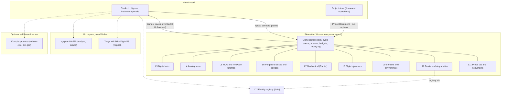
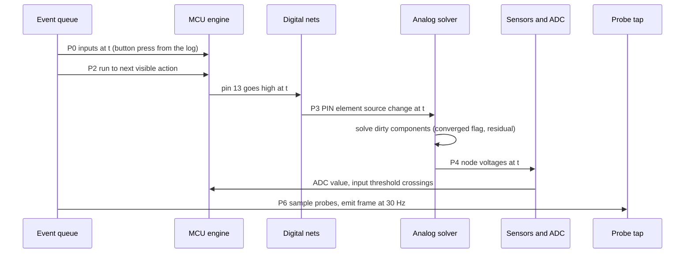

# Simulation architecture

Status: specification for the build, written 2026-10-27 for BRIEF section 10 (and the 20.3 fidelity registry, the 19.3 execution-placement question).
Author role: simulation architecture team. Output of one workflow step; later passes fold in spike results that were still running.
ADR range used: ADR-0300 to ADR-0315. Each is a full twelve-field file in [`ADR/`](ADR/) (`ADR/ADR-0300-*.md` to `ADR/ADR-0315-*.md`). ADR-0306 is a pointer to ADR-0013, the single record of the compile decision.

## 0. How to read this file

This file says how iynk simulates things: which layers exist, what each layer does today, what is missing, and the target design with interfaces. It is a specification. It names files, fields, units, limits and acceptance criteria. It does not plan around customers, markets, pricing or classrooms (D-013).

Labels: VERIFIED (read in code or reproduced), DOCUMENTED (a repo or spike document states it), EXTERNAL (a cited outside source states it), ESTIMATED (calculation or judgement, assumptions shown), HYPOTHESIS (a test is named), UNKNOWN (not found or not tested). "PENDING RS-xx" means the choice waits for a spike that had no verdict when this was written; the options and the decision rule are given.

Upstream (what this builds on):

| Source | Path | Used for |
|---|---|---|
| The assignment | `docs/MASTER_PLAN/BRIEF.md` sections 10, 19.3, 20.3 | scope |
| Decisions | `docs/MASTER_PLAN/00_EXECUTIVE/DECISION_REGISTER.md`: D-007, D-010, D-011, D-013 to D-017 | binding constraints |
| Audit | `01_AUDIT/inventory/interp.md`, `figure-engine.md`, `flight.md`, `drone-calc-lab.md`; `TECHNICAL_DEBT.md` A2, A5, A6, A12, A13, B2, B3, D2, D4, D5; `PERFORMANCE_BASELINE.md` | what exists |
| Research | `02_RESEARCH/TECHNICAL_RESEARCH.md` D1 to D3, D6, D7, section 6 spike table; `tech/simulation-options.md`; `00_EXECUTIVE/council/fidelity.md` (background) | options and licences |
| Spikes | `08_RESEARCH_SPIKES/RS-03`, `RS-06`, `RS-08`, `RS-12`, `RS-13` (`REPORT.md` each) | measured results |
| Product | `03_PRODUCT/FEATURE_CATALOGUE.md` (F-ids), `PRODUCT_REQUIREMENTS.md` (R-ids, BUD-, DET-, REF-) | feature and requirement ids |

Downstream: the ADRs in sections 1 and 20 (ADR-0300 to ADR-0315); features F-038 to F-056, F-097, F-098, F-185, F-203, F-208, F-209, F-213 to F-219; requirements R-041 to R-048, R-099 to R-117, R-FID-1 to R-FID-7; journeys J-05 (write and run code), J-06 (meet a simulated fault). Other architecture documents (project document, worker host protocol, operation log) are written by other authors; where this file needs a name from them it says "proposed" and gives the shape it relies on.

## 1. Summary of decisions

| ADR | Decision | Evidence | Status |
|---|---|---|---|
| ADR-0300 | One layered model. Every layer is a pure module with a typed interface. One orchestrator owns the clock and runs in a dedicated Worker. The UI never calls an engine directly. | A2 (logic is mostly decoupled already), F-203, D4 | Decided |
| ADR-0301 | One simulation clock: integer nanoseconds (`SimTime`), no wall-clock reads in any engine, a fixed order of events inside one timestamp. CPU engines keep their own cycle counters and convert with an exact rational rate. | `clock.ts` is microseconds as a float today; DET-5 | Decided |
| ADR-0302 | Four fidelity tiers T0 to T3 plus a separate "bench-checked" mark that is never named "validated". A project shows one tier per layer and a summary equal to the lowest. | D-007, council/fidelity.md section 7 | Decided |
| ADR-0303 | Determinism classes: B (bit-exact), N (numerically reproducible to a stated tolerance), D (display only). A deterministic math module `dmath` replaces `Math.sin/cos/atan2/exp/log/pow` on replay-critical paths if a cross-engine test passes. | A12: raw state drifts by 1 ulp across Node, Chromium, WebKit; RS-13 | Decided; adoption of `dmath` PENDING its own cross-browser test (SA-12) |
| ADR-0304 | Circuit solver: keep the MNA core, extract it as a pure module with a convergence flag, then add Newton devices and transient. ngspice WASM is an oracle and an on-demand "analyse" button, not the live engine. | RS-08 (a): 20 of 20 matched, 10 of 20 against realistic models; (b) not run | Extraction decided; transient engine PENDING RS-08(b) and RS-07 |
| ADR-0305 | MCU execution: the TypeScript interpreters stay the default path (T1). avr8js runs compiled Uno and Nano firmware as an opt-in mode in the worker (T3). rp2040js is a test oracle only in the first release. ESP32, STM32, Uno R4, Pi stay T1 or T0 and say so. | RS-03 PASS (desktop), RS-06 FAIL on CPU clause | Decided; avr8js device speed INCONCLUSIVE |
| ADR-0306 | Compile path for real firmware: decided in `ADR-0013` (the only record). This number is kept so existing citations resolve. | RS-04, RS-05, RS-17 have no verdict | PENDING RS-04, RS-05, RS-17 (see ADR-0013) |
| ADR-0307 | Peripheral buses are first-class models (I2C, SPI, UART, 1-Wire, PWM capture). A device is data plus an optional behaviour registered by id. No silent stubs: an unmodelled call returns a named "not modelled yet" diagnostic. | interp D4, R-109 | Decided |
| ADR-0308 | Rigid-body physics: Rapier deterministic build in the simulation worker behind a `PhysicsBackend` interface; Jolt stays the named fallback. The engine version is pinned in every replay record. | RS-13 PASS on determinism and speed, size undecided | Decided with a reversible interface |
| ADR-0309 | Flight dynamics: split `sim.ts` by craft class, keep the existing model as the labelled "flight game" (`flight-game@1`, T1), add a 6-DoF rigid-body model (`multirotor-rigid@1`) with a rotor ODE, rate-loop and IMU models as a second backend. A craft has one thrust source. | B3-09, B3-10, B3-11; DRONE ADR-0710 to ADR-0712 | Split decided; 6-DoF validation PENDING RS-14 |
| ADR-0310 | The fidelity registry is data under version control. Labels, the "What it models" panel and the CI oracle suite all read it. Nothing prints a tier that is not in the registry. | BRIEF 20.3, R-114 | Decided |
| ADR-0311 | Execution budgets and isolation: caps on heap, statements, cycles, output and traces enforced inside each engine; cooperative cancellation at every slice; `Worker.terminate()` after a 2 s grace. | interp D1, D2; BUD-12 | Decided |
| ADR-0312 | Snapshots, replay and divergence detection: replay is "seed + versions + input log"; a snapshot is a versioned blob per engine; a state hash is computed every 1,000 ms of simulated time and compared. | A12, DET-1 to DET-4 | Decided |
| ADR-0313 | Instrumentation reads through a probe tap. Every reading carries `provenance: 'computed' | 'approximation' | 'mocked'`, its tier and its model ids. | BRIEF 10.6 | Decided |
| ADR-0314 | Faults are operations on the model (change a value, open a connection, force a state), and failures are derived from solved quantities by rules that have derivation records. Every diagnosis uses the shared record `{cause_id, symptom_id, evidence, hint_level}`. | D-010, B3-11 | Decided |
| ADR-0315 | Verilog: the TypeScript 2-state cycle simulator stays the source of truth for checks. Yosys (YoWASP) plus DigitalJS is an optional "Inspect" mode, desktop first, loaded on request. | RS-12 PASS with memory and DigitalJS caveats | Decided |

The table is a summary. The binding text of each decision is its file in [`ADR/`](ADR/) (list in section 20). The compile decision has one record, `ADR-0013`; `ADR-0306` and `ADR-0427` point to it.

## 2. Objections

The decisions are binding and this file follows them. These are the places where the evidence says a decision or an acceptance line needs care.

1. **DET-2 as written is ambiguous and, for raw state, false today.** DET-2 asks for "identical hashes" in Chromium and WebKit. A12 measured that the 100 sampled `frameOf` hashes were equal in all three engines, but the raw simulation state differed from step 12 (Chromium) or step 1 (WebKit), because `Math.sin`, `cos`, `atan2` and `exp` differ in the last bit between engines (`TECHNICAL_DEBT.md` A12, VERIFIED, one macOS arm64 machine, Firefox not run). The requirement must say which hash. This file defines three classes (ADR-0303) and asks DET-2 to name one per test.
2. **REF-1 does not say which device model the 2 percent applies to.** RS-08 passes 20 of 20 when ngspice is given the solver's own piecewise-linear devices ("matched"), and 10 of 20 against ordinary exponential LED, diode and generic transistor models ("realistic", 6 of them off by more than 10 percent, worst 229.6 percent on a saturated 2N2222). The independent check corrected the spike verdict to "linear solve PASS, device-model fidelity FAIL, transient INCONCLUSIVE". REF-1 should name the flavour. Here the T1 gate uses "matched" and the T2 gate uses "realistic" with per-family tolerances (section 7.3).
3. **D-010 says the cause id list is closed; R-119 says cause ids are open strings.** Both cannot hold. Faults on user circuits (R-124) and custom parts (F-101) need new causes. This file treats the list as a registry with a closed core set shipped by the project and open extension ids (`x-` prefix), and asks the product documents to say the same.
4. **BUD-07 and R-100 assume a cost per tick that holds only for catalogue-sized circuits.** The measured solve is 0.04 ms on the largest of 79 catalogue circuits (14 nodes) and 0.088 ms in Node; dense elimination alone is 1.2 ms at n = 240 (RS-08). A 500-part project with an analog part count in the hundreds can leave that regime. The plan keeps the 1 ms per tick line but adds component partitioning and factorisation reuse (section 7.2) and a measured gate (SA-07), instead of assuming it.
5. **R-102 and BUD-07 speed lines were measured on one laptop.** avr8js ran at 6.1 to 7.5 times real time on an Apple M4 Pro, but the throttled main-thread proxy gave about 1.7 times at 4x and 1.1 times at 6x (RS-03; Workers cannot be throttled over CDP, so no throttled Worker number exists). rp2040js ran at 0.54 to 0.79 times on the same laptop. A "3 times real time on a Chromebook" line cannot be promised; this file makes slower-than-real-time a first-class, visible state (section 6.8).

## 3. The layer model

### 3.1 Picture



L1 (shared model and units) and L2 (clock and scheduling) are the orchestrator's own code, not boxes in the picture. L12 (replay and validation) is the replay log plus the registry plus the CI oracle suite.

### 3.2 Layer by layer: today, missing, target, disposition

"Disposition" follows BRIEF section 3.5: preserve working code until a replacement is measurably better. The word comes from the audit recommendation for that subsystem.

| # | Layer | What exists today (cited) | What is missing | Target (section) | Disposition |
|---|---|---|---|---|---|
| L1 | Shared model and units | No shared model. Interpreters use ms and microseconds (`src/lib/interp/clock.ts`), the solver uses volts, amps, ohms inside `B.*` globals (`figures/engine/bench-solve.js:10`), flight uses SI with degrees (`src/lib/flight/sim.ts:20`), the drone calculator uses grams, mm, kV (`src/lib/drone/calc.ts:151`). Circuits are strings inside a figure page, not a netlist (A5, VERIFIED). | A netlist independent of the drawing; one unit convention; open ids; a way to name a quantity with its unit and range. | 5.1 to 5.3 | Replace the input path (netlist from the project document); preserve the formulas |
| L2 | Event scheduling and clock | `VirtualClock`: microsecond float, sorted timer queue ordered by `(at, seq)`, no wall clock (`clock.ts`, VERIFIED, `interp.md` Determinism). Flight: fixed 100 Hz step counter, `STEP = 0.01` (`sim.ts:20`). Solver: no time. | One clock across digital, analog, MCU, mechanical, flight. Phases inside a timestamp. Integer time. | 5.4 to 5.6, 6 | Extend `clock.ts` into the orchestrator; keep the `(at, seq)` ordering rule |
| L3 | Digital signal engine | `World` pin state per pin `{ mode, out, duty, pwmHz, toneHz, servoUs, ext, volts, dac }`; PWM kept as duty and frequency, never as edges (`world.ts:166-300`, `interp.md`); floating inputs read noise from a shared RNG (`world.ts:235-245`). Verilog: 2-state cycle simulator (`verilog/sim.ts`). | Net-level resolution (several drivers, pull-ups, open drain, contention); edges for PWM; high-impedance and unknown. | 5.7 | Extend: `World` pin model becomes one driver on a `DigitalNet` |
| L4 | Analog and electrical solver | DC nodal solver with piecewise-linear parts, 431 lines, dense elimination, 12 element types, 40-round junction loop, silent exit on non-convergence (`bench-solve.js:15-37, 44-114, 213, 249-345`). Power tree and brown-out are rules in `bench.js` (~225-312). | Pure module with no globals; convergence report; C, L, PNP, MOSFET, Zener, op-amp, behavioural regulator; transient; per-board pin resistance (`PIN_R = 25` for every board, `:10`). | 7 | Replace for user circuits with a pure module seeded from this file; freeze the old one for catalogue figures until REF-1 passes (matches `PRODUCT_REQUIREMENTS.md` line 394) |
| L5 | MCU and firmware runtime | Three TypeScript interpreters (Arduino C++ subset, Python/MicroPython subset, Verilog 2-state), 11,822 source lines, 12 board profiles, flat cost per statement `opUs` (`profiles.ts:87-202`, `exec.ts:51-60`). No compiler, no emulator. | Real compiled firmware; cycle timing; debugger; memory accounting; worker run. | 8 | Extend (audit: "extend"); add avr8js as a second engine behind one interface |
| L6 | Peripheral protocol models | Register-level I2C devices (MPU-6050, PCA9685, SSD1306 subset, 1602, ACK-only generic) and HC-SR04 timing in `devices.ts`; I2C costs zero virtual time; `SPI.transfer` returns 0 silently (`libs.ts:779-790`); UART is a print sink (`interp.md`). | Bus timing, pull-ups, arbitration, NACK, SPI data, UART between devices, 1-Wire; device descriptions as data. | 9 | Extend `devices.ts`; fix the silent stub first |
| L7 | Mechanical and robotics dynamics | None. The Robotics Lab is 13 electronics benches (council/robotics-aero.md, VERIFIED by grep). The servo is a rule table (`bench-solve.js:121-123, 318-328`); the stepper is coil currents. | Rigid bodies, joints, wheels, friction, motors coupled to the electrical layer. | 10 | New (Rapier behind `PhysicsBackend`) |
| L8 | Flight dynamics | Point mass with kinematic Euler attitude, angle-lag controller, no sensors, fixed 100 Hz, semi-implicit Euler (`sim.ts:496-533, 630-631`); battery model with sag (`battery.ts:1-92`); faults as scripted flips (`sim.ts:513-590`). 96 tests. | Inertia, per-motor thrust and torque, rate-loop PID, IMU/baro/GPS models, real faults from dynamics. | 11 | Preserve as "flight game" (T1); new 6-DoF backend beside it |
| L9 | Sensors and environment | 11 `DeviceModel` kinds: button, switch, pot, divider, linear, tmp36, hc-sr04, mpu6050, qtr-rc, onboard, network (`src/content/schema.ts:304-315`, `lesson-world.ts`). Flight wind as two sines of the step counter (`sim.ts:292-301`). | Sensors from transfer functions with noise and range; an environment object (temperature, light, surfaces, obstacles, wind). | 12 | Extend `WorldModel`; keep the 11 kinds as built-ins |
| L10 | Faults and degradation | Threshold rules on solved values, latched in `st.burnt` (`bench-solve.js:301-345`); 144 board failures and 106 bench faults as content; flight faults as booleans (`types.ts:25-33`). | Faults on any circuit; failure as a distribution; derivation records; shared diagnosis record. | 13 | Preserve rules for the catalogue, re-express them as registry records |
| L11 | Observation and instrumentation | `Snapshot` at most 30 per simulated second (`run.ts:89`); `RunTrace` with pin edges capped at 20,000 (`world.ts:375`), serial lines, figure patches; bench status panel. No meter, scope, logic analyser, breakpoints. | Probe tap; instruments; provenance on every reading. | 14 | Extend `Snapshot` and `RunTrace`; add the tap |
| L12 | Replay and validation | Flight replay: `{step, action}` log re-simulated (`sim.ts:1008`); check runs on `RunTrace` (`checks.ts`); 189 interpreter tests and 126 figure-engine tests that mostly check self-consistency (A13). No oracle comparison in CI. | Replay for circuits and firmware; oracle suite; registry. | 15, 16 | Extend |

### 3.3 Dependency rules between layers

1. A layer imports only the shared types (`@iynk/sim-core`) and the layers below it in this list: L5 may call L3, L4 (through the orchestrator), L6; L4 may not call L5. The orchestrator is the only place where layers meet.
2. No layer imports React, the DOM, `@/components` or `@/content`. Today 28 type-only imports from `src/lib` into `@/components` and the content schema coupling (`world.ts:1`, `lesson-world.ts:9`, `headless.ts:5`) break this (A2, VERIFIED); the extraction removes them.
3. No layer reads `Date.now`, `performance.now`, `Math.random` or `crypto.getRandomValues`. The wall-clock read in `headless.ts:194` is the host budget checker and moves to the host side of the protocol (section 6.8). A lint rule (SA-11) enforces this for the folders listed in the package map.
4. Package map (proposed names, one folder each, tests next to code): `sim/core` (time, units, rng, dmath, hash, snapshot types), `sim/orchestrator`, `sim/digital`, `sim/analog`, `sim/mcu/{interp-arduino, interp-python, interp-verilog, avr, rp2040-oracle}`, `sim/bus`, `sim/mech`, `sim/ros`, `sim/flight`, `sim/env`, `sim/faults`, `sim/probe`, `sim/registry`.

## 4. Fidelity tiers

### 4.1 Definitions

BRIEF 10.2 names three tiers. The council memo uses four (T0 to T3) and F-011 already uses that numbering, so the numbering is kept. T0 is not a simulation tier; it exists so that scripted behaviour is labelled for what it is.

| Tier | Name | BRIEF term | Entry bar (enforced by registry validation, section 16.3) | Label shown |
|---|---|---|---|---|
| T0 | Illustration | (none; the "visual animation" the brief warns about) | None. Scripted outcome. | "Illustration. Not a calculation." |
| T1 | Teaching model | Educational approximation | Stated list of what it models and does not; deterministic; fails loudly outside its subset; at least one registry test | "Teaching model" |
| T2 | Calculated model | Component behavioural simulation | T1 plus: parameters with cited sources, tolerance bands, a convergence report, and a comparison with an independent engine inside a stated error on a named corpus | "Calculated. Within X percent of ngspice on N circuits" (numbers from the registry) |
| T3 | Runs your firmware | Firmware or hardware-target simulation | A real compiled binary on an emulator that models the CPU and the peripherals the program uses; unsupported peripherals fail loudly | "Runs your compiled firmware" |
| mark | Checked on a real board | (validation, BRIEF 20.2) | Bench data with source, conditions and error table in the registry (F-184) | "Measured on hardware: see the error table". The word "validated" is never printed (D-007) |

Rules:

1. A project shows one tier chip per layer it uses (execution, circuit, protocols, mechanics) and a summary equal to the lowest. Example: an Uno project in Firmware mode with LED and resistor shows "Execution T3, Circuit T1, Summary T1" until the LED model reaches T2. This avoids the problem that a T3 CPU beside a T1 circuit would otherwise print a flattering word.
2. Failing loudly beats guessing. Anything not modelled returns `ModelStatus = 'not-modelled-yet'` with a reason; no number is produced for it (R-099, R-FID-3).
3. Numbers from a model are shown as ranges where tolerance matters (R-FID-6). Exact quantities (a counter value, a serial line) are shown exactly.
4. The simulator never issues a positive safety statement. It reports what it modelled.
5. Words banned unless the registry entry supports them: "accurate", "exact", "realistic physics", "hardware-accurate", "safe to build", "validated".

### 4.2 What sits in which tier at the first release

"First release" here means the end of the simulation-fidelity build phase of D-014, not the first public tag.

**Boards and execution (all 12 board profiles, `src/lib/interp/profiles.ts:236-262`)**

| Board | Default execution | Tier | Optional higher mode | Realistic at the default | Mocked or absent | Basis |
|---|---|---|---|---|---|---|
| Arduino Uno R3 | TypeScript Arduino subset interpreter | T1 | avr8js, compiled firmware, in the worker (T3) | Pin logic, `delay`, `millis`, serial text, Servo, `analogWrite` duty, I2C devices that exist as models | Registers, timers, SRAM size, ISR latency, libraries outside the subset; `digitalWrite` costs 1 us where hardware is about 3.4 to 4 us (council/fidelity.md, forum figures, EXTERNAL) | RS-03: serial text equal on 80 of 80 lines, duty within 0.4 points |
| Arduino Nano | same | T1 | same (ATmega328P) | same | same | same chip |
| Uno R4 Minima and WiFi | interpreter, profile `opUs 0.4` | T1 | none | logic only | Renesas RA4M1 peripherals, Wi-Fi, LED matrix timing | no browser engine found (TECHNICAL_RESEARCH D1) |
| ESP32 DevKitC, ESP32-S3 | interpreter | T1 | none | logic, Wi-Fi scan and a fake web table | Wi-Fi stack, FreeRTOS, dual core, GPIO matrix, strapping pins | Espressif QEMU lacks Wi-Fi, I2C, general SPI and the GPIO matrix (EXTERNAL); RS-19 not run |
| NodeMCU (ESP8266) | interpreter | T1 | none | logic | Wi-Fi stack | no maintained engine |
| Raspberry Pi Pico, W, 2 | TypeScript MicroPython subset | T1 | rp2040js with stock MicroPython: test oracle only (REF-7) | pin, ADC, I2C (stub or model), Timer on the virtual clock | `machine.SPI`, `UART`, PIO, `json`, `os`; Pico 2 (RP2350) has no engine | RS-06: all four features work but 0.54 to 0.79 times real time on an M4 Pro |
| Nucleo F401RE | interpreter, "HAL level" | T1 | none | logic | every peripheral register, DMA | no engine |
| micro:bit V2 | TypeScript micro:bit runtime | T1 | none at first release | 5x5 matrix, buttons, radio mock | nRF52833 peripherals | self-hosted Foundation simulator is PENDING RS-18 |
| Raspberry Pi 4, 5 | TypeScript Python with `gpiozero`, `rclpy` mocks | T1 | none | GPIO API shapes | No operating system, no kernel, no DDS: labelled "Raspberry Pi API mock, not a Raspberry Pi OS" | BRIEF 10.2 |
| Basys 3, DE10-Lite | TypeScript Verilog 2-state cycle simulator | T1 | Inspect mode: Yosys elaboration plus DigitalJS netlist view (a view, not a simulation tier) | clocked synchronous designs in a 32-bit subset | 4-state, delays, `function`, `generate`, memories, timing, bitstreams | RS-12: 10 of 10 reference designs elaborate; DigitalJS needs init patching |

**Languages**

| Language | Where it runs | Tier |
|---|---|---|
| Arduino C++ (subset: no class, template, pointer; conditionals only for include guards and object-like macros, section 8.3 item 8) | interpreter, on every board that lists `arduino` in `languages` (Uno, Nano, R4, ESP32, ESP32-S3, NodeMCU, Nucleo) | T1; shown as "Arduino C++ subset", never "Arduino toolchain" |
| C and C++ for AVR (full compiler) | avr-gcc output on avr8js | T3, opt-in; libraries run as real code |
| MicroPython (subset) | interpreter, Pico and micro:bit | T1 |
| Python 3 (subset, `gpiozero`, `rclpy` mocks) | interpreter, Pi | T1 |
| Compiled embedded C/C++ for ESP32, STM32, Pico, R4 (a real toolchain and a chip emulator) | not supported | none; "not available". An Arduino sketch for these boards is not this row: it runs in the interpreter row above |
| Verilog (2-state, 32-bit, synchronous subset) | interpreter | T1; "not hardware-equivalent FPGA behaviour" |
| SystemVerilog | Yosys `-sv` elaboration only (Inspect mode); no simulation | structure view |
| Arduino libraries | registry of hand-written library models (T1); real libraries only on AVR firmware mode | T1 or T3 |

**Parts and models (first entries are in section 16.5)**

| Model | Tier at first release | Reason |
|---|---|---|
| Resistor, potentiometer, battery and rail with internal resistance, linear dividers | T2 once SA-03 passes | Resistive circuits (C01-C05, C18, C19) and 60 random networks, 67 in all: worst relative difference 7e-12 on the seven hand-made circuits (C01, RS-08 section 1) and 8.7e-13 on the random networks (RS-08 section 2), VERIFIED. The other 13 hand-made circuits match to 2 percent only with the solver's own piecewise-linear device models (worst 0.26 percent, C15) |
| LED, signal diode, 1N4007, NPN (2N2222, TIP120) | T1 (piecewise-linear) | RS-08 realistic models: LED at 0.3 mA 12.5 percent, 1N4007 12.3 percent, TIP120 base 20.8 percent, saturated 2N2222 Vce 229.6 percent off. T2 after Shockley and Ebers-Moll Newton devices pass the realistic corpus (section 7.3) |
| DC motor (steady-state), servo, buzzer, stepper coils, TMP36 chip | T1 | Rule tables and steady-state curves (`bench-solve.js:121-123, 243-247`) |
| DC motor with gearbox, inertia and back-EMF, driven by PWM through the closed form per PWM cycle (`MOTOR` element, `cycle` mode, section 7.2) | T1 | Prototype within 0.14 to 0.52 percent of a 5 microsecond reference in slow-decay and coast modes (ROBOTICS 7.4, VERIFIED as a prototype in scratch); no hardware check |
| Regulators, USB limit, brown-out | T1 once behavioural elements replace the rule path (section 7.6); T0 to T1 today | `bench.js` rules, `ilim` constant, 0.6 s sag times 0.42 |
| Capacitor, inductor, PNP, MOSFET, op-amp, Zener | not modelled yet until the transient and device slices land | no element type exists |
| Sensors in `DeviceModel` | T1 | datasheet nominal functions, no noise or tolerance |
| I2C devices (MPU-6050, PCA9685, SSD1306, LCD1602; BME280 added by section 9.2.1) | T1 functional | zero bus time until SA-09 |
| SPI, UART to a second device, 1-Wire | not modelled yet (fail loudly) | today a silent stub (interp D4) |
| Drone calculator | T1 (13 regressions) | B3-01 |
| Flight game | T1 | tuned to feel right (`types.ts:93` comment) |
| Flight faults | T0 | scripted outcomes (B3-11) |
| Raspberry Pi 5 ROS 2 concept bench | T0 | text only, no nodes |

### 4.3 Where open-source engines are adopted, by spike

| Engine | Spike result (cited) | Decision | What would reverse it |
|---|---|---|---|
| avr8js 0.21.1, MIT | RS-03: serial text equal on 80 of 80 lines; duty within 0.4 points over 53 samples; blink period within 0.14 ms; 6.1 to 7.5 times real time on an M4 Pro in Node, Chromium and WebKit; main-thread throttle proxy 1.7 times at 4x and 1.1 times at 6x; phone and Chromebook not tested (INCONCLUSIVE on devices) | Adopt as the opt-in T3 mode for Uno and Nano. The interpreter stays the default and the instant path. The mode shows "running slower than real time" when it is | A real Chromebook run below 1 times real time on the lesson set, or an adapter cost above 4 person-weeks, demotes the mode to desktop-only. REF-2 stays in CI either way |
| rp2040js 1.4.1, MIT | RS-06: boot to REPL in 15.1 ms simulated; blink, ADC, LittleFS (after a 30-line flash hook) and I2C (after a GPIO-level model for `scan`) work; 0.54 to 0.79 times real time, 100 percent of one core, 0.13 to 0.19 times under 4x to 6x throttle; Pass clause "under 60 percent of a core" missed | Not a user mode in the first release. Used as a differential oracle for the Pico interpreter (REF-7) | Profiling shows an idle-skip hook on MicroPython's poll loop is possible (core was idle-waiting 4 percent of instructions, so the opportunity is untested) and a throttled run reaches 1 times real time |
| In-house MNA versus ngspice-45.2 (via `eecircuit-engine` 1.9.0) | RS-08 (a): matched models 20 of 20 within 2 percent, worst 0.26 percent; 60 random resistor networks 0 mismatches; realistic models 10 of 20 within 2 percent; largest catalogue circuit 0.45 ms per solve at 6x throttle. (b) transient not run | Keep and extract the MNA core; add Newton devices for T2; ngspice is the oracle and an on-demand analysis | RS-08(b) fail (more than 1 percent from ngspice or over 16 ms per frame) sends transient to ngspice for user-visible waveforms, as `TECHNICAL_RESEARCH.md` section 6 says |
| Yosys 0.70 (YoWASP 0.71.188-dev.1267) plus DigitalJS 0.14.2 | RS-12: 10 of 10 reference designs elaborate; 13 to 29 ms warm; 12.5 MB over the wire with Brotli q9 (79.7 MB raw); 662 to 725 MB renderer memory; DigitalJS needed hand-patched initial values to match on the blink design and is about 50 times slower than the interpreter | Inspect mode only, on request, desktop first, refused when `navigator.deviceMemory` reports 4 GB or less and never loaded without an explicit click when the property is undefined (Safari, Firefox; section 8.6, R-110). The TypeScript simulator keeps running tests | A real-device run showing the memory fails on mainstream machines removes it from the client; a server-side Yosys run in the compile process is the fallback |
| Rapier 0.21.0 deterministic build (Apache-2.0) | RS-13: identical 16-hex-digit snapshot hash after 10,000 steps in Node, Chromium and WebKit, also under 4x and 6x throttle; 20 bodies in 0.07 to 0.09 ms per step (0.44 to 0.54 ms at 6x); first step stalls 24 to 27 ms; split build about 0.88 MB brotli | Default physics backend. Jolt 1.1.1 (0.61 MB brotli, no first-step stall) stays behind the same interface | Firefox or x86-64 hash mismatch; a size budget below 0.88 MB |

### 4.4 User-facing honesty labels

Strings live in the i18n files under a `fidelity` namespace; the English text is fixed here so translators have the source.

| Where | Text (English) | Source of truth |
|---|---|---|
| Tier chip, T0 | "Illustration. Not a calculation." | tier |
| Tier chip, T1 | "Teaching model" | tier |
| Tier chip, T2 | "Calculated model" plus a tooltip "Within {pct} percent of ngspice on {n} circuits ({date})" | registry `validation[].result` |
| Tier chip, T3 | "Runs your compiled firmware" plus "Peripherals not listed in the panel are not modelled" | tier |
| "What it models" panel | Three lists per layer: Modelled, Mocked, Not modelled yet. Each line links to a registry entry | registry `implements`, `mocked`, `unsupported` |
| Interpreter banner | "Your code runs in iynk's built-in interpreter, a teaching subset of {language}. It is not running on a chip." | language entry |
| Unsupported construct | "{construct} is not supported by the interpreter. Real {board} code can use it." (names the line, offers Firmware mode when available) | `InterpError` kind `unsupported` |
| Unmodelled part | "{part} is not modelled yet. The rest of the circuit still runs." | `ModelStatus` |
| Wi-Fi | "Wi-Fi is mocked: a scan list and a fixed 1.2 s connect." | mocked list |
| Slower than real time | "Running at {x} times real time on this device." | orchestrator `speed` report |
| A reading | "{value} {unit}, {tier}, computed from {model}" or "approximate, {why}" | probe provenance |
| Bench-checked | "Measured on hardware: {n} circuits, error table" only when `validation.kind = 'bench'` exists | registry |
| Not checked | "Not checked against a reference." | registry entry with empty `validation` |

## 5. Shared model, units, clock, scheduling and digital signals (layers L1, L2, L3)

### 5.1 Units and quantities

Every number inside `sim/*` is in SI base units, stored as a JavaScript `number`. Field names carry the unit so a wrong unit is visible in review.

| Quantity | Field suffix | Unit | Allowed range at the document boundary | Notes |
|---|---|---|---|---|
| Voltage | `volts` | V | -1000 to 1000 | |
| Current | `amps` | A | -1000 to 1000 | |
| Resistance | `ohms` | ohm | 1e-6 to 1e12 | 0 is rejected with "use a wire"; a zero-ohm part is a net merge |
| Capacitance | `farads` | F | 1e-15 to 10 | |
| Inductance | `henries` | H | 1e-9 to 100 | |
| Frequency | `hz` | Hz | 0 to 1e9 | |
| Time | `ns` | ns | integer 0 to 2^53 | the only time unit inside the engines |
| Temperature | `celsius` | degC | -273.15 to 2000 | |
| Length, mass, force, torque | `metres`, `kg`, `newtons`, `newtonMetres` | | positive finite | |
| Angle, rate | `radians`, `radPerS` | | finite | documents may show degrees with a `deg` suffix; conversion happens once, at the boundary |

Rules:

1. `parseQuantity(text, dimension)` returns `{ ok: true, value } | { ok: false, reason }`. It accepts SI prefixes `p n u m k M G`, the micro sign, and the "4k7" and "2R2" forms. It rejects NaN, infinity and out-of-range values with a message that names the field. This closes B3-03, where `calc` returns Infinity for `mah = 0` (`src/lib/drone/calc.ts:151-230`, VERIFIED).
2. Tolerance is data: `{ nominal: number; tol?: { kind: 'pct' | 'abs'; value: number }; dist?: 'uniform' | 'normal3' }`. A run has `toleranceMode: 'nominal' | 'seeded' | 'corners'`. `seeded` draws each part's value once at load from stream `tol:<partId>` (section 6.5). `corners` solves the 2^k extreme combinations for at most k = 6 parts and reports a band; more parts fall back to seeded Monte Carlo with 32 draws.
3. Identifiers are open strings (`PartId`, `NetId`, `PinRef = { part: PartId; pin: string }`), validated by length (at most 64 characters) and a character set (`[A-Za-z0-9_.:-]`). Registry ids look like `part:resistor@1`, `model:led.pwl@1`, `engine:mna-dc@1`.

### 5.2 The netlist the simulator consumes

The project core (F-076, F-078; written elsewhere) derives the netlist from stored connections. The simulator never reads layout (x, y, rotation), so a wire's drawing can never change a solve. The shape this file relies on (proposed):

```ts
export interface SimNetlist {
  version: 1;
  docHash: string;                   // canonical document hash (R-026)
  nets: { id: NetId; name?: string }[];
  ground: NetId;
  parts: SimPart[];
  settings: SimSettings;
}
export interface SimPart {
  id: PartId;
  descriptor: string;                // registry id, for example "part:led@1"
  params: Record<string, number | string | boolean>;
  pins: Record<string, NetId | null>; // null = unconnected
  faults?: FaultState[];             // applied by operations, section 13
}
export interface SimSettings {
  seed: number;                      // uint32, default 0x2545f491 (the value in world.ts today)
  toleranceMode: 'nominal' | 'seeded' | 'corners';
  analog: { mode: 'dc-event' | 'transient'; stepNs: number };  // stepNs 100..100000, default 1000
  mech: { stepRate: ClockRate };     // default 240 Hz
  flight: { stepRate: ClockRate };   // default 100 Hz game model, 1000 Hz rigid body
  speed: number;                     // 0.01..100, or 0 for as fast as possible
}
```

Today the same information is `MD.circuits[id]` compiled into a figure page (`bench.js:479`, `bench-bb.js:136`) and `WorldInput.pins` per lesson (`interp.md`). The catalogue converter (F-077) turns each of the 38 catalogue items into a `SimNetlist`; REF-3 uses them as the regression corpus.

**Model id format (stated once).** A model id is `[<namespace>:]<name>@<major>`, for example `model:led.pwl@1`, `engine:avr@1`, `flight-game@1`, `multirotor-rigid@1`. The id is the registry key (16.2), the value of `FlightModel.id`, and the key in `ReplayRecord.versions.models`. The full semver of that model is the value: `versions.models['multirotor-rigid@1'] = '1.0.0'`. The major in the id changes only when older replay records can no longer be replayed; a minor or patch change changes the value only. The two flight models carry no namespace because DRONE 5.3 already stores `flight-game@1` and `multirotor-rigid@1` in the project document (`DroneData.flight.model`). DRONE 11.1 must write the key with the `@1` (`versions.models['multirotor-rigid@1']`), not the bare name. The registry build rejects a key that has no `@<major>` (16.3 rule 6).

### 5.3 Domain classification of nets

At load, a pass classifies each net:

- `digital`: every attached pin is a logic pin or a digital part pin, and the only passive elements are ideal pull-ups declared as pin parameters (an internal pull-up, or a part's `pullup: true`).
- `analog`: any other net. Analog nets are solved by L4. Their voltage is compared with the board's input thresholds (`VIL`, `VIH` in the board profile) to feed L3 and L5.

A net with a resistor to a pin is analog. This is slower than the digital shortcut but correct, and the corpus of catalogue circuits is small enough (median 2 parts, largest 9 parts, `PERFORMANCE_BASELINE.md` section 4) that the shortcut matters only for large projects (section 7.2).

### 5.4 Simulation time

```ts
export type SimTime = number;            // integer nanoseconds since run start, 0..2^53 (about 104 days)
export interface ClockRate { num: number; den: number }   // nanoseconds per tick = num/den, reduced

export function cyclesToNs(cycles: number, rate: ClockRate): SimTime;   // floor(cycles*num/den), exact
export function nsToCycles(ns: SimTime, rate: ClockRate): number;       // ceil, so a deadline is never missed
```

`cyclesToNs` multiplies and divides in `number` when `cycles * num < 2^53`, otherwise in `BigInt`. All rates are reduced by their greatest common divisor at construction. Examples:

| Source | Frequency | `ClockRate` | Exact? |
|---|---|---|---|
| ATmega328P at 16 MHz | 16,000,000 | `{ num: 125, den: 2 }` (62.5 ns per cycle) | yes |
| RP2040 at 125 MHz | 125,000,000 | `{ num: 8, den: 1 }` | yes |
| ESP32 at 240 MHz | 240,000,000 | `{ num: 25, den: 6 }` | yes |
| Mechanical step at 240 Hz | 240 | `{ num: 25_000_000, den: 6 }` | yes |
| Flight game step at 100 Hz | 100 | `{ num: 10_000_000, den: 1 }` | yes |
| Analog step, default | 1,000,000 | `{ num: 1000, den: 1 }` (1 us) | yes |

An engine that counts cycles keeps its own integer cycle counter. It reports an event at `cyclesToNs(cycles, rate)`. The sub-nanosecond remainder is not lost: it is recomputed from the cycle counter every time, so there is no accumulated rounding. A run of 104 days of simulated time is the ceiling; the orchestrator halts with `time-limit` before overflow (the default run limit is 24 simulated hours).

**Migration of the existing clock.** `VirtualClock.now` is a microsecond float and the per-statement cost is `opUs` (`profiles.ts:87-202`). The exact conversion to `opNs` is: Uno R3 and Nano 1000, Uno R4 400, ESP32 and ESP32-S3 100, NodeMCU 250, Nucleo 250, Pico 4000, micro:bit 6000, Pi 50, FPGA boards 0 (VERIFIED from `profiles.ts` by grep). All integers, so the migration is lossless. Timers keep their `(at, seq)` ordering. Snapshots to the host stay in milliseconds as floats (`Snapshot.t`, `world.ts:40-62`), converted at the edge.

### 5.5 Event queue and ordering inside one timestamp

```ts
export type Phase = 0 | 1 | 2 | 3 | 4 | 5 | 6;
export interface SimEvent {
  at: SimTime;
  phase: Phase;
  rank: number;            // engine rank, fixed table below
  seq: number;             // assigned at enqueue, strictly increasing
  src: string;             // engine id or "host"
  kind: string;
  payload: unknown;        // structured-clone safe
}
```

The total order is `(at, phase, rank, seq)`. `seq` is deterministic because enqueue order is deterministic (the orchestrator is single-threaded and engines are called in a fixed order).

| Phase | Name | What runs | Why here |
|---|---|---|---|
| P0 | Inputs | host inputs from the replay log (button, pot, fault operations, serial bytes), timers whose purpose is an input | Inputs are the only thing outside the model; everything else follows |
| P1 | Environment | environment and sensor transfer functions refresh (temperature, light, wind schedule) | Sensors must read the world as it is at `at` |
| P2 | Drive | MCU engines run up to their next externally visible action; digital drivers update; bus masters start transactions; ROS timers and callbacks run (after the MCU engines, rank 35) | Outputs are decided here |
| P3 | Resolve | digital nets resolve; analog sources update; the analog solve runs if anything it depends on changed | Voltages follow drivers in the same timestamp |
| P4 | Sample | ADC and comparator sampling, digital input threshold reads, bus devices respond, sensors read | Reads see the P3 result: zero lag in event mode |
| P5 | Dynamics | mechanical and flight engines take their step | They use the currents from P3 |
| P6 | Observe | probes, instruments, snapshot emission, check evaluation | Observers never change state |

Rank (tie-break inside a phase): digital 10, analog 20, mcu 30 (by registration order, then engine id), ros 35 (by node registration order, then node name), bus 40, mech 50, flight 60, env 70, faults 80, probe 90. The table is part of the replay record version.

ROS ordering (ROBOTICS 11.2): a ROS timer fires at `n * period` exactly in nanoseconds, at P2 rank 35, so it always runs after every MCU engine event of the same timestamp and before any bus event. A publish at `at` enqueues one delivery per subscription with the same `at`, phase P2, rank 35 and the next `seq`, so publish-to-subscribe delivery is same-timestamp and ordered by `seq`. Because the order is total, RA-16 (messages at exact multiples of 100,000,000 ns, ten runs identical) is decidable.

The queue is a binary min-heap keyed on the tuple. The present sorted-array queue with `splice` (`clock.ts:17-24`) is adequate for lesson timers; avr8js produces 780 to 980 pin events per simulated second per PWM pin (RS-03), which a heap handles without change in behaviour. The queue is capped at 1,000,000 pending events; overflow halts the run with `event-queue-overflow`.

### 5.6 The orchestrator loop and cross-domain coupling

```ts
export interface Orchestrator {
  load(net: SimNetlist, opts: RunOptions): LoadResult;           // validates, builds engines, returns diagnostics
  runUntil(target: SimTime, budget: SliceBudget): SliceResult;   // never reads a wall clock
  step(unit: StepUnit, n: number): SliceResult;
  inject(input: HostInput): void;                                // appended to the log at current time
  snapshot(): OrchestratorSnapshot;
  restore(s: OrchestratorSnapshot): void;
  readonly now: SimTime;
  readonly state: 'idle' | 'running' | 'paused' | 'halted' | 'done';
}
export type StepUnit = 'ns' | 'event' | 'cycle' | 'line' | 'statement';
export interface SliceBudget { shouldYield(): boolean; work: WorkLimits }   // shouldYield is supplied by the host
```

Loop, per call to `runUntil`:

```
while now < target:
  horizon = min(target, min over engines of engine.nextDue(), queue.peekTime())
  advance engines that free-run (mcu, mech, flight) to horizon, each stopping early at its next
    externally visible action (pin write, bus start, ADC start); an early stop becomes an event
  pop every event whose time == next time, in (phase, rank, seq) order, and call engine.onEvent
  if shouldYield() or work limit reached: return { reason: 'budget' }
```

An MCU engine stops at each "externally visible action" so that the circuit sees a pin write at its own timestamp, not at the end of a batch. For avr8js the host owns the instruction loop (`avrInstruction(cpu)` and `cpu.tick()`, as RS-03's harness did), so the stop is a flag checked after each instruction. For the interpreters the stop is the existing yield at `delay` or at an I/O call.

Coupling table. "Lag" is how stale the data one engine reads from another can be.

| From to | Data | Lag | Rule |
|---|---|---|---|
| MCU to digital net | pin mode, level | 0 (same timestamp, P2 then P3) | pin write at `t` is visible to analog at `t` |
| Digital net to analog | pin as a Thevenin source (`Vhigh` behind `rPin`, or open) | 0 | PIN element source change; `rPin` from the board profile, not the constant 25 ohm (defect 3 of `figure-engine.md`) |
| Analog to MCU digital input | Schmitt threshold on node voltage | 0 in `dc-event`; at most one analog step in `transient` | thresholds `VIL`, `VIH`, hysteresis in the board descriptor |
| Analog to ADC | node voltage at conversion start | at most one analog step | conversion value is `min(1023, floor(V * 1024 / Vref))` (the datasheet form that avr8js uses; the interpreter's `round(V / Vref * 1023)` differs by up to one count, RS-03 caveat); the interpreter changes to the same formula |
| Analog to mechanical (motor) | cycle-average armature current `i_avg` for the step, from the closed form per PWM cycle in the `MOTOR` element (`PWM.mode = 'cycle'`, ROBOTICS 7.4); for DC drive `i = (V - vdrop_v - ke * w_m) / R` | at most one mechanical step (4.17 ms) | shaft torque `kt * (i_avg - i0_a * sign(w_m))`, times `gear.ratio * gear.efficiency`, applied as a torque impulse over the step (10.4) |
| Mechanical to analog | motor shaft speed `w_m = gear.ratio * w_out` | at most one mechanical step | back-EMF source `ke * w_m`, held constant inside each PWM cycle and each solve |
| ROS publisher to subscriber | message | 0 (same timestamp, next `seq`) | rank 35, section 5.5 |
| Mechanical or flight to sensors | encoder counts, IMU, range | read at P4 from the last step | |
| Faults to anything | state change | applied at P0 only | faults are inputs and appear in the replay log |

**Motor coupling rules (the single statement; ROBOTICS 7.2 and 7.4 are the detail).**

1. A `MOTOR` element on a net driven by `PWM` uses `mode: 'cycle'` by default. It integrates each PWM cycle in closed form, with the decay mode (`slow`, `fast` or `coast`) and `vdrop_v` taken from `MotorElectrical` (section 7.2). Duty-averaged voltage (`averaged`) is wrong for a motor in coast mode: 13 to 39 percent low at 25 to 75 percent duty in the ROBOTICS prototype (RA-10 makes it a test).
2. The algebraic armature `i = (V - vdrop_v - ke * w_m) / R` is only the DC fallback. It is used when the waveform has no edges in the step, when `l_henry` is 0 (not given), and for DC drive when `L / R` is below twice the mechanical step, so the one-step lag cannot make the electrical loop oscillate. It is never used in place of the cycle form for chopped drive.
3. Stability criterion, stated once: the explicit coupling with a lag of one mechanical step `h` is stable when `h * c < 2`, where `c = (kt * ke / R + b) / J` is the inverse of the electromechanical time constant (`b = b_nms_per_rad`, `J = j_kgm2`). The loader rejects a motor with `h * c >= 1` as `RB-E-COUPLING` (a margin of 2 against the bound; ROBOTICS 7.2, RA-12). Example from ROBOTICS 7.2: `c = 9.6` per second at `h = 1/240` s gives `h * c = 0.04` (VERIFIED arithmetic in `motor.mjs`).

### 5.7 Digital signal engine

```ts
export type Logic = 0 | 1 | 'Z' | 'X';
export interface PinDriver { id: string; level: Logic; strength: 'strong' | 'weak' | 'none'; rOutOhms?: number }
export interface DigitalNet { id: NetId; drivers: PinDriver[]; value: Logic; changedAt: SimTime }
export function resolve(drivers: PinDriver[]): Logic;
```

Resolution: no strong or weak driver gives `Z`; strong drivers that disagree give `X` and raise the diagnostic `output-contention` (the cause id for two outputs driven against each other); strong beats weak; two weak drivers that disagree give `X`. `Z` read by a digital input yields a pseudo-random but deterministic level only if the pin is declared floating-noisy (see below); otherwise `X` and a `floating-input` diagnostic.

Floating-input noise today comes from one shared xorshift32 stream, so adding one extra read of an unconnected pin changes all later noise (`world.ts:235-245`, VERIFIED). The new rule uses a stream per pin (`noise:<pin>`), so reads do not affect each other.

PWM: an interpreter reports `{ duty, hz }` for a pin. The digital engine can synthesize edges when an observer needs them: rising edge of cycle `k` at `floor(k * 1e9 / hz)`, falling at that time plus `round(duty * 1e9 / hz)`. In the analog domain a PWM source has three modes (`PWM.mode`, section 7.2). `averaged`: solve per duty slice and time-average, which is what `bench-solve.js:251-257` does and is correct for resistive loads only. `edge`: explicit edges in `transient`, chosen when the net has a C or L that is not part of a motor. `cycle`: closed form per PWM cycle (ROBOTICS 7.4), the default whenever a `MOTOR` element loads the net. The mode is chosen once at load from the loads on the net, so it is deterministic. In T3 the timer peripheral produces real edges (RS-03: Timer0 976 Hz, Timer1 490 Hz on the lesson sketches).

Verilog designs run in their own 2-state engine and expose ports as `DigitalNet` drivers at the board pins (`Snapshot.ports`, `duty` in `world.ts:40-62`).

## 6. Determinism specification (BRIEF 10.3)

The goal, from BRIEF 10.3: the same model versions, inputs and seed give reproducible results within defined numerical tolerances. This section defines "same", "reproducible" and "tolerance" so a test can decide.

### 6.1 Invariants

1. **One clock.** All simulated time is `SimTime` (section 5.4). No engine reads `Date.now`, `performance.now`, `Math.random`, `crypto.getRandomValues` or `new Date`. Today this holds in `src/lib/interp` and `src/lib/flight` except the host budget check at `headless.ts:194` and the UTC-day pick in `challenge.ts:27,33` (VERIFIED by grep in the audit).
2. **One order.** Events are ordered by `(at, phase, rank, seq)` (section 5.5).
3. **One seed.** `settings.seed` plus a stream name gives every random number (section 6.5).
4. **Inputs are data.** Anything from outside the model (a click, a slider, a fault) is an `InputEntry` with a `SimTime` and goes through the log (section 6.7).
5. **Versions are part of the input.** The replay record pins the engine versions, the registry model versions and the `dmath` version (section 6.9).
6. **Wall time is a host concern.** Pacing, budgets and "behind real time" are decided by the host, outside the engines, and change only how much simulated time is requested per call, never what the engines compute for a given simulated time.

### 6.2 Time-step policies

| Layer | Policy | Default | Allowed range | Why |
|---|---|---|---|---|
| Digital, MCU interpreter | event-driven; time advances by `opNs` per statement and by `delay`, timers and bus costs | board `opNs` | n/a | matches the present clock |
| MCU avr8js | cycle-driven in batches that stop at externally visible actions | 62.5 ns per cycle at 16 MHz | n/a | cycle-exact CPU |
| Analog, circuits without C or L | `dc-event`: solve when a source, switch, fault or parameter changes; hold between solves | n/a | n/a | the present behaviour; cost only when something changes |
| Analog, circuits with C or L | `transient`: fixed step `h` | 1000 ns | 100 ns to 100,000 ns | RS-08(b) rule is stated at 1 us |
| Analog, Newton failure | halve `h` for that solve, at most 8 halvings, then report non-convergence | | | the halving depends only on state, so it is deterministic |
| Mechanical | fixed step, one sub-step | 1/240 s, `{ num: 25_000_000, den: 6 }` | 1/60 to 1/1000 s | the step used in RS-13 (hashes verified at 1/240) |
| Flight game | fixed step | 10 ms | fixed | `STEP = 0.01` (`sim.ts:20`) |
| Flight rigid body | fixed step | 1 ms | 0.5 to 2 ms | rate loops at 1 kHz; ESTIMATED cost a few microseconds per step (the game model costs 0.5 to 0.63 microseconds per step, `PERFORMANCE_BASELINE.md` section 5) |
| Thermal | fixed step | 10 ms | 1 ms to 1 s | slow dynamics |
| Sensors, environment | sampled at P1 and P4 on their own period | per sensor | | |

The step size never depends on wall time. A slow device runs fewer steps per frame, so it shows slow motion, which is what `advance()` does for flight today (`sim.ts:327-336`, clamp 0.1 s).

### 6.3 Integration methods

| Domain | Method | Notes |
|---|---|---|
| Analog linear and reactive elements | Trapezoidal companion models; backward Euler for the first step after any discontinuity and after a detected ringing event | trapezoidal is A-stable but can ring after a switch; the standard fix is one backward-Euler step (HYPOTHESIS that this suffices for the buck case; tested in SA-05) |
| Analog nonlinear devices | Newton-Raphson with junction-voltage limiting; damping factor 0.5 on a residual increase; `gmin` stepping then source stepping as fallbacks | section 7.5 |
| Mechanical | Rapier's own fixed-step solver (symplectic Euler with iterative contact solver) | pinned by version; do not mix versions across clients |
| Flight rigid body | RK4 on position, velocity, quaternion and body rates; quaternion re-normalised each step | the game model keeps semi-implicit Euler (`sim.ts:630-631`) because its numbers are tuned to it |
| Rotor speed (motor, ESC and propeller load) | the rotor ODE `J_r dw/dt = tau_motor - Q(w)` is integrated by RK4 with the body (DRONE 7.1, ADR-0712). The first-order lag `u += (cmd - u) * (1 - exp(-dt/tau))` is only the fallback for a part descriptor with no rotor inertia, labelled "assumed time constant" | the lag is unconditionally stable; the ODE is not a fixed time constant because propeller drag grows with speed squared (DRONE Objection 2). The game model keeps its `spool * dt` form |
| Thermal | backward Euler | unconditionally stable |
| Battery | the existing open-circuit-voltage table plus internal resistance (`battery.ts:1-92`) | stays |

### 6.4 Numerical stability limits

- Matrix conditioning: after stamping, if `max|a_ij| / min|a_ii| > 1e15` the load step emits `ill-conditioned` naming the two elements that set the extremes.
- `gmin`: 1e-12 S from every analog node to ground in T2 (the SPICE default); the present 1e-9 S (`bench-solve.js:10, 150`) stays in the T1 compatibility mode so the catalogue numbers do not move.
- Any NaN or infinity in an engine state halts that engine with `numeric-fault`, names the engine and element, and writes a snapshot into the error report. RS-13 counted NaN/Inf bit patterns in 10,000 steps of two engines: zero.
- Step guards: mechanical and flight engines warn when a time constant in their model is below 5 steps (`tau < 5 * dt`), because the discretisation then dominates the physics.

### 6.5 Seeds and random streams

```ts
export interface Rng { next(): number /* uint32 */; float(): number /* [0,1) */; gauss(): number }
export function rng(seed: number, stream: string): Rng;   // sfc32 seeded from SplitMix32(seed XOR fnv1a32(stream))
```

Every consumer asks for a named stream: `tol:<partId>`, `noise:<pin>`, `dhcp`, `adc-noise:<channel>`, `sensor:<partId>`, `wind`, `fault:<id>`. Adding a consumer cannot change another's numbers, which today it can (`world.ts:235-245`). Two streams stay as they are because they model hardware: the Arduino `random()` generator (Park-Miller with seed 1, claimed to match avr-libc, `arduino/interp.ts:121-132`) and the Python `random` module's documented seeding. Both are in the registry with "claimed to match, not compared with hardware" until a test compares them.

### 6.6 Cross-domain synchronisation

Section 5.6 is the rule. Two guarantees follow from it and are tested (SA-08): (a) a pin write and the voltage it causes carry the same timestamp in `dc-event` mode; (b) swapping the registration order of two engines in the same rank changes nothing, because ties are broken by `seq` which is derived from the fixed engine list.

### 6.7 Snapshots, replay, pause and step

**Replay record.**

```ts
export interface ReplayRecord {
  format: 1;
  docHash: string;                         // the project document hash at run start
  seed: number;
  settings: SimSettings;
  versions: {
    engines: Record<string, string>;
    models: Record<string, string>;        // key = model id '<name>@<major>' (5.2), value = full semver
    dmath: string;
    rapier?: string;                       // '<pkg>@<semver>+sha256:<hex of the WASM file>'
    avr8js?: string;                       // '<pkg>@<semver>+sha256:<hex of the shipped bundle>'
  };
  physics?: {                              // present when a PhysicsWorld ran (producer: ROBOTICS 4.3 and 4.4)
    step_hz: number;                       // integer Hz form of settings.mech.stepRate; the writer derives both from one source
    length_scale: 1 | 10;
    sleeping: boolean;                     // false in v1
    ccd: 'off' | 'auto';
    combine: { friction: CombineRule; restitution: CombineRule };
    solver_iterations: number;
    scene_hash: string;                    // 16 hex digits, FNV-1a 64 (6.9 walk) over the canonical SceneSpec, so a scene-builder change is visible
  };
  flight?: { model: string; step_hz: number; pid_hz: number };   // model id as in 5.2; step_hz and pid_hz as DRONE 5.3
  inputs: InputEntry[];                    // sorted by (at, seq)
  checkpoints: { at: SimTime; hash: string }[];   // state hash every 1,000 ms of simulated time; the physics part is hash2(), never hash() (10.2)
  endsAt: SimTime;
}
export interface InputEntry { at: SimTime; seq: number; kind: 'pin' | 'analog' | 'serial' | 'param' | 'fault' | 'control'; target: string; value: unknown }
```

Replaying a record on the same engine versions must reproduce every checkpoint hash (class B) or stay inside class N tolerance (section 6.9). The `versions.rapier` and `versions.avr8js` strings are compared whole: a record whose string differs from the running build refuses to replay, shows both strings and offers a re-run (ROBOTICS 17, RA-22). `physics.sleeping`, `ccd`, `combine` and `solver_iterations` are written at world creation and read back from the engine after creation; a mismatch fails the run (RA-04). The record is small: it holds inputs, not outputs. Flight already works this way: `replay()` re-simulates from `origin` plus a `{step, action}` log (`sim.ts:1008`) and the unit test compares `frameOf` with `toEqual` (`flight.test.ts:296-311`). The new record generalises it to circuits and firmware.

**Snapshots.** An engine snapshot is `{ engine, engineVersion, schema, data }` where `data` is structured-clone safe or a `Uint8Array`. Restore requires the same engine major version. The orchestrator snapshot adds the clock, the pending queue, the RNG stream states and the log cursor.

| Engine | Snapshot support at first release |
|---|---|
| Interpreters (Arduino, Python, Verilog) | Replay-based: closure frames are not serialisable, so the snapshot stores `{ source hash, virtual time, input log cursor }` and restore re-runs from the nearest earlier keyframe. Re-running costs about 3 to 13 ms per 10 virtual seconds for an Uno blink (`interp.md`) and is cheap for lessons; the 100 MHz Verilog case is the exception (3M cycles per second) and is capped |
| Analog | Full: node voltages, reactive element states, Newton warm starts, PWM slice state |
| avr8js | UNKNOWN: avr8js has no state-serialisation API that any spike used. Plan: v1 restores by re-running from time zero (6.1 to 7.5 times real time on a laptop, so a 60 s restore costs about 10 s and is flagged); decide on a fork of avr8js (MIT) that adds `serialize()` only if restores are used often. Effort for the fork is ESTIMATED at 1 to 2 person-weeks (judgement, no source) |
| Rapier | UNKNOWN until RA-08. `world.takeSnapshot()` is the engine's own call (EXTERNAL; not exercised in RS-13, which hashed body transforms). Until RA-08 shows that snapshot then restore equals continuing, restore means keyframe replay: re-run from the nearest earlier keyframe, one keyframe every 5 simulated seconds, at most 64 kept (ROBOTICS 17). The state check is `hash2` (10.2) |
| Flight | Full: `SimState` is a plain record (about 100 fields, `sim.ts:28-107`) |

**Pause and step.** States: `idle`, `running`, `paused`, `halted` (error), `done`. `step(unit, n)` accepts `ns` (exactly n nanoseconds), `event` (to the next queue timestamp), `cycle` (n CPU cycles of the selected MCU, T3), `line` (until the source line changes, with a source map), `statement` (T1). `speed` is a host-side factor from 0.01 to 100 times real time, or 0 for as fast as the budget allows. The host turns `speed` into a requested `target` per frame using its own wall clock; the engines are never told the speed (invariant 6).

### 6.8 Execution budgets, cancellation and running behind real time

```ts
export interface WorkLimits { statements: number; cycles: number; newtonIters: number; events: number; outputBytes: number }
export const DEFAULT_SLICE: WorkLimits = { statements: 400_000, cycles: 2_000_000, newtonIters: 5_000, events: 100_000, outputBytes: 65_536 };
```

`statements: 400_000` is the present per-step cap (`run.ts:88`). Rules:

1. An engine returns control at a deterministic work count (every 4,096 statements or 65,536 cycles or 64 Newton iterations) and calls `budget.shouldYield()`. `shouldYield` is a host function and may read a wall clock; the engine only learns "stop now". Results do not depend on where the stop falls because the stop is between instructions.
2. Slice wall budget: 8 ms on the main-thread-equivalent frame (half of 16.7 ms), counted by the host. In a worker the slice may be longer (default 12 ms) since the UI is not blocked, but `postMessage` batches go out at 30 per second (the present `Snapshot` rate, `run.ts:89`).
3. **Cancellation.** `cancel()` sets a flag the engines read at their yield points. If the worker has not answered within 2 seconds the host calls `Worker.terminate()` and builds a new worker from the project document; this is BUD-12, and `check-client.ts:17,61` already does it with a `budgetMs + 2000` grace.
4. **Runaway programs.** An infinite loop in sketch code burns virtual time at `opNs` per statement and is harmless to the host (`interp.md`: `while(1){}` runs to the requested end in 6 ms wall). Zero-cost loops are the risk (`opNs = 0` on FPGA boards, and a Verilog design that never advances). The orchestrator halts with `no-time-progress` if 10,000,000 work units pass with the clock moving by less than 1 ns.
5. **Behind real time.** If the engines cannot produce simulated time as fast as `speed` asks, the host reports `{ behindReal: true, achievedSpeed: x }` and the UI shows "Running at {x} times real time on this device". Nothing else changes. This is the expected state for avr8js on a weak device (about 1.7 times at 4x throttle, 1.1 at 6x, RS-03 proxy) and for rp2040js everywhere (0.54 to 0.79 times).
6. **Output and trace caps.** Serial output 1 MiB per run (then `output-limit` and the run continues without storing more); pin traces use a ring buffer per probe (section 14.4), replacing the silent 20,000-edge truncation (`world.ts:375`).

### 6.9 Divergence detection and numerical tolerance

**Hash.** `stateHash()` is FNV-1a 64 over a canonical byte walk of the engine state: integers as little-endian, floats as their IEEE bits (`Float64Array` view), strings as UTF-8 with a length prefix, objects in sorted key order. The orchestrator hashes every engine state each 1,000 ms of simulated time into `checkpoints`. This is the method of the A12 cross-engine test (FNV-1a over float64 bits). It is not the RS-13 method. RS-13 hashed the float32 bit patterns of every body's position and rotation quaternion, folded into two 32-bit values and printed as 16 hex digits (RS-13 REPORT, Method). That form is kept only as `PhysicsWorld.hash()` for comparison with RS-13 (ROBOTICS RA-01). Physics checkpoints use `PhysicsWorld.hash2()` (10.2), the FNV-1a form over float64 bits that also covers velocities and joint state.

**Detectors.**

| Detector | What it catches | When it runs |
|---|---|---|
| D-replay | engine or code change altered a recorded run | CI: replay of the stored records |
| D-room | two peers computing the same run disagree (R-090) | live, every 1,000 ms of simulated time, hash compare through the relay |
| D-residual | the analog solve does not satisfy Kirchhoff: `max over nodes |sum of currents| / max(sum of |currents|, 1e-12 A) <= 1e-6` | after every solve in debug builds; sampled at 1 percent in release builds |
| D-oracle | model drifts from ngspice, avr8js or CPython | CI (REF-1, REF-2, REF-7) |
| D-engine | one JS engine differs from another | scheduled: Node, Chromium, WebKit, Firefox (DET-2, F-186) |

**Tolerance classes.** Every test names its class.

| Class | Meaning | Applies to | Test |
|---|---|---|---|
| B | bit-exact | event order and timestamps, digital traces, serial text, MCU registers and cycles, PRNG outputs, Rapier body hashes on the same build, project document hash | equal hash |
| N | numerically reproducible | analog voltages and currents, flight state, thermal | `abs(a - b) <= 1e-9 * max(abs(a), abs(b)) + 1e-12` per value, across JS engines; class B within one engine and build |
| D | display | rounded frames (`frameOf`, `Snapshot` as the UI rounds it) | equal after the UI's rounding |

A12 (VERIFIED) is why N exists: the raw flight state differed by 1 ulp from step 12 (Chromium) and step 1 (WebKit), the cause being engine differences in `Math.sin`, `cos`, `atan2` and `exp` (not `Math.pow`, `Math.sqrt`, which were equal in the 100,000-input test). The flight code has 27 call sites of those functions outside tests (VERIFIED by grep). The analog engine will add `Math.exp` and `Math.log` (diode and BJT models).

**`dmath` policy (ADR-0303).** `sim/core/dmath.ts` implements `sin`, `cos`, `atan2`, `exp`, `log` and `pow` with ported fdlibm-style algorithms that use only `+ - * /`, `Math.sqrt`, `Math.floor` and `Math.abs`, which are exactly rounded or exact in JavaScript and WebAssembly. Replay-critical paths call `dmath`; display and non-replay code may call `Math`. Adoption gate (SA-12): bit-identical results on 1,000,000 random inputs per function in Node, Chromium, WebKit and Firefox, and a slowdown below 6 times `Math` (ESTIMATED allowance; the flight step is 0.5 microseconds, so even 10 times is invisible). If the gate fails, the classes above still hold and flight remains class N.

**Cross-engine claim from the physics spike.** RS-13 shows identical hashes across V8 (Node, Chromium) and JavaScriptCore (WebKit) for WASM physics on one Apple-silicon machine, also under 4x and 6x throttle. It does not cover Firefox or x86-64 (the independent check says so). Physics is therefore class B within one build and one machine family, and DET-2 must add Firefox and an x86-64 run before rooms rely on lock-step physics across buddies' machines.

## 7. Circuit solver plan (layer L4, BRIEF 10.4)

### 7.1 What exists and what the spike measured

The solver is `figures/engine/bench-solve.js`, 431 lines (VERIFIED, `figure-engine.md`):

| Property | Today | Cite |
|---|---|---|
| Method | Nodal analysis, dense Gaussian elimination with partial pivoting, `GMIN = 1e-9` S on every diagonal; a node with no pivot is set to 0 V without a warning | `bench-solve.js:15-37, 150` |
| Netlist | Union-find over breadboard strips, rails, board pins and part legs; built every frame from the figure's `c.parts` and `c.wires`; depends on breadboard geometry and the global `B.md` | `bench-solve.js:44-60`; A5 |
| Sources | Rails are a voltage behind 0.5 ohm; output pins are a voltage behind 25 ohm for every board; rail voltages come from the power tree in `bench.js`, not from the solve | `bench-solve.js:10, 140-143` |
| Devices | 12 element types read by the solver; LED, diode, NPN piecewise linear (fixed Vf per colour, fixed `vbe`, `vcesat`, beta); motor as a conductance from the part's steady-state curve; no C, L, PNP, MOSFET, op-amp, Zener, regulator | `bench-solve.js:76-107, 164-211` |
| Convergence | Re-solve until no junction flag changes, at most 40 rounds; outer 6 passes for the motor conductance; no residual check, no failure flag | `bench-solve.js:213, 260-269` |
| PWM | Distinct duty levels split a period into slices; each slice is a separate DC solve; results time-averaged | `bench-solve.js:251-257` |
| Damage | Threshold rules on solved values, latched in `st.burnt` | `bench-solve.js:301-345` |
| Cost | 0.04 ms per solve on the largest catalogue circuit in Node/jsdom; 0.0715 ms (1x) to 0.446 ms (6x throttle) in Chromium for the 14-node stepper circuit; dense elimination alone 0.004 ms at n = 14, 0.18 ms at n = 120, 1.2 ms at n = 240 | `PERFORMANCE_BASELINE.md` section 4; RS-08 |

RS-08 (`08_RESEARCH_SPIKES/RS-08-mna-vs-ngspice/REPORT.md`, with the independent check):

| Result | Value | Meaning |
|---|---|---|
| Matched devices (ngspice given the solver's own piecewise-linear devices), 20 circuits | 20 of 20 within 2 percent, worst 0.26 percent (motor conductance stopping rule) | the linear algebra, the junction iteration and the sources are implemented correctly |
| 60 random resistor networks, 320 node voltages | 0 mismatches above 2 percent, worst relative difference 8.7e-13 | linear solve correct over five decades of resistance |
| Realistic devices (exponential LED and diode, generic Gummel-Poon BJT cards that the spike author chose), 20 circuits | 10 of 20 within 2 percent; 14 within 5 percent; 6 above 5 percent; worst: saturated 2N2222 Vce 229.6 percent, stalled-motor brown-out base voltage 41.1 percent, TIP120 base 20.8 percent, low-current LED 12.5 percent, 1N4007 12.3 and 12.4 percent | the device models, not the solver, differ; verdicts (lit, dim, clamped, brown-out) agree |
| Brown-out total load, stalled motor through a TIP120 | solver 2091 mA, matched ngspice 2091 mA, realistic 1792 mA; both far above the 500 mA USB limit | the verdict is stable, the number is model-dependent |
| Transient (RC, RLC, buck at 1 us) | not run | INCONCLUSIVE |
| Convergence | ngspice needed source stepping on some realistic circuits ("gmin stepping failed") | convergence aids matter for T2 |

The corrected reading is: the solve is right; the device models are T1; transient is unmeasured. The plan below is built on that reading.

### 7.2 Target: a pure module with a convergence report

```ts
export type ElementId = string;

export type Element =
  | { id: ElementId; kind: 'R'; a: number; b: number; ohms: number }
  | { id: ElementId; kind: 'C'; a: number; b: number; farads: number; esrOhms?: number; v0?: number }
  | { id: ElementId; kind: 'L'; a: number; b: number; henries: number; dcrOhms?: number; i0?: number }
  | { id: ElementId; kind: 'V'; a: number; b: number; volts: number; rSeriesOhms: number; limit?: CurrentLimit }
  | { id: ElementId; kind: 'PIN'; a: number; level: 0 | 1 | 'Z'; vHighVolts: number; rOutOhms: number; maxAmps: number }
  | { id: ElementId; kind: 'PWM'; a: number; duty: number; hz: number; vHighVolts: number; rOutOhms: number; mode: 'averaged' | 'edge' | 'cycle' }   // cycle: default when a MOTOR loads the net (5.6, 5.7)
  | { id: ElementId; kind: 'D'; a: number; b: number; modelId: string; params: DiodeParams }
  | { id: ElementId; kind: 'Q'; c: number; b: number; e: number; polarity: 'npn' | 'pnp'; modelId: string; params: BjtParams }
  | { id: ElementId; kind: 'M'; d: number; g: number; s: number; polarity: 'n' | 'p'; modelId: string; params: MosParams }
  | { id: ElementId; kind: 'SW'; a: number; b: number; closed: boolean; rOnOhms: number; rOffOhms: number }
  | { id: ElementId; kind: 'REG'; vin: number; vout: number; gnd: number; model: RegulatorModel }
  | { id: ElementId; kind: 'MOTOR'; a: number; b: number; model: MotorElectrical; omega?: number }   // omega: motor shaft speed in rad/s, set by Change 'motor-speed'
  | { id: ElementId; kind: 'OPAMP'; inp: number; inn: number; out: number; model: OpAmpMacro }
  | { id: ElementId; kind: 'BEHAV'; pins: number[]; modelId: string; params: Record<string, number> };  // catalogue parts: servo, buzzer, stepper coil, TMP36, pot

export interface SolveOptions {
  mode: 'pwl' | 'newton';              // pwl reproduces the present catalogue numbers (T1); newton is T2
  reltol: number;                      // default 1e-6
  vabstol: number;                     // default 1e-9 V
  iabstol: number;                     // default 1e-12 A
  maxIter: number;                     // default 50
  gminSiemens: number;                 // default 1e-12 (T2); 1e-9 in pwl compatibility mode
  homotopy: Array<'gmin' | 'source'>;  // fallbacks, in order
}

export interface SolveResult {
  converged: boolean;
  iterations: number;
  strategy: 'direct' | 'damped' | 'gmin-stepping' | 'source-stepping';
  v: Float64Array;                     // node voltages, index 0 is ground
  branch: Record<ElementId, { amps: number; volts: number; watts: number }>;
  state: Record<ElementId, DeviceState>;    // 'off' | 'on' | 'sat' | 'active' | 'open' | 'burnt' | ... (enum, not a string chain)
  residual: { maxKclAmps: number; worstNode: number };
  diagnostics: SolveDiagnostic[];      // 'no-convergence', 'floating-node', 'ill-conditioned', 'state-cycle', 'not-modelled-yet'
}
export function solve(input: { nodes: number; elements: Element[]; prev?: SolveResult; time?: { t: SimTime; h: number } }, o: SolveOptions): SolveResult;

export interface AnalogSolver {           // the stateful wrapper the orchestrator uses
  load(net: SimNetlist, o: SolveOptions): LoadReport;
  apply(changes: Change[]): void;         // source level, switch, fault, parameter; marks components dirty
  advanceTo(t: SimTime): AnalogStepResult;
  snapshot(): EngineSnapshot; restore(s: EngineSnapshot): void;
}
```

`MotorElectrical` is the electrical and shaft model of one brushed DC motor with its gearbox and driver. Its field names are those of `mechanics.motor` and `mechanics.driver` in ROBOTICS 6.1 (so no renaming layer exists), except that `mechanics.motor.i_noload_a` is `i0_a` here. Unit suffixes are the document's (`_ohm`, `_henry`), an accepted exception to the suffixes of 5.1 because the same record is stored in part descriptors.

```ts
export interface MotorElectrical {
  r_ohm: number;                  // armature resistance, 1e-3 to 1e4
  l_henry: number;                // armature inductance, 0 to 100. 0 means "not given": only the DC fallback of 5.6 rule 2 applies
  ke_vs_per_rad: number;          // back-EMF constant in V s/rad, 1e-6 to 10; kt = ke in SI and is stored once
  j_kgm2: number;                 // rotor inertia, 1e-12 to 10
  b_nms_per_rad: number;          // viscous friction, 0 to 10
  i0_a: number;                   // no-load current, 0 to 1000; shaft torque loss kt * i0_a * sign(w)
  gear: { ratio: number; efficiency: number; backdrivable: boolean };   // ratio 1 to 10000; efficiency 0.05 to 1; backdrivable false = a load cannot turn the motor (worm gear)
  decay: 'slow' | 'fast' | 'coast';   // driver behaviour in the off-segment of a PWM cycle: slow = terminals shorted (current may reverse), fast = supply reversed, coast = diode-clamped, current cannot reverse
  vdrop_v: number;                // bridge saturation drop subtracted from the supply in the on-segment, 0 to 10
}
```

Shaft equations (ROBOTICS 7.1): `L di/dt = v - vdrop_v - R i - ke w_m`; `tau_m = ke (i - i0_a sign(w_m))`; `J dw_m/dt = tau_m - b w_m - tau_load_m`; `tau_out = ratio * efficiency * tau_m` when motoring and `tau_m = tau_out / (ratio * efficiency)` when back-driven. In `cycle` mode the element evaluates the on-segment and off-segment exponentials of ROBOTICS 7.4 per PWM cycle and reports the cycle-average current for each mechanical step. Accuracy evidence: RA-10 (within 1 percent of a 5 microsecond reference in six cases). Out-of-range values are load errors naming the field.

Design points:

1. **No globals.** `solve` takes data and returns data. The reads of `B.md`, `B.st` and the calls to `B.say` and `B.sfx` at `bench-solve.js:250, 306` move to the caller (A2, VERIFIED). Constants (`PIN_R`, `RAIL_R`, `RBE`, `RSAT`) become element parameters read from the part descriptor or the board profile.
2. **Partition and reuse.** The analog graph is split into connected components. Each component keeps its own matrix and LU factors. A component is re-solved only when one of its sources, switches, parameters or faults changed (dirty flag). For a fixed step and a linear component the LU is computed once per topology and step size and each step is a forward and back substitution, O(n squared). Dense LU is used up to 150 unknowns, a sparse LU above that. The 150 threshold is the shape Falstad's engine uses (TECHNICAL_RESEARCH D2, source read), and RS-08 measured dense elimination at 1.2 ms for n = 240 (no reuse), so n up to 150 is comfortable; the sparse LU is own code written from textbooks (Falstad is GPL-2.0-or-later and is never copied). Effort for the sparse path is not estimated by any source (UNKNOWN); it is deferred until a real project exceeds 150 analog unknowns (SA-07 measures where that happens).
3. **State names are an enum.** The `meas[partId]` strings chosen by `if` chains (`ok`, `off`, `open`, `reverse`, `burnt`, `clamp`, `block`, `linear`, `on`, `hot`, `overdrive`, `spike`, `stall`, `over`, `jitter`, `bench-solve.js:303-345`) become a closed `DeviceState` set with the same words, so figures and tests keep working.
4. **Per-board pin model.** `rOutOhms` and `maxAmps` come from the board descriptor. Today `PIN_R = 25` ohm applies to every board, including 3.3 V ARM, ESP and FPGA pins (defect 3 of `figure-engine.md`), and the per-board `pinMaxMa` (Uno 40, R4 8, Pico 12, micro:bit 5, `profiles.ts`) is never read by the solver. The first descriptor keeps 25 ohm for AVR boards ("typical AVR pin figure", no datasheet citation in the file) and copies it to the other boards flagged `assumption: copied from AVR, not sourced`, so the registry shows it honestly (UNKNOWN true values). The `maxAmps` limit raises the `pin-overcurrent` diagnostic.
5. **Backward compatibility.** `mode: 'pwl'` reproduces the present numbers. The extraction acceptance is: on all 79 catalogue circuits and the 20 RS-08 circuits, every node voltage and branch current equals the old solver's within 1e-9 relative (SA-02). Only then does a catalogue figure switch to the new module (`PRODUCT_REQUIREMENTS.md` line 394). The 126 figure-engine tests, 16 of them in `bench-solve.test.mjs`, become the first regression corpus.

### 7.3 Accuracy gates

All gates run in CI against ngspice (the oracle, section 15.3). The corpus is the 20 RS-08 circuits plus the 60 random networks, moved to `sim/analog/fixtures/` with the netlists in `RS-08-mna-vs-ngspice/data/netlists/` (40 files) and a header giving source and revision (REF-6).

| Gate | Claim it supports | Condition | Today |
|---|---|---|---|
| G-T1 | the extraction changed nothing | new vs old solver, 99 circuits, each quantity within 1e-9 relative | not yet run |
| G-T1b | the solve is correct | matched ngspice netlists, 18 of 20 within 2 percent (REF-1) | 20 of 20, worst 0.26 percent |
| G-T2 linear | resistor, divider, pot, source models are T2 | within 1e-6 relative on the 60 random networks and C01-C05, C18, C19 | 8.7e-13 worst |
| G-T2 junctions | LED and diode models are T2 | forward current within 2 percent of ngspice using the same cited parameters, from 0.3 mA to the rating | Shockley parameters exist for the 1N4007 in the part file but the solver ignores them (`diode-1n4007.js:31` vs `bench-solve.js:100`, VERIFIED) |
| G-T2 BJT | NPN switch and active region are T2 | Ic within 5 percent, Vce(sat) within 20 mV or 5 percent, Vbe within 30 mV, using datasheet-derived Gummel-Poon parameters with cited source | RS-08 used generic cards chosen by the author; they are not a source |
| G-T2 supply | rails and regulators | droop and dropout within 5 percent of ngspice using the same behavioural parameters | not built |
| G-conv | convergence report | every corpus circuit either converges or reports `no-convergence` naming the worst node; zero silent exits | the old solver exits silently (defect 1, `bench-solve.js:213, 264`) |
| G-perf | speed | largest catalogue circuit under 1 ms per tick at 4x throttle (R-100 allows 1 ms; measured 0.446 ms at 6x for the stepper circuit) | passes by 2x |

A part moves from T1 to T2 in the registry only when its gate passes and the result is stored with date and engine version (R-114).

### 7.4 Transient analysis

Needed for RC timing, decoupling, buck converters, motors with inductance, I2C bus capacitance. No element type for C or L exists today (VERIFIED: `grep -i capacit bench-solve.js` returns nothing), so a circuit with one is "not modelled yet" and the figure draws it as a part without a number.

Method: trapezoidal companion models. A capacitor becomes a conductance `2C/h` in parallel with a current source holding the previous state; an inductor becomes a resistance `2L/h` in series with a voltage source holding the previous state. The first step after a discontinuity and after a ringing detection is backward Euler. Initial state is either the DC operating point (default) or the element's `v0`/`i0`.

Events that fall between grid steps (a pin edge at 2,500,125 ns with a 1 us grid): the solver takes a short step to the event time (backward Euler), applies the change, then returns to the grid. This depends only on state and event times, so it is deterministic. The factorisation for a short step is not cached.

**Backends and the reversible decision (PENDING RS-08(b) and RS-07).** The orchestrator talks to `AnalogBackend`, not to a specific solver:

```ts
export interface AnalogBackend {
  readonly kind: 'mna-inhouse' | 'ngspice-stepping' | 'ngspice-batch';
  readonly capabilities: { transient: boolean; coSimulate: boolean; interactive: boolean };
  prepare(net: SimNetlist, o: SolveOptions): LoadReport;
  advanceTo(t: SimTime, changes: Change[]): AnalogStepResult;   // batch backends throw 'not-interactive'
}
```

| Option | Decision rule (from `TECHNICAL_RESEARCH.md` section 6, RS-08(b) and RS-07) | If it passes | If it fails |
|---|---|---|---|
| In-house trapezoidal (`mna-inhouse`) | RC, RLC and buck waveforms within 1 percent of ngspice at a 1 us step and under 16 ms per frame on a phone | live transient and co-simulation with the MCU | use ngspice for waveforms |
| Own stepping libngspice WASM (`ngspice-stepping`) | within 2 percent of the analytic answer at 1 ms slices driven by the MCU loop, bit-identical across Chrome, Firefox and Safari, 1 s of simulation under 5 s wall | co-simulation with ngspice device models | drop |
| ngspice batch (`ngspice-batch`) via `eecircuit-engine` 1.9.0 or an own pinned build | measured by the dossier: 20.3 MB JS (5.7 MB gzip, WASM inlined), 349 ms start, RC step 34 ms, rectifier 23 ms, buck stage 28,208 points in 159 ms (TESTED by the dossier author, not re-run by the spike) | "Analyse" button: run to an end time, play the waveform; no co-simulation, the MCU is replaced by recorded pin edges | not needed |

Build constraints for any ngspice build: pin a source tag; exclude XSPICE and OpenMP (as the wrapper does) and exclude CIDER (a no-charge clause) and KLU (LGPL-2.1+) per the licence notes in `TECHNICAL_RESEARCH.md` D2; keep the exact tag's COPYING file in the notices (the licence of version 45.2 as built is UNKNOWN until read). Because licence handling for a public repo is the user's call (D-017), the build leaves the ngspice engine as an optional download, not part of the base bundle.

Until RS-08(b) has a verdict, first-release transient behaviour is: C and L parts exist in the editor, the run shows "not modelled yet" on them in live mode, and the "Analyse" button is available if `ngspice-batch` ships. No transient number is shown live.

### 7.5 Convergence procedure

For `mode: 'newton'`, per solve:

1. Start from the previous solution (warm start) or from zero with all junction voltages at 0.
2. Newton iteration: stamp linearised devices, factor, solve. Junction voltages are limited (the SPICE `pnjlim` idea: a junction voltage may not rise by more than a few thermal voltages in one iteration). Converged when for every node `abs(dv) <= reltol * abs(v) + vabstol` and for every branch `abs(di) <= reltol * abs(i) + iabstol`, and the KCL residual passes D-residual.
3. On a residual increase, damp by 0.5 (up to 4 times).
4. If `maxIter` is hit: `gmin` stepping (1e-2 down to the target in decades), then source stepping (sources from 0 to full in 10 steps). ngspice needed exactly these aids on some RS-08 circuits.
5. If all fail: `converged: false` with `strategy`, the worst node id, its net name, and the last residual. The message the learner sees names the net (R-099), and no number is shown for nets in the failed component. Other components still show their results.
6. For `mode: 'pwl'`, the flag iteration keeps the 40-round limit but detects a repeated state vector (a flip-flop between two junction assignments) and reports `state-cycle` instead of returning an arbitrary iterate.

Floating nodes (a net nothing drives) no longer solve to 0 V silently (`bench-solve.js:19-20`); they report `floating-node` and show "undefined" in a meter (section 14).

### 7.6 Power supplies, brown-outs and current limits

Today brown-out is two rule paths: a breadboard load above the source's `ilim` sets `st.sag` for 0.6 s and multiplies the MCU rail by 0.42 (`bench-bb.js:113-116`, `bench.js:~269`), and a rail below `mcu.min` gives status `brownout` and resets the chip (`bench.js:~312`). `ilim` is a constant per source (USB 500 mA). It is not a Thevenin droop computed from the network (VERIFIED, `figure-engine.md`).

Target elements:

```ts
export interface CurrentLimit { amps: number; mode: 'droop' | 'foldback' | 'hiccup' | 'trip'; holdAmps?: number; recoverNs?: number }
export interface RegulatorModel {
  kind: 'linear' | 'buck' | 'boost';
  voutVolts: number; dropoutVolts: number; ilimitAmps: number; quiescentAmps: number;
  efficiency?: number;            // switching types, constant in T1/T2, curve later
  thermal?: { thetaJaCperW: number; shutdownCelsius: number };
}
export interface BrownoutDetector { thresholdVolts: number; hysteresisVolts: number; minDwellNs: number; resetNs: number }
```

- A rail is a `V` element with `rSeriesOhms` and a `CurrentLimit`. USB 5 V gets `{ amps: 0.5, mode: 'droop' }` first and a `trip` option for polyfuse behaviour when a source is cited.
- The linear regulator is a behavioural element: `vout = min(vset, vin - dropout)`, current limited, dissipation `(vin - vout) * i` fed to the thermal state.
- The MCU brown-out detector is a rule on the node voltage with hysteresis and a minimum dwell; crossing it raises a reset event to the MCU engine at P4. Thresholds live in the board descriptor with a datasheet citation per MCU (today `mcu.min` in `bench.js`, no citation in the file).
- Behaviour kept for the catalogue in T1 compatibility: the 0.6 s and 0.42 constants stay available as a registry entry `rule.usb-sag@1` marked T1 `rule` until the droop model replaces them. The verdict regression is C20: both the old solver and ngspice say far above 500 mA, so the brown-out verdict must not change when the number moves.

#### 7.6.1 Board power-model entries (ESP32 DevKit first)

A board descriptor carries a `power` block (COMPONENT_SCHEMA 4.7: `inputs[]`, `outputs[]`, `protection[]`) and a `power` layer of kind `builtin` naming `power:linear-regulator@1`. The entry below is read from the existing board figure, not invented: `figures/boards/esp32-devkitc.js:138-150` (VERIFIED) declares the sources, the rails and the MCU minimum. Only the AMS1117 dropout and the MCU minimum are numbers the figure states; everything else is "not modelled at T1".

| Field | `board-power:esp32-devkitc@1` | Basis |
|---|---|---|
| Sources | `usb` 5.0 V through J1 and D3 (drop 0.35 V, current limit 0.5 A); `pin5` the 5V pin, range 4.75 to 5.25 V; `pin3v3` the 3V3 pin as an input, range 3.0 to 3.6 V, bypasses the regulator | `esp32-devkitc.js:139-143, 146-148` |
| Regulator | U2, AMS1117-3.3, `kind: 'linear'`, `voutVolts: 3.3`, `dropoutVolts: 1.1`, `vout = min(3.3, vin - 1.1)` | `esp32-devkitc.js:147`; rule `rule:regulator-dropout@1` (`bench.js:257`) |
| Regulator current limit, quiescent current, thermal shutdown | not modelled at T1 (the figure's `max: 10` has no stated unit and is not used); the registry row says so | UNKNOWN until the datasheet is cited into the entry |
| MCU | U3 on rail `3V3`, minimum 2.43 V, needs U3 and R11 (the EN pull-up) | `esp32-devkitc.js:149` |
| Brown-out | rule of 7.6 with hysteresis and dwell; thresholds cite the ESP32 datasheet when the entry is written | 7.6 |
| Reverse input | `pin5` has no reverse protection (stated as `protection[]` with `present: false`); `usb` has D3 | figure `via: ['J1','D3']` |

How a project uses it. In `schemas/examples/env-monitor-esp32.project.json` the bench supply `PS1` (5 V, limit 0.5 A) is on net `net_5v` with the board's `P5V` pin and `boards[0].powerInput` is `pin5`. The rail `net_3v3` is then `min(3.3, 5.0 - 1.1) = 3.3 V`, inside check `c1` (3.2 to 3.4 V at 200 ms). If the supply is set to 4.0 V the rail is `min(3.3, 2.9) = 2.9 V`: `c1` fails, the MCU minimum 2.43 V is not crossed, so there is no brown-out and the diagnosis is `wrong-value` with the rail voltage as evidence. If the supply is 3.0 V the rail is 1.9 V, below 2.43 V, and the diagnosis is `brownout`.

Before SIM-3 the rail is computed by the T1 rule path (`bench.js` power tree) and `node-voltage` checks read it. From SIM-3 the board's regulator is a behavioural solver element (the `RegulatorModel` above) with its input and output nets taken from the project's netlist; the numbers must not change (gate: SA-23 reads `net_3v3` both ways).

### 7.7 Failure derivation records

Every failure the solver or a rule can produce (burnt LED, open fuse, reversed capacitor, overdriven pin, stalled motor, brown-out, regulator shutdown) has a `FailureModel` record in the registry (section 13.3, section 16.5). The record holds the trigger expression over solved quantities, the derivation text, reference data, assumptions and the range the evidence covers (`evidenceRange`). The rules at `bench-solve.js:301-345` are the first entries; none of them has reference data yet, and the records say so.

### 7.8 What is kept, extracted, replaced

| Piece of `bench-solve.js` | Disposition | Where it goes |
|---|---|---|
| `linsolve` (Gaussian elimination, partial pivoting) | extend: becomes LU with factor/solve split and reuse | `sim/analog/lu.ts` |
| `uni()` union-find netlist build | replace input, keep algorithm: nets come from the project netlist, not breadboard holes | the project core's netlist derivation (F-078) |
| Rail and pin Norton sources | preserve as `V` and `PIN` elements | `sim/analog/elements.ts` |
| PWM slice averaging (`timeAvg`) | preserve as `PWM` element in `averaged` mode (resistive loads); `cycle` mode is new, for motor loads | same |
| Motor conductance iteration (up to 6 passes) | keep as the T1 compatibility mode (the part's `steady()` curve) so the 106 bench faults and their numbers do not move (ROBOTICS 3); user circuits use the `MOTOR` element in `cycle` mode or its DC fallback | `MOTOR` element |
| Burn rules and `meas` state words | preserve as registry failure records and the `DeviceState` enum | `sim/faults`, registry |
| Power tree rules in `bench.js` | replace over time by section 7.6; keep as T1 compatibility until REF-1 style gates for supplies pass | `sim/analog/supply.ts` |
| Part files `figures/parts/*.js` (drawing and physics together) | split: physics constants move to part descriptors (F-097); drawings stay | descriptors |

## 8. Firmware and programming (layer L5, BRIEF 10.5)

### 8.1 One engine interface, two kinds of engine

```ts
export type Language = 'arduino-cpp' | 'c-cpp' | 'micropython' | 'python' | 'verilog';
export type ProgramImage =
  | { kind: 'source'; language: Language; files: { path: string; text: string }[] }
  | { kind: 'hex'; hex: string; elf?: Uint8Array; sourceMap?: SourceMap };

export interface McuEngine extends Engine {
  readonly board: BoardId;
  readonly language: Language;
  readonly tier: 'T1' | 'T3';
  load(image: ProgramImage): LoadResult;                   // diagnostics with file, line, column, hint
  reset(reason: 'power' | 'button' | 'brownout' | 'watchdog' | 'code'): void;
  readonly pins: PinPort;                                  // read levels and modes, drive inputs
  readonly serial: SerialPort;                             // timed bytes both ways
  attachBus(bus: BusPort): void;
  readonly debug?: DebugPort;                              // section 8.7
  readonly costModel: { kind: 'per-statement'; opNs: number } | { kind: 'cycle'; rate: ClockRate };
}
```

`Run` in `src/lib/interp/run.ts:56` already has most of this surface (`start/stop/reset/step/input/analog/serialWrite/setSupply/snapshot/on`). `Run` is wrapped, not replaced: the interpreter engines implement `McuEngine` by delegating to `createRun`, and the existing check path (`runHeadless`, `evaluateChecks`, `CheckJob`) keeps working on the same `RunTrace`. Figures and checks see the same `Snapshot` and `RunTrace` whichever engine produced them.

### 8.2 Per board family: execution model, realistic and unrealistic parts

Cell text uses "real" for behaviour that follows the hardware at the stated tier, and "mock" for behaviour that only has the shape of the API.

| Board family | Execution model at first release | Real | Mock or absent | Compile path |
|---|---|---|---|---|
| Uno R3, Nano (ATmega328P) | Default: interpreter, cost `opNs` 1000 per statement. Firmware mode: avr8js on a compiled hex, 16 MHz, cycle-exact | Interpreter: pin logic, `delay`, `millis`, serial text, Servo, PWM duty. Firmware: CPU, Timer0/1/2, ports, USART0 with baud timing, ADC, TWI, SPI, EEPROM, watchdog, interrupts, any AVR library | Interpreter: registers, timers, SRAM, ISR latency, libraries outside the subset. Firmware: parts outside the peripherals the adapter binds | Interpreter: none. Firmware: section 8.5 |
| Uno R4 Minima, WiFi | Interpreter, `opNs` 400 | logic | RA4M1 peripherals, Wi-Fi, matrix timing | none; no known browser engine |
| ESP32, ESP32-S3, NodeMCU | Interpreter, `opNs` 100 (ESP32, S3) or 250 (NodeMCU) | logic, LEDC and DAC API shapes, deep sleep with RTC slots; I2C on the pins given to `Wire.begin(sda, scl)` with timing, ACK and pull-ups (section 9); the DevKit 5V to 3V3 regulator (7.6.1); library models including `Adafruit_BME280` and `Adafruit_SSD1306` | Wi-Fi stack (fixed 1.2 s DHCP, fake web table), dual core, FreeRTOS, GPIO matrix, strapping pins | none; Espressif QEMU lacks Wi-Fi, I2C, general SPI, GPIO matrix |
| Pico, Pico W, Pico 2 | Interpreter MicroPython subset, `opNs` 4000. Oracle: rp2040js with the stock UF2 (CI only) | `machine.Pin/PWM/ADC/I2C/Timer`, `time` | `machine.SPI/UART`, PIO, `json`, `os`; Pico 2 (RP2350) has no engine | none for MicroPython (no compile step) |
| Nucleo F401RE | Interpreter, "HAL level", `opNs` 250 | logic | all peripherals as registers, DMA | none |
| micro:bit V2 | Interpreter micro:bit runtime, `opNs` 6000 | 5x5 matrix, buttons, `music`, `radio` mock | nRF52833 peripherals | none |
| Raspberry Pi 4, 5 | Interpreter Python with `gpiozero`, `rclpy` mocks, `opNs` 50 | API shapes | no OS, no kernel, no DDS; `RPi.GPIO` refused on Pi 5 by design | none |
| Basys 3, DE10-Lite | Verilog 2-state cycle engine; `SIM_CLOCK_HZ = 100000` scaled clocks | clocked synchronous logic in the supported subset | timing, 4-state, delays, memories, `function`/`generate`, bitstreams | none; Inspect mode uses Yosys (section 8.6) |

### 8.3 The interpreter engines (T1): what changes

Disposition: extend (audit `interp.md` recommendation). Changes in order of value:

1. **Fail loudly.** SPI becomes a bus call (section 9) and returns a named diagnostic if no device answers (interp D4, `libs.ts:779-790`); `Pin(99)` on a Pico is rejected against the board profile (interp D5); unsupported constructs keep their friendly message and gain the "Firmware mode can run this" offer when it applies (F-025).
2. **Time.** `opNs` replaces `opUs`. A per-statement cost class is added on top of the flat cost for a small table of operations whose real cost is known to differ strongly: AVR `digitalWrite`/`digitalRead` about 3.4 to 4 microseconds (forum measurements, EXTERNAL, `council/fidelity.md`), `analogRead` about 100 microseconds (the Arduino reference figure for an Uno, EXTERNAL, to be checked against avr8js in SA-14), `Serial.print` charged by baud. The flat cost stays for everything else. Test: the council's timing probe (`n++; digitalWrite(13,HIGH); digitalWrite(13,LOW);` for 1 s) gives 200,000 iterations today against an ESTIMATED 90,000 to 110,000 on hardware; the cost table is accepted when avr8js on the same sketch is within 15 percent of the interpreter (SA-14). This is the T1 gate: avr8js is the oracle.
3. **Serial timing.** Bytes leave at `10 / baud` seconds each with a 64-byte transmit buffer on AVR (EXTERNAL), so `Serial.print` can block as it does on hardware. Today output is delivered instantly (`libs.ts:686-691`).
4. **Idle skip.** `exec.ts:93-99` jumps virtual time when a `loop()` iteration changed nothing visible and took under 1 ms. It stays as a documented deviation (registry `knownFailureCases`), is disabled automatically when the program reads `micros()`, and has a "strict timing" switch.
5. **Library registry.** `libs.ts` (1,440 lines) splits into one file per library with a declared header, class, board predicate and test. The first-release list is fixed, not left to the corpus: the 15 libraries that exist today (Wire, SPI, Servo and ESP32Servo, AccelStepper, Adafruit_NeoPixel, Adafruit_SSD1306, Adafruit_PWMServoDriver, LiquidCrystal and LiquidCrystal_I2C, MPU6050 with I2Cdev, QTRSensors, WiFi family, WebServer family, Arduino_LED_Matrix; VERIFIED by the `headers` fields in `libs.ts`) plus two new ones needed by the BRIEF 30 environment monitor:
   - `Adafruit_BME280` (header `Adafruit_BME280.h`): `begin(addr)`, `begin(addr, &Wire)`, `readTemperature()` (degC), `readHumidity()` (percent), `readPressure()` (Pa), `readAltitude(seaLevelHpa)` and `sensorID()`. It talks to the bus only through reads and writes of the registers of section 9.2.1, so a missing device, a NACK or a swapped bus gives the same result as on hardware (`begin` returns false). `setSampling`, `takeForcedMeasurement` and the `Adafruit_Sensor` event interface return the named diagnostic `library-method-not-modelled`.
   - `Adafruit_Sensor` (header `Adafruit_Sensor.h`): resolves, so a sketch that includes it compiles; defines `SENSORS_PRESSURE_SEALEVELHPA` (1013.25). `sensors_event_t` and `getEvent` are "not modelled yet".

   Other libraries missing today (DHT, SoftwareSerial, EEPROM, HTTPClient/WiFiClient, OneWire/DallasTemperature, SD, Preferences, Ticker/TimerOne) fail at compile with the named diagnostic of item 8. Their priority order is set by a corpus: at least 50 public beginner sketches run through `check()` (F-182) and sorted by the first failing construct (the council's own 17-sketch probe compiled 10 and failed 7; that is a pattern, not a rate).
6. **Language gaps** (Python): `machine.SPI/UART`, `json`, `collections`, generators, `os` are added in corpus order. The Pico, micro:bit and Pi runtimes share one evaluator (`python/runtime.ts`).
7. **Memory accounting and output caps** (section 8.8).
8. **Include resolution.** Today `#include` only records the name (`parser.ts:87-90`) and `#pragma` is skipped (`parser.ts:98`, VERIFIED), so a user header in a second source is never read. The preprocessor becomes a pass over the board's firmware sources (`boards[].firmware.sources`, entry file first). Rules:
   - **Quoted include `"x.h"`** resolves against the `path` of the including file's directory inside `sources[]`, then against the project root of the board's sources. Paths use `/`, `.` and `..` are collapsed, and a path that would leave the project root is treated as not found. Matching is case-sensitive; a case-only difference adds the hint "did you mean `Display.h`". A match splices the file's text at the include line with a `file:line` source map, so errors, breakpoints and the serial timeline point at the right file. Example: `#include "display.h"` in `monitor.ino` resolves to the source whose `path` is `display.h` (`src_display`).
   - **Angle include `<X.h>`** resolves against the library registry by header (`LibClass.headers`). A quoted include that matches no source falls back to the registry, as a C compiler falls back to its system path.
   - **Not found** gives a named diagnostic at the include line: `include-not-found` for a quoted name that matches neither a source nor a registry header; `library-not-modelled-yet` (cause id `library-not-modelled`, section 13.4) for an angle header with no registry entry. The text names the header, says it is not modelled yet rather than that the code is wrong, and offers "Firmware mode can run this" when the board is AVR and a compile path exists (F-025). It never skips the include silently.
   - **Once only.** `#pragma once` and the guard pattern `#ifndef NAME`, `#define NAME`, `#endif` are honoured. Beyond that, `#ifdef`, `#ifndef`, `#else`, `#endif` on object-like macros are supported; `#if` expressions and function-like conditionals give the diagnostic `unsupported-preprocessor` with the line.
   - **Limits.** Include depth 16, 64 files per board, 256 KiB per file, a cycle is `include-cycle`. These count against the logical heap of 8.8.
   - **`.ino` files.** Several `.ino` sources of one board are joined after the entry file in path order (Arduino IDE rule, EXTERNAL); `.h`, `.hpp`, `.c`, `.cpp` sources are only read through include.
   Test: SA-25.

### 8.4 avr8js firmware mode (T3), design

Engine: `engine:avr@1` wrapping avr8js 0.21.1 (MIT), one instance per MCU, in the simulation worker.

| Concern | Design | Evidence |
|---|---|---|
| Image | Intel HEX parsed into program memory; optional ELF for symbols and line table | RS-03 compiled `blink`, `motor`, `knob` to hex of 2,615, 3,188 and 6,653 bytes |
| Instruction loop | Host-owned: execute instructions and tick peripherals in batches; stop early after an instruction that wrote a pin, started a bus transaction or started an ADC conversion | RS-03 harness ran 100 simulated-ms slices |
| Time | `cycles` counter, `ClockRate { num: 125, den: 2 }` | section 5.4 |
| Pins | A listener on each port yields effective pin changes including the timer's PWM override; each change becomes a `PinDriver` update at `cyclesToNs(cycles)`; DDR gives the mode. Duty and frequency for figures come from edge timing over a window of 8 periods, emitted at 30 Hz | RS-03: edge-to-duty model within 2 percent, worst 1.1 points at 30 Hz sampling; 780 to 980 edges per simulated second per PWM pin |
| Inputs | Input pins use `port.setPin`; buttons pass through the `PIN` element and threshold logic of section 5.6 | RS-03 adapter notes |
| ADC | Before each batch, `adc.channelValues[ch]` is set from the latest node voltage of the net on that channel; conversion uses the hardware formula | RS-03 caveat: avr8js computes `floor(volts / 5 * 1024)`, the interpreter `round(volts / 5 * 1023)`, up to one count apart |
| Serial | USART0 byte callback produces timestamped bytes; baud timing comes from the peripheral | RS-03: 80 of 80 lines equal; avr8js lines drift up to 25.3 ms late over 4 s because the real loop costs about 50.27 ms |
| I2C, SPI | avr8js TWI and SPI peripherals expose event handlers; a `BusPort` adapter turns them into bus transactions on the models of section 9 | RS-03: "TWI peripheral exists, models need bridging"; not built |
| Not bound at first release | Timer capture inputs, analog comparator, external interrupts on parts that have no model | listed in the "What it models" panel as "not modelled yet" |
| Speed | Node 6.1 to 6.5 times real time with listeners (about 100 million AVR cycles per wall second on one M4 Pro core); Chromium Worker 7.3 to 7.5; WebKit 7.0 to 7.3; main-thread throttle proxy 1.6 to 1.8 at 4x and 1.1 to 1.2 at 6x | RS-03 and its independent check |
| Effort | Adapter 2 to 4 person-weeks; I2C and SPI device models 2 to 3 more | `TECHNICAL_RESEARCH.md` D1, ESTIMATED by the dossier |

Differential gate (REF-2, class B for serial text, class N for duty): `blink`, `motor`, `knob` equal serial text, duty within 2 percent, toggle period within one PWM period. The same three sketches become the first SA-14 corpus.

Unknowns, stated: avr8js state serialisation (section 6.7), phone and Chromebook speed (RS-03 had neither), behaviour of `Servo`, `tone`, `pulseIn`, interrupts and I2C against the interpreter (RS-03 tested default lesson parameters only).

### 8.5 Compile paths (ADR-0013, PENDING RS-04, RS-05, RS-17)

Real firmware needs a hex. The decision is not made; the options and the rule are. The one decision record is `ADR/ADR-0013-compile-service-deployment-shape.md`; ADR-0306 and ADR-0427 point to it, and the limits below (1 GiB, 30 s, 1 MiB output) are the single limit set until RS-05 reports.

| Option | What it is | Evidence | Licence and constraint |
|---|---|---|---|
| A. `server-arduino-cli` | arduino-cli on the user's own self-hosted server (D-015), in an isolated process, with a hash cache | RS-03 measured on a laptop: cold new cache 1.17 to 1.40 s, warm unchanged 0.33 to 0.56 s, warm one-line edit 0.45 to 0.47 s (the 6.56 s first compile included building the core). Sandbox VM numbers: RS-05, not run | arduino-cli is GPL-3.0 (LICENSE.txt in the 1.5.1 archive) or a paid commercial licence; whether running it on the user's own server needs the commercial licence is RS-17, nobody has been asked |
| B. `browser-avr-gcc-wasm` | avr-gcc compiled to WASM, in the browser | `horang-corp/avr-gcc-wasm`: 0.62 to 1.09 s for 24 to 38 KB firmware in Chrome (the author's own table); tools 16 to 17 MB, prebuilt objects about 38 MB; 3 stars, no licence file found | GCC is GPL-3.0 with a runtime exception; shipping it means offering source; unlicensed wrapper |
| C. `import-hex` | the user compiles elsewhere and imports a `.hex` (and optionally the `.elf`) | always available | none |

Decision rule (`TECHNICAL_RESEARCH.md` section 6, RS-04): pass if p95 click-to-running is under 3 s warm and under 8 s cold on a 4G phone with no licence blocker; fail if either path is over 15 s cold or a licence blocker appears. Until then the first release ships option C and the `CompileService` interface:

```ts
export interface CompileRequest { fqbn: string; files: { path: string; text: string }[]; libraries: LibraryRef[]; debug: boolean }
export interface CompileResult {
  ok: boolean;
  hex?: string; elf?: Uint8Array; sourceMap?: SourceMap;
  diagnostics: { file: string; line: number; column: number; severity: 'error' | 'warning' | 'note'; message: string }[];  // the compiler's own words
  size: { flashBytes: number; flashMax: number; ramBytes: number; ramMax: number };
  tool: { name: string; version: string };
  ms: number; cacheHit: boolean;
}
export interface CompileService { compile(r: CompileRequest, signal: AbortSignal): Promise<CompileResult> }
```

If option A is chosen the server compile process runs only on the user's own server (BRIEF 19.3: no arbitrary computation in an unrestricted shared runtime), in a rootless container or an `nsjail`-class sandbox with: no network, wall limit 30 s (the RS-05 pass line is a median under 30 s), memory limit 1 GiB, output limit 1 MiB, source limit 256 KiB and 32 files, a vendored library allowlist (no downloads at compile time), and a cache key of `sha256(files + fqbn + library versions + toolchain version)`. The server holds no user accounts; the device token of F-005 rate-limits it.

`debug: true` adds `-g` and `-Og` through arduino-cli build properties; arduino-cli inserts `#line` directives so DWARF line tables refer to `.ino` lines (EXTERNAL knowledge, verified by SA-15).

### 8.6 Verilog and the other engines

| Engine | Decision | Notes |
|---|---|---|
| Verilog 2-state cycle simulator (`verilog/sim.ts`, 1,214 lines) | Preserve as the source of truth for tests and checks (ADR-0315). Fix budget cadence: check every 4,096 cycles rather than every 64 virtual ms (defect D2: a 3,000 ms budget ended at 4,651 ms at 100 MHz). Performance: about 3M cycles per second, so 100 MHz designs run about 30 times slower than real time (D3); scaled clocks via `SIM_CLOCK_HZ = 100000` stay | `interp.md` |
| Yosys 0.70 (YoWASP) plus DigitalJS 0.14.2 | "Inspect" mode: elaboration, netlist view, gate counts, a lint step (`default_nettype none`, because Yosys silently makes undeclared names into implicit wires while the interpreter reports them). Not a simulation tier. On request only; shows the 12.5 MB (Brotli q9; 79.7 MB raw) size; memory gate below; runs in its own Worker (662 to 725 MB renderer memory, 853 to 917 MB total, measured in Chromium). Needs WebAssembly exception handling with `exnref` (Chromium 156 and WebKit 27.2 ran it; Node 24.8 needed `--experimental-wasm-exnref`; Firefox not run) | RS-12 |
| DigitalJS as a simulator | Not used for checks. It matched the counter design on all 12,000 cycles but the blink design only after hand-patching initial values, bits it never drives show `x`, and it is about 50 times slower (1.1 s vs 21 ms; 8.9 s vs 38 ms) | RS-12 |
| rp2040js | Oracle in CI (REF-7), section 4.3 | RS-06 |
| micro:bit Foundation simulator | Not in the first release: PENDING RS-18 | |
| Pyodide with a GPIO shim | Not in the first release: 9.6 MB WASM (3.5 MB gzip) plus 2.5 MB stdlib (EXTERNAL); it would give CPython semantics, not hardware; F-050 is "could" | |
| Espressif QEMU, Renode | Not used (RS-19 not run); revisit only if a server-side oracle for ESP32 blink is wanted | |

**Inspect-mode memory gate.** `navigator.deviceMemory` exists only in Chromium and is a coarse value capped at 8 (GB) (EXTERNAL, recalled). Safari and Firefox leave it undefined, so a rule that reads only that value cannot be tested on two of three engines. The rule:

1. `deviceMemory` is 4 or less: refuse, and say why.
2. `deviceMemory` is above 4: show the download size (12.5 MB over the wire, 79.7 MB raw) and the measured memory (662 to 725 MB renderer, RS-12), and require a click.
3. `deviceMemory` is undefined: show the same size and memory warning, add "this browser does not report device memory", and require an explicit click.
4. In no case does Inspect mode load by itself, from a project file, or from a share link without that click.

Memory use of Yosys in WebKit and Firefox: UNKNOWN (RS-12 ran WebKit but recorded no memory number, and did not run Firefox). Test: SA-21.

### 8.7 Debugging

| Capability | T1 interpreter | T3 avr8js | Interface |
|---|---|---|---|
| Line breakpoints | A set of line numbers checked in `Exec.tick()` (`exec.ts:51`); statements carry line numbers already for error positions | Program-counter breakpoints from the DWARF `.debug_line` table, held in a bitmap indexed by flash word; the instruction loop switches to a checking variant only while breakpoints exist | `DebugPort.setBreakpoints(file, lines)` |
| Step, step over, step out | By statement and call depth | By source line using the line table; step-over runs until a new line starts with a stack pointer at least as high | `step('line' \| 'over' \| 'out')` |
| Variable inspector | Locals and globals with their types, from a name table kept by the compile-to-closure step | Globals from the ELF symbol table with C base types from DWARF; registers R0 to R31, SP, SREG, PC; SRAM hex view. Locals only in `-Og` builds and only when DWARF location lists are simple | `DebugPort.inspect(frame)` |
| Watchpoints | no | Data-write hooks on SRAM addresses (avr8js `writeHooks`) | `DebugPort.watch(addr, len)` |
| Serial monitor and plotter | text from the program | text with real USART timing | `SerialPort` |
| Logic analyser, GPIO tracing | pin edges at statement time | pin edges at cycle time | probe tap (section 14) |
| Time travel | restore from keyframes | restore by re-run (section 6.7) | `restore()` |

Pausing at a breakpoint freezes simulated time; the other engines hold at the same `SimTime` (R-106). Effort: T1 breakpoints and variables, ESTIMATED 1 to 2 weeks (judgement from the closure-tree design; no source); T3 line table and symbols, ESTIMATED 1 to 2 weeks for an ELF/DWARF reader of the subset needed (no library was evaluated; UNKNOWN).

### 8.8 Limits and isolation (D4)

| Resource | Cap | Enforced | Today |
|---|---|---|---|
| Logical heap per run | 64 MiB; one array at most 1,000,000 elements; one string at most 1 MiB; one dict at most 100,000 keys | allocation helpers in the interpreters raise `MemoryError`/`limit` | none: 3 of 4 allocation probes killed the Node process (interp D1; `MemoryError` declared at `runtime.ts:152`, never raised) |
| Statements per slice | 400,000 | `run.ts:88` | exists |
| Synchronous ISR or expression operations | 5,000,000 | `exec.ts:16, 121-135` | exists |
| Serial output | 1 MiB per run | engines | unbounded in `headless.ts` |
| Trace storage | ring buffers, section 14.4 | probe tap | 20,000 edges, silently |
| Netlist | 2,000 parts, 20,000 connections, 5,000 analog nodes | `load()` | none |
| Wall time | slice budget and 2 s kill (section 6.8) | host | check path only; the live run is on the main thread (`boardlab/engine.ts:164`) |
| Code as JavaScript | never: no `eval`, `Function` or dynamic `import` of user text | lint rule (SA-11) | holds today (`interp.md` security risk 1) |
| Check regex | user-authored checks use literal or glob match, or a regex under a step budget | `checks.ts:76-79` builds `RegExp` from content | content is first-party today |
| Imported `.hex` (the only compile path in the first release, option C of 8.5) | text at most the board's flash size in bytes plus 1 MiB (Uno: 32,768 + 1,048,576); line at most 523 characters (the format's own maximum of 255 data bytes); record types 00, 01, 02, 04 only (03 and 05 are read and ignored); checksum checked on every record; end-of-file record required; every address inside flash; two records writing the same address are an error. Named errors: `hex-too-large`, `hex-bad-record`, `hex-bad-checksum`, `hex-out-of-flash`, `hex-overlap`, `hex-no-eof` | `parseHex()` inside the SimWorker | no parser exists yet |
| Imported `.elf` | file at most 8 MiB; 32-bit little-endian ELF with machine AVR (83) only; at most 64 sections and 16 program headers; each section's offset plus size inside the file, and its size at most the board's flash size (debug sections: at most 16 MiB in total); compressed sections refused. Named errors: `elf-too-large`, `elf-unsupported`, `elf-too-many-sections`, `elf-bad-section` | `parseElf()` | none |
| DWARF line program (`.debug_line`) | at most 4,000,000 emitted rows; directory and file tables at most 4,096 entries each; every offset bounds-checked; every opcode counts as work, so a loop cannot run unmetered. Named errors: `dwarf-too-large`, `dwarf-bad-line-program` | `parseLines()` | none |
| Parse time | the parser calls `shouldYield()` every 64 KiB of hex text or every 4,096 DWARF opcodes and counts its work in the slice budget of 6.8; a parse still running after the 2 s grace is killed with the worker (6.8 rule 3) and reported as `import-timeout` | parser and host | none |
| Parser failure | the parser returns `{ ok: false, error: { kind, offset?, message } }` for every bad input; an exception that escapes it is a bug. All buffers count against the 64 MiB logical heap above | SA-22 | none |

The worker holds all of this: a memory bomb kills the worker, not the tab, and the host restarts it. The server never runs interpreters in the first release (F-132 re-run is optional and, if built, uses an isolated process with the same caps).

## 9. Peripheral protocol models (layer L6)

### 9.1 Buses are objects

```ts
export type BusId = string;
export interface I2cBus { id: BusId; sda: NetId; scl: NetId; speedHz: number; pullupOhms?: number; capacitancePf?: number }
export interface I2cDevice {
  readonly addresses: number[];                        // 7-bit
  start(addr7: number, read: boolean): 'ack' | 'nack';
  write(byte: number): 'ack' | 'nack';
  read(last: boolean): number;
  stop(): void;
}
export interface SpiBus { id: BusId; sck: NetId; mosi: NetId; miso: NetId; mode: 0 | 1 | 2 | 3; hz: number; bitOrder: 'msb' | 'lsb' }
export interface SpiDevice { cs: NetId; transfer(mosi: number): number; select(): void; deselect(): void }
export interface UartLink { id: BusId; tx: NetId; rx: NetId; baud: number; format: '8N1' | '8E1' | '8N2' }
export interface BusPort { transact(bus: BusId, op: BusOp): BusResult | NotModelled }
export interface NotModelled { notModelled: true; reason: string; causeId: string }
```

Rules:

1. **Timing is charged.** An I2C byte costs `9 / speedHz` seconds (90 microseconds at 100 kHz) plus start and stop; an SPI byte `8 / hz`; a UART byte `10 / baud`. The present model charges zero (`libs.ts:741-777`, VERIFIED). The 102 lesson reference runs must still pass after the change (SA-09); their loops are tens of milliseconds long so the effect is small.
2. **Errors exist.** NACK, a missing device, a stuck bus and a baud mismatch produce results (an I2C `endTransmission` error code, garbage bytes on a mismatched UART) and diagnostics, not silence.
3. **No silent stubs.** If no model answers, the call returns `NotModelled` and the engine raises a diagnostic with the cause id `bus-device-not-modelled` at the calling line. Default policy `stubPolicy: 'fail'` halts the program at that statement like a compile error (R-109); `'warn'` continues with `0xFF` and a visible marker.
4. **Pull-ups are circuit facts.** An I2C bus needs a pull-up on SDA and SCL. In a project with analog nets, the bus nets must show a resistor to the supply or the bus reports `stuck-low`; the rise time estimate `0.8473 * R * C` is compared with the I2C specification limits (1,000 ns standard mode, 300 ns fast mode; UM10204, EXTERNAL knowledge, to be cited from the document in the registry). Without analog nets the part declares `pullup: true` and the model says "assumed". RS-06 found the same need for the GPIO-level route: MicroPython's `I2C.scan()` sends zero-length writes that only a bit-banged bus with pull-ups and a slave pulling SDA low during the ACK bit can answer.
5. **Pins decide the bus.** `Wire.begin(sda, scl)` (ESP32 form) and `Wire.begin()` (board default pins from the profile; GPIO21 and GPIO22 on the ESP32 DevKitC) bind the `I2cBus.sda` and `.scl` to the nets on those GPIOs in the project netlist. Today `begin` is a no-op (`libs.ts:744`, VERIFIED) and library `begin()` calls attach a device by themselves (`libs.ts:1054, 1117, 1180-1181, 1209`). In a Studio project devices come only from the netlist (`deviceSource: 'netlist'`): a library call that addresses a device which is not wired to the bound nets finds nobody and gets a NACK. The lesson worlds keep the old self-attaching behaviour (`deviceSource: 'library'`) because they have no netlist. A device answers only if its `VCC` pin is above its minimum and its SDA and SCL pins are on the nets the bus is bound to.
6. **PWM and pulse consumers** (servo, tone, ultrasonic echo, IR) are pulse-measure consumers on a net: they read edge times from the digital engine. `servoUs`, `toneHz` and the HC-SR04 timing (58.3 microseconds per cm, 38 ms timeout, `devices.ts:261-285`) keep their numbers.

### 9.2 Devices are data plus registered behaviour

```json
{
  "id": "device:mpu6050@1",
  "bus": "i2c",
  "addresses": [104, 105],
  "addressSelect": { "pin": "AD0", "low": 104, "high": 105 },
  "registers": [
    { "addr": 117, "name": "WHO_AM_I", "access": "r", "reset": 104, "source": "datasheet" },
    { "addr": 107, "name": "PWR_MGMT_1", "access": "rw", "reset": 64, "onWrite": "behaviour:wake" },
    { "addr": 63, "name": "ACCEL_ZOUT_H", "width": 2, "signed": true, "access": "r", "expr": "round(clamp(accelZ, -2, 2) * 16384)" }
  ],
  "inputs": [{ "name": "accelZ", "unit": "g", "default": 1, "range": [-2, 2] }],
  "behaviours": [{ "id": "wake", "kind": "builtin", "ref": "mpu6050.wake" }],
  "tier": "T1",
  "registry": "model:mpu6050.regs@1"
}
```

`expr` is evaluated by a small interpreter that supports arithmetic, comparison, `min`, `max`, `clamp`, `round`, `abs`, and names of inputs and registers. It does not call JavaScript. The `builtin` behaviours are the existing TypeScript classes in `devices.ts` (`Mpu6050`, `Pca9685`, `Ssd1306`, `Lcd1602`, `HcSr04`, `GenericI2C`). This is the data-only device route that the audit asked for (interp "Required refactoring" 1 and 2) and matches the part descriptor of F-097. Devices with code are not in scope until the extension sandbox spike (RS-15) has a pass.

The MPU-6050 constants in the example (WHO_AM_I 0x68, 16,384 LSB per g) are the datasheet-derived values that `arduino.test.ts:293-308` already checks.

### 9.2.1 BME280 register-level model (`device:bme280.regs@1`)

Needed by the BRIEF 30 environment monitor and by F-208 (sensors). It is a register device in the format above plus one builtin behaviour, `bme280.measure`. Register facts below are EXTERNAL (Bosch BME280 datasheet, BST-BME280-DS002); the registry entry cites the datasheet page for each, and the model refuses to ship until it does (R-114).

| Item | Model |
|---|---|
| Address | 7-bit `0x76` when the `SDO` pin is on ground, `0x77` when on supply. The pin level wins; the project parameter `address` (118 in the example) is a declared intent, and the validator warns when it disagrees with the wired `SDO` net. `CSB` must be high for I2C; with `CSB` low the device is in SPI mode and does not answer on I2C. |
| Power | Answers only with `VIN` (VDD) between 1.71 and 3.6 V (datasheet, EXTERNAL) and `GND` connected. Below that: no ACK, diagnosis `part-not-powered`. |
| Identity and control registers | `0xD0` id reads `0x60`; `0xE0` reset accepts `0xB6`; `0xF2` ctrl_hum; `0xF3` status (bit 3 measuring, bit 0 im_update); `0xF4` ctrl_meas (osrs_t 7:5, osrs_p 4:2, mode 1:0); `0xF5` config. A write to `0xF2` takes effect only after the next write to `0xF4` (datasheet). |
| Data registers | `0xF7..0xF9` pressure (20 bits), `0xFA..0xFC` temperature (20 bits), `0xFD..0xFE` humidity (16 bits). Before the first conversion they read the "skipped" values `0x80000`, `0x80000`, `0x8000`. A burst read of `0xF7..0xFE` returns one consistent sample. |
| Calibration registers | `0x88..0xA1` (dig_T1 u16, dig_T2 s16, dig_T3 s16, dig_P1 u16, dig_P2 to dig_P9 s16, dig_H1 u8) and `0xE1..0xE7` (dig_H2 s16, dig_H3 u8, dig_H4 and dig_H5 as 12-bit values sharing `0xE5`, dig_H6 s8). The 33 bytes are data in the descriptor. Their source (a published dump from a real part, with its URL, or a self-consistent synthetic set marked as such) is UNKNOWN until the entry is written; the entry records which. |
| Inputs | `temperatureC` (-40 to 85, default 22), `pressurePa` (30,000 to 110,000, default 101,325 ISA sea level), `humidityPct` (0 to 100, default 45). Inputs are quantised to 0.01 degC, 1 Pa, 0.01 %RH before use. Optional `thermalTauS` (default 0, so the reading follows the input; the project example script expects an immediate step). |
| `bme280.measure` | Turns the inputs into raw ADC words by inverting the datasheet's compensation with the stored calibration: bisection on the 20-bit `adc_T` using the integer temperature formula (which gives `t_fine`), then on `adc_H` and `adc_P` with that `t_fine`. At most 20 iterations per word, integer arithmetic only (BigInt for the 64-bit pressure formula), so the result is class B. Run only when an input changed or a conversion completes. |
| Compensation (in the library, not the device) | The `Adafruit_BME280` model reads the calibration registers once in `begin` and applies the datasheet integer formulas (`BME280_compensate_T_int32`, `_P_int64`, `_H_int32`) to the raw bytes it reads each call. The device never returns degrees. This keeps bus faults visible: a failed read gives NaN or a failed `begin`, not a plausible number. |
| Timing | Conversion time is the datasheet formula `1.25 + 2.3*Ts + (2.3*Tp + 0.575) + (2.3*Th + 0.575)` ms, 112.8 ms at x16 for all three (EXTERNAL, datasheet maximum). Normal mode repeats after the standby time. Reads during a conversion return the previous sample, and `status` bit 3 is set. |
| `begin(addr)` sequence charged by the library model | Read `0xD0` (anything other than `0x60` returns false), write `0xE0` = `0xB6`, wait 10 ms, poll `0xF3` bit 0 until clear, read calibration, write `0xF2`, `0xF4`, `0xF5` with the library defaults (normal mode, x16, filter off), wait 100 ms. EXTERNAL knowledge of the Adafruit library; SA-24 compares the byte trace against the library source when the model is written. |
| Errors | NACK on the address phase: `Wire.endTransmission()` returns 2 and `begin` returns false. Pressure or humidity outside the declared input range: clamped, shown as "outside the range this model was checked over". |
| Not modelled | SPI mode, forced mode timing details beyond the formula, IIR filter, self-heating, the sleep-mode current. Each returns the named diagnostic, never a silent value. |

```json
{
  "id": "device:bme280.regs@1",
  "bus": "i2c",
  "addresses": [118, 119],
  "addressSelect": { "pin": "SDO", "low": 118, "high": 119 },
  "requires": { "pins": { "CSB": "high" }, "supply": { "pin": "VIN", "min": 1.71, "max": 3.6 } },
  "registers": [
    { "addr": 208, "name": "ID", "access": "r", "reset": 96, "source": "datasheet" },
    { "addr": 224, "name": "RESET", "access": "w", "onWrite": "behaviour:soft-reset" },
    { "addr": 242, "name": "CTRL_HUM", "access": "rw", "reset": 0 },
    { "addr": 243, "name": "STATUS", "access": "r", "expr": "measuring * 8" },
    { "addr": 244, "name": "CTRL_MEAS", "access": "rw", "reset": 0, "onWrite": "behaviour:apply-config" },
    { "addr": 245, "name": "CONFIG", "access": "rw", "reset": 0 },
    { "addr": 247, "name": "PRESS", "width": 3, "access": "r", "reset": 524288 },
    { "addr": 250, "name": "TEMP", "width": 3, "access": "r", "reset": 524288 },
    { "addr": 253, "name": "HUM", "width": 2, "access": "r", "reset": 32768 },
    { "addr": 136, "name": "CALIB00", "width": 26, "access": "r", "source": "descriptor.calibration" },
    { "addr": 225, "name": "CALIB26", "width": 7, "access": "r", "source": "descriptor.calibration" }
  ],
  "inputs": [
    { "name": "temperatureC", "unit": "degC", "default": 22, "range": [-40, 85] },
    { "name": "pressurePa", "unit": "Pa", "default": 101325, "range": [30000, 110000] },
    { "name": "humidityPct", "unit": "percent", "default": 45, "range": [0, 100] }
  ],
  "behaviours": [
    { "id": "measure", "kind": "builtin", "ref": "bme280.measure" },
    { "id": "soft-reset", "kind": "builtin", "ref": "bme280.reset" },
    { "id": "apply-config", "kind": "builtin", "ref": "bme280.config" }
  ],
  "tier": "T1",
  "registry": "model:bme280.regs@1"
}
```

The world input `temp` of the example project (`simulation.world.inputs[0]`, `device.kind: "registry"`, `device.device: "bme280"`) writes `temperatureC`. Acceptance: SA-24.

### 9.3 First-release protocol coverage

| Protocol | First release | Notes |
|---|---|---|
| I2C | modelled: timing, ACK/NACK, pull-up check, the five existing device models, generic register devices | R-109 |
| SPI | modelled: data transfer, modes, chip select; a registered device is required | replaces the stub |
| UART | modelled between the MCU and one device model or a loopback; baud mismatch garbles | replaces the print sink for `Serial1`/SoftwareSerial |
| PWM, servo, tone | modelled as pulse streams | existing numbers kept |
| 1-Wire | not modelled yet (fails loudly) | design only: reset 480 microseconds, presence 60 to 240 microseconds, bit slots (EXTERNAL knowledge of the protocol) |
| CAN, I2S, USB, BLE | not modelled; not in any board's checklist | |

## 10. Mechanical and robotics dynamics (layer L7)

### 10.1 Today and the gap

Nothing in the repository simulates rigid bodies. The Robotics Lab is 13 electronics benches (council/robotics-aero.md, VERIFIED by grep): motor drivers, a servo driver, sensors, a buck converter. The servo is a rule table that reads the average pulse width (`bench-solve.js:121-123, 318-328`), the stepper is four coil currents, and a DC motor is a steady-state conductance (`bench-solve.js:243-247`). `rclpy` messages leave through an `onRos` callback with no graph behind them (`interp.md`). The 13 benches are preserved as they are; the physics layer is new and arrives with the robotics phase of D-014.

### 10.2 Target interface

```ts
export interface PhysicsBackend {
  readonly name: 'rapier' | 'jolt';
  readonly version: string;                         // pinned into every replay record
  load(): Promise<void>;                            // lazy WASM load, then one dummy step (Rapier's first step stalls 24 to 27 ms)
  create(scene: SceneSpec, stepRate: ClockRate): PhysicsWorld;
}
export interface PhysicsWorld {
  step(): void;                                     // one fixed step, no arguments: dt comes from stepRate
  applyJointTorqueImpulse(joint: JointId, newtonMetres: number): void;   // the only way iynk applies torque; see the rule below
  setJointMotor(joint: JointId, m: { velocity?: number; position?: number; maxTorque: number; damping?: number }): void;
  body(id: BodyId): { p: Vec3; q: Quat; v: Vec3; w: Vec3 };
  joint(id: JointId): { angle: number; speed: number; torque: number };
  contacts(): ContactEvent[];                       // for bump sensors
  hash(): string;                                   // RS-13 method: float32 bit patterns of every body's p and q, folded to 2 x 32 bits, 16 hex digits. Kept only to compare with RS-13 (RA-01)
  hash2(): string;                                  // FNV-1a 64 over float64 bits of p, q, v, w of every body (sorted by id, code-unit order), then angle and speed of every joint (sorted by id); 16 hex digits. Used for ReplayRecord.checkpoints
  snapshot(): Uint8Array; restore(b: Uint8Array): void;
  free(): void;
}

export type BodyId = string; export type JointId = string; export type ColliderId = string;
export type CombineRule = 'average' | 'min' | 'max' | 'multiply';

// Produced by buildScene(doc, deps) in ROBOTICS 4.3 and 4.4 (the only producer). All numbers are SI (metres, kilograms, radians);
// lengthScale is applied inside the adapter and nowhere else (ROBOTICS 4.4 rule 8).
export interface SceneSpec {
  gravity: Vec3;                                    // m/s^2, default [0, 0, -9.81]
  lengthScale: 1 | 10;                              // engine units per metre; 1 unless RA-03 says otherwise
  sleeping: false;                                  // fixed in v1 (ROBOTICS Objection 6, ADR-0700)
  ccd: 'off' | 'auto';                              // 'auto' turns CCD on for bodies with BodySpec.ccd
  combine: { friction: CombineRule; restitution: CombineRule };   // pinned, default 'average' for both
  solverIterations: number;                         // integer 1 to 64, read from the engine at creation, then pinned
  bodies: BodySpec[];                               // dynamic bodies, sorted by id
  colliders: ColliderSpec[];                        // sorted by (body id, collider id)
  joints: JointSpec[];                              // sorted by id
  statics: StaticSpec[];                            // ground, walls, ramps; sorted by id
}
// Creation order is statics, then bodies each followed by its colliders, then joints (ROBOTICS 4.4 rule 1; the statics-first
// placement is stated here and ROBOTICS 4.4 should list it). Order changes the hash (order.mjs, RA-21).

export interface BodySpec {
  id: BodyId;
  pose: Pose;                                       // world pose at t = 0
  massKg: number;                                   // > 0 (RB-E-MASS); set on the body, colliders get density 0
  comM: Vec3;                                       // centre of mass in the body frame
  inertiaKgM2: Vec3;                                // principal moments about the centre of mass, each > 0, triangle inequality (RB-E-INERTIA)
  inertiaFrame: Quat;                               // principal axes in the body frame; identity unless the document gave off-diagonal terms
  linearDamping: number; angularDamping: number;    // 1/s, 0 to 100
  ccd: boolean;                                     // BodyPhysics.fast; used only when SceneSpec.ccd is 'auto'
  v0?: Vec3; w0?: Vec3;                             // initial velocities, default zero
}

export type ColliderShape =
  | { kind: 'box'; halfM: Vec3 }
  | { kind: 'cylinder'; radiusM: number; halfHeightM: number }
  | { kind: 'sphere'; radiusM: number }
  | { kind: 'convex'; pointsM: Vec3[] }             // at most 256 points
  | { kind: 'trimesh'; verticesM: Float32Array; indices: Uint32Array };   // statics only, at most 20,000 triangles
// Every dimension at least 0.005 m (RB-E-THIN).

export interface ColliderSpec {
  id: ColliderId; body: BodyId;
  shape: ColliderShape; localPose: Pose;
  friction: number;                                 // 0 to 3
  restitution: number;                              // 0 to 1
  frictionCombine?: CombineRule;                    // per-collider rule; the caster ball uses friction 0 with 'min' (ROBOTICS 4.4 rule 6)
  restitutionCombine?: CombineRule;
  sensor: boolean;                                  // reports contacts, applies no force (bump switch)
  noCollideWith: ColliderId[];                      // overlap by design, for example a wheel and its fender
}

export interface JointSpec {
  id: JointId;
  kind: 'fixed' | 'revolute' | 'prismatic';         // a wheel is a continuous revolute joint (ROBOTICS 4.4 rule 5)
  parent: BodyId; child: BodyId;
  parentFrame: Pose; childFrame: Pose;              // the joint anchor in each body's frame
  axis: Vec3;                                       // unit vector in the parent frame; ignored for 'fixed'
  limits?: { min: number; max: number };            // radians (revolute) or metres (prismatic); absent means continuous
  dampingNmsPerRad: number;                         // viscous, applied by iynk through applyJointTorqueImpulse
  frictionNm: number;                               // Coulomb, smoothed over a 0.01 rad/s band so it does not chatter
}

export interface StaticSpec {
  id: string; pose: Pose; shape: ColliderShape;
  friction: number; restitution: number;
  surface?: string;                                 // Surface id, read by line sensors (ROBOTICS 4.3)
}

// One entry per colliding pair per step, sorted by (a, b) in code-unit order, so the list is deterministic.
export interface ContactEvent {
  a: ColliderId; b: ColliderId;
  point: Vec3;                                      // world position of the deepest contact point, metres
  normal: Vec3;                                     // unit vector, from a to b
  impulse: number;                                  // total normal impulse of the pair over the last step, newton seconds
}
```

Units are metres, kilograms, newtons, radians. RS-13 used centimetre-scale parts (a 5 cm wheel, a 0.08 by 0.03 by 0.10 m chassis) in metre units with each engine's defaults and did not study small-scale stability (the spike says so). The ROBOTICS prototype `sa16.mjs` then found scale 1 well behaved (lateral drift 0.5 mm in 4 m, VERIFIED as a prototype in scratch, ROBOTICS 4.4 rule 8); SA-16 makes it a test and records which `lengthScale` was needed.

**Torque rule.** `applyJointTorqueImpulse(joint, newtonMetres)` is implemented as `applyTorqueImpulse(tau * dt)` about the joint axis on the child body and `-tau * dt` on the parent body (child only when the parent is fixed or static), where `dt` is the step. `addTorque` and `addForce` are forbidden in `sim/mech` (lint list of SA-11, ROBOTICS RA-05). Reason, measured: Rapier's `addTorque` keeps the torque until it is reset, so calling it every step gave 188.5 rad/s against the analytic 50.93 rad/s, an error of 3.70 times (`dbg.mjs` in the robotics prototype scratch folder, `/Users/amar/iynk-master-plan-scratch/design/robotics-drone/rapier/`, VERIFIED as a prototype). `applyTorqueImpulse(tau * dt)` gave 50.929 rad/s, an error of 0.002 percent (ROBOTICS 6.2, RA-06).

**Hashes.** `hash()` is kept only to compare with RS-13 (ROBOTICS RA-01). `hash2()` is what `ReplayRecord.checkpoints` use for the physics engine, because it covers velocities and joint state, which RS-13 did not.

### 10.3 Engine choice (ADR-0308)

RS-13 (PASS on determinism and speed; size undecided):

| Measure | Rapier 0.21.0 deterministic | Jolt 1.1.1 |
|---|---|---|
| Final hash after 10,000 steps, 20 bodies, 6 motor joints | `c6a8e92d6174bd66` in Node 24.8, Chromium 156, WebKit 27.2, also at 4x and 6x throttle | `4b0f9eda5752860e`, same runtimes |
| Mean step | 0.072 to 0.089 ms (unthrottled), 0.436 to 0.467 ms at 6x | 0.085 to 0.093 ms, 0.537 to 0.545 ms at 6x |
| First step | stalls 24 to 27 ms in Node and Chromium, 157 ms at 6x | 2 to 14 ms |
| Wire size, split build | about 0.88 MB brotli (WASM 855 KB plus glue 27 KB); single-file compat 1.20 MB | about 0.61 MB |
| API | about 66 adapter lines, garbage-collected wrappers | about 101 lines, manual `destroy` |
| Licence | Apache-2.0 | MIT |

Decision: Rapier, split build, in the simulation worker, behind `PhysicsBackend` so Jolt can replace it. Reasons: smaller API surface to maintain, deterministic build is a first-class package; the cost is 0.27 MB more over the wire than Jolt, which fits the proposed 1.0 MB budget (BUD-14, HYPOTHESIS budget) only as the split build. The two engines do not produce the same trajectories (friction combination, solvers), so a scene tuned on one is not portable; this is why the backend name and version are in the replay record.

Open items from the independent check, carried as acceptance conditions (SA-12): the hash was tested on one CPU architecture (arm64) and Firefox was not run; step time excludes state readback (a render loop reading all bodies each frame costs more); the RS-13 hash covers positions and rotations, not velocities or joint angles (`hash2` adds them, section 10.2); sleeping was disabled in the test and stays disabled in v1 (ROBOTICS ADR-0700). A sleeping run has a different hash by design (`order.mjs`, ROBOTICS Objection 6), so if sleeping is ever enabled it is recorded in `physics.sleeping` and its hash is compared only with another sleeping run (SA-12).

### 10.4 Coupling to the electrical layer

- A DC motor is the `MOTOR` element of section 7.2 with a `MotorElectrical` record: `r_ohm`, `l_henry`, `ke_vs_per_rad` (`kt` equals `ke` in SI), `j_kgm2`, `b_nms_per_rad`, `i0_a`, `gear`, `decay`, `vdrop_v`.
- Per mechanical step (P5): the electrical layer provides the cycle-average armature current `i_avg` from the closed form per PWM cycle (5.6, ROBOTICS 7.4). The shaft torque is `tau_m = ke * (i_avg - i0_a * sign(w_m))`, the output torque is `tau_out = gear.ratio * gear.efficiency * tau_m` (back-driven: `tau_m = tau_out / (gear.ratio * gear.efficiency)`), and it is applied with `applyJointTorqueImpulse(joint, tau_out)`, which holds the torque for the step. The mechanical layer provides joint speed `w_out`; the motor shaft speed `w_m = gear.ratio * w_out` becomes the back-EMF source `ke * w_m` for the next solves. The lag is at most one mechanical step (4.17 ms). The rotor inertia `j_kgm2 * gear.ratio^2` is added to the wheel's inertia by the scene builder (ROBOTICS 7.1).
- The stability criterion `h * c < 2` (load rejects at `h * c >= 1`) and the DC fallback for `L / R` below two steps are stated once, in 5.6 ("Motor coupling rules"). Evidence: the closed form is within 1 percent of a 5 microsecond reference (RA-10); the coupling check is RA-12.
- Torque application is VERIFIED as a prototype in scratch: `applyTorqueImpulse(tau * dt)` gave a wheel speed within 0.002 percent of the analytic answer, and `addTorque` accumulated to 3.70 times too much (rule in 10.2; ROBOTICS 6.2 and RA-06). RS-13 itself exercised velocity motors with a torque cap only. Small-scale robot stability is checked in SA-16 and RA-07.
- Sensors read the last step at P4: encoder counts from joint angle (quantised to the part's pulses per revolution), IMU from body rates and accelerations plus seeded noise, range sensors from ray casts against the scene, bump sensors from `contacts()`.
- The 2D robot slice of F-060 can run on the same backend with a 2D scene (z fixed); the decision to use the 3D engine for 2D robots is made in the robotics phase and does not change this interface.
- ROS 2: a simulated graph in TypeScript (topics, nodes, `geometry_msgs/Twist`) for the first robotics release. A real ROS 2 bridge is a later option (F-062); `rclpy` today has no DDS and two-node exchange inside one script is untested (UNKNOWN).

Costs (all from RS-13 and BUD-13/14): 0.07 to 0.09 ms per step at 20 bodies on an M4 Pro, 0.44 to 0.54 ms at 6x throttle; at 240 Hz that is 1.7 to 13 percent of one core. State readback and rendering are extra and unmeasured.

## 11. Flight dynamics (layer L8, BRIEF section 12 touches this)

### 11.1 Today (VERIFIED, `flight.md`)

| Aspect | Present model |
|---|---|
| Body | Point mass plus kinematic Euler attitude (3 angles); no inertia tensor, no angular velocity state, no quaternion (`sim.ts:496-533`) |
| Integration | Semi-implicit Euler at a fixed 100 Hz (`sim.ts:630-631`, `STEP = 0.01`) |
| Controller | Angle mode: first-order lag of attitude toward `stick * limit`; acro: rate times stick with Betaflight-style expo; altitude hold and position hold are P laws. No PID, no gyro filter |
| Thrust | `u^2 * tmax * (V/Vnom)^2 * fade`; `tmax` from the drone calculator's static thrust; no airspeed loss, no ground effect, no per-motor RPM |
| Drag | One isotropic law `a = -drag * v_rel * (|v_rel| + 1)` |
| Battery | Open-circuit curve (11 points per chemistry), internal resistance, I*R sag, 0.5 s low-voltage cut-off (`battery.ts:1-92`); tuned to the calculator |
| Wind | Mean plus two sines of the step counter |
| Sensors | None |
| Faults | Boolean flags that add fixed rotation rates (900, 500, 400, 300 deg/s after 0.25 s or 1.5 s) (`sim.ts:513-590`, `types.ts:25-33`) |
| Replay | `{step, action}` log re-simulated; bit-identical in one engine; raw state differs by 1 ulp across engines (A12) |
| Cost | 0.50 to 0.63 microseconds per step for quad5 (Node); the figure's SVG rebuild is the real cost |

### 11.2 Target (ADR-0309)

1. **Split the god module.** `sim.ts` (1,028 lines, a 100-field `SimState`) becomes `multirotor.ts`, `wing.ts`, `vtol.ts`, `tricopter.ts`, `swarm.ts`, `autopilot.ts`, `scoring.ts`, `battery.ts`, `events.ts` behind one interface. Behaviour does not change; the 96 flight tests are the guard (B3-09).
2. **Keep the present model as the "flight game"** (`flight-game@1`, T1). Its constants get names and units (B3-11) and its registry entry says "tuned to feel right; cannot teach PID tuning".
3. **Add a rigid-body backend** (`multirotor-rigid@1`, `versions.models['multirotor-rigid@1'] = '1.0.0'`) beside it, selected by the craft spec (`DroneData.flight.model`, DRONE 5.3):

```ts
export interface FlightModel {
  readonly id: string; readonly tier: 'T1' | 'T2';
  readonly stepRate: ClockRate;
  create(craft: CraftSpec, course: CourseSpec, calc: CalcOutputs, env: EnvironmentState, rng: (s: string) => Rng): FlightState;
  step(s: FlightState, inputs: FlightInputs): void;       // fixed dt
  frame(s: FlightState): FlightFrame;                      // the existing flat frame type
}
export interface RigidState { p: Vec3; v: Vec3; q: Quat; w: Vec3; omega: number[]; battery: BatteryState; imu: ImuState; est: EstimatorState; ctl: ControllerState }
```

Equations of the rigid-body model (form only; parameter values come from part descriptors):

- Translation: `m dv/dt = R(q) * (sum_i T_i) * z_body - m g z_world + F_drag + F_wind`.
- Rotation: `J dw/dt = sum_i (r_i x T_i z_body) + sum_i s_i Q_i z_body - w x (J w)`, with spin direction `s_i`.
- Rotor: `T_i = kT * omega_i^2`, `Q_i = kQ * omega_i^2`. `kT` comes from the single thrust source of the craft (DRONE ADR-0710): a `legacy-calc` craft takes it from the calculator's per-motor full-throttle static thrust at nominal voltage, so the test "hover throttle equals the calculator's value on a nominal pack" still holds; a `parts` craft takes it from the propulsion model (DRONE 6.2, `kT = ct0 rho D^4 / (4 pi^2)`). A craft never has both. The ratio `kQ / kT` is a per-prop parameter; no value is sourced yet (UNKNOWN; the descriptor field is required and a default is flagged `assumption`).
- Rotor speed and motor: an ODE, `J_r d(omega_i)/dt = tau_motor(omega_i, V_eff,i) - Q_i(omega_i)`, integrated by RK4 with the body (DRONE 7.1, ADR-0712, Objection 2). The pack voltage after sag comes from the previous step, so there is no algebraic loop. A first-order lag, `u += (cmd - u) * (1 - exp(-dt / tau))`, is used only as the fallback for a part descriptor with no rotor inertia, and the screen labels it "assumed time constant".
- Drag: per-axis coefficients from the frame descriptor (area and Cd), replacing the isotropic law.
- Integration: RK4 at 1 kHz, quaternion renormalised each step.
- Controller: angle outer loop (P), rate inner loop (PID plus feed-forward, D-term low-pass), mixer with saturation handling; stick expo and rates reuse the game's expo law.
- Sensors: gyro (bias random walk and noise from seeded streams), accelerometer, barometer, GPS (update rate and latency); estimator: a complementary attitude filter. Noise levels and rates are unsourced defaults, flagged.
- Faults fall out of the dynamics (the fault kinds are in 13.2): a reversed flight-controller orientation (`mount` fault) is a frame error in the controller input, so the loop has positive feedback; a swapped prop (`param` fault on `prop_spin`) flips `s_i`; swapped motor phases (`swap-phase`) reverse the rotor; a motor out sets `T_i = 0`; a backwards prop changes the sign and magnitude of `T_i`; an over-KV motor drives a thermal state and ESC desync pulses.
4. **Collision.** Sphere against boxes once per step can tunnel at 20 m/s because one step is 0.2 m and the default hit radius is 0.03 m (`world.ts:117`; HYPOTHESIS, not reproduced, B3-18). The new world uses a swept test (segment against inflated boxes). SA-13 reproduces the tunnel first with the old code, then shows the swept test stops it.
5. **Craft and course as data.** `createSim(craft, course, calc, opts)` already takes plain objects (`sim.ts:103`). The only producer is `flightOf(content)` and it needs a catalogue `DroneContent` and the static `DRONES` palette (`registry.ts:164, 260`). A `craftFromProject(doc)` producer is added so a user-built drone flies without the registry (B3-12).
6. **Calculator input validation.** `calc` rejects non-finite and out-of-range inputs with a named field (B3-03); this is the same `parseQuantity` of section 5.1.

### 11.3 Validation: PENDING RS-14

No RS-14 folder exists. The decision rule from `TECHNICAL_RESEARCH.md` section 6 is: pass if the TypeScript model is within 15 percent of PX4 SIH on rise time and overshoot for 3 craft, and (RS-14b) PX4 SIH runs under 50 percent of one shared vCPU for 30 minutes. The design keeps the choice reversible: `FlightModel` is an interface, so a PX4 SIH or ArduPilot SITL process behind a socket could be a third implementation on the user's own server (D-015 forbids a hosted service) without touching the UI. Until RS-14 reports, the rigid-body model is labelled T1 "Rigid-body teaching model, not checked against flight-controller firmware", and the flight game stays the default.

Server-verified lap times are not needed among friends (F-075 is "later"); the replay record of section 6.7 makes it possible (the sim is pure TypeScript with no DOM; A12 notes the server's Node and the player's browser already differ in the last bit, which is why class N exists and why `dmath` is adopted).

## 12. Sensors and environment (layer L9)

### 12.1 Environment object

```ts
export interface EnvironmentState {
  temperatureCelsius: number;
  lightLux: number;
  pressurePa: number;
  wind: WindModel;
  surfaces: SurfaceSpec[];         // friction, colour reflectance (line followers)
  obstacles: ObstacleSpec[];       // boxes, cylinders for range sensors and collision
  magneticFieldTesla?: Vec3;
}
export interface WindModel { mean: Vec3; gust: { kind: 'none' | 'ou'; sigma: number; tauS: number } }   // 'ou' = Ornstein-Uhlenbeck, exact discretisation, stream "wind"
```

Today the environment is a set of per-lesson `WorldInput` knobs (`lesson-world.ts`) and a two-sine wind in flight. The knobs become environment inputs (the 11 kinds stay as built-ins); the lesson world scripts that drive them in `WorldModel.script` stay and become `InputEntry` sequences.

### 12.2 Sensor model format

```ts
export interface SensorModel {
  id: string;                                 // 'sensor:tmp36@1'
  input: { quantity: string; unit: string; range: [number, number] };
  transfer: string;                           // safe expression, section 9.2
  output: { kind: 'volts' | 'ohms' | 'register' | 'pulse-us'; range: [number, number] };
  noise?: { sigma: number; stream: string };
  resolution?: number;
  responseTauS?: number;                      // first-order lag
  saturates: boolean;
}
```

| Sensor today | Transfer function | Source and status |
|---|---|---|
| TMP36 | `0.5 V + 0.010 V/degC * T` | datasheet form; the one hand check in the audit matches (`figure-engine.md` test table) |
| HC-SR04 | echo width `58.3 us/cm * d`, timeout 38 ms | `devices.ts:261-285`; datasheet figure per the audit |
| MPU-6050 | `round(accel_g * 16384)` at +/-2 g, WHO_AM_I 0x68 | datasheet-derived tests `arduino.test.ts:293-308` |
| Potentiometer, divider (LDR, FSR, thermistor) | resistance versus input curve, then the divider is solved by L4 | curves are per-lesson constants without a cited source (UNKNOWN); entries flagged |
| QTR-8RC | decay time versus darkness (`qtrDarkness`) | rule |
| Button, switch | contact bounce optional, seeded | none today |

All entries are T1: nominal functions, no tolerance, no noise. T2 requires cited transfer curves, tolerance bands and noise figures; none exists yet. Sensors with an analog output are `BEHAV` or `R` elements in the netlist whose value the environment updates at P1.

## 13. Faults and degradation (layer L10)

### 13.1 Words

A **fault** is a cause: an open connection, swapped pins, a wrong value, a missing ground, reversed polarity, a cold joint, a wrong pin number in code, a stuck sensor, a failed motor. A **failure** is a consequence the model derives from solved quantities: an LED burnt, an MCU reset, a stall, a regulator in shutdown. Faults go in; failures come out; the diagnosis record links them.

### 13.2 Faults are operations on the model (ADR-0314)

```ts
export type FaultOp =
  | { kind: 'open'; pin: PinRef }
  | { kind: 'short'; a: PinRef; b: PinRef; ohms: number }
  | { kind: 'swap'; a: PinRef; b: PinRef }
  | { kind: 'value'; part: PartId; param: string; factor: number }
  | { kind: 'polarity'; part: PartId }
  | { kind: 'cold-joint'; pin: PinRef; onFraction: number; periodNs: number }
  | { kind: 'stuck'; part: PartId; level: number }
  | { kind: 'degrade'; part: PartId; param: string; perHour: number }
  | { kind: 'code-pin'; file: string; line: number; from: number; to: number }
  | { kind: 'param'; target: string; path: string; factor?: number; value?: number | string }
  | { kind: 'mount'; mount: string; pose: Pose }
  | { kind: 'sensor'; sensor: string; mode: 'dropout' | 'stuck' | 'bias' | 'noise'; magnitude?: number; atNs: SimTime; durationNs?: SimTime }
  | { kind: 'swap-phase'; motor: string };
export interface FaultState { id: string; op: FaultOp; appliedAt: SimTime; causeId: string }
```

A fault is applied at P0, is recorded in the replay log, and when a person injects it from the UI ("Break it", R-118, R-125) it is also a project operation, so it is undoable.

The four kinds added for the robotics and drone files:

| Kind | Fields and rules | Used for |
|---|---|---|
| `param` | `target` is a part, motor slot, joint or body id; `path` is a dotted path into its parameters; exactly one of `factor` (multiplies the current value) or `value` (replaces it; a string for enumerations such as `prop_spin`). A path that does not exist is a load error | wheel friction, motor `ke_vs_per_rad` (weak magnet), gearbox efficiency, propeller `ct0`, battery capacity, `prop_spin != spin` (`path: 'prop_spin'`, `value: 'ccw'`) |
| `mount` | `mount` is a mount id (`mnt_...`); `pose` replaces its pose (SI, `Pose` of the appendix) | flight-controller yaw, sensor mount pose (IMU rotated 90 degrees) |
| `sensor` | `mode` `dropout` stops new samples and marks the reading invalid; `stuck` holds the last good value; `bias` adds `magnitude` in the sensor's unit; `noise` multiplies the noise sigma by `magnitude` (default 10, which is DRONE's `noise-x10`). `atNs` and optional `durationNs` are integer `SimTime`; at load the orchestrator expands the op into a start input at `atNs` and, if `durationNs` is given, an end input at `atNs + durationNs` | DRONE `sensorFailures`, a gyro dropout, GPS loss |
| `swap-phase` | `motor` is a motor slot or component id; reverses the rotation direction of a three-phase motor whose phases are not nets, so `swap` of two `PinRef`s cannot express it | DRONE "motor direction reversed" |

Where these live. `param` and `mount` faults change the simulator's working copy of the netlist or scene when applied at P0 as inputs; they never edit the stored document by themselves. They are also written as project operations (a merge patch on the domain for `param`, `mech.set` for `mount`) only when a person injects them from the UI. A fault that arrives from a schedule (a drone course's `sensorFailures`, a lesson's scripted fault) is an input only. Times are integer `SimTime`: a document that stores seconds (`at_s`) is converted once, at load, with `round(at_s * 1e9)`, so floats never enter the clock. This reuses what the present code has: `Run.coldJoint(pin, cold)` and `setSupply(volts)` (`run.ts:56-86`) become two fault kinds; the 144 board failures and 106 bench faults of the catalogue become `FaultOp` lists (F-017, F-058). Faults on user circuits use the same ops (F-029, F-030).

### 13.3 Failure records with derivation (BRIEF 10.4)

```ts
export interface FailureModel {
  id: string;                         // 'failure:led-overcurrent@1'
  causeId: string;                    // registry of cause ids, section 13.4
  appliesTo: string[];                // descriptor ids or families
  trigger: string;                    // safe expression over solved quantities: "peak(i) > 2.5 * rating.imaxAmps"
  window?: { sustainNs: number };     // sustained condition: pot above pmax for 2 s, reversed TMP36 for 3 s
  outcome: { state: 'open' | 'short' | 'derated' | 'shutdown'; params?: Record<string, number>; latch: boolean };
  derivation: { text: string; equation?: string; sourceIds: string[] };
  referenceData: { kind: 'datasheet' | 'bench' | 'oracle'; ref: string; revision?: string }[];
  assumptions: string[];
  evidenceRange: { quantity: string; min: number; max: number; unit: string }[];   // the range the evidence covers (same meaning as FidelityEntry.operatingRange in 16.2)
  threshold: { kind: 'fixed' } | { kind: 'distribution'; dist: 'normal' | 'lognormal'; sigmaFraction: number; stream: string };
  message: { symptomId: string; i18nKey: string };
}
```

Rules for the records: `referenceData` empty means the label says "Not checked against a reference"; `evidenceRange` is the range the evidence covers, and outside it the model reports "outside the range this model was checked over" rather than a verdict (the shipped string passes the banned-word grep of 16.3); `threshold.kind = 'distribution'` is for T2, where each part draws its own limit from the seeded stream, so a part that survives 50 mA briefly is a possible and explainable outcome (council/fidelity.md W8). T1 keeps the fixed thresholds that the catalogue uses now.

The first entries are the rules at `bench-solve.js:301-345` (section 16.5). Their derivations are "datasheet-informed, hand-fitted" (the file headers cite the datasheet; the numbers that reach the solver are fitted, DOCUMENTED, not tested against hardware).

### 13.4 The diagnosis record and cause ids

D-010 fixes the shape; field names are snake_case as in the decision.

```ts
export interface Diagnosis {
  cause_id: string;                  // closed core list shipped with the project, plus extension ids prefixed "x-" (Objection 3)
  symptom_id: string;
  evidence: Evidence[];
  hint_level: 0 | 1 | 2 | 3;         // 0 = none opened; 1 where to look; 2 what to measure; 3 the cause
}
export interface Evidence {
  kind: 'pin-level' | 'net-voltage' | 'branch-current' | 'serial-line' | 'state' | 'timeline';
  ref: string; at: SimTime; value: number | string; unit?: string;
  provenance: 'computed' | 'approximation' | 'mocked'; tier: 'T0' | 'T1' | 'T2' | 'T3'; modelIds: string[];
}
```

**The cause-id registry.** This table is the single list of cause ids shipped in the first release. It replaces the list that ROBOTICS 13 and DRONE 10 each carried: those sections now point here, and an id that is in neither this table nor an `x-` extension fails the registry build (16.3).

Naming rule. Kebab-case; noun first, then the condition (`motor-stall`, `prop-clash`, `sensor-drift`); no layer or seat word as a prefix or suffix (no `electrical-`, `mech-`, `robot-`, `drone-`, `flight-`, `sim-`). Eight core ids that existed before this rule start with a modifier (`wrong-value`, `wrong-pin-in-code`, `swapped-pins`, `missing-ground`, `open-connection`, `floating-input`, `reverse-polarity`, `output-contention`) and keep their names because lessons, checks and the 18 core detectors already use them. One id per concept: where two files used two names, the table keeps one and lists the other in "Replaces".

Columns. "Seat" names the architecture file that owns the detector text and the symptom text key: SIM (this file), ROB (`ROBOTICS_ARCHITECTURE.md`), DRN (`DRONE_ARCHITECTURE.md`). "Layer" is the layer that produces the evidence.

| cause_id | Detector | Layer | Seat | Replaces |
|---|---|---|---|---|
| `led-no-series-resistor` | solve: LED peak current above rating (113 mA through a 20 mA part, VERIFIED C010) | L4 | SIM | |
| `led-reversed` | solve: LED reverse biased with no current while the anode net is high | L4 | SIM | |
| `output-contention` | digital resolve: two strong drivers disagree | L3 | SIM | |
| `supply-shorted-to-ground` | solve: current at the source above its limit with a node pair at 0 V | L4 | SIM | |
| `floating-input` | digital: `Z` read by an input | L3 | SIM | |
| `part-not-powered` | solve: supply pin below the part's minimum | L4 | SIM | |
| `button-no-pulldown` | digital/analog: input floats when the button is open | L3, L4 | SIM | |
| `open-connection` | topology: pin with no net where the descriptor requires one | static | SIM | |
| `swapped-pins` | topology versus descriptor expected function; also code plus netlist: `Wire.begin(sda, scl)` names GPIOs whose nets reach the `SCL` and `SDA` pins of the wired I2C parts (the BRIEF 30 `flt_swap`: GPIO21 reaches the BME280 `SCL` pin) | static, L5 plus netlist | SIM | |
| `wrong-value` | solve: current or voltage out of the expected band for the lesson/template | L4 | SIM | |
| `missing-ground` | topology: no path from a part's ground pin to the ground net | static | SIM | |
| `wrong-pin-in-code` | code writes a pin whose net has no output part on it (F-026) | L5 plus netlist | SIM | |
| `i2c-missing-pullup` | bus: SDA or SCL without a resistor to supply | L6 | SIM | |
| `bus-device-not-modelled` | bus returns `NotModelled` | L6 | SIM | |
| `library-not-modelled` | an angle `#include` names a header with no library registry entry, or a call names a method the library model lacks (`library-method-not-modelled` is the symptom text of the same cause); not an error in the user's code | L5 | SIM | |
| `pin-overcurrent` | solve: pin current above the board's `maxAmps` | L4 | SIM | |
| `brownout` | detector crossing: MCU supply below the board's minimum | L4, L5 | SIM | |
| `motor-stall` | joint speed near 0 with current near `V/R` for over 0.5 s | L4, L7 | SIM, ROB | |
| `reverse-polarity` | solve: polarised part with reverse voltage above limit | L4 | SIM | |
| `motor-direction-reversed` | robot: commanded direction sign differs from joint velocity sign for 0.5 s with torque applied. Drone: a `swap-phase` fault or a rotor whose spin sign differs from the slot's `spin`, seen as thrust at `reverse_thrust_factor` and a flipped yaw torque | L7 (robot), L8 (drone) | ROB, DRN | `motor-direction-wrong` (DRN) |
| `encoder-channel-swapped` | counts decrease while the joint angle increases | L7 | ROB | |
| `wheel-slip` | wheel surface speed differs from ground speed by more than 20 percent (default) for 0.3 s | L7 | ROB | |
| `driver-undersized` | RB-C-04 fails, or the driver current limit is reached | L4 | ROB | |
| `battery-sag-reset` | MCU reset within 50 ms of a motor start while pack or logic-rail voltage is below the regulator or MCU minimum; the evidence names which of the two was low (pack voltage, regulator input, logic rail) and the correlation window (20 ms) | L4, L5 | ROB, DRN | `logic-brownout-from-motors` (ROB), `battery-sag-brownout` (DRN) |
| `sensor-too-high` | line sensor height above the optimum range | L7, L9 | ROB | |
| `sensor-saturated` | ADC at full scale or empty for the whole run (the reading is pinned at an end of its range) | L9 | ROB | |
| `ranger-beam-blocked` | ranger minimum-range hit inside the robot's own body | L7 | ROB | |
| `tip-over` | body tilt beyond 45 degrees, or RB-C-07 triggered | L7 | ROB | |
| `loop-too-slow` | control loop period over 2 times its set period (loop-timing probe) | L5 | ROB | |
| `servo-jitter-supply` | servo rail dips with servo current while the commanded position is constant | L4, L7 | ROB | |
| `stepper-lost-steps` | lost-steps counter above 0 | L7 | ROB | |
| `hover-throttle-too-high` | DB-C-02: hover throttle above 0.6 | L8 | DRN | |
| `thrust-to-weight-low` | DB-C-01: full-throttle thrust-to-weight at loaded voltage below 1.0 (fail) or the class minimum (warn) | L8 | DRN | |
| `esc-overcurrent` | DB-C-03: motor current above `esc.i_cont_a` (burst: `i_burst_a`) | L4, L8 | DRN | |
| `battery-overcurrent` | DB-C-04: pack current above `c_continuous * Ah` | L4, L8 | DRN | |
| `prop-clash` | DB-C-06: distance between adjacent motor axes below the prop radii plus clearance | L8 | DRN | |
| `cg-offset` | DB-C-08: centre of mass offset from the motor-axis centroid above the warn or fail fraction | L8 | DRN | |
| `props-swapped` | DB-C-11 or a `param` fault with `prop_spin != spin`: propeller handedness differs from the motor direction | L8 | DRN | |
| `fc-orientation-wrong` | estimator frame differs from the motor frame (`mount` fault on the flight controller): a commanded rate is answered on the wrong axis or with the wrong sign | L8, L9 | DRN | |
| `esc-desync` | desync state active, seen as brief thrust dropouts on one rotor | L8 | DRN | |
| `motor-out` | commanded rotor speed above idle while the measured rotor speed falls toward zero | L8 | DRN | |
| `controller-oscillation` | sustained rate-error oscillation above the trace threshold | L8 | DRN | |
| `gps-lost` | GPS fix lost (a `sensor` fault) while a position mode is active | L8, L9 | DRN | |
| `link-lost` | receiver link-loss event (a `sensor` fault on the receiver) | L8, L9 | DRN | |
| `sensor-drift` | estimator error against truth grows beyond the bound because of gyro, accelerometer or barometer bias or noise | L8, L9 | DRN | |

Forty-five ids (the second review pass added `library-not-modelled`): 18 core electrical plus that one, 12 added from ROB, 14 added from DRN, with `motor-direction-reversed` shared by ROB and DRN (counted once) and the two brownout names merged into `battery-sag-reset`. `brownout` stays as the generic detector (the supply crossed the MCU minimum); `battery-sag-reset` is the more specific cause that follows a motor start. `sensor-saturated` (reading pinned at the end of its range) and `sensor-drift` (bias or noise grows) are different concepts and both stay. Extension ids (custom parts, F-101) carry the prefix `x-`.

Each id has a symptom text key and a three-step hint ladder (D-010), and each row's detector is tested by the seat that owns it. Downstream edits required in the other two files: replace ROBOTICS 13's table and DRONE 10's id list by a pointer to this table, rename `motor-direction-wrong` to `motor-direction-reversed`, and use `battery-sag-reset` for both brownout names.

**Symptom ids for an I2C device that does not answer.** `i2c-no-ack` is the symptom when an address phase gets no ACK. It is paired with a cause by evidence: `swapped-pins` when the code-plus-netlist rule above matches, `i2c-missing-pullup` when SDA or SCL has no resistor to supply (the bus then reads low or floats, reported as `stuck-low` in the evidence), `part-not-powered` when the device supply is below its minimum, `wrong-value` when the sketch address differs from the wired `SDO` level. Both lines idle high with their 4.7 kOhm pull-ups in the swapped case; neither is stuck low, so the evidence says NACK and names the nets, not a stuck line.

The static rule set (F-028, R-123) runs in the editor without a solve using the same ids; the solved detectors confirm and add evidence. The target for the generic rules on the catalogue is the F-029 line: zero false alarms on the 79 catalogue circuits and 18 of 20 deliberate faults found.

### 13.5 Degradation

Slow changes (battery capacity fade, resistor drift, bearing wear) are `degrade` faults with a rate per simulated hour, usable with speed up to 100 times (section 6.7). At the first release the only degradation with a model is the flight battery (`battery.ts`). Thermal derating and shutdown (F-219) is "could" and waits for the solver gates; its registry entry is `not-modelled-yet`.

## 14. Observation and instrumentation (layer L11, BRIEF 10.6)

### 14.1 The probe tap

Instruments never reach into engines. They add probes to a tap that the orchestrator serves at P6.

```ts
export type Provenance = 'computed' | 'approximation' | 'mocked' | 'not-modelled';
export interface Reading {
  value: number | string | boolean | null;       // null with provenance 'not-modelled'
  unit?: string;
  at: SimTime;
  provenance: Provenance;
  tier: 'T0' | 'T1' | 'T2' | 'T3';
  modelIds: string[];                            // registry ids of every model that contributed
  band?: [number, number];                       // from tolerance mode, when it applies
  conditions?: string;                           // e.g. "ideal meter, 10 Mohm input not modelled"
  noteKey?: string;                              // i18n key for the one-line reason
}
export interface ProbeSpec {
  id: string;
  kind: 'voltage' | 'current' | 'power' | 'pin' | 'bus' | 'serial' | 'variable' | 'event' | 'body' | 'state';
  target: string;                                // net, pin, part, variable path
  sampleNs?: number;                             // default: every solve or edge
  capacity: number;                              // samples kept, default 65536
  envelope: boolean;                             // keep min and max per decimated bucket
}
export interface ProbeTap {
  add(p: ProbeSpec): ProbeHandle;
  read(h: ProbeHandle): Reading;
  stream(h: ProbeHandle, from: SimTime): TraceChunk;   // transferable ArrayBuffers, batched at 30 Hz
  remove(h: ProbeHandle): void;
}
```

### 14.2 What each reading is

This is the table BRIEF 10.6 asks for: "computed" means a model of the physics produced the number; "approximation" means a simplification stated in the reading.

| Instrument | Reading | Class | What produces it, and what is simplified |
|---|---|---|---|
| Multimeter | DC voltage between two nodes | computed | Node voltages of the L4 solve (piecewise devices in T1, Newton devices in T2). Ideal meter by default (infinite input resistance); with "meter loading" on, a 10 megohm element joins the circuit and the reading is computed with it (the 10 megohm figure is a typical value, EXTERNAL, editable). A node in a component that did not converge shows "no result" |
| Multimeter | DC current in series | approximation | Branch current of the series element. The meter's own burden is zero ohms unless `burdenOhms` is set, then computed |
| Multimeter | Resistance, power off | approximation | Nominal or seeded part values combined by topology. Ignores the meter's test current, so a diode reads as open or by a fixed forward rule; flagged on the reading |
| Multimeter | Continuity | approximation | Path exists with total resistance below a threshold (50 ohm default); topology plus values |
| Multimeter | Diode test | computed | Forward voltage at a 1 mA test current from the device model |
| Multimeter | Frequency, duty (PWM pin) | computed | From digital edge times (T3 cycle-exact, T1 statement-timed, so T1 is flagged approximate at sub-millisecond scale) |
| Oscilloscope | Analog channel | computed | Node voltage samples at the analog step `h` (default 1 microsecond) with zero-order hold. In `dc-event` mode there is no waveform between events: the trace is a staircase and says so. Bandwidth is below `1 / (2h)` (500 kHz at 1 microsecond); the model has no probe loading or compensation |
| Oscilloscope | Digital channel / PWM edges | computed | Edges from the digital engine; PWM in `averaged` mode is shown as an average level with the duty and frequency in the label, not as edges |
| Oscilloscope | Trigger and time base | computed | Exact in `SimTime` |
| Logic analyser | Pin edges, decoded I2C/SPI/UART | computed for T3, approximation for T1 | T3: cycle-exact edges at `cyclesToNs`. T1: edge times follow the statement cost model (flat `opNs`), so protocol timing is only as good as the cost table; decoding is exact for the bytes the bus model moved |
| Serial monitor | Text | computed | Bytes the program wrote. T1 timing after the baud fix is `10 / baud` per byte with a transmit buffer (approximation of the buffer); T3 timing is the USART peripheral |
| Serial plotter | Numeric columns | computed | Parsed from the serial text |
| Variable inspector | Values of locals and globals | computed | Interpreter frames (T1; integer widths from the board profile, floats are JavaScript doubles in T1, which differs from AVR 32-bit floats: flagged) or emulator memory (T3, globals; locals only in `-Og` builds) |
| Current and power | Branch current, `P = V * I` | computed | From the solve |
| Temperature of a part | Lumped thermal state | approximation | `Tj = 25 + theta * P` style rules exist for transistors today (`bench-solve.js:301-345`); otherwise "not modelled yet" |
| Battery voltage and charge | Flight battery | approximation | 11-point open-circuit table plus `I*R`; tuned to the calculator |
| Event timeline | Every queue event with time, source, kind | computed | The queue itself |
| Fault trace | Evidence records of a diagnosis | inherits | Each record carries the provenance and tier of the reading it quotes |
| State snapshot | Engine state and hash | computed | Section 6.7 |
| Speed readout | Achieved speed versus real time | host measurement | Wall clock on the host side; not a simulation quantity |

### 14.3 Honesty rules for readings

1. A reading shows its tier and provenance. A tolerance band is shown when `toleranceMode` is not `nominal`.
2. Values are rounded to the digits the model supports: for a T1 piecewise LED, current is shown to 2 significant figures, because the council memo showed that 12.2 mA from 3 V / 245.5 ohm hides a real-world spread of roughly 9.6 to 13.9 mA (ESTIMATED there, with assumptions: resistor 5 percent, LED Vf 1.8 to 2.2 V, pin supply 4.8 to 5.0 V, pin resistance 20 to 40 ohm).
3. A reading of an unmodelled node or part is `not-modelled`, shows "not modelled yet", and carries no number.

### 14.4 Trace storage

Each probe has a ring buffer of `capacity` samples (default 65,536; maximum 1,048,576). When `envelope` is on, decimation keeps the minimum and maximum of each bucket so a fast glitch survives zooming out. On overflow the buffer drops the oldest samples and increments a visible `droppedSamples` counter. This replaces the silent 20,000-edge truncation (`world.ts:375`, interp D6). CSV export has a header with the project hash, seed, versions and the provenance of the column. Trace data crosses to the UI as transferable `ArrayBuffer`s in batches at 30 per second, the present snapshot rate.

### 14.5 Speed and stepping controls

`speed` from 0.01 to 100 times real time, "as fast as possible", pause, and the step units of section 6.7. The achieved speed is reported with `behindReal` (section 6.8). Snapshots are a button and an automatic keyframe every 10 simulated seconds (interpreters), every 5 simulated seconds with at most 64 kept (physics, until RA-08), or at run start (avr8js, until serialisation exists).

## 15. Replay and validation (layer L12)

### 15.1 Replay uses

The replay record of section 6.7 serves four jobs with one format: a bug report (attach the record, anyone reproduces the run), a regression test (stored records replay in CI and must hit every checkpoint hash), a ghost or a crash replay (flight already does this), and room synchronisation (section 17.4).

### 15.2 Oracle suite

An oracle is an independent implementation that answers the same question. Tests run in CI and fail the build above tolerance (R-113). The order below follows the cost of building each.

| Oracle | Compared with | Corpus | Class and tolerance | Status |
|---|---|---|---|---|
| ngspice 45.2 (via `eecircuit-engine` 1.9.0 in the spike; own pinned build later) | DC solver | 20 RS-08 circuits plus 60 random networks (matched flavour at T1; realistic flavour at T2) | N; section 7.3 | matched 20 of 20, realistic 10 of 20 (RS-08) |
| avr8js 0.21.1 | Arduino interpreter (REF-2) | `blink`, `motor`, `knob` now; at least 50 public beginner sketches later | B for serial text and toggle order; N for duty (within 2 percent) and toggle time (within one PWM period) | passes on the three (RS-03) |
| rp2040js 1.4.1 plus MicroPython v1.29.0 UF2 | Pico interpreter (REF-7) | Pico `blink` and `i2c-mpu6050` lessons | B for pin order and serial text; start offsets differ (14.9 ms against 0.024 ms because of paste and compile time) and are excluded | matched on two lessons (RS-06); not real-time |
| MicroPython unix port or CPython | Python subset semantics | not built | B for printed text | not started (interp "Required refactoring" 8) |
| Verilator or Icarus (server or developer machine only, never shipped) | Verilog subset | the 10 reference designs | B per clock cycle | not started. Icarus is GPL-2.0, Verilator LGPL-3.0 or Artistic-2.0; developer-side use only, licence handling is D-017's problem |
| DigitalJS (via Yosys) | Verilog subset | counter, blink | B per cycle after initial-value patching | counter 12,000 cycles zero mismatches, blink matched only with patched initial values (RS-12) |
| Rapier (Firefox, x86-64) | itself across runtimes | RS-13 scene | B (hash) | arm64 Node, Chromium, WebKit equal (RS-13); others not run |
| PX4 SIH | rigid-body flight model | 3 craft step response | within 15 percent on rise time and overshoot | PENDING RS-14 |
| Real board and bench instruments | LED, divider, transistor switch, 10 faults on an Uno; 24 circuits later | F-183, F-184 | the registry stores the error table | not started (zero hardware-oracle tests exist; 15 of 1,677 declared tests transcribe a datasheet fact by hand, `TEST_COVERAGE.md`) |

### 15.3 Golden corpora and what they are for

| Corpus | Size | Use |
|---|---|---|
| Lesson reference runs | 102 (74 Arduino, 10 MicroPython, 8 Python, 10 Verilog); the starter fails at least one check in 102 of 102 | regression of interpreters; replay records |
| Catalogue circuits | 79 circuits (median 2 parts, max 9) | solver extraction (G-T1) |
| Catalogue items as projects | 38 | REF-3: the converter output must reproduce pin behaviour and check results |
| RS-08 circuits | 20 plus 60 random | oracle gate |
| Flight scenarios | the 60,000-step `fixed` and `lcg` scenarios of A12 | cross-engine class N/B tests |
| End-to-end projects | `schemas/examples/env-monitor-esp32.project.json` (BRIEF 30 walkthrough), `uno-blink-d12.project.json`, `lesson-uno-r3-button.project.json` | SA-23, SA-01 |
| Hardware fixtures | target at least 10 per area (REF-6) | datasheet table, bench measurement or trace with source and revision in the file |

Tests assert on simulated time and state, never on wall time; the 13 suite timeouts that appeared at machine load 38 to 117 (`TEST_COVERAGE.md`, B10-02) are not allowed to come from simulation tests.

## 16. Fidelity registry (BRIEF 20.3, ADR-0310)

### 16.1 What it is for

One place that says what every model does, how well, and how that is known. The tier chip, the "What it models" panel, the reading provenance, the CI oracle runs and the "not checked against a reference" wording all read from it. If the registry does not say it, the UI does not print it.

### 16.2 Format

Entries are JSON files under `sim/registry/entries/`, one per model, validated by a JSON Schema and a TypeScript type. A build step produces one index file (about a few kilobytes per entry; total size not estimated) that the worker and the UI load.

```ts
export type Tier = 'T0' | 'T1' | 'T2' | 'T3';
export interface Phenomenon { id: string; text: string }                  // text is an i18n key or English source
export interface ParameterSource {
  param: string; value: number | string; unit?: string;
  type: 'datasheet' | 'fit' | 'measurement' | 'assumption' | 'numerical';
  ref?: string; page?: string; note?: string;
}
export interface ValidationRecord {
  id: string;
  kind: 'oracle' | 'bench' | 'differential' | 'analytic' | 'self-consistency';
  oracle?: { name: string; version: string };
  dataset: string;                       // path of the corpus or fixture set
  flavour?: string;                      // for example "matched" or "realistic" in RS-08
  result: { n: number; passed: number; metric: string; worst: number; unit: string };
  date: string; engineVersion: string;
  status: 'pass' | 'fail' | 'partial' | 'none';
  report?: string;                       // path of the report
}
export interface ErrorMetric { name: string; value: number; unit: string; condition: string }
export interface RangeSpec { quantity: string; min: number; max: number; unit: string; evidence: string }
export interface PerfRecord { benchId: string; metric: string; value: number; unit: string; machine: string; load?: string; date: string; label: 'MEASURED' | 'ESTIMATED' }

export interface FidelityEntry {
  id: string;                                 // "engine:mna-dc-pwl@1"
  version: string;                            // semver of the model
  kind: 'engine' | 'part-model' | 'failure-model' | 'runtime' | 'device' | 'bus' | 'sensor' | 'environment' | 'rule';
  title: string;
  tier: Tier;                                 // asserted
  layers: Array<'L1' | 'L2' | 'L3' | 'L4' | 'L5' | 'L6' | 'L7' | 'L8' | 'L9' | 'L10' | 'L11' | 'L12'>;
  implements: Phenomenon[];
  mocked: Phenomenon[];
  unsupported: Phenomenon[];
  parameterSources: ParameterSource[];
  validation: ValidationRecord[];
  errorMetrics: ErrorMetric[];
  operatingRange: RangeSpec[];
  knownFailureCases: string[];
  performance: PerfRecord[];
  labels: { chip: string; summary: string };  // i18n keys
  status: 'active' | 'planned' | 'deprecated';
  supersedes?: string;
}
```

### 16.3 CI rules (what keeps the registry honest)

1. **Allowed tier.** The build computes the highest tier the evidence supports and fails if `tier` is higher.
   - T0: always.
   - T1: `unsupported` is not empty, at least one test is referenced, the model is deterministic (a seed and no wall clock).
   - T2: every primary parameter has a `datasheet`, `fit` or `measurement` source (an `assumption` is allowed only for secondary parameters and must also appear in `knownFailureCases`); at least one `validation` record with `kind` of `oracle` or `analytic`, `status: 'pass'`, a date and an engine version; a convergence report exists.
   - T3: the engine is an emulator of the CPU for the target (`runtime` kind) and a `differential` record against the interpreter or a hardware trace passes.
   - The "checked on a real board" mark: a `bench` record with `status: 'pass'` and an error table in `errorMetrics`. The word "validated" is never produced from any field (D-007).
2. **Banned words.** A grep over the English strings and over registry text fails on "validated", "accurate", "exact", "realistic physics", "hardware-accurate", "safe to build" unless on an allow-list with a reason.
3. **Coverage.** Every part descriptor, engine and failure model in a shipped project refers to an entry that exists.
4. **Freshness.** A validation record older than the model version it names is flagged `stale` in the panel.
5. **Panel content.** "What it models" renders `implements`, `mocked` and `unsupported`; `validation` renders as "Within X percent of ngspice on N circuits (date)" or "Not checked against a reference".
6. **Id format.** Every entry id and every key of `versions.models` matches `^([a-z0-9-]+:)?[a-z0-9.-]+@[0-9]+$` (section 5.2).

### 16.4 Where it plugs in

`ProjectDocument.parts[].descriptor` → part descriptor (F-097) → `model` field (`modelled`, `partly-modelled`, `not-modelled-yet`, R-FID-2) → registry id. The orchestrator copies the `modelIds` of the elements it used into each `Reading` (section 14).

### 16.5 First entries

Values are taken from the audit and the spikes; where a source does not exist the entry says so. These four are written out in full; the rest follow in a table.

**Entry 1: the present DC solver.**

```json
{
  "id": "engine:mna-dc-pwl@1",
  "version": "1.0.0",
  "kind": "engine",
  "title": "DC nodal solver, piecewise-linear devices",
  "tier": "T1",
  "layers": ["L4"],
  "implements": [
    { "id": "dc-nodal", "text": "DC steady state of resistive networks by nodal analysis with partial-pivot Gaussian elimination" },
    { "id": "pwl-devices", "text": "LED, diode and NPN as off / on / saturated junction states, re-solved until the states agree (at most 40 rounds)" },
    { "id": "rail-pin-sources", "text": "Rails as a voltage behind 0.5 ohm; output pins as a voltage behind 25 ohm" },
    { "id": "pwm-slices", "text": "PWM solved per duty slice and time-averaged" },
    { "id": "motor-conductance", "text": "DC motor as a conductance from the part's steady-state curve, up to 6 passes" }
  ],
  "mocked": [
    { "id": "supply-rules", "text": "Regulators, dropout, current limit and brown-out are rules in the power tree, not part of the solve" }
  ],
  "unsupported": [
    { "id": "reactive", "text": "Capacitors and inductors; no transient analysis" },
    { "id": "devices-missing", "text": "PNP, MOSFET, op-amp, Zener, regulators as devices" },
    { "id": "unit-variation", "text": "Unit-to-unit variation: identical LEDs share the same forward voltage, so parallel LEDs split current evenly" }
  ],
  "parameterSources": [
    { "param": "PIN_R", "value": 25, "unit": "ohm", "type": "assumption", "note": "typical AVR pin figure; applied to every board; no citation in bench-solve.js:10" },
    { "param": "RAIL_R", "value": 0.5, "unit": "ohm", "type": "assumption" },
    { "param": "RBE", "value": 2, "unit": "ohm", "type": "assumption" },
    { "param": "RSAT", "value": 0.01, "unit": "ohm", "type": "assumption" },
    { "param": "GMIN", "value": 1e-9, "unit": "S", "type": "numerical" }
  ],
  "validation": [
    { "id": "rs08-matched", "kind": "oracle", "oracle": { "name": "ngspice", "version": "45.2" }, "dataset": "RS-08 20 circuits", "flavour": "matched",
      "result": { "n": 20, "passed": 20, "metric": "worst relative error", "worst": 0.0026, "unit": "fraction" }, "date": "2026-10-27", "engineVersion": "bench-solve.js@bb546d6", "status": "pass", "report": "08_RESEARCH_SPIKES/RS-08-mna-vs-ngspice/REPORT.md" },
    { "id": "rs08-random", "kind": "oracle", "oracle": { "name": "ngspice", "version": "45.2" }, "dataset": "RS-08 60 random resistor networks", "flavour": "linear",
      "result": { "n": 320, "passed": 320, "metric": "worst relative error", "worst": 8.7e-13, "unit": "fraction" }, "date": "2026-10-27", "engineVersion": "bench-solve.js@bb546d6", "status": "pass" },
    { "id": "rs08-realistic", "kind": "oracle", "oracle": { "name": "ngspice", "version": "45.2" }, "dataset": "RS-08 20 circuits", "flavour": "realistic (author-chosen exponential LED, diode, generic BJT cards)",
      "result": { "n": 20, "passed": 10, "metric": "worst relative error", "worst": 2.296, "unit": "fraction" }, "date": "2026-10-27", "engineVersion": "bench-solve.js@bb546d6", "status": "fail" }
  ],
  "errorMetrics": [
    { "name": "worst node or branch error vs matched ngspice", "value": 0.26, "unit": "percent", "condition": "20 circuits, motor conductance stopping rule" }
  ],
  "operatingRange": [
    { "quantity": "analog nodes", "min": 2, "max": 14, "unit": "nodes", "evidence": "largest of 79 catalogue circuits has 14 nodes" }
  ],
  "knownFailureCases": [
    "Exits after 40 junction rounds or 6 motor passes without a flag (bench-solve.js:213, 264)",
    "Pin resistance 25 ohm on 3.3 V boards",
    "1N4007 Shockley parameters in the part file are ignored (diode-1n4007.js:31)",
    "Floating subcircuits solve to 0 V without a warning"
  ],
  "performance": [
    { "benchId": "rs08-timing", "metric": "ms per solve, largest catalogue circuit", "value": 0.0715, "unit": "ms", "machine": "Apple M4 Pro, Chromium 156", "date": "2026-10-27", "label": "MEASURED" },
    { "benchId": "rs08-timing-6x", "metric": "ms per solve, same, 6x CPU throttle", "value": 0.4463, "unit": "ms", "machine": "Apple M4 Pro, Chromium 156", "date": "2026-10-27", "label": "MEASURED" }
  ],
  "labels": { "chip": "fidelity.t1.chip", "summary": "fidelity.engine.mna-dc-pwl.summary" },
  "status": "active"
}
```

**Entry 2: the LED model.**

```json
{
  "id": "model:led.pwl@1", "version": "1.0.0", "kind": "part-model", "title": "LED, piecewise linear", "tier": "T1", "layers": ["L4"],
  "implements": [
    { "id": "forward", "text": "Off below Vf; above it current = (V - Vf) / 0.5 ohm" },
    { "id": "burn", "text": "Latches burnt when peak current exceeds 2.5 times the part's imax (default 20 mA)" }
  ],
  "mocked": [],
  "unsupported": [
    { "id": "exp-iv", "text": "Exponential current-voltage curve; low-current glow and the dim region" },
    { "id": "variation", "text": "Unit variation and temperature" },
    { "id": "brightness", "text": "Measured brightness against current" }
  ],
  "parameterSources": [
    { "param": "Vf red", "value": 2.0, "unit": "V", "type": "fit", "ref": "figures/parts/led.js:9", "note": "colour table: red 2.0, yellow 2.1, green 2.2, blue 3.0, white 3.1; datasheet page not cited" },
    { "param": "rd", "value": 0.5, "unit": "ohm", "type": "assumption" },
    { "param": "imax", "value": 0.02, "unit": "A", "type": "fit", "ref": "figures/parts/led.js", "note": "burn threshold 2.5 x imax, bench-solve.js:303" }
  ],
  "validation": [
    { "id": "rs08-led", "kind": "oracle", "oracle": { "name": "ngspice", "version": "45.2" }, "dataset": "RS-08 C06-C12", "flavour": "realistic exponential card anchored at 20 mA, N = 2 (author's choice)",
      "result": { "n": 7, "passed": 3, "metric": "worst relative error", "worst": 0.125, "unit": "fraction" }, "date": "2026-10-27", "engineVersion": "bench-solve.js@bb546d6", "status": "partial" }
  ],
  "errorMetrics": [
    { "name": "LED at 0.3 mA (10k from D13)", "value": 12.5, "unit": "percent", "condition": "node voltage vs realistic ngspice" },
    { "name": "LED 220 ohm from 5 V rail", "value": 2.5, "unit": "percent", "condition": "current vs realistic ngspice" },
    { "name": "LED with no resistor, first solve", "value": 3.7, "unit": "percent", "condition": "pin voltage; 117.65 mA solver vs 114.46 mA realistic" }
  ],
  "operatingRange": [{ "quantity": "forward current", "min": 0.003, "max": 0.12, "unit": "A", "evidence": "RS-08 cases C06-C10; below 1 mA the model is not checked" }],
  "knownFailureCases": ["Two identical LEDs in parallel split current 50/50; real units differ by tens of mV", "A real LED may survive more than 2.5 x imax briefly"],
  "performance": [],
  "labels": { "chip": "fidelity.t1.chip", "summary": "fidelity.part.led.pwl.summary" },
  "status": "active"
}
```

**Entry 3: the Arduino C++ interpreter.**

```json
{
  "id": "runtime:arduino-subset@1", "version": "1.0.0", "kind": "runtime", "title": "Arduino C++ subset interpreter", "tier": "T1", "layers": ["L5"],
  "implements": [
    { "id": "closure-tree", "text": "Hand-written lexer, parser, type checker and closure-tree executor; generator statements so delay() can suspend" },
    { "id": "builtins", "text": "89 built-in functions: pin I/O, analog, timing, math, bits, strings, random, interrupts, ESP32 LEDC/DAC/touch/deep sleep" },
    { "id": "libs", "text": "Serial, String, Wire (I2C), Servo, AccelStepper, Adafruit_NeoPixel, Adafruit_SSD1306, Adafruit_PWMServoDriver, LiquidCrystal(_I2C), MPU6050, QTRSensors, WiFi, WebServer, ArduinoLEDMatrix, ESP" },
    { "id": "ints", "text": "Integer widths from the board profile (int wraps at 16 bits on Uno, 32 on ESP32)" }
  ],
  "mocked": [
    { "id": "wifi", "text": "Wi-Fi scan and connect with a fixed 1.2 s DHCP and a fake web table" },
    { "id": "spi", "text": "SPI is a stub: transfer returns 0 (to be replaced by section 9)" }
  ],
  "unsupported": [
    { "id": "lang", "text": "class, template, typedef, goto, try, new/delete, range-for, default arguments, struct methods, pointers other than const char*, #if/#ifdef, overloading" },
    { "id": "hw", "text": "Registers (TCCR1A, PORTB), timers, SRAM size, ISR latency, EEPROM, SoftwareSerial, DHT, HTTPClient, OneWire" },
    { "id": "timing", "text": "Cycle timing: every statement costs the same fixed time" }
  ],
  "parameterSources": [
    { "param": "opUs uno", "value": 1, "unit": "us", "type": "assumption", "ref": "profiles.ts:108", "note": "real digitalWrite about 3.4 to 4 us (forum measurements)" }
  ],
  "validation": [
    { "id": "rs03-diff", "kind": "differential", "oracle": { "name": "avr8js", "version": "0.21.1" }, "dataset": "uno-r3 blink, motor, knob",
      "result": { "n": 3, "passed": 3, "metric": "max duty difference", "worst": 0.004, "unit": "fraction" }, "date": "2026-10-27", "engineVersion": "src/lib/interp@bb546d6", "status": "pass", "report": "08_RESEARCH_SPIKES/RS-03-avr8js-differential/REPORT.md" },
    { "id": "unit-tests", "kind": "self-consistency", "dataset": "189 vitest cases; 102 of 102 lesson references pass", "result": { "n": 189, "passed": 189, "metric": "tests", "worst": 0, "unit": "count" }, "date": "2026-10-26", "engineVersion": "src/lib/interp@bb546d6", "status": "pass" }
  ],
  "errorMetrics": [
    { "name": "toggle period vs avr8js", "value": 0.138, "unit": "ms", "condition": "blink, after 8 s; interpreter charges no time per statement" },
    { "name": "serial line time drift vs avr8js", "value": 25.3, "unit": "ms", "condition": "knob, over 4 s" }
  ],
  "operatingRange": [{ "quantity": "program", "min": 0, "max": 0, "unit": "n/a", "evidence": "sketches inside the subset; 10 of 17 probe sketches compiled" }],
  "knownFailureCases": [
    "Loop timing is about 2 times too fast for tight digitalWrite loops (estimated)",
    "Idle skip jumps virtual time when an iteration has no visible effect",
    "Pin edge trace silently truncates at 20,000 edges",
    "Memory bombs abort the process (no heap cap)"
  ],
  "performance": [{ "benchId": "interp-throughput", "metric": "statements per second, Uno busy loop", "value": 15000000, "unit": "1/s", "machine": "Apple silicon Mac, Node, shared load", "date": "2026-10-26", "label": "MEASURED" }],
  "labels": { "chip": "fidelity.t1.chip", "summary": "fidelity.runtime.arduino-subset.summary" },
  "status": "active"
}
```

**Entry 4: the flight game and its scripted faults.**

```json
{
  "id": "flight-game@1", "version": "1.0.0", "kind": "part-model", "title": "Flight game model (point mass, angle-lag attitude)", "tier": "T1", "layers": ["L8"],
  "implements": [
    { "id": "point-mass", "text": "3-D translation with semi-implicit Euler at a fixed 100 Hz; thrust from the calculator's static thrust; one isotropic drag law" },
    { "id": "battery", "text": "Open-circuit curve (11 points per chemistry), internal resistance sag, low-voltage cut-off" },
    { "id": "wind", "text": "Mean wind plus two sine terms of the step counter" }
  ],
  "mocked": [{ "id": "attitude", "text": "Attitude is first-order lag toward the stick target; no inertia tensor, no rate loop" }],
  "unsupported": [
    { "id": "sensors", "text": "IMU, barometer, GPS, noise, latency" },
    { "id": "pid", "text": "PID tuning, filters, mixer saturation" },
    { "id": "aero", "text": "Advance-ratio thrust loss, ground effect, per-axis drag" }
  ],
  "parameterSources": [
    { "param": "drag", "value": 0.045, "unit": "1/m", "type": "fit", "ref": "types.ts:93", "note": "'the original's 0.045 for a 5-inch'; tuned to feel right" }
  ],
  "validation": [
    { "id": "hover", "kind": "analytic", "dataset": "flight.test.ts hover throttle equals calculator", "result": { "n": 1, "passed": 1, "metric": "relative difference", "worst": 0, "unit": "fraction" }, "date": "2026-10-26", "engineVersion": "src/lib/flight@bb546d6", "status": "pass" },
    { "id": "replay", "kind": "self-consistency", "dataset": "A12 60,000-step scenarios, Node/Chromium/WebKit", "flavour": "frameOf equal; raw state differs by 1 ulp from step 12", "result": { "n": 100, "passed": 100, "metric": "sampled frame hashes equal", "worst": 0, "unit": "count" }, "date": "2026-10-27", "engineVersion": "src/lib/flight@bb546d6", "status": "partial" }
  ],
  "errorMetrics": [],
  "operatingRange": [],
  "knownFailureCases": [
    "Faults are scripted rotations (900, 500, 400, 300 deg/s) not consequences of dynamics: see model:flight.faults-scripted@1, tier T0",
    "Sphere-against-box collision may tunnel at 20 m/s (hypothesis)",
    "Wing top speed overstated (static thrust used at speed)"
  ],
  "performance": [{ "benchId": "flight-step", "metric": "us per stepSim, quad5 bando course", "value": 0.6, "unit": "us", "machine": "Node 24, load 4.3", "date": "2026-10-27", "label": "MEASURED" }],
  "labels": { "chip": "fidelity.t1.chip", "summary": "fidelity.part.flight.game.summary" },
  "status": "active"
}
```

**Further first entries (compact).** Each follows the same schema; the table gives the fields that differ.

| Registry id | Tier | Implements | Unsupported / mocked | Parameter sources | Validation today |
|---|---|---|---|---|---|
| `model:diode.pwl@1` (1N4007, signal diode) | T1 | on at 0.7 V plus 0.2 ohm, off below | Shockley curve ignored although the part file carries `is`, `n: 1.808`, `rs` | `vf .7`, `rd .2` hard-coded (`bench-solve.js:100`) | RS-08 realistic: C13 12.3 percent, C14 12.4 percent; status partial |
| `model:npn.pwl@1` (2N2222, TIP120) | T1 | off / active (`Ic = beta * Ib`) / saturated; Darlington fails short, small transistors open; `Tj = 25 + theta * P` limit 150 degC | PNP, Early effect, inverse beta beyond `hfr`, switching | TIP120 `hfe 1000, vbe 1.3, vcesat .9` (`tip120.js:45`) cites datasheet curves read off a plot | RS-08 realistic: TIP120 base 20.8 percent, saturated 2N2222 Vce 229.6 percent, active Ic 2.5 percent; the 2N2222 is in no shipped figure |
| `model:motor.steady@1` | T1 | steady-state current from `model.steady(v, load)`; stall as `1/ohms`; brushless polarity block | back-EMF dynamics, inductance, inertia | per-part curves | matched C15 0.26 percent; realistic not applicable (same table) |
| `model:servo.rule@1` | T1 | draw from last-frame current (`iidle`, `imove`, `istall`); angle from average pulse width; dead-state rules | mechanical response, load, torque | per-part constants | none |
| `rule:usb-sag@1` | T1 | `ilim` 500 mA for USB; sag 0.6 s multiplies the MCU rail by 0.42 | Thevenin droop from the network; polyfuse behaviour | constants in `bench-bb.js:113-116` | C20 verdict matches ngspice (2091 mA matched, 1792 mA realistic, both over 500 mA); the 0.42 has no source |
| `rule:regulator-dropout@1` | T1 | `fd.reg`, `fd.dropout`, `fd.drop`, `ilim` fold-back in the power tree | thermal shutdown, load regulation | `bench.js:~225-290` | none |
| `runtime:python-subset@1` | T1 | tree-walking evaluator, BigInt ints, classes, closures, try/except, f-strings, comprehensions; `machine.Pin/PWM/ADC/I2C/SoftI2C/Timer`, `time`, `math`, `random`, `struct`; gpiozero and rclpy mocks | `yield`, `async`, `**kwargs` in calls; `machine.SPI/UART`, PIO, `json`, `os`; DDS | n/a | RS-06: two Pico lessons equal to rp2040js; 15 micro:bit tests |
| `runtime:verilog-2state@1` | T1 | cycle-based 2-state simulation, 32-bit signals, `always`, `initial`, if/case/for, parameters | 4-state, delays, `function`/`generate`, memories, `inout`, timing, wider than 32 bits | n/a | RS-12: counter equal to DigitalJS over 12,000 cycles; blink only after patching initial values in DigitalJS |
| `device:mpu6050.regs@1`, `device:pca9685@1`, `device:ssd1306@1`, `device:lcd1602@1`, `device:generic-i2c@1` | T1 | register-level behaviour; command subset for the OLED; backlight bit for the LCD; ACK-only generic | bus time (zero today), pull-ups, clock stretch, repeated start | datasheet scale 16384 LSB/g, WHO_AM_I 0x68 | `arduino.test.ts:293-308` datasheet-derived |
| `device:bme280.regs@1`, `library:Adafruit_BME280@1` | T1 | register map, calibration block, raw ADC words by inverting the datasheet compensation, conversion timing, I2C ACK and address select by `SDO`; library applies the datasheet integer formulas | SPI mode, IIR filter, forced-mode detail, self-heating, thermal lag by default | calibration set source UNKNOWN until the entry is written; datasheet pages cited per register | SA-24: round trip within 0.01 degC, 0.01 %RH and 1 Pa; no hardware comparison |
| `board-power:esp32-devkitc@1` | T1 | USB, 5V pin and 3V3 pin sources; AMS1117-3.3 as `min(3.3, vin - 1.1)`; MCU minimum 2.43 V | regulator current limit, quiescent current, thermal shutdown, load regulation | dropout and MCU minimum from the board figure (`esp32-devkitc.js:147, 149`), not yet cited to a datasheet | SA-23 reads `net_3v3` 3.3 V with a 5 V supply; no oracle run |
| `device:hcsr04.timing@1` | T1 | echo width 58.3 us/cm, 38 ms timeout | temperature compensation, cone angle | datasheet 58.3 us/cm | the test asserts a number derived from the same constant (self-consistency) |
| `sensor:tmp36@1` | T1 | `0.5 V + 10 mV/degC` | tolerance, noise | datasheet form | hand check matches |
| `model:drone.calc@1` | T1 | closed-form thrust, current, flight time per craft; 13 hand-tuned `CalcModel`s | sag, load-dependent efficiency; no validation of input | scalar `k` per craft (`models.ts`) | 342 golden rows from a third-party site (provenance open, D-017) |
| `model:battery.flight@1` | T1 | OCV table, `I*R` sag, 0.5 s cut-off | temperature, ageing | tuned to calculator | `flight.test.ts:76` |
| `model:flight.faults-scripted@1` | T0 | named scripted outcomes | everything physical | magic constants | none |
| `multirotor-rigid@1` (planned) | T1 | 6-DoF rigid body, rotor ODE, battery with sag, rate-loop controller, gyro, accelerometer, barometer, GPS, complementary filter | EKF, ground effect beyond the stated form, turbulence spectra, notch and RPM filters | unsourced defaults flagged `assumption` (DRONE 6.1, 9.1) | PENDING RS-14; hover and step tests in DRONE 15 |
| `model:motor.dc-cycle@1` (planned) | T1 | brushed DC motor with gearbox, closed form per PWM cycle, slow, fast and coast decay, bridge drop | motor heating, brush wear, cogging, gear friction nonlinearity, backlash | per-part `mechanics.motor` blocks; unsourced until each descriptor cites a datasheet | ROBOTICS RA-10: within 1 percent of a 5 microsecond reference in six cases (prototype 0.14 to 0.52 percent) |
| `rule:static-electrical@1` | T1 | F-028 static checks | circuits with unmodelled parts | rule text | target: zero false alarms on 79 circuits |
| `engine:avr8js@1` (planned) | T3 | AVR CPU, Timer0/1/2, ports, USART, ADC, TWI, SPI, EEPROM, watchdog | peripherals the adapter does not bind | n/a | RS-03 differential pass on 3 sketches; device speed INCONCLUSIVE |
| `engine:rapier-deterministic@0.21.0` (planned) | engine, no tier alone | rigid bodies, joints, contacts | n/a | n/a | RS-13 hash equal on 3 runtimes, arm64 only |

## 17. Where execution happens (BRIEF 19.3)

### 17.1 Placement table

Costs are the numbers measured in the spikes and audit (one Apple M4 Pro unless stated); ESTIMATED means a calculation with its assumption shown. Phones and Chromebooks were not measured for any engine (UNKNOWN), so every browser line is a laptop figure and a throttled proxy at best.

| Workload | UI thread | Worker | WASM in Worker | Server (the user's own) | Serverless | Chosen | Cost and evidence |
|---|---|---|---|---|---|---|---|
| Interpreter live run | today (`boardlab/engine.ts:164`) | yes | n/a | no | no | **SimWorker** | about 15M statements/s in Node; Uno blink 10 s virtual in 3 to 13 ms; busy loop 62 ms wall per virtual second; at the 400,000-statement cap one step is about 27 ms (ESTIMATED), over a 16.7 ms frame, so the main thread is the wrong place |
| Check runs | no | already (`check.worker.ts`) | n/a | optional re-run (F-132) | no | **Worker** | 102 reference runs sum 27.8 s unloaded, 60.6 s loaded; Verilog median 867 ms; slowest content (ESP32 web lessons) 2.3 to 2.7 s unloaded, 17.3 s loaded |
| DC solve | no | yes | n/a | no | no | **SimWorker** | 0.04 to 0.09 ms largest catalogue circuit; 0.446 ms at 6x |
| Transient (in-house) | no | yes | n/a | no | no | **SimWorker**, PENDING RS-08(b) | rule: under 16 ms per frame on a phone |
| ngspice batch | no | own Worker | yes | no | no | **AnalysisWorker, on request** | 20.3 MB JS, 5.7 MB gzip, 349 ms start, RC step 34 ms, rectifier 23 ms, buck 28,208 points in 159 ms (dossier TESTED) |
| avr8js | no | yes | JS | no | no | **SimWorker, opt-in** | 6.1 to 7.5 times real time; throttled main-thread proxy 1.1 to 1.7 times |
| rp2040js | no | possible | JS | CI only | no | **CI (Node)** | 0.54 to 0.79 times real time, 100 percent of a core; 0.13 to 0.19 times throttled |
| Yosys + DigitalJS | no | own Worker | yes | fallback (compile sandbox) | no | **HdlWorker, on request, desktop** | 12.5 MB wire (Brotli q9), 79.7 MB raw, 662 to 725 MB renderer, 13 to 29 ms warm, 0.2 to 1 s start; 2.3 s load at 50 Mbps, 5.3 s at 20 Mbps, 10.3 s at 10 Mbps |
| Rapier | no | yes | yes | no | no | **SimWorker** | 0.07 to 0.09 ms per step at 20 bodies; 0.44 to 0.54 ms at 6x; 0.88 MB wire |
| Flight sim | today | yes | n/a | optional SITL later | no | **SimWorker** | 0.5 to 0.63 microseconds per step |
| Figure drawing (SVG iframes) | yes | no | no | no | no | main thread | P1: 48 to 65 percent of one core idle on lab pages (`PERFORMANCE_BASELINE.md`); a cost the simulation must not add to |
| Sketch compile | no | no | possible (option B) | **option A**, isolated | no | PENDING RS-04, RS-05, RS-17 | laptop: 0.33 to 1.4 s |
| GPU compute | no | no | no | no | no | **none** | no workload needs it; WebGPU is off by default in Firefox desktop through version 161 (EXTERNAL, TECHNICAL_RESEARCH F8) |
| Persistent service | n/a | n/a | n/a | relay: orders operations, moves hashes, never simulates | no | **relay only** | D-015, section 17.4 |

Rules that follow:

1. **Local first.** Every simulation runs in the browser after the engines are cached. With no server, a person can still edit, run, debug and save (D-015, R-012).
2. **No unsafe computation on a shared runtime.** The server (the user's own) runs only the compile process and the optional check re-run, each in an isolated process with the caps of section 8.5 and 8.8. Nothing is on serverless functions; nothing depends on Vercel (F-202).
3. **Lazy engines.** The base bundle holds the orchestrator, the interpreters and the DC solver. avr8js, Rapier, ngspice and Yosys load on request with their sizes shown first (R-110). Sizes known: Rapier split 0.88 MB brotli, ngspice 5.7 MB gzip, Yosys 12.5 MB; avr8js bundle size was not measured (UNKNOWN).
4. **Memory.** Studio Uno project heap under 150 MB after 10 minutes (BUD-11). Yosys is the exception: it is refused on devices reporting 4 GB or less, and asks first (size, memory, explicit click) when the device does not report memory at all; it never auto-loads (section 8.6, SA-21).

### 17.2 Worker topology and protocol

One `SimWorker` per open run. It hosts the orchestrator and every real-time engine, which keeps the cross-domain coupling of section 5.6 in one thread with no message latency. Heavy optional engines get their own workers and never join the lockstep: ngspice (analysis) and Yosys (inspect) work on a snapshot of the netlist or source and return results.

```ts
export type HostToSim =
  | { v: 1; id: number; t: 'load'; net: SimNetlist; run: RunOptions; program?: ProgramImage }
  | { v: 1; id: number; t: 'control'; op: 'run' | 'pause' | 'stop' | 'reset' | 'cancel' }
  | { v: 1; id: number; t: 'step'; unit: StepUnit; n: number }
  | { v: 1; id: number; t: 'speed'; factor: number }
  | { v: 1; id: number; t: 'input'; input: InputEntry }
  | { v: 1; id: number; t: 'probe'; op: 'add' | 'remove'; spec: ProbeSpec }
  | { v: 1; id: number; t: 'debug'; op: DebugOp }
  | { v: 1; id: number; t: 'snapshot' }
  | { v: 1; id: number; t: 'restore'; snapshot: OrchestratorSnapshot }
  | { v: 1; id: number; t: 'replay'; record: ReplayRecord };

export type SimToHost =
  | { v: 1; id: number; t: 'loaded'; diagnostics: Diagnostic[]; models: string[] }
  | { v: 1; t: 'frame'; at: SimTime; snapshot: Snapshot; speed: { achieved: number; behindReal: boolean } }   // 30 per simulated second at most
  | { v: 1; t: 'trace'; probe: string; chunk: ArrayBuffer }                                                    // transferable
  | { v: 1; t: 'event'; event: SimEventPublic }                                                                // faults, diagnoses, brown-outs, breakpoints
  | { v: 1; t: 'state'; state: Orchestrator['state']; at: SimTime }
  | { v: 1; id: number; t: 'ack' | 'error'; error?: { kind: string; message: string; hint?: string } };
```

The `v: 1` envelope follows the figure bridge (`{source:'iynk', v:1, ...}`, `protocol.ts`), the best-defined API in the repo (A6). The check-job protocol (`check.worker.ts:9-13`) is the first message type moved onto this one. The host owns the worker lifecycle: it creates, kills after the 2 s grace and recreates it from the project document. Typed arrays cross by transfer; no `SharedArrayBuffer` is used, so no cross-origin isolation headers are needed (a self-hosted deployment is simpler).

### 17.3 One tick, in order



### 17.4 Rooms

The relay orders operations and carries state hashes; it does not simulate (D-015). Each peer simulates locally from the same ordered project operations and the same replay log, so no frames are streamed. The host's hash is the reference: every 1,000 ms of simulated time peers compare class B hashes (digital, MCU, serial) and class D hashes (display) for analog; a mismatch triggers a resync from the host's snapshot (R-090). Until SA-12 passes on Firefox and x86-64, rooms compare class D hashes for physics and flight, and the host's frames are the fallback display.

## 18. Preserve, extend, replace and the build slices

### 18.1 Disposition by subsystem

| Subsystem | Disposition | Reason (audit) |
|---|---|---|
| `src/lib/interp` (clock, world, three interpreters, checks, worker) | extend | clean, deterministic, tested, zero dependencies (`interp.md` recommendation) |
| `figures/engine/bench-solve.js` | replace for user circuits, freeze for catalogue figures until G-T1 passes | A5, D2; 126 tests and RS-08 give the regression corpus |
| Power tree (`bench.js`) | preserve as T1 rules, replace in steps by section 7.6 | rules, not physics |
| Part files (`figures/parts/*.js`) | split: constants to descriptors, drawings stay | F-097 |
| `src/lib/flight` | preserve the model, split the module, add a second backend | 96 tests; B3-09 |
| `src/lib/drone/calc.ts` | preserve, add validation | closed form, 342 golden rows |
| Figure bridge (`FigureFrame.tsx`, `embed.js`, `protocol.ts`) | preserve | best-defined API in the repo (A6) |
| Verilog simulator | preserve | RS-12 keeps it as the source of truth |
| avr8js, rp2040js, Rapier, ngspice, Yosys | adopt as stated in section 4.3 | spikes |

### 18.2 Slices

Each slice ends with a stop for Amar's OK (D-012, D-014). The slices are ordered by dependency and are placed in the D-014 phases; effort is given only where a source gives it.

| Slice | Phase | Content | Exit tests | Features, requirements |
|---|---|---|---|---|
| SIM-0 | project core | `sim/core` (time, units, rng, hash), engine interface, orchestrator for the digital slice, interpreters wrapped as `McuEngine`, worker host and protocol, `opNs` migration, lint for wall clock | SA-01, SA-06, SA-11; BUD-06, BUD-07, BUD-12 | F-203, F-044, F-047 (digital), F-041; R-041 to R-045 |
| SIM-1 | project core | pure solver extraction in `pwl` mode with convergence flag | SA-02, SA-04; G-conv | F-045; R-046 |
| SIM-2 | simulation fidelity | fail loudly: SPI and bus stubs, per-board pin model, `Pin(99)`, memory and output caps, registry v0 (first entries), include resolution and library diagnostics (8.3 item 8) | SA-09, SA-10, SA-17, SA-25 | F-043, F-044; R-099, R-018, R-114 |
| SIM-3 | simulation fidelity | analog on the live path: pins to solver, ADC from nodes, honest states | SA-03, SA-07, SA-08 | F-047, F-042; R-100 |
| SIM-4 | simulation fidelity | probe tap, multimeter, scope, logic analyser, serial plotter; pause, step, speed; snapshot and replay | SA-18, SA-19 | F-051, F-053, F-054, F-207; R-101, R-107, R-108, R-112 |
| SIM-5 | simulation fidelity | buses as models, devices as data, `Wire.begin` pin binding, BME280 model and `Adafruit_BME280`, board power-model entries, sensors and environment | SA-09, SA-24, SA-23 | F-208, F-209; R-109, R-111 |
| SIM-6 | simulation fidelity | avr8js mode, `CompileService` per the RS-04/05/17 outcome (hex import first, with the limits and fuzz gate of 8.8), Inspect-mode memory gate (8.6), differential suite, debugger | SA-14, SA-15, SA-21, SA-22; REF-2 | F-048, F-049, F-055; R-102, R-103, R-106, R-113 |
| SIM-7 | simulation fidelity | Newton devices (T2), cited parameters, oracle gates, registry complete; transient backend chosen after RS-08(b) and RS-07 | G-T2, SA-05, SA-12 (dmath) | F-046, F-185, F-182; R-105, R-114, R-117 |
| SIM-8 | faults | fault ops, failure records, diagnosis record, static and solved detectors | F-029 target | F-017 to F-030; R-118 to R-127 |
| SIM-9 | robotics | physics backend, motor coupling, sensors from bodies | SA-16, SA-12 (Rapier) | F-213, F-214, F-061; BUD-13, BUD-14 |
| SIM-10 | drones | flight module split, swept collision, rigid-body model, RS-14 | SA-13 | F-216 to F-218, F-074 |

## 19. Acceptance criteria

Each criterion is a test with a number. "Class" is from section 6.9.

| ID | Criterion | Class and threshold | Links |
|---|---|---|---|
| SA-01 | Worker equivalence: all 102 lesson reference runs produce the same `RunTrace` in the worker as in-thread; starters still fail at least one check (102 of 102) | B | R-041, R-043 |
| SA-02 | Extraction: new solver in `pwl` mode equals the old on 79 catalogue circuits and the 20 RS-08 circuits, every quantity within 1e-9 relative | N | G-T1, REF-3 |
| SA-03 | Linear T2: 60 random networks and C01 to C05, C18, C19 within 1e-6 of ngspice | N | G-T2 linear |
| SA-04 | Convergence: three constructed non-convergent circuits report `no-convergence` with the worst net; zero silent exits across the corpus | n/a | G-conv, R-099 |
| SA-05 | Transient: RC, RLC and buck within 1 percent of ngspice at 1 microsecond and under 16 ms per frame on the throttled target; otherwise the backend rule of section 7.4 applies | N | R-105; PENDING RS-08(b), RS-07 |
| SA-06 | Ten runs, same seed: identical serial text and pin-trace hash | B | DET-1 |
| SA-07 | Largest catalogue circuit under 1 ms per tick at 4x throttle; a synthetic 150-node mixed circuit measured and recorded, and the value that triggers the sparse path is written down | n/a | R-100, BUD-07 |
| SA-08 | Phase order: pin write and the resulting node voltage carry one timestamp in `dc-event` mode; permuting same-rank engine registration changes no hash | B | section 5.5 |
| SA-09 | Bus timing is on and 102 of 102 references still pass; `SPI.transfer` with no device raises `bus-device-not-modelled` and does not print `0` | B | R-109, interp D4 |
| SA-10 | The four allocation probes (`[0] * 10**9`, an `append(bytearray(1e7))` loop, `int a[2000000000]`, `String s += s`) end in a `limit` error and the worker stays alive; a runaway is killed within 2 s | n/a | R-018, BUD-12, interp D1 |
| SA-11 | A lint rule fails the build on `Date.now`, `performance.now`, `Math.random`, `crypto.getRandomValues`, `new Date`, `eval`, `new Function` and dynamic `import` inside `sim/*` (the host budget module is the one exception); inside `sim/mech` it also fails on calls to `addTorque` and `addForce` (section 10.2, ROBOTICS RA-05) | n/a | DET-5 |
| SA-12 | `dmath`: bit-identical on 1,000,000 random inputs per function in Node, Chromium, WebKit and Firefox, slowdown under 6 times `Math`; Rapier `hash` equals RS-13's `c6a8e92d6174bd66` for the RS-13 scene (RA-01) and `hash2` is identical in Node, Chromium, WebKit and Firefox and on x86-64; sleeping is off in v1, and if it is enabled the same scene gives an identical hash across Node, Chromium, WebKit and Firefox, compared only with itself; flight raw-state hash equal across engines when `dmath` is on | B | DET-2, F-186; RA-01, RA-02 |
| SA-13 | Flight: the 96 existing tests pass after the module split; a 20 m/s run through a pole of radius 0.08 m tunnels with the old collision and does not with the swept test | B | B3-09, B3-18 |
| SA-14 | avr8js differential on at least 50 beginner sketches: serial text equal; duty within 2 percent; the interpreter's cost table brings the council's digitalWrite loop within 15 percent of avr8js; ADC uses `floor(V * 1024 / Vref)` in both | B / N | REF-2, F-182 |
| SA-15 | Debugger: breakpoints stop on the right line in 5 sketches on both engines; global variables match known values; `#line` mapping of `.ino` verified | B | R-106 |
| SA-16 | Robot: lateral drift under 1 percent of the distance travelled over 10 simulated seconds at `lengthScale` 1 (RA-03; prototype 0.013 percent); wheel speed within 1 percent of 50.93 rad/s for the reference wheel (0.157 kg, radius 0.05 m, 0.01 N·m applied with `applyJointTorqueImpulse` for 240 steps at 1/240 s; RA-06, prototype 0.002 percent); coupling check `h * c < 1` passes for every motor of the shipped robot templates (RA-12) | N | F-213, BUD-13; RA-03, RA-06, RA-12 |
| SA-17 | Registry: every part, engine and failure model in the 38 converted projects has an entry; asserted tier never exceeds the computed tier; banned-words grep passes | n/a | R-114, R-FID-1, R-FID-5 |
| SA-18 | Replay: five recorded runs (one per interpreter, one analog, one flight) replay with equal checkpoint hashes in Chromium and WebKit; snapshot then restore equals continuing (all engines except the physics path, which is excluded until RA-08 passes; physics restore is keyframe replay every 5 simulated seconds, at most 64 kept) | B / N | R-107, DET-4; RA-08 |
| SA-19 | A requested speed above what the device achieves sets `behindReal` and the UI text; nothing else changes in the results | B | section 6.8 |
| SA-20 | A project with an unmodelled part shows the part as "not modelled yet", shows no number for it, and the rest still solves; the tier chips per layer and the summary equal to the lowest | n/a | R-099, R-065 |
| SA-21 | Inspect-mode gate: on a Chromium run with `deviceMemory` 4, Inspect mode refuses and gives the reason; with `deviceMemory` 8 it shows the size and memory warning and requires a click; with `deviceMemory` undefined (Safari, Firefox, or Chromium with the property removed) it shows the same warning and asks first. In no case does it load without the click | n/a | R-110, section 8.6 |
| SA-22 | Import fuzz: a corpus of 1,000 malformed `.hex` and `.elf` files (500 of each; seeded mutations of the three RS-03 sketches plus hand-made cases: bad checksum, overlapping records, out-of-flash addresses, 2 GiB section sizes, giant DWARF line tables, DWARF opcode loops, truncated headers) never throws outside the parser, never hangs, and finishes each file in under 2 s with either success or a named error; the logical heap stays under 64 MiB | B | section 8.8, BUD-12 |
| SA-23 | BRIEF 30 walkthrough on `schemas/examples/env-monitor-esp32.project.json` (runtime `rtm_esp`, interpreter, seed 7, 5,000 ms of simulated time). Healthy: `c1` passes at 200 ms (`net_3v3` between 3.2 and 3.4 V, read through the board power-model entry 7.6.1); the serial monitor shows `boot`, then at least 3 lines matching `^T=-?[0-9]+\.[0-9] H=[0-9]+$` by 4,000 ms (`c2`; about 4 are ESTIMATED: the loop is `delay(1000)` plus about 100 ms of display bus time at 100 kHz); at least one line matching `^T=30\.` by 4,500 ms (`c3`; the world script sets 30 degC at 2,000 ms); the OLED framebuffer holds text. With fault `flt_swap` enabled: no `T=` line is printed, serial shows `boot` then `BME280 not found`, the Studio I2C scan (a read-only bus master issuing an address probe for 0x08 to 0x77) finds 0 of 112 addresses, `Wire.endTransmission()` returns 2, the SSD1306 does not answer either, and the diagnosis record is `{cause_id: 'swapped-pins', symptom_id: 'i2c-no-ack', evidence: [serial-line "BME280 not found", pin-level GPIO21 and GPIO22 with their nets, net-voltage of both lines high], hint_level: 0}`. No `bus-device-not-modelled` and no silent value. Two runs give identical serial text and pin-trace hash | B | BRIEF 30, R-109, J-06 |
| SA-24 | BME280 model: for 1,000 seeded inputs inside the declared ranges the library model's `readTemperature`, `readHumidity` and `readPressure` return the input within 0.01 degC, 0.01 %RH and 1 Pa (round trip through raw words and the datasheet formulas); a burst read of `0xF7..0xFE` is one consistent sample; `begin(0x76)` fails with `SDO` on supply (address 0x77), with `CSB` low, and with `VIN` at 1.0 V; the `begin` byte trace equals the one in section 9.2.1; the same inputs give the same raw words in Node, Chromium, WebKit and Firefox | B / N | F-208, R-111 |
| SA-25 | Include resolution: the BRIEF 30 sketch (`monitor.ino` including `display.h` by quoted name, and `Adafruit_BME280.h`, `Wire.h` by angle name) builds; a quoted name with no source gives `include-not-found` at the right `file:line`; `#include <DHT.h>` gives `library-not-modelled-yet` (cause `library-not-modelled`) and the text says "not modelled yet", not an error in the code; `#include "../x.h"` that leaves the project root is not found; a header including itself gives `include-cycle`; `#pragma once` and an `#ifndef` guard both include once; depth 17 and the 65th file give named limit errors; `bme.setSampling(...)` gives `library-method-not-modelled` | B | F-044, R-109 |

## 20. ADR notes

Each ADR is its own file in [`ADR/`](ADR/) with the twelve fields of BRIEF 19.6 (problem, constraints, considered options, decision, technical justification, performance data, cost implications, licensing, security implications, reversibility, migration plan, known limitations). The "Reverse if" condition of each is in its Reversibility field. Status of all sixteen: proposed, 2026-10-27.

| ADR | File | Reverse if (short) |
|---|---|---|
| ADR-0300 | [one layered model, one orchestrator](ADR/ADR-0300-one-layered-model-and-orchestrator.md) | the message protocol costs more than 1 ms per frame at 30 Hz (measure in SIM-0) |
| ADR-0301 | [integer-nanosecond clock](ADR/ADR-0301-integer-nanosecond-simulation-clock.md) | a run needs more than 104 days of simulated time |
| ADR-0302 | [fidelity tiers T0 to T3](ADR/ADR-0302-fidelity-tiers-and-bench-checked-mark.md) | the lowest-tier rule hides a useful T3 result; then show per-layer chips only |
| ADR-0303 | [determinism classes and dmath](ADR/ADR-0303-determinism-classes-and-dmath.md) | SA-12 fails; classes remain, flight stays N |
| ADR-0304 | [circuit solver: keep and extract](ADR/ADR-0304-circuit-solver-keep-and-extract.md) | RS-08(b) fails: transient goes to an ngspice backend |
| ADR-0305 | [MCU execution: interpreters default, avr8js opt-in](ADR/ADR-0305-mcu-execution-interpreters-default-avr8js-opt-in.md) | a Chromebook run below 1 times real time demotes avr8js to desktop only |
| ADR-0306 | [pointer to ADR-0013 (compile path)](ADR/ADR-0306-compile-path-pointer-to-adr-0013.md) | see ADR-0013 |
| ADR-0307 | [peripheral buses as first-class models](ADR/ADR-0307-peripheral-buses-as-first-class-models.md) | n/a |
| ADR-0308 | [Rapier behind PhysicsBackend](ADR/ADR-0308-rigid-body-physics-rapier-behind-an-interface.md) | Firefox or x86-64 hash mismatch: switch engine or fix the pin |
| ADR-0309 | [flight dynamics split by craft class](ADR/ADR-0309-flight-dynamics-split-by-craft-class.md) | RS-14 shows the TypeScript model misses 15 percent: label stays T1; consider SITL on the user's server |
| ADR-0310 | [fidelity registry as data](ADR/ADR-0310-fidelity-registry-as-data.md) | n/a |
| ADR-0311 | [execution budgets and isolation](ADR/ADR-0311-execution-budgets-and-isolation.md) | n/a |
| ADR-0312 | [snapshots, replay and divergence detection](ADR/ADR-0312-snapshots-replay-and-divergence-detection.md) | class B hashes diverge across peers: stream frames from the host |
| ADR-0313 | [probe tap with provenance](ADR/ADR-0313-probe-tap-with-provenance.md) | n/a |
| ADR-0314 | [faults as operations, failures derived](ADR/ADR-0314-faults-as-operations-and-derived-failures.md) | n/a |
| ADR-0315 | [Verilog: TypeScript simulator stays, Yosys inspect](ADR/ADR-0315-verilog-typescript-simulator-stays-yosys-inspect.md) | memory fails on mainstream machines: move Yosys to the user's server |

"Disposition" follows BRIEF section 3.5: preserve working code until a replacement is measurably better. The word comes from the audit recommendation for that subsystem.

## 21. Unknowns and what would settle them

| Unknown | Settled by |
|---|---|
| Speed of avr8js and every other engine on a phone or Chromebook | a real-device run (RS-01 baseline device); Workers cannot be CPU-throttled over CDP (RS-03) |
| avr8js state serialisation | read the avr8js peripheral classes; decide fork or re-run (section 6.7) |
| Whether the in-house engine reaches 1 percent on transient waveforms | RS-08(b) |
| Whether stepping libngspice is bit-identical across browsers | RS-07 |
| Compile time and cost in a sandbox, and arduino-cli licence for a user-run server | RS-04, RS-05, RS-17 |
| TypeScript quadrotor against PX4 SIH | RS-14 |
| micro:bit Foundation simulator coverage | RS-18 |
| Real values for per-board pin resistance, sensor curves, prop torque ratio, I2C rise-time limits | datasheets cited into the registry; bench data (F-184) |
| Cost of `dmath` | SA-12 benchmark |
| Small-scale robot stability; whether the engine exposes per-pair contact impulses for `ContactEvent.impulse` (not exercised in RS-13) | SA-16, RA-03, RA-07 |
| Rapier snapshot then restore equals continuing | RA-08 |
| Yosys memory use in WebKit and Firefox | a measured run on each engine (RS-12 gave no WebKit memory number and did not run Firefox) |
| ELF/DWARF reader effort | a one-week prototype before SIM-6 is scheduled |
| ngspice licence of the exact build tag | read its COPYING when the build is pinned |
| Sparse LU effort and the real analog node count of a 500-part project | SA-07 measurement |
| Whether the 102 references still pass with bus timing on | SA-09 |
| Source of the BME280 calibration set and the datasheet pages for each register | writing the registry entry for `model:bme280.regs@1` (SA-24) |
| Whether the `Adafruit_BME280` begin sequence in 9.2.1 matches the library source of the pinned version | reading that source when the model is written (SA-24 byte trace) |
| AMS1117 current limit, quiescent current and thermal shutdown for the DevKit entry | citing the datasheet into `board-power:esp32-devkitc@1` |

## Appendix A. Type index

Every type that sections 5 to 17 use without defining it is defined here, or this appendix names the one section or source file that does. Numbers in comments are limits; a value outside a limit is a load error that names the field. All types are structured-clone safe unless stated.

### A.1 Primitives and ids

```ts
export type Vec3 = [number, number, number];            // metres, or the unit of the field that uses it
export type Quat = [number, number, number, number];    // x, y, z, w; unit length within 1e-9, normalised at load
export interface Pose { p: Vec3; q: Quat }              // SI. The document form {position_mm, rpy_deg} is converted once, at the boundary
export type PartId = string; export type NetId = string; export type ElementId = string;   // 1 to 64 characters of [A-Za-z0-9_.:-] (5.1)
export type BoardId = string;                           // an id of the 12 board profiles, src/lib/interp/profiles.ts:236-262
// BodyId, JointId, ColliderId and CombineRule are defined with SceneSpec, 10.2
```

### A.2 Orchestrator, protocol and diagnostics

```ts
export interface RunOptions {
  seed: number;                       // uint32; overrides SimSettings.seed when present
  speed: number;                      // 0.01 to 100, or 0 for as fast as the budget allows; a host-side factor (6.7), never passed to engines
  limits: WorkLimits;                 // 6.8; default DEFAULT_SLICE
  tier: 'T1' | 'T3';                  // execution tier for MCU engines that offer both; 'T3' without a hex image fails load with 'firmware-image-missing'
  endNs?: SimTime;                    // run limit; default 24 simulated hours = 86_400_000_000_000
}
export interface HostInput { kind: InputEntry['kind']; target: string; value: unknown }   // stamped with now and the next seq by Orchestrator.inject
export interface Diagnostic {
  id: string;                         // kebab-case, at most 64 characters; a cause id (13.4) when one applies, otherwise a load or solve code such as 'no-convergence', 'floating-node', 'ill-conditioned', 'event-queue-overflow'
  severity: 'error' | 'warning' | 'note';
  ref: { part?: PartId; pin?: PinRef; net?: NetId; file?: string; line?: number; column?: number };   // line and column are 1-based
  text_key: string;                   // i18n key; the English text lives in the fidelity and diagnostics namespaces
  args?: Record<string, string | number>;   // values substituted into the text
  hint_key?: string;                  // optional one-line fix hint
}
export type SolveDiagnostic = Diagnostic;   // ref.net or ref.part always set
export interface LoadResult { ok: boolean; diagnostics: Diagnostic[]; models: string[]; analog?: LoadReport }   // at most 1,000 diagnostics; more are cut with 'diagnostics-truncated'
export interface Engine {
  readonly id: string;                // 'engine:avr@1', 'sim/mech'
  readonly rank: number;              // the table of 5.5
  nextDue(): SimTime | null;
  advanceTo(horizon: SimTime, budget: SliceBudget): { reached: SimTime; stoppedEarly: boolean };
  onEvent(e: SimEvent): void;
  stateHash(): string;                // 6.9
  snapshot(): EngineSnapshot; restore(s: EngineSnapshot): void;
}
export interface EngineSnapshot { engine: string; engineVersion: string; schema: number; data: unknown | Uint8Array }   // 6.7; at most 64 MiB
export interface OrchestratorSnapshot {
  format: 1; docHash: string;
  at: SimTime; seqNext: number;
  queue: SimEvent[];                  // at most 1,000,000 (5.5)
  rng: Record<string, [number, number, number, number]>;   // stream name to the four uint32 words of its sfc32 state (6.5)
  logCursor: number;                  // index into ReplayRecord.inputs
  engines: EngineSnapshot[];          // in registration order
  stateHash: string;
}
export interface SimEventPublic {     // what leaves the worker; never engine internals
  at: SimTime;
  kind: 'fault' | 'diagnosis' | 'brownout' | 'reset' | 'breakpoint' | 'halt' | 'check' | 'output-limit' | 'import';
  src: string;
  diagnosis?: Diagnosis;              // 13.4
  payload?: Record<string, number | string | boolean>;
}
```

`Snapshot` (the frame the UI draws) and `PinView` are defined by `src/lib/interp/world.ts:36-62` and are unchanged. `SimEvent`, `SliceBudget`, `StepUnit`, `WorkLimits` are in 5.5, 5.6 and 6.8.

### A.3 Analog solver

```ts
export type DiodeParams =
  | { kind: 'pwl'; vfVolts: number; rdOhms: number }                       // today's rule: 0.7 V and 0.2 ohm (bench-solve.js:100)
  | { kind: 'shockley'; isAmps: number; n: number; rsOhms: number; vbrVolts?: number };   // isAmps 1e-18 to 1e-3; n 0.5 to 5; rsOhms 0 to 1e3. The 1N4007 file already has is, n 1.808, rs (diode-1n4007.js:31)
export type BjtParams =
  | { kind: 'pwl'; beta: number; vbeVolts: number; vcesatVolts: number; rbeOhms: number; rsatOhms: number }   // today: RBE 2, RSAT 0.01 (registry entry 1); TIP120 hfe 1000, vbe 1.3, vcesat 0.9
  | { kind: 'gummel-poon'; isAmps: number; bf: number; br: number; nf?: number; vafVolts?: number; rbOhms?: number; reOhms?: number };   // T2 gate G-T2 BJT; parameters need a cited source
export type MosParams =
  | { kind: 'switch'; rdsOnOhms: number; vthVolts: number; rOffOhms: number }
  | { kind: 'level1'; vthVolts: number; kpAmpsPerV2: number; lambdaPerV: number; rdsOnOhms?: number };   // square-law model; not built before the transient slice
export interface OpAmpMacro {
  aolVPerV: number;                   // open-loop gain, 1e3 to 1e8
  gbwHz: number;                      // gain-bandwidth product, 1e3 to 1e9 (transient only)
  vosVolts: number; inputBiasAmps: number;
  slewVPerUs: number;                 // transient only
  rOutOhms: number;
  railHighVolts: number; railLowVolts: number;   // output limits; supply pins are not modelled in v1, so rails are parameters
  headroomVolts: number;              // output stops this far inside a rail
}
export type DeviceState =             // closed set; the first 15 words are the strings chosen by the if-chains at bench-solve.js:303-345, kept so figures and tests keep working
  | 'ok' | 'off' | 'open' | 'reverse' | 'burnt' | 'clamp' | 'block' | 'linear' | 'on' | 'hot' | 'overdrive' | 'spike' | 'stall' | 'over' | 'jitter'
  | 'sat' | 'active' | 'shutdown' | 'not-modelled';                          // new: junction regions, regulator shutdown, unmodelled part
export type Change =
  | { kind: 'pin'; element: ElementId; level: 0 | 1 | 'Z' }
  | { kind: 'pwm'; element: ElementId; duty: number; hz: number }
  | { kind: 'source'; element: ElementId; volts: number }
  | { kind: 'switch'; element: ElementId; closed: boolean }
  | { kind: 'param'; element: ElementId; path: string; value: number }
  | { kind: 'motor-speed'; element: ElementId; omegaRadPerS: number }       // motor shaft speed from the mechanical layer
  | { kind: 'fault'; fault: FaultState };
export interface AnalogStepResult {
  at: SimTime;
  converged: boolean;                 // false if any component failed; the failed component's nets carry no number
  solves: number; skippedClean: number;   // components solved and components left alone by the dirty flag
  events: SimEvent[];                 // threshold crossings, brown-out, burnt
  diagnostics: Diagnostic[];
  worstKclAmps: number;               // D-residual (6.9)
}
export interface LoadReport {
  ok: boolean;
  components: number; nodes: number; elements: number;
  unmodelled: { part: PartId; reason: string }[];    // parts shown as "not modelled yet"
  diagnostics: Diagnostic[];
  modelIds: string[];                 // registry ids of the models used (16.4)
}
```

`MotorElectrical` is defined in 7.2. `RegulatorModel` and `CurrentLimit` are defined in 7.6. `SolveOptions`, `SolveResult` and `Element` are in 7.2.

### A.4 Firmware, debugging, buses

```ts
export type DebugOp =
  | { op: 'set-breakpoints'; file: string; lines: number[] }                // at most 256 lines in all
  | { op: 'continue' } | { op: 'pause' }
  | { op: 'step'; unit: 'line' | 'over' | 'out' }
  | { op: 'inspect'; frame: number }                                        // frame 0 to 255
  | { op: 'watch'; addr: number; len: number }                              // at most 16 watches, len 1 to 64 bytes (T3)
  | { op: 'unwatch'; addr: number };
export interface LibraryRef { name: string; version: string }               // a vendored allowlist entry (8.5); name at most 64 characters, semver version; at most 32 per request
export interface SourceMap {
  files: string[];                    // at most 256 paths
  entries: { pc: number; file: number; line: number; column?: number; isStmt: boolean }[];   // sorted by pc, byte address; at most 4,000,000 (8.8); line is 1-based
}
export interface PinPort { readonly count: number; mode(pin: number): 'in' | 'in-pullup' | 'out' | 'analog' | 'pwm' | 'alt'; level(pin: number): Logic; drive(pin: number, level: Logic, strength?: 'strong' | 'weak'): void }
export interface SerialPort { readonly baud: number; write(byte: number, at: SimTime): void; onByte(cb: (byte: number, at: SimTime) => void): void }
export interface DebugPort { setBreakpoints(file: string, lines: number[]): void; step(unit: 'line' | 'over' | 'out'): void; inspect(frame: number): unknown; watch(addr: number, len: number): void }
export type BusOp =
  | { kind: 'i2c-start'; addr7: number; read: boolean } | { kind: 'i2c-write'; byte: number } | { kind: 'i2c-read'; last: boolean } | { kind: 'i2c-stop' }
  | { kind: 'spi-transfer'; cs: NetId; byte: number } | { kind: 'uart-byte'; byte: number };
export interface BusResult { ack?: boolean; byte?: number; costNs: SimTime }   // costNs from the timing rules of 9.1
export type ProbeHandle = number;     // opaque
export interface TraceChunk { probe: string; fromNs: SimTime; stepNs?: number; t?: Float64Array; v: Float64Array; min?: Float64Array; max?: Float64Array; dropped: number }
```

### A.5 Flight

| Type | Defined by | Notes |
|---|---|---|
| `CraftSpec` | `{ model: 'flight-game@1'; craft: FlightCraft }` or `{ model: 'multirotor-rigid@1'; craft: RigidCraft }`. `FlightCraft` is `src/lib/flight/types.ts:73`. `RigidCraft` is built by `craftFromProject(doc)` from `DroneData` (DRONE 5.3), `FcParams` (DRONE 5.4), the part `mechanics` blocks (DRONE 6.1) and the mass, centre of mass and inertia of DRONE 7.3 | `RigidCraft` carries the resolved motor slots, `massKg`, `comM`, the symmetric 3 x 3 inertia, per-axis `cdA`, the battery, `FcParams` and the sensor models; DRONE owns the field list |
| `CourseSpec` | `Course`, `src/lib/flight/types.ts:214`. A user course follows the caps of DRONE 5.3 (64 solids, 32 gates, field up to 2,000 m) | |
| `FlightInputs` | `{ sticks: Sticks; actions: FlightAction[] }` per fixed step; `Sticks` is `types.ts:242`, `FlightAction` is `types.ts:249` | the same record the game model already logs as `{step, action}` |
| `FlightFrame` | `src/lib/flight/types.ts:288`, the flat frame (`t`, `x`, `y`, `z`, attitude in degrees, `volt`, `amps`, `mah`, `motorsOut`, and so on) | the rigid model fills the same fields; extra channels go to `FlightTrace` (DRONE 11.2) |
| `BatteryState` | `src/lib/flight/battery.ts:33`: `used` (mAh), `volt`, `amps`, `low`, `empty`, `cutTimer` (s) | |
| `CalcOutputs` | `src/lib/flight/types.ts:9` | the calculator's output, input to `FlightModel.create` |
| `FlightState` | `SimState` (`sim.ts:28-107`) for `flight-game@1`; `RigidState` (11.2) for `multirotor-rigid@1` | `EstimatorState`, `ImuState` and `ControllerState` are defined by DRONE 9.1 and 7.4; this file requires only plain records of finite numbers |
| `SurfaceSpec`, `ObstacleSpec` | `SurfaceSpec` is ROBOTICS 4.3 `Surface`. `ObstacleSpec` is `{ id: string; shape: ColliderShape; pose: Pose }` | used by sensors and collision (12.1) |

## Review fixes (2026-10-27)

One entry per review issue. "Applied" means the text of this file changed; other files that must change to match are listed at the end.

| # | Issue | What was done |
|---|---|---|
| 1 | Hash definitions contradict | Applied. 6.9 no longer says FNV-1a over float64 is the RS-13 method; it says RS-13 = float32 p and q folded to 2 x 32 bits, 16 hex digits (checked against the RS-13 REPORT, Method). 10.2 keeps `hash()` for comparison with RS-13 (RA-01) and adds `hash2()`: FNV-1a 64 over float64 bits of p, q, v, w of every body sorted by id plus angle and speed of every joint. `ReplayRecord.checkpoints` for physics use `hash2` (6.7 comment, 10.2). |
| 2 | Torque application unspecified | Applied. `applyJointTorque` renamed `applyJointTorqueImpulse`; rule in 10.2: `applyTorqueImpulse(tau * dt)` on the child and `-tau * dt` on the parent; `addTorque` and `addForce` forbidden in `sim/mech` and added to the SA-11 lint list. The UNKNOWN in 10.4 is replaced by "0.002 percent error, ROBOTICS 6.2, RA-06", labelled VERIFIED as a prototype in scratch (the 3.70 times error of `addTorque` is quoted from ROBOTICS section 0 and `dbg.mjs`, whose path is given). The unknowns row in 21 no longer lists torque. |
| 3 | Scene types undefined | Applied. 10.2 now defines `SceneSpec` (gravity, lengthScale, sleeping false, ccd, combine, solverIterations, bodies, colliders, joints, statics), `BodySpec`, `ColliderShape`, `ColliderSpec`, `JointSpec`, `StaticSpec` and `ContactEvent`, with ROBOTICS 4.3 and 4.4 named as the only producer. `GroundSpec` is dropped: ground is a `StaticSpec`. Creation order puts statics first; ROBOTICS 4.4 rule 1 does not mention statics, so it must add that. Whether the engine exposes per-pair contact impulses is not shown by any spike, so `ContactEvent.impulse` is listed as an unknown (21). |
| 4 | Types referenced but undefined | Applied. Appendix A defines or points to every listed type: `RunOptions`, `DebugOp`, `LibraryRef`, `SourceMap`, `CraftSpec`, `CourseSpec`, `FlightInputs`, `FlightFrame`, `BatteryState`, `Diagnostic`, `OrchestratorSnapshot`, `SimEventPublic`, `MotorElectrical` (in 7.2), `DiodeParams`, `BjtParams`, `MosParams`, `OpAmpMacro`, `Change`, `AnalogStepResult`, `LoadReport`, `DeviceState`. Also added because the interfaces needed them: `LoadResult`, `HostInput`, `Engine`, `EngineSnapshot`, `PinPort`, `SerialPort`, `DebugPort`, `BusOp`, `BusResult`, `ProbeHandle`, `TraceChunk`, `Vec3`, `Quat`, `Pose`. `RigidCraft` is only named here; DRONE owns its field list. |
| 5 | Motor coupling contradicts ROBOTICS | Applied. 7.2 defines `MotorElectrical {r_ohm, l_henry, ke_vs_per_rad, j_kgm2, b_nms_per_rad, i0_a, gear, decay, vdrop_v}` and adds PWM mode `'cycle'`, the default for motor loads. 5.6 now has one "Motor coupling rules" block: cycle form for chopped drive, the "L/R below two steps" rule only as the DC fallback, and the stability criterion `h * c < 2` (load rejects at `h * c >= 1`, RB-E-COUPLING) stated once. The coupling table rows, 5.7, 10.4, 7.8 and 4.2 follow. RA-10 and RA-12 are cited. ROBOTICS 6.1 calls the no-load current `i_noload_a`; this file uses `i0_a` as the issue specified, and the loader maps one to the other. |
| 6 | Flight rotor model contradicts DRONE | Applied. 11.2 now takes `kT` from the single thrust source (ADR-0710) and models the rotor as the ODE of DRONE 7.1, with the first-order lag only as a fallback labelled "assumed time constant". The 6.3 row is changed to match and points to DRONE 7.1. |
| 7 | Flight model ids disagree | Applied. `flight-game@1` and `multirotor-rigid@1` are used in 11.2, in the 16.5 registry entry 4 (id changed from `model:flight.game@1`) and in ADR-0309 (sections 1 and 20). 5.2 defines the id format once: `<name>@<major>` is the id, and `versions.models[<id>]` holds the full semver. 16.3 gets rule 6 (id format check). A row for `multirotor-rigid@1` is added to the compact entries. |
| 8 | Cause-id registry not reconciled | Applied. 13.4 is now the single registry: 44 ids with detector, layer, seat and "Replaces" columns, and a stated naming rule (kebab-case, noun first, no layer words; eight older core ids keep their modifier-first names). Chosen: `motor-direction-reversed` (replaces `motor-direction-wrong`) and `battery-sag-reset` (replaces `logic-brownout-from-motors` and `battery-sag-brownout`). `brownout` stays as the generic detector. `sensor-saturated` and `sensor-drift` are different concepts (pinned at range end versus growing bias or noise), so both stay and the text says so. Detector wording for the DRONE ids is taken from DRONE 8.1 (DB-C-01 to DB-C-11) and DRONE 10; the three estimator and fault ids (`fc-orientation-wrong`, `motor-out`, `controller-oscillation`) have detector text written here from DRONE 10, and DRONE should confirm it. |
| 9 | `FaultOp` cannot express other files' faults | Applied. 13.2 adds `param`, `mount`, `sensor` (with integer `atNs`, `durationNs`) and `swap-phase`, the semantics of each, the conversion of `at_s` to integer nanoseconds at load, and the rule that `param` and `mount` faults are inputs at P0 and become project ops only when a person injects them. `value` is `number | string` in `param` so `prop_spin` can be expressed. The existing `value` kind stays for part parameters. |
| 10 | `ReplayRecord` lacks physics fields | Applied. 6.7 adds `physics?`, `flight?`, and the format `'<pkg>@<semver>+sha256:<hex>'` for `versions.rapier` and `versions.avr8js`. The physics block uses the name `combine`, as in the issue; ROBOTICS 17 calls it `combine_rules` and should be aligned. `physics.step_hz` duplicates `settings.mech.stepRate` as an integer, so the text says the writer derives both from one source. |
| 11 | No rank for the ROS graph | Applied. `ros 35` added after `mcu 30`; the P2 row says it also runs ROS timers and callbacks; 5.5 states that publish-to-subscribe delivery is same-timestamp, next `seq`; a coupling row and `sim/ros` in the package map follow. |
| 12 | Banned word in the file's own text | Applied. `validRange` is `evidenceRange`; the message is "outside the range this model was checked over"; 7.7 prose changed. The issue also asked to update examples in 16.2 and 16.5: a grep found no `validRange` in them. They use `operatingRange`, which COMPONENT_SCHEMA and ROBOTICS also use, so it was not renamed; the 13.3 comment says the two fields have the same meaning. A search of the file for "validated" finds only the rule text that bans it and ordinary uses such as "validated by length" in spec prose, none in a shipped string. |
| 13 | Undecidable acceptance criteria | Applied. SA-16 now carries numbers (under 1 percent drift over 10 s at `lengthScale` 1, 1 percent of 50.93 rad/s for the reference wheel, `h * c < 1`). SA-12's sleeping clause is replaced as the issue specified, with the RS-13 hash value and `hash2`. The earlier "within 5 percent" torque line in SA-16 was dropped because RA-06 gives 1 percent. |
| 14 | Overclaim in 4.2 | Applied, with one correction. RS-08's results table confirms C01-C05, C18 and C19 are resistive. Their matched worst error is at most 7e-10 percent (C01), which is 7e-12 relative, so the issue's single figure "worst 8.7e-13 over 67" would understate the hand-made circuits. The row therefore gives 7e-12 for the seven hand-made circuits and 8.7e-13 for the 60 random networks (RS-08 sections 1 and 2), and states that the other 13 hand-made circuits match to 2 percent only with the solver's own piecewise-linear models (worst 0.26 percent, C15). |
| 15 | Rapier snapshot labelled Full | Applied. 6.7 row says UNKNOWN until RA-08, with keyframe replay every 5 simulated seconds (cap 64); SA-18 excludes the physics path until RA-08 passes; 14.5 mentions the physics keyframe. |
| 16 | `deviceMemory` rule untestable | Applied. 8.6 has a four-case gate (4 or less refuses, above 4 asks, undefined asks, never auto-loads); 4.3, 17.1 rule 4 match; WebKit and Firefox memory are marked UNKNOWN (and listed in 21); SA-21 added. The 662 to 725 MB renderer and 853 to 917 MB whole-browser figures were re-read in RS-12 (report lines 88 to 102; WebKit memory was not measured). |
| 17 | No caps on imported programs | Applied. 8.8 adds rows for hex, ELF, DWARF, parse time and parser failure with the caps from the issue and named errors; SA-22 (1,000-file fuzz corpus, under 2 s each) added and placed in slice SIM-6. The line-length cap of 523 characters and the section-header cap of 16 program headers are derived here (the first from the Intel HEX record format, the second a chosen limit), not from the issue. |

Downstream edits that other files' owners must make so the set is consistent (not done here, because this pass edits only this file):

1. ROBOTICS 13: replace the cause-id table by a pointer to SIM 13.4; ROBOTICS 4.4 rule 1: list statics first; ROBOTICS 17: rename `combine_rules` to `combine`.
2. DRONE 10: replace the id list by a pointer to SIM 13.4 and use `motor-direction-reversed` and `battery-sag-reset`; DRONE 11.1: write `versions.models['multirotor-rigid@1'] = '1.0.0'`.
3. ROBOTICS 6.1 and SIM 7.2 should agree on `i_noload_a` versus `i0_a` (loader mapping, or rename one).


## Review fixes (2026-10-27), second pass

| # | Issue | What was done |
|---|---|---|
| 1 | ADR-0300 to ADR-0315 existed only as table rows; the compile decision had three records with different limits | Applied. Sixteen files `ADR/ADR-0300-*.md` to `ADR/ADR-0315-*.md` in the twelve-field template of BRIEF 19.6 (problem, constraints, considered options, decision, technical justification, performance data, cost implications, licensing, security implications, reversibility, migration plan, known limitations). Section 1 keeps its summary table and points to the files; section 20 is now a pointer table with a short "reverse if" per record. Compile: `ADR-0013` is the only record. `ADR-0306` is a pointer file that decides nothing. `ADR-0427` was edited to decide only the backend slot (route answers 501 `compile_not_set_up`) and to point to ADR-0013. `ADR-0013` now carries the one limit set: 1 GiB memory, 30 s wall time, 1 MiB output, 256 KiB and 32 files of source, until RS-05 reports; the 512 MB and 60 s proposal is withdrawn. Section 8.5 says so |
| 2 | The BRIEF 30 ESP32 walkthrough could not run on the specified engines | Applied, with one correction of location. The issue cites "section 7 item 5"; the library list is section 8.3 item 5 (section 7 is the circuit solver), and "line 1490" is the golden-corpora table. Evidence checked: the project example `schemas/examples/env-monitor-esp32.project.json` includes `Adafruit_BME280.h`, calls `Wire.begin(21, 22)`, `bme.begin(0x76)`, `readTemperature()` and includes the user header `display.h` (source `src_display`); `libs.ts` has no BME280 entry; `Wire.begin` is a no-op (`libs.ts:744`); `#include` only records a name (`parser.ts:87-90`). Changes: 8.3 item 5 fixes the first-release library list and adds `Adafruit_BME280` (`begin`, `readTemperature`, `readHumidity`, `readPressure`, `readAltitude`, `sensorID`) and `Adafruit_Sensor`; new 8.3 item 8 specifies include resolution (quoted against `sources[]`, angle against the registry, named `include-not-found` and `library-not-modelled-yet` diagnostics, once-only rules, limits); 9.1 rule 5 binds `Wire.begin(sda, scl)` to the netlist and makes devices come from the netlist in Studio projects; 9.2.1 specifies the register-level BME280 (`device:bme280.regs@1`) with address select by `SDO`, `CSB` mode, calibration registers, datasheet compensation in the library, timing and errors; 7.6.1 adds the ESP32 DevKit 5V to 3V3 regulator as `board-power:esp32-devkitc@1`, read from `esp32-devkitc.js:138-150`; 4.2 clarifies that the "not supported" row is compiled embedded C/C++, not Arduino sketches (which run in the interpreter on ESP32); 13.4 adds the cause `library-not-modelled` and the symptom `i2c-no-ack`; 16.5 adds registry rows; SA-23, SA-24, SA-25 added and placed in slices SIM-2 and SIM-5; unknowns added to section 21 |

Findings made while fixing, for other owners:

1. `schemas/examples/env-monitor-esp32.project.json` uses fault `cause: "sda-scl-swapped"`, which is not in the cause-id registry of 13.4 and would fail the registry build (16.3). The registry id is `swapped-pins`. PROJECT_DATA_MODEL and the example need the rename (or an `x-` id).
2. `SYSTEM_ARCHITECTURE.md` lines 163 and 633 still say "PROPOSAL 512 MB, 1 CPU" for the compile service. They should read 1 GiB, 1 CPU, 30 s (ADR-0013).
3. `ADR/README.md` rows for ADR-0300 to ADR-0315 say "inline"; they should link the new files. `SYSTEM_ARCHITECTURE.md` lines 198-213 have the same "inline" column, and line 324 says ADR-0310 is "inline".
4. The issue wording "stuck-low/NACK diagnostic" for the swapped bus: with 4.7 kOhm pull-ups on both lines neither line is stuck low, so the diagnosis is a NACK (`i2c-no-ack`, cause `swapped-pins`). `stuck-low` appears as evidence only when a pull-up is missing (13.4). The acceptance test SA-23 asserts the NACK.
