# iynk system diagrams

Written 2026-10-27 by the diagrams seat. Status: specification for the build (D-014). Nothing drawn here is built yet except where a section says "today".

Upstream: `BRIEF.md` section 19.2 (the ten required diagrams); `00_EXECUTIVE/DECISION_REGISTER.md` (D-007, D-010, D-011, D-013 to D-017); `04_ARCHITECTURE/PROJECT_DATA_MODEL.md`, `schemas/project.schema.json`, `COMPONENT_SCHEMA.md`, `schemas/component.schema.json`, `SIMULATION_ARCHITECTURE.md`, `REALTIME_ARCHITECTURE.md`, `AI_ARCHITECTURE.md`, `FRONTEND_ARCHITECTURE.md`, `BACKEND_ARCHITECTURE.md`, `SYSTEM_ARCHITECTURE.md`, `API_CONTRACTS.md`; `01_AUDIT/SECURITY_BASELINE.md`.
Downstream: the feature catalogue ids named under each diagram, and the ADR index. The system architecture file (`SYSTEM_ARCHITECTURE.md`) holds the module map and deployment these diagrams follow. This file defines no feature, requirement or ADR. Diagram ids `DG-01` to `DG-10` are local to this file.

Evidence labels: VERIFIED (read in source or run by me), DOCUMENTED (stated in a contract file), EXTERNAL, ESTIMATED, HYPOTHESIS, UNKNOWN, PENDING RS-xx, PROPOSAL.

## 0. How to read this file

1. Every diagram is a Mermaid block you can paste into any Mermaid renderer. All ten (and the three small companion diagrams) were rendered with `@mermaid-js/mermaid-cli` 12.0.0 before this file was finished (section 12).
2. A diagram never decides anything. Each one is drawn from a contract file, and the "Source" line under it says which. If a diagram and a contract file disagree, the contract file wins and the diagram is a bug (report it in section 13).
3. Names are the contract names: ids `prj_`, `cmp_`, `brd_`, `net_`, `vw_`, `wir_`, `src_`, `rtm_`, `flt_`, `prp_`, `rm_`, `dev_`, `usr_`; ops such as `net.connect`; frames such as `commit`; phases P0 to P6; tiers T0 to T3.
4. A solid arrow is a call or data flow that always happens. A dashed arrow happens only if the person turned something on or supplied a key (a provider key, a search key, a server).
5. Where a diagram shows a thing that does not exist yet, the "Today" column of the table under it says what exists in the repository now.

| Id | Diagram | BRIEF 19.2 item | Section |
|---|---|---|---|
| DG-01 | System context | 1 | 1 |
| DG-02 | Containers and deployment | 2 | 2 |
| DG-03 | Module dependency | 3 | 3 |
| DG-04 | Project data model | 4 | 4 |
| DG-05 | Simulation pipeline | 5 | 5 |
| DG-06 | AI tool-execution sequence | 6 | 6 |
| DG-07 | Collaboration synchronization sequence | 7 | 7 |
| DG-08 | Save and export lifecycle | 8 | 8 |
| DG-09 | Identity and access control | 9 | 9 |
| DG-10 | Physical build and BOM integration | 10 | 10 |

## 1. DG-01 System context

Scope: the whole product as a black box, the people and outside systems it touches, and what crosses each line. Source: `SECURITY_BASELINE.md` trust boundaries; D-013 to D-016; `REALTIME_ARCHITECTURE.md` 3.1; `AI_ARCHITECTURE.md` 4.1; `SYSTEM_ARCHITECTURE.md` section 3.1 and 6.11.

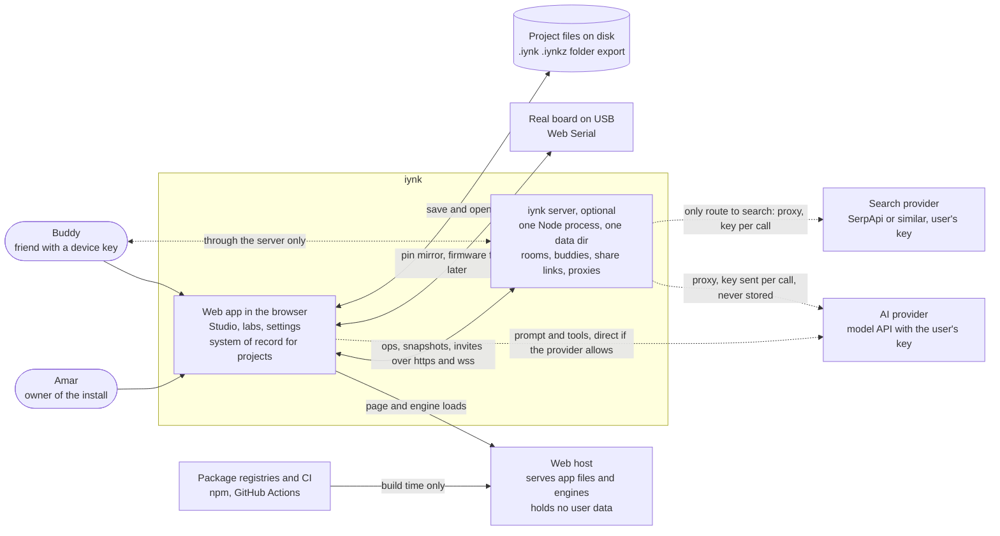

| Party | Trust | What crosses the line | Evidence |
|---|---|---|---|
| Browser app | Holds every project, key and setting. Works with nothing else running (K-LOCAL, D-015) | Reads and writes IndexedDB and files | DOCUMENTED: PROJECT_DATA_MODEL 12.1 |
| iynk server | Trusted by its operator (Amar) and by friends only for what it stores. Optional | Ops, snapshots, chat, presence, invite tokens, share-link copies. Never frames of a simulation, never keys at rest | DOCUMENTED: REALTIME_ARCHITECTURE 3.1, 17.4 of SIMULATION_ARCHITECTURE |
| Buddy's browser | Untrusted input. Every op is validated before it applies | Ops through the server | DOCUMENTED: PROJECT_DATA_MODEL 13 |
| Web host | Trusted code, untrusted network. No user data | Static files, engine bundles | DOCUMENTED |
| AI provider | Third party. Receives only what the context builder sends | Context pack and tool results, over the person's key | DOCUMENTED: AI_ARCHITECTURE 5 |
| Search provider | Third party. Receives query text. Reached through the iynk server only, because the provider takes its key in a URL (SYSTEM_ARCHITECTURE 6.11); without a server, search says "needs a server" | Queries only (F-154, F-194) | DOCUMENTED |
| Real board | The only route into the physical world | Serial bytes (hardware twin, F-159 exists today for Uno, Nano, Uno R4) | VERIFIED: catalogue row F-159 |
| Package registries and CI | Supply-chain boundary | Dependencies at build time | DOCUMENTED: SECURITY_BASELINE |

Not in the diagram, by decision: payment processors and billing (D-013), an analytics service, identity providers and wallets (D-016), a managed database or queue (D-015), Vercel (F-202).

Features: F-199, F-202, F-193, F-194, F-206, F-159, F-200, F-201. Journeys: J-01 to J-12 all start at the app box.

## 2. DG-02 Containers and deployment

Scope: processes and stores, in the browser and on the one machine Amar controls. Source: SIMULATION_ARCHITECTURE 17.2 (workers); REALTIME_ARCHITECTURE 3.1 (server); PROJECT_DATA_MODEL 12.1 (stores); SYSTEM_ARCHITECTURE 4.1 and 4.2 (deployment modes, container names, Caddyfile), FRONTEND_ARCHITECTURE (`/config.json`, the `ai` worker) and BACKEND_ARCHITECTURE 434 (AI transports).

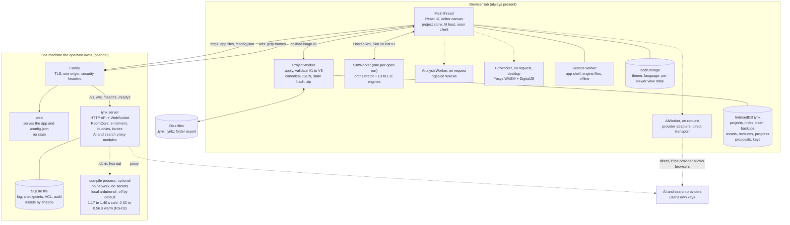

### 2.1 Deployment modes

| Mode | Processes | What works | What says "needs a server" |
|---|---|---|---|
| A. Solo, web only | `web` only, or any static host once the static-export experiment passes (PENDING AX-01 in SYSTEM_ARCHITECTURE) | Edit, run, debug, save, export, import, offline after first load. AI and search work if the provider allows browser calls | Rooms, buddies, share links, proxies, compile |
| B. Friends | `web`, `server`, `caddy` from one compose file on one machine (F-198, F-199) | Everything in A, plus rooms, buddies, share links, enabled proxies | Compile, unless the compile process is enabled |
| C. Development | `next dev` plus the server entry | Everything, with hot reload | none |

There is no mode where the app calls a service owned by Amar (F-202, D-015). The server detects its absence cleanly: a capability probe at start decides which features show (F-012).

### 2.2 Who owns what state

| State | Owner | Lost if | Recovery |
|---|---|---|---|
| Working copy of every project | IndexedDB `projects` (browser) | The browser evicts storage | The file copy the person saved (`.iynk`), or a share snapshot on the server |
| Keys (AI, search) | IndexedDB `keys` | Site data cleared | Re-enter. Keys are never in a project, export or room |
| Room log and checkpoints | SQLite on the server | Disk loss | Each member's last saved copy; the operator's backup of the data directory |
| Simulation state | SimWorker memory | Tab closes | Re-run from the project, seed and input log (replay) |
| Compiled firmware | A cache | Anything | Recompile |

### 2.3 Today versus target

| Item | Today (VERIFIED where cited) | Target | Disposition |
|---|---|---|---|
| Web app | Next.js 16 app on Vercel-style deployment; pages and API routes under `src/app` | Pages only; served by `web` or a static host; no platform variables | Replace the hosting assumptions (F-202) |
| Realtime | `server/realtime` Node relay with `ws`, peer cap 8 (`server/realtime/src/config.js:5`), frame cap 64 KiB (`config.js:6`) | One server: relay plus HTTP API plus SQLite | Extend (audit A11, F-118, F-119) |
| Simulation | Interpreters on the main thread (`src/lib/boardlab/engine.ts:164`), checks already in a Worker (`check.worker.ts`) | SimWorker per run | Extend (F-203) |
| Project storage | `localStorage` key `iynk:v1`, progress only | IndexedDB plus files | Replace for projects (F-200, F-201) |

Features: F-198, F-199, F-200, F-201, F-202, F-203, F-094, F-012. Decisions: D-011, D-015.

## 3. DG-03 Module dependency

Scope: which code module may import which. Source: `SYSTEM_ARCHITECTURE.md` 5.2 and 5.3 (module list and dependency matrix), `FRONTEND_ARCHITECTURE.md` 4.1 (the `protocol` layer), SIMULATION_ARCHITECTURE 3.3 (layer rules) and AI_ARCHITECTURE 4.1. An arrow means "is imported by" and points from the lower module to the module that uses it. Every `x` in the SYSTEM 5.3 matrix is one solid arrow (48 edges); nothing else is drawn. The edge list is generated by `/Users/amar/iynk-master-plan-scratch/design/diagrams/gen_dg03.py`, which reads the matrix table, so a change to the matrix means re-running the script, not hand-editing the picture. Qualifiers on a cell (types only, protocol types only, read only, optional) are in the table below, not on the arrows.

The `protocol` module (dashed) is not in SYSTEM 5.3 yet. FRONTEND_ARCHITECTURE 4.1 defines it (`src/protocol/`, imports `core` types, imported by the host and by the server). It is drawn dashed and counts as PENDING the matrix gaining a row and column for it (see Objection 6).

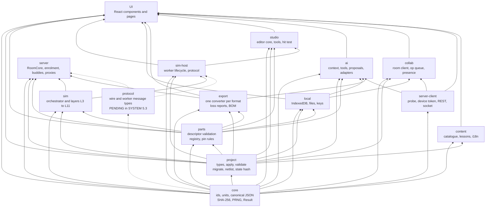

| Cell qualifier in SYSTEM 5.3 | Edges |
|---|---|
| types only | project to parts, project to simhost, project to content |
| types and netlist only | project to sim |
| protocol types only | sim to simhost |
| frames, read only | simhost to studio |
| keys only | local to ai |
| `faults` check re-run only, optional | sim to server |
| share previews, optional | export to server |

### 3.1 Rules the diagram stands for

| # | Rule | Enforced by | Evidence |
|---|---|---|---|
| M1 | No module imports `UI`. A type a lower module needs lives in the lower module | ESLint `no-restricted-imports` zones and an import-reading test | Today 28 type-only imports from `src/lib` into `@/components` break this (TECHNICAL_DEBT A2, VERIFIED); the count must reach 0 by the end of CORE |
| M2 | `sim` imports only `core`, `project` (types, netlist) and `parts` (the matrix also lets `server` re-run the `faults` check from `sim`, optional). It never imports `local`, `studio`, `ai` or `collab` | Same | SIMULATION_ARCHITECTURE 3.3 rule 1 and 2 |
| M3 | The UI never calls an engine directly. It talks to `sim-host`, which talks to the SimWorker over `HostToSim` and `SimToHost` | Code review plus the lint zone | SIMULATION_ARCHITECTURE 17.2; ADR-0300 |
| M4 | `ai` imports no engine code. It reads project state through the ProjectWorker and simulation state through the SimWorker protocol | Same | AI_ARCHITECTURE 4.1 |
| M5 | `server` imports portable modules only: `core`, `project`, `parts`, plus optionally `sim` (the `faults` check re-run) and `export` (share previews). `RoomCore` imports the same `apply` the browser uses (ADR-0104) | The portable-code type check (no DOM lib, no React, no `node:` in portable folders) | REALTIME_ARCHITECTURE 3.2; SYSTEM_ARCHITECTURE ADR-0014 |
| M6 | No `sim` folder reads `Date.now`, `performance.now`, `Math.random`, `crypto.getRandomValues` | Lint rule SA-11 | SIMULATION_ARCHITECTURE 3.3 rule 3 |
| M7 | `export` converters are pure functions: `export(project) -> {bytes, loss[]}`, `import(bytes) -> {project, loss[]}` | Converter unit tests | ADR-0109 |

### 3.2 Inside `sim`

The orchestrator is the only place engines meet. Engines import shared types only.

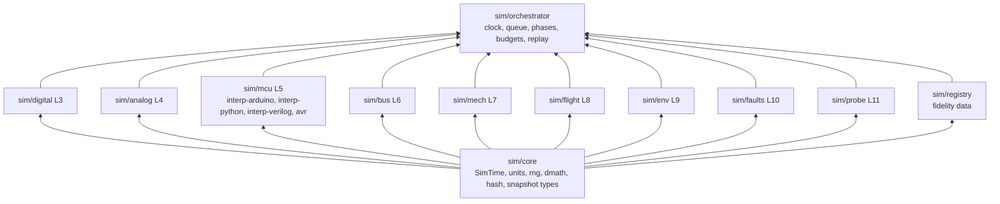

| Today | Maps to | Disposition (BRIEF 3.5) |
|---|---|---|
| `src/lib/interp/*` (11,822 source lines, 189 tests) | `sim/mcu/interp-*`, `sim/bus` (devices), `sim/digital` (World) | Extend; wrapped by `McuEngine`, not rewritten |
| `figures/engine/bench-solve.js` | `sim/analog` (new pure module); old file frozen for catalogue figures until REF-1 | Replace the input path, preserve the formulas |
| `src/lib/flight/*` | `sim/flight` ("flight game" backend kept, 6-DoF added) | Preserve, then extend |
| `src/lib/robotics`, `src/lib/dronelab`, `src/lib/boardlab`, `src/lib/drone` | `content` and Studio templates (LABS) | Move into Studio as projects (D-014) |
| `src/lib/solana`, `src/lib/verify` | deleted | Remove (D-016, F-195) |

Features: F-203, F-047, F-078, F-076, F-205. ADRs: ADR-0001 (SYSTEM_ARCHITECTURE), ADR-0300, ADR-0104, ADR-0109.

## 4. DG-04 Project data model

Scope: the entities inside one project document and how they refer to each other. Source: `PROJECT_DATA_MODEL.md` sections 2 and 5, `project.schema.json`. Field lists are in the data model file; this diagram shows entities, keys and references only. Mermaid ER notation: `||--o{` means one to many.

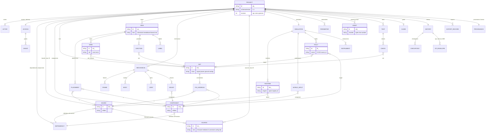

### 4.1 What the picture says that the file also enforces

| Statement | Rule | Where enforced |
|---|---|---|
| The electrical truth is `NET` and its `PIN_ADDRESS` members. A `WIRE` points at a net and never adds a member | N4, N7, W1, W2, W5 | `apply` (ops) and validation pass V3 |
| `PLACEMENT` and `WIRE` are layout. Moving a part changes no net | N6 | `view.place` touches `views` only |
| A part instance names its definition by `{ref, version}`; `DEPENDENCY` holds a pinned interface snapshot so the document opens without the part library | ADR-0107, V6-INTERFACE-DRIFT | Loader |
| `FAULT`, `TEST`, `CHECK`, `RUNTIME` and `WORLD_INPUT` refer to nets, pins and instances by id. Removing the target cascades or is rejected with `referenced_by` | 7.2 cascade column | `apply` |
| `HISTORY` is outside the state hash, so a trimmed and an untrimmed copy of one state hash equal | 6.4, Objection O-3 | `stateHash` |
| Fidelity tier, solver results, netlist text and BOM are not stored. They are recomputed | 2.2 | Derivers |

### 4.2 Relation to the part descriptor

The part descriptor (`COMPONENT_SCHEMA.md`, `component.schema.json`) lives outside the document, in the part library. The document keeps only the pinned interface of each used descriptor.

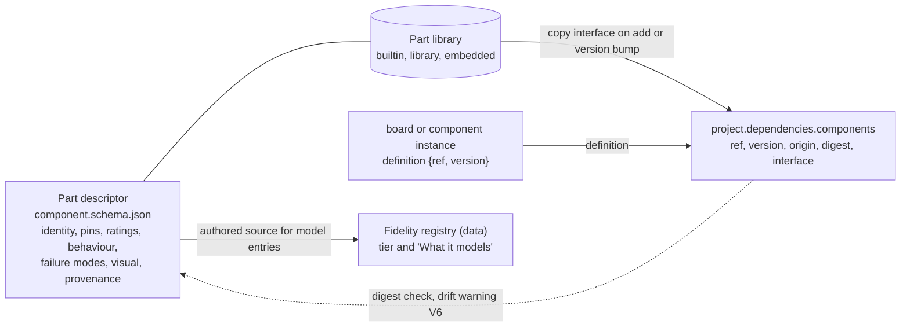

Features: F-076, F-078, F-097, F-098, F-083, F-093, F-185, F-221. ADRs: ADR-0100 to ADR-0110, ADR-0200 to ADR-0208, ADR-0310.

## 5. DG-05 Simulation pipeline

Scope: from the project document to pixels and checks, in the browser, off the main thread. Source: SIMULATION_ARCHITECTURE 3.1, 5.2, 5.3, 5.5, 6.7, 14.1, 17.2, 17.3. Phases P0 to P6 are the fixed order inside one timestamp.

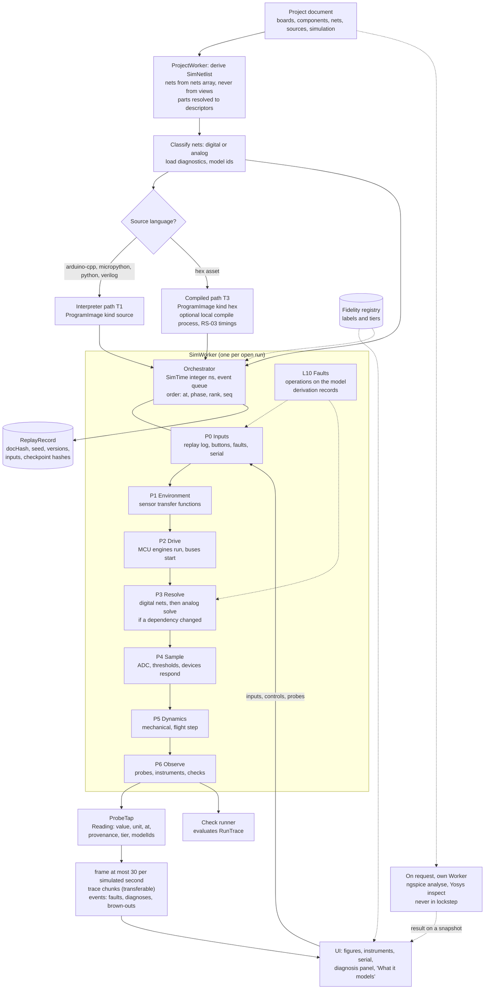

### 5.1 One timestamp, in the order the code runs it

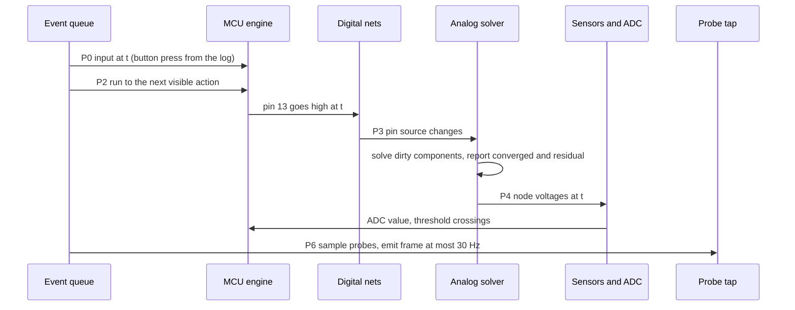

### 5.2 Rules that make the picture trustworthy

| Rule | Meaning | Source |
|---|---|---|
| Netlist independent of drawing | `derive` reads `nets` and part descriptors only. A wire's drawing cannot change a solve | PROJECT_DATA_MODEL N7; audit A5 |
| One clock | Integer nanoseconds, no wall-clock reads. The host turns "speed" into a per-frame target using its own clock; engines are never told the speed | ADR-0301 |
| Determinism classes | B bit-exact (digital, MCU, serial), N tolerance (analog, physics), D display only. DET-2 must name the class | ADR-0303, SIMULATION_ARCHITECTURE Objection 1 |
| Cooperative cancel plus kill | Every slice checks budgets (heap, statements, cycles, output). The host kills the worker 2 s after a cancel request and recreates it from the document | ADR-0311, 17.2 |
| Running behind real time is a state | `speed.behindReal` travels in every frame and the UI shows it | 6.8 |
| No silent stubs | An unmodelled call returns a named "not modelled yet" diagnostic and `provenance: 'not-modelled'` | ADR-0307, 14.1 |
| Rooms | Each peer simulates locally from the same ordered ops, seed and runner-stamped input log. No frames are streamed. Class B hashes compared every 1,000 ms of simulated time for digital, MCU and serial; physics, flight and analog compare class D until RA-02, SA-12 and DET-2 pass | 17.4 |

### 5.3 Today versus target

| Item | Today | Target | Disposition |
|---|---|---|---|
| Clock | `VirtualClock`, microsecond float, `(at, seq)` ordering (`src/lib/interp/clock.ts`) | Integer ns plus phases | Extend |
| Analog | DC nodal solver with globals, silent non-convergence (`figures/engine/bench-solve.js`) | Pure module, convergence flag, then transient in the in-house engine behind `AnalogBackend`; ngspice WASM is the on-demand oracle. Live transient accuracy is unmeasured (RS-08 part b and RS-07 never ran) | Replace input path, freeze old for figures |
| Firmware | Three TypeScript interpreters, flat cost per statement (`profiles.ts:87-202`) | Same by default (T1), avr8js opt-in "Firmware mode" in a Worker (T3). RS-03 INCONCLUSIVE overall: correctness PASS, desktop 6.1 to 7.5x, throttled about 1.7x at 4x and 1.1x at 6x | Extend |
| Where it runs | Main thread (`boardlab/engine.ts:164`); checks in a Worker | SimWorker | Extend |
| Replay | Flight only (`sim.ts:1008`) | `ReplayRecord` for circuits and firmware | Extend |

Features: F-047, F-045, F-044, F-203, F-041, F-208, F-209, F-185, F-186, F-207, F-030. Decisions: D-007, D-010, D-011. ADRs: ADR-0300 to ADR-0315.

## 6. DG-06 AI tool-execution sequence

Scope: one partner turn that ends in a change to the project, and the places where a person must click. Source: AI_ARCHITECTURE 4.2, 6.1, 7.3 to 7.7; PROJECT_DATA_MODEL 7.5. The model is treated as fully compromised (ADR-0604): it can only ask, never act.

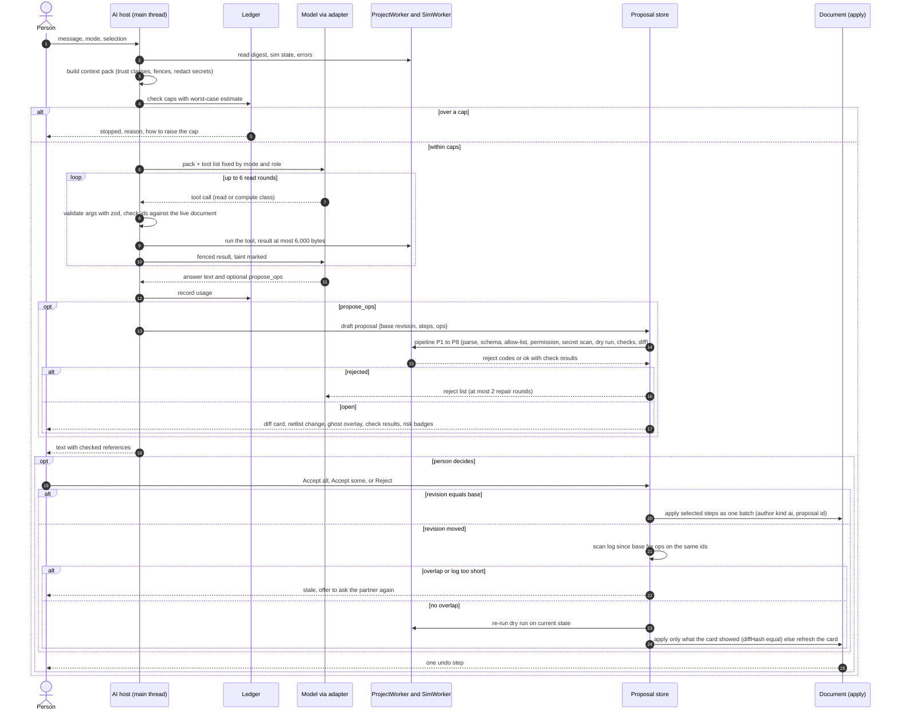

### 6.1 Classes of tool and where the click is

| Class | Examples | Click needed | Can change the project |
|---|---|---|---|
| read | `get_netlist`, `get_source` | no | no |
| compute | `check_rules`, `try_ops` (throw-away copy) | no | no |
| ui | `highlight`, `open_panel`, `ask_clarification` | no | no (nothing persistent) |
| propose | `propose_ops` | the Accept on the card | only after Accept |
| effect | `search_datasheet`, `find_parts`, `draft_buddy_message` | yes, every time, arguments shown | no (leaves the tab, or spends the person's search quota) |

There is no tool that applies a change, runs arbitrary code, fetches an arbitrary URL, reads a disk file or calls a privileged API. Risk classes of ops: R0 cosmetic, R1 additive, R2 removing or cascading (needs a confirm tick with cascade counts), R3 never proposed by the AI (`access.*`, `license.set`, `asset.add`, `domain.set`, solver or physics choice, unknown `dep.set`).

### 6.2 Proposal states

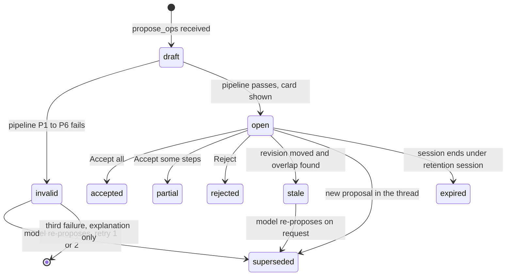

### 6.3 Where it runs, and the key

The AI host runs in the main thread and holds no engine code. The model call goes from the browser to the provider with the person's key from the local `keys` store, or through the self-hosted proxy module if the provider blocks browser calls (ADR-0600, per-provider path UNKNOWN until the conformance run). The proxy has a host allowlist, a private-address block, size and time limits, no body logging, and needs a signed-in device (ADR-0612). The key is a per-call header on the proxy path and is never stored there.

| Today | Target | Disposition |
|---|---|---|
| `src/lib/ai/tools.ts` (zod tool schemas, replace-whole-file edits), `provider.ts` (OpenAI-compatible), `ChangeCard.tsx`, `diff.ts` | Context packs, three tool classes, op proposals, two adapter families | Extend the zod pattern and the card; replace the bench-context guess (B6-05) and full-text replace |

Features: F-105, F-106, F-109, F-110, F-111, F-112, F-114, F-193, F-083. Requirements: R-154, R-157, R-158, R-159. ADRs: ADR-0600 to ADR-0613, ADR-0104.

## 7. DG-07 Collaboration synchronization sequence

Scope: two friends editing one project, from room creation to a rejected op and a resync. Source: REALTIME_ARCHITECTURE 4.3, 5.2, 5.4, 8.1, 8.2, 13; PROJECT_DATA_MODEL 7.1 to 7.4; RS-09 (PASS, 36 reproduced runs (30+6), about 10,900 generated ops each, no divergence). The server orders and validates. It never simulates.

```mermaid
sequenceDiagram
  autonumber
  participant A as Browser A (host, runner)
  participant S as iynk server (RoomCore)
  participant DB as SQLite
  participant B as Browser B (buddy)
  A->>S: POST /v1/rooms {project at revision r, settings} (device token)
  S->>S: validate V1 to V5 and limits
  S->>DB: checkpoint 0, seq = r, ACL (A is owner and host)
  S-->>A: 201 Room {id, epoch, seq}
  A->>S: POST /v1/rooms/:id/invites {buddy B, role editor}
  S-->>B: lobby frame invite {room, from, title, role}
  B->>S: POST /v1/room-invites/redeem {room, token}
  S->>DB: ACL insert, access.grant op (author kind system)
  Note over A,B: WebSocket handshake for each, challenge then hello with ECDSA signature
  B->>S: hello {device, room, sig, resume}
  S-->>B: welcome, snapshot or tail, ready
  A->>A: edit: apply optimistically to pending view
  A->>S: submit {sub, batch, ops[{opId, base, op}]}
  S->>S: dedup by first opId, permission, apply on working copy, deferred invariants
  alt valid
    S->>DB: append envelopes (seq0..seq1, author from device, at from server clock, chain)
    S-->>A: commit {seq0, seq1, chain, ack{sub, inverse}}
    S-->>B: commit {seq0, seq1, chain, envs}
    B->>B: apply envelopes to confirmed state, replay own pending ops on top
  else invalid
    S-->>A: reject {sub, code, index, rule}
    A->>A: drop pending op, rebuild view = confirmed + remaining pending
  end
  loop every 100 ops or 30 s of activity
    S-->>A: check {seq, chain}, every fifth also stateHash
    S-->>B: check {seq, chain}
  end
  opt chain or apply mismatch on B
    B->>S: report mismatch
    S-->>B: resync {reason} and snapshot
  end
  opt B reconnects after a gap
    B->>S: hello {resume.seq}
    S-->>B: tail since seq if retained, else last checkpoint plus tail (gzip)
  end
  Note over A,B: Simulation: runner A stamps inputs, B runs the same ops and seed locally. Peers compare class B hashes every 1,000 ms of simulated time for digital, MCU and serial; physics, flight and analog compare class D until RA-02, SA-12 and DET-2 pass. On a mismatch B switches its display to the runner's run.frame, so runner frames are the fallback display (REALTIME 13.6).
```

### 7.1 Facts the sequence relies on

| Fact | Value | Evidence |
|---|---|---|
| Order | Server assigns `seq = previous + 1`, no gaps. Author is stamped from the authenticated device, never from the frame | REALTIME 8.1 rule 1 |
| Atomic batch | Ops with one `batch` id commit together or not at all, delivered as one `commit` | PROJECT_DATA_MODEL 7.3 |
| Dedup | Server keeps last 8 submissions per member: `(first opId, seq0, seq1, inverse)`. A resend returns the stored result | REALTIME 8.1 rule 4; needs its own unit test (RS-09) |
| In flight | Client sends one submission at a time. The server tolerates 4 unacknowledged, more gets `rate_limited` | 8.1 rule 5 |
| Frame caps | 64 KiB per op envelope today (`server/realtime/src/config.js:6`, VERIFIED). Snapshots above 4 KiB are gzip binary frames. A document at the 5 MiB limit is 159 KB gzipped (DOCUMENTED, data model 9.6) | 7.1 of data model |
| Reconnect cost | 1,000-op tail 2.8 ms, 10,000-op tail 22 ms on localhost (VERIFIED in RS-09 report) | PROJECT_DATA_MODEL 7.4 |
| Room size | 8 editors and commenters plus 8 spectators | REALTIME 5.6 |
| Text edits | Single writer by the baton is the default. Server range transform for `open` code mode converges but may lose intent on overlap. A text CRDT for source files is held in reserve | PROJECT_DATA_MODEL 7.4; REALTIME 8.4 |
| Offline | Bounded pending queue replayed on reconnect, else the local work becomes a fork. No offline merge engine | REALTIME 0 row 9 |
| Hostile client | Defences enforced by the server, each with a named test (R-097) | REALTIME 0 row 11 |

PENDING: durability and throughput of the SQLite store (RT-1), cross-machine simulation agreement (RT-2, SA-12, DET-2). The sequence stays valid if either fails, because the fallback in both cases is "the runner's frames are the display" (`run.frame`, REALTIME 13.6).

### 7.2 Room states

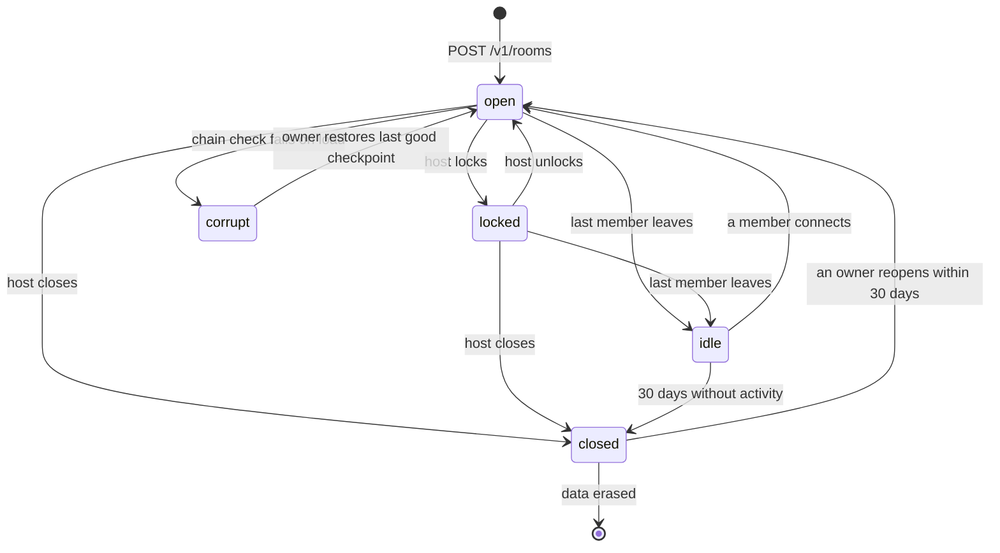

### 7.3 Today versus target

| Item | Today (VERIFIED, SECURITY_BASELINE) | Target |
|---|---|---|
| Peer identity | Client picks `peer.id`; a third socket with the host's id takes the seat (R4) | Device key signature; member derived by the server (ADR-0502) |
| Room creation | Joining creates a room (R3); six-character codes (R1, about 29.7 bits) | Authenticated creation; 128-bit invite capabilities redeemed once (ADR-0503) |
| Authority | Relay enforces no roles, any peer can send the baton frame (R6) | Permission table in `RoomCore` (ADR-0504) |
| State | Peers supply snapshots (R9) | Server holds the document and log in SQLite (ADR-0505) |
| Disposition | Extend `server/realtime` (payload-agnostic, gapless sequence, 39 tests) | Keep the sequencing core, replace auth, protocol and storage |

Features: F-116 to F-123, F-199, F-206, F-138, F-083. Requirements: R-077, R-080, R-090, R-094, R-097. ADRs: ADR-0500 to ADR-0511, ADR-0104. Journeys: J-08, J-09, J-13.

## 8. DG-08 Save and export lifecycle

Scope: how a change becomes bytes in three places (IndexedDB, a file the person owns, the server), and how bytes come back in. Source: PROJECT_DATA_MODEL 6, 9, 10, 12; ADR-0105, ADR-0106, ADR-0109; PRODUCT_REQUIREMENTS R-035, R-037.

### 8.1 Write and read paths

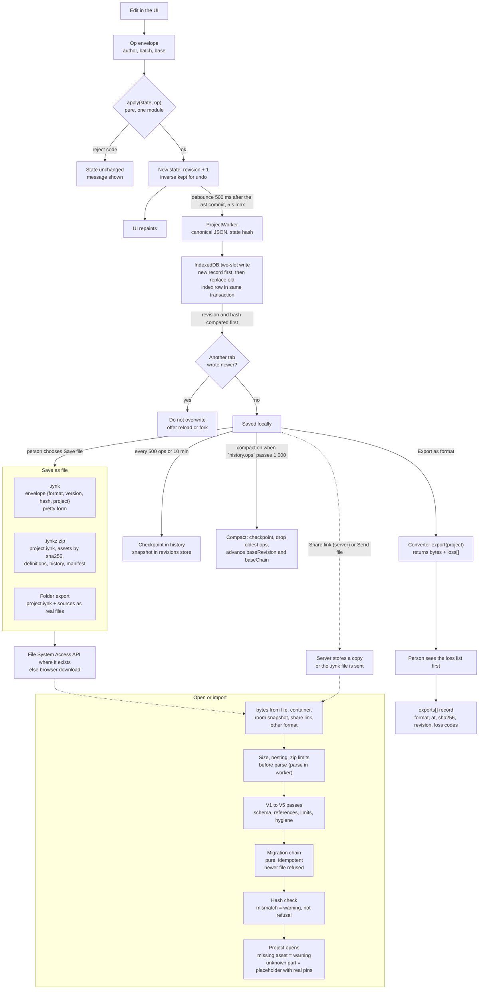

### 8.2 Where a project's copy lives

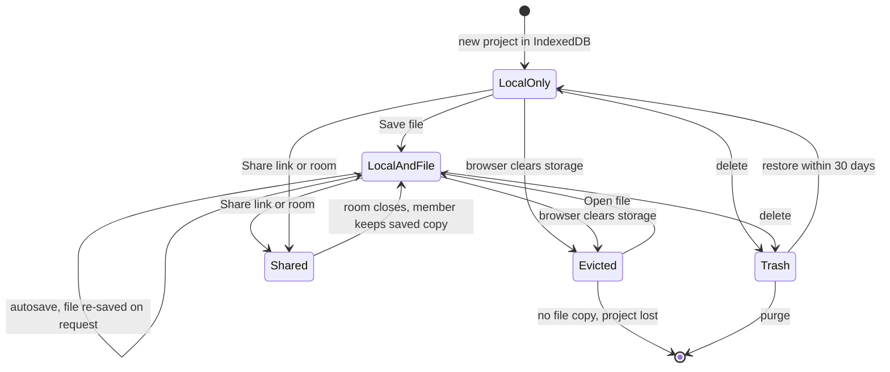

`hasFileCopy` in the `index` store drives a visible badge, because storage can be evicted (EXTERNAL; exact browser policies are HYPOTHESIS and need a test). A project with no file copy gets a standing reminder (R-037).

### 8.3 Limits and refusals

| Limit | Value | Source |
|---|---|---|
| Bare document | 5 MiB canonical (5,242,880 bytes), nesting at most 32, duplicate key rejected | PROJECT_DATA_MODEL 13, 9.4 |
| Container | at most 1,000 entries, any entry at most 16 MiB, total at most 128 MiB, compression ratio at most 100 to 1, no path outside the container | 12.1 |
| Op envelope | at most 64 KiB serialised | 7.1 |
| History | tail of at most 1,000 ops, at most 256 checkpoints | 5.15 |
| Secrets | export runs a secret-shape scan (`sk-`, `AIza`, PEM headers, long hex) and warns before writing. The `keys` store is outside every export path | 13 |
| Hash | Same content gives the same bytes and hash. Hash excludes `history`, `exports`, `meta.updatedAt` and `revision` | 6.4 |
| Round trips | Only `.iynk`, `.iynkz` and replay logs promise a round trip. Every other format is HYPOTHESIS until its acceptance test passes | 12.2 |

### 8.4 Formats the converters write

| Format | Dir | Feature | Loss named up front |
|---|---|---|---|
| `.iynk`, `.iynkz` | both | F-201 | none |
| Arduino sketch | both | F-090, F-091 | wiring, nets, tests, guide |
| BOM CSV | export | F-160 | virtual parts flagged `not-purchasable` |
| Netlist text, schematic and wiring SVG or PDF | export | F-210 | interactivity, other views |
| KiCad netlist, SPICE netlist | both | F-211 | footprints, placements, MCU behaviour, faults |
| Wokwi diagram | import | F-211 | licence and format UNKNOWN, check before code |
| URDF | both | ROBOT phase | electronics |
| Replay log `.iynkreplay` | both | F-047 | none |

Today: progress is a small `localStorage` document `iynk:v1`; no user work is stored (walk 14, F-087 note). Disposition: replace for projects, keep for settings.

Features: F-076, F-083, F-087, F-088, F-089, F-090, F-091, F-092, F-093, F-094, F-168, F-200, F-201, F-210, F-211. Requirements: R-026, R-028, R-035, R-037. ADRs: ADR-0103, ADR-0105, ADR-0106, ADR-0109, ADR-0110. Journeys: J-03, J-08.

## 9. DG-09 Identity and access control

Scope: who a person is, how the server knows, and where each permission is checked. Source: REALTIME_ARCHITECTURE 4 to 6; PROJECT_DATA_MODEL 5.1; AI_ARCHITECTURE 7.4; F-005, F-206, R-077, R-080. There are no accounts, passwords, emails or sign-in providers (D-013, F-169 out of scope). Identity is a device key.

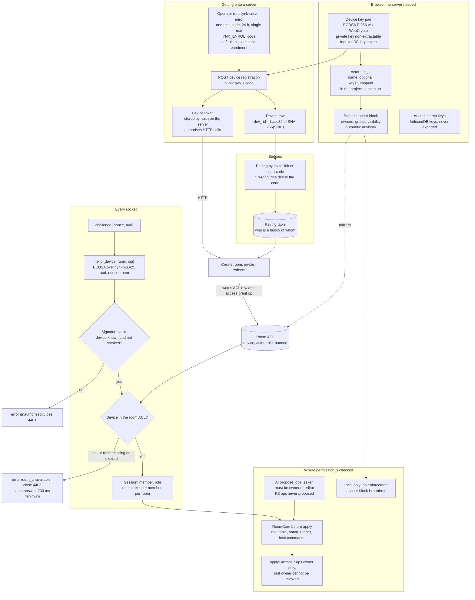

### 9.1 Roles and what each may do

Roles are the document's four values. Host, baton holder and runner are room properties, not roles.

| Action | owner | editor | commenter | viewer or spectator |
|---|---|---|---|---|
| Read, presence, chat | yes | yes | yes | yes (chat unless muted) |
| Graph ops (`board.*`, `component.*`, `net.*`, `view.*`, `wire.*`, `mech.*`, `param.*`, `test.*`, `asset.*`, `dep.*`, `meta.*`, ...) | yes | yes | no | no |
| `sim.*`, `runtime.*`, `input.*`, `script.*`, `fault.*`, `instrument.*` | yes | yes | no | no |
| `source.*` | baton holder, or any editor if `codeMode` is `open` | same | no | no |
| `access.*`, `license.set` | yes | no | no | no |
| Run controls | per `runControl` | per `runControl` | no | no |
| Kick, lock, mute, close, baton, runner, settings | host only | no | no | no |
| Delete or reopen the room | any owner | no | no | no |
| AI `propose_ops` in the tool list | yes | yes | no | no |

### 9.2 Boundaries, stated plainly

| Boundary | Statement | Evidence |
|---|---|---|
| Document `access` | Advisory. Whoever holds a file can edit it. Only a self-hosted server that hosts a room enforces roles, from its own ACL | PROJECT_DATA_MODEL 5.1 |
| Author in an op | The server stamps `author.actor` from the authenticated device. `kind: "ai"` is a claim by the accepting client and cannot be verified | REALTIME 8.1; AI_ARCHITECTURE 7.7 |
| Device id | Never placed in a document or a frame to another member. Others see actor id, name and colour | REALTIME 4.2 |
| Invites | 128-bit capability in the URL fragment, one use for editor, five for viewer, 24 h default, at most 7 days and 20 uses. Only the SHA-256 is stored | REALTIME 5.4 |
| Bans | By device id, in the room ACL. A new random id does not help | REALTIME 4.4 rule 4 |
| Auth failures | 5 per minute per address, then 5 minutes refused (PROPOSAL) | REALTIME 4.4 rule 5 |
| Server reach | Registration needs an enrolment code from `iynk-server enrol` (`IYNK_ENROL=code`, default; `closed` stops all new enrolment; there is no open or invite mode, and a pairing never enrols). A public URL cannot store data for strangers | REALTIME 5.3 and SYSTEM_ARCHITECTURE ADR-0007 (adds a gate to R-077, Objection O-1 there) |
| Local only | With no server there are no devices, no rooms and no enforcement. That is not a gap, it is the single-user case | REALTIME 4.4 last line |
| Lobby | Delivers only things about paired buddies. No directory, search or listing of strangers (D-016). The buddies-only leaderboard is a REST read | REALTIME 5.5 |

### 9.3 Today versus target

| Item | Today (VERIFIED in SECURITY_BASELINE) | Target |
|---|---|---|
| Peer id | Client chosen, trusted (R4) | Derived from device key |
| Room codes | Six characters, 29.7 bits (R1); join creates a room (R3) | Capability invites; authenticated creation |
| Roles | Not enforced (R6) | Table above in `RoomCore` |
| Server routes | Several unauthenticated direct-to-model routes | Every route needs IYNK_SERVER_TOKEN in B0 (BACKEND 13.1, deleted later), then the device bearer token from the collaboration phase (ADR-0007, D-018) or a buddy signature (F-004) |
| Wallet identity | Solana wallet and passport | Removed (D-016, F-195) |

Features: F-004, F-005, F-119, F-120, F-121, F-206, F-138, F-140. Requirements: R-077, R-080, R-081, R-094, R-097. ADRs: ADR-0502, ADR-0503, ADR-0504, ADR-0510, ADR-0612. Journey: J-13.

## 10. DG-10 Physical build and BOM integration

Scope: from a finished project to parts on a bench. Source: FEATURE_CATALOGUE domain O (F-154 to F-162, F-210 to F-212), PROJECT_DATA_MODEL 12.2 (BOM row), COMPONENT_SCHEMA 4.4 (identity: `mpn`, `generic`, `sources`), SYSTEM_ARCHITECTURE 6.18. The BOM is derived and never stored (P3).

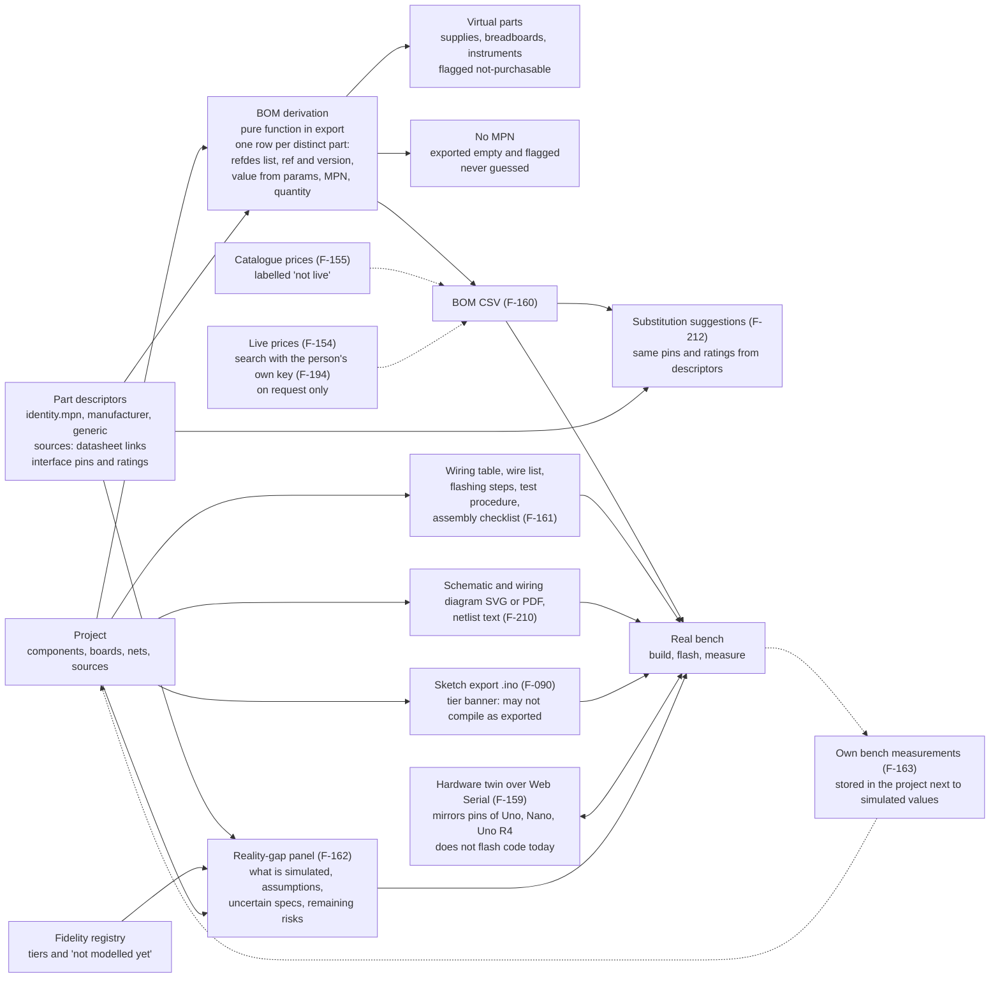

### 10.1 Rules

| Rule | Meaning | Source |
|---|---|---|
| Derived, not stored | The BOM is recomputed from `components`, `boards` and the descriptors. No BOM lives in the document | PROJECT_DATA_MODEL 2.2 |
| Honest gaps | A part with no MPN is exported with the field empty and flagged. A generic part says `generic: true` with the source it cites | COMPONENT_SCHEMA 4.3, 4.4 |
| Keyless by default | Without a search key the BOM uses labelled catalogue prices. With a key, searches run only on request. Today a view costs 32 to 54 searches and the key had 0 of 250 left (C027, VERIFIED), so a request shows its cost first | FEATURE_CATALOGUE F-154, F-194 |
| Export banner | At tier T1 an exported sketch says it may not compile as exported | F-090 |
| Reality gap | The panel reads the fidelity registry and the descriptors' three rating slots (manufacturer, simulation, measured). It never prints "validated". Wording follows D-007 | D-007; COMPONENT_SCHEMA 4.6 |
| Own measurements | A measured value is stored with the project as the person's own, beside the simulated value | F-163 |
| No commerce | No affiliate or sponsored links (F-164 is out of scope) | D-013 |
| Acceptance | BOM totals equal a hand count for the 3 examples. Wiring SVG matches the editor view for 3 examples | PROJECT_DATA_MODEL 12.2 |

### 10.2 Today versus target

| Item | Today | Target | Disposition |
|---|---|---|---|
| Parts list with prices | `src/lib/search/bom.ts` (catalogue prices, quad5 $346), `RealBuildPanel.tsx`, `src/app/api/search/offers/route.ts` | BOM from the project, CSV, labelled prices | Preserve the catalogue-price code; the live-price route is broken (C027) and moves behind the user's key |
| Budget optimiser | `src/lib/search/optimize.ts` finds a $330 build in 3.0 s keyless (walk 7) | Same, over descriptors in the drone builder | Preserve (F-156) |
| Hardware twin | `src/lib/hw/*`, unit tests only, no hardware-in-the-loop test | Same, plus flashing steps as a document | Preserve (F-159) |
| Export of any kind | None (FV section 6, F-160 absent) | Section 8.4 | New |

Features: F-154 to F-163, F-090, F-097, F-098, F-185, F-210, F-211, F-212, F-194. Journey: J-12 (export a physical build package; J-11 covers import). Decisions: D-007, D-013, D-015.

## 11. Reading the diagrams together

| Question | Diagrams |
|---|---|
| What runs where, and what breaks if there is no server? | DG-01, DG-02 |
| Where does a new file of code go? | DG-03 |
| What does an op change? | DG-04, DG-07, DG-08 |
| Why can a wire not change a solve? | DG-04, DG-05 |
| How can the AI change a circuit safely? | DG-06, DG-09 |
| What stops a stranger entering a room? | DG-09, DG-07 |
| What do I lose if the browser clears storage? | DG-08, DG-02 |
| What do I carry to the bench? | DG-10 |

## 12. Validation of the Mermaid source

Method: every fenced `mermaid` block was extracted from this file into scratch (`/Users/amar/iynk-master-plan-scratch/design/diagrams/blocks/`) and rendered to SVG with `npx -p @mermaid-js/mermaid-cli mmdc` (version 12.0.0, VERIFIED by `mmdc --version`). The result is in the table; the script and logs are in the same scratch folder.

| Block | Content | Result |
|---|---|---|
| 1 | DG-01 system context | renders, no error |
| 2 | DG-02 containers and deployment | renders, no error |
| 3 | DG-03 module dependency | renders, no error |
| 4 | DG-03 companion: inside `sim` | renders, no error |
| 5 | DG-04 project data model (ER) | renders, no error |
| 6 | DG-04 companion: part descriptor relation | renders, no error |
| 7 | DG-05 simulation pipeline | renders, no error |
| 8 | DG-05 companion: one timestamp | renders, no error |
| 9 | DG-06 AI tool-execution sequence | renders, no error |
| 10 | DG-06 companion: proposal states | renders, no error |
| 11 | DG-07 collaboration sequence | renders, no error |
| 12 | DG-07 companion: room states | renders, no error |
| 13 | DG-08 write and read paths | renders, no error |
| 14 | DG-08 companion: where a copy lives | renders, no error |
| 15 | DG-09 identity and access control | renders, no error |
| 16 | DG-10 physical build and BOM | renders, no error |

Re-run on 2026-10-27 after the review fixes (blocks in `/Users/amar/iynk-master-plan-scratch/design/diagrams/blocks2/`): 16 of 16 blocks render with exit code 0 and no syntax-error marker (VERIFIED); one block (DG-07) failed first because of a semicolon in a note and was fixed. The statement below is from the first pass.

16 of 16 blocks rendered with exit code 0 and no "Syntax error" marker in any SVG (VERIFIED). I opened the PNG renders of the `sim` companion and the AI sequence to check that labels are readable; I did not open the rest (not checked by eye). No block needed a syntax fix on the final pass. Layout quality in other renderers (GitHub's embedded Mermaid is an older version) is UNKNOWN: the large flowcharts DG-05, DG-08 and DG-09 are the ones to look at first.

## 13. Objections

The decisions are binding and the diagrams follow them. These are places where the contract files disagree with each other or leave a diagram unable to be drawn without a choice. None changes a decision.

1. **Naming of the server.** SIMULATION_ARCHITECTURE 17.4 and parts of PROJECT_DATA_MODEL say "relay". REALTIME_ARCHITECTURE 3.1 calls it "iynk server" and gives it HTTP, SQLite and an ACL. The diagrams use "iynk server" and treat "relay" as the old name of the realtime part (`server/realtime`). The contract files should converge on one word.
2. **AI proxy location. RESOLVED (SYSTEM ADR-0008).** The proxy is a module of the iynk server, with a browser-direct transport in the AiWorker; DG-02 draws both. The text below is the original objection, kept for the record. AI_ARCHITECTURE 4.3 puts the proxy at `src/app/api/ai/relay/route.ts` (a Next route) and calls it "a stateless server route". F-202 and D-015 remove the platform dependency, and the system architecture draft puts the proxy in the iynk server process (ADR-0008 there). DG-02 draws it as a module of the iynk server. If the Next route survives, DG-02 gains an arrow from `web` to the providers, and mode A (web only) gains a proxy that is not "the server". One of the two files needs to change.
3. **Static hosting with no server. RESOLVED as a gated experiment (SYSTEM AX-01).** Mode A keeps `web` until AX-01 passes; DG-02 shows that. Original objection: D-015 says the app runs in the browser with an optional server. The system architecture draft notes that a Next static export does not support the app's redirects, headers and cookies, so mode A still needs `web` or a static host after an untried conversion (PENDING AX-01). DG-02 shows `web` in mode A for that reason. Until AX-01 passes, "no server" means "no iynk server" only.
4. **Where the state hash is computed for rooms.** REALTIME 8.2 asks idle clients to compute `stateHash` in their worker. DG-07 therefore shows B applying envelopes in a worker implicitly. The contract does not say which worker (ProjectWorker or SimWorker) holds the room's confirmed state. DG-02 assumes the ProjectWorker. This needs a sentence in the system architecture file.
5. **Authorship of system ops.** The server writes `access.grant` with `author.kind: "system"` on redeem (REALTIME 5.4), while a client may not send `system` ops (8.1 rule 1). DG-07 shows both; the data model should say that `system` envelopes carry no `base` and are never part of a client's pending queue.
6. **Module map. RESOLVED for the 14 modules (SYSTEM 5.3, ADR-0001), one gap open.** DG-03 is generated from the final SYSTEM 5.3 matrix. The contract statement of record is the import-reading test (`src/architecture.test.ts`), not this picture. Open: SYSTEM 5.2 and 5.3 have no `protocol` module while FRONTEND 4.1 does (`src/protocol/`, imported by the host and the server). DG-03 draws it dashed. SYSTEM should add the row and column, or say `protocol` lives inside `core`.

## 14. Open items

| # | Item | Blocks | Owner file |
|---|---|---|---|
| 1 | Add `protocol` to the SYSTEM 5.3 matrix (or fold it into `core`), then re-run `gen_dg03.py` and make its edges solid | DG-03 | SYSTEM_ARCHITECTURE |
| 2 | Add the compile process boundary once RS-04, RS-05, RS-17 have a verdict | DG-02, DG-05 | SIMULATION_ARCHITECTURE 8.5 |
| 3 | Add transient solver and ngspice path once RS-07 and RS-08(b) report | DG-05 | SIMULATION_ARCHITECTURE 7.4 |
| 4 | Add the physics and flight engines to the pipeline diagram for ROBOT and DRONE phases at detail level | DG-05 | robotics and drone specs |
| 5 | Re-render all blocks after any edit and re-run section 12 | all | this file |

## 15. Traceability

| Item | Where |
|---|---|
| BRIEF 19.2 items 1 to 10 | DG-01 to DG-10 |
| D-013 (purpose), D-014 (order) | Section 1 out-list, section 3 module phases |
| D-015 (local-first, self-host) | DG-01, DG-02, DG-08 |
| D-016 (removal, buddies) | DG-01, DG-03 table, DG-09 |
| D-007, D-010, D-011 | DG-05, DG-10 |
| Contract names | PROJECT_DATA_MODEL, COMPONENT_SCHEMA, SIMULATION_ARCHITECTURE, REALTIME_ARCHITECTURE, AI_ARCHITECTURE |
| New ADRs | none |
| New requirement or feature ids | none |

## Review fixes (2026-10-27)

| # | Issue | What I did | Evidence |
|---|---|---|---|
| 1a | DG-02 Caddy edge `/api and /ws` | Changed to `/api/v1, /ws, /healthz, /mcp` (superseded by RC-21 and RC-30, see the fold-in below). Added the `/config.json` fetch from `web`, and an `AiWorker` node with the dashed direct edge to the providers (the old main-thread edge is removed) | SYSTEM_ARCHITECTURE Caddyfile (`/v1/* /healthz /mcp`), FRONTEND_ARCHITECTURE 173 and 212, BACKEND_ARCHITECTURE 434 |
| 1b | DG-07 paths | `POST /v1/rooms`, `POST /v1/rooms/:id/invites`, `POST /v1/room-invites/redeem`; room state diagram edge updated too | REALTIME_ARCHITECTURE 187 and 1004, API_CONTRACTS 589 to 598 |
| 1c | DG-01 app to search provider | Removed the dashed edge; the server edge is labelled as the only route. Table row says so | SYSTEM_ARCHITECTURE 6.11 (line 536) |
| 1d | DG-09 enrolment | `IYNK_ENROL=code default, closed stops enrolment` (was `invite`, RC-14) and `iynk-server enrol`; 9.2 row rewritten (no open mode) | REALTIME_ARCHITECTURE 196, BACKEND_ARCHITECTURE 238 and 501 |
| 1e | DG-07 mismatch note | Now says runner `run.frame` is the fallback display; the PENDING paragraph cites REALTIME 13.6 | REALTIME_ARCHITECTURE 699 to 706 |
| 1f | DG-08 autosave | Debounce edge reads `500 ms after the last commit, 5 s max` (was 1,000 ms, RC-11) | SYSTEM_ARCHITECTURE 1024 |
| 1g | Re-run section 12 | Done, 16 of 16 render | Section 12 |
| 2a | DG-03 regeneration | Edge list now produced by `gen_dg03.py` (in the scratch folder named in section 3, not committed per the no-commit rule) from the SYSTEM 5.3 table: 48 edges, including the ones the old picture dropped (core to ai, parts to ai, core to local, core to collab, core to studio, core to export, core to content, sim-host to studio, and the optional server edges). Cell qualifiers listed in a table | SYSTEM_ARCHITECTURE 184 to 203 |
| 2b | Protocol module | Added as a dashed node from FRONTEND 4.1. I did not make it solid because SYSTEM 5.2 and 5.3 still have no `protocol` row; Objection 6 and open item 1 say what SYSTEM must add | FRONTEND_ARCHITECTURE 105 |
| 2c | Draft wording and objections | Removed "draft" and PROPOSAL-until-it-lands wording about SYSTEM. Objections 2 and 3 marked resolved (SYSTEM ADR-0008, AX-01); objection 6 resolved except the protocol gap. Open item 1 replaced. Objections 1, 4, 5 untouched (not covered by the issue) | SYSTEM_ARCHITECTURE ADR table |
| 2d | Upstream line | Added FRONTEND, BACKEND, SYSTEM_ARCHITECTURE, API_CONTRACTS | Header |
| 2e | RS-09 source | Now `36 reproduced runs (30+6), about 10,900 generated ops each` | RS-09 REPORT lines 45 to 46 and 152 |

Open items from the review (the second, on `IYNK_ENROLLMENT`, is closed by RC-14 and its line is deleted):

1. Resolved by RC-21: the base path is `/v1`. The fold-in below applies it.

## Reconcile and spike fold-in (2026-10-27)

Source: RECONCILIATION.md rows and the spike reports under `08_RESEARCH_SPIKES/`.

| Id | Change | Where |
|---|---|---|
| RC-11 | Autosave edge reads "debounce 500 ms after the last commit, 5 s max". Review log row 1f updated | DG-08 |
| RC-12 | Checkpoint edge kept at 500 ops or 10 min. Compaction edge now "when `history.ops` passes 1,000" | DG-08 |
| RC-14 | `IYNK_ENROL=code` default, `closed` stops enrolment. DG-09 box and section 9.2 row fixed. Review log row 1d updated. The `IYNK_ENROLLMENT` note is deleted | DG-09, review log |
| RC-21 | `/api/v1` becomes `/v1` in the Caddy edge, three DG-07 sequence calls and the room state diagram edge. Review log row 1a notes it. Open item 1 is resolved. Row 1b keeps its old text but its paths now read `/v1` too | DG-02, DG-07 |
| RC-24 | No edge or table in this file names `/projects`, `/me/exports`, `/usage` or `/parts` (checked with grep). No share edge exists either, so there was nothing to change to `POST /v1/shares`. Skipped | none |
| RC-30 | Root `/mcp` removed from the Caddy edge. The root list is `/v1, /ws, /healthz, /readyz`; the last two serve the container check and proxy and are not in openapi. MCP is `/v1/mcp`, covered by `/v1` | DG-02 |
| RC-31 | Hash exclusion list now includes `revision` | section 8.3 limits table |
| RC-34 | New project `schemaVersion` is "1.1" in the data model ER diagram | DG-04 |
| RS-03 | Firmware row no longer says PASS. INCONCLUSIVE overall: correctness PASS (80 of 80 serial lines, duty within 0.4 points, period within 0.14 ms), desktop 6.1 to 7.5x real time, throttled about 1.7x at 4x and 1.1x at 6x, below the 3x line. Decision: TypeScript interpreters stay default and offline; avr8js is an opt-in "Firmware mode" in a Worker behind an engine interface. Would change if a phone or Chromebook run (For Amar) reaches 3x. Report: `08_RESEARCH_SPIKES/RS-03-avr8js-differential/REPORT.md` | section 5.3 table |
| RS-03, RS-04, RS-05, RS-17 | Compile boxes (DG-02 and the DG-05 build path) no longer say PENDING. Decision: an optional local arduino-cli process, off by default, no network, no secrets, run as a separate executable and never linked. Measured 1.17 to 1.40 s cold and 0.33 to 0.56 s warm on an M4 Pro (RS-03 REPORT, compile times). Not decided: sandbox cost and isolation (RS-05 never ran, and a self-hosted app has no scale to price) and whether arduino-cli GPL-3.0 needs more than separate-process use (RS-17 never ran; the licence call is For Amar). Reversible: interpreters are the default path, so removing compile loses no lesson | DG-02, DG-05 |
| RS-08 | Analog row: in-house MNA core as a pure module with a convergence flag, then transient added in the same engine behind `AnalogBackend`. ngspice WASM is the on-demand oracle. Device-model fidelity failed (10 of 20 within 2 percent, worst C16 229.6 percent), so Newton devices are added and no SPICE-level accuracy is claimed. Part (b) transient accuracy and RS-07 never ran; they become a Fidelity-phase task. Report: `08_RESEARCH_SPIKES/RS-08-mna-vs-ngspice/REPORT.md` | section 5.3 table |

Spike results folded in as context, with no diagram change needed here: RS-01 (SVG scene with level of detail and culling behind a Renderer interface; the device run is For Amar, Q-2), RS-06 (Pico stays on the TypeScript MicroPython interpreter), RS-09 (server-ordered op log), RS-12 (Yosys and DigitalJS as a lazy opt-in desktop Inspect mode), RS-13 (Rapier behind `PhysicsBackend`, Robotics phase only). DP-01 is an author-run prototype and is not cited as a spike verdict. RS-07, RS-11, RS-14, RS-15, RS-16, RS-18 and RS-20 have no result and stay PENDING until their phase.

Wait wording: grep found no text in this file that makes Studio wait for interviews, a pilot or Fault Lab, so nothing was replaced for the D-014 order.

## Reconcile, second pass (2026-10-27)

| Id | Change |
|---|---|
| RC-25 | Create-room reply is now `201 Room {id, epoch, seq}` (sequence diagram), matching the `Room` object. |
| RC-53 | Both class B hash statements (rooms table row and the simulation note) now say the 1,000 ms compare applies to digital, MCU and serial; physics, flight and analog compare class D until RA-02, SA-12 and DET-2 pass (REALTIME 668/701, ADR-0303). |
| RC-24 | Working-copy row now reads "or a share snapshot on the server". The log line saying no project edges exist was already correct and is unchanged. |


## Reconcile, final nits (2026-10-27)

- Server routes row in the before and after table (about line 890): "the server token or a device signature" now names IYNK_SERVER_TOKEN in B0 (BACKEND 13.1, deleted later), then the device bearer token from the collaboration phase (ADR-0007, D-018) or a buddy signature. No setup token (RC-15, RC-16).
