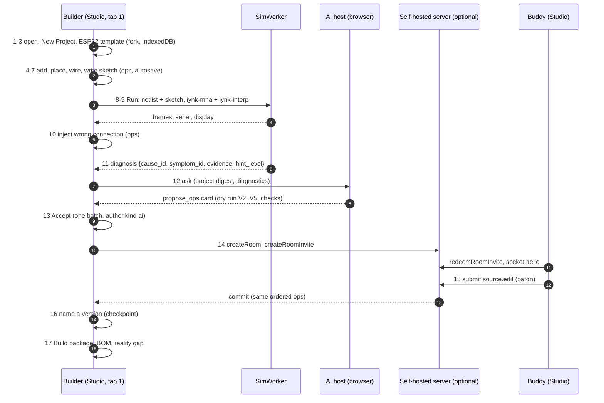

# Demonstration walkthrough: ESP32 environmental monitor, line-follower robot, quadcopter

Status: specification, review-fix pass 2026-10-27. Nothing here is built.
Satisfies BRIEF section 30 and BRIEF section 34 item 7 ("the original-project builder has an end-to-end design").
Upstream: `BRIEF.md` 30; decisions D-013 to D-016 (`00_EXECUTIVE/DECISION_REGISTER.md`); `PROJECT_DATA_MODEL.md` (PDM); `schemas/project.schema.json`; `schemas/openapi.yaml`; `schemas/examples/env-monitor-esp32.project.json` (the fixture); `SIMULATION_ARCHITECTURE.md` (SIM); `../03_PRODUCT/STUDIO_EDITOR.md` (STU); `REALTIME_ARCHITECTURE.md` (RT); `AI_ARCHITECTURE.md` (AI); `ROBOTICS_ARCHITECTURE.md` (RA); `DRONE_ARCHITECTURE.md` (DA); `../03_PRODUCT/COMMUNITY.md` (CM, build package); `../01_AUDIT/SECURITY_BASELINE.md`.
Downstream: journeys J-03 to J-09, J-11, J-12 (`../03_PRODUCT/USER_JOURNEYS.md`); features named per step; test ids `WT-nn` (ESP32), `WT-Rn` (robot), `WT-Dn` (drone), defined here. No new ADR is needed; the gaps in section 6 point at the ADRs and documents that own the fix.
Linked from `SYSTEM_ARCHITECTURE.md` section 19.4.

Labels: VERIFIED (read in a file or code), DOCUMENTED (another spec file states it), EXTERNAL, ESTIMATED, HYPOTHESIS, UNKNOWN. Step status: **OK** (the contract documents as written support the step), **PENDING RS-xx** (waits for a spike with no verdict; the rule is named), **GAP** (the architecture lacks a piece; section 6 lists it and who owns the fix).

## 0. How to read this file

Each of the 17 steps of BRIEF 30 gets one table with the same ten rows: UI module (the STUDIO_EDITOR section), data structure (a `$defs` name of `project.schema.json` or an op kind, or a record from another spec), API call (an `operationId` of `openapi.yaml`, a room socket frame, or "none, local"), engine, persistence path, security check, validation rule, expected result, test id, status.

Conventions:

| Item | Meaning |
|---|---|
| Builder, buddy | The person driving (`usr_amar`) and the friend (`usr_friend1`), the two actors of the fixture. D-013 replaces "student" with the maker who uses the lab with friends |
| Fixture | `env-monitor-esp32.project.json`. It is the end state of an assembled project: revision 142, a named checkpoint at 140 ("Sensor reads, display works"), one buddy edit at 141, one disabled fault at 142, one export record (`arduino-sketch-zip`). It has no AI proposal and no second device. Where a step needs data the fixture lacks, the op is written out here and marked "constructed" |
| Revisions | `r+n` means n revisions after the revision the step started at. Where the fixture has a value (140, 141, 142) it is used |
| "None, local" | No network call. Everything runs in the browser (D-015, ADR-0002). The server is optional |
| Tests | `WT-nn` ids are local to this file. The harness is one Node script `walkthrough.e2e.ts` driving `apply`, the validators, the SimWorker and the AI host with scripted inputs, plus Playwright for the UI rows. Steps that are UI only reuse the `STU-nn` tests of STUDIO_EDITOR section 17 |

The path of the whole story:

## 1. The ESP32 environmental monitor: facts the steps rely on

| Fact | Value | Source |
|---|---|---|
| Project id, title | `prj_env-monitor`, "Environmental monitor" | fixture `id`, `meta.title` |
| Board | `brd_esp`, refdes `U1`, definition `core.esp32-devkitc@1.0.0`, `powerInput: "pin5"`, language `arduino-cpp`, entry `src_main`, sources `src_main`, `src_display`, libraries `Wire`, `Adafruit_BME280`, `Adafruit_SSD1306` | fixture `boards[0]` |
| Parts | `cmp_bme` U2 `core.bme280-breakout` address 118 (0x76); `cmp_oled` U3 `core.ssd1306-i2c-128x64` address 60 (0x3C); `cmp_ps1` PS1 `core.bench-supply` 5 V 0.5 A; `cmp_r1`, `cmp_r2` 4,700 ohm pull-ups | fixture `components` |
| Nets | `net_5v` (PS1 POS, ESP P5V); `net_3v3` (ESP P3V3, BME VIN and CSB, OLED VCC, R1.P1, R2.P1); `net_gnd` (ESP GND, BME GND and SDO, OLED GND, PS1 NEG); `net_sda` (ESP GPIO21, BME SDA, OLED SDA, R1.P2); `net_scl` (ESP GPIO22, BME SCL, OLED SCL, R2.P2) | fixture `nets` |
| Sketch | `monitor.ino` (`src_main`): `Wire.begin(21, 22)`, `bme.begin(0x76)`, prints `T=<t> H=<h>` once a second, calls `displayShow`. `display.h` (`src_display`): `Adafruit_SSD1306 oled(128, 64, &Wire, -1)`, `oled.begin(SSD1306_SWITCHCAPVCC, 0x3C)` | fixture `sources` |
| Runtime and solver | `rtm_esp` engine `iynk-interp` on `brd_esp`; solver `iynk-mna`; seed 7; duration 5,000 ms | fixture `simulation` |
| World | input `temp` (quantity `temperature-c`, device `{kind: registry, device: bme280, address: 118}`, default 22 degC); script: 30 degC at 2,000 ms, 18 degC at 4,000 ms | fixture `simulation.world` |
| Test `boots` | c1 `node-voltage` `net_3v3` between 3.2 and 3.4 V at 200 ms; c2 `serial` regex `^T=-?[0-9]+\.[0-9] H=[0-9]+$` at least 3 lines by 4,000 ms; c3 hidden `serial` `^T=30\.` by 4,500 ms | fixture `tests` |
| Fault | `flt_swap`: `cause_id: "swapped-pins"`, `kind: wrong-connection`, `target.nets: [net_scl, net_sda]`, `enabled: false` (op `seq 142`) | fixture `simulation.faults[0]`, `history.ops[1]` |
| Access | owner `usr_amar`; grant `usr_friend1` role `editor`; `visibility: buddies`; `authority: advisory` | fixture `access` |
| Export record | `arduino-sketch-zip`, revision 142, loss `library-versions-unpinned`, sha256 `14813e8d...` | fixture `exports[0]` |

Honesty about the fixture (VERIFIED by reading it against the contracts; findings F1 to F4 are in section 6):

| Check | Result |
|---|---|
| Addresses agree: BME280 `SDO` on `net_gnd` gives 0x76, code opens 0x76, param 118 | consistent |
| `CSB` on `net_3v3` selects I2C mode | consistent |
| Pull-ups on both bus nets to `net_3v3` | present, so the `i2c-missing-pullup` rule must stay quiet (SIM 9.1 rule 4) |
| `powerInput: "pin5"` | a documented value (PDM 5.4 `boards`: `usb`, `jack`, `pin5`) |
| `fault.cause_id = "swapped-pins"` | in the closed core cause list (SIM 13.4); the fixture was corrected, F1 is closed |
| `kind: "wrong-connection"` with `target.nets` | no mapping to the pin-level `FaultOp` `swap` of SIM 13.2; see F2 |
| Sketch is two files | the interpreter takes one source string (`src/lib/interp/run.ts:20`, `compileSketch(this.opts.source, w)` at `run.ts:165`); see F3 |
| `Adafruit_BME280` | not in the library registry (`libs.ts:1411-1434`, SIM 4.2 libraries row); see F4 |
| Document hash prefix | `9bd83afe9598a898` for the file as stored (PDM section 8 fixture table); the hash of the file after each step below is recomputed by the harness, not stated here |

## 2. Walkthrough A: ESP32 environmental monitor (17 steps)

### Step 1. A builder opens iynk

| Row | Content |
|---|---|
| UI module | Home / project library (STU 4.2 "Create blank", 3.1 top bar). First visit shows the starter list (F-175). Route is a static client page (ADR-0401) |
| Data structure | Library `index` rows `{name, updatedAt, hash, board, size, hasFileCopy, archived}` (PDM 12.1). No project document yet (a Draft is not in the library until the first op, STU 4.1) |
| API call | None, local. `getServerInfo` is called only if a server URL is configured; the answer sets `features` flags (F-012, F-166). Without a server the app says nothing about it |
| Engine | None. The capability probe (ADR-0002) records whether IndexedDB, Web Workers, `navigator.storage.persist` and Web Locks exist |
| Persistence | IndexedDB database `iynk`, the 19 stores of ADR-0106 (PDM 12.1). First project creation asks `navigator.storage.persist()` once (STU 4.4) |
| Security check | Offline shell served from the same origin; no third-party script. CSP and headers per SECURITY_BASELINE X4. The `keys` store stays outside every export path (AI 9.2) |
| Validation | None (no document). If the library holds a record that fails V2 or V3, it appears in the recovery list, never silently deleted (PDM 9.3, R-028) |
| Expected result | Library renders from IndexedDB with no network call. Works with the network blocked. Save-state chip absent until a project opens |
| Test id | WT-01: Given a cold profile and all requests outside the app origin blocked, When the home route loads, Then it renders the New button and an empty library with no console error (reuses STU-26) |
| Status | OK |

### Step 2. The builder chooses New Project

| Row | Content |
|---|---|
| UI module | New dialog: Blank tab and Template tab (STU 4.2 "Create blank", "Create from template"; F-084). Command palette entry `project.new` (Ctrl/Cmd+N) |
| Data structure | A new `prj_` ULID (ADR-0102); a document with `format`, `schemaVersion "1.1"`, `meta {kind: "project", title: "Untitled", locale}`, `actors` with the local person, `access.owners`, `provenance.origin {kind: "blank"}`, `license {spdx: "LicenseRef-iynk-pending"}` (STU 4.2) |
| API call | None, local |
| Engine | None |
| Persistence | Nothing is written until the first op commits (STU 4.1). Then `projects` and `index` in one IndexedDB transaction (two-slot write, PDM 12.1) |
| Security check | Local actor id comes from the device identity (ADR-0007), not from user text. Title is data, rendered as text (PDM 13) |
| Validation | V2 schema on the new document; V3-ACTOR (owner is in `actors`) |
| Expected result | Dialog opens in under one frame; Cancel leaves no record |
| Test id | WT-02: Given the New dialog, When I cancel, Then `index` is unchanged; When I confirm Blank, Then the first op is `meta.set` and the library lists one row (STU-23, STU-24 for forks) |
| Status | OK |

### Step 3. They choose an ESP32 environmental monitor

| Row | Content |
|---|---|
| UI module | Template tab (STU 4.2, fork-on-open 4.3). Two routes: (a) template "ESP32 environmental monitor" (the fixture as a template); (b) Blank with board "ESP32 DevKitC" (STU 4.2, R-072) |
| Data structure | Route (a): fork of the template with `provenance.origin {kind: "template", template: ...}` and a named checkpoint "Start" at revision 0 (STU 4.3 item 1). Route (b): `board.add {board: {id: "brd_esp", definition: {ref: "core.esp32-devkitc", version: "1.0.0"}, refdes: "U1", powerInput: "pin5", firmware: {...}}}` plus `dep.set` for the pinned interface (the fixture `dependencies.components` entry has 38 pins, group `g_GND`) |
| API call | None, local |
| Engine | None yet. The board's profile (`src/lib/interp/profiles.ts:236-262`, 12 profiles, ESP32 is T1) is read for the tier chip |
| Persistence | IndexedDB `projects` and `index`; `revisions` gets the "Start" snapshot |
| Security check | A template is data; its hidden solution (`ext["x-iynk-solution"]`) is not copied into the fork (STU 4.3 item 2) |
| Validation | V2, V3-DEF (every definition has a dependency entry), V3-DEP-DUP, V3-FW (firmware entry exists in sources), V6-UNKNOWN-PART warning if a part is absent from the registry (opens as placeholder, STU-30) |
| Expected result | A project titled "Environmental monitor", one board `U1`, tier chip "Teaching model", banner "Your code runs in iynk's built-in interpreter, a teaching subset of Arduino C++. It is not running on a chip." (SIM 4.4) |
| Test id | WT-03: Given the template, When I open it, Then a new `prj_` exists, `origin` is `template`, the "Start" checkpoint exists, the template record is unchanged, and the document passes V2 to V4 (STU-23) |
| Status | **GAP** for route (a): no ESP32 monitor template is in any catalogue list (F-084 names "about ten Uno lessons"). **PENDING ST-8** for route (b): the ESP32 board descriptor arrives in STUDIO slice ST-8 (STU 16), after the Uno gate. Owner: STUDIO / COMPONENTS (GAP G1) |

### Step 4. They add a temperature sensor, a display, a power source and the other necessary parts

| Row | Content |
|---|---|
| UI module | Palette: search, categories, recent (STU 6.12, left rail 3.1). Placement by drop or click-to-place (STU 6.4). The "other necessary parts" come from the static rules: `missing-supply` and the I2C pull-up rule suggest R1 and R2 |
| Data structure | Per part one batch: `dep.set` (pinned interface from the descriptor), `component.add {component: {id, definition: {ref, version}, refdes, params}}`, `view.place` (placement). Fixture parts: `cmp_bme` (params `{address: 118}`), `cmp_oled` (`{address: 60}`), `cmp_ps1` (`{volts: 5, limit_a: 0.5}`), `cmp_r1` and `cmp_r2` (`{ohms: 4700}`) |
| API call | None, local |
| Engine | None. Static pass `staticProblems` (F-028) runs in an idle task over the changed nets |
| Persistence | Autosave debounced 1 s or 5 s max (STU 4.4) to IndexedDB; one undo entry per placement (STU 11.2) |
| Security check | Part refs are looked up in the registry; an unknown ref is a placeholder, never fetched from a URL. Op size caps (PDM 9.4: 2,000 components, 16 boards) |
| Validation | V3-REFDES (unique refdes), V3-PARAM (only declared param keys), V3-PARAM-RANGE (address 0 to 127, volts 0 to 30), V3-DEP-DUP, V3-DEP-UNUSED |
| Expected result | Five components plus the board listed in Outline. Each part shows its model chip: BME280 "Teaching model" if its register device exists, otherwise the grey "not modelled yet" hatch (STU 10.3, R-064) |
| Test id | WT-04: Given the blank ESP32 project, When the five parts are added by the scripted batches, Then `components` equals the fixture's list (ids, refdes, params) and V3 passes. Also STU-04 and STU-14 (typing `4k7` writes `ohms: 4700`) |
| Status | **GAP** (G2): the registry first release holds Uno, LED, resistor, button, buzzer, potentiometer and one I2C display (PRD acceptance text for the first registry, around line 449); `core.bme280-breakout` is row 16 of the component list (COMPONENT_ECOSYSTEM) and has no register device in the simulator yet (F4). `core.bench-supply` and `core.resistor` are in the first set |

### Step 5. They place the components on the canvas

| Row | Content |
|---|---|
| UI module | Schematic view (STU 8.2), the lens named in the fixture: `vw_sch` with placements. Auto-layout is computed until the first manual move freezes it (STU 6.4, STU-13). Breadboard view is the alternative lens (STU 8.1) |
| Data structure | `view.place {view: "vw_sch", placement: {c, x_mm, y_mm, rotation_deg?}}`. Fixture positions: `brd_esp` (0, 0), `cmp_bme` (120, -20), `cmp_oled` (120, 40), `cmp_ps1` (-80, 0), `cmp_r1` (80, -50) rot 90, `cmp_r2` (90, -50) rot 90 |
| API call | None, local |
| Engine | Renderer (`Renderer` interface, SVG DOM with LOD and culling, STU 5.1, 5.4). RS-01 is INCONCLUSIVE on phone and Chromebook, so the frame budget is not claimed for them |
| Persistence | A drag is one `view.place` at release (STU 11.2); layout-only, so a running simulation is not marked stale (STU 11.4) |
| Security check | None beyond op validation. Placement coordinates are numbers within schema range |
| Validation | V3-PLACE (placement names an existing instance); STU-11 (moving a part never changes `nets`, PDM N6) |
| Expected result | All six placements visible; Fit view shows them; `nets` unchanged by moving |
| Test id | WT-05: Given the five parts, When each is placed at the fixture position, Then `views[0].placements` equals the fixture and `nets` is still empty; STU-02, STU-11 |
| Status | OK |

### Step 6. They connect the pins

| Row | Content |
|---|---|
| UI module | Wiring tool: drag pin to pin, or tap, tap (STU 6.7); verdict ring (STU 10.2); refusals closed list (STU 7.1); electrical mistakes are allowed with a flag (STU 7.2) |
| Data structure | `wireRecipe` batches (STU 6.7 table). First wire PS1.POS to ESP P5V: `net.create {net: {id: "net_5v", name: "5V", class: "power", connections: [{c: "cmp_ps1", p: "POS"}, {c: "brd_esp", p: "P5V"}]}}` then `wire.add {view: "vw_sch", wire: {id: "wir_1", net: "net_5v", from: {kind: "pin", c: "cmp_ps1", p: "POS"}, to: {kind: "pin", c: "brd_esp", p: "P5V"}}}`. Later wires use `net.connect {net, pin}` + `wire.add`. Seven wires `wir_1` to `wir_7` in the fixture. Derived netlist: `refdes.pin` per net (PDM netlist derivation, F-078) |
| API call | None, local |
| Engine | Static rules (F-028): pin-type pairs of STU 7.2, `missing-ground`, `missing-supply`. No solve |
| Persistence | One undo entry per wire (STU 11.2); autosave after the batch |
| Security check | Ops only touch ids that exist; `permission` and `read-only` refusals apply when the tab is a second writer (STU 4.4) |
| Validation | V3-PIN, V3-PIN-TWICE (a pin is in at most one net), V3-NET-NAME, V3-WIRE-NET, V3-WIRE-END (a pin end is a member of the wire's net), V3-WIRE-SELF |
| Expected result | The netlist equals the five fixture nets. No error-level Problem. GPIO21 and GPIO22 are the I2C pins the sketch binds in step 7. The BME280 `SDA` pin type is `open_drain` and the ESP pin `digital_io`: no contention hit (STU 7.2 row "open_drain with open_drain: none") |
| Test id | WT-06: Given the placed parts, When the seven wire batches are applied, Then the derived nets equal the fixture `nets` as sets of sets and V3 passes with zero errors (STU-06, STU-10 oracle) |
| Status | OK for wiring. Note: the pin-type pair table of STU 7.2 has no I2C-specific row; the swap in step 11 is caught by the bus layer, not by this table |

### Step 7. They write the controller program

| Row | Content |
|---|---|
| UI module | Code dock: a tab per source (STU 3.1 bottom dock), CodeMirror; Files rail lists `monitor.ino`, `display.h`, `NOTES.md`. Per-keystroke-burst journal (STU 4.4) |
| Data structure | `source.add {source: {id: "src_main", path: "monitor.ino", language: "arduino-cpp", role: "firmware", board: "brd_esp", content}}`, then `source.edit {id, baseSeq, pos, del, ins}` for typed text (insert up to 65,536 characters per op). `board.set` with a `firmware` patch `{entry: "src_main", sources: ["src_main", "src_display"], libraries: [...]}`. `dep.set` for library entries (`Adafruit BME280 Library 2.2.4`, `Adafruit SSD1306 2.5.9`, shim `Wire`) |
| API call | None, local. Interpreter diagnostics come from the SimWorker `load()` (SIM 8.1). `createCompileJob` is not used: ESP32 has no compile path in the plan |
| Engine | `iynk-interp`, profile ESP32 DevKitC, T1. `load(image)` returns diagnostics `{file, line, column, hint}` (SIM 8.1). Library calls resolve against the library registry |
| Persistence | Text edits journalled in `journal`, committed as `source.edit` ops; each source at most 262,144 UTF-8 bytes (V4-SOURCE) |
| Security check | Source text is data. No `eval` or `Function` of user text (SIM 8.8, SECURITY_BASELINE X1, lint rule SA-11). Path rules V3-PATH (no `..`, no leading `/`) |
| Validation | V3-PATH, V3-SRC-BOARD, V3-FW (entry in list), V4-SOURCE, V3-TOKEN. Code diagnostics are Problem records with `source: "code"` (STU 10.1) |
| Expected result | Sketch with no red squiggle. If the library registry lacks a class, the Problem reads "{construct} is not supported by the interpreter. Real ESP32 code can use it." and names the line (SIM 4.4 "Unsupported construct") |
| Test id | WT-07: Given the fixture sources, When `load()` runs on the ESP32 profile, Then it returns zero error diagnostics and the includes `Wire.h`, `Adafruit_BME280.h`, `Adafruit_SSD1306.h`, `display.h` all resolve |
| Status | **GAP** (G3, G4): (1) the interpreter takes one source string, so `#include "display.h"` is recorded as an include name and not resolved (`src/lib/interp/arduino/parser.ts:88-91` records `inc[1]` for quoted and angle forms alike; no file lookup exists). `ProgramImage.files[]` (SIM 8.1) is the target. (2) `Adafruit_BME280` is not in the library registry (SIM 4.2 lists SSD1306, NeoPixel, PWMServoDriver, LiquidCrystal, MPU6050, QTRSensors, WiFi, WebServer, ArduinoLEDMatrix, ESP). Until both exist this step ends in the "not supported" Problem |

### Step 8. They run the simulation

| Row | Content |
|---|---|
| UI module | Top bar Run, Stop, Reset, speed, tier chip (STU 3.1); status line shows virtual time and "running slower than real time" if so (SIM 4.4); Serial monitor in the dock (F-207) |
| Data structure | `Simulation` block: `runtimes [{id: "rtm_esp", board: "brd_esp", engine: "iynk-interp"}]`, `solver {engine: "iynk-mna"}`, `seed 7`, `duration_ms 5000`, `world.inputs [temp]`, `world.script`. The orchestrator receives `{netlist, programs, inputs, seed, versions}` and returns `frame`, `event`, `loaded.diagnostics` (SIM 17.2). Netlist derived from the document, not from the drawing (SIM 5.2, F-078) |
| API call | None, local (the SimWorker is a Web Worker; the server never simulates, RT 13.1, SIM 17.4) |
| Engine | Orchestrator loop (SIM 5.6): digital engine L3, `iynk-mna` DC solve L4 for the 5 V to 3V3 rail and pull-ups, `iynk-interp` L5 for the sketch, I2C bus model L6 (`I2cBus {sda: net_sda, scl: net_scl, speedHz}`), BME280 register device (L6, `device:i2c/bme280@1`) and SSD1306 device with its framebuffer. Rapier is not loaded (RA-26) |
| Persistence | Run state is never saved (STU 3.2 RunState). The run can be saved as a replay asset by explicit action (`asset.add` role `replay`) |
| Security check | Worker isolation: logical heap 64 MiB, 400,000 statements per slice, 2 s kill, serial 1 MiB per run (SIM 8.8, SECURITY_BASELINE X2). A hostile sketch kills the worker, not the tab |
| Validation | Netlist limits at `load()`: 2,000 parts, 20,000 connections, 5,000 analog nodes (SIM 8.8). Static error-level hits show "Run anyway" after the first press (STU 7.2) |
| Expected result | `boot` then `T=22.0 H=<n>` lines at 1 Hz in the serial monitor; `net_3v3` reads 3.2 to 3.4 V (check c1); tier labelled T1 with "approx" tags (SIM 14.3) |
| Test id | WT-08: Given the fixture and seed 7, When the test `boots` runs headless for 5,000 ms, Then checks c1, c2, c3 pass, and ten repeated runs produce identical serial text and identical 1,000 ms checkpoint hashes (SIM class B) |
| Status | **GAP** (G3, G4 as step 7) and **PENDING** for c1: the 3.3 V rail needs a regulator element on the ESP32 board descriptor (SIM 7.6 behavioural regulator); today the T0/T1 rule path covers USB sag only. The bus is "zero time" until SA-09 lands (SIM 9.1 rule 1). Everything else is OK |

### Step 9. The virtual display shows the sensor data

| Row | Content |
|---|---|
| UI module | Display widget on the canvas next to `cmp_oled` (STU 10.3 part state overlay); the same pixels appear in the Instruments dock. Part state comes from `SolveResult.state` and the device framebuffer |
| Data structure | `frame.snapshot` keyed by document ids (`netVolts`, `pinState`, `branchAmps`, `partState`; request O-S4 in STU 10.3 notes that this keying is not yet defined in SIM). The SSD1306 `Ssd1306` device holds `fb` (128 x 64) and the text list `world.oled.texts` (`libs.ts:1043-1110`) |
| API call | None, local |
| Engine | Interpreter calls `oled.print`, `oled.display`; bus model carries the I2C transactions to the SSD1306 device (functional, T1, zero bus time today). The world input `temp` moves 22 to 30 degC at 2,000 ms and to 18 degC at 4,000 ms (`world.script`) |
| Persistence | None |
| Security check | Display text is drawn as text, not HTML (PDM 13) |
| Validation | Check c3 (hidden): `^T=30\.` by 4,500 ms. Hidden is a UI convention, not secrecy (STU 4.3 item 4) |
| Expected result | Display shows `22.0 C` and a humidity line, then `30.0 C` after 2 s, then `18.0 C` after 4 s. Label: "Teaching model: sensor values are nominal datasheet curves, no noise, no tolerance" (SIM 4.2 sensors row). The panel "What it models" lists I2C functional transfer as modelled, bus timing as "not modelled yet" until SA-09 |
| Test id | WT-09: Given the run of WT-08, When I read the SSD1306 text list at 1,500 ms, 3,500 ms and 4,500 ms, Then it holds `22.0 C`, `30.0 C`, `18.0 C` in turn (class B) |
| Status | **GAP** (G4: BME280 device model) and **GAP** (G5: `frame.snapshot` keyed by document ids, STU O-S4) |

### Step 10. They intentionally create an incorrect connection

| Row | Content |
|---|---|
| UI module | Two ways, both ending in the same document state class. (a) Rewire by hand: drag the wire end of `wir_4` from GPIO21 to GPIO22 and `wir_5` from GPIO22 to GPIO21 (STU 6.7; the editor allows it, STU 7.2). (b) "Break it" button on the circuit (F-030): toggles the fixture fault `flt_swap` |
| Data structure | (a) constructed batch `swap-by-hand`: `wire.remove wir_4`, `wire.remove wir_5`, `net.connect {net: "net_sda", pin: {c: "brd_esp", p: "GPIO22"}, move: true}`, `net.connect {net: "net_scl", pin: {c: "brd_esp", p: "GPIO21"}, move: true}`, `wire.add wir_8 {net_sda, GPIO22 to BME SDA}`, `wire.add wir_9 {net_scl, GPIO21 to BME SCL}` (the wires must be rebuilt because V3-WIRE-END requires each pin end to be a member of the wire's net). (b) `fault.set {fault: {id: "flt_swap", cause_id: "swapped-pins", kind: "wrong-connection", target: {nets: ["net_scl", "net_sda"]}, enabled: true}}`, the fixture op at `seq 142` with `enabled` turned on at `r+1` |
| API call | None, local |
| Engine | None yet. The run is marked stale by either path: class "changes the circuit" for (a) and "changes the run itself" for (b) (STU 11.4); banner "The design changed since this run began. Restart?" |
| Persistence | One undo entry for (a) (one batch); one for (b) ("Break it" toggles are one entry each, STU 11.2). Autosave |
| Security check | Fault ops are not R3 for the AI, but a person may issue them freely; in a room `fault.*` needs role owner or editor (RT 6.2) |
| Validation | (a) V3-PIN-TWICE, V3-WIRE-END, V3-WIRE-NET at batch end. (b) V3-FAULT (target nets exist). The schema pattern for `cause` is `^[a-z0-9][a-z0-9.-]{0,63}$`, which accepts `swapped-pins` |
| Expected result | The circuit is now wrong on purpose and the editor says so only if a static rule knows (step 11). Undo restores the earlier `stateHash` exactly (STU-04 style) |
| Test id | WT-10: Given the fixture at the checkpoint state, When batch `swap-by-hand` is applied, Then V3 passes, `net_sda` holds GPIO22 and `net_scl` holds GPIO21, and Undo restores the previous hash; and When `flt_swap` is enabled, Then `simulation.faults[0].enabled` is true |
| Status | OK for (a), constructed here (HYPOTHESIS that the six-op batch is what the tool emits; WT-10 settles it). (b) has an open part of G6: the fixture's `kind: "wrong-connection"` with `target.nets` has no defined translation to a pin-level `swap` (SIM 13.2) |

### Step 11. The simulation either detects the error or states why it cannot

| Row | Content |
|---|---|
| UI module | Problems pane, canvas badges, serial monitor (STU 10.1 to 10.3). A run problem carries a `diagnosis`; in an ordinary project it opens at hint level 3, in a challenge project at 0 (STU 10.1) |
| Data structure | `Diagnosis {cause_id: "swapped-pins", symptom_id: "i2c-device-not-found" (PROPOSED id), evidence: Evidence[], hint_level: 3}` (D-010, SIM 13.4). Evidence rows: `serial-line` "BME280 not found" (provenance `computed`, tier T1); `pin-level` GPIO21 net contains the SCL pins of U2 and U3 (provenance `computed`); `net-voltage` pull-up level for context. `Problem {source: "run", severity: "error", rule: "swapped-pins", targets: [net_sda, net_scl, brd_esp.GPIO21, brd_esp.GPIO22]}` |
| API call | None, local |
| Engine | L6 bus builder: when the interpreter runs `Wire.begin(21, 22)` it calls `attachBus`; the builder resolves `sda = net of GPIO21`, `scl = net of GPIO22`, then checks the device pins on those nets against their designators. Devices find their `SCL` pin on the bus `sda` net, so the transaction at 0x76 gets no ACK (`I2cDevice.start` returns `nack`, SIM 9.1 rule 2). The sketch prints `BME280 not found` and stops. The detector is the topology rule `swapped-pins` ("topology versus descriptor expected function", SIM 13.4), run statically after the batch and confirmed by the bus result |
| Persistence | Diagnoses are run output, not document data. A replay record may be saved on request |
| Security check | None specific. The cause list is a closed core list plus `x-` extension ids (SIM Objection 3) |
| Validation | None (this is a simulation diagnosis, not a V3 diagnostic; PDM 9.1 keeps them separate) |
| Expected result | Within the first second of virtual time the serial monitor shows `BME280 not found`; the Problem names U2, U3 and the two GPIO pins; the display stays blank. If the model cannot decide (for example the BME280 has no device model) the tool says: "{part} is not modelled yet. The rest of the circuit still runs." and the cause `bus-device-not-modelled` is raised at the calling line, never a silent `0xFF` (SIM 9.1 rule 3) |
| Test id | WT-11: Given the swapped project, When it runs 2,000 ms, Then exactly one Diagnosis with `cause_id` `swapped-pins` exists, `evidence` holds the serial line, and the display framebuffer is empty; and given the BME280 model removed, When it runs, Then the cause is `bus-device-not-modelled` at the `bme.begin` line |
| Status | **GAP** G6 and G7: (1) the fixture cause id is now `swapped-pins`, so that part of G6 is closed; (2) the list has no id for "bus device did not acknowledge", so the symptom id above is a PROPOSAL; (3) the topology rule needs the descriptor to declare the default I2C alternate functions of GPIO21 and GPIO22 (ESP32 can route I2C to other pins, so the rule must use the bound pins from `Wire.begin`, not the defaults). The honest limit statement in the last row is already specified |

### Step 12. They open the AI assistant, which reads the circuit, the code and the diagnostics

| Row | Content |
|---|---|
| UI module | AI dock (AI 4.1, F-105 to F-114). Hint ladder buttons "Another hint", "Show me" (AI 8.3). Mode: ordinary project, so level 3 is reachable at once |
| Data structure | Context pack at revision N: digest levels D0 to D2, trust classes (AI 5.2). Read tools (AI 6.2): `get_project_summary`, `get_netlist {around: "brd_esp", depth: 2}`, `get_source {id: "src_main"}`, `get_diagnostics {kind: "runtime"}`, `get_sim_state`, `get_component {id: "cmp_bme"}`. Results carry tier and provenance. Hidden causes are omitted from `get_diagnostics` in challenge mode (AI 8.4) |
| API call | None, local to the project; the model call is made from the browser straight to the provider with the person's own key (D-015, ADR-0008). Optional via the server: `aiRelay` (`POST /v1/ai/relay`, key in `x-iynk-provider-key`, allowlisted host, 256 KiB body, 120 s) |
| Engine | AI host in a browser worker; no simulation engine, though `try_ops` and the checks of step 13 run the SimWorker on a copy |
| Persistence | Thread and proposal records in IndexedDB (AI 7.2 `ProposalRecord`); key in the `keys` store, shown as the last 4 characters (AI 9.2). Not in the document or any export |
| Security check | Prompt-injection handling by trust class: project text, source comments and buddy chat are untrusted data (SECURITY_BASELINE A1, A2, A3). The model sees a fenced read-only snapshot. Output markdown is rendered without raw HTML (X5). The secret-shape scan runs on the message so a pasted key is not sent as text (AI 9.2). No key means the dock shows the add-a-key state; nothing is sent |
| Validation | Tool arguments validated by zod per tool; result at most 6,000 bytes (AI 6.2) |
| Expected result | The partner's reply states facts and inference separately (AI 5.9): "GPIO21 is wired to the SCL pins of U2 and U3; the sketch uses GPIO21 as SDA" (fact) and "so the sensor cannot answer" (inference), with `[[ref]]` highlights on `net_sda`, `net_scl` |
| Test id | WT-12: Given the swapped project and a stub provider that records requests, When I ask "why is the display blank?", Then the first request holds the digest, `get_diagnostics` returns the Diagnosis of WT-11, no request contains a key or an unredacted secret-shaped string, and every reference the reply cites resolves to an existing id |
| Status | OK in design. Depends on step 11 for the diagnosis content |

### Step 13. The assistant offers a reviewable correction; the builder accepts it

| Row | Content |
|---|---|
| UI module | Diff card with ghost overlay and a list form (AI 7.5, STU 11.3); buttons Accept all, Accept some, Reject. "Accept anyway" if checks fail |
| Data structure | `propose_ops {title: "Swap SDA and SCL back", kind: "fix", rationale, steps: [{id: "s1", label, ops}]}` with ops = the inverse of the step 10 batch: `wire.remove wir_8, wir_9`, `net.connect {net: net_sda, pin: GPIO21, move: true}`, `net.connect {net: net_scl, pin: GPIO22, move: true}`, `wire.add wir_4`, `wire.add wir_5`. Stored as `Proposal {id: "prp_...", base: N, author: {actor, model}, ops, status: "open"}`; risk class R2 (wire removal, `net.connect` is R1, AI 7.6). On Accept: one batch, envelope `author {actor: "usr_amar", kind: "ai", proposal: "prp_..."}` |
| API call | None, local. In a room the batch goes as a `submit` frame (RT 7.3) |
| Engine | Pipeline P1 to P8 (AI 7.4): arguments, schema, allow-list, permission, secret scan, dry run on a copy at the current revision (V2 to V5), checks: electrical rules delta plus test `boots` on a bounded run (min(runMs, 5,000 ms) of simulated time, 2 s wall). SimWorker used on the copy only |
| Persistence | `ProposalRecord` with `diffHash`; on accept the ops land in the op log and the document, autosave follows. One Accept is one undo step (AI 7.5 item 6) |
| Security check | R3 ops are never proposable (`access.*`, `license.set`, `asset.add`, `domain.set`, solver changes, unknown `dep.set`). Permission check: asker role owner or editor (P4). The card applies only what it displayed (diffHash re-check). The proposal is never auto-applied (SECURITY_BASELINE A4) |
| Validation | P6 dry run: deferred invariants N1 to N3, W1 to W4 at batch end; reject codes closed list (`invariant`, `missing_target`, `pin_in_use`, ...). A stale `base` triggers the overlap scan (AI 7.5) |
| Expected result | Card shows "nets: net_sda + brd_esp.GPIO21, net_scl + brd_esp.GPIO22", test `boots` passes in the dry run, no new error. After Accept, `nets` equals the fixture's again, the project passes V3, the run restarts and prints `T=` lines |
| Test id | WT-13: Given the swapped project and a scripted proposal, When I Accept, Then the document hash equals the pre-swap hash of the same nets and wires, Undo restores the swapped state, and a proposal whose `base` is stale with an overlapping edit is refused with "the project changed since this suggestion" |
| Status | OK. The ops are constructed here (the fixture has no proposal, section 1) |

### Step 14. They invite a collaborator

| Row | Content |
|---|---|
| UI module | Share menu, Work together (STU 4.5); buddy list in the lobby (RT 5.5); Start room dialog with `codeMode` (default `baton`) and `runControl` (RT 5.2) |
| Data structure | `RoomCreate {title, project | projectId, settings {codeMode: "baton", runControl: "editors"}}`; `RoomInvite {buddy | link, role: "editor", maxUses, ttl}`; on redeem the server writes `access.grant {grant: {actor: "usr_friend1", role: "editor"}}` (author kind `system`) so the document mirrors the ACL. The fixture already shows the result: `access.grants [{actor: "usr_friend1", role: "editor"}]`, `visibility: "buddies"` |
| API call | `createRoom` (`POST /rooms`, document at revision r without history, validated V1 to V5, stored as checkpoint 0). `createRoomInvite` (`POST /rooms/{roomId}/invites`, direct to a paired buddy or a link with a 128-bit token in the URL fragment). Buddy side: `redeemRoomInvite` or `acceptRoomInvite`, then socket `hello` with a device signature. Prior to this, pairing used `createPairing` and `redeemPairing` (one time, F-206) |
| Engine | `RoomCore` on the server orders ops; clients apply them with the same `apply` (RT 8.1). The server does not simulate |
| Persistence | Server: SQLite `rooms`, `ops`, `checkpoints`, `acl` (RT 11.1; ADR-0004). Each client keeps its own IndexedDB copy marked shared (R-085). The creating device becomes owner, host, creator |
| Security check | Device-token auth on every call (ADR-0007); socket handshake signs a server nonce (RT 4.3), which closes R4 (takeover by id). Room ids are addresses, not secrets; join to a missing or forbidden room returns the same `room_unavailable` after 200 ms (R2). Enrolment `IYNK_ENROL=code|closed` (`code` by default) (RT 5.3). Quotas: 6 room creations per minute, 10 stored rooms per device (RT 5.2, PROPOSAL). Snapshot validated by the joiner (V2 to V5) before it replaces local state (R9). Token in the fragment is never sent to a server log |
| Validation | Server validates the uploaded document V1 to V5 and the 5,242,880 byte cap; `quota` reject on overflow |
| Expected result | Buddy sees an invite, taps Join, receives snapshot plus op tail, `ready`. Presence shows both members; roles are host and editor |
| Test id | WT-14: Given two clients and a test server, When the builder creates a room and invites the buddy, Then the buddy's document hash equals the builder's at the same `seq`, the redemption increments the use count exactly once, a second redemption of a single-use token fails, and a socket that presents the host's actor id without the device key is refused (R4 test) |
| Status | OK in design (REALTIME is DOCUMENTED, RS-09 PASS for the log). Needs a self-hosted server: without one the step degrades to "send a `.iynk` copy" (STU 4.5), which is a fork and not a shared result |

### Step 15. The collaborator changes the display behaviour; both see a consistent result

| Row | Content |
|---|---|
| UI module | Code dock in baton mode (RT 9): the buddy requests the baton, the holder grants it; other members see the file read-only with the holder's caret (STU 11.2 "In a room, code has one writer at a time"). Presence cursors on the canvas (RT 10) |
| Data structure | Command `baton.request`, `baton.grant {to: "usr_friend1"}`; then `source.edit {id: "src_display", baseSeq, pos, del, ins}` envelopes coalesced to one per 250 ms burst. Example constructed op: change `oled.setTextSize(2)` to `oled.setTextSize(1)` and add a third line for pressure; the fixture's own buddy op (`seq 141`, `src_main`, insert `Serial.println("boot");`) shows the envelope shape: `{opId, seq: 141, base: 140, author {actor: "usr_friend1", kind: "user"}, op {k: "source.edit", id: "src_main", baseSeq: 140, pos: 130, del: 0, ins}}` |
| API call | Socket frames, not REST: `submit {sub, batch?, ops[{opId, base, op}]}`, `commit {seq0, seq1, chain, envs}`, `cmd {name: "baton.grant"}`; run channel `run.req` start, `run.ev`, `run.tick`, `run.check` (RT 7.3, 13) |
| Engine | A `source.edit` is sim-affecting, so an active run halts with reason `edited` on every member at that `seq` (RT 13.4). Restart: the runner (default the host) sends `run.ev control start {atSeq, seed, versions}`; both members run the same sketch from the same ordered state with the same seed. Lockstep: mirrors never simulate past the runner's last `run.tick`; inputs are stamped by the runner (RT 13.2). Hash check `run.check {hb, hd}` every 1,000 ms of simulated time |
| Persistence | Server `ops` table, one row per envelope, chain-hashed; each client autosaves its copy |
| Security check | Server stamps `author.actor` from the authenticated member (never from the frame) and `at` from its own clock; `source.*` ops are accepted only from the baton holder when `codeMode` is `baton`, else `not_baton`; role `viewer` gets `permission` (RT 6.2, closes R6). `author.kind` from a client may be only `user` or `ai`. Dedup of resent first `opId` (RT 8.1 rule 4). Frame rate limit and 4 pending submissions per socket |
| Validation | Server runs `apply` on a working copy, then deferred invariants; V4-SOURCE size; offsets in UTF-16 code units. A rejected submission changes nothing and leaves no log entry |
| Expected result | Both clients show the same display text on the virtual OLED at the same virtual time (class B for digital, MCU and serial; class N for analog within tolerance, SIM 6). `run.check` hashes match every second. Latency on the buddy's mirror is about one network delay plus up to 100 ms (HYPOTHESIS, RT 13.2) |
| Test id | WT-15: Given two clients in a test room, When the buddy edits `src_display` as baton holder and the runner restarts, Then both document hashes are equal at the final `seq`, both OLED text lists are equal at 3,000 ms, `run.check` never reports a mismatch, and a `source.edit` from a non-holder returns `not_baton` and leaves `seq` unchanged |
| Status | OK for the document. **UNKNOWN** for real network behaviour (SYSTEM_ARCHITECTURE section 18: phones, proxies, sleep; tested at the COLLAB gate, R-087). Display consistency needs the display and BME280 models from steps 7 to 9 |

### Step 16. They save a version

| Row | Content |
|---|---|
| UI module | History pane: Name this version; compare two; restore (STU 4.2 "Version", "Compare", "Restore version"; F-093). Top bar chip `saved` |
| Data structure | `Checkpoint {revision, at, author, kind: "named", label: "Display shows pressure line", stateHash, store: "container"}` in `history.checkpoints` (the fixture's existing one: revision 140, label "Sensor reads, display works", `stateHash 097630efe2ac0c752bc7ad7a4650ebe1e9f1a820cf67cf4d461af110aa6d127c`). Snapshot bytes in IndexedDB `revisions` key `prj_env-monitor:<revision>`. At most 256 checkpoints in the header; local retention 50 named plus automatic (PROPOSAL) |
| API call | None, local, for the working copy. For a server-backed project: `listRevisions` and `getRevision` read saved revisions. In a room, a server-side named checkpoint exists in the schema of the store (RT 11.1 "plus named ones") but no command or route creates it |
| Engine | None. State hash is canonical JSON (ADR-0103); folding the op log reproduces it |
| Persistence | IndexedDB `revisions` plus the header; optional `.iynk` or `.iynkz` file save (File System Access API where it exists, STU 4.4) |
| Security check | A snapshot whose `stateHash` does not match its checkpoint is refused on restore (STU 4.2). Restore is a batch of ops, so it is permission-checked like any edit and undoable |
| Validation | V3-HIST-SEQ, V3-HIST-HEAD, V3-HIST-CP (no checkpoint ahead of `revision`) |
| Expected result | The checkpoint appears in History at the current revision with its hash; compare against revision 140 lists the changed source hunks and no net change; restoring revision 140 produces a batch of inverse ops and the document hash equals the 140 snapshot hash |
| Test id | WT-16: Given the project after WT-15, When I name a version and then restore the "Sensor reads, display works" checkpoint, Then the document hash after restore equals the checkpoint `stateHash`, undo returns to the later hash, and both buddies' local copies show the same checkpoint hash for the same revision (the chain is shared) |
| Status | OK for local versions. **GAP** G8: there is no way to create a server-held named checkpoint in a room (no `cmd` name in RT 7.3, no REST route). Local checkpoints on each member's copy cover this story; the shared "host can restore" control of RT 15 needs the route |

### Step 17. They export firmware, circuit description and parts list, and inspect purchasing and physical risk

| Row | Content |
|---|---|
| UI module | Project menu, Export; "Build package" (CM 8.13, J-12); Reality gap panel (CM 8.12, F-162); Prices panel (CM 8.7); loss list shown before writing (STU 4.2 "Export") |
| Data structure | `ExportRecord` (PDM 5.16) `{format: "arduino-sketch-zip", at, appVersion, sha256, revision, loss: ["library-versions-unpinned"]}` appended to `exports` (the fixture's record is revision 142). Package files: `README.md`, `bom.csv`, `bom.md`, `wiring.md`, `flash.md`, `checklist.md`, `tests.md`, `reality-gap.md`, `schematic.svg`, `wiring-diagram.svg`, `netlist.json`, `project.iynk`, the sources (CM 8.13). BOM rows: refdes list, part id and version, value from params, MPN from the descriptor, quantity; virtual parts (`core.bench-supply`) flagged `not-purchasable`. Netlist text: `refdes.pin` per net (PDM 12.2) |
| API call | None, local for all converters (they run in the ProjectWorker, off the main thread). The server does not import or export projects; `.iynk` and `.iynkz` save and open in the browser (API_CONTRACTS 8.4, RC-24). Optional prices: `searchOffers` (`POST /v1/search/offers`, up to 25 parts, up to three searches per part, the person's search key in the provider-key header; the dialog states "up to N searches" before the call). Nearby shops: `searchNearby`. Without a key or server the BOM shows catalogue prices dated and "not live" |
| Engine | Converters `export(project) -> {bytes, loss[]}` (ADR-0109); reality-gap computation reads the fidelity registry tiers and the last run; the static rules supply "risks remaining" |
| Persistence | Download or File System Access write; the `exports[]` record is added by an op or on save (PDM 5.16). Deterministic bytes for a given revision (CM 8.13) |
| Security check | Zip paths are fixed names, no user-controlled path escapes the archive (PDM 13 zip-slip rule). CSV cells starting with `=`, `+`, `-`, `@` are prefixed with `'` (CM-70). Secret-shaped strings in text: warn before writing (V5 hygiene, PDM 13). The `keys` store is never exported. `hazard:mains` refuses the export (CM-69); this project has none |
| Validation | Loss list before write; BOM totals equal a hand count (CM-60: 1 board, 1 BME280 breakout, 1 OLED, 2 resistors, 1 supply flagged not purchasable); netlist compared with `nets` (PDM 12.2 acceptance) |
| Expected result | The zip holds `monitor.ino`, `display.h`, a header comment with library names (versions unpinned: loss code), `bom.csv` with five purchasable lines and one flagged, `netlist.json` with the five nets, a banner "may not compile as exported" (F-090). Reality gap reads: nothing checked against hardware (empty `measurements`); simulated only: BME280 (T1), SSD1306 (T1), ESP32 interpreter (T1) with what each does not model; assumptions: I2C zero bus time, nominal sensor curve; uncertain specs: any part with `generic: true`; risks before wiring a real board: the ESP32 pins are 3.3 V only and the bench supply feeds 5 V to the board `5V` pin, not to the pins; ESP32 strapping pins are not modelled (SIM 4.2 ESP32 row); boot behaviour on GPIO0, GPIO2, GPIO12 and GPIO15 is unmodelled. The word "validated" does not appear (CM-68, D-007) |
| Test id | WT-17: Given the final project, When I run Build package, Then every listed file exists and is byte-identical across two runs, the BOM counts equal the hand count above, `netlist.json` equals the derived nets, `reality-gap.md` contains the five sections and no occurrence of "validated", and no file contains a secret-shaped string |
| Status | **GAP** G9: the export is a sketch folder, not firmware. There is no ESP32 compile path (SIM 4.2 languages row: "Embedded C/C++ for ESP32 ... not supported"; ADR-0306 points to ADR-0013; the compile slot stays "contract only" and the choice is DECIDED as reversible, see the fold-in section), so no `.bin` is produced and the acceptance test of the Arduino export ("opens in `arduino-cli compile` for 20 projects", PDM 12.2) needs a local `arduino-cli` compile timing task (RS-04 as a build task). The brief's "supported firmware project" is therefore met as source plus a flashing guide, and the panel must say so. BOM, netlist and reality-gap parts are OK |

## 3. Walkthrough B: a line-follower robot (original project, smaller)

Source of truth: RA 15 template 3 ("Line follower": drive base plus encoders plus QTR-8RC array), RA 4.3 `domains.robotics.data`, RA 8 sensors, RA 19 acceptance. Physics: Rapier 0.21.0 deterministic split build, step 1/240 s, `world.timestep = 1/240` (RA 6.2), engine choice by RS-13 (SIM 4.3). Board: Arduino Uno R3 (T1 interpreter; avr8js opt-in T3).

Both domain data and mechanics live in the same document: `mechanical.{frames,bodies,joints,mounts}` carry geometry and mass; `domains.robotics` (`$defs/Domains`, `{schemaVersion: "1.0", data}`) carries surfaces, wheels, sensor bindings and the arena with the painted track.

| # | Step | UI module | Data structure | API call | Engine | Persistence | Security check | Validation rule | Expected result and test id | Status |
|---|---|---|---|---|---|---|---|---|---|---|
| R1 | New Project, template "Line follower" | New dialog, Template tab (STU 4.2, 4.3) | Fork with `origin template`; document has `mechanical` (chassis, two wheel joints, caster), `domains.robotics.data` (`physics.sleeping: false`, `surfaces`, `wheels`, `sensors`, `arena.tracks`), a QTR-8RC and TB6612 `component`, `board` Uno | none, local | none | IndexedDB `projects`, `revisions` "Start" | Template solution not copied (STU 4.3) | V2 on `Domains`; RB-E-TREE, RB-E-MASS, RB-E-INERTIA, RB-E-THIN, RB-E-AXIS, RB-E-LIMITS, RB-E-DRIVE, RB-E-WHEEL, RB-E-SURFACE (RA 4.5) | Project opens, robot validator reports zero errors. WT-R1: template loads and passes all RB-E rules | **GAP** G10: template does not exist (RA 15 is a plan; slice R1 builds it); RB rules not yet in the V3 list of PDM |
| R2 | Edit physical properties, for example wheel friction and sensor height | Inspector, robot panel (RA 4, F-213) | `mech.set {collection: "mounts", value: {id: "mnt_qtr", component: "cmp_qtr", frame, pose {position_mm: [x, y, z]}}}` for the sensor mount; wheel friction in `domains.robotics.data.wheels[...]`. Edit op: `domain.set` replaces the whole domain today. RA Objection 2 asks for `domain.patch {domain, patch}` (RFC 7396 merge patch, opSchema 1.1) | none, local; in a room a socket `submit` | none | IndexedDB; one undo entry per commit | R3 for the AI: `domain.set` is never proposable (AI 7.6); `mech.set` is R1 | RB-W-TUNNEL, RB-W-CG, V3-FRAME, V3-MOUNT | Both edits survive when two buddies edit different wheels at once. WT-R2 (RA-20) | **GAP** G11: `domain.patch` is not in `project.schema.json` `$defs/Op` (55 kinds, no `domain.patch`); until opSchema 1.1 a concurrent robot edit is last-writer-wins on the whole domain (RA Objection 2) |
| R3 | Wire driver, motors, encoders and QTR array to the Uno | Schematic and Board view; wiring tool (STU 6.7) | `net.create`, `net.connect`, `wire.add`; sensor `SensorBinding {id, component: "cmp_qtr", mount: "mnt_qtr", query: "surface-sample"}` | none, local | static rules (F-028, F-029) | autosave | none specific | V3-PIN, V3-PIN-TWICE, V3-WIRE-END; RB-V3 `SensorBinding.mount` exists and component is a sensor with the matching channel | Netlist matches the template. WT-R3: nets equal the template's as sets of sets | OK (nets are the same machinery as walkthrough A) |
| R4 | Write the controller (PD steering) | Code dock (STU 3.1) | `source.add`, `source.edit` (Arduino C++ for the Uno); `runtimes [{board: "brd_uno", engine: "iynk-interp"}]` or `avr8js` | none, local | `iynk-interp` T1 (default); `avr8js` T3 opt-in (RS-03: serial text equal on 80 of 80 lines) | `journal`, ops | no `eval` (SIM 8.8) | V3-SRC-BOARD, V3-FW, V4-SOURCE | Compiles in the interpreter. WT-R4 | OK |
| R5 | Run: physics, motors, sensors, code on one clock | Run button; top-down view (RA 20 R1) with the track and robot; instruments for wheel speed | `buildScene(doc, deps): SceneSpec`: bodies sorted by id, then colliders, then joints sorted by id (RA 4.4 rule 1); friction combine rule `Average`, caster `Min`; replay record carries solver iterations and combine rules (RA-04) | none, local (SimWorker) | Rapier at 240 Hz in the SimWorker; DC motor with gearbox, closed form per PWM cycle (RA 7.4: 0.14 to 0.52 percent versus a 5 microsecond reference, VERIFIED as a prototype, no hardware check); QTR `surface-sample` (9 points per channel); encoder edges enqueued with look-ahead (RA 9.2); orchestrator couples electrical and mechanical at P5 (SIM 5.5, 10.4) | Run not saved; optional replay asset | Worker caps (SIM 8.8); Rapier bytes only loaded for robot projects (RA-26) | RB-W-TUNNEL checked at load; `RB-E-COUPLING` if `h * c >= 1` (RA-12) | Robot follows the line; hash at every 1,000 ms checkpoint is identical in ten runs and across Chromium and WebKit (class B, RA-02). WT-R5: ten-run hash equality; speed within BUD-13 (mean step under 1 ms at 6x throttle for the synthetic 64-body scene, RA-07) | **PENDING**: Firefox and x86-64 hash equality untested (RS-13 limits, RA 17); baseline device undefined (RS-01 INCONCLUSIVE); motor model is T1 with no hardware check |
| R6 | A fault is found: sensor mounted too high | Problems pane, Break it (F-030) | Diagnosis `{cause_id: "sensor-too-high", symptom_id, evidence (sensor height, reflectance reading, mount id), hint_level}`; `fault.set` for an injected variant | none, local | surface-sample reflectance drops with height; rule in RA 13 | run output only | none | D-010 record; RA-13 | The run fails with `sensor-too-high` naming the sensor and the height 30 mm too high; the hint ladder has three levels. WT-R6 (RA-13) | OK in design; the cause id belongs to the robotics list (RA 13), not the SIM 13.4 core list: GAP G7 covers the registry merge |
| R7 | AI reads circuit, code, scene; proposes a fix | AI dock; diff card | `propose_ops` with `mech.set` (lower the mount to `z`) and optionally `source.edit` (gain change); R1 class | `aiRelay` only if the relay is used; otherwise direct provider call with the person's key | dry run on a copy plus a bounded run (min(runMs, 5,000 ms)) | `ProposalRecord` | AI 7.4 stages P1 to P8; domain changes are R3 so the AI may not change `domains.robotics` directly (it can only use `mech.set`, `source.edit`, `component.set`) | closed apply reject codes | After Accept the run completes the lap. WT-R7 | **GAP** G11 again: parameters that live only in `domains.robotics.data` (surface friction, wheel radius) cannot be changed by an AI proposal because `domain.set` is R3 and `domain.patch` is absent. The fix path for this story uses only `mech.set`, so the story works |
| R8 | Robot checker, then export | Robot builder checks RB-C-01 to RB-C-10 (RA 6.3, F-213); Build package | `tests` results with the document hash; URDF export (RA 12.2), BOM CSV, netlist | none, local | torque and power budget arithmetic, no simulation | export record in `exports[]` | URDF import (reverse direction) is hardened against entity expansion and big meshes (RA-19) | RA-11, RA-18 | Checker passes for the shipped template and fails a deliberately undersized driver with the right `limitingPart`. URDF round trip keeps masses within 1e-9 relative. WT-R8 | OK in design; URDF export and import converters do not exist yet |

## 4. Walkthrough C: a quadcopter from design to flight (original project, smaller)

Source of truth: DA 4 (workflow), DA 5 (`domains.drone.data`), DA 6 (`mechanics` block in part descriptors), DA 7 (`multirotor-rigid@1`), DA 8 (checks), DA 15 (acceptance). Safety notices are data, not copy (DA 12; DA-14).

The mechanics block is a proposal to COMPONENT_SCHEMA section 10: keys `bldc`, `rotor`, `esc`, `frame`, `fc` owned by the drone seat, `battery` shared, `motor`, `servo`, `stepper`, `driver`, `encoder` owned by robotics. A part with both `motor` and `bldc` is a loader error `E-MECH-KEY-CLASH` (DA 6.1).

| # | Step | UI module | Data structure | API call | Engine | Persistence | Security check | Validation rule | Expected result and test id | Status |
|---|---|---|---|---|---|---|---|---|---|---|
| D1 | New Project, drone template (for example a 5-inch quad) | New dialog, Template tab; drone builder (F-216) | Fork; `domains.drone.data {kind: "multirotor", thrustSource: "parts", motors: MotorSlot[4], battery, controller, fcParams, flight {model: "multirotor-rigid@1", step_hz: 1000, pid_hz: 1000}, environment, course, bench {propsOff: true}}`; `mechanical.mounts` for the four motor axes | none, local | none | IndexedDB | Safety notice SN-8 shown on every drone page (DA-14); no banned mode or restricted part in templates (DA-15) | V2 on `Domains`; DB-E-INERTIA, DB-E-MIXER, DB-E-FIELD | Project opens with the safety notice. WT-D1: grep of shipped strings finds none of "safe to fly", "certified", "validated", "guaranteed", "approved" | **GAP** G10 (no drone template file exists; the 13 legacy crafts are `kind: "legacy-craft"` migrations, DA 5.3); `domain.set` in the schema takes `enum [drone, robotics]` and replaces the whole domain |
| D2 | Choose frame, motor, propeller, ESC, battery | Palette plus drone builder panel | `component.add` for each part with `mechanics.bldc`, `mechanics.rotor`, `mechanics.esc`, `mechanics.battery`, `mechanics.frame`; `MotorSlot {id, motor, prop, esc, esc_channel, mount, spin, prop_spin}`; `domain.set {domain: "drone", value}` (or `domain.patch`, see below) | none, local | closed-form motor and propeller solve (DA 6.2, residual under 1e-9 N·m, DA-04); datasheet fit with an error band (DA 6.3, within 5 percent on held-out points, DA-05) | autosave | part values are data; unknown refs become placeholders | missing required field is named and blocks only the outputs that need it (DA-03); input guards reject non-finite values (DA-01) | Hover throttle, thrust-to-weight, hover current and flight-time range appear, tier T1 with assumptions. WT-D2 (DA-03) | **PENDING** the `mechanics` block: it is a proposal to COMPONENT_SCHEMA 10 (DA Objection 5); no drone part descriptor exists yet (slice D1) |
| D3 | Place motors, set spin directions, mass and centre of mass | Mechanical placement view (STU 8.5 seam, F-086); generic craft figure (DA 5.5) | `mech.set` frames, bodies, mounts; `MotorSlot.spin`, `prop_spin`; inertia tensor from the masses (DA 7.3) | none, local | inertia and CG arithmetic (DA-17: equals analytic to 1e-9 relative) | autosave | none | V3-FRAME-CYCLE, V3-MOUNT; DB-C-06 prop clash, DB-C-07, DB-C-08 CG, DB-C-11 spin layout | Checks list `ok`, `warn` or `fail` with `{id, result, value, limit, limitingPart, formula, assumptions, tier}`. WT-D3 (DA-16, DA-24) | OK in design |
| D4 | Wire the flight controller, ESC and receiver | Schematic view; wiring panel (F-065) | nets between FC board and ESC; `controller` board id; FC board runtime | none, local | static rules F-028, F-029; FC firmware is parameters, not simulated code (DA 5.4) | autosave | none | V3-PIN, V3-PIN-TWICE; DB-C-12 loop rates (`pid_hz` divides `step_hz`) | Wiring sheet derivable. WT-D4 | OK |
| D5 | Bench checks, props off, arming | Bench checks panel (DA 8.2, F-066) | Results written to `tests` with the document hash they ran against; stale when the hash changes. Props-off run: each motor spun at 10 percent, direction compared with `spin` (ESC phase order fault state) | none, local | `multirotor-rigid@1` or the propulsion model in a props-off bench run; smoke test through a modelled current-limited supply | `tests` in the document | none | arming rules (DA 8.2); DB-C-03, DB-C-04, DB-C-05 | A swapped propeller (`prop_spin != spin`) fails with the motor named. WT-D5 | OK in design |
| D6 | Fly: course, wind, seed | Fly tab; stick input; traces (F-068 to F-072, F-217) | `InputEntry[]` log (SIM 6.7); `DroneEnvironment` converted by `toEnvironmentState()` (DA-26); seed in `simulation.seed` | none, local | `multirotor-rigid@1`: 6-DoF rigid body, rotor ODE, RK4 at 1 kHz, sensors with noise and bias, complementary estimator, cascaded PID; Rapier is not used for flight. Game model `flight-game@1` stays, labelled "tuned to feel" (DA-20) | Replay asset on request | Worker caps | `step_hz` in {500, 1000, 2000}; DB-E rules | Same project, seed and input log give the same checkpoint hashes in ten runs (DA-07); mean step under 50 microseconds at 1 kHz and 2 kHz at 6x throttle in a Worker (DA-22). WT-D6 | **Open (RS-14 never ran, no report)**: whether the rigid model's step response matches PX4 SIH within 15 percent on rise time and overshoot (DA-21). Decision: keep the label (reversible). The Drone phase adds an offline PX4 SIH comparison task; only a passing result could change the label wording, and "validated" stays banned. Until then the label is "teaching model of a rigid-body multirotor", never "validated" (D-007; DA 13.3 rule). Cross-browser flight hashes: Chromium and WebKit only (DA-07) |
| D7 | Diagnose a fault and compare two builds | Problems pane; traces; compare panel (F-217) | Diagnosis `{cause_id: "motor-out", symptom_id, evidence (trace), hint_level}`; fault injected via `fault.set`; metrics: rise time, overshoot, min voltage, peak current, saturation (DA 11.3) | none, local | same model, fault applied as a state change at P0, recorded in the replay log (SIM 13.2) | replay | none | DA-23, DA-12, DA-13 | The first-difference marker lands within one sample of the changed stick action; comparison A to B is the negation of B to A. WT-D7 | OK in design |
| D8 | AI reads the build and proposes a change (for example a stronger ESC) | AI dock | `propose_ops` with `component.swap` (R2, needs `pinMap`) or `component.set`; `domain.set` is R3 and is not proposable | `aiRelay` optional | dry run plus design checks on a copy | `ProposalRecord` | AI 7.4; refusal set for harmful flight content (DA-15: 20-prompt refusal set) | closed reject codes | After Accept, DB-C-03 passes. WT-D8 | **GAP** G11: drone parameters (`fcParams`, `motors`) are inside `domains.drone.data`, so the AI cannot change them (R3) and a buddy cannot tune them concurrently without `domain.patch` (DA Objection 4) |
| D9 | Export a build | Build package; drone export (DA 4 "Export", F-160, F-161, F-090) | BOM CSV with MPNs, wiring sheet, FC parameter dump (iynk units, with a loss list for anything without an exact mapping, DA-19), notices (SN-8, mass notice DB-C-13 above 250 g) | none, local; `searchOffers` optional | converters | `exports[]` | CSV injection guard (CM-70); `hazard:lipo` note appears (CM-69) | DA-14, DA-19, CM-60 | Package lists battery hazard note and the "registration and Remote ID rules may apply" chip; no "safe to fly" wording. WT-D9 | OK in design; converters are not built |

## 5. What this proves about the architecture, and what it does not

| Claim | Evidence | Label |
|---|---|---|
| Every step of the ESP32 story maps to an existing op kind, schema `$defs` name, openapi `operationId` or room frame | Tables above; the op kinds used are in `$defs/Op` (`board.add`, `component.add`, `dep.set`, `view.place`, `net.create`, `net.connect`, `wire.add`, `wire.remove`, `source.add`, `source.edit`, `board.set`, `fault.set`, `access.grant`, `mech.set`, `domain.set`) | VERIFIED by reading the schema |
| Most steps need no server | Steps whose API call is "none, local": 13 of 17 (1 to 11, 13, 16); step 12 is local unless the optional relay is used | DOCUMENTED |
| Steps that need the optional server | 14 (room, invite), 15 (socket), optionally 12 (relay) and 17 (offers) | DOCUMENTED |
| The ESP32 simulation can run the fixture end to end today | It cannot: multi-file sketch, BME280 library, BME280 device, regulator element, document-keyed frames | VERIFIED (code and spec reads); see section 6 |
| The fixture is a faithful test of the story | Partly: it holds the assembled state, no proposal, no second device, a fault with a non-registry cause id | VERIFIED |
| Cross-browser determinism of the shared run | Class B shown for Rapier in Node, Chromium, WebKit (RS-13); the interpreter and I2C path have not been measured across browsers | DOCUMENTED / UNKNOWN |
| Run speed on phones and Chromebooks | UNKNOWN (RS-01, RS-03 had neither) | UNKNOWN |

## 6. Gaps and findings (each needs an owner; none is invented to look finished)

| Id | Finding | Step | Evidence | Owner and fix |
|---|---|---|---|---|
| G1 | No ESP32 environmental monitor template, and the ESP32 board descriptor arrives only in STUDIO slice ST-8 | 3 | F-084 text; STU 16 slice table | STUDIO / COMPONENTS: add the fixture as a template of the ST-8 starter set |
| G2 | `core.bme280-breakout` has a catalogue row but no register-level simulator device | 4, 8, 9 | COMPONENT_ECOSYSTEM list row 16; SIM 4.2 I2C devices row lists only MPU-6050, PCA9685, SSD1306, LCD1602 | SIM / COMPONENTS: add `device:i2c/bme280@1` (registers `0xD0` id `0x60`, `0xFA` to `0xFC` temperature, `0xF7` to `0xF9` pressure, `0xFD`, `0xFE` humidity, calibration block); model status T1 |
| G3 | The interpreter accepts one source string; `display.h` is not resolved | 7, 8 | `src/lib/interp/run.ts:20`, `:165`; `parser.ts:88-91` | SIM 8.1 `ProgramImage.files[]`: resolve quoted includes against `Source.path` |
| G4 | `Adafruit_BME280` is not in the library registry | 7, 8, 9 | `libs.ts:1411-1434` | SIM 8.3 item 5: one file per library; add `Adafruit_BME280` with `begin(addr)`, `readTemperature()`, `readHumidity()`, `readPressure()` bound to G2 |
| G5 | `frame.snapshot` keyed by document ids (`netVolts`, `pinState`, `branchAmps`, `partState`) is requested by STUDIO and not defined by SIM | 9 | STU 10.3 closing paragraph (O-S4) | SIM: define in section 17.2 `SimToHost` |
| G6 | CLOSED for the cause id: the fixture now has `cause_id: "swapped-pins"` (`env-monitor-esp32.project.json` lines 601, 879). Still open: `kind: "wrong-connection"` with `target.nets` versus the pin-level `swap` op of SIM 13.2 (F2) | 10, 11 | fixture `simulation.faults[0]`; SIM 13.2, 13.4; EDUCATION broken-circuit list item 18 uses `swapped-pins` | PDM / SIM: define `wrong-connection` over nets as two `swap` ops on the pins that join the nets |
| G7 | No cause id or symptom id for "an I2C device did not acknowledge"; robot ids (`sensor-too-high`) and drone ids (`motor-out`) live in their own documents | 11, R6, D7 | SIM 13.4 list | SIM: one cause registry file merging SIM, RA 13 and DA 10; add `i2c-no-ack` or document that `swapped-pins` with evidence covers it |
| G8 | No command or route creates a server-held named checkpoint in a room | 16 | RT 7.3 `CmdName`; RT 11.1 table says "plus named ones"; `openapi.yaml` has `listRevisions` and `getRevision` only | REALTIME: add `cmd checkpoint.name {label}` (host or owner) |
| G9 | No ESP32 compile path, so no firmware binary | 17 | SIM 4.2 languages row; ADR-0306 and ADR-0013 (compile slot, reversible); RS-03 measured local `arduino-cli` compile at 1.17 to 1.40 s cold and 0.33 to 0.56 s warm (08_RESEARCH_SPIKES/RS-03-avr8js-differential/REPORT.md); `createCompileJob` is "contract only" | SIM: say so in the Build package README; revisit in the Export phase after the local compile timing task |
| G10 | No robot or drone template project file exists | R1, D1 | RA 15 plan; DA 14.2 | ROBOT and DRONE slices R1 and D1 |
| G11 | `domain.patch` is not in schema 1.0, and `domain.set` is R3 for the AI | R2, R7, D8 | RA Objection 2; DA Objection 4; `$defs/Op` list | PDM: add `domain.patch` in opSchema 1.1 and class it in STU 11.4 and AI 7.6 (CI test STU-32 fails until it does) |
| G12 | 5 V to 3.3 V regulator behaviour for check c1 | 8 | SIM 7.6; fixture test `boots` c1 | SIM: board descriptor declares the regulator element |

The order in which the walkthrough becomes runnable is the same as D-014: CORE (steps 1, 2, 5, 6, 10a, 16), STUDIO (3, 4, 7 once G3 and G4 are closed), SIM (8, 9, 11, G2, G4, G5, G6, G7, G12), COLLAB (14, 15, G8), AI (12, 13), EXPORT (17, G9), ROBOT and DRONE (sections 3 and 4).

## 7. Acceptance for this file

| Id | Rule |
|---|---|
| WT-ALL-1 | The 17 step tables each contain the ten rows of section 0; a script checks the headings `### Step 1.` to `### Step 17.` exist |
| WT-ALL-2 | Every op kind named in this file exists in `$defs/Op` of `project.schema.json`, except `domain.patch`, which is listed as G11 (script: grep ``k`` names and compare with the schema's `const` list) |
| WT-ALL-3 | Every `operationId` named here exists in `openapi.yaml` (`getServerInfo`, `createRoom`, `createRoomInvite`, `redeemRoomInvite`, `acceptRoomInvite`, `createPairing`, `redeemPairing`, `aiRelay`, `searchOffers`, `searchNearby`, `exportProject`, `listRevisions`, `getRevision`, `createCompileJob`) |
| WT-ALL-4 | No step status is OK where the Status row also lists a GAP; a script checks that every GAP id in a table appears in section 6 |
| WT-ALL-5 | The word "validated" appears in this file only inside quotation marks as a forbidden word or in the name of a test of that rule |

## Objections

1. **The brief's "supported firmware project" is not a binary for the ESP32.** The decided direction (D-014 export, SIM compile paths pending) gives a sketch folder with a flashing guide. A user reading BRIEF 30 literally will expect a flashable image. Evidence: SIM 4.2 languages row, ADR-0306. I wrote the spec for sketch export and flagged G9. If a binary is wanted for the ESP32, it needs a server-side `arduino-cli` for ESP32 in the compile container (ADR-0013) or a WASM toolchain, and the Export phase runs a local compile timing first (RS-04 as a build task). RS-05 (managed sandbox cost) assumes scale a self-hosted app does not have, and RS-17 (licence) is a For Amar item because `arduino-cli` is GPL-3.0.
2. **Closed cause list versus the fixture.** SIM Objection 3 wants a closed core list. The fixture, which is the only ESP32 data in the repository, used a cause not on it (G6). The fixture was changed to `swapped-pins` (RC-44), because the closed list is also what the hint ladder and the diagnose-first tests rely on.
3. **The room checkpoint story is thinner than the single-user one.** Local versions work. A host-restorable named version in a room (RT 15) has no creation path (G8). This is small to fix but it is a contract change in two documents.
4. **The sequence in the fixture is not the sequence of the brief.** The fixture puts the buddy edit (141) before the fault (142) and has no AI step. I did not edit the fixture (not my file). A walkthrough-order fixture would let WT-08 to WT-16 check document hashes at each step; I have left the per-step hashes to the harness.

## Review fixes (2026-10-27)

| # | Issue | What I did |
|---|---|---|
| 1 | [blocker] No per-step walkthrough for BRIEF 30 and 34 item 7; no ESP32 flow in USER_JOURNEYS | Created this file with one table for each of the 17 steps of BRIEF 30, in the order the brief gives them. Each table has the ten rows requested (UI module with STUDIO_EDITOR section, data structure with `$defs` name or op kind or record, API call with openapi `operationId` or "none, local" or room frame, engine, persistence path, security check, validation rule id, expected result, test id, status). Used `examples/env-monitor-esp32.project.json` as the data (ids, params, nets, sources, fault, checks, history, export record, access), and wrote out as "constructed" the ops the fixture lacks (hand swap batch, AI proposal, display edit). Added a robot table (line follower: RA template 3, `domains.robotics`, `mech.set`, `domain.set` and the missing `domain.patch`, Rapier at 1/240 s, Uno interpreter) and a drone table (quadcopter: DA mechanics block, `domains.drone.data`, `multirotor-rigid@1`, design checks DB-C, bench checks, safety notices). Marked every step the architecture cannot yet support as GAP or PENDING with an id in section 6: BME280 device and library (G2, G4), multi-file sketch (G3), document-keyed frames (G5), fixture cause id and fault kind (G6), missing cause ids (G7), room named checkpoint (G8), no ESP32 binary (G9), missing templates (G10), `domain.patch` (G11), regulator for check c1 (G12), open RS-14 for the flight model label (see the fold-in section). Added acceptance checks WT-ALL-1 to WT-ALL-5 so the file can be checked by script. Not done: I did not run the walkthrough (nothing is built), and I did not edit the fixture (outside my output file); the swap batch in step 10 is a HYPOTHESIS until WT-10 runs |
| 2 | Link from SYSTEM_ARCHITECTURE section 19 | Added section 19.4 to `SYSTEM_ARCHITECTURE.md` that points to this file (the one edit allowed outside this file) |

## Reconcile and spike fold-in (2026-10-27)

| Id | Change |
|---|---|
| RC-14 | Step 14 security row now reads `IYNK_ENROL=code\|closed` (default `code`). The old `invite` value is gone. |
| RC-32 | Step 16 checkpoint `stateHash` is `097630efe2ac0c752bc7ad7a4650ebe1e9f1a820cf67cf4d461af110aa6d127c`, the example file's value. |
| RC-33 | Step 2 license spdx is `LicenseRef-iynk-pending`. |
| RC-34 | Step 2 new project is `schemaVersion "1.1"`. Domain data keeps its own `"1.0"`. |
| RS-03 / RS-04 / RS-05 / RS-17 (G9, step 17 export) | PENDING text removed. Decision: no ESP32 binary in the first release; export stays a sketch folder plus flashing guide, reversible behind the ADR-0013 compile slot. RS-03 measured local `arduino-cli` compile at 1.17 to 1.40 s cold, 0.33 to 0.56 s warm (08_RESEARCH_SPIKES/RS-03-avr8js-differential/REPORT.md), a desktop number only. RS-04 never ran: it becomes a local compile timing task in the Export phase. RS-05 assumes scale this app lacks. RS-17: `arduino-cli` is GPL-3.0, so a licence choice is For Amar (Q-17 with D-017). |
| RS-14 (D6 and changelog row 1) | No report exists. Decision: keep the "teaching model of a rigid-body multirotor" label, never "validated". The Drone phase adds an offline PX4 SIH comparison (rise time and overshoot within 15 percent, DA-21). What would change it: a pass permits softer wording; a fail means the label stays and the model is retuned. |
| Wait wording | No text in this file made Studio wait for interviews, a pilot or Fault Lab; nothing changed. Build order is D-014. |
| Skipped | RS-01, RS-06, RS-08, RS-09, RS-12, RS-13 are not named in a place this task listed, so no step text was changed for them. The robot table already cites the RS-13 limits (row R5). |

## Reconcile, second pass (2026-10-27)

| Id | Change |
|---|---|
| RC-44 | Fixture fault is now written as `cause_id: "swapped-pins"` (was `cause: "sda-scl-swapped"`) in section 1, steps 10 and 11, and G6. F1 is closed. The `kind: "wrong-connection"` mapping (F2) stays open, so G6 is closed for the cause id only. |
| RC-09 | Step 2 persistence row now says "the 19 stores of ADR-0106 (PDM 12.1)" instead of the short list. |

## Reconcile, final nits (2026-10-27)

| Id | Change |
|---|---|
| RC-24 | Step 12 API row (about line 330) no longer says the server `exportProject` returns `.iynk` or `.iynkz`. It now says the server does not import or export projects and that those files save and open in the browser (API_CONTRACTS 8.4). |
