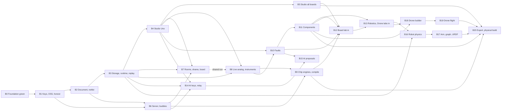

# iynk implementation roadmap

Written 2026-10-27 for the build plan step. Plan only: no source, test, config or package file was changed to write it.
Scope: the build from today's code (`main`, HEAD `4d11dc5`) to the full open-source app, as build phases B0 to B20 in the D-014 order.
Binding inputs: `00_EXECUTIVE/DECISION_REGISTER.md` (D-013 to D-017 lead; D-018 to D-021 are orchestrator decisions Amar may overrule), `03_PRODUCT/`, `04_ARCHITECTURE/` (field and module names), `04_ARCHITECTURE/RECONCILIATION.md` (RC rows decide where documents disagree), `08_RESEARCH_SPIKES/*/REPORT.md`, `01_AUDIT/`.
Labels: VERIFIED (I read it in code or a file in this step), DOCUMENTED (a plan file says it), EXTERNAL, ESTIMATED, HYPOTHESIS, UNKNOWN.

## 1. The phases at a glance

One build phase is one approval unit: a result Amar can look at and test, built by one workflow run, then a stop for his OK (D-014). He may reorder or cut phases at any stop. Effort is engineer-weeks for one engineer who knows the repo (ESTIMATED; section 2.9 gives the assumptions). D-014's B0 and Project core, Studio, Collaboration, Fidelity, Labs, AI, Robotics and Drone phases are split where one run would be too big.

| Phase | Name | D-014 phase | Tasks | Effort best / expected / adverse (weeks) | What Amar can do at the stop |
|---|---|---|---|---|---|
| B0 | Foundation: green, safe, smaller | B0 foundation | 30 | 3 / 5 / 8 | No Solana, stories, night, wallet or public pool; telemetry off; headers; routes closed; tests stable; CI file |
| B1 | Foundation: your own keys, open source, honest and light | B0 foundation | 30 | 3 / 5 / 8 | Paste your own keys; README, CONTRIBUTING, licence placeholder; honest copy; CSP; lighter first load |
| B2 | Project core: document and netlist | Project core | 27 | 5 / 7 / 11 | Headless: build, edit by operations, undo, hash, net; 38 catalogue items converted |
| B3 | Project core: storage, runtime, replay | Project core | 27 | 6 / 9 / 13 | Save, reload, `.iynk`, worker runs with limits, same seed same trace, offline |
| B4 | Studio editor: the Uno slice | Studio editor | 28 | 5 / 8 / 12 | Start from scratch, place, wire, code, run with serial, save, reopen (M1 steps 1 to 8) |
| B5 | Studio editor: all boards, views, history, phone | Studio editor | 25 | 4 / 6 / 10 | 12 boards, schematic and board views, history, `.ino` in and out |
| B6 | Collaboration: server, identity, buddies | Collaboration | 25 | 3 / 5 / 8 | One-command server; enrol a friend; pair as buddies |
| B7 | Collaboration: rooms, shares, leaderboard | Collaboration | 41 | 6 / 9 / 13 | Room on a project with a buddy, baton, hostile client refused, shares, buddies-only board (M1 steps 9 to 11) |
| B8 | Fidelity: live analog, instruments, replay | Simulation fidelity | 32 | 6 / 9 / 14 | Computed analog behaviour, instruments, tier chips, replay, shared run |
| B9 | Fidelity: chip engines, buses, compile, debugger | Simulation fidelity | 37 | 8 / 12 / 18 | Buses and devices as data, avr8js opt-in, compile on your server, breakpoints, Newton devices, transient |
| B10 | Faults on any circuit | Faults | 34 | 4 / 6 / 9 | Break and diagnose any circuit; hints; one diagnosis record |
| B11 | Components | Components | 25 | 3 / 5 / 8 | Add a custom part; every part states fidelity and sources |
| B12 | Labs moved in: Board lab | Labs moved in | 28 | 4 / 6 / 9 | 12 boards and 71 lessons as Studio projects |
| B13 | Labs moved in: Robotics and Drone labs | Labs moved in | 41 | 4 / 6 / 9 | 13 benches and 13 craft as Studio projects; old stores and relay deleted |
| B14 | AI partner: keys, relay, grounded read-only | AI partner | 35 | 3 / 5 / 8 | Partner reads your project with your key, cites it, changes nothing |
| B15 | AI partner: proposals and teaching modes | AI partner | 36 | 4 / 6 / 9 | Reviewable proposals, one undo, adversarial suite |
| B16 | Robotics creation: physics and line follower | Robotics creation | 41 | 10 / 13 / 19 | Build a wheeled robot and run it deterministically |
| B17 | Robotics creation: arm, ROS-like graph, URDF | Robotics creation | 24 | 9 / 11 / 15 | Arm, topic graph, URDF in and out |
| B18 | Drone creation: parts, propulsion, builder | Drone creation | 40 | 10 / 12 / 16 | Design a multirotor from parts; thrust, current, endurance, checks |
| B19 | Drone creation: rigid-body flight and traces | Drone creation | 31 | 13 / 16 / 22 | 6-DoF flight, traces, comparison, parameter dump |
| B20 | Export and physical build | Export and build | 44 | 6 / 9 / 13 | BOM, wiring guide, flashing, hardware twin, open-format export |
| | Total | | 681 | 119 / 170 / 252 | |

The task files split and add to the phase-card rows. The task file is the authority for task ids and counts; the card rows are the original sizing. Counts are the `### T-B<n>-<id>` cards in `tasks/B*.md`, spike cards (T-B3-S1 to S3, T-B18-S1 and S2) not counted.

Section 8 maps Milestone 1 (51 features, 11 acceptance steps) onto the phases. Section 6 is "For Amar". Section 7 is "Not in this build".

## 2. Conventions every task obeys

### 2.1 Branch, commits, safety

| Rule | Detail |
|---|---|
| Branch | All work is on the local branch `build/v1`, cut from `main` at the start of B0. Nothing is pushed. A push to `main` deploys production on Vercel (DOCUMENTED, `HANDOFF.md`), so merging is Amar's call (rollout field of each phase). |
| One commit per task | Authored as Amar Kushwaha (`bash scripts/handoff-status.sh` prints the identity). No `Co-Authored-By` line and no "Generated with" line. Message form: `B<n> T-B<n>-<nn>: <what>`. |
| Phase tag | After Amar's OK the orchestrator makes the local tag `phase-B<n>`. It is the rollback point. |
| Off limits | Production services, `.env.local` keys, ports 3000 and 43117. A task never reads `.env.local` values. T-B0-03 makes Playwright skip port 43117 (the random range 40000 to 49999 includes it). |
| Next.js | This repo runs Next.js 16.4.3 (VERIFIED, `package.json`). Before naming any Next API a task reads the matching guide in `node_modules/next/dist/docs/01-app/` (`AGENTS.md`). APIs this plan names, with the guide read: `headers()` and `poweredByHeader` in `next.config.ts` (`03-api-reference/05-config/01-next-config-js/headers.md`, `poweredByHeader.md`), `proxy.ts` (`03-api-reference/03-file-conventions/proxy.md`; `middleware.md` is the old name), CSP and nonce rules (`02-guides/content-security-policy.md`: a nonce needs dynamic rendering, which fights `cacheComponents: true` at `next.config.ts:5`), `partialPrefetching` and `<Link prefetch>` (`02-guides/adopting-partial-prefetching.md`, `optimizing-prefetching.md`), lazy loading (`02-guides/lazy-loading.md`), `output: "standalone"` (`03-api-reference/05-config/01-next-config-js/output.md`), route handlers (`03-api-reference/03-file-conventions/route.md`). |
| Hackathon rule | `MEMORY.md` records that only post-11:30 Oct 24 code counts for the hackathon entry. This plan only adds and removes code on a local branch; it does not touch the entry. UNKNOWN whether removal of the extras affects the entry. Amar's call before merging B0. |

### 2.2 The 5-file rule and how I count

Each task changes at most 5 source files, not counting its own test files. My reading of the rule, which Amar confirms in section 6 item 10:

| Case | Counts as |
|---|---|
| A test file the task adds or edits | 0 |
| A file or directory the task deletes | 0 (deletion is mechanical; the task still names what goes) |
| The six language copies of one i18n namespace file, or a set of data files of one kind (descriptors, project templates) | 1 |
| `package.json` with `package-lock.json` | 1 |
| A new or edited source file | 1 each, at most 5 |

### 2.3 Proof commands

Every task row ends with the commands that prove it. Shorthand used in the rows:

| Name | Expands to |
|---|---|
| `TL` | `npm run typecheck && npm run lint` (VERIFIED scripts, `package.json`). Always part of the proof. |
| `V <path>` | `npx vitest run <path>` |
| `E <label> <specs>` | `KL NEXT_DIST_DIR=.next-<label> npx playwright test <specs>` (Playwright picks a random port, `playwright.config.ts:5`, and builds unless `E2E_SKIP_BUILD` is set; TEST_STRATEGY 12 wants one dist dir per task or label and a prebuilt gate build) |
| `KL` | Keyless prefix, TEST_STRATEGY 3.2: `env META_API_KEY= GEMINI_API_KEY= SERPAPI_KEY= NEXT_PUBLIC_REALTIME_URL= IYNK_SERVER_TOKEN= IYNK_AI_ENABLE= IYNK_SEARCH_ENABLE= NEXT_PUBLIC_SOLANA_PROGRAM_ID= SOLANA_ISSUER_KEYPAIR= VULTR_API_KEY= TIMESCALE_SERVICE_URL= PGPASSWORD= PGHOST= DATABASE_URL=`. After T-B0-03 the e2e config blanks the same names itself; after T-B0-12 the names that no longer exist are dropped from `KL`. |
| `BUILD <label>` | `KL NEXT_DIST_DIR=.next-<label> npm run build` |
| `SRV` | Before T-B6-01b: `cd server/realtime && npm test` (39 tests, VERIFIED, `runs/COMMANDS.md` row 9). From T-B6-01b: `npm run server:test` (also runs the 39 legacy relay tests; TEST_STRATEGY 3.7, RELEASE_GATES G-06) |
| `LOAD` | Three full runs of `npx vitest run` while 14 busy-loop processes run (`for i in $(seq 14); do node -e "const e=Date.now()+900000;while(Date.now()<e);" & done`, killed afterwards) |

`npm run check` (`package.json`: content check, typecheck, lint, test, e2e) is the phase-end command. Each phase's exit gate says what else runs.

### 2.4 Task ids, order, and who builds

Task ids are `T-B<n>-<nn>`. Tasks inside a phase run in the listed order unless a row says "parallel with". An agent that cannot finish a task in one sitting stops and reports; it does not widen the task. Subagents run on Sonnet (`MEMORY.md`); the orchestrator stops after each phase for Amar's OK.

### 2.5 Test rules

| Rule | Source |
|---|---|
| No test waits on wall-clock polling. Simulation tests step the virtual clock. | R-002; `src/content/drones/_checks.ts:358-364` |
| Under `CI=true` a test whose service is missing fails and names the service; it does not skip with `console.info` (`src/lib/server/db/timescale.test.ts:26` is the one today, and it goes with Postgres). | R-001 |
| No test touches production or a third party. | R-003 |
| New portable code (`src/core`, `src/protocol`, `src/project`, `src/parts`, `src/sim`, `src/export`) has no DOM or Node import and passes `tsconfig.portable.json` (ADR-0014). | AR-03 |
| A change to a gate threshold is Amar's decision, not an agent's. | D-014 |

### 2.6 Language and copy

Six languages (`en`, `de`, `es`, `fr`, `hi`, `zh`, VERIFIED, `src/i18n/messages/`). A copy change updates all six in the same commit (K-I18N). Plain words, no "validated", no em dashes.

### 2.7 What a phase card means

Each phase has a card with the BRIEF section 26 fields, then its task table. "Rollout" means merging `build/v1` into `main`. "Operational cost" means a self-hoster's running cost, never a customer price.

### 2.8 Rollback, all phases

`git revert` the phase's commits in reverse order, or `git reset --hard phase-B<n-1>` on `build/v1`. Both are local and Amar's call. Each phase's rollback field adds only what is special. A deleting commit is always separate from the commit that replaces the thing, so it reverts alone (SYSTEM_ARCHITECTURE section 16).

### 2.9 Effort assumptions

One engineer who knows this repo; tests and a docs page included; reviews by Amar not counted. Agents may shorten calendar time but not the review. Ranges are judgement, not velocity: best = nothing unexpected, adverse = a named risk lands. Sources: RT slices (REALTIME_ARCHITECTURE section 18: 8 to 12 weeks for COLLAB), ROB section 20 (19 to 28 for R0 to R8), DRN section 16 (23 to 32 for D0 to D7), TECHNICAL_DEBT Part D (D2 solver extraction 3 to 5 weeks, D1 and D3 L), ADR-0104 (op log 3 to 5 person-weeks). Phases with no source are my ESTIMATE from task count.

## 3. Starting point (VERIFIED in this step)

| Fact | Evidence |
|---|---|
| Next 16.4.3, React 19.3.0, Node 24.x, `cacheComponents: true`, `partialPrefetching: true` | `package.json`, `next.config.ts:5-6` |
| 23 API route files under `src/app/api` | `find src/app/api -name route.ts` |
| No CI | `.github/` does not exist |
| `npm test` has 13 wall-clock timeouts under load; the keyless run is otherwise green | `01_AUDIT/runs/COMMANDS.md` rows 6, 7 |
| Telemetry is on by default | `src/lib/progress/storage.ts:38` (`telemetry: true`) |
| The room code is stamped on telemetry events | `src/lib/telemetry/client.ts:123-125` |
| Only `/figures/:path*` gets security headers | `next.config.ts:21-33` |
| The wallet stack loads on every lab page through the dock | `src/components/dock/LabDock.tsx:11` imports `PassportPanel`; `LabDock.tsx:85` renders it |
| The theme boot script is inline | `src/lib/settings/theme.tsx:11,25` |
| The relay lets a second socket take over a present peer id | `server/realtime/src/relay.js:246-258` |
| Any peer can move the baton in the client | `src/lib/realtime/room.ts:589-597` |
| Python `*` repeats strings and lists without a cap; C array sizes are not capped | `src/lib/interp/python/runtime.ts:1071-1077`, `src/lib/interp/arduino/interp.ts:393-405` |
| The client IP is the first `x-forwarded-for` value, so it is caller-controlled | `src/lib/server/http.ts:130` |
| AI keys come from server env (`META_API_KEY`, `GEMINI_API_KEY`) | `src/lib/server/ai/provider.ts:105-107`, `src/lib/server/env.ts` |
| `guardAi` has an instance-wide hourly budget in memory | `src/lib/server/ai/guard.ts:8-9`; `src/lib/server/ratelimit.ts:14` |
| `get_passport` and `plan_build_night` are MCP tools | `src/lib/server/mcp/tools/index.ts:10`, `tools/together.ts:29` |
| `@coral-xyz/anchor` is declared and not imported by `src` | `package.json`, `PERFORMANCE_BASELINE.md` section 1 |
| 80 files in `public/figures`; figures are first-party | `git ls-files public/figures` |
| The repo is public | EXTERNAL, `SECURITY_BASELINE.md` section 9 (`gh repo view` returned PUBLIC) |

## 4. Dependency diagram

Arrows are hard dependencies. Order on the page is D-014; B6 could move earlier because it needs only B1 and B2 (RT slices S1 to S3 need no document model), which is Amar's call.

Dotted edge: the shared run in rooms (RT slice S7) is placed in B8 because it needs the replay and determinism work, and it needs the rooms of B7.

## 5. The phases

Counting rule for the task tables: section 2.2. Section 6 item 10 asks Amar to confirm it.

### B0. Foundation: green, safe, smaller

| Field | Plan |
|---|---|
| Business objective | D-013 and D-005: make the repository safe to run for friends and honest to read before anything new is built. Remove what D-016 removes. |
| User-visible outcomes | The app runs with no keys. Passport, Verify, Build Stories, Build Night, the wallet, the public buddy pool, the public board and the live counter are gone. Telemetry is off and nothing leaves the browser. Optional services (AI, search) are off and closed by default. Every page sends security headers. A CI file exists. `npm test` passes three times in a row on a busy laptop. |
| Exact technical scope | Features F-001, F-002, F-004, F-006, F-016 (local log, in B1), F-180, F-195, F-202; requirements R-001 to R-008, R-009 (telemetry half), R-017, R-018, R-005. Removal map: `03_PRODUCT/COMMUNITY.md` section 4. Quick wins 1 (headers), 3 (caps), 7 (telemetry default), 13 (anchor), 14 (`/metrics`) of `SECURITY_BASELINE.md` section 10. |
| Non-goals | No bring-your-own keys, no CSP, no README rewrite, no bundle work (all B1). No new feature. The relay and rooms stay off (R-022); relay authority is B6/B7. No licence choice (D-017). |
| Dependencies | None. Starts from `main`. |
| Architecture changes | `src/app/api` shrinks from 23 route files to 13: `ai/{chat,transcribe,translate}`, `mcp` (2), `openapi.json`, `search/{web,videos,nearby,offers,events}`, `status`. Every remaining route gets a class (`local-only`, `needs-server-token`, `needs-user-key`) in one allow-list test. Postgres layer and `solana/` leave. Telemetry becomes a local log. |
| Database changes | Postgres layer removed: `src/lib/server/db/`, `db/migrations/0001..0003`, `scripts/db-migrate.mjs`, dependency `postgres`. Git history keeps the migrations. No new store. |
| APIs | Removed: `/api/solana/*`, `/api/ai/{story,image,plan,match}`, `/api/buddies`, `/api/leaderboard`, `/api/live`, `/api/telemetry`. Kept routes answer 401 with an empty detail without `X-Iynk-Server-Token`, and 501 `feature_disabled` while `IYNK_AI_ENABLE` or `IYNK_SEARCH_ENABLE` is unset (RC-28). `IYNK_SERVER_TOKEN` is B0 only (RC-16). No `Access-Control-Allow-Origin: *`. `IYNK_TRUST_PROXY=1` gates forwarded-address headers. |
| Frontend components | Deleted: `src/components/solana/`, `StoryCard`, `useBuildLog`, `src/components/data/`, `Planner.tsx`, `Buddies.tsx`, the Passport dock tab. Edited: `LabDock`, `PartnerPanel`, `FlyWorkspace`, `nav.ts`, `FooterNav`. `/together` keeps its page shell (RC-68). |
| Simulation work | Caps only: string and list repeat, C array size and serial output are bounded (R-018). Drone figure tests step the virtual clock (R-002). |
| Security | Release blockers 1, 5 and 6 of `SECURITY_BASELINE.md` section 8 close for the routes that remain; blocker 2 (rooms) closes by not deploying them; headers; `X-Forwarded-For` no longer trusted by default (C7); CORS `*` removed from MCP and OpenAPI (M1). Secret scan in CI. |
| Accessibility | No regression: the existing axe checks in `e2e/` still pass (VERIFIED they exist, `e2e/shell.spec.ts`). Removed nav entries leave no empty landmark. |
| Testing | New: route allow-list test, token tests, clientIp tests, cap tests, header e2e, secret-scan unit test. Rewritten: 13 timeout tests. CI runs `scripts/ci-local.sh`. |
| Documentation | `.env.example` with names only for what remains. `docs/DECISIONS.md` gets one dated line per removal (it is the existing decision log). README is B1. |
| Effort (weeks) | Best 3, expected 5, adverse 8. Assumes the COMMUNITY section 4 map is accurate (VERIFIED line facts at `b6255ca`). Adverse: deleting `lib/server/db` or `components/data` surfaces a hidden importer, or the 13 timeouts are not purely CPU. |
| Operational cost | None. No service is needed to run or test. |
| Risks | R1: a hidden importer breaks typecheck after a delete (HYPOTHESIS: low, the map was grepped). R2: stepping the virtual clock in the drone tests changes what they prove. R3: a self-hoster with a server key finds the browser cannot reach AI until B1 adds the token field (accepted; AI is off by default). R4: removal may touch code that the hackathon entry counts (UNKNOWN). |
| Mitigations | One delete per commit, `TL` after each. Residual grep from COMMUNITY 4.6 as the exit check. T-B0-01 keeps every assertion and only changes how time advances. Hackathon question goes to Amar before merge (section 6). |
| Acceptance criteria | PRD 6.4 B0 gate, minus the parts moved to B1: R-001 (CI file and local equivalent pass), R-002 (three green runs at load), R-003, R-004 (residual grep empty, `npm audit --omit=dev` shows 0 high), R-005, R-006 headers part, R-007, R-008 limiter part, R-017, R-018. |
| Rollout | Amar merges `build/v1` into `main` when he wants. Note: `main` deploys production on Vercel today; B0 removes the live Passport and Build Night pages, so he decides whether production should follow now. |
| Rollback | Revert by task; each delete is its own commit. `phase-B0` tag. |
| Exit gate | `npm run check` green on a keyless env; `BUILD` succeeds; the COMMUNITY 4.6 grep prints nothing; `LOAD` passes; `npm ls @solana/web3.js @coral-xyz/anchor` finds neither (CM-41). Then Amar's OK. |

| ID | Task | Files edited or new (deletes listed) | Proof |
|---|---|---|---|
| T-B0-01 | Drone figure tests step the virtual clock instead of polling `Date.now()` for 50 s (R-002) | Edit `src/content/drones/_checks.ts:358-364`, `figures/engine/testkit.mjs`; tests `src/content/drones/{octo,wing,swarm,agrihex,delivery}.test.ts` | `TL`; `V src/content/drones`; `LOAD` on that folder |
| T-B0-02 | Split the basys3 display sweep (95 interpreter runs in one 120 s test) and set one shared `testTimeout` | Edit `vitest.config.mts`; test `src/content/boards/basys3.test.ts:241-251` | `TL`; `V src/content/boards/basys3.test.ts`; `LOAD` |
| T-B0-03 | Test isolation: Playwright blanks provider keys and `NEXT_PUBLIC_REALTIME_URL`, skips port 43117, fails on any request that leaves localhost (R-003) | Edit `playwright.config.ts`; new `e2e/support/no-egress.ts`; test `e2e/shell.spec.ts` | `TL`; `E e2e/shell.spec.ts` |
| T-B0-04 | Fix the `]` shortcut race, no retry (R-002) | Edit `src/components/boardlab/shortcuts.ts:90`; test `e2e/boardlab.spec.ts:171` | `TL`; `E e2e/boardlab.spec.ts --repeat-each=5 --retries=0` |
| T-B0-05 | A test whose service is missing fails under `CI=true` and names the service (R-001) | Edit `vitest.setup.ts`; the five skipping tests listed in `TEST_COVERAGE.md` section 4 | `TL`; `CI=true npx vitest run src/lib/realtime` |
| T-B0-06 | CI workflow and a local script that runs the same steps: content check, typecheck, lint, vitest, relay tests, keyless build, e2e, secret scan. No secret needed (R-001). Runs on GitHub only after Amar pushes | New `.github/workflows/ci.yml`, new `scripts/ci-local.sh` | `bash scripts/ci-local.sh` exit 0; `TL` |
| T-B0-07 | Secret scanner: key shapes from `SECURITY_BASELINE.md` section 9, full history once then the diff (R-017) | New `scripts/secret-scan.mjs`; test `scripts/secret-scan.test.mjs` | `TL`; `V scripts/secret-scan.test.mjs`; `node scripts/secret-scan.mjs --history` exit 0 |
| T-B0-08 | Telemetry local-only: default off (`storage.ts:38`), no network call, no room code on events (`client.ts:123-125`) (R-009) | Edit `src/lib/progress/storage.ts`, `src/lib/telemetry/client.ts`, `src/lib/telemetry/index.ts`; tests `src/lib/telemetry/client.test.ts`, `src/lib/progress/progress.test.ts` | `TL`; `V src/lib/telemetry src/lib/progress` |
| T-B0-09 | MCP: drop `get_passport` and `plan_build_night`. Delete `src/lib/server/mcp/tools/passport.ts` | Edit `tools/index.ts:7,10,29`, `tools/together.ts:10-50`, `backends.ts`, `openapi.ts:27`, `registry.ts:34`; tests `tools.test.ts`, `e2e.test.ts`, `openapi.test.ts`, `transport.test.ts` | `TL`; `V src/lib/server/mcp` |
| T-B0-10 | Dock, nav and footer stop offering Passport and Verify. Delete nothing yet | Edit `src/components/dock/LabDock.tsx:11,25-29,37,85`, `src/components/dock/types.ts`, `src/lib/ai/tools.ts:10,83`, `src/components/shell/nav.ts:13,22-23,28`, `src/components/shell/FooterNav.tsx:11,14`; tests `LabDock.test.tsx`, `nav.test.ts`, `e2e/dock.spec.ts`, `e2e/dock-shared.ts`, `e2e/dock.phone.spec.ts` | `TL`; `V src/components/dock src/components/shell`; `E e2e/dock.spec.ts` |
| T-B0-11 | Remove Solana server code, the status field and env. Delete `src/app/api/solana/`, `src/lib/server/solana/`, `src/lib/server/solana-ready.ts` | Edit `src/app/api/status/route.ts:5,15`, `src/lib/server/env.ts:41-45,60,66,97`, `src/lib/features.ts:17,24,56`, `next.config.ts:54` (drop `passport\|verify`); tests `env.test.ts`, `features.test.tsx`, `status/route.test.ts` | `TL`; `V src/lib/server src/app/api/status src/lib/features.test.tsx` |
| T-B0-12 | Remove Solana client code and pages. Delete `src/components/solana/`, `src/lib/solana/`, `src/lib/verify/`, `src/app/[lang]/passport/`, `src/app/[lang]/verify/`, `src/i18n/messages/*/solana.json` | Edit `src/i18n/namespaces.ts:4,17`, `scripts/crawl-routes.mjs:27-28`; test `src/i18n/messages.test.ts` | `TL`; `V src/i18n`; `BUILD` |
| T-B0-13 | Remove Build Stories, client side. Delete `StoryCard.tsx` (+test), `useBuildLog.ts`, `src/lib/ai/session-log.ts` (+test), `src/lib/ai/story-png.ts` | Edit `src/components/ai/PartnerPanel.tsx:27,29,37,99,116,185-207`, `src/components/dock/LabDock.tsx:5,119`, `src/components/ai/index.ts:2`, `src/lib/ai/conversation.ts`, `src/lib/ai/protocol.ts:11-21`; test `PartnerPanel.test.tsx` | `TL`; `V src/components/ai src/lib/ai src/components/dock` |
| T-B0-14 | Remove Build Stories, server side and the image route. Delete `src/app/api/ai/story/`, `src/app/api/ai/image/`, `prompts/story.ts`, `prompts/image.ts` | Edit `src/lib/ai/client.ts:10-12,249-262`, `src/lib/server/ai/types.ts:49-61`, `src/lib/server/ai/provider.ts:425-472`, `src/lib/server/env.ts:35,57,94`, `src/lib/features.ts:17` | `TL`; `V src/lib/server/ai src/lib/ai src/lib/features.test.tsx` |
| T-B0-15 | Remove Build Night. Delete `src/app/[lang]/together/Planner.tsx`, `src/app/api/ai/plan/`, `src/lib/server/ai/plan.ts`, `prompts/plan.ts` | Edit `src/app/[lang]/together/Lobby.tsx:15,143,173`, `src/lib/server/ai/catalog.ts` (comment) | `TL`; `V src/lib/server/ai`; `E e2e/room.spec.ts` |
| T-B0-16 | Remove the public buddy pool, matcher, board and live counter UI and routes. Delete `Buddies.tsx`, `src/app/api/{buddies,leaderboard,live}/`, `src/app/api/ai/match/`, `prompts/match.ts`, `src/components/data/` | Edit `src/app/[lang]/together/Lobby.tsx:14,172`, `src/components/dronelab/FlyWorkspace.tsx:5,205-215`, `src/app/[lang]/drones/[drone]/fly/page.tsx:4` | `TL`; `E e2e/fly.spec.ts e2e/room.spec.ts` |
| T-B0-17 | Remove the telemetry route and the Postgres layer. Delete `src/app/api/telemetry/`, `src/lib/server/db/`, `db/`, `scripts/db-migrate.mjs`, `src/lib/telemetry/responses.ts` | Edit `src/lib/server/env.ts` (`DATABASE_URL`, `db`), `src/lib/features.ts`, `src/app/api/status/route.ts`, `package.json` (`postgres`), `src/lib/telemetry/kinds.ts` | `TL`; `V src/lib`; `BUILD` |
| T-B0-18 | Delete `solana/`; drop `@solana/*`, `@coral-xyz/anchor`, `bs58`; rewrite `.env.example` (names only) | Edit `package.json`+lockfile, `.env.example`, `.gitignore`, `eslint.config.mjs`, `tsconfig.json` (only if they name `solana`) | `TL`; `BUILD`; `npm audit --omit=dev` shows 0 high; `npm ls @solana/web3.js @coral-xyz/anchor` finds neither; COMMUNITY 4.6 grep prints nothing in `src server e2e scripts deploy package.json .env.example next.config.ts` |
| T-B0-19 | Delete orphan i18n keys in six languages: `story`, `plan`, `buddies`, `dock.tabs.passport`, the shell string that advertises stories | Edit `src/i18n/messages/*/ai.json`, `together.json`, `shell.json`, `common.json` (four sets) | `TL`; `V src/i18n` (parity) |
| T-B0-20 | Remove Vercel and Vultr from the repo; keep `/metrics` off the proxy (R-005, quick win 14). Delete `.vercelignore`, `scripts/realtime-vultr-create.sh`, `scripts/realtime-deploy.sh` | Edit `deploy/realtime/Caddyfile`, `next.config.ts:12` (`VERCEL`), `src/i18n/seo.ts:10`, `.gitignore` | `TL`; `V src/i18n`; `BUILD`; `grep -rni vercel src next.config.ts scripts deploy .env.example` prints nothing |
| T-B0-21 | Security headers on every route and `poweredByHeader: false` (R-006 without CSP; quick win 1) | Edit `next.config.ts:21-33`; test `e2e/headers.spec.ts` (new) | `TL`; `E e2e/headers.spec.ts` |
| T-B0-22 | Route classes: one allow-list, one access helper, a test that enumerates `src/app/api/**/route.ts` and fails on an unlisted file (R-007) | New `src/lib/server/access.ts`; edit `src/lib/server/http.ts`; test `src/app/api/routes.test.ts` (new) | `TL`; `V src/app/api/routes.test.ts src/lib/server/http.test.ts` |
| T-B0-23 | Apply the classes: token required (401, empty detail, equal for missing and wrong), 501 `feature_disabled` while the switch is off, MCP and OpenAPI lose CORS `*` | Edit `src/lib/server/ai/guard.ts`, `src/lib/server/search/route.ts`, `src/lib/server/mcp/http.ts:6-17`, `src/lib/server/mcp/transport.ts`, `src/lib/server/mcp/rest.ts`; tests `src/app/api/search/routes.test.ts`, `src/app/api/ai/chat/route.test.ts`, `transport.test.ts` | `TL`; `V src/app/api src/lib/server/mcp` |
| T-B0-24 | `IYNK_TRUST_PROXY=1` gates `x-forwarded-for`, `x-real-ip`, `cf-connecting-ip`; a missing address never maps to the shared key `unknown` (C7, R-008) | Edit `src/lib/server/http.ts:130`, `src/lib/server/ratelimit.ts:14`; tests `http.test.ts:121`, `ratelimit.test.ts` | `TL`; `V src/lib/server` |
| T-B0-25 | Interpreter caps: 1,000,000 elements for repeat and C arrays, 1 MB serial buffer with a "truncated" marker; the three OOM repros become tests (R-018) | Edit `src/lib/interp/python/runtime.ts:1071-1077`, `src/lib/interp/arduino/interp.ts:393-405`, `src/lib/interp/run.ts`; tests `python.test.ts`, `arduino.test.ts` | `TL`; `V src/lib/interp` |

### B1. Foundation: your own keys, open-source basics, honest and light

| Field | Plan |
|---|---|
| Business objective | D-015 and D-017: the app depends on nothing Amar pays for; a stranger can clone, run and read it; every public claim is true; the first load is smaller. |
| User-visible outcomes | A Settings panel where you paste your own AI and search keys and a server token; keys never leave the browser except in a header to your own server; a per-key daily spend cap you can see. README, CONTRIBUTING, SECURITY, a licence placeholder and a provenance table. Honest copy. A CSP. A home page with no counter, sign-up or price. A lighter lesson page. |
| Exact technical scope | F-009, F-007, F-012, F-014, F-015, F-016, F-166, F-174 (copy only), F-193, F-194, F-196, F-197 (record only), F-204, F-205 (stub); R-002 done in B0; R-006 CSP, R-008 spend part, R-009 log part, R-010 to R-016, R-019 to R-021, R-023, R-024. Quick wins 2, 8, 9, 12, 15 of `SECURITY_BASELINE.md` section 10. |
| Non-goals | No AI feature work (the partner keeps today's behaviour; its rewrite is B14/B15). No relay for AI (B6 and B14). No hosted AI, no shared key. No licence choice. No rewrite of third-party content (the record only; rewrites are listed For Amar). No device-lab results. |
| Dependencies | B0. |
| Architecture changes | New module `src/server-client` (probe only) and `/config.json`. Keys live in `src/lib/keys` (localStorage `iynk:keys:v1`), moved into the IndexedDB `keys` store in B3 (T-B3-07). AI routes read the key from `X-Iynk-Provider-Key`; the base URL and model stay operator environment, so a caller cannot aim the server at another host (SSRF: ADR-0425 and BA-15 define the relay guard in B14). `/api/status` is deleted. |
| Database changes | None in a database. One local file `<IYNK_DATA_DIR>/usage.json` (default `.iynk-data/`, git-ignored) holds per-key-hash daily token and search counts. |
| APIs | `GET /config.json` (same origin, no secret). Headers: `X-Iynk-Provider-Key` (RC-27), `X-Iynk-Server-Token` (B0 only). New env: `IYNK_AI_DAILY_TOKENS`, `IYNK_DATA_DIR`, `IYNK_ALLOWED_ORIGINS`. Removed env: `META_API_KEY`, `GEMINI_API_KEY`, `SERPAPI_KEY`. |
| Frontend components | `KeysPanel`, `LocalLog`, edited `UsageToggle`, `SettingsMenu`, `PartnerPanel` (confirm before `ask_peer`), search panels (click to search), home page, `CodeEditor` and dock panels loaded on demand. |
| Simulation work | None. The idle-CPU fix touches the figure core only (T-B1-25). |
| Security | Quick wins 2, 8, 9, 12, 15; CSP with no inline script; keys masked and never logged, exported or put in a project (AR-13 starts here); a canary-secret test. SSRF avoided by not accepting a client base URL. |
| Accessibility | New panels keyboard-operable with labelled fields; axe zero serious and critical on Settings and Home (existing axe harness, `e2e/shell.spec.ts`). Home passes 360 px width with no horizontal scroll (R-023). |
| Testing | Keys store unit tests; header tests; ledger restart test; canary key scan; keyless walk e2e (0 page errors, 0 failed requests); CSP e2e (0 violations); copy-check; figure first-party test; perf baselines recorded. |
| Documentation | `README.md` rewritten, `CONTRIBUTING.md`, `SECURITY.md`, `CODE_OF_CONDUCT.md`, `LICENSE-PENDING.md`, `NOTICE`, `docs/PROVENANCE.md`, `docs/SELF_HOSTING.md` (stub), `docs/DATA_HANDLING.md`, `docs/LOW_END_TESTING.md`. The existing `docs/ARCHITECTURE.md` (the schema log) is extended, not replaced. |
| Effort (weeks) | Best 3, expected 5, adverse 8. Adverse: Next's own inline scripts do not pass a hash CSP (UNKNOWN until FA-05) or the late chunk fetch is not the prefetch setting. |
| Operational cost | Zero for the app. A friend's own AI and search usage is theirs. EXTERNAL: provider prices vary and are not planned here. |
| Risks | R1: hash CSP fails against Next's inline bootstrap (UNKNOWN). R2: a provider rejects the key header shape. R3: the person pastes a key on a shared browser. R4: copy-check false positives. R5: the figure idle-CPU cause is only a HYPOTHESIS (`PERFORMANCE_BASELINE.md`). R6: `README` numbers drift. |
| Mitigations | R1: try build-emitted hashes first; if any violation remains the task stops and asks Amar (fallbacks: a `proxy.ts` nonce with dynamic rendering, which costs the static shell, or a relaxed policy he must approve). R3: the panel says keys are kept in this browser and shows "Remove". R4: reviewed exceptions list. R5: T-B1-25 is go or no-go with a stated stop. R6: README numbers come from `gen-content-index.mjs` output and `copy-check` verifies them. |
| Acceptance criteria | PRD 6.4: R-013 copy check passes; R-014 a new reader reaches a running app in three commands (CI performs the same steps); R-019 baselines recorded; R-020 idle CPU measured, wallet chunk already gone; R-009 first-run network check shows zero outside requests; R-010 key canary absent from every export, share body, log line and event; R-012 keyless walk clean. |
| Rollout | Amar merges when satisfied. The README and home page change what the live site says. |
| Rollback | Revert by task. `phase-B1` tag. Keys stored by testers stay in their browsers; the store version key (`iynk:keys:v1`) makes a later migration safe. |
| Exit gate | `npm run check` green keyless; CI file passes `scripts/ci-local.sh`; `node scripts/copy-check.mjs` exit 0; `node scripts/perf-budget.mjs` writes `budgets.json` baselines; a person who has never seen the repo follows the README to a running app (Amar's check). Then Amar's OK. |

| ID | Task | Files edited or new | Proof |
|---|---|---|---|
| T-B1-01 | Keys store: AI profile (key, optional label), search key, server token; masked read, remove, never exported (R-010) | New `src/lib/keys/store.ts`, `src/lib/keys/index.ts`; test `src/lib/keys/store.test.ts` | `TL`; `V src/lib/keys` |
| T-B1-02 | Settings panel for keys and server token with "kept in this browser only" text | New `src/components/settings/KeysPanel.tsx`; edit `src/components/shell/SettingsMenu.tsx`, `src/components/settings/index.ts`, `src/i18n/messages/*/common.json`; test `KeysPanel.test.tsx` | `TL`; `V src/components/settings` |
| T-B1-03 | Clients send `X-Iynk-Provider-Key` and `X-Iynk-Server-Token` | New `src/lib/keys/headers.ts`; edit `src/lib/ai/client.ts`, `src/lib/search/client.ts`; tests `src/lib/ai/client.test.ts`, `src/lib/search/client.test.ts` | `TL`; `V src/lib/ai src/lib/search src/lib/keys` |
| T-B1-04 | AI server reads the key from the header; server provider keys removed; base URL and model stay operator env | Edit `src/lib/server/ai/provider.ts:105-107,432-440,500-513`, `src/lib/server/env.ts`, `src/lib/server/ai/guard.ts`; test `provider.test.ts` | `TL`; `V src/lib/server/ai` |
| T-B1-05 | Chat, transcribe and translate routes pass the header key through | Edit `src/app/api/ai/chat/route.ts`, `src/app/api/ai/transcribe/route.ts`, `src/app/api/ai/translate/route.ts`; tests beside each | `TL`; `V src/app/api/ai` |
| T-B1-06 | Per-key daily spend cap: file-backed ledger of token counts under the key hash, survives restart, replaces the instance-wide `AI_BUDGET` (D-015, R-008) | New `src/lib/server/ai/ledger.ts`; edit `guard.ts:8-9`, `env.ts`, `provider.ts`; test `ledger.test.ts` (spend the cap, restart, still refused) | `TL`; `V src/lib/server/ai` |
| T-B1-07 | Settings shows tokens and searches used today and this month, the cap, a local event viewer and a local error log with "copy for a bug report" (R-009, F-016) | New `src/lib/keys/usage.ts`, `src/components/settings/LocalLog.tsx`; edit `UsageToggle.tsx`, `src/lib/telemetry/client.ts`, `src/components/settings/index.ts` | `TL`; `V src/components/settings src/lib/telemetry` |
| T-B1-08 | Search key from the header; real monthly budget in a file, not a closure variable (C3, quick win 12) | New `src/lib/server/search/budget.ts`; edit `serpapi.ts`, `search/route.ts`, `env.ts`; test `serpapi.test.ts` | `TL`; `V src/lib/server/search` |
| T-B1-09 | Search runs only on click; `quota_exhausted` has its own message (`client.ts:39`); coordinates are not cached, or the "never stored" copy goes (D4, quick win 15, R-011) | Edit `src/components/search/RealBuildPanel.tsx`, `NearbyPanel.tsx`, `src/lib/search/client.ts`, `src/lib/server/search/lru.ts`, `src/i18n/messages/*/search.json:95` | `TL`; `V src/components/search src/lib/search src/lib/server/search` |
| T-B1-10 | Prompt-injection quick wins: search text wrapped in the existing `quoted()` helper (`tools.ts:38-45`); learner confirms before `ask_peer` sends (`run-tools.ts:76-88`) | Edit `src/lib/server/ai/tools.ts`, `src/lib/ai/run-tools.ts`, `src/components/ai/PartnerPanel.tsx`; tests `src/lib/ai/tools.test.ts`, `PartnerPanel.test.tsx` | `TL`; `V src/lib/ai src/components/ai` |
| T-B1-11 | `/config.json` and a capability probe replace `/api/status` (R-012, F-166). Read `route.md` first | New `src/app/config.json/route.ts`, `src/server-client/probe.ts`; edit `src/lib/features.ts`; delete `src/app/api/status/`; tests `probe.test.ts`, `features.test.tsx` | `TL`; `V src/server-client src/lib/features.test.tsx`; `E e2e/shell.spec.ts` |
| T-B1-12 | Keyless walk: every optional surface says "not set up", 0 page errors, 0 failed requests | New `e2e/keyless.spec.ts`; edit up to `src/components/ai/PartnerPanel.tsx`, `src/components/search/RealBuildPanel.tsx`, `src/app/[lang]/together/Lobby.tsx` | `TL`; `E e2e/keyless.spec.ts` |
| T-B1-13 | CSP: move the theme boot script to `/boot.js`, add a CSP built from hashes, `frame-ancestors 'self'`, connect origins from `IYNK_ALLOWED_ORIGINS` (R-006, ADR-0405) | Edit `src/lib/settings/theme.tsx:11,25`, `next.config.ts`; new `public/boot.js`, `e2e/csp.spec.ts` | `TL`; `E e2e/csp.spec.ts` (0 `securitypolicyviolation` on `/en`, a lesson, a bench, a figure) |
| T-B1-14 | Test that fails when `public/figures` holds a file the figure build did not produce (quick win 2) | New `scripts/figures-first-party.test.mjs` | `TL`; `V scripts/figures-first-party.test.mjs` |
| T-B1-15 | README rewrite: every claim traced to `FEATURE_VERIFICATION.md` section 7 wording | Edit `README.md`, `docs/ARCHITECTURE.md` | `TL`; follow the README in a clean clone (`git clone` to scratch, three commands) |
| T-B1-16 | Contributor files | New `CONTRIBUTING.md`, `SECURITY.md`, `CODE_OF_CONDUCT.md`, `.github/ISSUE_TEMPLATE/request-a-part.md`; edit `docs/ARCHITECTURE.md` | `TL`; link check script in `scripts/ci-local.sh` |
| T-B1-17 | Licence placeholder and provenance record (D-017, R-015): one row per copied content set | New `LICENSE-PENDING.md`, `docs/PROVENANCE.md`, `NOTICE`, `scripts/provenance-check.mjs`; edit `package.json` (`provenance:check`) | `TL`; `npm run provenance:check` lists open rows (exit non-zero is expected until Amar clears them) |
| T-B1-18 | Operator and data docs | New `docs/SELF_HOSTING.md` (stub: "the server arrives in B6"), `docs/DATA_HANDLING.md`, `docs/LOW_END_TESTING.md` | `TL` |
| T-B1-19 | Honest copy in the six languages: telemetry wording, "aims to do everything they do", height-limit message, price panel, "pass only when your run meets their checks" | Edit `src/i18n/messages/*/shell.json:126,141`, `flight.json`, `search.json`, `boardlab.json` | `TL`; `V src/i18n` |
| T-B1-20 | Copy check: banned phrases (`validated`, `live prices`, `Proof of Build`, `Solana`, `credential`, `sponsor`), numbers match generated counts; wired into CI | New `scripts/copy-check.mjs`; edit `.github/workflows/ci.yml`, `scripts/ci-local.sh`; test `scripts/copy-check.test.mjs` | `TL`; `V scripts/copy-check.test.mjs`; `node scripts/copy-check.mjs` exit 0 |
| T-B1-21 | Home page: two-sentence description, lab shelf, links to README and self-hosting, fidelity statement; no counter, sign-up, price or sponsor | Edit `src/app/[lang]/page.tsx`, `src/components/marketing/index.tsx`, `src/components/marketing/marketing.css`, `src/i18n/messages/*/shell.json` | `TL`; `E e2e/shell.spec.ts` (axe, 360 px width) |
| T-B1-22 | Load CodeMirror and the dock panels on demand (`next/dynamic`; read `lazy-loading.md`) | Edit `src/components/boardlab/CodeEditor.tsx`, `src/components/dock/LabDock.tsx`, `src/components/boardlab/LessonWorkspace.tsx` | `TL`; `V src/components/dock src/components/boardlab`; `BUILD` then the bundle script of T-B1-24 |
| T-B1-23 | Prefetch check (FA-03): record JS fetched in the first 3 s with `partialPrefetching` true and false; apply what the data says (`next.config.ts:6` or per-link `prefetch`). Read `adopting-partial-prefetching.md` | New `scripts/perf-prefetch.mjs`; edit `next.config.ts` and at most `src/components/shell/NavLinks.tsx`, `src/components/shell/SiteHeader.tsx` | `TL`; `node scripts/perf-prefetch.mjs` prints both runs; landing JS transferred at or below the recorded baseline |
| T-B1-24 | Perf budget job: idle main-thread, first-load JS transferred, Run start under 4x CPU; writes `budgets.json`, fails on a regression over 10 percent (PROPOSAL; Amar confirms at the gate) | New `scripts/perf-budget.mjs`, `budgets.json`; edit `.github/workflows/ci.yml`, `package.json` | `TL`; `node scripts/perf-budget.mjs --record`; second run passes |
| T-B1-25 | Figure idle redraw, go or no-go: confirm the cause (`art.inner` rebuild, HYPOTHESIS) with a profile; if the fix is at most 5 hand-edited files, make it (generated figure files do not count); otherwise record and defer to B12 | Edit `figures/vendor/colorfigures/core.js:497` area and at most 4 more; regenerate figures with the existing build | `TL`; `V figures src/components/figure`; idle main-thread under 5 percent at 1x on the home, a lesson and a bench (R-020) |

### B2. Project core: the document and the netlist

| Field | Plan |
|---|---|
| Business objective | D-010 and D-014: one canonical project document, the netlist derived from connectivity and independent of the drawing, and one revision-safe operation vocabulary. Everything after this builds on it. |
| User-visible outcomes | Nothing in the browser yet. A developer can, in a script or test, create a project, edit it only through operations, undo, hash it, validate it, derive its nets, and convert the 38 catalogue items into valid projects. |
| Exact technical scope | F-076, F-077, F-078, F-083, F-097 (first descriptors); R-025 to R-034, R-052. Modules `src/core`, `src/project`, `src/parts`, the portable toolchain (ADR-0014, ADR-0400), generated types and validator from `04_ARCHITECTURE/schemas/project.schema.json` (opSchema 1.1: 64 op kinds, VERIFIED by reading the schema; FA-06 still says 55, which is stale). Schema, field and op names are binding (`k` is the op discriminator). |
| Non-goals | No storage, no worker, no UI, no simulation. No custom parts (B11). No AI. Domain data (`domains.robotics`, `domains.drone`) is validated but not interpreted. |
| Dependencies | B1. |
| Architecture changes | New portable modules `src/core`, `src/project`, `src/parts` (loaders in `src/parts/browser/`). `tsconfig.portable.json`, `package.json` `imports` map (`#core/*`, `#protocol/*`, `#project/*`), ESLint import zones and `src/architecture.test.ts` (SYSTEM 5.3 matrix). `src/lib` stops importing `@/components` (28 type-only imports in 25 files, TECHNICAL_DEBT A2) as each piece moves. |
| Database changes | None. |
| APIs | None. The contract is the JSON schema. `npm run schema:gen` and `npm run schema:check`. |
| Frontend components | None. |
| Simulation work | The netlist (F-078) is the only input later simulation reads. The converter output becomes the regression corpus for the solver and orchestrator (BRIEF 3.5, catalogue objection 3). |
| Security | Size limits at import (R-028); reject `__proto__`, `constructor` and `prototype` keys in `ext` and every open map; canonical JSON rejects duplicate keys; validators never `eval`; ids are random, never derived from names (ADR-0102). |
| Accessibility | Not applicable. |
| Testing | `apply`: every op kind has an inverse test and a reject-leaves-hash-unchanged test; property tests over generated ops (replay from empty equals live hash, 20 sessions, FA-01); the five example files validate with their recorded hashes (RC-32); netlist checked on the 27 figure parts (C-LEG mapping); the converter yields valid projects for all 38 items; AR-02, AR-03 and a measured `apply` cost at 500 parts and 1,000 wires (AR-09, PROPOSAL threshold p95 under 1 ms per op). |
| Documentation | `docs/ARCHITECTURE.md` module map and import matrix; a short "how to add an op" page next to `src/project/apply/`. |
| Effort (weeks) | Best 5, expected 7, adverse 11. Sources: ADR-0104 estimates 3 to 5 person-weeks for the op log; TECHNICAL_DEBT D1 is L. Adverse: Turbopack rejects `.ts`-extension imports (AX-03 UNKNOWN) and a bundled server build is needed; or the converter exposes catalogue circuits that cannot be expressed as nets. |
| Operational cost | None. |
| Risks | R1: AX-03, shared `.ts` imports under Turbopack. R2: catalogue circuits that do not convert cleanly. R3: schema and example drift. R4: `apply` too slow on the main thread at 500 parts (AR-09 UNKNOWN). R5: 64 ops is a large surface for one phase. |
| Mitigations | R1: T-B2-01 tests it first and falls back to a bundled server build (ADR-0014 option B). R2: unconvertible items are listed as skipped with a reason; a count below 38 is an exit-gate question for Amar. R3: examples hash test in `npm run check` (T-B2-15). R4: measurement in T-B2-16; if over budget, `apply` moves into the `ProjectWorker` (already planned in B3). R5: three apply tasks, each reviewable. |
| Acceptance criteria | PRD 7.5 CORE gate checks for document, hash, versions, validation, descriptor, netlist, converter, op log, undo; AR-02, AR-03, FA-01, FA-02, REF-3 round trips. |
| Rollout | Invisible to users; merges any time. |
| Rollback | Revert by task; no data exists to migrate. `phase-B2` tag. |
| Exit gate | `npm run check` green; `npx tsc -p tsconfig.portable.json` green; `npm run schema:check` and the examples hash test green; the converter report shows 38 of 38 items (or a named list Amar accepts). Then Amar's OK. |

| ID | Task | Files edited or new | Proof |
|---|---|---|---|
| T-B2-01 | Portable toolchain and the import matrix; first thing: prove a shared `.ts`-extension import builds under Turbopack (AX-03) | New `tsconfig.portable.json`, `src/architecture.test.ts`; edit `package.json` (`imports`), `eslint.config.mjs` | `TL`; `npx tsc -p tsconfig.portable.json`; `V src/architecture.test.ts`; `BUILD` with a one-line shared module imported by a page |
| T-B2-02 | `src/core` A: ids (`cmp_...`, ADR-0102), units (ADR-0103), `Result`, size limits | New `src/core/ids.ts`, `units.ts`, `result.ts`, `limits.ts` | `TL`; `V src/core` |
| T-B2-03 | `src/core` B: canonical JSON (RFC 8785), synchronous SHA-256, seeded PRNG | New `src/core/canonical.ts`, `sha256.ts`, `prng.ts` | `TL`; `V src/core` (RFC 8785 vectors; SHA-256 against `node:crypto` on 1,000 random inputs) |
| T-B2-04 | Generate types and a standalone validator from the schemas (Ajv 8.17.1 as in `schemas/tools/package.json`) | New `scripts/schema-gen.mjs`, `src/project/generated/types.ts`, `src/project/generated/validate.mjs`; edit `package.json` (`schema:gen`, `schema:check`) | `TL`; `npm run schema:check` (regenerates and diffs) |
| T-B2-05 | `apply` A: meta, access, actor, board, component ops (`meta.set` to `component.swap`, 14 kinds) with inverses | New `src/project/apply/index.ts`, `doc.ts`, `component.ts`, `board.ts` | `TL`; `V src/project/apply` |
| T-B2-06 | `apply` B: net, view, wire, group, junction, label ops (22 kinds), cascades (remove component removes its connections) | New `src/project/apply/net.ts`, `view.ts`, `wire.ts`; edit `index.ts` | `TL`; `V src/project/apply` |
| T-B2-07 | `apply` C: mech, source, sim, runtime, input, script, fault, instrument, param, test, asset, dep, guide, provenance, license, domain ops (28 kinds) | New `src/project/apply/source.ts`, `sim.ts`, `misc.ts`; edit `index.ts` | `TL`; `V src/project/apply` (all 64 kinds covered by a test that reads the schema) |
| T-B2-08 | Validation passes V1 to V5 and the limits (ADR-0110) | New `src/project/validate.ts`, `semantic.ts`, `limits.ts` | `TL`; `V src/project` |
| T-B2-09 | Migrations, refusal of a newer `schemaVersion`, canonical bytes, `stateHash` (excludes `history`, `exports`, `meta.updatedAt`, `revision`: RC-31) | New `src/project/migrate.ts`, `hash.ts` | `TL`; `V src/project` |
| T-B2-10 | `ProjectSession` as the only mutator, undo and redo, `computeTouched`, `LocalAuthority` (FA-01) | New `src/project/session.ts`, `touched.ts`, `authority.ts` | `TL`; `V src/project`; `V src/architecture.test.ts` |
| T-B2-11 | Part registry, descriptor validation against `component.schema.json`, pin and group rules, generic art fallback (F-097) | New `src/parts/descriptor.ts`, `registry.ts`, `pins.ts`, `fallback.ts`, `browser/load.ts` | `TL`; `V src/parts` |
| T-B2-12 | First descriptors as data: Uno, LED, resistor, push button, buzzer, potentiometer, one I2C display; pins, footprint, artwork reference (the existing figure), model kind | New `src/parts/data/*.component.json` (one data set) | `TL`; `V src/parts`; `npm run schema:check` |
| T-B2-13 | Netlist from parts, holes and wires only; same netlist for every view; `RAIL_TP<n>` hole names (RC-36) | New `src/project/netlist.ts`, `holes.ts` | `TL`; `V src/project/netlist.test.ts` (27 figure parts) |
| T-B2-14 | Catalogue-to-project converter: 38 items to 140 projects, output kept as the regression corpus (ADR-0108, X3) | New `src/project/convert/catalogue.ts`, `boards.ts`, `index.ts`, `scripts/convert-catalogue.mjs` | `TL`; `V src/project/convert` (validates, nets, round-trips) |
| T-B2-15 | Example files: update the two stale examples to `schemaVersion` 1.1 and `LicenseRef-iynk-pending`; add the example-hash test to `npm run check` (RC-32) | Edit `04_ARCHITECTURE/schemas/examples/robot-line-follower.project.json`, `drone-quad.project.json`, `package.json`; new `src/project/examples.test.ts` | `TL`; `V src/project/examples.test.ts` |
| T-B2-16 | Headless harness and round trips (R-052, REF-3); measure `apply` p95 at 500 parts and 1,000 wires (AR-09) | New `src/project/testing/harness.ts`, `generators.ts`; test `roundtrip.test.ts`, `apply-cost.test.ts` | `TL`; `V src/project/testing src/project/apply-cost.test.ts` |

### B3. Project core: storage, runtime, replay

| Field | Plan |
|---|---|
| Business objective | D-015: projects are kept locally and survive a reload; code runs in a Worker with limits; the same seed gives the same trace; the diagnosis record exists before anything uses it (D-010). |
| User-visible outcomes | Still headless plus a minimal page that lists projects (no editor). Save, reload, export a `.iynk` file, import it, fork, delete to trash and restore. A sketch from a converted project runs in a worker, is killed within 2 s when it loops, and replays to an identical trace. Works offline after one load. |
| Exact technical scope | F-044, F-047 (digital slice), F-045 (solver extraction in `pwl` mode), F-038, F-041, F-087, F-092, F-094, F-200, F-201, F-203; R-035 to R-048 except R-046's analog use, R-049, R-052. Modules `src/protocol` (RPC), `src/local`, `src/sim`, `src/sim-host`, `src/export` (the `.iynk` writer). SIM-0 and SIM-1. |
| Non-goals | No editor (B4). No analog on the live path (B8). No avr8js, no compile, no buses beyond what exists. No room or server code. |
| Dependencies | B2. |
| Architecture changes | Three runtime pieces: `ProjectWorker` (one per tab, owns canonicalise, hash, validate and every IndexedDB write), `SimWorker` (orchestrator and engines), main-thread hosts for both (FRONTEND 8, SIMULATION 17). RPC envelope in `src/protocol`. Service worker for the offline shell (ADR-0406). Lint rule SA-11 bans wall-clock and randomness inside `src/sim`. |
| Database changes | IndexedDB database `iynk` with the 19 stores of SYSTEM_ARCHITECTURE 8.1 and ADR-0106 (RC-09 fixes the list): `projects` (two-slot write), `index`, `trash`, `backups`, `assets`, `revisions`, `progress`, `proposals`, `keys`, `journal`, `events`, `ai_*` and the rest. Created in one versioned upgrade (T-B3-02). The old `localStorage` key `iynk:v1` keeps settings only. |
| APIs | None over the network. Internal: `HostToSim` / `SimToHost` (SIMULATION 17.2), `ProjectWorker` messages `open`, `commit`, `saved`, `save_failed`, `hash_mismatch` (FRONTEND 8.2). |
| Frontend components | A bare `/[lang]/studio` page listing projects with New, Open, Open from file (the static client page of ADR-0401); no canvas. |
| Simulation work | Integer-nanosecond clock; orchestrator with the digital slice (pin levels and PWM duty through the netlist); the three interpreters wrapped as `McuEngine`; run limits and kill; the DC solver extracted from `figures/engine/bench-solve.js` (431 lines) as a pure `solve()` in `pwl` mode with a convergence flag; `ReplayRecord` and trace hash; the diagnosis record type and the closed cause-id list (SIMULATION 13.4: 45 ids, 18 of them electrical). |
| Security | `.iynkz` import refuses zip bombs and `../` paths (CM-17) and names the limit; workers get no network; hostile documents rejected by B2 validators before storage; keys move into the `keys` store and stay out of exports (AR-13 groundwork); a killed worker never leaves the project partly written (two-slot write). |
| Accessibility | The project list is keyboard-operable with labelled controls; axe zero serious and critical on `/en/studio`. |
| Testing | SA-01 (102 lesson reference runs equal in worker and in-thread), SA-02 (new solver equals old within 1e-9 on the converter corpus and the 20 RS-08 circuits), SA-06 (ten runs, same trace), SA-10 (four allocation probes), SA-11 lint, FA-07 (kill each worker, project unchanged), FA-08 (save p95 under 50 ms at 500 parts), FA-09 (offline), AR-01, AR-15, AR-17 (clear site data, open `.iynk`, same hash), R-048 Chromium and WebKit hashes. |
| Documentation | `docs/ARCHITECTURE.md` runtime diagram; a `docs/PROJECT_FILES.md` describing `.iynk`. |
| Effort (weeks) | Best 6, expected 9, adverse 13. Sources: TECHNICAL_DEBT D2 solver extraction 3 to 5 weeks, D4 first half L. Adverse: `createWritable()` in a worker or a transaction after `pagehide` fails (UNKNOWN, FA-08), or WebKit hashes differ. |
| Operational cost | None. |
| Risks | R1: IndexedDB quota or eviction loses a project (the audit saw edited code lost on reload, B4-01). R2: solver extraction changes a result in the figures. R3: Next RSC requests cannot be served from the service worker cache (UNKNOWN, FA-09). R4: replay differs across browsers (R-048). R5: the cause-id list (45) is large to freeze. |
| Mitigations | R1: visible warning on save failure, file save offered, last good copy kept (two-slot write). R2: figures keep their own solver until SA-02 passes (SIMULATION 18.1: "freeze for catalogue figures until G-T1 passes"). R3: hard-navigation fallback offline. R4: determinism class B only for what is claimed. R5: the list is data with the `x-` extension rule (PRD R-119). |
| Acceptance criteria | PRD 7.5 CORE gate checks; M1 acceptance steps 1, 2, 6, 7, 8 run headless (FEATURE_PRIORITIZATION 7.6, M1-b). |
| Rollout | Invisible except the bare list page; merges any time. |
| Rollback | Revert by task. IndexedDB is created by this phase only, so rollback leaves an unused database that a later phase reuses. `phase-B3` tag. |
| Exit gate | `npm run check` green; SA-01, SA-02, SA-06, SA-10, FA-07, FA-08, FA-09 numbers recorded in the PR; the headless walk passes; AR-17 passes. Then Amar's OK. |

| ID | Task | Files edited or new | Proof |
|---|---|---|---|
| T-B3-01 | `src/protocol`: RPC envelope, `createRpcPort`, `createInlinePort`, error and version constants | New `src/protocol/rpc.ts`, `errors.ts`, `version.ts`, `index.ts` | `TL`; `V src/protocol`; `npx tsc -p tsconfig.portable.json` |
| T-B3-02 | Repository: database `iynk`, the 19 stores, a memory implementation for tests | New `src/local/db.ts`, `stores.ts`, `repository.ts`, `memory-repository.ts` | `TL`; `V src/local` (jsdom with `fake-indexeddb` as a dev dependency, or the memory repository if Amar objects to the new dependency) |
| T-B3-03 | `ProjectWorker` and host: canonicalise, hash, validate, write; messages `open`, `commit`, `saved`, `save_failed`, `hash_mismatch` | New `src/local/project.worker.ts`, `project-host.ts` | `TL`; `V src/local`; `E` kill test is T-B3-21 |
| T-B3-04 | Autosave (500 ms after the last commit, at most 5 s after the first unsaved commit, on `pagehide`), crash journal, quota warning (RC-11) | New `src/local/autosave.ts`, `journal.ts`; edit `src/project/session.ts` | `TL`; `V src/local src/project` |
| T-B3-05 | `.iynk` and `.iynkz` read and write; File System Access with download and upload fallback; refuse zip bombs and `../` | New `src/local/files.ts`, `src/export/iynk.ts` | `TL`; `V src/local src/export` (hostile archive fixtures) |
| T-B3-06 | Library: list, open, rename, duplicate, delete to trash, restore, fork (`provenance.origin` kind `fork`) | New `src/local/library.ts` | `TL`; `V src/local` |
| T-B3-07 | Move provider keys from `iynk:keys:v1` into the `keys` store; the B1 module becomes an adapter | New `src/local/keys.ts`; edit `src/lib/keys/store.ts`, `src/lib/keys/index.ts` | `TL`; `V src/lib/keys src/local` |
| T-B3-08 | Local data export and wipe (R-049); the AI-data delete hook lists the stores RC-09 names | New `src/local/wipe.ts`, `src/local/export-all.ts` | `TL`; `V src/local` |
| T-B3-09 | Service worker, engine manifest loader, `/config.json` bypass; never cache `/v1/*` or the socket (ADR-0406, FA-09, FA-11). Read `progressive-web-apps.md` first | New `public/sw.js`, `src/local/sw-register.ts`, `src/sim-host/engines/loader.ts`; edit `next.config.ts` | `TL`; `V src/sim-host src/local`; `E e2e/offline.spec.ts` (new) |
| T-B3-10 | `src/sim/core`: integer-ns clock (ADR-0301), units, seeded RNG, state hashing; lint ban on `Date.now`, `performance.now`, `Math.random`, `eval` inside `src/sim` (SA-11) | New `src/sim/core/clock.ts`, `units.ts`, `rng.ts`, `hash.ts`; edit `eslint.config.mjs` | `TL`; `V src/sim/core`; planted violation fails lint |
| T-B3-11 | Engine interface and the orchestrator, digital slice: pin levels and PWM duty reach part states through the netlist; solver hook answers "not modelled yet" | New `src/sim/engine.ts`, `orchestrator.ts`, `digital/pins.ts`, `digital/pwm.ts` | `TL`; `V src/sim` |
| T-B3-12 | Wrap the Arduino C++, Python and Verilog interpreters as `McuEngine`; no behaviour change | New `src/sim/mcu/arduino.ts`, `python.ts`, `verilog.ts` (over `src/lib/interp`) | `TL`; `V src/sim/mcu src/lib/interp` |
| T-B3-13 | `SimHost`, `SimWorker` and the `HostToSim` / `SimToHost` protocol; start, stop, step, kill, restart | New `src/sim-host/host.ts`, `sim.worker.ts`, `protocol.ts` | `TL`; `V src/sim-host` (SA-01: 102 reference runs equal) |
| T-B3-14 | Run limits: 400,000 statements per slice, 5,000,000 operations per expression (RC-58), memory cap, `cancel()` then terminate after 2 s | New `src/sim-host/watchdog.ts`; edit `src/lib/interp/exec.ts`, `src/lib/interp/run.ts` | `TL`; `V src/sim-host src/lib/interp` (SA-10 four probes; FA-07) |
| T-B3-15 | Bind interpreters to the netlist: pins, World and I2C devices reach the project's nets | New `src/sim/mcu/bind.ts`, `src/sim/digital/nets.ts`; edit `src/lib/interp/world.ts` | `TL`; `V src/sim src/lib/interp` |
| T-B3-16 | Solver I: pure types, union-find and `linsolve` ported from `figures/engine/bench-solve.js`; per-board constants (`PIN_R = 25`, line 10) read from data | New `src/sim/analog/types.ts`, `graph.ts`, `linsolve.ts` | `TL`; `V src/sim/analog` |
| T-B3-17 | Solver II: element stamps, `pwl` iteration, convergence flag, structured results, no `B.*` globals | New `src/sim/analog/solve.ts`, `elements.ts` | `TL`; `V src/sim/analog` (three constructed non-convergent circuits report `no-convergence`, SA-04) |
| T-B3-18 | Solver equivalence against the old solver on the converter corpus and the 20 RS-08 circuits, every quantity within 1e-9 relative (SA-02) | New `src/sim/analog/legacy-adapter.ts`; test `equivalence.test.ts` | `TL`; `V src/sim/analog/equivalence.test.ts`; `node figures/engine/bench-solve.test.mjs` still green |
| T-B3-19 | Deterministic run and replay: `ReplayRecord` (model key `<name>@<major>`, RC-54), input events, pin-trace hash | New `src/sim/replay/record.ts`, `trace.ts` | `TL`; `V src/sim/replay` (ten runs equal, SA-06) |
| T-B3-20 | Shared diagnosis record `{cause_id, symptom_id, evidence[], hint_level}` and the closed cause-id registry (45 ids) with the `x-` rule | New `src/project/diagnosis.ts`, `src/sim/faults/cause-ids.ts` | `TL`; `V src/project src/sim/faults` |
| T-B3-21 | Headless acceptance walk (M1 steps 1, 2, 6, 7, 8) and the Chromium and WebKit hash check (R-048); bare `/en/studio` list page | New `src/app/[lang]/studio/page.tsx`, `src/components/studio/ProjectList.tsx`; edit `playwright.config.ts` (add a WebKit project); test `e2e/core.spec.ts` | `TL`; `E e2e/core.spec.ts`; `V src/local src/sim-host` |

### B4. Studio editor: the Uno slice (Milestone 1 editor half)

| Field | Plan |
|---|---|
| Business objective | D-013 workflow: imagine, design, assemble, wire, program, simulate. Amar can make a circuit that is not in the lesson catalogue and run it. |
| User-visible outcomes | At `/en/studio`: New project on an Uno; place an LED, resistor and push button from a palette; wire pin 13 to the LED through the resistor; write a Blink sketch with serial output; Run; see the LED follow pin 13 and serial text with virtual-time stamps; undo; reload; save a `.iynk`; reopen. Keyboard-only path for place, wire, edit and run. |
| Exact technical scope | F-079, F-080, F-081 (breadboard view), F-082, F-096, F-098 (static), F-011, F-025, F-034, F-171, F-175, F-176, F-207, F-177 (core only: RC-67); R-050, R-053 to R-058, R-059, R-062 to R-065, R-068 to R-070, R-073, R-074. Slices ST-0 to ST-7 of `03_PRODUCT/STUDIO_EDITOR.md` section 16. Acceptance steps 1 to 8 of FEATURE_PRIORITIZATION 7.2. Rendering as RS-01 and ADR-0403 decided: SVG behind a `Renderer` interface, level of detail and culling from the start, filter-free canvas. |
| Non-goals | Other boards, schematic and board views, history and compare, phone layout (B5). Analog behaviour (B8). Rooms (B7). AI. Canvas renderer (stays unbuilt until the device run, ADR-0403). The old lab pages stay exactly as they are (BRIEF 3.5). |
| Dependencies | B3. |
| Architecture changes | `src/studio` (non-React editor core: `EditorEngine`, `buildDrawList`, tools, commands) and `src/components/studio` (React chrome). Three stores (document, session, ui) and a command registry (ADR-0402). One prerendered page per language, client-only entry through `next/dynamic` with `ssr: false` in a client wrapper (ADR-0401; read `lazy-loading.md`). Hash router `#/<prj_id>`. New i18n namespace `studio`. |
| Database changes | None. Uses the B3 stores. |
| APIs | None. |
| Frontend components | `StudioEntry`, `Palette`, `Inspector`, `CodeDock` (reuses `CodeEditor.tsx`), `SerialPane` (reuses `src/components/boardlab/SerialMonitor.tsx`), `RunBar`, `Problems`, `ModelsPanel`, `Outline`, `Home`. |
| Simulation work | Run button drives `SimHost`; pin and part-state overlays; "not modelled yet" on a part without a model; Problems from validators and interpreter errors (an unsupported `#include` gives a named message, not a silent run). |
| Security | Document text rendered as text, never as HTML; part names and labels escaped; custom SVG is not accepted yet; CSP from B1 must stay at 0 violations on `/en/studio`. |
| Accessibility | F-177 core is part of this gate (RC-67): axe zero serious and critical; keyboard path for place, wire, edit and run in under 40 key presses on the Uno blink project (FA-12); an outline pane as the accessible twin of the canvas. A screen-reader pass is For Amar (Q-13). |
| Testing | FA-04 selector stability, FA-06, FA-12; RS-01 harness: 500 parts and 1,000 wires, p95 under 20 ms on desktop Chromium (device numbers recorded when devices exist, UNKNOWN today); the M1 steps 1 to 8 as one Playwright spec; axe on `/en/studio`. |
| Documentation | `docs/STUDIO.md` (what the editor does and its keys); `docs/device-results.md` empty table for RS-01 (R-021). |
| Effort (weeks) | Best 5, expected 8, adverse 12. Adverse: SVG with LOD misses 20 ms at 500 parts on desktop, or touch wiring needs a redesign. |
| Operational cost | None. |
| Risks | R1: RS-01 is INCONCLUSIVE; p95 25.8 and 25.0 ms plain SVG at 1x, about 10 ms with LOD, desktop only (VERIFIED in the report, UNKNOWN on phone or Chromebook). R2: LOD thresholds (35 and 120 px) are HYPOTHESIS. R3: the keyboard path is untested by a real screen-reader user. R4: the interpreter's unsupported-feature defects surface as confusing runs. R5: two editors exist (old labs and Studio) and confuse. |
| Mitigations | R1: renderer interface and desktop exit test; Canvas fallback stays designed, unbuilt. R2: thresholds live in one constants file with a harness curve. R3: outline pane plus automated keyboard gate; manual pass listed For Amar. R4: T-B4-17 names each unsupported construct. R5: the home page labels old labs as lessons. |
| Acceptance criteria | M1 acceptance steps 1 to 8 (FEATURE_PRIORITIZATION 7.2); PRD 8.4 STUDIO gate checks for the Uno; FA-04, FA-12; BUD-01 to BUD-04 recorded. |
| Rollout | Studio route ships dark if Amar wants: it is a new page; the old labs are untouched. |
| Rollback | Revert by task or remove the `studio` route; no data migration. `phase-B4` tag. |
| Exit gate | `npm run check` green; `E e2e/studio-m1.spec.ts` and `E e2e/studio-a11y.spec.ts` pass; the RS-01 harness number is in the PR. Amar walks steps 1 to 8 by hand. Then Amar's OK. |

| ID | Task | Files edited or new | Proof |
|---|---|---|---|
| T-B4-01 | Studio entry, hash router, ui store, `studio` namespace (ST-0) | New `src/components/studio/StudioEntry.tsx`, `src/studio/router.ts`, `src/studio/stores/ui.ts`, `src/i18n/messages/*/studio.json` (six languages, one set); edit `src/i18n/namespaces.ts` | `TL`; `V src/studio src/i18n`; `E e2e/core.spec.ts` |
| T-B4-02 | Document and session stores over `ProjectSession`, the command registry; selector stability (FA-04) | New `src/studio/stores/doc.ts`, `session.ts`, `select.ts`, `src/studio/commands.ts` | `TL`; `V src/studio/stores` (0 extra renders over a 200-op script) |
| T-B4-03 | `Renderer` interface, `buildDrawList`, SVG renderer with LOD (35 and 120 px, 15 percent hysteresis) and culling (ST-1) | New `src/studio/engine/types.ts`, `draw-list.ts`, `lod.ts`, `svg-renderer.ts` | `TL`; `V src/studio/engine` |
| T-B4-04 | `EditorEngine`: viewport, pan, zoom, fit, selection, hit testing; emits intents, never writes | New `src/studio/engine/engine.ts`, `viewport.ts`, `hit.ts` | `TL`; `V src/studio/engine` |
| T-B4-05 | RS-01 harness: 500-part, 1,000-wire scene and a frame-time spec (p95 under 20 ms desktop Chromium) | New `src/studio/engine/scene-fixture.ts`, `e2e/studio-perf.spec.ts`, `e2e/support/frames.ts` | `TL`; `E e2e/studio-perf.spec.ts` |
| T-B4-06 | Part art: reuse the existing figure art, generic fallback generators for any descriptor (F-096) | New `src/studio/art/figure-art.ts`, `src/studio/art/fallback.ts` | `TL`; `V src/studio/art` |
| T-B4-07 | Palette, search, placement, snap-back outside the board, "unknown part" placeholder | New `src/components/studio/Palette.tsx`, `src/studio/tools/place.ts`, `src/parts/search.ts` | `TL`; `V src/studio src/parts` |
| T-B4-08 | Inspector (value, pin names), delete, multi-select, copy and paste | New `src/components/studio/Inspector.tsx`, `src/studio/tools/select.ts`, `src/studio/tools/clipboard.ts` | `TL`; `V src/studio` |
| T-B4-09 | Wiring with pointer and touch: `canConnect`, `wireRecipe`, air wires, refusal reasons (ST-3) | New `src/studio/tools/wire.ts`, `src/studio/rules/connect.ts`, `src/studio/engine/air-wires.ts` | `TL`; `V src/studio` |
| T-B4-10 | Breadboard descriptor with strips, breadboard view, netlist overlay (F-081) | New `src/parts/data/breadboard.component.json`, `src/studio/views/breadboard.ts`, `src/studio/overlays/netlist.ts` | `TL`; `V src/studio src/parts`; `npm run schema:check` |
| T-B4-11 | Undo and redo wiring, autosave wiring, open by `#/<prj_id>`, library hook | New `src/studio/commands/history.ts`; edit `src/studio/stores/doc.ts`, `src/components/studio/StudioEntry.tsx` | `TL`; `V src/studio` |
| T-B4-12 | Code dock bound to `sources[]` through `source.edit`; diagnostics as markers (F-034) | New `src/components/studio/CodeDock.tsx`, `src/studio/code/sources.ts`; edit `src/components/boardlab/CodeEditor.tsx` | `TL`; `V src/studio src/components/boardlab` |
| T-B4-13 | Run bar and serial pane with virtual-time stamps (F-207); session bridge to `SimHost` | New `src/components/studio/RunBar.tsx`, `SerialPane.tsx`, `src/studio/run/session.ts` | `TL`; `V src/studio` |
| T-B4-14 | Live overlays: pin levels, LED state, "not modelled yet" for a part with no model | New `src/studio/overlays/state.ts`, `src/studio/engine/part-state.ts` | `TL`; `V src/studio` |
| T-B4-15 | Tier label and static "What it models" panel (F-011, F-098) | New `src/components/studio/ModelsPanel.tsx`, `src/studio/fidelity/static-tier.ts` | `TL`; `V src/studio`; banned-word grep for "validated" |
| T-B4-16 | Home: New project, Open, Open from file; starter templates; first run opens a starter and runs it (F-175, R-050, R-056) | New `src/components/studio/Home.tsx`, `src/studio/templates.ts`; edit `src/components/studio/ProjectList.tsx` | `TL`; `V src/studio`; `E e2e/studio-m1.spec.ts` (first step) |
| T-B4-17 | Problems pane and loud, specific code feedback: validators V3, interpreter errors, unsupported includes named (F-025, R-073) | New `src/components/studio/Problems.tsx`, `src/studio/problems.ts`; edit `src/lib/interp/errors.ts` | `TL`; `V src/studio src/lib/interp` |
| T-B4-18 | RS-16 mini-spike: keyboard wiring pattern, written up as a report. Nothing waits for it (STUDIO 12.2, RC-67) | New `08_RESEARCH_SPIKES/RS-16-keyboard-wiring/REPORT.md` and a throwaway prototype outside `src/` | The report states a verdict and numbers |
| T-B4-19 | Keyboard path (list-based place and wire emitting the same ops) and the outline pane | New `src/components/studio/Outline.tsx`, `src/studio/tools/keyboard.ts`, `src/studio/commands/keymap.ts` | `TL`; `V src/studio` |
| T-B4-20 | Keyboard-only gate (FA-12: place and wire in under 40 key presses) and axe | New `e2e/studio-a11y.spec.ts` | `TL`; `E e2e/studio-a11y.spec.ts` |
| T-B4-21 | Settings in Studio: language, theme, sound; six-language parity for the `studio` namespace (R-068, R-069) | New `src/components/studio/StudioSettings.tsx`; edit `src/i18n/messages.test.ts` | `TL`; `V src/i18n` |
| T-B4-22 | The M1 walk, steps 1 to 8, as one spec; BUD-01 to BUD-04 recorded | New `e2e/studio-m1.spec.ts` | `TL`; `E e2e/studio-m1.spec.ts e2e/core.spec.ts` |

### B5. Studio editor: all boards, views, history, phone

| Field | Plan |
|---|---|
| Business objective | Complete the editor D-014 asks for: every board the app supports, the three views, history, and a layout that works on a phone. |
| User-visible outcomes | All 12 boards start a project with a starter that runs. Schematic and board views of the same netlist. Revision history with compare. `.ino` import and export. Author checks on your own project. A phone layout and a fuller accessibility pass. |
| Exact technical scope | F-104, F-081 (schematic, board), F-093, F-084, F-085 (LATER, skipped unless Amar asks), F-178 and F-177 rest (LATER, last tasks, cut first); R-051, R-059 to R-061, R-066, R-067, R-070 rest, R-071, R-072, R-074. ST-6, ST-8. |
| Non-goals | Analog (B8). Lessons as templates (B12). Rooms (B7). Canvas renderer unless the device run says SVG fails. |
| Dependencies | B4. |
| Architecture changes | Board descriptors as data; `src/lib/interp/profiles.ts` profiles bound to descriptors; views as projections of one document (`views[]`, `view.add`). |
| Database changes | None. |
| APIs | None. |
| Frontend components | `HistoryPanel`, `ChecksEditor`, schematic and board views, phone sheets. |
| Simulation work | Each board's starter runs on its interpreter (Arduino C++, Python or Verilog by board). Verilog boards show a netlist-level Inspect view only: RS-12 passed on desktop only and Yosys stays Inspect mode (ADR-0315). |
| Security | `.ino` import runs through the same size limits as any document and never executes on import. |
| Accessibility | WCAG 2.2 AA pass for the editor; screen-reader pass remains For Amar. |
| Testing | One spec that adds each of the 12 boards and runs its starter in the matching language; round-trip `.ino`; compare view against known diffs; axe on all views; BUD-08 and BUD-09 (save under 50 ms, open under 1 s at 1x) recorded. |
| Documentation | `docs/BOARDS.md`: per board what the interpreter does not cover (the "What it models" text, R-072). |
| Effort (weeks) | Best 4, expected 6, adverse 10. Adverse: phone layout needs a redesign of the palette and inspector. |
| Operational cost | None. |
| Risks | R1: board profiles encode behaviour in code, not data, so descriptors diverge. R2: Pi 4 and Pi 5 boards are Linux computers; the Python subset may mislead. R3: phone and Chromebook performance is UNKNOWN (RS-01 device run). |
| Mitigations | R1: one test compares descriptor pins with `profiles.ts` for every board. R2: the models panel states the limits in plain words. R3: the phone layout tasks are the last two and marked cuttable; device numbers go in `docs/device-results.md` by Amar or a buddy. |
| Acceptance criteria | PRD 8.4 gate checks complete; R-072 for all 11 added boards; R-071 only if Amar keeps the LATER tasks. |
| Rollout | As B4. |
| Rollback | Revert by task; boards are data. `phase-B5` tag. |
| Exit gate | `npm run check`; `E e2e/studio-boards.spec.ts`; `E e2e/studio-a11y.spec.ts`; Amar opens one project on each board. Then Amar's OK. |

| ID | Task | Files edited or new | Proof |
|---|---|---|---|
| T-B5-01 | Boards `nano`, `uno-r4`: descriptors, profile binding, starter, models entry | New `src/parts/data/nano.component.json`, `uno-r4.component.json`; edit `src/lib/interp/profiles.ts`, `src/studio/templates.ts`, `src/studio/fidelity/static-tier.ts` | `TL`; `V src/parts src/studio src/lib/interp` |
| T-B5-02 | Boards `esp32-devkitc`, `esp32-s3-devkitc-1`, `nodemcu` | Same four files, new data for three boards | `TL`; `V src/parts src/studio src/lib/interp` |
| T-B5-03 | Boards `pico`, `microbit-v2`, `nucleo-f401re` | Same four files | `TL`; `V src/parts src/studio src/lib/interp` |
| T-B5-04 | Boards `pi4-pi5`, `basys3`, `de10-lite`; Verilog boards show netlist inspect only | Same four files | `TL`; `V src/parts src/studio src/lib/interp` |
| T-B5-05 | Schematic view: symbols from descriptors, placement stored in a second view (ST-6) | New `src/studio/views/schematic.ts`, `symbols.ts`, `src/studio/tools/schematic-place.ts` | `TL`; `V src/studio` |
| T-B5-06 | Board and pin-map view | New `src/studio/views/board.ts`, `src/components/studio/PinMap.tsx` | `TL`; `V src/studio` |
| T-B5-07 | Copy and paste across projects, align, groups | New `src/studio/tools/align.ts`, `groups.ts`; edit `src/studio/tools/clipboard.ts` | `TL`; `V src/studio` |
| T-B5-08 | Revision history and compare (F-093, R-066) | New `src/studio/history/revisions.ts`, `compare.ts`, `src/components/studio/HistoryPanel.tsx` | `TL`; `V src/studio` |
| T-B5-09 | Author checks on your own project (R-067) | New `src/studio/checks.ts`, `src/components/studio/ChecksEditor.tsx`; edit `src/lib/interp/checks.ts` | `TL`; `V src/studio src/lib/interp` |
| T-B5-10 | Import and export `.ino` with a loss report (R-051, ADR-0109) | New `src/export/ino.ts`, `src/export/loss.ts` | `TL`; `V src/export` |
| T-B5-11 | Boards spec: add each board, run its starter; descriptor against profile consistency | New `e2e/studio-boards.spec.ts`; test `src/parts/boards.test.ts` | `TL`; `E e2e/studio-boards.spec.ts`; `V src/parts` |
| T-B5-12 | Editor performance budgets in the CI job (BUD-01 to BUD-04, BUD-08, BUD-09) | Edit `scripts/perf-budget.mjs`, `budgets.json` | `TL`; `node scripts/perf-budget.mjs` |
| T-B5-13 | Phone layout: panels as sheets, 44 px targets (LATER class; cut first) | Edit `src/components/studio/StudioEntry.tsx`, `Palette.tsx`, `Inspector.tsx`; new `src/components/studio/studio.css` | `TL`; `E e2e/studio.phone.spec.ts` (new, Pixel 7 project) |
| T-B5-14 | WCAG 2.2 AA pass for all views (LATER class; cut first) | Edit up to 5 studio components named by the axe report | `TL`; `E e2e/studio-a11y.spec.ts` |

### B6. Collaboration: the server, identity and buddies

| Field | Plan |
|---|---|
| Business objective | D-015, D-016, D-018, D-019: an optional self-hostable server where a friend enrols, and two friends become buddies. Build Buddies returns as the friends feature. |
| User-visible outcomes | One documented setup starts the server. Amar runs `iynk-server enrol`, a friend opens the app, enters the code, and a device key is made in the browser. They pair with a typed code or link and see each other in a buddy list. A stranger sees nothing. With the server stopped, every server control says "needs a server". |
| Exact technical scope | F-005, F-198, F-199, F-206, F-138, F-165 (SQLite part); R-077 to R-081, R-083, R-097 (identity rows), R-098. BE-1 and the identity part of BE-3; RT slices S2 and S3. Order per RC-69: enrolment, key, bearer token, pairing, then (B7) relay authority. |
| Non-goals | Rooms, shares, scores (B7). Postgres (D-019: a later adapter, in no phase). AI, search and MCP stay Next routes behind `IYNK_SERVER_TOKEN` until B14 moves them (RC-16 deletes the token with those routes). The old relay is kept unmounted in `server/legacy/` until B13. |
| Dependencies | B0, B1, B2 (`src/core`, `src/protocol`). |
| Architecture changes | New `server/` package with its own `package.json` (dependency `ws`), run as `node src/main.ts` with type stripping (ADR-0014, AR-04; Node 24.8 runs it with no flag, VERIFIED in ADR-0014). `ServerStore` port with a `node:sqlite` adapter (ADR-0004). Shared code through `#core/*`, `#protocol/*`, `#project/*`. Web app probes `GET /v1/server`. |
| Database changes | One SQLite file `iynk.db` (WAL, `synchronous=FULL`, `IYNK_STORE_SYNC=normal` the only option: RC-01). Tables: `devices`, `sessions`, `enrollment_codes`, `pairings`, `buddies` (BACKEND 7.2 names). Data dir mode 0700. Backups `pre-<version>-<ts>.db` (last 3) and `iynk-<ts>.db` (last 7). |
| APIs | `/v1/auth/challenges`, `/v1/auth/tokens`, `/v1/identities`, `/v1/pairings*`, `/v1/buddies*`, `/v1/server`, root `/healthz` and `/readyz` (RC-30). Error shape `{error:{code,message,detail?}}`. Env: `IYNK_ENROL` (`code` default, `closed`), `IYNK_ALLOWED_ORIGINS` (no `*`), `IYNK_STORE_SYNC`. CLI `iynk-server init, enrol (alias enroll), devices, revoke, backup, compact, diagnostics` (RC-15). |
| Frontend components | Buddies page on the kept `/together` shell, `PairDialog`, `BuddyList`, `ServerPanel` in Settings, "needs a server" states. |
| Simulation work | None. |
| Security | Opaque 256-bit bearer token, SHA-256 stored, 12 h, one identical 401 for every failure (BA-03). Pairing code `XXXX-XXXXXX`, 5 wrong tries delete the code (BA-04). Stranger lookups answer 404 like a random id (CM-04). No signing secret, no email, no password. Canary secret absent from logs (BA-09). Secure-context check before a key is made (CM-02). |
| Accessibility | Pairing and buddy controls labelled and keyboard-operable; code entry announces errors; axe on the Buddies page. |
| Testing | `ServerStore` contract tests (AR-11); BA-01 to BA-04, BA-09, BA-11; kill -9 durability on the store (AR-10 on macOS; Linux run is For Amar); CM-01 to CM-07; the 39 legacy relay tests keep passing under `server/legacy/`. |
| Documentation | `docs/SELF_HOSTING.md` becomes real: requirements, one command, enrolment, backup, upgrade, drills. |
| Effort (weeks) | Best 3, expected 5, adverse 8 (RT: S2 3 to 5 days, S3 4 to 6 days, plus CLI, pairing, UI). Adverse: `node:sqlite` is unstable across Node minors or Linux commit cost is high (UNKNOWN, AX-05). |
| Operational cost | ESTIMATED: a 1 vCPU, 512 MB host or a home machine; the RA-08 load target is that size. Storage under 100 MB for a few friends. |
| Risks | R1: `node:sqlite` stability and Linux cost (UNKNOWN). R2: WebCrypto non-extractable keys are lost on clearing site data, so a device must re-enrol. R3: a friend on plain HTTP cannot make a key. R4: operator error leaves the server open. |
| Mitigations | R1: the port; a `better-sqlite3` adapter in a nightly contract run (AR-11). R2: documented; re-enrol is one code. R3: the page explains HTTPS or localhost is needed and creates no key. R4: BA-01 refuses `*` origins, open data dir, root and removed variables. |
| Acceptance criteria | PRD 9.4 steps 9 (server start, enrol, pair) and the identity rows of R-097; BA-01 to BA-04; AR-06 for the server routes; CM-01 to CM-06. |
| Rollout | The server is optional; merging changes nothing for users without one. Production hosting at rt.iynk.tech stays Amar's affair. |
| Rollback | Revert by task; delete `iynk.db`. `phase-B6` tag. |
| Exit gate | `npm run check`; `SRV`; compose config validates; Amar follows `docs/SELF_HOSTING.md` on his own machine, enrols two browsers and pairs them. Then Amar's OK. |

| ID | Task | Files edited or new | Proof |
|---|---|---|---|
| T-B6-01 | Create `server/`: `git mv` the old relay to `server/legacy/` (unmounted, its tests intact), `main.ts`, config loader and `check-config` refusals (BA-01), health and `GET /v1/server` | New `server/package.json`, `server/src/main.ts`, `server/src/config.ts`, `server/src/http/server-info.ts`, `server/tsconfig.json` | `TL`; `SRV`; `cd server/legacy && npm test` (39) |
| T-B6-02 | `ServerStore` port, `node:sqlite` adapter, migrations, `synchronous=FULL`, `VACUUM INTO` backup | New `server/src/store/port.ts`, `sqlite.ts`, `migrate.ts`, `schema.sql` | `TL`; `SRV` (contract tests, AR-11) |
| T-B6-03 | Store durability harness: kill -9 during writes, restart, integrity check; result recorded for macOS (Linux is For Amar) | New `server/scripts/bench-store.mjs`; test `server/test/store-crash.test.js` | `TL`; `SRV` |
| T-B6-04 | Identity: enrolment codes (128-bit link, 12-character typed form, 24 h, one use), challenge, signature check, opaque token | New `server/src/identity/enrol.ts`, `challenge.ts`, `tokens.ts`, `server/src/http/auth.ts` | `TL`; `SRV` (BA-03 five cases, timing within 2 ms) |
| T-B6-05 | Browser side: non-extractable P-256 key in IndexedDB, sign-in, token refresh, secure-context check | New `src/server-client/keys.ts`, `auth.ts`, `client.ts` | `TL`; `V src/server-client` |
| T-B6-06 | Operator CLI | New `server/bin/iynk-server.ts`, `server/src/cli/commands.ts`, `server/src/cli/diagnostics.ts` | `TL`; `SRV` (CLI tests on a temp dir) |
| T-B6-07 | Route classes and limiter on the server; no CORS `*`; `IYNK_TRUST_PROXY` | New `server/src/http/router.ts`, `limits.ts`, `classes.ts` | `TL`; `SRV` (BA-11: a route without a class fails) |
| T-B6-08 | Pairing: channel plus secret, 5 strikes, link and typed forms, buddy rows | New `server/src/buddies/pairing.ts`, `list.ts`, `server/src/http/buddies.ts` | `TL`; `SRV` (BA-04) |
| T-B6-09 | Visibility: buddy data only to buddies; remove and block (CM-04, CM-06, CM-30) | New `server/src/buddies/visibility.ts`; edit `server/src/http/buddies.ts` | `TL`; `SRV` |
| T-B6-10 | Buddies page: list, pair by code, link or QR (existing `qrcode`), remove | New `src/components/buddies/BuddyList.tsx`, `PairDialog.tsx`, `BuddiesPage.tsx`; edit `src/app/[lang]/together/page.tsx`, `src/app/[lang]/together/Lobby.tsx` | `TL`; `V src/components/buddies`; `E e2e/buddies.spec.ts` |
| T-B6-11 | Server settings, probe states ("needs a server" on every server control), Leave server (AR-16, CM-31) | New `src/server-client/profile.ts`, `src/components/settings/ServerPanel.tsx`; edit `src/server-client/probe.ts`, `src/components/settings/index.ts` | `TL`; `E e2e/keyless.spec.ts` (server stopped) |
| T-B6-12 | Compose, Caddy, Next `output: "standalone"` (read `output.md`); ports other than 3000 and 43117 | New `deploy/compose.yaml`, `deploy/Dockerfile.web`, `deploy/Dockerfile.server`; edit `deploy/realtime/Caddyfile` (moved to `deploy/Caddyfile`), `next.config.ts` | `TL`; `docker compose -f deploy/compose.yaml config` (building images is For Amar if Docker is absent) |
| T-B6-13 | Log redaction and the identity hostile tests: forged, expired, revoked tokens; canary secret (BA-09) | New `server/src/ops/log.ts`; tests `server/test/identity.hostile.test.js` | `TL`; `SRV` |
| T-B6-14 | Backup, restore, upgrade and graceful-shutdown drills; `docs/SELF_HOSTING.md` real text | New `server/scripts/drill.sh`; edit `docs/SELF_HOSTING.md`, `server/src/cli/commands.ts` | `TL`; `bash server/scripts/drill.sh` on a temp dir |

### B7. Collaboration: rooms, shares, leaderboard

| Field | Plan |
|---|---|
| Business objective | D-014 and D-016: friends work on the same project at once; invite-only; the old takeover and flooding holes cannot recur; friends can share a read-only snapshot and race on a buddies-only board. |
| User-visible outcomes | Open a room on a Studio project, invite a buddy, both edit parts and wires and see each other within 2 s; the baton decides who types code; a dropped link resumes; closing a room lets each person keep a copy. Share a project read-only with an expiry. A lap board shows only you and your buddies. |
| Exact technical scope | F-116 to F-122, F-089, F-140, F-143, F-144 (as COMMUNITY scopes them), F-117 (chat); R-075, R-076, R-082 to R-095, R-097. REALTIME slices S4 to S6 and S8, BE-2 and BE-3. RS-09 pattern: server-ordered op log. |
| Non-goals | Voice (F-108), text CRDT (decided only if the two-typist trial RA-13 fails), offline multi-author merge beyond rebase and fork, public gallery, any board of strangers (D-016). Shared run is B8. Old lab rooms stay off until B13. |
| Dependencies | B3 (`apply`, store), B4 (Studio stores), B6. |
| Architecture changes | `src/collab` (room client, `RoomAuthority`), `server/src/rooms` (`RoomCore`), protocol v2 frames in `src/protocol`. Rooms are created, not implied; invites are capabilities. Simulation authority in rooms stays local until B8. |
| Database changes | `rooms`, `room_members`, `room_invites`, `ops`, `checkpoints`, `submissions`, `events`, `blobs`, `shares`, `scores` (BACKEND 7.2, REALTIME 11.1). Checkpoint every 500 ops or 10 min, keep 8 plus named, payloads for the latest 20,000 ops (RC-04). Shares store only a token hash. |
| APIs | `/ws` socket (protocol 2); `POST /v1/rooms`, `/v1/rooms/{id}/invites*`, `PUT /v1/assets/{sha256}?room=`, `POST /v1/shares`, `DELETE /v1/shares/{shareId}`, `GET /v1/shares/{token}`, `PUT /v1/scores/{key}`, `GET /v1/leaderboards/{key}`. Per-share default 30 days, owner may choose none or up to 365; `IYNK_SHARE_TTL_DAYS` is the operator maximum (RC-13). Caps: 20 live rooms, 100 stored, 8 editors and 8 spectators per room (RC-71). |
| Frontend components | `RoomBanner`, `Members`, `BatonControl`, `HostControls`, `Chat`, `ShareDialog`, `BuddyBoard`; `InviteDialog` reused. |
| Simulation work | None; a sim-affecting edit is just an op. |
| Security | The hostile suite (R-097): take over a peer id, move the baton as a non-holder, chat `kind: ai`, 600 frames in 5 s, 1,000 unknown codes in a minute, 501 rooms, an oversized frame, a forged token, all refused with the room continuing. Frames never carry device ids or addresses. Only `owner` or `system` may `actor.set`. Missing and revoked shares answer byte-identically. |
| Accessibility | Presence, baton and offline states announced in text, not colour only; cursor labels readable; axe on the room UI. |
| Testing | RA-01 (40 runs of at least 10,000 ops, zero divergence, both RS-09 mutants caught plus a net-cascade mutant), RA-02 to RA-07, RA-12, RA-17, RA-18, BA-05 to BA-08, BA-10, BA-12; load RA-08 on a 1 vCPU, 512 MB container; CM-08 to CM-13, CM-20 to CM-24. |
| Documentation | `docs/ROOMS.md` (roles, baton, what the server can read: it holds project text, and the note says so); self-hosting guide extended. |
| Effort (weeks) | Best 6, expected 9, adverse 13 (RT estimates 8 to 12 for the whole COLLAB phase; B6 holds S2 and S3). Adverse: group commit misses p99 10 ms on Linux or the property test finds a cascade bug. |
| Operational cost | ESTIMATED: same 1 vCPU, 512 MB host; RSS under 400 MB at 20 rooms x 8 members (RA-08 target, UNKNOWN until run). |
| Risks | R1: divergence on net ops (RS-09 covered fewer op kinds than 64). R2: Linux commit cost. R3: reconnect on a real home or mobile link (UNKNOWN). R4: two people typing in one file (RA-13). R5: removing the old action layer would break old lab rooms. |
| Mitigations | R1: RA-01 with all kinds and mutants. R2: RT-1 and AR-10 run on the target host (For Amar). R3: BA-07 shaped-link result recorded; real network is For Amar. R4: baton by default; trial decides. R5: old lab rooms stay off and the old layer is deleted in B13, not here. |
| Acceptance criteria | PRD 9.4 steps 9 to 11 (M1); AR-05, AR-07, AR-08, AR-10, AR-12; RA-01 to RA-18 as listed above. |
| Rollout | Rooms ship only with a server; no effect on others. |
| Rollback | Revert by task; `DELETE` rooms by dropping `iynk.db` or `iynk-server restore`. `phase-B7` tag. |
| Exit gate | `npm run check`; `SRV`; RA-01 and the hostile suite green; M1 steps 9 to 11 walked by Amar with a friend. Then Amar's OK. |

| ID | Task | Files edited or new | Proof |
|---|---|---|---|
| T-B7-01 | Wire protocol v2 frames, close codes, validators (ADR-0501) | New `src/protocol/frames.ts`, `close-codes.ts`, `validate.ts` | `TL`; `V src/protocol`; `npx tsc -p tsconfig.portable.json` |
| T-B7-02 | Room tables and store methods | New `server/src/store/rooms.ts`, `server/src/store/migrations/002-rooms.sql` | `TL`; `SRV` |
| T-B7-03 | `RoomCore`: submit, commit, reject, dedup (last 8 per member), inverse, hash chain, group commit, ack after COMMIT | New `server/src/rooms/core.ts`, `commit.ts`, `dedup.ts` | `TL`; `SRV` (RA-03) |
| T-B7-04 | Checkpoints and resume (tail within 1,000 ops and 200 KB gzipped, else snapshot plus tail), gzip frames | New `server/src/rooms/checkpoint.ts`, `resume.ts` | `TL`; `SRV` (RA-04) |
| T-B7-05 | Socket authentication by signature, hello within 10 s, one socket per device per room, revoke closes sockets (ADR-0502) | New `server/src/ws/server.ts`, `auth.ts` | `TL`; `SRV` (RA-05) |
| T-B7-06 | Room lifecycle, invites (editor 1 use, viewer 5, max 7 days, 20 uses), roles, permission matrix | New `server/src/rooms/lifecycle.ts`, `invites.ts`, `permissions.ts`, `server/src/http/rooms.ts` | `TL`; `SRV` (RA-12 generated from the schema) |
| T-B7-07 | Baton gates all `source.*` ops; host takeover refused; `actor.set` system or owner only | New `server/src/rooms/baton.ts`; edit `server/src/rooms/permissions.ts` | `TL`; `SRV` |
| T-B7-08 | Property test: RS-09 harness ported to `RoomCore` with nets, batches, cascades, `component.swap`; mutants | New `server/test/property/harness.js`; tests `server/test/property/*.test.js` | `TL`; `SRV` (40 runs, zero divergence) |
| T-B7-09 | Crash test: kill between COMMIT and ack, 50 runs, `ack.dup` | Test `server/test/crash-rooms.test.js`; new `server/scripts/kill-loop.mjs` | `TL`; `SRV` |
| T-B7-10 | `RoomClient`: optimistic over shared `apply`, reconnect, pending queue to 1,000, rebase report | New `src/collab/client.ts`, `queue.ts`, `rebase.ts`, `ws-transport.ts` | `TL`; `V src/collab` |
| T-B7-11 | `RoomAuthority` in `ProjectSession`; `confirmedSeq`; offline banner | New `src/collab/authority.ts`, `src/components/studio/room/RoomBanner.tsx`; edit `src/studio/stores/doc.ts` | `TL`; `V src/collab src/studio` |
| T-B7-12 | Members, cursors in millimetres, baton UI, host controls (kick, mute, lock), invite dialog | New `src/components/studio/room/Members.tsx`, `BatonControl.tsx`, `HostControls.tsx`; edit `src/components/realtime/InviteDialog.tsx`, `src/studio/overlays/cursors.ts` | `TL`; `V src/components/studio src/components/realtime` |
| T-B7-13 | Room chat: ephemeral, `kind` set by the server, 2 per second per socket | New `src/components/studio/room/Chat.tsx`, `server/src/ws/chat.ts` | `TL`; `SRV`; `V src/components/studio` |
| T-B7-14 | Fork on close and "Keep a copy" (`provenance.origin` kind `fork`); fast-forward join (RA-07, RA-18) | New `src/collab/fork.ts`, `src/components/studio/room/RebaseReport.tsx` | `TL`; `V src/collab` |
| T-B7-15 | Shares, server side: snapshot in the body, token hash only, expiry, revoke, byte-identical 404 | New `server/src/shares/store.ts`, `routes.ts` | `TL`; `SRV` (BA-10) |
| T-B7-16 | Shares, client: share dialog, read-only open, "Make my copy" | New `src/components/studio/ShareDialog.tsx`, `src/collab/share.ts`, `src/studio/readonly.ts` | `TL`; `V src/collab src/studio`; `E e2e/share.spec.ts` |
| T-B7-17 | Buddies-only scores, server side: one row per person per key, `lap` track first (RC-65) | New `server/src/scores/store.ts`, `routes.ts` | `TL`; `SRV` (CM-20 to CM-24) |
| T-B7-18 | Buddies board in the fly workspace replaces the deleted public board | New `src/components/flight/BuddyBoard.tsx`; edit `src/components/dronelab/FlyWorkspace.tsx` | `TL`; `V src/components/flight`; `E e2e/fly.spec.ts` |
| T-B7-19 | Hostile-client suite and capacity test (RA-08, RA-17); delete the unmounted legacy relay only if no test depends on it (otherwise B13) | New `server/test/hostile/*.test.js`, `server/test/load.js` | `TL`; `SRV`; load result written to the PR |
| T-B7-20 | Two-room acceptance with two real browsers (M1 steps 9 to 11) | New `e2e/rooms.spec.ts`, `e2e/support/server.ts` | `TL`; `E e2e/rooms.spec.ts` |

### B8. Fidelity: live analog, instruments, replay

| Field | Plan |
|---|---|
| Business objective | D-007 and D-013: what the simulator says about a circuit is computed, labelled with its tier, and inspectable. |
| User-visible outcomes | Dividers, a wrong resistor, LED burn-out and brown-out show real computed values. Multimeter, scope, logic analyser and serial plotter. Pause, step, speed. Snapshot and replay. Tier chips per layer with the lowest as the summary. The same run can be shared in a room. |
| Exact technical scope | F-042, F-043, F-047 (analog), F-051, F-053, F-054, F-185, F-207 (plotter), F-011 (registry-driven); R-099 to R-101, R-107, R-108, R-112, R-114, R-FID-1 to R-FID-5. SIM-2, SIM-3, SIM-4; REALTIME S7 (run channel). |
| Non-goals | Real-chip engines, compile, debugger, Newton devices, transient (B9). Any claim of hardware equivalence; the word "validated" stays banned. |
| Dependencies | B3 (orchestrator, solver, replay), B4 (UI), B7 for the shared run. |
| Architecture changes | Fidelity registry as data (ADR-0310): `FidelityEntry.operatingRange`, tier T0 to T3 and the "Checked on a real board" mark (RC-55, RC-60). Probe tap with provenance (ADR-0313). `dc-event` phase order (SA-08). |
| Database changes | `revisions`/snapshot rows reuse B3 stores; no new store. Server: none (run frames are not stored). |
| APIs | Run channel frames in protocol v2 (`run.*`, REALTIME 13). No new REST route. |
| Frontend components | `InstrumentDock`, `Multimeter`, `Scope`, `LogicAnalyser`, `Plotter`, `SpeedControl`, tier chips. |
| Simulation work | Pins to solver, ADC from node voltage `floor(V*1024/Vref)`, honest states, SPI and bus stubs fail loudly, per-board pin model, include resolution (SA-25), snapshot and restore, replay checkpoints. LED no-resistor current is the computed value (RS-08: 117.65 mA solver, 114.46 mA realistic), never a fixed 113. |
| Security | Run channel accepts input events only from the runner and permitted roles; frame sizes capped; instrument readouts are text-escaped. |
| Accessibility | Instruments expose values as text with units, not canvas only; scope has a table view; keyboard speed and step controls. |
| Testing | SA-04, SA-06 to SA-09, SA-17 to SA-20, SA-25, RA-14 and RA-15 (runner and two mirrors, Chromium and WebKit, `hb` equal every 1,000 ms), SA-18 (five recorded runs replay with equal hashes). |
| Documentation | `docs/FIDELITY.md`: tiers, what each layer models, not modelled yet. |
| Effort (weeks) | Best 6, expected 9, adverse 14. Adverse: realistic device models fail more circuits than RS-08's 10 of 20, or WebKit hashes differ. |
| Operational cost | None beyond B7's server for shared runs. |
| Risks | R1: RS-08 realistic devices failed 10 of 20 (VERIFIED in the report). R2: shared run diverges across browsers. R3: instruments cost frame time on a throttled device. R4: tier labels read as promises. |
| Mitigations | R1: ship only the linear plus piecewise-linear path here; Newton devices are B9. R2: compare class D hashes for physics, B/N for the rest (RC-53). R3: BUD-07 budget in the perf job. R4: copy rule and banned-word check. |
| Acceptance criteria | PRD 10.1 SIM requirements R-099 to R-101, R-107, R-108, R-112, R-114; SA numbers above recorded. |
| Rollout | Amar's call; changes what Studio shows for analog circuits. |
| Rollback | Revert by task. Registry is data. `phase-B8` tag. |
| Exit gate | `npm run check`; SA-01 to SA-09, SA-17 to SA-20, SA-25 numbers in the PR; shared run walked with a buddy. Then Amar's OK. |

| ID | Task | Files edited or new | Proof |
|---|---|---|---|
| T-B8-01 | Fail loudly: SPI and bus stubs raise `bus-device-not-modelled`; `Pin(99)`; per-board pin model | Edit `src/lib/interp/devices.ts`, `pins.ts`, `profiles.ts`, `python/modules.ts` | `TL`; `V src/lib/interp` (SA-09) |
| T-B8-02 | Include resolution and library diagnostics (`include-not-found`, `library-not-modelled-yet`, cycles, depth 16, 64 files) | Edit `src/lib/interp/arduino/parser.ts`, `libs.ts`, `src/sim/mcu/arduino.ts` | `TL`; `V src/lib/interp` (SA-25) |
| T-B8-03 | Fidelity registry as data; entry per part, engine and failure model; asserted tier never above computed tier | New `src/sim/registry/entries.ts`, `tiers.ts`, `data/*.json` (one set) | `TL`; `V src/sim/registry` (SA-17) |
| T-B8-04 | Tier chips per layer, lowest-tier summary, "What it models" driven by the registry; banned-word grep | Edit `src/components/studio/ModelsPanel.tsx`; new `src/components/studio/TierChips.tsx` | `TL`; `V src/components/studio` |
| T-B8-05 | Analog on the live path: pin levels to solver sources, ADC reads node voltage | New `src/sim/analog/live.ts`; edit `src/sim/orchestrator.ts`, `src/sim/digital/pins.ts` | `TL`; `V src/sim` (SA-03 linear cases) |
| T-B8-06 | Honest states: over-current, burn-out, brown-out, floating input, with evidence | New `src/sim/analog/states.ts`, `src/sim/analog/rails.ts` | `TL`; `V src/sim/analog` |
| T-B8-07 | LED and resistor cases computed, not fixed; remove the 113 mA figure from prose (RC-47) | Edit `src/sim/analog/elements.ts`; docs `UJ` text via `docs/FIDELITY.md` | `TL`; `V src/sim/analog` |
| T-B8-08 | Tick budget: largest catalogue circuit under 1 ms per tick at 4x throttle; 150-node synthetic circuit measured, sparse threshold recorded (SA-07) | New `src/sim/analog/bench.test.ts`, `scripts/sim-bench.mjs` | `TL`; `V src/sim/analog/bench.test.ts` |
| T-B8-09 | `dc-event` phase order: a pin write and its node voltage share a timestamp; permuting same-rank engines changes no hash (SA-08) | Edit `src/sim/orchestrator.ts`, `src/sim/engine.ts` | `TL`; `V src/sim` |
| T-B8-10 | Probe tap with provenance | New `src/sim/probe/tap.ts`, `provenance.ts` | `TL`; `V src/sim/probe` |
| T-B8-11 | Multimeter | New `src/sim/probe/meter.ts`, `src/components/studio/instruments/Multimeter.tsx` | `TL`; `V src/sim/probe src/components/studio` |
| T-B8-12 | Scope and logic analyser with a table view | New `src/components/studio/instruments/Scope.tsx`, `LogicAnalyser.tsx`, `src/sim/probe/capture.ts` | `TL`; `V src/components/studio` |
| T-B8-13 | Serial plotter | New `src/components/studio/instruments/Plotter.tsx`, `src/studio/run/plot.ts` | `TL`; `V src/components/studio` |
| T-B8-14 | Pause, step, speed; `behindReal` and its text (SA-19) | New `src/components/studio/SpeedControl.tsx`; edit `src/sim-host/host.ts`, `src/studio/run/session.ts` | `TL`; `V src/sim-host src/studio` |
| T-B8-15 | Snapshot and restore for the interpreters and the analog state | New `src/sim/replay/snapshot.ts`, `restore.ts` | `TL`; `V src/sim/replay` (restore equals continuing) |
| T-B8-16 | Replay checkpoints equal in Chromium and WebKit (SA-18) | New `e2e/replay.spec.ts`; edit `src/sim/replay/record.ts` | `TL`; `E e2e/replay.spec.ts` |
| T-B8-17 | Run channel, host side: runner, ticks, input events, pause at the same `tNs` | New `server/src/rooms/run-channel.ts`; edit `src/protocol/frames.ts` | `TL`; `SRV` (RA-14) |
| T-B8-18 | Run channel, client: mirrors, checks, fallback to frame mode on engine mismatch, detach and rejoin | New `src/collab/run.ts`; edit `src/sim-host/host.ts` | `TL`; `V src/collab` (RA-15) |
| T-B8-19 | Lockstep determinism test: runner plus two mirrors, a non-runner pressing a button 50 times | New `e2e/run-lockstep.spec.ts` | `TL`; `E e2e/run-lockstep.spec.ts` |
| T-B8-20 | Instrument dock integrated into Studio; keyboard operation | New `src/components/studio/InstrumentDock.tsx`; edit `src/components/studio/StudioEntry.tsx` | `TL`; `E e2e/studio-a11y.spec.ts` |

### B9. Fidelity: chip engines, buses, compile, debugger

| Field | Plan |
|---|---|
| Business objective | D-014: run real compiled firmware where a spike allowed it, model buses and devices as data, and let a person debug. |
| User-visible outcomes | I2C, SPI and UART have timing; sensors are devices described as data (a BME280 round-trips values); the Uno and Nano can run compiled firmware on avr8js (opt-in); with your own server's compile service on, sketches build to hex; hex import always works; breakpoints; diodes and transistors behave as non-linear parts; a transient answer for RC, RLC and buck circuits. |
| Exact technical scope | F-046, F-048, F-049, F-050 (only if time), F-055, F-182, F-208, F-209, F-182; R-102 to R-106, R-109 to R-111, R-113, R-117. SIM-5, SIM-6, SIM-7; BE-5. |
| Non-goals | RP2040 emulation (RS-06 pass clause not met; Pico stays on the TypeScript interpreter), Renode, QEMU, Xyce. Browser avr-gcc (not built: RC and FRONTEND 4.3 decision). |
| Dependencies | B8, B6 (server for compile). |
| Architecture changes | `McuEngine` gains an avr8js mode; `CompileService` behind the server (ADR-0013: a fourth compose service with no network, 1 GiB, 1 CPU, 30 s, 1 MiB output, 256 KiB and 32 files of source: RC-59); engine loader with sha256 check; Yosys in Inspect mode only (ADR-0315). |
| Database changes | Server: a `compile_jobs` table is NOT kept; results live in memory with a short TTL (ADR-0011 no queue). None otherwise. |
| APIs | `POST /v1/compile/jobs`, `GET /v1/compile/jobs/{id}` behind `IYNK_COMPILE_ENABLE` (default 0; off gives `501 feature_disabled`). |
| Frontend components | `DebugPanel`, breakpoint gutter, `CompileStatus`, "Inspect circuit" gate dialog. |
| Simulation work | Buses as models, `Wire.begin` pin binding, devices as data, avr8js differential on at least 50 sketches (serial equal, duty within 2 percent), `#line` mapping, Newton devices (T2) with cited parameters, ngspice-checked oracle gates, a transient backend chosen after RS-08(b) and RS-07 run. |
| Security | Compile runs in a locked container without network; hex and elf import is fuzzed (1,000 malformed files, never throws outside the parser, under 2 s each, heap under 64 MiB: SA-22); Inspect mode asks before loading 12.5 MB Brotli (RS-12). |
| Accessibility | Debugger is keyboard-operable; current line announced. |
| Testing | SA-03, SA-05, SA-12 (`dmath`), SA-14, SA-15, SA-21, SA-22, SA-24, BA-18, FA-11. |
| Documentation | `docs/COMPILE.md`: what is built, how to turn it on, licences of the toolchain. |
| Effort (weeks) | Best 8, expected 12, adverse 18. Adverse: realistic devices still fail the oracle, transient needs an ngspice WASM build of our own, or compile isolation needs rework. |
| Operational cost | ESTIMATED: compile adds a 1 GiB container on demand; off by default. |
| Risks | R1: RS-17 (arduino-cli GPL-3.0 on a server) is a legal reading, not an agent task. R2: RS-05 isolation never ran. R3: avr8js speed on phones (RS-03 devices INCONCLUSIVE). R4: transient backend undecided. |
| Mitigations | R1: compile tasks T-B9-13 to T-B9-15 start only after Amar answers section 6 item 4; hex import ships regardless. R2: BA-18 fork bomb and 2 GB output tests are the gate. R3: avr8js is opt-in and desktop-first. R4: T-B9-18 runs the missing tests first and the backend task follows its result. |
| Acceptance criteria | PRD 10.1 R-102 to R-106, R-109 to R-111, R-113, R-117; SA numbers recorded. |
| Rollout | Compile stays off unless the operator turns it on. |
| Rollback | Revert by task. `phase-B9` tag. |
| Exit gate | `npm run check`; SA-14, SA-15, SA-22, SA-24 recorded; BA-18 green if compile was built. Then Amar's OK. |

| ID | Task | Files edited or new | Proof |
|---|---|---|---|
| T-B9-01 | I2C, SPI and UART as bus models with timing (ADR-0307) | New `src/sim/bus/i2c.ts`, `spi.ts`, `uart.ts`, `index.ts` | `TL`; `V src/sim/bus` (SA-09: 102 reference runs still pass) |
| T-B9-02 | `Wire.begin` pin binding to nets | Edit `src/lib/interp/arduino/libs.ts`, `src/sim/mcu/bind.ts` | `TL`; `V src/lib/interp src/sim` |
| T-B9-03 | Devices as data (descriptor `behavior`, register maps) | New `src/sim/devices/loader.ts`, `register-map.ts`; edit `src/lib/interp/devices.ts` | `TL`; `V src/sim/devices` |
| T-B9-04 | BME280 model and `Adafruit_BME280` library | New `src/sim/devices/bme280.ts`, `src/lib/interp/arduino/lib-bme280.ts`, `src/parts/data/bme280-module.component.json` | `TL`; `V src/sim/devices` (SA-24: 1,000 seeded inputs) |
| T-B9-05 | Board power-model entries (3V3 rail, brown-out threshold) | New `src/sim/registry/power-models.ts` | `TL`; `V src/sim/registry` |
| T-B9-06 | World script and environment sensors | Edit `src/lib/interp/world.ts`; new `src/sim/env/world.ts` | `TL`; `V src/lib/interp src/sim/env` |
| T-B9-07 | avr8js engine behind `McuEngine`, opt-in for compiled Uno and Nano firmware (ADR-0305) | New `src/sim/mcu/avr8js.ts`, `src/sim-host/engines/avr8js.manifest.json`; edit `package.json` | `TL`; `V src/sim/mcu` |
| T-B9-08 | Hex and elf import with limits and a 1,000-file fuzz (SA-22) | New `src/export/hex.ts`, `src/export/elf.ts`, `src/export/dwarf-lines.ts` | `TL`; `V src/export` |
| T-B9-09 | Inspect mode gate: Yosys engine loader, sha256, memory warning, click required (SA-21, FA-11) | New `src/sim-host/engines/inspect.ts`, `src/components/studio/InspectGate.tsx` | `TL`; `V src/sim-host`; `E e2e/inspect.spec.ts` |
| T-B9-10 | avr8js differential: 50 beginner sketches; interpreter cost table within 15 percent (SA-14) | New `src/sim/mcu/differential.test.ts`; edit `src/lib/interp/run.ts` | `TL`; `V src/sim/mcu/differential.test.ts` |
| T-B9-11 | Debugger: breakpoints, step, `#line` mapping on both engines (SA-15) | New `src/sim/debug/breakpoints.ts`, `src/components/studio/DebugPanel.tsx`; edit `src/components/studio/CodeDock.tsx` | `TL`; `V src/sim/debug src/components/studio` |
| T-B9-12 | Variable inspection and watch for globals | New `src/sim/debug/watch.ts`; edit `src/components/studio/DebugPanel.tsx` | `TL`; `V src/sim/debug` |
| T-B9-13 | Compile module on the server: job runner, caps, off by default (after section 6 item 4) | New `server/src/compile/runner.ts`, `limits.ts`, `routes.ts` | `TL`; `SRV` |
| T-B9-14 | Compile container: fourth compose service, no network, read-only root; caps tests (BA-18) | New `deploy/Dockerfile.compile`; edit `deploy/compose.yaml`; test `server/test/compile-caps.test.js` | `TL`; `SRV` (needs Docker; else recorded as For Amar) |
| T-B9-15 | Client `CompileService`, build status, hex-import fallback | New `src/server-client/compile.ts`, `src/components/studio/CompileStatus.tsx` | `TL`; `V src/server-client src/components/studio` |
| T-B9-16 | Newton devices in the solver: diode, LED, BJT, MOSFET with cited parameters (ADR-0304) | New `src/sim/analog/newton.ts`, `devices/diode.ts`, `devices/bjt.ts`, `devices/mosfet.ts` | `TL`; `V src/sim/analog` |
| T-B9-17 | Oracle gates against ngspice output: 60 random networks, C01 to C05, C18, C19 within 1e-6 (SA-03) | New `src/sim/analog/oracle.test.ts`, fixtures from `08_RESEARCH_SPIKES/RS-08-mna-vs-ngspice/data` | `TL`; `V src/sim/analog/oracle.test.ts` |
| T-B9-18 | Run the missing transient tests (RS-08(b), RS-07) and write the verdict | New `08_RESEARCH_SPIKES/RS-08-mna-vs-ngspice/TRANSIENT.md`; scripts outside `src/` | The note states which backend passes RC, RLC and buck within 1 percent |
| T-B9-19 | Transient backend per the verdict (in-house stepping or an ngspice WASM build pinned by hash) | New `src/sim/analog/transient.ts` and up to 3 more | `TL`; `V src/sim/analog` (SA-05) |
| T-B9-20 | `dmath` and registry complete: bit-identical math across Node, Chromium, WebKit, Firefox (SA-12); every part has an entry | New `src/sim/core/dmath.ts`; edit `src/sim/registry/entries.ts` | `TL`; `V src/sim/core src/sim/registry`; `E e2e/dmath.spec.ts` |

### B10. Faults on any circuit

| Field | Plan |
|---|---|
| Business objective | D-002 and D-010 on the new core: break any circuit you drew in a labelled way and diagnose it, with one shared record. |
| User-visible outcomes | "Break it" on your own project; the symptom shows and the cause is hidden; evidence and hints are logged; a hint ladder; the record can be exported. Detectors run on any netlist. |
| Exact technical scope | F-017 to F-030, F-056, F-183; R-118 to R-130. SIM-8. Cause ids: the single list of 45 (18 electrical) in SIMULATION 13.4 (RC-43). |
| Non-goals | Outcome studies, classroom roles (OOS). Any claim a fault matches a real board (R-130 stays open until Amar's check). |
| Dependencies | B8, B3 (diagnosis type), B4. |
| Architecture changes | Faults as operations (`fault.set`, ADR-0314); `Fault.kind` gains `param`, `mount`, `sensor`, `swap-phase` (RC-45); failure models as data (ADR-0203). |
| Database changes | None; faults live in the document. |
| APIs | None. |
| Frontend components | `BreakIt`, `DiagnosePanel`, `HintLadder`, `DiagnosisRecord`. |
| Simulation work | Static detectors, solved detectors, code-level detectors; fault injection through FaultOp kinds. |
| Security | A fault's hidden cause is not placed in text sent anywhere (AI exclusion enforced in B14). |
| Accessibility | Symptom and hint text readable by screen reader; hint ladder keyboard-operable. |
| Testing | Corpus gate: zero false alarms on `tests/fixtures/fault-corpus/clean/` (built by the converter) and at least 18 of 20 files in `broken/` caught with at least 8 distinct rules (RC-48); SA-23 walkthrough on `env-monitor-esp32.project.json` (swapped pins gives `{cause_id: 'swapped-pins', symptom_id: 'i2c-no-ack'}`). |
| Documentation | `docs/FAULTS.md`: ids, detectors, what is not checked against hardware. |
| Effort (weeks) | Best 4, expected 6, adverse 9. Adverse: the 18 of 20 gate needs new detector kinds. |
| Operational cost | None. |
| Risks | R1: false alarms on valid circuits. R2: the 20 broken files are written by an agent and may share its blind spots. R3: claims of realism before the bench check. |
| Mitigations | R1: zero-false-alarm gate on `clean/`. R2: Amar adds files at the gate (section 6). R3: label "not checked against hardware" until item 2 of section 6 is done. |
| Acceptance criteria | PRD 10.2 R-118 to R-130 except R-130 (For Amar); the corpus gate; SA-23. |
| Rollout | Amar's call. |
| Rollback | Revert by task. `phase-B10` tag. |
| Exit gate | `npm run check`; corpus gate numbers and SA-23 in the PR. Then Amar's OK. |

| ID | Task | Files edited or new | Proof |
|---|---|---|---|
| T-B10-01 | Add `param`, `mount`, `sensor`, `swap-phase` to `Fault.kind`; FaultOp mapping table | Edit `04_ARCHITECTURE/schemas/project.schema.json`, `src/project/apply/sim.ts`; new `src/sim/faults/ops.ts` | `TL`; `V src/project src/sim/faults`; `npm run schema:check` |
| T-B10-02 | Failure models as data in the registry | New `src/sim/faults/models.ts`, `src/sim/faults/data/*.json` (one set) | `TL`; `V src/sim/faults` |
| T-B10-03 | Static detectors over any netlist (no series resistor, shorted rails, floating inputs, reversed polarity) | New `src/sim/faults/static.ts`, `rules.ts` | `TL`; `V src/sim/faults` |
| T-B10-04 | Solved detectors (over-current, brown-out, burn-out) from live analog results | New `src/sim/faults/solved.ts` | `TL`; `V src/sim/faults` |
| T-B10-05 | Code-level detectors (pin mode, I2C address, wrong baud) | New `src/sim/faults/code.ts` | `TL`; `V src/sim/faults` |
| T-B10-06 | Corpus: `clean/` from the converter and 20 hand-written `broken/` projects | New `tests/fixtures/fault-corpus/README.md` and project files (data set); test `src/sim/faults/corpus.test.ts` | `TL`; `V src/sim/faults/corpus.test.ts` (0 false alarms; at least 18 of 20) |
| T-B10-07 | Diagnosis flow: symptom visible, cause hidden, evidence captured per step | New `src/sim/faults/diagnose.ts`, `evidence.ts` | `TL`; `V src/sim/faults` |
| T-B10-08 | Hint ladder and `hint_level` | New `src/sim/faults/hints.ts`, `src/components/studio/HintLadder.tsx` | `TL`; `V src/sim/faults src/components/studio` |
| T-B10-09 | Break it on any circuit and Diagnose-first mode | New `src/components/studio/BreakIt.tsx`, `DiagnosePanel.tsx`, `src/studio/tools/break.ts` | `TL`; `V src/components/studio` |
| T-B10-10 | Diagnosis record view and export; local log entry | New `src/components/studio/DiagnosisRecord.tsx`, `src/export/diagnosis.ts` | `TL`; `V src/export src/components/studio` |
| T-B10-11 | All 45 cause ids wired to detectors or marked "no detector yet" | Edit `src/sim/faults/cause-ids.ts`, `src/sim/faults/rules.ts` | `TL`; `V src/sim/faults` |
| T-B10-12 | Fidelity label on fault claims ("not checked against hardware") | Edit `src/components/studio/DiagnosePanel.tsx`; i18n `studio.json` set | `TL`; `V src/i18n`; copy-check |
| T-B10-13 | SA-23 walkthrough: env monitor healthy and swapped-pins fault | New `e2e/diagnose.spec.ts` | `TL`; `E e2e/diagnose.spec.ts` |
| T-B10-14 | Fault authoring in a project (`fault.set` ops) and replay of a diagnosis | Edit `src/studio/tools/break.ts`, `src/sim/replay/record.ts` | `TL`; `V src/studio src/sim/replay` |

### B11. Components

| Field | Plan |
|---|---|
| Business objective | A person adds a part without touching the engine; each part states its fidelity and where its numbers came from. |
| User-visible outcomes | A part editor for pins, footprint, ratings, art and behaviour; the 29 hand-drawn parts and 12 modules available as descriptors; versions and pins (`led@1`); share parts as a pack with a buddy. |
| Exact technical scope | F-096 (rest), F-098, F-099, F-101, F-104 (pins), F-220; R-131 to R-138. ADR-0200 to ADR-0208. |
| Non-goals | A marketplace (F-103 OOS), code-bearing parts (blocked until RS-15 has a verdict), a part-request counter (OOS). |
| Dependencies | B4, B10 (failure models), B2 (descriptor). |
| Architecture changes | Descriptor is source for registry entries (ADR-0208); layered behaviour with named model kinds (ADR-0202); art by reference with a mandatory generic fallback (ADR-0204); trust ladder for packs (ADR-0207). |
| Database changes | IndexedDB `assets` for part art; none on the server. |
| APIs | None. |
| Frontend components | `PartEditor`, `PinTable`, `RatingsForm`, `PackDialog`. |
| Simulation work | Model kinds: ideal, table, curve, piecewise-linear; each declares its tier. |
| Security | Custom SVG art is sanitised to a script-free subset and a planted `<script>` does not run (AR-14); pack import refuses zip bombs and `../`; code-bearing parts stay disabled. |
| Accessibility | Part editor forms labelled; pin table keyboard-operable. |
| Testing | CM-16, CM-17; AR-14; descriptor without `simulation.tier` fails CI; pinned versions load unchanged. |
| Documentation | `docs/ADD_A_PART.md`. |
| Effort (weeks) | Best 3, expected 5, adverse 8. |
| Operational cost | None. |
| Risks | R1: converting 29 parts exposes constants with no source. R2: SVG sanitiser gaps. |
| Mitigations | R1: unsourced numbers are marked "assumed" in the descriptor. R2: allow-list sanitiser plus the CSP test. |
| Acceptance criteria | PRD 10.3 R-131 to R-138; a documented custom part is added and simulated with no engine edit. |
| Rollout | Amar's call. |
| Rollback | Revert by task. `phase-B11` tag. |
| Exit gate | `npm run check`; `E e2e/parts.spec.ts`. Then Amar's OK. |

| ID | Task | Files edited or new | Proof |
|---|---|---|---|
| T-B11-01 | Descriptor tools: validate CLI and error text | New `scripts/validate-part.mjs`, `src/parts/validate.ts` | `TL`; `V src/parts` |
| T-B11-02 | Convert the 29 hand-drawn parts in `figures/parts` to descriptors (data, art by reference) | New `src/parts/data/parts/*.component.json` (one set); edit `src/parts/registry.ts` | `TL`; `V src/parts`; `npm run schema:check` |
| T-B11-03 | Convert the 12 modules in `figures/modules` | New `src/parts/data/modules/*.component.json` (one set) | `TL`; `V src/parts` |
| T-B11-04 | Part editor: identity, pins, groups, footprint | New `src/components/studio/PartEditor.tsx`, `PinTable.tsx`, `src/studio/parts/draft.ts` | `TL`; `V src/components/studio` |
| T-B11-05 | Ratings, simulation tier and source fields; model kinds | New `src/components/studio/RatingsForm.tsx`, `src/sim/models/kinds.ts` | `TL`; `V src/sim/models` |
| T-B11-06 | Safe art: sanitiser and generic fallback | New `src/parts/art-sanitize.ts`; edit `src/parts/fallback.ts` | `TL`; `V src/parts`; `E e2e/csp.spec.ts` (AR-14) |
| T-B11-07 | Versioning, pinning, interface snapshots (ADR-0205, ADR-0107) | New `src/parts/versions.ts`, `src/project/interface.ts` | `TL`; `V src/parts src/project` |
| T-B11-08 | Packs: import and export with a trust ladder, code-bearing parts disabled | New `src/export/pack.ts`, `src/components/studio/PackDialog.tsx` | `TL`; `V src/export` (CM-16, CM-17) |
| T-B11-09 | Behaviour model kinds wired into the orchestrator | Edit `src/sim/orchestrator.ts`, `src/sim/models/kinds.ts` | `TL`; `V src/sim` |
| T-B11-10 | End-to-end: add a custom part, wire it, simulate it | New `e2e/parts.spec.ts` | `TL`; `E e2e/parts.spec.ts` |
| T-B11-11 | `docs/ADD_A_PART.md` and a worked example | New `docs/ADD_A_PART.md`, `src/parts/data/examples/custom-led.component.json` | `TL`; `V src/parts` |

### B12. Labs moved in: the Board lab

| Field | Plan |
|---|---|
| Business objective | One app, one document model: the 12 boards and their 71 lessons run as Studio projects and templates with the same checks. |
| User-visible outcomes | Every board lesson opens in Studio as a template, keeps its checks, hints, progress and fault lessons, in six languages. The old board pages stay until the replacement is better (R-152). |
| Exact technical scope | F-031 to F-037, F-052, F-057, F-063 to F-067, F-181 (board part); R-139 to R-148 (board). FRONTEND 6.6 mapping, one lab at a time, board first. |
| Non-goals | New lesson content (R-149 is Amar's). Robotics and drones (B13). Deleting old board pages. |
| Dependencies | B5 (all boards), B8, B10, B11. |
| Architecture changes | Lessons become `guide`, `tests` and `fault` sections of a project; `progress` store keyed by lesson id; templates in `content/projects/`. |
| Database changes | IndexedDB `progress` migrates from `localStorage` `iynk:v1` (done flag, quiz, best). |
| APIs | None. |
| Frontend components | `LessonRail` in Studio, `ChecksPanel` reuse, template gallery. |
| Simulation work | Lesson `World` scripts and I2C devices bound through nets; 102 reference runs must match. |
| Security | Lesson text rendered as text; no network. |
| Accessibility | Lesson pane and checks keyboard-operable; axe on a lesson page. |
| Testing | FA-14: 102 of 102 reference runs give the same results as before; the starters still fail at least one check; six-language parity. |
| Documentation | `docs/LESSONS.md`. |
| Effort (weeks) | Best 4, expected 6, adverse 9. |
| Operational cost | None. |
| Risks | R1: a lesson relies on a figure behaviour the new model lacks. R2: third-party content is converted before Amar clears it (D-017). R3: progress is lost in migration. |
| Mitigations | R1: unconverted lessons stay on the old page and are listed. R2: conversion copies text as is; rewrite tasks are For Amar's decisions in `docs/PROVENANCE.md`. R3: migration keeps the old key until a second load succeeds. |
| Acceptance criteria | PRD 10.4 board rows; FA-14. |
| Rollout | Old and new both live; Amar decides when the old pages go. |
| Rollback | Revert by task; old pages untouched. `phase-B12` tag. |
| Exit gate | `npm run check`; FA-14 numbers; Amar plays three lessons. Then Amar's OK. |

| ID | Task | Files edited or new | Proof |
|---|---|---|---|
| T-B12-01 | Lesson-to-project converter: guide, checks, hints, quiz, world script | New `src/project/convert/lesson.ts`, `guide.ts`, `checks.ts` | `TL`; `V src/project/convert` |
| T-B12-02 | Template store and gallery | New `content/projects/index.ts`, `src/components/studio/TemplateGallery.tsx`, `src/studio/templates.ts` (edit) | `TL`; `V src/studio` |
| T-B12-03 | Lesson rail in Studio: info, picker, shortcuts `[` and `]` | New `src/components/studio/LessonRail.tsx`; edit `src/components/boardlab/shortcuts.ts` | `TL`; `V src/components/studio` |
| T-B12-04 | Checks panel and failure panel on a project's `tests` | Edit `src/components/boardlab/ChecksPanel.tsx`, `FailurePanel.tsx`; new `src/studio/run/checks.ts` | `TL`; `V src/components/boardlab` |
| T-B12-05 | Progress migration from `iynk:v1` to the `progress` store | New `src/local/progress.ts`; edit `src/lib/progress/storage.ts` | `TL`; `V src/lib/progress src/local` |
| T-B12-06 | Convert Arduino boards: `uno-r3`, `nano`, `uno-r4` lessons | New `content/projects/boards/arduino/*.project.json` (one set) | `TL`; `V src/content/boards` (FA-14 subset) |
| T-B12-07 | Convert ESP32 family and `nodemcu` lessons | New `content/projects/boards/esp/*.project.json` (one set) | `TL`; `V src/content/boards` |
| T-B12-08 | Convert `pico`, `microbit-v2`, `nucleo-f401re`, `pi4-pi5` lessons | New `content/projects/boards/other/*.project.json` (one set) | `TL`; `V src/content/boards` |
| T-B12-09 | Convert `basys3` and `de10-lite` (Verilog) lessons; sweep test uses the T-B0-02 split | New `content/projects/boards/fpga/*.project.json` (one set) | `TL`; `V src/content/boards/basys3.test.ts` |
| T-B12-10 | Wiring and assembly panels (`AssemblyPanel`, `WireInPanel`) over the netlist | Edit `src/components/boardlab/AssemblyPanel.tsx`, `WireInPanel.tsx`; new `src/studio/run/assembly.ts` | `TL`; `V src/components/boardlab` |
| T-B12-11 | Fault lessons use B10 faults | Edit `src/studio/run/checks.ts`; new `content/projects/boards/faults.ts` | `TL`; `V src/sim/faults` |
| T-B12-12 | Six-language lesson text parity for templates | Edit `src/i18n/messages/*/studio.json` (one set) and `src/i18n/messages.test.ts` | `TL`; `V src/i18n` |
| T-B12-13 | FA-14 reference-run gate: 102 of 102 equal to the old results | New `src/content/boards/reference.test.ts` | `TL`; `V src/content/boards/reference.test.ts` |
| T-B12-14 | Board lab links into Studio; old pages marked "lesson view" | Edit `src/app/[lang]/boards/[board]/[lesson]/page.tsx`, `src/components/boardlab/LessonInfo.tsx` | `TL`; `E e2e/boardlab.spec.ts` |

### B13. Labs moved in: Robotics and Drone labs

| Field | Plan |
|---|---|
| Business objective | Finish D-014 "labs moved in": 13 benches and 13 craft become Studio projects; the old stores and room action layer go. |
| User-visible outcomes | Each robotics bench and each drone opens in Studio as a project with its steps, checks and figure; flight range and the buddies board still work; lab rooms now use the new rooms. |
| Exact technical scope | F-057 to F-059, F-063, F-064 to F-067, F-151, F-172, F-173, F-181 (rest); R-139 to R-152 (robotics, drone). X13. |
| Non-goals | Real robot physics (B16), drone builder (B18). New content. |
| Dependencies | B12, B11. |
| Architecture changes | `boardlab`, `robotics`, `dronelab` stores deleted after their projects run; `src/lib/realtime` action layer, `LabRoom.tsx:50,59` and `store-sync.ts:143,153` dispatch patches, `shared-actions.ts` and the legacy relay in `server/legacy/` deleted (REALTIME 18 removal list). |
| Database changes | None new. |
| APIs | None. |
| Frontend components | Bench and craft panels reused in Studio; `DailyChallenge`, `BreakIt` (flight) kept. |
| Simulation work | The 13 craft keep the existing flight model (96 tests) and calculator (342 golden rows) unchanged; benches keep their solver paths until their descriptors pass. |
| Security | Old room path removed means the takeover hole is gone for good. |
| Accessibility | Existing axe checks on bench and fly pages still pass. |
| Testing | Converted benches and craft pass the same checks as before; the 13 drone figure tests (B0) stay green; `e2e/robotics.spec.ts`, `dronelab.spec.ts`, `fly*.spec.ts`. |
| Documentation | `docs/LABS.md` migration note. |
| Effort (weeks) | Best 4, expected 6, adverse 9. |
| Operational cost | None. |
| Risks | R1: drone constants and the 342 golden rows are third-party derived (DK-3). R2: deleting stores breaks a hidden importer. |
| Mitigations | R1: moved as is; rewrite is Amar's call (section 6). R2: delete only after `TL` and the three e2e specs pass. |
| Acceptance criteria | PRD 10.4 robotics and drone rows; same-checks parity. |
| Rollout | Amar decides when old pages go. |
| Rollback | Revert by task. `phase-B13` tag. |
| Exit gate | `npm run check`; Amar flies one craft and runs one bench in Studio. Then Amar's OK. |

| ID | Task | Files edited or new | Proof |
|---|---|---|---|
| T-B13-01 | Robotics bench converter: steps, parts, checks | New `src/project/convert/bench.ts`, `steps.ts` | `TL`; `V src/project/convert` |
| T-B13-02 | Convert benches 1 to 6 | New `content/projects/robotics/a/*.project.json` (one set) | `TL`; `V src/content/robotics` |
| T-B13-03 | Convert benches 7 to 13 | New `content/projects/robotics/b/*.project.json` (one set) | `TL`; `V src/content/robotics` |
| T-B13-04 | Robotics panels in Studio | New `src/components/studio/lab/BenchPanel.tsx`; edit `src/components/robotics/*` (up to 3) | `TL`; `E e2e/robotics.spec.ts` |
| T-B13-05 | Craft converter: parts, calculator inputs, bench tests | New `src/project/convert/craft.ts` | `TL`; `V src/project/convert` |
| T-B13-06 | Convert craft 1 to 7 | New `content/projects/drones/a/*.project.json` (one set) | `TL`; `V src/content/drones` |
| T-B13-07 | Convert craft 8 to 13 | New `content/projects/drones/b/*.project.json` (one set) | `TL`; `V src/content/drones` |
| T-B13-08 | Drone and fly panels in Studio; flight range kept | New `src/components/studio/lab/CraftPanel.tsx`; edit `src/components/dronelab/FlyWorkspace.tsx` | `TL`; `E e2e/dronelab.spec.ts e2e/fly.spec.ts` |
| T-B13-09 | Lab rooms on the new rooms; delete `LabRoom.tsx`, `store-sync.ts`, `shared-actions.ts`, `room.ts` baton code, `probe.ts` | Edit `src/components/dock/LabDock.tsx`, `src/lib/realtime/index.ts`; delete the listed files | `TL`; `E e2e/room.spec.ts e2e/rooms.spec.ts` |
| T-B13-10 | Delete `server/legacy/` and its 39 tests; remove the realtime config from `deploy/` | Delete `server/legacy/`; edit `deploy/compose.yaml` | `TL`; `SRV` |
| T-B13-11 | Delete `src/lib/boardlab`, `robotics`, `dronelab` stores once nothing imports them | Delete the three store files and tests; edit up to 3 importers | `TL`; `npm test` |
| T-B13-12 | Figure idle redraw, if deferred from T-B1-25 | Edit `figures/vendor/colorfigures/core.js` and up to 4 more | `TL`; idle main-thread under 5 percent |

### B14. AI partner: keys, relay, grounded read-only

| Field | Plan |
|---|---|
| Business objective | D-015: a partner that reads your project with a key you bring, tells you what it saw, and changes nothing. |
| User-visible outcomes | Add provider profiles (Anthropic, an OpenAI-compatible cloud, a local server); a conformance run reports what each supports; the partner answers about your circuit and cites the part, net or line; "What the partner sees" shows the exact context; a daily cap and an activity panel. |
| Exact technical scope | F-105, F-109, F-111, F-112 (part), F-167, F-193 (rest), F-194; R-153, R-154, R-155, R-156, R-159 (part). AI-1a and AI-1; BE-4; `IYNK_SERVER_TOKEN` and the Next AI, search and MCP routes are deleted here (RC-16). |
| Non-goals | Proposals and edits (B15). Hosted AI or a shared key. Memory across projects (F-115). Voice. |
| Dependencies | B2, B4, B6. |
| Architecture changes | `src/ai` (context builder, trust classes, tools, adapters, transports); AI, search and MCP modules move to `server/src/modules`; `POST /v1/ai/relay` with an SSRF guard (ADR-0425). Key lives only in the browser `keys` store or in a per-call header to your own server; never stored by the server (D-020). |
| Database changes | IndexedDB `ai_threads`, `ai_log`, `ai_memo`, `ai_debug`, `ai_usage` (RC-09); server: none. |
| APIs | `POST /v1/ai/relay`, `GET /v1/search/{web,videos,nearby,events}`, `POST /v1/search/offers`, `/v1/mcp`; header `X-Iynk-Provider-Key`; `IYNK_AI_ENABLE`, `IYNK_SEARCH_ENABLE` (default 0). |
| Frontend components | `PartnerPanel` rewritten on the context builder, `ProviderForm`, `WhatItSees`, `ActivityPanel`. |
| Simulation work | Read tools return netlist, probes and diagnosis records; hidden fault causes are never in the pack. |
| Security | Relay refuses unlisted hosts, loopback, private and link-local addresses after DNS and redirects (BA-15; `169.254.169.254` refused in every setting); 256 KiB request, 8 MiB response, 120 s; logs hold no body or key (AI-AC-19); trust classes and fences against injection; model output cannot render links not in `seenUrls`, images or HTML (AI-AC-20). |
| Accessibility | Panel streaming text announced politely; context preview keyboard-operable. |
| Testing | AI-AC-01 to 06, 13 (read-only part), 14 to 16 with stubs in CI, 19 to 24; AR-13 key scan; BA-15 to BA-17. Live provider conformance is run by Amar. |
| Documentation | `docs/AI.md`: what is sent, to whom, when. |
| Effort (weeks) | Best 3, expected 5, adverse 8. |
| Operational cost | The user's provider bill, theirs alone; the app enforces a daily cap. |
| Risks | R1: some providers block browser-direct calls (UNKNOWN). R2: price tables go stale. R3: prompt injection through project text. |
| Mitigations | R1: relay mode. R2: unknown price means the token cap applies (AI-AC-15). R3: fences, read-only now, adversarial corpus grows in B15. |
| Acceptance criteria | PRD 10.5 for R-153 to R-156; the AI-AC rows above. |
| Rollout | Off unless the person adds a key. |
| Rollback | Revert by task. `phase-B14` tag. |
| Exit gate | `npm run check`; AI-AC rows green with stubs; Amar runs one live conversation with his key. Then Amar's OK. |

| ID | Task | Files edited or new | Proof |
|---|---|---|---|
| T-B14-01 | Provider profiles and the OpenAI-compatible adapter | New `src/ai/profiles.ts`, `adapters/openai.ts`, `adapters/types.ts` | `TL`; `V src/ai` |
| T-B14-02 | Anthropic adapter | New `src/ai/adapters/anthropic.ts` | `TL`; `V src/ai` |
| T-B14-03 | Conformance run C1 to C10, stored on the profile | New `src/ai/conformance.ts`, `src/components/settings/ProviderForm.tsx` | `TL`; `V src/ai` (AI-AC-16 with stubs) |
| T-B14-04 | Ledger and price table; daily token and money caps (AI-AC-14, 15) | New `src/ai/ledger.ts`, `prices.ts`, `src/local/ai-usage.ts` | `TL`; `V src/ai` |
| T-B14-05 | Server relay with allow-list and SSRF guard | New `server/src/modules/ai/relay.ts`, `ssrf.ts`, `routes.ts` | `TL`; `SRV` (BA-15) |
| T-B14-06 | Move search and MCP into `server/src/modules`; delete `src/app/api/**` AI, search, MCP, status routes and `IYNK_SERVER_TOKEN` | Move `src/lib/server/search/*`, `src/lib/server/mcp/*`; delete `src/app/api/`; edit `src/lib/server/env.ts` (deleted) | `TL`; `SRV`; `BUILD` |
| T-B14-07 | Persisted usage cap on the server survives restart (BA-16); off state `501 feature_disabled` (BA-17) | New `server/src/modules/ai/usage.ts` | `TL`; `SRV` |
| T-B14-08 | Context builder: trust classes, fences, redaction, pack hash equal in preview and request | New `src/ai/context/pack.ts`, `fences.ts`, `redact.ts` | `TL`; `V src/ai` (AI-AC-03, 05, 21) |
| T-B14-09 | Read tools: project, nets, probe, diagnosis; `unknown_ref` with nearest ids | New `src/ai/tools/read.ts`, `registry.ts` | `TL`; `V src/ai` (AI-AC-06) |
| T-B14-10 | Partner panel on the new core; modes `direct`, `debugging`, `beginner`; citations | Edit `src/components/ai/PartnerPanel.tsx`, `TurnView.tsx`; new `src/ai/modes.ts`, `src/ai/citations.ts` | `TL`; `V src/components/ai src/ai` |
| T-B14-11 | "What the partner sees" and activity panel | New `src/components/ai/WhatItSees.tsx`, `ActivityPanel.tsx` | `TL`; `V src/components/ai` |
| T-B14-12 | Adversarial harness skeleton and key canary scan (AR-13) | New `src/ai/adversarial/harness.ts`; test `src/ai/adversarial/keys.test.ts` | `TL`; `V src/ai/adversarial` |
| T-B14-13 | AI off or offline: every editor feature works (AI-AC-23) | New `e2e/ai-off.spec.ts` | `TL`; `E e2e/ai-off.spec.ts` |

### B15. AI partner: proposals and teaching modes

| Field | Plan |
|---|---|
| Business objective | The partner can propose edits as operations Amar reviews; nothing changes unreviewed. |
| User-visible outcomes | The partner proposes a change; a diff card shows it; Accept applies it with one undo; a stale proposal is refused; `socratic` and `beginner` modes never reveal hidden causes or quiz answers; a hint ladder; scaffold generation; a draft message to a buddy. |
| Exact technical scope | F-106, F-107, F-110, F-112, F-113, F-114, F-167; R-157, R-158, R-159, R-160 to R-163. AI-2, AI-3, AI-4. |
| Non-goals | Model-initiated actions without confirmation, memory across projects, on-device models. |
| Dependencies | B14, B10 (hints), B7 (buddy messages). |
| Architecture changes | `propose_ops` builds a `Proposal` of ops through the same `apply`; risk classes; dry run; stale check by base revision; forbidden op kinds (R3 class) never reach a card. |
| Database changes | IndexedDB `proposals` store. |
| APIs | None new. |
| Frontend components | `ChangeCard`, `DiffView`, `ProposalList`. |
| Simulation work | Dry run applies the proposal to a copy and reports validators and any new diagnosis. |
| Security | Compromised-model suite of 82 cases: every invariant holds (AI-AC-12); a rejected apply leaves the document hash unchanged (AI-AC-11). |
| Accessibility | Diff announced as text; Accept and Reject keyboard-operable. |
| Testing | AI-AC-07 to 12, 13, 17, 18, 22; 50-conversation evaluation set with a stub model. |
| Documentation | `docs/AI.md` section on proposals. |
| Effort (weeks) | Best 4, expected 6, adverse 9. |
| Operational cost | The user's provider bill. |
| Risks | R1: the evaluation set is small. R2: models propose invalid ops. |
| Mitigations | R1: set grows with Amar's use; defaults file records results. R2: three invalid proposals in a row show explanation only (AI-AC-10). |
| Acceptance criteria | PRD 10.5 R-157 to R-163. |
| Rollout | Amar's call. |
| Rollback | Revert by task. `phase-B15` tag. |
| Exit gate | `npm run check`; AI-AC-07 to 12 green; Amar accepts and undoes one live proposal. Then Amar's OK. |

| ID | Task | Files edited or new | Proof |
|---|---|---|---|
| T-B15-01 | `Proposal` type, `propose_ops`, risk classes, forbidden ops | New `src/ai/proposals/types.ts`, `propose.ts`, `risk.ts` | `TL`; `V src/ai/proposals` (AI-AC-09) |
| T-B15-02 | Dry run and validation report | New `src/ai/proposals/dryrun.ts` | `TL`; `V src/ai/proposals` (AI-AC-11) |
| T-B15-03 | Stale check by base revision; re-preview on unrelated edits | New `src/ai/proposals/stale.ts` | `TL`; `V src/ai/proposals` (AI-AC-07) |
| T-B15-04 | Accept as one undoable batch | Edit `src/project/session.ts`; new `src/ai/proposals/accept.ts` | `TL`; `V src/project src/ai/proposals` (AI-AC-08) |
| T-B15-05 | Diff card and proposal list | Edit `src/components/ai/ChangeCard.tsx`; new `DiffView.tsx`, `ProposalList.tsx`; edit `src/lib/ai/diff.ts` | `TL`; `V src/components/ai` |
| T-B15-06 | Three-invalid rule and explanation-only fallback | New `src/ai/proposals/guard.ts` | `TL`; `V src/ai/proposals` (AI-AC-10) |
| T-B15-07 | Compromised-model suite, 82 cases | New `src/ai/adversarial/corpus.ts`; test `compromised.test.ts` | `TL`; `V src/ai/adversarial` (AI-AC-12) |
| T-B15-08 | `socratic` and `advanced` modes, exclusions of hidden checks and causes | New `src/ai/modes/socratic.ts`, `exclusions.ts` | `TL`; `V src/ai` (AI-AC-13) |
| T-B15-09 | Hint ladder tied to diagnosis `hint_level` | New `src/ai/hints.ts` | `TL`; `V src/ai` |
| T-B15-10 | Routing, fallback list, compaction, cache breakpoints | New `src/ai/routing.ts`, `compaction.ts` | `TL`; `V src/ai` (AI-AC-17) |
| T-B15-11 | Evaluation set runner (50 conversations) and defaults file | New `src/ai/eval/run.ts`, `eval/set.json` | `TL`; `V src/ai/eval` (AI-AC-18) |
| T-B15-12 | Scaffold generation and draft message to a buddy | New `src/ai/tools/scaffold.ts`, `buddy-draft.ts` | `TL`; `V src/ai` |

### B16. Robotics creation: physics and the line follower

| Field | Plan |
|---|---|
| Business objective | Build a wheeled robot from parts, run it in a physics world, control it from code, and get the same result every time. |
| User-visible outcomes | A top-down robot builder; motors, drivers, gearboxes, battery; sensors (line, distance, encoder); a PID instrument; a checker with cause ids; three templates (line follower first). |
| Exact technical scope | F-213, F-214, F-060 (part); R-164 to R-169. ROBOTICS slices R0 to R4. |
| Non-goals | Arm, ROS-like graph, URDF (B17); ROS 2 bridge (R9, only on a stated need); server physics. |
| Dependencies | B13, B8, B11. |
| Architecture changes | Rapier split build behind `PhysicsBackend` (ADR-0308, RC-52); `domains.robotics` typed by `robotics.domain.schema.json` with `domain.patch` ops; `src/sim/mech`; lint ban on `addForce`/`addTorque` inside `mech` (SA-11). |
| Database changes | None. |
| APIs | None. |
| Frontend components | `RobotBuilder`, `TopDownView`, `PidPanel`, `RobotChecks`. |
| Simulation work | Scene builder and validator; motor-driver-battery electrical coupling (`h*c < 1` check, RA-12); sensors from bodies; encoder edges; loop-timing instrument; checker with cause ids renamed per RC-43. |
| Security | Pinned artifact hash for the physics build; the build script fails loudly on any change (RK-2). |
| Accessibility | Builder has a list-based keyboard path like the Studio's; run results as text. |
| Testing | RA-01 and RA-02 (cross-engine hash; Chromium, WebKit, Firefox, x86-64 still UNKNOWN), SA-16 (lateral drift under 1 percent; wheel speed within 1 percent), RA-09 to RA-13. |
| Documentation | `docs/ROBOTICS.md`. |
| Effort (weeks) | Best 10, expected 13, adverse 19 (ROBOTICS 20 gives R0 to R4 as 10 to 15). |
| Operational cost | None. |
| Risks | RK-1 determinism off x86-64; RK-2 Rapier JS package archived upstream (EXTERNAL); RK-5 sensor numbers unsourced; RK-3 small robots unstable. |
| Mitigations | Class D hashes in rooms until RA-02 passes (RC-53); pinned tarball and Jolt fallback; sourcing noted in descriptors; validator warnings. |
| Acceptance criteria | PRD 10.6 line-follower acceptance; SA-16 numbers. |
| Rollout | Amar's call. |
| Rollback | Revert by task; physics is isolated. `phase-B16` tag. |
| Exit gate | `npm run check`; SA-16 and RA-02 numbers; Amar builds and runs a line follower. Then Amar's OK. |

| ID | Task | Files edited or new | Proof |
|---|---|---|---|
| T-B16-01 | Physics artifact build script, pins and hashes; engine decision closed | New `scripts/build-physics.mjs`, `src/sim-host/engines/rapier.manifest.json` | `TL`; script prints hash equal to the pin |
| T-B16-02 | `PhysicsBackend` interface and Rapier wrapper; determinism hash on the RS-13 scene (RA-01) | New `src/sim/mech/backend.ts`, `rapier.ts`, `hash.ts` | `TL`; `V src/sim/mech` |
| T-B16-03 | Scene builder and validator from the document (ROBOTICS 4.4, 4.5) | New `src/sim/mech/scene.ts`, `validate.ts` | `TL`; `V src/sim/mech` |
| T-B16-04 | `domains.robotics` ops and typed validation | New `src/project/apply/domain-robotics.ts`; edit `src/project/validate.ts` | `TL`; `V src/project` |
| T-B16-05 | Top-down view and robot builder | New `src/components/studio/robot/RobotBuilder.tsx`, `TopDownView.tsx`, `src/studio/views/topdown.ts` | `TL`; `V src/components/studio` |
| T-B16-06 | Motor, driver, gearbox, servo models; battery reuse (R2) | New `src/sim/mech/motor.ts`, `driver.ts`, `gearbox.ts` | `TL`; `V src/sim/mech` (SA-16 wheel speed) |
| T-B16-07 | Electrical coupling and the `h*c < 1` check | New `src/sim/mech/coupling.ts` | `TL`; `V src/sim/mech` (RA-12) |
| T-B16-08 | Sensors from bodies: line, distance, encoder edges | New `src/sim/mech/sensors.ts`, `encoder.ts` | `TL`; `V src/sim/mech` |
| T-B16-09 | Loop-timing instrument and PID instrument | New `src/components/studio/robot/PidPanel.tsx`, `src/sim/probe/loop-timing.ts` | `TL`; `V src/sim/probe` |
| T-B16-10 | Drift gate: lateral drift under 1 percent over 10 simulated seconds (SA-16) | Test `src/sim/mech/drift.test.ts` | `TL`; `V src/sim/mech/drift.test.ts` |
| T-B16-11 | Checker and cause ids; rename per RC-43 | New `src/sim/mech/checker.ts`; edit `src/sim/faults/cause-ids.ts` | `TL`; `V src/sim/mech src/sim/faults` |
| T-B16-12 | Templates 1 to 3 (line follower first) | New `content/projects/robots/*.project.json` (one set) | `TL`; `V src/sim/mech` |
| T-B16-13 | Robot detectors in the fault engine | New `src/sim/faults/robot.ts` | `TL`; `V src/sim/faults` |
| T-B16-14 | Cross-browser hash job (Chromium, WebKit, Firefox) recorded | New `e2e/physics-hash.spec.ts`; edit `playwright.config.ts` | `TL`; `E e2e/physics-hash.spec.ts` |
| T-B16-15 | Robot e2e: build, run, same result twice | New `e2e/robot.spec.ts` | `TL`; `E e2e/robot.spec.ts` |

### B17. Robotics creation: arm, ROS-like graph, URDF

| Field | Plan |
|---|---|
| Business objective | Finish robotics creation: odometry and frames, an arm, a ROS-like topic graph, URDF in and out. |
| User-visible outcomes | A kinematic arm that reaches a target; a topic graph with a terminal in the browser; URDF import and export with a loss report; templates 4 to 7. |
| Exact technical scope | F-215, F-061 (LATER), F-062 (research, only if asked), F-060; R-170, R-171. ROBOTICS R5 to R8. R9 (ROS 2 bridge) is not planned. |
| Non-goals | Walking robots, a real ROS 2 graph, server physics. |
| Dependencies | B16. |
| Architecture changes | `tf` tree and odometry libraries; ROS-like graph in the sim; URDF converter in `src/export`. |
| Database changes | None. |
| APIs | None. |
| Frontend components | `ArmView`, `TopicGraph`, `RosTerminal`, `UrdfDialog`. |
| Simulation work | Forward and inverse kinematics; joint torque limits via `applyJointTorqueImpulse`; topic latency model. |
| Security | URDF import is size-limited and never fetches external mesh paths. |
| Accessibility | Terminal output as text, keyboard-operable graph list. |
| Testing | RA-14 to RA-19 (arm, graph, URDF round trip). |
| Documentation | `docs/ROBOTICS.md` extended. |
| Effort (weeks) | Best 9, expected 11, adverse 15. |
| Operational cost | None. |
| Risks | URDF features beyond the schema; arm stability. |
| Mitigations | Loss list on import; joint limits validator. |
| Acceptance criteria | PRD 10.6 R-170, R-171; RA-14 to RA-19. |
| Rollout | Amar's call. |
| Rollback | Revert by task. `phase-B17` tag. |
| Exit gate | `npm run check`; RA-14 to RA-19 green. Then Amar's OK. |

| ID | Task | Files edited or new | Proof |
|---|---|---|---|
| T-B17-01 | `tf` tree and odometry | New `src/sim/mech/tf.ts`, `odometry.ts` | `TL`; `V src/sim/mech` (RA-15) |
| T-B17-02 | Navigation libraries N1 and N2 (wall follow, waypoint) | New `src/sim/mech/nav1.ts`, `nav2.ts` | `TL`; `V src/sim/mech` |
| T-B17-03 | Templates 4, 5, 7 | New `content/projects/robots/b/*.project.json` (one set) | `TL`; `V src/sim/mech` |
| T-B17-04 | Kinematics: forward, inverse, limits | New `src/sim/mech/kinematics.ts`, `limits.ts` | `TL`; `V src/sim/mech` (RA-14) |
| T-B17-05 | Arm view and template 6 | New `src/components/studio/robot/ArmView.tsx`; template data set | `TL`; `V src/components/studio` |
| T-B17-06 | ROS-like graph engine | New `src/sim/ros/graph.ts`, `topics.ts` | `TL`; `V src/sim/ros` |
| T-B17-07 | Topic graph and terminal UI | New `src/components/studio/robot/TopicGraph.tsx`, `RosTerminal.tsx` | `TL`; `V src/components/studio` (RA-16) |
| T-B17-08 | URDF export | New `src/export/urdf-out.ts` | `TL`; `V src/export` |
| T-B17-09 | URDF import with loss report | New `src/export/urdf-in.ts` | `TL`; `V src/export` (RA-17 to RA-19) |
| T-B17-10 | URDF dialog | New `src/components/studio/robot/UrdfDialog.tsx` | `TL`; `V src/components/studio` |
| T-B17-11 | Arm and graph e2e | New `e2e/arm.spec.ts` | `TL`; `E e2e/arm.spec.ts` |

### B18. Drone creation: parts, propulsion, builder

| Field | Plan |
|---|---|
| Business objective | Design a multirotor from parts and see the numbers before flying. |
| User-visible outcomes | Calculator guards; safety notices; a builder with motors, propellers, batteries and frames; thrust, current, endurance and the 14 checks; a BOM; the game flight model driven by your build; optimiser over the parts library. |
| Exact technical scope | F-068, F-069, F-216, F-070 (part), F-217; R-172 to R-179. DRONE slices D0 to D2. |
| Non-goals | Rigid-body flight (B19), SITL bridge (D8), instructions for weaponised or harmful craft (R-179). |
| Dependencies | B13, B11. |
| Architecture changes | Flight module split with swept collision (SA-13); `mechanics` block; `drone.domain.schema.json`; units suffix rule in domain data (RC-42). |
| Database changes | None. |
| APIs | None. |
| Frontend components | `DroneBuilder`, `PartPicker`, `ChecksList`, `SafetyNotice`. |
| Simulation work | Closed-form propulsion with a datasheet fit and error band; battery update; endurance; `calcFromBuild`. |
| Security | Content rule enforced by checks and notices (DA-14, DA-15). |
| Accessibility | Builder list path; numbers as text with units. |
| Testing | DA-01 to DA-05, DA-11, DA-14 to DA-17, DA-20, DA-24; SA-13 (96 flight tests pass after the split; swept test stops tunnelling at 20 m/s through a 0.08 m pole). |
| Documentation | `docs/DRONES.md` with safety notices. |
| Effort (weeks) | Best 10, expected 12, adverse 16 (DRONE D0 to D2). |
| Operational cost | None. |
| Risks | DK-1 accuracy with no hardware data; DK-2 redistributable motor and propeller data; DK-3 provenance of legacy constants; DK-9 legal reading of the dual-use rule. |
| Mitigations | Error band shown; entry form fallback; rewrite from datasheets (section 6); lawyer is Amar's call. |
| Acceptance criteria | PRD 10.7 R-172 to R-179. |
| Rollout | Amar's call. |
| Rollback | Revert by task. `phase-B18` tag. |
| Exit gate | `npm run check`; SA-13 and DA numbers. Then Amar's OK. |

| ID | Task | Files edited or new | Proof |
|---|---|---|---|
| T-B18-01 | Calculator guards (DA-01) | Edit `src/lib/drone/calc.ts`; test `calc.test.ts` | `TL`; `V src/lib/drone` |
| T-B18-02 | Flight module split and swept collision (SA-13) | Edit `src/lib/flight/sim.ts`, `world.ts`; new `src/sim/flight/collide.ts` | `TL`; `V src/lib/flight` |
| T-B18-03 | Safety notices SN-1 to SN-8 and content rule checks (DA-14, DA-15) | New `src/sim/flight/notices.ts`, `src/components/studio/drone/SafetyNotice.tsx` | `TL`; `V src/sim/flight` |
| T-B18-04 | `mechanics` block and `domains.drone` ops | New `src/project/apply/domain-drone.ts`; edit `src/project/validate.ts` | `TL`; `V src/project` |
| T-B18-05 | Part descriptors: motors, propellers, batteries, frames, first set | New `src/parts/data/drone/*.component.json` (one set) | `TL`; `V src/parts` |
| T-B18-06 | Closed-form propulsion with datasheet fit and error band | New `src/sim/flight/propulsion.ts`, `fit.ts` | `TL`; `V src/sim/flight` |
| T-B18-07 | Battery model and endurance | New `src/sim/flight/battery.ts`, `endurance.ts` | `TL`; `V src/sim/flight` |
| T-B18-08 | Checks DB-C-01 to DB-C-14 | New `src/sim/flight/checks.ts` | `TL`; `V src/sim/flight` |
| T-B18-09 | Builder UI and part picker | New `src/components/studio/drone/DroneBuilder.tsx`, `PartPicker.tsx` | `TL`; `V src/components/studio` |
| T-B18-10 | Generic craft figure and BOM | New `src/studio/art/craft.ts`, `src/export/bom-drone.ts` | `TL`; `V src/studio src/export` |
| T-B18-11 | `calcFromBuild`; game model driven by a user build; ghosts and medals keyed by model | New `src/sim/flight/from-build.ts`; edit `src/lib/flight/from-calc.ts` | `TL`; `V src/lib/flight` (DA-02) |
| T-B18-12 | Optimiser over the parts library | New `src/sim/flight/optimise.ts` | `TL`; `V src/sim/flight` (DA-20) |
| T-B18-13 | Builder e2e | New `e2e/drone-build.spec.ts` | `TL`; `E e2e/drone-build.spec.ts` |

### B19. Drone creation: rigid-body flight and traces

| Field | Plan |
|---|---|
| Business objective | Fly your build on a 6-DoF model, see why one build flies better, and take the parameters out. |
| User-visible outcomes | A rigid-body multirotor with sensors, estimator, cascaded PID and mixer; parameter bindings; wind and failures; traces, metrics and comparison of two builds; a parameter dump and wiring sheet. |
| Exact technical scope | F-218, F-071, F-072, F-074 (research), F-156; R-180, R-193, R-194. DRONE slices D3 to D7. |
| Non-goals | SITL bridge, EKF, flexible frames, blade flapping, ground effect (listed "Not modelled yet"). |
| Dependencies | B18. |
| Architecture changes | `multirotor-rigid@1` model; second flight backend; `dmath` for cross-engine determinism. |
| Database changes | None. |
| APIs | None. |
| Frontend components | `TraceView`, `CompareView`, `EnvelopeView`, `ParamBindings`. |
| Simulation work | 6-DoF rigid body, rotor ODE, drag per axis, wind with gusts, noisy biased sensors, complementary estimator, PID, mixer, failure schedule, failsafe; RS-14 oracle run (S0). |
| Security | Parameter dump carries notices; no flashing in this phase. |
| Accessibility | Trace data also as a table. |
| Testing | DA-06 to DA-10, DA-12, DA-13, DA-18, DA-19, DA-21 to DA-23, DA-26; SA-12 flight raw-state hash equal across engines with `dmath`. |
| Documentation | `docs/DRONES.md` extended. |
| Effort (weeks) | Best 13, expected 16, adverse 22 (DRONE D3 to D7). |
| Operational cost | None. |
| Risks | DK-5 model versus PX4 SIH (RS-14 never ran); DK-6 cross-engine determinism; DK-7 sensor defaults unsourced. |
| Mitigations | D6 task runs the oracle and labels the result; class N for flight until SA-12 passes. |
| Acceptance criteria | PRD 10.7 rows; DA numbers. |
| Rollout | Amar's call. |
| Rollback | Revert by task. `phase-B19` tag. |
| Exit gate | `npm run check`; DA and SA-12 numbers; Amar flies his own build twice and compares. Then Amar's OK. |

| ID | Task | Files edited or new | Proof |
|---|---|---|---|
| T-B19-01 | Rigid body and rotor ODE | New `src/sim/flight/rigid.ts`, `rotor.ts` | `TL`; `V src/sim/flight` |
| T-B19-02 | Drag, wind and gusts | New `src/sim/flight/drag.ts`, `wind.ts` | `TL`; `V src/sim/flight` |
| T-B19-03 | Sensors with noise and bias; complementary estimator | New `src/sim/flight/sensors.ts`, `estimator.ts` | `TL`; `V src/sim/flight` |
| T-B19-04 | Cascaded PID, mixer, parameter bindings | New `src/sim/flight/controller.ts`, `mixer.ts`, `params.ts` | `TL`; `V src/sim/flight` |
| T-B19-05 | CLI integration for parameter changes | Edit `src/lib/dronelab/cli.ts`; new `src/sim/flight/cli-bridge.ts` | `TL`; `V src/lib/dronelab` |
| T-B19-06 | Traces and metrics | New `src/sim/flight/trace.ts`, `metrics.ts` | `TL`; `V src/sim/flight` |
| T-B19-07 | Comparison view and first-difference marker | New `src/components/studio/drone/CompareView.tsx`, `src/sim/flight/diff.ts` | `TL`; `V src/components/studio` |
| T-B19-08 | Bench-flight set and envelope | New `src/sim/flight/bench-set.ts`, `envelope.ts` | `TL`; `V src/sim/flight` |
| T-B19-09 | Environment and failure models; failsafe | New `src/sim/flight/failures.ts`, `failsafe.ts` | `TL`; `V src/sim/flight` |
| T-B19-10 | RS-14 oracle run and label | New `08_RESEARCH_SPIKES/RS-14-flight-oracle/REPORT.md` | The report states a verdict; the model label follows it |
| T-B19-11 | `dmath` in flight; raw-state hash across engines (SA-12) | Edit `src/sim/flight/*.ts` (up to 5) | `TL`; `E e2e/dmath.spec.ts` |
| T-B19-12 | Export: parameter dump, wiring sheet, notices, loss list | New `src/export/drone-params.ts`, `wiring-sheet.ts` | `TL`; `V src/export` (DA-19) |
| T-B19-13 | Trace and envelope views | New `src/components/studio/drone/TraceView.tsx`, `EnvelopeView.tsx` | `TL`; `V src/components/studio` |
| T-B19-14 | Fly-your-build e2e, twice with comparison | New `e2e/drone-fly.spec.ts` | `TL`; `E e2e/drone-fly.spec.ts` |

### B20. Export and physical build

| Field | Plan |
|---|---|
| Business objective | A finished project becomes a real thing, with an honest note of how far the simulation can be trusted. |
| User-visible outcomes | A parts list with quantities and prices only when you click (your own search key); wiring steps from the netlist; flashing steps; a hardware twin that compares simulation with a connected board; a "reality gap" page; open-format export and import with loss reports. |
| Exact technical scope | F-090, F-091, F-154, F-155, F-157, F-158, F-159, F-160, F-161, F-162, F-210, F-211, F-212; R-181 to R-192. X16. |
| Non-goals | Affiliate links (OOS), a marketplace, gerber files, manufacturing. |
| Dependencies | B9 (hex, compile), B11, B5, B17, B19. |
| Architecture changes | `src/export` converters with loss reports (ADR-0109); BOM keyed by `bomKey` hash; reuse of `src/lib/hw` Web Serial twin. |
| Database changes | None. |
| APIs | Search routes already exist from B14. |
| Frontend components | `BomPanel`, `GuidePanel`, `FlashPanel`, `TwinPanel`, `RealityGap`. |
| Simulation work | Twin compares measured serial and pin traces with the simulated ones. |
| Security | Web Serial is permitted by `Permissions-Policy: serial=(self)`; flashing needs a click and a named port; no outbound request except the user's own search key. |
| Accessibility | Guide steps as an ordered list; keyboard operable. |
| Testing | CM-60 to CM-68; the Blink BOM equals a hand count; every net with two or more pins appears in exactly one guide step group (CM-61); no affiliate parameter literal (CM-66). |
| Documentation | `docs/BUILD_IT.md`. |
| Effort (weeks) | Best 6, expected 9, adverse 13. |
| Operational cost | The user's search quota only. |
| Risks | Part data coverage; flashing across OSs; a physical-build check needs hardware. |
| Mitigations | Generic parts flagged `generic`; hex-file download always works; physical build is For Amar. |
| Acceptance criteria | PRD 10.8 R-181 to R-192. |
| Rollout | Amar's call; this is the last phase. |
| Rollback | Revert by task. `phase-B20` tag. |
| Exit gate | `npm run check`; Amar builds one project for real from the guide. Then Amar's OK. |

| ID | Task | Files edited or new | Proof |
|---|---|---|---|
| T-B20-01 | BOM from the document, grouping key, totals check | New `src/export/bom.ts`, `bom-key.ts` | `TL`; `V src/export` (CM-60, CM-62) |
| T-B20-02 | Prices on click with the user's key; catalogue prices dated and "not live" without one | New `src/export/prices.ts`; edit `src/components/search/RealBuildPanel.tsx` | `TL`; `V src/export src/components/search` (CM-63, CM-64, CM-65) |
| T-B20-03 | Wiring guide from nets: signal and power groups, each step with a source | New `src/export/guide.ts`, `src/components/studio/GuidePanel.tsx` | `TL`; `V src/export` (CM-61) |
| T-B20-04 | BOM and guide UI | New `src/components/studio/BomPanel.tsx` | `TL`; `V src/components/studio` |
| T-B20-05 | Flashing steps and hex download | New `src/export/flash-steps.ts`, `src/components/studio/FlashPanel.tsx` | `TL`; `V src/export` |
| T-B20-06 | Web Serial flashing for supported boards (`src/lib/hw` reuse) | Edit `src/lib/hw/serial.ts`, `src/lib/hw/session.ts`; new `src/lib/hw/flash.ts` | `TL`; `V src/lib/hw` |
| T-B20-07 | Hardware twin: simulated and measured traces side by side | Edit `src/components/hw/HardwareTwinPanel.tsx`; new `src/lib/hw/compare.ts` | `TL`; `V src/lib/hw src/components/hw` |
| T-B20-08 | Reality gap page: five sections, "not checked against hardware" when empty | New `src/components/studio/RealityGap.tsx`, `src/export/reality.ts` | `TL`; `V src/components/studio` (CM-68) |
| T-B20-09 | Substitute parts that pass tests 1 to 5 as reviewable `component.swap` proposals | New `src/export/substitutes.ts` | `TL`; `V src/export` (CM-67) |
| T-B20-10 | Export `.ino` bundle and Wokwi-style or KiCad-style netlist with loss reports | New `src/export/netlist-out.ts`, `bundle.ts` | `TL`; `V src/export` |
| T-B20-11 | Import with loss reports for the formats the exporters write | New `src/export/import.ts` | `TL`; `V src/export` |
| T-B20-12 | Leave-with-your-work: whole-library export in open formats | Edit `src/local/export-all.ts`; new `src/export/library.ts` | `TL`; `V src/local src/export` |
| T-B20-13 | Datasheet links per part (search proxy, user key) | New `src/export/datasheets.ts` | `TL`; `V src/export` |
| T-B20-14 | No-affiliate check and copy check for "validated" | Test `src/export/no-affiliate.test.ts`; edit `scripts/copy-check.mjs` | `TL`; `V src/export`; `node scripts/copy-check.mjs` |
| T-B20-15 | End-to-end: blink project to BOM, guide, flash steps | New `e2e/build-it.spec.ts` | `TL`; `E e2e/build-it.spec.ts` |

## 6. For Amar

These are not agent tasks. "When" says which phase stop they matter at.

| # | Item | Why only Amar | When |
|---|---|---|---|
| 1 | Choose the licence (D-017). The repo is already public (EXTERNAL, `SECURITY_BASELINE.md` section 9), so until a licence is chosen nobody has a grant. `LICENSE-PENDING.md` says so | A legal and personal choice | Before B1 closes; certainly before telling anyone the repo is open source |
| 2 | Review third-party content (lessons, timings, formulas, drone constants, the 342 reference builds) and mark each row in `docs/PROVENANCE.md` `cleared`, `rewrite-needed` or `own`; rewrite what needs it | Counsel or his own judgement; D-017 | Before publishing; B12 and B13 move the content, B18 builds on the constants |
| 3 | Check 10 simulated faults on a real board with a multimeter (D-007) | Needs hardware and hands | After B10, before relying on diagnosis claims (R-130) |
| 4 | Read the arduino-cli licence for use on a server (RS-17) and say whether compile may be built | A legal reading | Before T-B9-13 |
| 5 | Run RS-01 on a phone and a Chromebook and fill `docs/device-results.md` | Needs devices | Any time after B4; before claiming phone support (B5 phone tasks) |
| 6 | Run the Linux store benchmark on the host he will use and choose `synchronous=FULL` or `normal` (RC-01); measure reconnect on his own network | Needs his host and network | B6 and B7 |
| 7 | Run live AI conformance with his own keys on the three provider families | Needs his keys | B14 |
| 8 | Add real broken circuits to the fault corpus and a screen-reader pass of the editor (Q-13) | Judgement and assistive tech | B10 and B4 |
| 9 | Decide the hackathon question: does removing the extras affect the entry (MEMORY.md rule) | Only he knows the rules | Before merging B0 |
| 10 | Confirm the 5-file counting rule (deleted files do not count; a six-language set counts as one) | It is his rule | Before B0 starts |
| 11 | Overrule or accept D-018 to D-021 and the RC items in `RECONCILIATION.md` "For Amar" (share default 30 days, `synchronous=FULL`) | They are orchestrator decisions | Before B6 |
| 12 | Decide on production: the live relay at rt.iynk.tech, the iynk.tech site, and when `main` is pushed | Production is off limits to the build | At every rollout |
| 13 | Legal reading of the drone dual-use rule and regional rules (DK-9) | A lawyer | Before B18 content is published |
| 14 | Build a project for real from the guide | Hardware and hands | B20 |
| 15 | Accept ADRs (only Amar accepts: RC-62) and choose which contributor-only files are published (`HANDOFF.md`, `docs/handoff/`, `docs/hacktx/`, `docs/requests/`) | His call | B1 |

## 7. Not in this build

BRIEF section 26 phases 8 to 10 contain work D-013 puts out of scope. None of it is planned in B0 to B20.

| BRIEF phase | Part | Why out |
|---|---|---|
| 8 Education and creator ecosystem | Classroom roles, class CSV, lecturer guide (F-124 to F-132), outcome studies (F-027, F-187), moderation of a public community, student privacy controls, a marketplace (F-103), a public gallery | D-013, D-004 shelved; D-016 keeps only buddies |
| 9 Commercial and production maturity | Billing and paid tiers (D-008), customer support, incident procedures, operational dashboards, institutional requirements, SSO, LMS integration, a Redis or Postgres limiter (D-019), accounts, age gate, consent flow | D-013: no customers |
| 10 Platform and global expansion | Renode, QEMU, Xyce, an RP2040 emulator (RS-06), board families beyond the 12, a component SDK and marketplace, partnerships, enterprise use, affiliate links (F-164) | D-013; each needs adoption evidence that does not exist |
| Also not planned | ROS 2 bridge (R9), SITL bridge (D8), voice in rooms (F-108), cross-project AI memory (F-115), hosted or shared-key AI, moderation product, on-device model, gerber or manufacturing files | Stated non-goals; Amar may add any at a stop |

## 8. Milestone 1 mapped onto the phases

| M1 step (FEATURE_PRIORITIZATION 7.2) | Phase that makes it pass |
|---|---|
| 1 Opens the app with no server, key or search key; no outside request | B0, B1 (T-B1-12), B3 (T-B3-21) |
| 2 New project on an Uno | B3 headless, B4 in the browser |
| 3 Place an LED, resistor, button | B4 |
| 4 Wire them; netlist matches | B2 netlist, B4 wiring |
| 5 Write a Blink sketch with Serial | B4 |
| 6 Run; serial text; ten runs identical | B3 headless, B4 |
| 7 Edit, undo, reload; same hash | B3, B4 |
| 8 Save `.iynk`, close, reopen | B3, B4 |
| 9 Start the server; enrol; pair | B6 |
| 10 Open a room; buddy joins; baton | B7 |
| 11 Hostile client refused | B7 |

## 9. Plan-level decisions and open points

| Item | Decision here | Label |
|---|---|---|
| B0 split into B0 and B1 | One foundation phase would hold about 50 tasks; D-014 allows splitting | ESTIMATED |
| `IYNK_SERVER_TOKEN` | Kept until B14 moves the AI, search and MCP routes; BACKEND BE-1 says delete in BE-1, RC-16 says delete with the Next routes, which is B14 | PROPOSAL |
| Old relay | Kept unmounted in `server/legacy/` after B6; deleted in B13 when lab rooms move (REALTIME slice S1 stop-gap skipped on purpose) | PROPOSAL |
| Keys storage | localStorage in B1, IndexedDB `keys` in B3 | PROPOSAL |
| Schemas | Generated from `docs/MASTER_PLAN/04_ARCHITECTURE/schemas/`; they are not copied into `src/` | PROPOSAL |
| Shared run in rooms (RT S7) | In B8, because it needs replay and determinism | PROPOSAL |
| FRONTEND FA-06 says 55 op kinds | The schema has 64 (VERIFIED) | VERIFIED |
| Tag and rollback | Local tags `phase-B<n>`; no push | DOCUMENTED |
| Effort total | 116 / 165 / 238 engineer-weeks across 21 phases, at the stated assumptions | ESTIMATED |
| Physics determinism outside one x86-64 build, phone numbers, Linux store cost, real-network reconnect | Open | UNKNOWN |

## Cross-review fixes (2026-10-27)

| # | Issue | Evidence | Action |
|---|---|---|---|
| 1 | Task counts stale (341 vs 681) | `grep -c '^### T-B' tasks/B*.md` gives the card counts; B3 has 3 spike cards (S1 to S3) and B18 has 2 (S1, S2) that the given counts exclude (30-3=27, 42-2=40) | Section 1 Tasks column set to 681 total, note under the table, scope line now B0 to B20. Section 2.4 has no count text, so no change there. |
| 2a | `KL` incomplete | TEST_STRATEGY 3.2 list adds IYNK_SERVER_TOKEN, IYNK_AI_ENABLE, IYNK_SEARCH_ENABLE | Section 2.3 `KL` replaced with that list. |
| 2b | `SRV` stale | TEST_STRATEGY 3.7, RELEASE_GATES G-06, T-B6-01b | Section 2.3 `SRV` split before and from T-B6-01b. |
| 2c | `E` and `BUILD` fixed dist dir | TEST_STRATEGY 12 | Both now take a label and `NEXT_DIST_DIR=.next-<label>`. |

The per-phase effort figures and the phase-card task tables were not edited (card rows stay the original sizing). Task ids, parallel groups and file ownership are unchanged.
