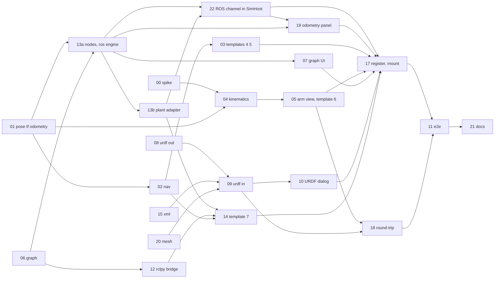

# B17 Robotics creation: arm, ROS-like graph, URDF: atomic task packages

Written 2026-10-27 for the build plan step. Plan only: no file under `src/`, `figures/`, `server/`, `solana/`, `db/`, `e2e/`, `package.json` or a lockfile was changed to write it, and nothing was committed.
Phase goal: odometry and frames, a kinematic arm, a ROS-like topic graph with a terminal, and URDF import and export with loss reports.
Scope: F-215, F-061, F-060; R-170, R-171; ROBOTICS slices R5 to R8. Not in scope: walking robots, a real ROS 2 graph or bridge (R9, RA-28), SDF, server physics, a general 6-DoF manipulator, SLAM, AMCL, Nav2.
Exit: `npm run check`; RA-14 to RA-19 green; `e2e/arm.spec.ts` passes. Then Amar's OK.
Depends on phase B16 (robot physics and the line follower). Through the roadmap chain it also needs B2 (document, ops, netlist), B3 (worker, orchestrator, replay), B4 and B5 (Studio chrome, `loss.ts`), B10 (fault engine), B11 (descriptors) and B13 (the 13 benches as projects).
Labels: VERIFIED (read or run in this step), DOCUMENTED (a plan file says it), EXTERNAL, ESTIMATED, HYPOTHESIS, UNKNOWN.

## 1. What this phase starts from

The B16, B3, B5 and B4 task files now exist in `docs/MASTER_PLAN/05_ENGINEERING/tasks/` (VERIFIED, `ls`); names below are checked against them (see "Review fixes" at the end). Names in code that is not built yet are still taken from those plans (DOCUMENTED), not from code. `src/sim`, `src/export`, `src/studio`, `src/components/studio` and `content/` do not exist on `main` today (VERIFIED, `ls`). Every task starts with a precondition check (section 4) so an agent stops and reports if a file is not where this plan says.

| Fact | Evidence | Label |
|---|---|---|
| Next.js is 16.4.3; `AGENTS.md` warns it differs from older versions. This phase adds no route, no Server Action and no `proxy.ts`. Studio panels are client components loaded with `next/dynamic` (`ssr: false`); guide: `node_modules/next/dist/docs/01-app/02-guides/lazy-loading.md` | `package.json`; `AGENTS.md` | VERIFIED |
| The existing `rclpy` mock already has subscriptions, timers, `spin`, `spin_once`, parameters and executors. ROBOTICS section 3 says it "publishes messages only"; that row is stale | `src/lib/interp/python/modules.ts:867` (`installRos`), `:895-896` (`subs`, `timers`), `:897` (`Publisher`), `:938-947` (`create_publisher`, `create_subscription`, `create_timer`), `:961` (`spinGen`), `:994` (module `rclpy`), `:1007` (`std_msgs.msg`) | VERIFIED |
| The mock keeps its own clock (`w.now`, microseconds), delivers by `rt.softQueue`, knows only 4 message classes (`Twist`, `Vector3`, `String`, `Int32`, `Float32`, `Bool` under `std_msgs.msg`) and emits `RosMessage {t, topic, type, data}` to the host | `modules.ts:870-905`, `:1004-1007`; `modules.ts:8-15`; `src/lib/interp/run.ts:51-52`, `:174` | VERIFIED |
| The Pi 5 ROS 2 bench is the starting point of the ROS-like variant. It has practice tasks that run `rclpy` headless | `src/content/robotics/pi5-ros2.ts:1-12`, `:101-200` | VERIFIED |
| The PCA9685 bench is already "a three-servo desk arm" on the Adafruit driver, with sketches `CENTRE`, `SWEEP`, `PICK`. Template 6 starts from it | `src/content/robotics/pca9685.ts:1`, `:21-24`, `:335-339`; `src/lib/interp/arduino/libs.ts:1111` (`Adafruit_PWMServoDriver.h`) | VERIFIED |
| The arm reads pulses on a 600 to 2400 us scale; `Servo.h` uses 544 to 2400 us | `pca9685.ts:14` (comment) | VERIFIED |
| `project.schema.json` already holds what ROBOTICS Objection 1 asked for: `Body.inertia_g_mm2`, `Body.com_mm`, `Joint.limits.effort` (with deprecated `effort_n`), units by kind, `LossItem {code, severity, path, message}`, `ExportRecord {format, at, appVersion, sha256, revision, loss[]}`, `Provenance.origin` kind `import {format, fileName, sha256, loss[]}` (at most 500 items), `Asset.role` `model` | `schemas/project.schema.json` (`$defs.Body`, `Joint`, `LossItem`, `ExportRecord`, `Provenance`, `Asset`) | VERIFIED |
| `domains.robotics.data` caps: 64 entries in `bodies`, 32 in `joints`, 32 in `wheels`, 64 sensors; `RosConfig` has `namespace`, at most 32 `nodes` (kinds `robot_state_publisher`, `diff_drive_controller {left_joint, right_joint}`, `user {source}`) and `sensor_topics` with five message types. ROBOTICS 4.5 gives the v1 scene limits: 64 dynamic bodies, 32 joints (HYPOTHESIS until RA-07) | `schemas/robotics.domain.schema.json` (`properties.*.maxProperties`, `$defs.RosConfig`); `ROBOTICS_ARCHITECTURE.md:206` | VERIFIED |
| `Arena.start {x_mm, y_mm, yaw_deg}` is the only "robot start" in the document; there is no `odom` frame stored | `robotics.domain.schema.json` (`$defs.Arena`) | VERIFIED |
| Fault cause ids the arm and rover templates can use come from the closed list of SIM 13.4: `servo-jitter-supply`, `battery-sag-reset`, `open-connection`, `swapped-pins`, `i2c-missing-pullup`, `motor-stall`, `encoder-channel-swapped`, `wheel-slip`, `ranger-beam-blocked`, `sensor-saturated`, `loop-too-slow`, `tip-over`, `motor-direction-reversed`, `driver-undersized` | `SIMULATION_ARCHITECTURE.md:1444-1476` | VERIFIED |
| Physics API this phase uses: `PhysicsWorld.applyJointTorqueImpulse`, `setJointMotor({velocity?, position?, maxTorque, damping?})`, `body()`, `joint()`, `hash2()`; `addTorque` and `addForce` are banned in `sim/mech` (RA-05) | `SIMULATION_ARCHITECTURE.md:1099-1125`, `:1200` | VERIFIED |
| ROS callbacks run at phase P2, rank 35, ordered `(at, phase, rank, seq)`; a publish enqueues one delivery per subscription at the same `at` | `SIMULATION_ARCHITECTURE.md:343`, `:351`, `:395` | VERIFIED |
| Playwright uses a random port in 40000 to 49999 (`E2E_PORT`) and builds unless `E2E_SKIP_BUILD` is set; Vitest includes `src/**/*.test.{ts,tsx}` and `scripts/**/*.test.*` and runs under jsdom | `playwright.config.ts:5-7`, `:11-13`; `vitest.config.mts:12-17` | VERIFIED |
| Namespaces are listed in `src/i18n/namespaces.ts:4`; languages are `en, es, fr, de, zh, hi` | `namespaces.ts:4`; `src/i18n/config.ts:4` | VERIFIED |
| No XML parser, mesh reader or YAML package is in `package.json` | `package.json` | VERIFIED |
| The Python interpreter supports `math`; `heapq` was not found by grep | `modules.ts:227`; grep found no `heapq` | VERIFIED / UNKNOWN |
| `docs/ROBOTICS.md` does not exist yet. The roadmap says B16 creates it and B17 extends it | `ls docs`; roadmap lines 958, 1003 | VERIFIED / DOCUMENTED |

## 2. Decisions this plan makes, and the questions it leaves

Where two design documents disagree, `RECONCILIATION.md` decides (RC-41, RC-45, RC-46, RC-52, RC-53, RC-54 touch this phase; none changes a B17 task). The rows below are places the documents still disagree or are silent. Each has a default so agents can proceed; Amar can overrule at the phase stop.

| # | Question | Sources | Default in this plan | Label |
|---|---|---|---|---|
| Q1 | Roadmap row T-B17-02 says "N1 and N2 (wall follow, waypoint)". ROBOTICS 10.3 says N0 is reactive (wall follow is template code), N1 is the waypoint follower, N2 is the occupancy grid plus A* | roadmap line 1016 against ROB 10.3 | ROB 10.3 wins. `nav1.ts` is `waypointFollower`; `nav2.ts` is `OccupancyGrid` and `astar`. Wall following is code inside templates 4 and 7, not a library | DOCUMENTED |
| Q2 | Roadmap puts templates 4, 5 and 7 in one task before the ROS graph exists. Template 7 needs the graph, `rclpy` binding and N2 | roadmap line 1017 against ROB 15 row 7 | T-B17-03 is templates 4 and 5. Template 7 is T-B17-14, later. Template 6 stays in T-B17-05 | DOCUMENTED |
| Q3 | ROB 10.1 says "no frame is created implicitly" and also maps ROS `map`, `odom`, `base_link` to `world`, "a robot-start frame" and the root body's frame. The document stores no robot-start frame | ROB 10.1; `Arena.start` | `tf` holds three read-only virtual aliases, named in one table in `tf.ts`: `map` = `world`; `odom` = the pose of `Arena.start` (fixed); `base_link` = the root body's frame. They are not written into `mechanical.frames`. Any other unknown name is `unknown-frame` | ASSUMED |
| Q4 | ROB 12.1 limits a URDF to 512 links. The robotics domain schema holds physics for 64 bodies and 32 joints, and ROB 4.5 sets scene limits of 64 bodies and 32 joints | ROB 12.1 against `robotics.domain.schema.json` and ROB 4.5 | Two layers. The XML parser caps at 512 links (parse safety). The importer refuses more than 64 links or 32 joints with `urdf-over-scene-limit` and the counts. The schema and scene limits win (RC rule R4) | DOCUMENTED |
| Q5 | RA-17 says the xacro case is "refused with a hint, and the rest imports". ROB 12.1 says "error with a hint". Both can be read as whole-file refusal or partial import | RA-17 against ROB 12.1 | Partial import. A file with xacro constructs (an `xmlns:xacro` declaration, an `xacro:` element, or a `${...}` value) still imports its plain URDF elements. Each refused construct is an `error` loss item `urdf-xacro-refused` with the hint "expand it first: `xacro robot.urdf.xacro > robot.urdf`". The dialog shows these in red and the person decides whether to keep the partial robot. Switching to whole-file refusal is one branch in `urdf-in.ts` | ASSUMED |
| Q6 | URDF `<inertial>` is a full tensor and an origin with rotation. The document holds principal moments and `com_mm` only | ROB 12.1 against `Body` | Use `ixx, iyy, izz`. If any product term is above 1e-9 of the largest diagonal term, or the inertial origin has a rotation, emit warnings `urdf-inertia-products-dropped` and `urdf-inertial-rotation-dropped`. Mass and `com_mm` are kept exactly | ASSUMED |
| Q7 | `<visual>` and `<collision>` have an `origin`. `Body.shape` and `BodyPhysics.collider` have none | ROB 12.1 against `Body`, `Collider` | Geometry origins are not stored. A non-identity origin is the warning `urdf-geometry-origin-dropped` with the link. Real URDFs often have such origins, so this loss is expected to be common (HYPOTHESIS; Amar's own URDFs will show how common) | HYPOTHESIS |
| Q8 | The `diff_drive_controller` node (schema: `left_joint`, `right_joint` only) consumes `cmd_vel`. If the same wheel joint also has a `drive` (a motor in the netlist) the controller would bypass the electronics, which breaks ADR-0101 (one electrical truth) | ROB 11.2; ADR-0101; `Joint.drive` | The controller is an ideal velocity controller for joints with no `drive`. It drives them with `setJointMotor({velocity, maxTorque: limits.effort})`. A joint with a `drive` makes the node fail to start with `ros-joint-has-drive` and the joint name. The panel says "ideal controller: no driver, no battery" next to it. This is also how a URDF-imported robot (undriven wheels, `RB-W-UNDRIVEN`) can move. `hasDrive(jointId)` is true when the joint's `Joint.drive` (project schema `$defs.Joint.drive`, `{component, pin?}`) is set; the plant adapter (T-B17-13b) reads it from the `Project` once, not from physics | ASSUMED |
| Q9 | The "assumed" against "true" wheel radius for the odometry error demo (ROB 10.2) has no document field | ROB 10.2 | No schema change. The physics uses `WheelSpec.radius_mm` (true). User code holds its own constant (assumed). The odometry panel plots both. Changing the true radius in the robot builder is how the person makes the error | ASSUMED |
| Q10 | A `wheel` joint has no URDF equivalent | ROB 12.2 | Exported as `continuous` with loss `urdf-wheel-surface-dropped` and `urdf-wheel-kind-lost`. A round trip returns `continuous`, not `wheel`. RA-18 compares kinds through this documented mapping | DOCUMENTED |
| Q11 | Arm physics: does a servo-driven 3-link arm hold pose and keep the hash in the pinned Rapier build? RK-3 (stability of small robots, high mass ratios) is open and RS-13 tested wheeled scenes only | ROB 21 RK-3; RS-13 REPORT | Spike T-B17-00 answers it first. If the arm is not stable above a measured mass ratio, the validator limit `RB-W-MASSRATIO` is set to the measured value; if hashes differ across runs, arm templates use hash class D (RC-53). No new document field | HYPOTHESIS |
| Q12 | Topic latency. The roadmap names a "topic latency model". ROB 11.2 says delivery is same-timestamp, and RA-16 needs exact multiples of 100 ms | roadmap line 1000; ROB 11.2; RA-16 | Default latency is 0 ns. A per-subscription `latencyNs` option exists for teaching and tests. DDS jitter, loss and discovery delay are "not modelled yet" and the terminal says so | ASSUMED |
| Q13 | The roadmap has 11 tasks and 9 / 11 / 15 weeks. The XML parser, mesh reader, standard nodes, `rclpy` binding, i18n scaffold, panel mounting, odometry panel, round-trip gate and docs need their own tasks under the 5-file rule | roadmap lines 986 to 1025 | 24 tasks, ids T-B17-00 to T-B17-22, where T-B17-13 is split into 13a and 13b. Ids 01 to 11 keep the roadmap meaning (03 is narrowed by Q2). Ids 00 and 12 to 22 are new. Effort ESTIMATED 10 / 13 / 18 weeks. The orchestrator updates roadmap section 1 when Amar accepts this file | ESTIMATED |
| Q14 | Task T-B17-05 and the roadmap say the arm is "kinematic". The roadmap's simulation work says torque limits go through `applyJointTorqueImpulse` | roadmap lines 986, 1000 | Both. FK, IK and the holding-torque check (RB-C-08) are pure functions (the "kinematic" part). In a run, servo joints are moved by the B16 servo position motor in the physics engine, and the torque limit is the servo's stall torque. The IK helper never drives the physics; it computes angles the person puts into code (D-010: code controls the robot) | DOCUMENTED |
| Q15 | Topic names and namespaces. `RosConfig.namespace` is required (`^/...`); template 7 uses `/rover`; the controller topics were named without a namespace in some places | ROB 11.2; `robotics.domain.schema.json` (`RosConfig.namespace`, `sensor_topics.topic` has no leading slash) | Decided once, in T-B17-06: a name without a leading slash resolves under `RosConfig.namespace` (`cmd_vel` is `/rover/cmd_vel`); a name with a leading slash is absolute and kept; `/tf` and `/tf_static` are always absolute (ROS 2 convention, EXTERNAL recalled). Every acceptance and terminal example below uses the full name | DOCUMENTED |

## 3. Task index

Group = parallel group (section 5). Priority P0 blocks the exit gate; P1 is in the gate but other tasks can proceed without it; P2 can be cut at the stop. Size is ESTIMATED focused agent time: S under 2 h, M 2 to 5 h, L over 5 h. Source files exclude tests.

| ID | Task | Group | Pri | Size | Src files | Depends on (this phase) | Roadmap row |
|---|---|---|---|---|---|---|---|
| T-B17-00 | Spike: arm stability and determinism in the pinned Rapier build | 1 | P0 | M | 0 (spike folder) | none | new |
| T-B17-01 | Pose maths, `tf` tree, odometry (RA-15) | 1 | P0 | M | 3 | none | T-B17-01 |
| T-B17-06 | ROS-like graph engine: messages, topics, nodes, timers, services, parameters (RA-16 core) | 1 | P0 | L | 3 | none | T-B17-06 |
| T-B17-08 | URDF export and the shared unit and loss tables | 1 | P0 | M | 3 | none | T-B17-08 |
| T-B17-15 | Safe XML parser | 1 | P0 | M | 1 | none | new |
| T-B17-16 | i18n scaffold: namespaces `arm`, `rosgraph`, `urdf`, `odometry` | 1 | P0 | S | 4 | none | new |
| T-B17-20 | STL and OBJ mesh readers with hard limits | 1 | P0 | M | 1 | none | new |
| T-B17-02 | Navigation: `waypointFollower` (N1), `OccupancyGrid` and `astar` (N2) | 2 | P0 | M | 2 | 01 | T-B17-02 |
| T-B17-04 | Kinematics: FK, analytic and damped least squares IK, joint limits, RB-C-08 (RA-14) | 2 | P0 | L | 4 (2 new, 2 B16 edits) | 01, 00 | T-B17-04 |
| T-B17-09 | URDF import with loss report, worker and host (RA-17, RA-19) | 2 | P0 | L | 3 | 08, 15, 20 | T-B17-09 |
| T-B17-12 | Bind the `rclpy` mock to the graph | 2 | P1 | M | 5 | 06 | new |
| T-B17-13a | Standard nodes, sensor bridge, ROS commands and the ROS engine on a fake plant | 2 | P0 | L | 4 | 01, 06 | new |
| T-B17-03 | Templates 4 (obstacle avoider) and 5 (rover with odometry) | 3 | P0 | L | 2 data | 01, 02 | T-B17-03 (narrowed) |
| T-B17-05 | Arm view and template 6 (planar arm, with a 200 g payload variant) | 3 | P0 | L | 4 | 04, 00, 16 | T-B17-05 |
| T-B17-07 | Topic graph and terminal UI (RA-16 in the UI) | 3 | P0 | L | 5 | 06, 13a, 16 | T-B17-07 |
| T-B17-10 | URDF dialog and flow | 3 | P0 | M | 3 | 08, 09, 16 | T-B17-10 |
| T-B17-13b | Plant adapter over the B16 mech engine, engine wiring, `rover-ros` fixture | 3 | P0 | M | 4 (1 new, 3 B16 edits) | 13a | new |
| T-B17-14 | Template 7 (sensor-guided maze rover, ROS-like Pi 5 variant) | 4 | P1 | L | 1 data | 02, 06, 12, 13b | T-B17-03 (split) |
| T-B17-22 | ROS channel through the SimHost (commands down, snapshots and taps up) | 4 | P0 | M | 4 | 13a, 13b | new |
| T-B17-18 | URDF round-trip gate on templates 1, 3 and 6 (RA-18) | 4 | P0 | M | 0 (tests, fixtures) | 05, 08, 09 | new |
| T-B17-19 | Odometry panel: dead reckoning against ground truth | 5 | P1 | M | 3 | 01, 13a, 16, 22 (and B16 T-B16-33) | new |
| T-B17-17 | Register templates 4 to 7, mount the panels, add URDF commands | 6 | P0 | M | 4 | 03, 05, 07, 10, 14, 19, 22 | new |
| T-B17-11 | Arm and graph end to end, and the template hash job | 7 | P0 | L | 1 (config) | all | T-B17-11 |
| T-B17-21 | `docs/ROBOTICS.md` extended | 7 | P1 | S | 1 | all | new |

## 4. Rules every task obeys

These rules apply to every package below, so the packages do not repeat them. A package that differs says so.

| Rule | Detail |
|---|---|
| Branch and commit | Local branch `build/v1`. One commit per task, authored as Amar Kushwaha, message `B17 T-B17-<nn>: <what>`, no `Co-Authored-By` and no "Generated with" line. Never push, never deploy. A push to `main` deploys production on Vercel (roadmap 2.1). |
| Off limits | No production service, no `.env.local` value, ports 3000 and 43117. Verification is keyless on a local build. |
| Precondition check | Before editing, run `ls` or `grep` on every file from an earlier phase that the task names. If a file or export is missing or has another signature, keep the earlier phase's name, adapt the new code, and write the difference in the commit body. If a whole module is missing, stop and report; do not widen the task. |
| Next.js | Before naming any Next API read the matching guide in `node_modules/next/dist/docs/01-app/` (`AGENTS.md`). This phase needs only client components loaded through `next/dynamic` with `ssr: false` (`02-guides/lazy-loading.md`). No route handler, no `proxy.ts`, no Server Action. |
| Portable code | `src/sim`, `src/export`, `src/project`, `src/core`, `src/protocol` import no DOM, no React, no Node built-in and no `TextDecoder` type (ADR-0014; checked by `npx tsc -p tsconfig.portable.json` and `src/architecture.test.ts`). Browser-only code goes in `src/export/browser/`, `src/studio/` or `src/components/`. |
| Import matrix | `src/export` imports `core`, `project`, `parts` only (B3 M-4); it must not import `src/sim`. Anything an export or import needs from `sim` (`inertiaOf`, `validateRobot`) is passed in by a caller in `src/studio`, or runs there. `src/lib/interp` must not import `src/sim`, and `src/sim` must not import `src/lib/interp`; `src/sim-host` may import both (B3 M-2, M-3). `A` (below) proves it. |
| Names from earlier phases | Use B2's `Project` (not `ProjectDocument`), B16's `CheckInput`, `RobotCheck`, `runChecks`, `PhysicsFrame` (B16:468, 763 to 766), and B3's `Engine`, `SimEvent`, `Phase`, `RANK` (B3:621 to 637). If the built file differs, the built name wins and the commit body says so. |
| Determinism | Inside `src/sim`: no `Date.now`, `performance.now`, `Math.random`, `eval`, `addTorque`, `addForce` (lint ban, SA-11, RA-05). Time is the integer-ns `SimTime` from `src/sim/core/clock.ts`. Randomness is the seeded generator from `src/core/prng.ts`. Use the exported names those files have; the names in this plan are descriptive. |
| Units | Document: mm, degree, gram. Libraries in `src/sim/mech` and `src/sim/ros`: metres, radians, kilograms, seconds (REP-103). Conversion happens once, at the function that reads the document, and is named in the task. |
| 5-file rule | At most 5 source files per task. A data set of one kind (project templates, one i18n namespace in six languages) counts as one. Test files and fixtures count as zero. Counts are stated in each package. |
| Gate thresholds | A test never changes a threshold named in ROBOTICS section 19. Any new number this plan introduces is labelled ESTIMATED and sits in one exported constant so Amar can change it. |
| API contracts | None. This phase adds no HTTP route and no server code (roadmap B17: "APIs: None"). The server never sees a URDF, a mesh or a ROS message. |
| Permissions | All actions are by the local person on their own device. A URDF, a mesh and a project from a room are untrusted input. No remote actor can start a ROS node or write the local library. |
| Observability | No telemetry leaves the browser (D-015, B0). Failures go to the local `errors` store as `{where: 'robot.<area>', message}` with no file contents. User-visible reasons appear in the UI. Counters (dropped messages, refused URDFs) are shown in the panel that owns them. |
| Honest labels | Panels carry the tier and the "What it models" and "Not modelled yet" lists (RA-23). Shipped strings never contain "validated", "accurate" or "realistic". The graph is titled "ROS-like graph: a model, not ROS 2". |
| Copy | A copy change updates all six languages in the same commit (K-I18N). Plain words, no em dashes. |
| Verify abbreviations | `TL` = `npm run typecheck && npm run lint`. `V <p>` = `npx vitest run <p>`. `P` = `npx tsc -p tsconfig.portable.json`. `KL` = `env META_API_KEY= GEMINI_API_KEY= SERPAPI_KEY= NEXT_PUBLIC_SOLANA_PROGRAM_ID= SOLANA_ISSUER_KEYPAIR= NEXT_PUBLIC_REALTIME_URL= VULTR_API_KEY= TIMESCALE_SERVICE_URL= PGPASSWORD= PGHOST= DATABASE_URL=` (use the shorter list the roadmap says remains after T-B0-12). `E <spec>` = `KL NEXT_DIST_DIR=.next-build npx playwright test <spec>`. `A` = `npx vitest run src/architecture.test.ts` (the import matrix, B3 T-B3-10). Each package also writes the literal commands. |
| Done means | Typecheck and lint print zero errors; the named tests pass; `git status` shows only the task's files; the commit exists. Not "looks right". |
| Rollback | `git revert <commit>` for the task. Later tasks that depend on it are reverted first. Local tag `phase-B17` after Amar's OK is the phase rollback point. |
| Migration | None. B17 adds no stored field and no schema change. Template files are new files. |

## 5. Parallel groups and file ownership

Groups run in order. Tasks in one group touch disjoint files (see the ownership table) and can be built by separate agents at once. A group starts after every task of the earlier groups is committed and its verify commands pass.

| Group | Tasks (run at once) | Starts when | What the group leaves behind |
|---|---|---|---|
| 1 | T-B17-00, T-B17-01, T-B17-06, T-B17-08, T-B17-15, T-B17-16, T-B17-20 | B16 exit gate passed | Arm spike verdict; pose maths, `tf`, odometry; ROS graph engine; URDF writer and shared tables; XML parser; four i18n namespaces; mesh readers |
| 2 | T-B17-02, T-B17-04, T-B17-09, T-B17-12, T-B17-13a | Group 1 | N1 and N2; kinematics, RB-C-08 and `ARM_MAX_MASS_RATIO`; URDF importer; `rclpy` port on the graph; standard nodes and the ROS engine on a fake plant |
| 3 | T-B17-03, T-B17-05, T-B17-07, T-B17-10, T-B17-13b | Group 2 | Templates 4, 5, 6 (and the payload variant) as files; arm view; graph and terminal; URDF dialog; plant adapter, engine wiring and the `rover-ros` fixture |
| 4 | T-B17-14, T-B17-18, T-B17-22 | Group 3 | Template 7; RA-18 gate; ROS transport over the SimHost |
| 5 | T-B17-19 | Group 4 | Odometry panel (needs the transport and the frame stream) |
| 6 | T-B17-17 | Group 5 | Templates registered and panels mounted |
| 7 | T-B17-11, T-B17-21 | Group 6 | `e2e/arm.spec.ts` and the hash job; docs |

### File ownership

One owner per file in a group. A file edited in a later group is listed with each owner and its group. Test files are named in each package and owned by the same task.

| File | Task | Group |
|---|---|---|
| `docs/MASTER_PLAN/08_RESEARCH_SPIKES/RS-B17-arm-stability/` (REPORT.md, src/arm-stability.mjs, results/) | T-B17-00 | 1 |
| `src/sim/mech/pose.ts`, `tf.ts`, `odometry.ts` | T-B17-01 | 1 |
| `src/sim/ros/messages.ts`, `topics.ts`, `graph.ts` | T-B17-06 | 1 |
| `src/export/urdf-out.ts`, `urdf-map.ts`, `urdf-loss.ts` | T-B17-08 | 1 |
| `src/export/xml.ts` | T-B17-15 | 1 |
| `src/i18n/namespaces.ts`, `src/i18n/messages/*/arm.json`, `rosgraph.json`, `urdf.json`, `odometry.json` (created) | T-B17-16 | 1 |
| `src/export/mesh.ts` | T-B17-20 | 1 |
| `src/sim/mech/nav1.ts`, `nav2.ts` | T-B17-02 | 2 |
| `src/sim/mech/kinematics.ts`, `arm-limits.ts`; `src/sim/mech/checker.ts` (edit, B16 T-B16-11), `src/sim/mech/validate.ts` (edit, B16 T-B16-17: `RB-W-MASSRATIO` reads `ARM_MAX_MASS_RATIO`) | T-B17-04 | 2 |
| `src/export/urdf-in.ts`, `src/export/browser/urdf.worker.ts`, `src/export/browser/urdf-host.ts` | T-B17-09 | 2 |
| `src/sim/ros/rclpy-bridge.ts`; `src/lib/interp/python/rclpy-port.ts` (new, the `RclpyPort` interface); `src/lib/interp/python/modules.ts`, `src/lib/interp/run.ts`, `src/sim-host/engines/interp-engine.ts` (edits; the last is B3 T-B3-12) | T-B17-12 | 2 |
| `src/sim/ros/nodes.ts`, `sensor-bridge.ts`, `commands.ts`, `engine.ts`; `src/sim/ros/__fixtures__/fake-plant.ts` | T-B17-13a | 2 |
| `content/projects/robots/obstacle-avoider.project.json`, `rover-odometry.project.json`; `src/sim/mech/templates-b-avoider.test.ts`, `src/sim/mech/__fixtures__/template-hashes-avoider.json` | T-B17-03 | 3 |
| `src/components/studio/robot/ArmView.tsx`, `src/studio/views/arm.ts`, `content/projects/robots/planar-arm.project.json`, `planar-arm-payload.project.json` (one data set), `src/i18n/messages/*/arm.json` (fill); `src/sim/mech/templates-b-arm.test.ts`, `src/sim/mech/__fixtures__/template-hashes-arm.json` | T-B17-05 | 3 |
| `src/components/studio/robot/TopicGraph.tsx`, `RosTerminal.tsx`, `src/studio/ros/terminal.ts`, `graph-model.ts`, `src/i18n/messages/*/rosgraph.json` (fill) | T-B17-07 | 3 |
| `src/components/studio/robot/UrdfDialog.tsx`, `src/studio/robot/urdf-flow.ts`, `src/i18n/messages/*/urdf.json` (fill) | T-B17-10 | 3 |
| `src/sim/ros/plant.ts`; `src/sim/mech/engine.ts`, `src/sim-host/mech.ts` and the file that registers `runtime.engine` (edits, B16 T-B16-22 and T-B16-33); `src/sim/mech/__fixtures__/rover-ros.project.json` | T-B17-13b | 3 |
| `content/projects/robots/maze-rover.project.json`; `src/sim/mech/templates-b-maze.test.ts`, `src/sim/mech/__fixtures__/template-hashes-maze.json` | T-B17-14 | 4 |
| `src/sim-host/protocol.ts`, `handler.ts`, `host.ts` (edits, B3 T-B3-13; `sim.worker.ts` only if it needs a new import); `src/studio/ros/transport.ts` | T-B17-22 | 4 |
| `src/export/urdf-roundtrip.test.ts`, `src/export/__fixtures__/urdf/expected-loss.json` | T-B17-18 | 4 |
| `src/components/studio/robot/OdometryPanel.tsx`, `src/studio/ros/odom-trace.ts`, `src/i18n/messages/*/odometry.json` (fill) | T-B17-19 | 5 |
| `src/studio/templates.ts`, `src/studio/commands.ts`, `src/components/studio/Workspace.tsx` (edits; the mount, see T-B17-17); `src/studio/robot/panels.ts` (new) | T-B17-17 | 6 |
| `e2e/arm.spec.ts`, `e2e/arm-hash.spec.ts`, `playwright.config.ts` (edit) | T-B17-11 | 7 |
| `docs/ROBOTICS.md` | T-B17-21 | 7 |
| `src/export/__fixtures__/urdf/*.urdf` (hostile and sample inputs) | the task that first needs each, named in its package: T-B17-08 owns `two-link.urdf`, `diff-drive.urdf`; T-B17-09 owns `hostile-mixed.urdf`, `billion-laughs.urdf`, `deep.urdf`, `wide.urdf`, `mesh-ref.urdf` (the 50 MB buffers are made inside the tests, no generator file) | 1, 2 |

Dependency diagram (arrows are hard dependencies inside the phase):



## 6. Task packages

Every package has the same blocks: Identity; Intent; Implementation; Verification; Delivery. "Rules" means section 4. Target user is Amar and his friends unless a row says otherwise.

### T-B17-00. Spike: arm stability and determinism in the pinned Rapier build

**Identity**

| Field | Value |
|---|---|
| Id, subsystem, phase | T-B17-00; robotics physics; B17 |
| Priority, status | P0; not started |
| Dependencies | B16 done (artifact built by `scripts/build-physics.mjs`, pins in `src/sim-host/engines/rapier.manifest.json`, `PhysicsBackend` in `src/sim/mech/backend.ts`) |

**Intent**

| Field | Value |
|---|---|
| Problem | RK-3 (stability of light parts and high mass ratios) is open. RS-13 and `sa16.mjs` tested wheeled robots only. Template 6 puts a 3-link arm on servo position motors; nobody has measured whether it holds a pose or keeps the hash. |
| Target user | The agent building T-B17-04 and T-B17-05, then Amar |
| User story | As Amar, I want to know before the arm is built how heavy the links can be and whether the arm replays the same, so that the template does not teach a wrong lesson. |
| Falsifiable question | In the pinned Rapier split build at 1/240 s, a planar 3-link arm (links 120, 100, 60 mm; link masses 25, 20, 12 g; servo joints through `setJointMotor({position, maxTorque})` with `maxTorque` 0.2, 0.15, 0.1 N·m; a 20 g payload at the tip; gravity on) (a) holds each of 10 target poses within 1 degree per joint after 2 simulated seconds, (b) gives identical `hash2()` at every 1,000 ms checkpoint in 10 runs, (c) steps in under 1 ms mean on this machine, and (d) the mass ratio across any joint can be raised from 1 to 100 in steps of 10 while (a) holds. |
| Expected behaviour | A report with the measured numbers, the largest mass ratio for which (a) holds, and a verdict PASS, PASS WITH LIMIT, or FAIL. |
| Exit condition | `REPORT.md` exists with raw output files, states each of (a) to (d) as met or not met with the number, and ends with the decision rule below. The task is finished when the report is committed, whatever the verdict. |
| Decision rule | PASS: T-B17-05 builds the dynamic arm as planned. PASS WITH LIMIT: the largest passing mass ratio becomes the constant `ARM_MAX_MASS_RATIO` in `arm-limits.ts` (T-B17-04), the one place the number lives: B16 `validate.ts` imports it for `RB-W-MASSRATIO` (T-B17-04 makes that edit). (b) fails: arm templates use hash class D in rooms (RC-53) and T-B17-05 records that in the template's hash test. (a) fails at ratio 1: stop; Amar decides whether template 6 runs as pure kinematics (FK display and IK only, no physics), which needs a scope change |
| Success metric | The four questions have numbers. |

**Implementation**

| Field | Value |
|---|---|
| Existing files | `scripts/build-physics.mjs` and `rapier.manifest.json` (B16, T-B16-01); `08_RESEARCH_SPIKES/DP-01-robot-prototypes/src/sa16.mjs` (scene style to copy) and `src/dbg.mjs` (torque rule) |
| New files | `docs/MASTER_PLAN/08_RESEARCH_SPIKES/RS-B17-arm-stability/src/arm-stability.mjs`, `results/arm-stability.txt`, `REPORT.md`. No file under `src/` |
| Method | Load the shipped artifact by the path in the manifest (not the compat package). Build bodies and joints in canonical id order, sleeping off, combine rules pinned as in ROBOTICS 4.4. Use `setJointMotor` for position control and `applyJointTorqueImpulse` for holding-torque checks; never `addTorque`. Pose error is the joint angle from `joint(id).angle`. Run (a) for 10 targets chosen by the seeded generator with seed 17. Run (b) as 10 fresh worlds. Run (c) over 10,000 steps after one dummy step. Run (d) by scaling child link mass by 1 to 100 |
| Data model, API, state, validation | None |
| Errors, edge cases | Record NaN or `physics-diverged` if seen; a diverged run counts as not met |
| Permissions, performance | Node script, local. The run takes under 2 minutes |
| Migration | None |

**Verification**

| Field | Value |
|---|---|
| Unit tests | None. The script prints a pass line per question; the report quotes it |
| Integration, Playwright | None. The browsers are not part of this question; hash equality across browsers is T-B17-11 |
| Fixtures | None |
| Acceptance (Given/When/Then) | Given the pinned artifact, When `node src/arm-stability.mjs` runs twice, Then both `results` files are byte-equal except timing lines, and `REPORT.md` quotes (a) to (d) with numbers |
| Observability | The report records Node version, CPU model, artifact sha256 |
| Release blockers | A report that quotes a number the results file does not contain |

**Delivery**

| Field | Value |
|---|---|
| Definition of done | Report committed with a verdict and the decision rule applied |
| Verify commands | `node docs/MASTER_PLAN/08_RESEARCH_SPIKES/RS-B17-arm-stability/src/arm-stability.mjs` (prints four pass or fail lines); `git status` shows only the spike folder |
| Documentation | The report. Its verdict is copied into `docs/ROBOTICS.md` by T-B17-21 |
| Rollback | Delete the folder. Nothing depends on it at run time |
| Later tasks need | T-B17-04 reads `ARM_MAX_MASS_RATIO`; T-B17-05 reads the hash class; both read the verdict line |

---

### T-B17-01. Pose maths, `tf` tree, odometry

**Identity**

| Field | Value |
|---|---|
| Id, subsystem, phase | T-B17-01; robotics `sim/mech`; B17 |
| Priority, status | P0; not started |
| Dependencies | B16 (scene builder `src/sim/mech/scene.ts`), B3 (`SimTime` in `src/sim/core/clock.ts`), B2 (`Frame`, `Pose` generated types in `src/project/generated/types.ts`) |

**Intent**

| Field | Value |
|---|---|
| Problem | Nothing in the repo computes a transform chain or dead-reckoned pose (VERIFIED, ROBOTICS section 3). Kinematics, the URDF writer, the ROS `tf` topics and the odometry panel all need one shared pose maths. |
| Target user | Amar building a rover or arm; the tasks listed under "Later tasks need" |
| User story | As Amar, I want the robot's frames and wheel odometry computed from the document, so that I can see where my code thinks the rover is against where it is. |
| Expected behaviour | `lookup(target, source)` returns the pose of `source` in `target`; odometry integrates encoder counts with the exact arc form. |
| Success metric | RA-15: a 1 percent radius error on one wheel over 10 m gives a heading error within 5 percent of 0.667 rad. FK-style round trips to 1e-9 |

**Implementation**

| Field | Value |
|---|---|
| Existing files | `src/project/generated/types.ts` (B2) for `Pose`, `Frame`; `src/sim/core/clock.ts` (B3) for `SimTime`. `figures/engine/bench-solve.js` has no transforms (VERIFIED by grep) |
| New files | `src/sim/mech/pose.ts`, `tf.ts`, `odometry.ts`; tests `pose.test.ts`, `tf.test.ts`, `odometry.test.ts` |
| Types and signatures | See below |
| Data model | Reads `mechanical.frames[]` `{id, name, parent, pose {position_mm, rpy_deg}}`. Writes nothing |
| Input and output schemas | In: `Frame[]`, live frame poses as `Pose`. Out: `Pose` in the document form, or `TfError` |
| Algorithms | Quaternion from fixed-axis roll, pitch, yaw (URDF convention): `q = qz(yaw) * qy(pitch) * qx(roll)`; compose by quaternion product and rotated translation; slerp for interpolation with the shorter-arc rule; odometry arc form from ROB 10.2 |
| State transitions | `TfTree` holds, per moving frame, a ring buffer of the last 480 poses (2 s at 240 Hz). `setFramePose` appends; `lookup` reads |
| Validation | `lookup` returns `unknown-frame` for a name not in the document or in the alias table; `no-path` when two frames share no root; `extrapolation` when `at` is older than the oldest stored pose or newer than the newest. Nothing returns NaN: a NaN input to `setFramePose` is rejected with `TfError` `bad-pose` and the buffer is unchanged |
| Error conditions | As above. A parent cycle in `frames` is `cycle` at construction |
| Edge cases | Gimbal case pitch = +-90 degrees: `quatToRpy` returns roll 0 and puts the rest in yaw, and the round trip compares quaternions, not angles. Zero-length quaternion normalises to identity with a flag. A frame named `world` is the root. Frame count cap 512 (schema) |
| Permissions | None (pure code) |
| Performance | `lookup` over a 20-frame chain under 20 microseconds mean (ESTIMATED; measured in the test, printed, not gated) |
| Migration | None |

```ts
// src/sim/mech/pose.ts
export type Vec3 = [number, number, number];
export type Quat = [number, number, number, number];            // x, y, z, w, unit length
export interface Transform { p: Vec3; q: Quat }                  // metres, unit quaternion
export function rpyDegToQuat(rpyDeg: Vec3): Quat;
export function quatToRpyDeg(q: Quat): Vec3;
export function poseToTransform(p: { position_mm: Vec3; rpy_deg: Vec3 }): Transform;   // mm to m
export function transformToPose(t: Transform): { position_mm: Vec3; rpy_deg: Vec3 };
export function compose(a: Transform, b: Transform): Transform;
export function invert(a: Transform): Transform;
export function slerp(a: Quat, b: Quat, s: number): Quat;
export function applyToPoint(t: Transform, v: Vec3): Vec3;

// src/sim/mech/tf.ts
export type FrameId = string;                                    // 'frm_...' or 'world', or an alias below
export type TfError = { error: 'unknown-frame' | 'no-path' | 'extrapolation' | 'bad-pose' | 'cycle'; frame?: FrameId };
export interface TfTree {
  lookup(target: FrameId, source: FrameId, at?: SimTime): Transform | TfError;
  frames(): FrameId[];
  chain(a: FrameId, b: FrameId): FrameId[] | TfError;
  setFramePose(frame: FrameId, at: SimTime, pose: Transform): void | TfError;
}
export const ROS_ALIASES: { map: 'world'; odom: 'virtual:arena-start'; base_link: 'virtual:root-body' };   // Q3
export function createTfTree(frames: Frame[], opts: { arenaStart: { x_mm: number; y_mm: number; yaw_deg: number }; rootBodyFrame: FrameId; now: () => SimTime }): TfTree | TfError;

// src/sim/mech/odometry.ts
export interface OdomState { x: number; y: number; phi: number }              // metres, radians
export interface DiffDriveParams { radius_m: number; track_m: number }
export type DriveType = 'diff';                                                // other types are not in v1
export function diffDriveOdometry(s: OdomState, dThetaL: number, dThetaR: number, p: DiffDriveParams, drive?: DriveType): OdomState;
export function countsToAngle(counts: number, countsPerRev: number, gearRatio: number): number;   // radians
```

**Verification**

| Field | Value |
|---|---|
| Unit tests | `pose.test.ts`: `rpyDegToQuat` then `quatToRpyDeg` and back within 1e-9 on 10,000 seeded random poses; `compose(a, invert(a))` is identity within 1e-12; pitch +-90 degrees case; unit conversion mm and degree. `tf.test.ts`: a 3-frame chain gives the hand-computed pose; aliases `map`, `odom`, `base_link` resolve; `lookup` at a time between two stored poses equals the slerp and linear midpoint; older than 480 poses gives `extrapolation`; unknown name gives `unknown-frame`; two roots give `no-path`; a cycle is refused. `odometry.test.ts`: straight run (`|dphi| < 1e-9` branch) 1 m; quarter circle with `dsR - dsL` giving `dphi = pi/2` lands at the exact arc end point; RA-15 run: radius true 1.01 r on the right wheel, assumed r on both, both wheels turn the angle that gives 10 m on the left, the true-minus-assumed heading difference is within 5 percent of 0.667 rad (arithmetic: `0.1 / 0.15`) |
| Integration | None here. T-B17-13a runs the tree inside the orchestrator |
| Playwright | None |
| Fixtures | None (inline numbers) |
| Acceptance | Given the document of the four-wheel fixture, When `lookup('base_link', 'world')` is read after setting the root pose, Then it equals the set pose. Given RA-15's setup, Then heading error is within 5 percent of 0.667 rad |
| Observability | None |
| Release blockers | A NaN returned from any exported function; `Math.random` or `Date.now` in `src/sim` |

**Delivery**

| Field | Value |
|---|---|
| Definition of done | Tests pass; `P` passes; commit exists |
| Verify commands | `npm run typecheck && npm run lint`; `npx vitest run src/sim/mech/pose.test.ts src/sim/mech/tf.test.ts src/sim/mech/odometry.test.ts`; `npx tsc -p tsconfig.portable.json` |
| Documentation | JSDoc on `lookup` conventions (REP-103) and the alias table; `docs/ROBOTICS.md` by T-B17-21 |
| Rollback | Revert the commit; nothing else imports these files yet |
| Later tasks need | T-B17-02 `Pose2D`; T-B17-04 `Transform`, `compose`; T-B17-13a `createTfTree`, `diffDriveOdometry`; T-B17-13b `compose`; T-B17-19 odometry. T-B17-08 and T-B17-09 do not import this task: they keep angles in degrees and use only `degToRad`, `radToDeg` and `wrapDeg360` from `urdf-map.ts` |

---

### T-B17-06. ROS-like graph engine

**Identity**

| Field | Value |
|---|---|
| Id, subsystem, phase | T-B17-06; `sim/ros`; B17 |
| Priority, status | P0; not started |
| Dependencies | B3 (orchestrator event order `(at, phase, rank, seq)`, `src/sim/engine.ts`) |

**Intent**

| Field | Value |
|---|---|
| Problem | No ROS-like graph exists. The `rclpy` mock keeps its own clock and queue and cannot be inspected by a UI (VERIFIED, `modules.ts:895-905`). |
| Target user | Amar writing nodes in Python or TypeScript; the terminal and graph UI |
| User story | As Amar, I want nodes, topics, timers and services on the simulation clock, so that a run with the same seed gives the same messages at the same times. |
| Expected behaviour | A deterministic graph: a 10 Hz publisher for 10 virtual seconds is received exactly 100 times at multiples of 100,000,000 ns, in every run. |
| Success metric | RA-16 for the engine in isolation (with a test scheduler) |

**Implementation**

| Field | Value |
|---|---|
| Existing files | `src/sim/engine.ts` (`Engine`, `SimEvent`, `Phase`, `RANK`; B3 task file lines 621 to 637) and `orchestrator.ts` (T-B3-11) for the event order; `src/sim/core/clock.ts` for `SimTime`; `modules.ts:895-1007` as the behaviour to match (parameters, `create_timer`, logger format `[{severity}] [{name}]: {message}`, `modules.ts:906-910`) |
| New files | `src/sim/ros/messages.ts`, `topics.ts`, `graph.ts`; tests `messages.test.ts`, `topics.test.ts`, `graph.test.ts` |
| Data model | In code only. The persisted part is `domains.robotics.data.ros` (`RosConfig`), read by T-B17-13a, not here |
| Algorithms | Scheduler abstraction below. Timer `n` fires at `t0 + n * periodNs` by integer arithmetic on `SimTime`, never by adding to a drifting float. Publish: for each subscription of the topic in subscription-creation order, the graph stores a delivery record (`{topic, subscription, message, publishedAt}`) in an internal table `Map<number, Delivery>` with ids from a counter, and calls `scheduler.at(now + latencyNs, 'ros.deliver', { id })`. The queued event holds only the id, so it can be hashed, cloned and replayed; closures live in the subscription table, which node code rebuilds on load and which is never serialised. When the engine hands the due event back, `graph.deliver(id)` removes the record and runs the callback. Timers use `scheduler.at(t, 'ros.timer', { id: timerId })`. `seq` comes from the orchestrator. Services: request and response are two `ros.deliver` records. `graph.hash(h)` feeds the sorted table (id, due time, topic, message bytes) and every node's state |
| State transitions | Node: `created` to `active` to `destroyed`. Publisher and subscription live as long as their node. A destroyed node's pending deliveries are dropped and counted |
| Validation | Topic names match `^/?[a-z][a-z0-9_]{0,31}(/[a-z][a-z0-9_]{0,31}){0,3}$` (the schema pattern for `sensor_topics.topic`, plus an optional leading slash). Namespace rule, decided once (Q15): a name without a leading slash resolves under `RosConfig.namespace` (`/rover` + `cmd_vel` = `/rover/cmd_vel`); a name with a leading slash is absolute and kept; `/tf` and `/tf_static` are always absolute, whatever the namespace. A type string must be in the message registry; a topic has one type for its whole life (a second type is `type-mismatch`); messages are validated against the registry before delivery |
| Error conditions | Structured, no throw across the API: `unknown-type`, `type-mismatch`, `bad-topic-name`, `bad-message` (with the field path), `node-limit` (32), `topic-limit` (128), `subscription-limit` (512), `queue-depth-limit`, `not-modelled-yet` for QoS history, durability, deadline, liveliness and actions |
| Edge cases | Same-timestamp publish inside a callback is delivered at the same `at` with the next `seq` (still before any later time). Publishing from a timer at the same instant as another node's timer is ordered by node registration order. Best-effort with depth N drops the oldest and counts it. A subscription created after a publish gets nothing (volatile, no latching) |
| Permissions | None |
| Performance | 10,000 deliveries under 50 ms in Node (ESTIMATED, printed). Message size cap 1 MiB estimated bytes (ESTIMATED constant `MAX_MESSAGE_BYTES`); arrays capped at 200,000 elements so a full occupancy grid fits |
| Migration | None |

```ts
// src/sim/ros/messages.ts
export type FieldKind = 'bool' | 'int32' | 'uint32' | 'int64' | 'float32' | 'float64' | 'string' | 'time' | 'message' | 'array';
export interface FieldDef { name: string; kind: FieldKind; type?: string; of?: FieldDef; fixedLength?: number; unit?: string }   // 'type' names a message when kind is 'message'
export interface MsgDef { type: string; fields: FieldDef[] }
export const MESSAGE_TYPES: Readonly<Record<string, MsgDef>>;    // std_msgs/{String,Bool,Int32,Float32,Float64,Header}, geometry_msgs/{Twist,TwistStamped,Pose,PoseStamped,Transform,TransformStamped,Point,Quaternion,Vector3}, nav_msgs/{Odometry,Path,OccupancyGrid}, sensor_msgs/{Range,LaserScan,Imu,JointState,BatteryState}, tf2_msgs/TFMessage, builtin_interfaces/Time
export function defaultMessage(type: string): unknown | RosError;
export function validateMessage(type: string, value: unknown): { ok: true } | { ok: false; error: RosError };
export type RosError = { error: 'unknown-type' | 'type-mismatch' | 'bad-topic-name' | 'bad-message' | 'node-limit' | 'topic-limit' | 'subscription-limit' | 'queue-depth-limit' | 'not-modelled-yet'; path?: string; detail?: string };

// src/sim/ros/topics.ts
export interface Qos { reliability: 'reliable' | 'best-effort'; depth: number }          // depth 1 to 100
export const DEFAULT_QOS: Qos;                                                           // reliable, depth 10
export interface TopicInfo { name: string; type: string; publishers: string[]; subscribers: string[]; qos: Qos; count: number; dropped: number }
export function resolveTopicName(ns: string, name: string): string | RosError;
export class TopicRegistry { /* register(name, type), info(name), list(), noteStamp(name, t), hz(name, windowNs): number | null */ }

// src/sim/ros/graph.ts
export interface Scheduler { now(): SimTime; at(t: SimTime, kind: string, payload: unknown): void }   // the engine turns this into a SimEvent {phase: 2, rank: 35, src: 'ros'}
export interface RosGraph {
  createNode(id: string): RosNode | RosError;
  nodes(): NodeInfo[];
  topics(): TopicInfo[];
  tap(topic: string, cb: (msg: unknown, at: SimTime) => void): () => void;           // used by echo and hz; not a node
  setLatency(topic: string, latencyNs: number): void;                                 // default 0, Q12
  snapshot(): GraphSnapshot;                                                         // {nodes, topics, edges: {from, topic, to}[]}
  deliver(id: number): void;                                                           // called by the engine when a 'ros.deliver' or 'ros.timer' event is due
  hash(h: StateHasher): void;                                                          // StateHasher from src/sim/core
}
export interface RosNode {
  readonly id: string;
  createPublisher<T>(topic: string, type: string, qos?: Qos): Publisher<T> | RosError;
  createSubscription<T>(topic: string, type: string, cb: (m: T, at: SimTime) => void, qos?: Qos): Subscription | RosError;
  createTimer(periodNs: number, cb: () => void): Timer;
  createService<Q, S>(name: string, reqType: string, resType: string, handler: (q: Q) => S): void | RosError;
  callService<Q, S>(name: string, q: Q, cb: (s: S | RosError) => void): void;
  declareParameter(name: string, type: 'bool' | 'int' | 'double' | 'string', value: unknown): void | RosError;
  getParameter(name: string): unknown | RosError;
  setParameter(name: string, value: unknown): void | RosError;
  destroy(): void;
}
export function createRosGraph(sched: Scheduler, opts?: { namespace?: string }): RosGraph;
export function createTestScheduler(): Scheduler & { bind(g: Pick<RosGraph, 'deliver'>): void; runUntil(t: SimTime): void };   // total order (at, seq) at phase 2, rank 35, for tests
```

**Verification**

| Field | Value |
|---|---|
| Unit tests | `messages.test.ts`: every type in the registry has a default that validates; a wrong field type names the path (`linear.x`); an unknown type names the type (R-FID-3); every type that ROB 11.2 lists is present (22 types, counted in the test). `topics.test.ts`: name rules (accept `cmd_vel`, `/robot/cmd_vel`; refuse `Cmd`, `a//b`, 5 segments, 33 chars); namespace resolution; `hz` over a window equals the known rate. `graph.test.ts`: RA-16 (publisher timer 10 Hz for 10 virtual seconds, one subscriber, 100 messages at multiples of 100,000,000 ns, ten runs identical, compared as arrays); two subscribers receive in creation order; publish inside a callback is delivered at the same `at`; best-effort depth 2 with latency 5 ms drops the oldest and counts; services round trip; parameters typed (setting a string on an int is `bad-message`); `tap` sees messages without appearing in `nodes()`; destroyed node's deliveries are dropped and counted; limits 32 / 128 / 512; QoS `durability` option returns `not-modelled-yet`; deliveries are plain data (`structuredClone` of every scheduled `(kind, payload)` equals itself, no function inside) and `graph.hash` is equal across ten runs and differs when one message is delayed one step; namespace `/rover`: `cmd_vel` resolves to `/rover/cmd_vel`, an absolute `/other/x` is kept, and `tf` and `tf_static` become `/tf` and `/tf_static` |
| Integration | The orchestrator wiring is T-B17-13a |
| Playwright | None |
| Fixtures | None |
| Acceptance | Given a graph and a test scheduler, When a timer node publishes `geometry_msgs/Twist` at 10 Hz for 10 s, Then a subscriber gets exactly 100 messages, at `k * 100_000_000` ns for k = 1 to 100 (the first fire is at `t0 + period`, with `t0` = 0, and the run is inclusive of 10.0 s), identical in ten runs |
| Observability | `TopicInfo.count`, `dropped`; `GraphSnapshot` for the UI |
| Release blockers | Any wall-clock call; a thrown exception for a user mistake |

**Delivery**

| Field | Value |
|---|---|
| Definition of done | Tests pass; portable check passes; commit exists |
| Verify commands | `npm run typecheck && npm run lint`; `npx vitest run src/sim/ros`; `npx tsc -p tsconfig.portable.json` |
| Documentation | JSDoc; the "ROS-like graph: a model, not ROS 2" label text is owned by T-B17-07 |
| Rollback | Revert the commit |
| Later tasks need | T-B17-12 `createRosGraph`, `RosNode`; T-B17-13a `Scheduler`, `TopicRegistry`, `deliver`, `hash`; T-B17-07 `GraphSnapshot`, `tap` |

---

### T-B17-08. URDF export and the shared unit and loss tables

**Identity**

| Field | Value |
|---|---|
| Id, subsystem, phase | T-B17-08; `src/export`; B17 |
| Priority, status | P0; not started |
| Dependencies | B2 (document types, `src/project/generated/types.ts`, `hash.ts`), B5 (`src/export/loss.ts` from T-B5-10), T-B17-01 is not required (this task needs only `degToRad`, `radToDeg` and `wrapDeg360` in `urdf-map.ts`). B16's `inertiaOf` is passed in by the caller, not imported: `src/export` may not import `src/sim` (B3 M-4) |

**Intent**

| Field | Value |
|---|---|
| Problem | A robot built in iynk cannot leave. R-171 asks for URDF in and out. |
| Target user | Amar who wants to open an iynk robot in another tool |
| User story | As Amar, I want to export my robot as URDF and see what was left out before I save it. |
| Expected behaviour | Bodies become links with inertial blocks, joints keep kind, origin, axis and limits in SI; everything electrical and every physics setting URDF cannot hold is listed. |
| Success metric | Export then import (T-B17-09) gives equal bodies, joints, masses and limits for templates 1, 3, 6 (RA-18, gated by T-B17-18) |

**Implementation**

| Field | Value |
|---|---|
| Existing files | `src/export/loss.ts` (B5): `LossItem` builder and `exportRecord()`; if its names differ, use B5's. `schemas/project.schema.json` (`$defs.LossItem`, `ExportRecord`); `src/sim/mech/inertia.ts` (B16, `inertiaOf(shape, massKg): [ixx, iyy, izz]`, B16:377) is read for its signature and units only; read it first and convert mm to m if it takes millimetres |
| New files | `src/export/urdf-out.ts`, `urdf-map.ts`, `urdf-loss.ts`; tests `urdf-out.test.ts`, `urdf-map.test.ts`; fixtures `src/export/__fixtures__/urdf/two-link.urdf`, `diff-drive.urdf` (hand-written, no third-party content) |
| Data model | Reads `mechanical.{frames,bodies,joints,mounts}`, `domains.robotics.data.{bodies,joints,wheels}`. Writes text and a `LossItem[]`. The caller adds an `ExportRecord` |
| Input and output schemas | In: a validated `Project`. Out: `{ ok: true, text: string, loss: LossItem[] } \| { ok: false, error: UrdfError }` |
| Mapping (ROB 12.2) | `<robot name>` = `meta.title`. Body to `<link name="X">` with X = body id without `bdy_`. `<inertial>`: `<mass value=` `mass_g / 1000`; `<inertia ixx iyy izz>` = `inertia_g_mm2 * 1e-9` (derived from shape and mass when absent with `opts.inertiaOf`, which the caller passes as B16's `inertiaOf`, so the file is complete; without `opts.inertiaOf` the `<inertia>` element is left out and `urdf-no-inertial` is listed with the detail "tensor"); `<origin xyz>` = `com_mm / 1000`. Joint: id without `jnt_`; `type` `fixed`, `revolute`, `prismatic`, `continuous`; `wheel` becomes `continuous`. `<origin xyz rpy>` = `origin.position_mm / 1000`, `rpy_deg * pi / 180`. `<axis xyz>` normalised. `<limit lower upper effort velocity>`: revolute degrees to radians, effort N·m, velocity deg/s to rad/s; prismatic mm to m, N, mm/s to m/s. `<dynamics damping friction>` from `JointPhysics`. Geometry: box `size_mm / 1000`; cylinder `radius, length` (axis z, no rotation); sphere; mesh as `<mesh filename="meshes/<asset path>">` |
| Algorithm notes | Output order is deterministic: links sorted by body id, joints sorted by joint id (code-unit order, PDM 6.2). Numbers print as the shortest string that round-trips (`String(n)`), never exponent form for values with magnitude between 1e-6 and 1e9 (a fixed-notation helper in `urdf-map.ts`). XML text and attributes are escaped with the five predefined entities; control characters are removed. The root body is the one body that is not a joint child (`RB-E-TREE`); more than one root or a cycle is `urdf-not-a-tree` and nothing is written |
| Loss codes (all in `urdf-loss.ts`, one table: code, severity, message text key) | Export: `urdf-electronics-dropped` (warning; count of components, nets), `urdf-wheel-surface-dropped` (warning), `urdf-wheel-kind-lost` (info), `urdf-driver-dropped` (warning), `urdf-domain-dropped` (info; surfaces, arena, sensors, ros), `urdf-mounts-dropped` (info; count), `urdf-names-simplified` (info), `urdf-mesh-file-external` (warning; the `.urdf` text does not carry mesh bytes; lists asset ids), `urdf-limits-implied` (info; a revolute joint without limits written as `continuous`), `urdf-frames-dropped` (info; the root frame pose and every frame that no body or joint uses), `urdf-fault-or-sim-dropped` (info; `simulation`, `tests`, `sources` and faults). Import codes are defined here too, for T-B17-09: `urdf-joint-unsupported`, `urdf-mesh-dae`, `urdf-mesh-not-fetched`, `urdf-mesh-scale-baked`, `urdf-tag-ignored`, `urdf-xacro-refused`, `urdf-mimic`, `urdf-inertia-products-dropped`, `urdf-inertial-rotation-dropped`, `urdf-inertia-invalid`, `urdf-no-inertial`, `urdf-geometry-origin-dropped`, `urdf-multiple-visuals`, `urdf-limit-missing`, `urdf-axis-zero`, `urdf-material-dropped`, `urdf-over-scene-limit`, `urdf-too-large`, `urdf-dtd-refused`, `urdf-multiple-roots`, `urdf-cycle`, `urdf-unknown-link`, `urdf-path-refused`, `urdf-limit-order` (error), `urdf-loss-truncated` (warning), `urdf-rpy-wrapped` (info), `RB-W-UNDRIVEN`. `urdf-xml-error`, `urdf-not-urdf`, `urdf-empty`, `urdf-timeout` are `UrdfImportError` values and `urdf-asset-missing` is a `UrdfError` value: refusals, not loss items, so `urdfLoss(code)` does not build them. `urdf-too-large`, `urdf-dtd-refused`, `urdf-multiple-roots`, `urdf-cycle`, `urdf-unknown-link` and `urdf-over-scene-limit` are both: the refusal carries the loss item with the same code |
| Validation | Refuses a document with a mesh shape whose asset is missing (`urdf-asset-missing`); warns for a body with no mass (writes the link without `<inertial>`, loss `urdf-no-inertial`) |
| Error conditions | `UrdfError` = `{ error: 'urdf-not-a-tree' \| 'urdf-asset-missing' \| 'urdf-no-bodies'; detail?: string }` |
| Edge cases | A body name with non-ASCII letters (the display name is not used in the file); two bodies whose ids differ only by prefix; zero-length axis (written as `0 0 1` with loss, since the document validator already errors, RB-E-AXIS); angles at +-360 |
| Permissions, performance | Pure code. Export of a 64-body robot under 20 ms (ESTIMATED, printed) |
| Migration | None |

```ts
// src/export/urdf-out.ts
export interface UrdfExportOptions { includeInertia?: boolean; inertiaOf?: (shape: Shape, massKg: number) => [number, number, number] }   // includeInertia default true; inertiaOf is B16's, passed in by src/studio
export type UrdfError = { error: 'urdf-not-a-tree' | 'urdf-asset-missing' | 'urdf-no-bodies'; detail?: string };
export function exportUrdf(doc: Project, opts?: UrdfExportOptions): { ok: true; text: string; loss: LossItem[] } | { ok: false; error: UrdfError };

// src/export/urdf-map.ts
export const MM_TO_M = 1e-3, G_TO_KG = 1e-3, GMM2_TO_KGM2 = 1e-9;
export const degToRad = (d: number) => number, radToDeg = (r: number) => number;
export const wrapDeg360 = (d: number) => number;                      // d % 360, with -0 turned into 0: keeps rpy inside the schema range -360..360
export function fmt(n: number): string;                                 // shortest round-trip, fixed notation in range
export function jointLimitsToUrdf(kind: Joint['kind'], l: Joint['limits']): { lower?: number; upper?: number; effort?: number; velocity?: number };
export function jointLimitsFromUrdf(kind: 'revolute' | 'prismatic' | 'continuous', l: { lower?: number; upper?: number; effort?: number; velocity?: number }): Joint['limits'];

// src/export/urdf-loss.ts
export type UrdfLossCode = 'urdf-electronics-dropped' | /* ...the table above... */ 'RB-W-UNDRIVEN';
export function urdfLoss(code: UrdfLossCode, detail?: { path?: string; count?: number; name?: string }): LossItem;   // severity and message from one table
```

**Verification**

| Field | Value |
|---|---|
| Unit tests | `urdf-map.test.ts`: `1 kg m2 = 1e9 g mm2` conversion to relative 1e-12; `degToRad(radToDeg(x))` within 1e-15 relative on 1,000 seeded values; `fmt` of 0.1, 1e-7, 123456789.5, -0 ; limits revolute and prismatic both ways. `urdf-out.test.ts`: the two-link document yields the exact expected text (golden string); output is byte-equal on two calls and when the body array is shuffled 20 times (seeded); a document with two roots gives `urdf-not-a-tree`; the diff-drive document drops its electronics with a counted `urdf-electronics-dropped`; `wheel` becomes `continuous` with both wheel loss codes; a mesh body lists `urdf-mesh-file-external`; the text contains no `NaN` or `Infinity`; special characters in `meta.title` are escaped; `wrapDeg360(401.07)` is 41.07 within 1e-9; frames and `simulation` fields give `urdf-frames-dropped` and `urdf-fault-or-sim-dropped`; with `inertiaOf` passed in, a body without stored inertia gets the derived tensor, without it the element is absent and `urdf-no-inertial` is listed |
| Integration | The round trip is T-B17-18 |
| Playwright | None |
| Fixtures | `two-link.urdf` and `diff-drive.urdf` are hand-written sample outputs used by T-B17-09 as inputs. Written fresh for this repo: no third-party URDF is vendored (D-017 licence open) |
| Acceptance | Given the four-wheel test fixture (B16), When exported, Then every body and joint appears once, masses are `mass_g / 1000` and the loss list is exactly the documented one |
| Observability | Loss list returned to the caller |
| Release blockers | A loss that happens without a loss item (a test walks every top-level and `mechanical`/`domains.robotics` document field and fails if one is neither written nor named by a loss code in `urdf-loss.ts`) |

**Delivery**

| Field | Value |
|---|---|
| Definition of done | Tests pass; commit exists |
| Verify commands | `npm run typecheck && npm run lint`; `npx vitest run src/export/urdf-out.test.ts src/export/urdf-map.test.ts`; `npx tsc -p tsconfig.portable.json` |
| Documentation | Loss table in `docs/ROBOTICS.md` (T-B17-21) |
| Rollback | Revert the commit |
| Later tasks need | T-B17-09 `urdf-map.ts`, `urdf-loss.ts`; T-B17-10 `exportUrdf`; T-B17-18 round trip |

---

### T-B17-15. Safe XML parser

**Identity**

| Field | Value |
|---|---|
| Id, subsystem, phase | T-B17-15; `src/export`; B17 |
| Priority, status | P0; not started |
| Dependencies | none |

**Intent**

| Field | Value |
|---|---|
| Problem | URDF is XML. `DOMParser` is a DOM API and not allowed in portable code, and a general parser expands entities. A hostile file must not hang or exhaust memory (RA-19, BUD-12). |
| Target user | T-B17-09 |
| User story | As Amar, I want a hostile URDF refused fast, so that a shared project can never freeze my browser. |
| Expected behaviour | A linear-time parser that refuses `DOCTYPE` and entity declarations outright, supports only the five predefined entities and numeric character references, and enforces size, depth and count limits. |
| Success metric | A billion-laughs file is refused in under 50 ms; a 2 MiB valid file parses in under 300 ms (ESTIMATED, printed) |

**Implementation**

| Field | Value |
|---|---|
| Existing files | None. No XML package exists (VERIFIED) |
| New files | `src/export/xml.ts`; test `xml.test.ts` |
| Types | See below |
| Algorithm | One forward scan with an index; no regular expression with nested quantifiers. Handles: prolog `<?xml ... ?>` (the only processing instruction accepted), comments (skipped, must close), CDATA (text), elements, attributes in single or double quotes, self-closing tags, character data. Names are `[A-Za-z_:][A-Za-z0-9_:.-]*`. Namespace prefixes are kept verbatim (`xacro:macro` is a name). `&lt; &gt; &amp; &quot; &apos; &#N; &#xH;` only; any other `&name;` is `unknown-entity`; a code point outside the valid range or a control character other than tab, CR, LF is `bad-char-ref` |
| Limits (exported constant `XML_LIMITS`, all ESTIMATED except bytes and depth, which are ROB 12.1) | `maxChars` 2,097,152; `maxDepth` 64; `maxElements` 50,000; `maxAttrsPerElement` 64; `maxAttrValueChars` 4,096; `maxTextCharsPerElement` 65,536; `maxNameChars` 128 |
| Error conditions | `{ error: 'too-large' \| 'too-deep' \| 'too-many-elements' \| 'too-many-attributes' \| 'attr-too-long' \| 'text-too-long' \| 'doctype-refused' \| 'entity-refused' \| 'unknown-entity' \| 'bad-char-ref' \| 'unclosed' \| 'mismatched-tag' \| 'bad-syntax' \| 'multiple-roots' \| 'empty'; line: number; column: number }` |
| Edge cases | BOM at start (stripped); `\r\n` line counting; duplicate attribute names are `bad-syntax`; `<!DOCTYPE` anywhere, even in a comment-like position that is not a real comment, is refused; text after the root other than whitespace and comments is `bad-syntax`; a `]]>` inside text; `<` inside an attribute value |
| Permissions, performance | Pure. Time is linear in input length (test: doubling the input at most doubles the time, within 3x) |
| Migration | None |

```ts
export interface XmlElement { name: string; attrs: Record<string, string>; children: XmlElement[]; text: string; line: number }
export interface XmlLimits { maxChars: number; maxDepth: number; maxElements: number; maxAttrsPerElement: number; maxAttrValueChars: number; maxTextCharsPerElement: number; maxNameChars: number }
export const XML_LIMITS: Readonly<XmlLimits>;
export type XmlError = { error: 'too-large' | 'too-deep' | 'too-many-elements' | 'too-many-attributes' | 'attr-too-long' | 'text-too-long' | 'doctype-refused' | 'entity-refused' | 'unknown-entity' | 'bad-char-ref' | 'unclosed' | 'mismatched-tag' | 'bad-syntax' | 'multiple-roots' | 'empty'; line: number; column: number };
export function parseXml(text: string, limits?: Partial<XmlLimits>): { ok: true; root: XmlElement } | { ok: false; error: XmlError };
```

**Verification**

| Field | Value |
|---|---|
| Unit tests | `xml.test.ts`: well-formed document tree equals the expected tree; the five entities and `&#65;` `&#x41;` decode; `&foo;` is `unknown-entity`; the classic billion-laughs file (ten nested `<!ENTITY lolN ...>`) is `doctype-refused` in under 50 ms and uses under 5 MB of heap growth; external entity `<!ENTITY x SYSTEM "file:///etc/passwd">` is `doctype-refused` and nothing is read; depth 64 passes and depth 65 is `too-deep`; 50,001 elements is `too-many-elements`; 65 attributes; a 4,097-character attribute; a 2,097,153-character input is `too-large` before any scanning (checked by length only); a 1 MiB input of `<a>` repeated nests refuses at depth 65 without a stack overflow (the scanner is iterative); mismatched and unclosed tags give line and column; BOM; CDATA; comments; linear-time check. Property test: 200 seeded random byte strings never throw and always return `ok` or an `XmlError` |
| Integration, Playwright | None here |
| Fixtures | Inline strings |
| Acceptance | Given a file with `<!DOCTYPE lolz [<!ENTITY lol "lol"> ...]>`, When parsed, Then the result is `doctype-refused` within 50 ms |
| Observability | Error carries line and column |
| Release blockers | Any recursion proportional to input depth; any entity expansion |

**Delivery**

| Field | Value |
|---|---|
| Definition of done | Tests pass; commit exists |
| Verify commands | `npm run typecheck && npm run lint`; `npx vitest run src/export/xml.test.ts`; `npx tsc -p tsconfig.portable.json` |
| Documentation | Header comment with the limits and why entities are refused |
| Rollback | Revert the commit |
| Later tasks need | T-B17-09 `parseXml`, `XML_LIMITS` |

---

### T-B17-16. i18n scaffold: namespaces `arm`, `rosgraph`, `urdf`, `odometry`

**Identity**

| Field | Value |
|---|---|
| Id, subsystem, phase | T-B17-16; `src/i18n`; B17 |
| Priority, status | P0; not started |
| Dependencies | B4 (`studio` namespace pattern, T-B4-01; parity test `src/i18n/messages.test.ts`) |

**Intent**

| Field | Value |
|---|---|
| Problem | Four UI tasks add strings. If each edits `src/i18n/namespaces.ts` they collide. |
| Target user | The four UI tasks |
| User story | As an agent building a panel, I want my namespace to exist, so that I only edit my own files. |
| Expected behaviour | Four namespaces exist in six languages, each file holding one key, `title`, so parity tests have something to compare. Each UI task then fills its own namespace only (section 5). |
| Success metric | `src/i18n/messages.test.ts` passes with the new namespaces |

**Implementation**

| Field | Value |
|---|---|
| Existing files | `src/i18n/namespaces.ts:4` (the `NAMESPACES` array) and the `Messages` type just below it (`namespaces.ts:9-`); `src/i18n/messages.test.ts` (parity) |
| New files | `src/i18n/messages/{en,de,es,fr,hi,zh}/{arm,rosgraph,urdf,odometry}.json` (four sets, 24 files) |
| Edits | `src/i18n/namespaces.ts`: add the four ids to `NAMESPACES` and four lines to `Messages` |
| Content | `arm.json` `{"title": "Arm"}`; `rosgraph.json` `{"title": "ROS-like graph: a model, not ROS 2"}` translated into each language with the words "model" and "ROS 2" kept; `urdf.json` `{"title": "URDF"}`; `odometry.json` `{"title": "Odometry"}` |
| Validation, errors, edge cases | Parity: every key in `en` exists in the other five. No em dash. Banned words "validated", "accurate", "realistic" (RA-23) |
| Migration | None |

**Verification**

| Field | Value |
|---|---|
| Unit tests | Existing `src/i18n/messages.test.ts` covers parity and key order; add one assertion in the same file only if the existing test does not already loop over `NAMESPACES` (read it first) |
| Integration, Playwright | None |
| Acceptance | Given the four new namespaces, When the parity test runs, Then it passes; When a key is removed from `hi/rosgraph.json`, Then it fails (checked once by hand, not committed) |
| Release blockers | A namespace listed in `NAMESPACES` with a missing file in any language |

**Delivery**

| Field | Value |
|---|---|
| Definition of done | Parity passes; commit exists |
| Verify commands | `npm run typecheck && npm run lint`; `npx vitest run src/i18n` |
| Documentation | None |
| Rollback | Revert the commit |
| Later tasks need | T-B17-05 `arm`; T-B17-07 `rosgraph`; T-B17-10 `urdf`; T-B17-19 `odometry` |

---

### T-B17-20. STL and OBJ mesh readers with hard limits

**Identity**

| Field | Value |
|---|---|
| Id, subsystem, phase | T-B17-20; `src/export`; B17 |
| Priority, status | P0 (T-B17-09 imports `mesh.ts` with a static `import`, so both are in the exit gate; without it meshes would only become `urdf-mesh-not-fetched` losses); not started |
| Dependencies | none |

**Intent**

| Field | Value |
|---|---|
| Problem | ROB 12.1: a URDF `<mesh>` becomes a `mesh` asset when the person supplies the STL or OBJ file, up to 20,000 triangles. No reader exists. |
| Target user | Amar importing a robot that has meshes |
| User story | As Amar, I want to pick the mesh files my URDF names, so that the body shows the real shape. |
| Expected behaviour | Binary STL, ASCII STL and OBJ (positions and triangular or polygon faces) are read into one `Mesh` and written back as binary STL for storage (one stored format, deterministic hash). |
| Success metric | RA-19's mesh half: a 50 MB mesh is refused within 2 s |

**Implementation**

| Field | Value |
|---|---|
| Existing files | None |
| New files | `src/export/mesh.ts`; test `mesh.test.ts` |
| Limits (`MESH_LIMITS`, ESTIMATED except triangles which is ROB 12.1) | `maxBytes` 8,388,608; `maxTriangles` 20,000; `maxVertices` 60,000 |
| Algorithm | Binary STL: 80-byte header, `uint32` count, 50 bytes per triangle; the count must equal `(length - 84) / 50` exactly (a lying count is refused before allocation). ASCII STL starts with `solid` and contains `facet`; a file that starts with `solid` but whose length fits binary rules is treated as binary (common exporter quirk). OBJ: `v x y z`, `f a b c ...` with 1-based and negative indices; polygons fan-triangulated; texture and normal indices (`a/b/c`) ignored; all other lines skipped. Vertices are merged by exact bit equality in first-seen order. Every coordinate must be finite. `scale` is applied by the caller through `scaleMesh` |
| Error conditions | `{ error: 'too-large' \| 'too-many-triangles' \| 'too-many-vertices' \| 'bad-count' \| 'bad-syntax' \| 'bad-index' \| 'non-finite' \| 'empty' \| 'unsupported-format'; detail?: string }` |
| Edge cases | Size is checked first from `bytes.length` so a 50 MB buffer is refused without a scan; degenerate triangles are kept; OBJ with no faces is `empty`; an index past the vertex list is `bad-index`; `.dae`, `.stl` with Unicode BOM garbage, and gzip are `unsupported-format` |
| Permissions, performance | Pure. 20,000 triangles read in under 100 ms (ESTIMATED, printed) |
| Migration | None |

```ts
export interface Mesh { vertices: Float32Array; indices: Uint32Array }         // xyz in the file's own units; indices in threes
export const MESH_LIMITS: Readonly<{ maxBytes: number; maxTriangles: number; maxVertices: number }>;
export type MeshError = { error: 'too-large' | 'too-many-triangles' | 'too-many-vertices' | 'bad-count' | 'bad-syntax' | 'bad-index' | 'non-finite' | 'empty' | 'unsupported-format'; detail?: string };
export function readMesh(bytes: Uint8Array, nameHint: string): { ok: true; mesh: Mesh } | { ok: false; error: MeshError };
export function scaleMesh(m: Mesh, s: [number, number, number]): Mesh;
export function writeBinaryStl(m: Mesh): Uint8Array;                            // deterministic: zero header, triangle order as indexed, normals zero
```

**Verification**

| Field | Value |
|---|---|
| Unit tests | `mesh.test.ts`: a cube in binary STL, ASCII STL and OBJ gives the same 8 vertices and 12 triangles; `writeBinaryStl` then `readMesh` is identical; a binary STL whose count says 1,000,000 but whose length fits 10 is `bad-count` with no large allocation (heap check); a 50 MB zero-filled buffer is `too-large` in under 100 ms (RA-19); 20,001 triangles is `too-many-triangles`; NaN coordinate is `non-finite`; OBJ negative indices; OBJ quad is two triangles; `scaleMesh`; same input twice gives the same output bytes |
| Integration, Playwright | None here |
| Fixtures | Inline cube strings; the 50 MB buffer is created in the test with `new Uint8Array(50 * 1024 * 1024)` |
| Acceptance | Given a 50 MB buffer, When `readMesh` is called, Then the result is `too-large` and the call returns within 2 s |
| Release blockers | Any allocation sized from an untrusted count before it is checked |

**Delivery**

| Field | Value |
|---|---|
| Definition of done | Tests pass; commit exists |
| Verify commands | `npm run typecheck && npm run lint`; `npx vitest run src/export/mesh.test.ts`; `npx tsc -p tsconfig.portable.json` |
| Documentation | Header comment with limits |
| Rollback | Revert T-B17-09 first, then this commit (T-B17-09 has a static `import` of `mesh.ts`) |
| Later tasks need | T-B17-09 `readMesh`, `scaleMesh`, `writeBinaryStl` |

---

### T-B17-02. Navigation: `waypointFollower` (N1), `OccupancyGrid` and `astar` (N2)

**Identity**

| Field | Value |
|---|---|
| Id, subsystem, phase | T-B17-02; `sim/mech`; B17 |
| Priority, status | P0; not started |
| Dependencies | T-B17-01 (`OdomState`) |

**Intent**

| Field | Value |
|---|---|
| Problem | Template 5 needs a waypoint follower and template 7 needs a map and a planner. ROB 10.3 says the platform does not plan for the robot: these are reference functions with golden tests and the same equations appear as code the person reads in the templates. |
| Target user | Amar learning navigation; templates 5 and 7 |
| User story | As Amar, I want a documented waypoint follower and a grid planner, so that I can read how a rover drives to a goal and change it. |
| Expected behaviour | N1 turns a pose and a goal into `(v, omega)`. N2 builds an occupancy grid from range readings and plans a path with A*. |
| Success metric | Golden vectors pass; template 5 reaches its waypoint within 50 mm in the run test of T-B17-03; template 7's Python port agrees with `astar()` on the golden grids (T-B17-14) |

**Implementation**

| Field | Value |
|---|---|
| Existing files | `src/sim/mech/odometry.ts` (T-B17-01) for `OdomState` |
| New files | `src/sim/mech/nav1.ts`, `nav2.ts`; tests `nav1.test.ts`, `nav2.test.ts`, `__fixtures__/nav-golden.json` |
| N1 algorithm | Pure pursuit on a P controller. Distance error `d = hypot(gx - x, gy - y)`; heading error `e = wrap(atan2(gy - y, gx - x) - phi)`. `v = clamp(kv * d, 0, vMax)` scaled by `max(0, cos(e))` so the robot turns in place when the goal is behind it; `omega = clamp(kw * e, -wMax, wMax)`. `reached` when `d < tol`. Defaults `kv` 0.8 1/s, `kw` 2.0 1/s, `vMax` 0.3 m/s, `wMax` 2.0 rad/s, `tol` 0.03 m (ESTIMATED, iynk assumptions, shown as editable in template 5, in one exported `NAV1_DEFAULTS`) |
| N2 grid | Log-odds. Cell size default 20 mm (ROB 10.3). Update with a ranger reading along a beam: cells from the robot to `range - cell` get `lFree`, the cell at `range` gets `lOcc` when `range < maxRange`; clamp to `[lMin, lMax]`. Defaults `lFree` -0.4, `lOcc` +0.85, `lMin` -4, `lMax` 4, occupied when `l > 0.5` (EXTERNAL, recalled from common log-odds tutorials; ESTIMATED as defaults; in one constant `GRID_DEFAULTS`). Ray traversal is integer Bresenham so it is exact and deterministic |
| N2 planner | A*, 8-connected, cost 1 straight and `sqrt(2)` diagonal, octile heuristic. Inflation: cells within `inflationRadius_m` of an occupied cell are blocked. No corner cutting (a diagonal needs both orthogonal neighbours free). Tie-break: lowest `f`, then lowest `h`, then lowest cell index, so the path is deterministic. A binary heap keyed on `(f, h, index)`. Expansion budget `maxExpansions` 200,000 |
| Data model | None persisted. Grid size cap 400 x 400 cells (160,000; ESTIMATED constant `MAX_GRID_CELLS`) |
| Validation, errors | `OccupancyGrid` constructor returns `{ error: 'grid-too-large' }` above the cap or for non-positive cell size; `astar` returns `{ found: false, reason: 'blocked-start' \| 'blocked-goal' \| 'no-path' \| 'budget' \| 'outside' }`, never throws |
| Edge cases | Start equals goal gives a one-cell path; goal inside the inflation zone is `blocked-goal`; beam leaving the grid stops at the edge; `range` NaN or negative is ignored and counted; heading wrap at +-pi |
| Permissions | None |
| Performance | A* on a 200 x 200 empty grid corner to corner under 50 ms (ESTIMATED, printed) |
| Migration | None |

```ts
// nav1.ts
export interface Waypoint { x: number; y: number }                       // metres in the odom frame
export interface Nav1Params { kv: number; kw: number; vMax: number; wMax: number; tol: number }
export const NAV1_DEFAULTS: Readonly<Nav1Params>;
export function waypointFollower(pose: OdomState, goal: Waypoint, p?: Partial<Nav1Params>): { v: number; omega: number; reached: boolean };
export function wrapAngle(a: number): number;                            // (-pi, pi]

// nav2.ts
export interface GridParams { cellM: number; widthCells: number; heightCells: number; originX: number; originY: number; lFree: number; lOcc: number; lMin: number; lMax: number }
export const GRID_DEFAULTS: Readonly<Omit<GridParams, 'widthCells' | 'heightCells' | 'originX' | 'originY'>>;
export class OccupancyGrid {
  static create(p: Partial<GridParams> & Pick<GridParams, 'widthCells' | 'heightCells'>): OccupancyGrid | { error: 'grid-too-large' | 'bad-cell-size' };
  integrate(pose: OdomState, beamAngleRad: number, rangeM: number, maxRangeM: number): void;
  isOccupied(ix: number, iy: number): boolean;
  logOdds(ix: number, iy: number): number;
  toCells(): Int8Array;                                                  // -1 unknown, 0 free, 100 occupied, for nav_msgs/OccupancyGrid
  worldToCell(x: number, y: number): [number, number] | null;
}
export type PlanResult = { found: true; cells: [number, number][]; length_m: number; expansions: number } | { found: false; reason: 'blocked-start' | 'blocked-goal' | 'no-path' | 'budget' | 'outside' };
export function astar(g: OccupancyGrid, start: [number, number], goal: [number, number], opts?: { inflationRadiusM?: number; maxExpansions?: number }): PlanResult;
```

**Verification**

| Field | Value |
|---|---|
| Unit tests | `nav1.test.ts`: goal straight ahead gives `omega` 0 and `v` capped at `vMax`; goal at 90 degrees left gives positive `omega`; goal behind gives `v` near 0 and `omega` at the limit; `reached` at 0.029 m and not at 0.031 m; a closed-loop simulation of a unicycle for 20 s from five seeded start poses ends within 0.03 m; `wrapAngle` at +-pi. `nav2.test.ts`: a known 12 x 12 maze in `nav-golden.json` gives exactly the stored path and `length_m`; no corner cutting; blocked goal; no path; budget exit with 10 expansions; inflation 0 and 0.06 m give different paths on the maze; log-odds after 3 identical hits equals the hand value; Bresenham traverses the stored cell list for 8 beam angles; determinism (same input, same path, 20 runs); grid of 401 x 400 is `grid-too-large` |
| Integration | T-B17-03 and T-B17-14 reuse the golden file |
| Playwright | None |
| Fixtures | `src/sim/mech/__fixtures__/nav-golden.json`: maze strings, start, goal, expected path and length. Written by hand and recomputed once by an independent short script in the test file's comment (the length is a sum of 1 and 1.41421356...) |
| Acceptance | Given the golden maze, When `astar` runs, Then the cell list equals the stored list byte for byte |
| Release blockers | A path that differs between two runs; recursion in the planner |

**Delivery**

| Field | Value |
|---|---|
| Definition of done | Tests pass; commit exists |
| Verify commands | `npm run typecheck && npm run lint`; `npx vitest run src/sim/mech/nav1.test.ts src/sim/mech/nav2.test.ts`; `npx tsc -p tsconfig.portable.json` |
| Documentation | The equations in the file header (these are what the templates teach) |
| Rollback | Revert the commit |
| Later tasks need | T-B17-03 golden numbers and `NAV1_DEFAULTS`; T-B17-13a `OccupancyGrid.toCells` (optional `/map` publisher); T-B17-14 golden maze |

---

### T-B17-04. Kinematics: FK, IK, joint limits, RB-C-08

**Identity**

| Field | Value |
|---|---|
| Id, subsystem, phase | T-B17-04; `sim/mech`; B17 |
| Priority, status | P0; not started |
| Dependencies | T-B17-01 (`Transform`, `compose`); T-B17-00 verdict (`ARM_MAX_MASS_RATIO`); B16 `checker.ts` (T-B16-11) and `validate.ts` (T-B16-17). Precondition: `grep -nE "export (function|interface|type|const)" src/sim/mech/checker.ts src/sim/mech/validate.ts` and confirm `CheckId`, `RobotCheck`, `CheckInput`, `runChecks(i: CheckInput): RobotCheck[]` (B16:763 to 766) and `validateRobot`; keep the built names |

**Intent**

| Field | Value |
|---|---|
| Problem | Nothing computes arm poses. ROB 5.2 and RB-C-08 define the maths; RA-14 defines the gate. |
| Target user | Amar building the planar arm |
| User story | As Amar, I want to click a point and see the joint angles that reach it, and see when the servos are too weak, so that I choose parts before I build. |
| Expected behaviour | FK for any joint tree path; analytic IK for 2-link planar arms; damped least squares for 3 to 6 joints with limit handling; the arm holding-torque check. |
| Success metric | RA-14: 1,000 seeded random configurations; FK then IK recovers the pose within 0.5 mm and 0.5 degree or returns `converged: false`; no NaN. RA-11 arm variant: a heavy payload fails RB-C-08 naming the limiting servo |

**Implementation**

| Field | Value |
|---|---|
| Existing files | `src/sim/mech/pose.ts` (T-B17-01); `src/sim/mech/checker.ts` (B16 T-B16-11): `runChecks(i: CheckInput): RobotCheck[]` returns `{id, result, value, unit, limit, limitingPart, formula, assumptions, causeId?}` for RB-C-01 to RB-C-10 (`CheckId` already contains `'RB-C-08'`, so `runChecks` may already return a stub for it: read `checker.ts` first and note the old stub's text in the commit body); `src/sim/mech/validate.ts` (B16 T-B16-17) owns `RB-E-LIMITS` and `RB-W-MASSRATIO` (threshold 100 today, B16:1030) |
| New files | `src/sim/mech/kinematics.ts`, `arm-limits.ts` (not `limits.ts`: B16 T-B16-17 owns `src/sim/mech/limits.ts` with `ROBOT_LIMITS` and `tunnelBound`, B16:160, :1026); tests `kinematics.test.ts`, `arm-limits.test.ts`, edits to `checker.test.ts` and `validate.test.ts` |
| Edits | `src/sim/mech/checker.ts`: `runChecks` returns the result of `checkArmHoldingTorque(i)` for `RB-C-08`, replacing whatever B16 returned for that id (one import and the one place that builds the RB-C-08 entry). `src/sim/mech/validate.ts`: the `RB-W-MASSRATIO` threshold reads `ARM_MAX_MASS_RATIO` from `arm-limits.ts` (one import; B16's literal 100 is deleted, so the number lives in one place). Source files touched: 4 (2 new, 2 edits) |
| Chain | `chainFromMechanical(mech, tipBody)` walks joints from the tip body up to the root through `Joint.parent` and `child`, then reverses. Each element: joint kind, `origin` transform (mm to m, deg to rad), unit `axis`, limits in radians or metres. `wheel` and `fixed` joints are not allowed in an arm chain: `fixed` is merged into the next origin; `wheel` is `not-an-arm` |
| FK | `T_child = T_parent * T_origin * J(q)`; `J(q)` is a rotation by `q` about `axis` (revolute, continuous) or a translation `q * axis` (prismatic). Returns every link transform in order |
| Analytic 2-link IK (ROB 5.2) | `c2 = (x^2 + y^2 - l1^2 - l2^2) / (2 l1 l2)`; reachable when `abs(c2) <= 1 + 1e-12`; `q2 = +-acos(c2)`; `q1 = atan2(y, x) - atan2(l2 sin q2, l1 + l2 cos q2)`. Two solutions, returned in fixed order: `elbow: 'up'` first, `'down'` second. Defined geometrically: "up" is the solution whose elbow point has the larger coordinate along world +z than the line from base to tip (if that line is vertical, the larger +x). Unreachable returns `{ reachable: false, nearest }` where `nearest` is the straight-line configuration pointing at the target with the arm stretched or folded as far as it goes; never NaN. Joint limits are applied after the solve: a solution outside a limit is dropped from `solutions` and listed in `rejected` |
| Damped least squares (ROB 5.2) | `dq = J^T (J J^T + lambda^2 I)^-1 e`, `lambda = 0.05`, at most 50 iterations, tolerance 0.5 mm and 0.5 degree. `e` is 3 values (position) or 6 (position and orientation error as a rotation vector) depending on the target. Linear solve by Gaussian elimination with partial pivoting on a matrix of at most 6 x 6 (no package). After each step clamp `q` to limits; a clamped joint has its Jacobian column zeroed for the next iteration (the "clamp and re-solve" of ROB 5.2). Returns `{ q, converged, residual: { position_mm, angle_deg }, iterations, saturated: number[] }`. If any intermediate value is not finite the function returns the last finite `q` with `converged: false` |
| Joint limits (`arm-limits.ts`) | `jointLimits(joint)` returns `{ min, max }` in radians or metres. It returns `{ error: 'bad-limits' }` for `min >= max` and for a `revolute` joint whose span is 360 degrees or more, which is B16's `RB-E-LIMITS` (B16:383); a joint that really turns freely must be declared `continuous`, and a `continuous` joint returns `{ min: -Infinity, max: Infinity }`. `chainFromMechanical` returns `ChainError` `bad-limits` for those joints. `clampToLimits(q, limits)`. `ARM_MAX_MASS_RATIO` is the single home of the mass-ratio threshold (from the T-B17-00 verdict; until the verdict exists the file uses 100, B16's `RB-W-MASSRATIO` value, and a test fails if the report says otherwise) |
| RB-C-08 | `armHoldingTorque(chain, linkMasses, payloadG, q)` computes for each joint `tau_j = g * sum_i (m_i * horizontalDistance(r_i, axis_j))` over links beyond the joint, plus the payload at the tip (bodies joined to the tip body by `fixed` joints count as payload); worst case is evaluated at the document's rest pose and at the fully extended horizontal pose; the larger is used. Limit is the servo `stall_torque_nm` from the part descriptor's `mechanics.servo` (B16 reads it; reuse its accessor). Result `ok` when `tau * margin <= stall` with `margin` 1.5 (iynk's margin, shared with RB-C-01, editable, ESTIMATED); `warn` when `tau <= stall < tau * margin`; `fail` when `tau > stall`. `limitingPart` is the component id of the joint with the smallest margin. Jacobian-transpose payload form: `tau_payload = J^T * [0, 0, -m g]` is used as a cross-check in the test |
| Data model | Reads `mechanical.*`, `domains.robotics.data.joints`, part descriptors. Writes nothing |
| Validation | `chainFromMechanical` errors: `unknown-body`, `not-a-chain` (branch in the path), `not-an-arm` (wheel joint), `zero-axis`, `empty` |
| Edge cases | Zero-length link (IK `c2` division): `degenerate-link`; target exactly at the base; fully stretched target (`c2 = +-1`) must give one solution twice, not NaN; `l1 = l2` target at the base; limits `min > max` are an input error already caught by the validator, here it returns `bad-limits`; payload mass 0 |
| Permissions | None |
| Performance | DLS 3-link solve under 0.2 ms mean (ESTIMATED, printed); 1,000-case gate under 2 s |
| Migration | None |

```ts
// kinematics.ts
export interface ChainJoint { id: string; kind: 'revolute' | 'continuous' | 'prismatic'; origin: Transform; axis: Vec3; min: number; max: number }   // radians or metres
export interface ArmChain { joints: ChainJoint[]; tipBody: string; linkLengthsM: number[] }
export type ChainError = { error: 'unknown-body' | 'not-a-chain' | 'not-an-arm' | 'zero-axis' | 'empty' | 'bad-limits'; detail?: string };
export function chainFromMechanical(mech: Mechanical, tipBody: string): ArmChain | ChainError;
export function forward(chain: ArmChain, q: number[]): Transform[];                     // one per joint, last is the tip
export function tipPose(chain: ArmChain, q: number[]): Transform;
export interface IkTarget { position: Vec3; orientation?: Quat }                        // metres; orientation optional
export type Ik2Result = { reachable: true; solutions: { q: [number, number]; elbow: 'up' | 'down' }[]; rejected: { elbow: 'up' | 'down'; reason: 'limit' }[] } | { reachable: false; nearest: [number, number] };
export function ik2Link(l1: number, l2: number, x: number, y: number, limits?: { min: [number, number]; max: [number, number] }): Ik2Result;
export interface IkOptions { lambda: number; maxIterations: number; tolPositionM: number; tolAngleRad: number }
export const IK_DEFAULTS: Readonly<IkOptions>;                                           // 0.05, 50, 0.0005, 0.5 deg in rad
export function ikDls(chain: ArmChain, target: IkTarget, q0: number[], opts?: Partial<IkOptions>): { q: number[]; converged: boolean; residual: { position_mm: number; angle_deg: number }; iterations: number; saturated: number[] };

// arm-limits.ts
export const ARM_MAX_MASS_RATIO: number;
export function jointLimits(j: Joint): { min: number; max: number } | { error: 'bad-limits' };
export function clampToLimits(q: number[], chain: ArmChain): number[];
export function armHoldingTorque(chain: ArmChain, linkMassesKg: number[], payloadKg: number, q: number[]): { jointId: string; tauNm: number }[];
export function checkArmHoldingTorque(i: CheckInput): RobotCheck;   // RB-C-08; CheckInput and RobotCheck are B16's (type-only import from ./checker, no runtime cycle)
```

**Verification**

| Field | Value |
|---|---|
| Unit tests | `kinematics.test.ts`: FK of a 2-link planar arm at three hand-computed angles; prismatic joint; `ik2Link` for a reachable point returns two solutions, the first is "up", and FK of each lands on the target within 1e-9 m; fully stretched target gives equal solutions; unreachable target gives `reachable: false` with a finite `nearest` that points at the target; a limit that removes one solution lists it in `rejected`; **RA-14**: `it.each` over 1,000 configurations drawn with seed 14 (300 two-link, 400 three-link planar, 300 four-joint spatial), each solved from a start configuration that is the true one plus a seeded offset of up to 30 degrees per joint; for every case either `converged` and the FK pose is within 0.5 mm and 0.5 degree of the target, or `converged: false`; no NaN anywhere (checked with `Number.isFinite` over `q`, residuals and poses). The test prints the converged fraction; the fraction is recorded, not gated (a gate threshold is Amar's decision, section 4). `arm-limits.test.ts`: a revolute joint with a 360-degree span, and one with `min >= max`, give `{ error: 'bad-limits' }` and `chainFromMechanical` returns `ChainError` `bad-limits` for them; a `continuous` joint has infinite limits; `clampToLimits`; `RB-C-08` on the template-6 chain with the document's masses gives the hand value `g * sum(m_i d_i)` within 1e-9 (the test spells out the arithmetic); a 200 g payload makes it `fail` with `limitingPart` equal to the shoulder servo's component id; no payload makes it `ok`; Jacobian-transpose cross-check agrees within 1e-9. `checker.test.ts` gains one case: `runChecks` returns RB-C-08 from `checkArmHoldingTorque` on the template-6 fixture (not the old stub) and, on a robot with no arm, returns what B16 returned before this task. `validate.test.ts` gains one case: `RB-W-MASSRATIO` fires just above `ARM_MAX_MASS_RATIO` and not at it |
| Integration | Template 6's real chain is exercised in T-B17-05 |
| Playwright | None |
| Fixtures | `src/sim/mech/__fixtures__/arm-3link.mechanical.json`: a 3-link planar chain with links 120, 100, 60 mm and the masses from the spike (a plain `Mechanical` object) |
| Acceptance | Given 1,000 seeded configurations, When FK then IK runs, Then each result is within 0.5 mm and 0.5 degree or `converged: false`, and no value is NaN |
| Observability | `iterations` and `residual` returned for the UI |
| Release blockers | A NaN; a solution outside a joint limit returned as a solution; `Math.random` |

**Delivery**

| Field | Value |
|---|---|
| Definition of done | Tests pass; the `checker.ts` and `validate.ts` edits are limited to the RB-C-08 hook and the one threshold import; commit exists |
| Verify commands | `npm run typecheck && npm run lint`; `npx vitest run src/sim/mech/kinematics.test.ts src/sim/mech/arm-limits.test.ts src/sim/mech/checker.test.ts src/sim/mech/validate.test.ts`; `npx tsc -p tsconfig.portable.json` |
| Documentation | Header comment: the elbow convention, the tolerance, why `lambda` is 0.05 |
| Rollback | Revert the commit (the `checker.ts` and `validate.ts` hunks go with it; the threshold returns to B16's 100) |
| Later tasks need | T-B17-05 `chainFromMechanical`, `ik2Link`, `ikDls`, `checkArmHoldingTorque`, `forward` (ArmView). T-B17-13a and T-B17-13b do not need this task: `robot_state_publisher` reads frame poses from the plant port, not from `forward` |

---

### T-B17-09. URDF import with loss report, worker and host

**Identity**

| Field | Value |
|---|---|
| Id, subsystem, phase | T-B17-09; `src/export`; B17 |
| Priority, status | P0; not started |
| Dependencies | T-B17-08 (`urdf-map.ts`, `urdf-loss.ts`, fixtures), T-B17-15 (`parseXml`), T-B17-20 (`readMesh`), B2 (document types, `createProject` or the blank-document builder, `hash.ts`), B3 (`src/protocol/rpc.ts` `createRpcPort`) |

**Intent**

| Field | Value |
|---|---|
| Problem | R-171: a URDF becomes a robot project or a clear list of what could not be mapped. |
| Target user | Amar with a URDF from another tool |
| User story | As Amar, I want to open a URDF and see exactly what iynk kept and dropped, so that I know whether the robot is still the robot. |
| Expected behaviour | A valid, mappable URDF becomes a project with bodies, joints, masses and limits; every unmapped construct is a loss item; hostile input is refused fast. |
| Success metric | RA-17 and RA-19 pass; RA-18 passes together with T-B17-18 |

**Implementation**

| Field | Value |
|---|---|
| Existing files | `src/export/urdf-map.ts`, `urdf-loss.ts`, `xml.ts`, `mesh.ts` (this phase); `src/export/loss.ts` (B5); `src/protocol/rpc.ts` (B3); `src/project/generated/types.ts`, `src/project/validate.ts` (B2); B16's `RB-*` rules are NOT imported here (B3 M-4: `src/export` cannot import `src/sim`); T-B17-10's `urdf-flow.ts` runs `validateRobot` on the result |
| New files | `src/export/urdf-in.ts`, `src/export/browser/urdf.worker.ts`, `src/export/browser/urdf-host.ts`; tests `urdf-in.test.ts`, `urdf-host.test.ts`; fixtures under `src/export/__fixtures__/urdf/`: `hostile-mixed.urdf` (RA-17), `billion-laughs.urdf`, `deep.urdf` (depth 65), `wide.urdf` (65 links), `mesh-ref.urdf` |
| Input and output | `importUrdf(text, opts)` below. The host returns the same value over the RPC port |
| Pipeline | 1. `text.length > 2,097,152` gives `urdf-too-large`. 2. `parseXml`; a parse error maps to `urdf-dtd-refused` for `doctype-refused` and `entity-refused`, else `urdf-xml-error` with line and column. 3. Root must be `robot`; else error `urdf-not-urdf`. 4. Detect xacro: attribute `xmlns:xacro`, any element name starting `xacro:`, or an attribute value containing `${`: record `urdf-xacro-refused` (error severity, one per distinct construct, with the hint) and continue with plain elements (Q5). A numeric attribute that is `${...}` is unusable: the element it sits in is skipped and named. 5. Collect links and joints. More than 64 links or 32 joints is `urdf-over-scene-limit` with both counts and nothing else is built. 6. Build the tree; one root; no cycle; unknown link names in joints give `urdf-unknown-link`. 7. Map (table below). 8. Fill `domains.robotics.data` with defaults (`physics` is the exported literal `DEFAULT_ROBOTICS_PHYSICS` = `{ccd: 'auto', gravity_mps2: [0, 0, -9.81], length_scale: 1, params: {solver_iterations: 4}, sleeping: false}`, copied from `domains.robotics.data.physics` of `schemas/examples/robot-line-follower.project.json` (VERIFIED; B16 exports no `defaultPhysics`), `simulation.physics {engine: 'rapier', step_hz: 240}`, one surface `floor` mu 0.8 crr 0.01 reflectance 0.5, arena floor 4000 x 4000 mm, no tracks, start 0 0 0, empty `wheels` and `sensors`) so the document validates. 9. Run the V1 to V5 validators (`src/project/validate.ts`); their warnings are added to the loss list with severity `warning`. The `RB-*` rules run later in T-B17-10, and the mass rule below makes sure the importer never builds a body that the scene builder rejects |
| Mapping | `<robot name>` to `meta.title` (cut to 60 characters; control characters removed). `<link name>` to body `bdy_<slug>` and frame `frm_<slug>`; `slug` = lowercase, characters outside `[a-z0-9_-]` become `_`, then leading characters that are not `[a-z0-9]` are stripped (the id patterns `^bdy_[a-z0-9]`, `^frm_`, `^jnt_` need a letter or digit first), an empty result becomes `link` (`joint` for a joint), truncated to 56, collisions get `-2`, `-3`; a name changed by these rules gets `urdf-names-simplified`; the joint id is `jnt_<slug>` by the same rules; `Body.name` = the link name cut to 60. Root link frame: parent `world`, identity. Child link frame: parent = parent link frame, pose = joint origin. `<inertial>`: `mass` to `mass_g * 1000`; a link with no `<inertial>`, or with a `mass` that is not finite or is 0 or less, gets `mass_g` 1 and, when it has no `<visual>` or `<collision>` geometry, a 10 mm box as `Body.shape`, with the loss item `urdf-no-inertial` (warning, one per link, the link named in `path`). Chosen because B16 makes mass 0 on a dynamic body the error `RB-E-MASS` (B16:383) and a URDF root such as `base_link` often has no inertial; the other option, fixing the body to the world, would stop a mobile robot from moving. The 1 g body can raise `RB-W-MASSRATIO`, which is a named warning; diagonal `ixx iyy izz` to `inertia_g_mm2 = value * 1e9`; `origin xyz` to `com_mm = value * 1000`; warnings per Q6; `inertia_g_mm2` failing the triangle inequality is omitted with `urdf-inertia-invalid`. `<visual>` first geometry to `Body.shape`; `<collision>` first geometry to `BodyPhysics.collider` (`from-shape` when absent or equal); extra visuals counted in `urdf-multiple-visuals`; non-identity geometry origin per Q7. Box `size * 1000`; cylinder `radius * 1000`, `length * 1000`; sphere `radius * 1000`. Mesh: filename containing `..`, a drive letter, a leading `/`, a URL scheme (`http:`, `https:`, `file:`), or `package://` is never opened: `urdf-path-refused` (info) and, since it is also not fetched, `urdf-mesh-not-fetched`; the filename is shown as a label with control characters removed and 200 characters at most. A bare name found in `opts.meshes` (the person picked it): `readMesh`, `scaleMesh` by the `scale` attribute (baked, `urdf-mesh-scale-baked` when not 1 1 1), `writeBinaryStl`, and an `ImportedAsset {id: 'ast_<slug>', path: 'meshes/<name>.stl', mediaType: 'model/stl', role: 'model', bytes, sha256}` returned with the project. `.dae`: `urdf-mesh-dae` and no shape. `<joint type>`: `fixed`, `revolute`, `continuous`, `prismatic` map directly; `planar`, `floating`: `fixed` plus `urdf-joint-unsupported`. `<origin>` to `origin` (`xyz * 1000`, `rpy` rad to deg, then `wrapDeg360` so the value stays inside the schema range -360..360; `urdf-rpy-wrapped`, info, when a value changed). `<axis>` default `1 0 0`, normalised; zero gives `urdf-axis-zero` and `fixed`. `<limit>`: `jointLimitsFromUrdf`; a revolute joint without `<limit>` becomes `continuous` with `urdf-limit-missing`. `<dynamics>`: revolute and continuous to `domains.robotics.data.joints[jnt] = {damping, friction_nm}`; prismatic dropped with `urdf-tag-ignored` for `dynamics`. `<mimic>` to `urdf-mimic`. `<transmission>`, `<gazebo>`, `<ros2_control>`, `<calibration>`, `<safety_controller>`, `<material>`: ignored, counted per tag in `urdf-tag-ignored` (message "gazebo: 1"). A revolute or continuous joint with an `effort` and no motor gets `RB-W-UNDRIVEN` (warning, one per joint) |
| Result | `UrdfImportResult` below. `provenance.origin = { kind: 'import', format: 'urdf', fileName, sha256, loss }` with the loss list cut to 500 items (the schema cap; a 501st item replaces the last with `urdf-loss-truncated`). `sha256` is of the input bytes (the host computes it with `src/core/sha256.ts` and passes it in `opts`) |
| State transitions | Host: `idle` to `parsing` to `done` or `refused` or `timeout`. The host terminates the worker after 2 seconds with `urdf-timeout` and keeps the page responsive (RA-19) |
| Validation, errors | `UrdfImportError`: `urdf-too-large`, `urdf-dtd-refused`, `urdf-xml-error`, `urdf-not-urdf`, `urdf-over-scene-limit`, `urdf-multiple-roots`, `urdf-cycle`, `urdf-unknown-link`, `urdf-empty`, `urdf-timeout`. A refusal returns `ok: false` with the loss items gathered so far |
| Edge cases | A joint whose parent and child are the same; two joints with one child (a closed loop) is `urdf-cycle`; a link with `<inertial>` mass 0; a negative mass (`urdf-inertia-invalid`, then the 1 g rule above); `limit` with `lower > upper` (swap is not done: `urdf-limit-missing` and `continuous` is wrong, so this case is the loss item `urdf-limit-order` (error severity) and the joint is imported as `fixed`, so the project still validates); attribute with leading or trailing spaces; numbers like `1e-3`, `.5`, `5.`; unit `xyz` with 2 numbers gives `urdf-xml-error` naming the attribute; link names that slug to the same id |
| Permissions | The worker has no network use: the code contains no `fetch`, no `importScripts` and no dynamic import (a lint test greps for them). A mesh path is a label only |
| Performance | 64-link URDF imports in under 100 ms in Node (ESTIMATED, printed); host timeout 2,000 ms |
| Migration | None |

```ts
// src/export/urdf-in.ts
export interface UrdfImportOptions { fileName: string; sha256: string; nowIso: string; appVersion: string; meshes?: Record<string, Uint8Array> }   // meshes keyed by bare file name
export interface ImportedAsset { id: string; path: string; mediaType: 'model/stl'; role: 'model'; bytes: Uint8Array; sha256: string }
export type UrdfImportError = 'urdf-too-large' | 'urdf-dtd-refused' | 'urdf-xml-error' | 'urdf-not-urdf' | 'urdf-over-scene-limit' | 'urdf-multiple-roots' | 'urdf-cycle' | 'urdf-unknown-link' | 'urdf-empty' | 'urdf-timeout';
export type UrdfImportResult =
  | { ok: true; project: Project; assets: ImportedAsset[]; loss: LossItem[] }
  | { ok: false; error: UrdfImportError; detail?: string; line?: number; column?: number; loss: LossItem[] };
export function importUrdf(text: string, opts: UrdfImportOptions): UrdfImportResult;

// src/export/browser/urdf-host.ts   (browser only)
export interface UrdfHost { import(file: File, meshes: File[]): Promise<UrdfImportResult>; dispose(): void }
export function createUrdfHost(opts?: { timeoutMs?: number }): UrdfHost;        // default 2000
```

**Verification**

| Field | Value |
|---|---|
| Unit tests | `urdf-in.test.ts`: `two-link.urdf` and `diff-drive.urdf` (from T-B17-08) import and the project passes the V1 to V5 validators; masses `mass_g` equal `kg * 1000` within 1e-9 relative; limits convert both ways; **RA-17**: `hostile-mixed.urdf` has one `planar` joint, one `.dae` mesh, one `<gazebo>` block and xacro macros: the planar joint is a `urdf-joint-unsupported` item and becomes `fixed`, the `.dae` is `urdf-mesh-dae`, the gazebo block is counted in `urdf-tag-ignored`, each xacro construct is `urdf-xacro-refused` with the hint text, and the remaining links and joints import (counts asserted); **RA-19**: `billion-laughs.urdf` returns `urdf-dtd-refused` in under 2 s (the test asserts under 200 ms), a 50 MB mesh passed in `opts.meshes` is refused through `readMesh` `too-large` in under 2 s and the URDF still imports with `urdf-mesh-not-fetched`; `deep.urdf` (depth 65) returns `urdf-xml-error` `too-deep`; `wide.urdf` (65 links) returns `urdf-over-scene-limit` with `65` and `64`; a mesh filename of `../../etc/passwd`, `C:\x.stl`, `file:///x`, `package://a/b.stl`, `https://x/y.stl` each gives `urdf-path-refused` and no read of `opts.meshes`; a name with a newline is stripped in the label; two links named `Wheel L` and `wheel_l` get distinct ids; closed loop is `urdf-cycle`; zero axis; missing `<limit>`; negative mass (1 g rule, `urdf-inertia-invalid`); a link with no `<inertial>` and no geometry imports with `mass_g` 1, a 10 mm box and `urdf-no-inertial`; `rpy="7 0 0"` gives 41.07 degrees within 1e-9 and `urdf-rpy-wrapped`; link names `_base`, `-x` and `___` give `bdy_base`, `bdy_x` and `bdy_link`, with `urdf-names-simplified`; `lower > upper` gives `urdf-limit-order` and a `fixed` joint; undriven revolute joint with `effort` gets `RB-W-UNDRIVEN`; loss list over 500 is truncated with the marker; output project is deterministic (same input twice gives the same canonical hash from `src/project/hash.ts`); a grep test of `urdf-in.ts` and the worker finds no `fetch(`, `importScripts`, `import(`, `XMLHttpRequest`, `WebSocket`. `urdf-host.test.ts`: with a fake worker that never answers, `import` resolves with `urdf-timeout` after the configured timeout (fake timers) and `dispose` terminates it |
| Integration | The import then opens in the Studio through T-B17-10; the round trip is T-B17-18 |
| Playwright | `e2e/arm.spec.ts` (T-B17-11) imports a hostile file and checks the page stays responsive |
| Fixtures | All hand-written for this repo; `billion-laughs.urdf` is the standard shape (a `DOCTYPE` with nested entity definitions) written out, not downloaded; the 50 MB buffer is made in the test |
| Acceptance | See RA-17 and RA-19 above; plus Given `diff-drive.urdf`, When imported and exported again by T-B17-08, Then link count, joint count, masses and limits are equal |
| Observability | The loss list is the observability; the host writes `{where: 'robot.urdf', message: <error code>}` to the local `errors` store on a refusal |
| Release blockers | An import path that reads a file the person did not pick; an unbounded loop; a failing RA-19 time |

**Delivery**

| Field | Value |
|---|---|
| Definition of done | Tests pass; no network API in the files; commit exists |
| Verify commands | `npm run typecheck && npm run lint`; `npx vitest run src/export`; `npx tsc -p tsconfig.portable.json` (covers `urdf-in.ts`; the two `browser/` files are excluded from the portable config) |
| Documentation | Table of mappings and losses goes to `docs/ROBOTICS.md` (T-B17-21) |
| Rollback | Revert the commit |
| Later tasks need | T-B17-10 `createUrdfHost`; T-B17-18 `importUrdf`; T-B17-11 the hostile fixtures |

---

### T-B17-12. Bind the `rclpy` mock to the graph

**Identity**

| Field | Value |
|---|---|
| Id, subsystem, phase | T-B17-12; interpreters and `sim/ros`; B17 |
| Priority, status | P1 (template 7's Pi variant needs it; arm, URDF and the TypeScript graph do not); not started |
| Dependencies | T-B17-06 (`createRosGraph`); B3 `src/sim-host/engines/interp-engine.ts` (T-B3-12; B3 PD-1 puts the one interpreter adapter there, no `src/sim/mcu/python.ts` exists in the B3 plan) |

**Intent**

| Field | Value |
|---|---|
| Problem | The Python `rclpy` mock runs its own clock and its own subscriber list (`modules.ts:895-896`), so a Python node cannot talk to a TypeScript node, the terminal or the graph view. |
| Target user | Amar writing a ROS node in Python on the Pi 5 bench or template 7 |
| User story | As Amar, I want my `rclpy` node to appear in the graph and to hear `/scan` and publish `/cmd_vel`, so that the terminal shows what my code does. |
| Expected behaviour | When a graph is present, `Node`, `create_publisher`, `create_subscription`, `create_timer`, parameters and `get_clock().now()` use it. When no graph is given (the 13 benches in the Board lab until B13, and the existing tests) the mock behaves exactly as today. |
| Success metric | Existing `python.test.ts` and `pi5-ros2.test.ts` pass unchanged; a new test shows a Python publisher and a TypeScript subscriber on one graph |

**Implementation**

| Field | Value |
|---|---|
| Existing files | `src/lib/interp/python/modules.ts:201` (`installModules(rt, onRos)`), `:405` (`installRos(rt, onRos)` call), `:867-1007` (`installRos`); `src/lib/interp/run.ts:51-52` (`ros: RosMessage`), `:174` (`installModules(rt, (m) => this.emit('ros', m))`); `src/sim-host/engines/interp-engine.ts` (B3 T-B3-12), which builds the run with `createRun`; `src/lib/interp/python/python.test.ts:3-9` (uses `RosMessage`); `src/content/robotics/pi5-ros2.test.ts` |
| New files | `src/sim/ros/rclpy-bridge.ts`, `src/lib/interp/python/rclpy-port.ts` (the `RclpyPort` interface); tests `src/sim/ros/rclpy-bridge.test.ts` and `src/sim-host/engines/rclpy-graph.test.ts` |
| Edits | `modules.ts`: `installModules(rt, onRos, ros?: RclpyPort)` and `installRos(rt, onRos, ros?)`; when `ros` is given, `create_publisher`, `create_subscription`, `create_timer`, `declare_parameter` and `get_parameter` delegate to the port and the local `subs` and `timers` arrays are not used. `run.ts`: `RunOptions` gets an optional `ros?: RclpyPort` passed through. `interp-engine.ts`: passes `createRclpyBridge(graph)` to `createRun` as `ros` when the run has a graph; this assignment is also where TypeScript checks that the bridge matches `RclpyPort` |
| Port | `RclpyPort` is an interface declared in `src/lib/interp/python/rclpy-port.ts` (types only; plain objects, strings and integer-ns numbers; no import from `src/sim`). `src/sim/ros/rclpy-bridge.ts` implements it structurally and imports nothing from `src/lib/interp` (the matrix lets `sim` import only `core`, `project`, `parts`, and lets `sim-host` import both, B3 M-2 and M-3), so `lib/interp` never imports `sim` and `sim` never imports `lib/interp`. Methods: `createNode(name)`, `publish(nodeId, topic, type, plain)`, `subscribe(nodeId, topic, type, cb)`, `timer(nodeId, periodNs, cb)`, parameters. It is implemented over `RosGraph`. Python values convert to plain objects with the existing `toPlain` (`modules.ts:888-893`) and back through the message registry, so `geometry_msgs.msg.Twist`, `nav_msgs.msg.Odometry`, `sensor_msgs.msg.Range`, `LaserScan`, `Imu`, `JointState` classes are generated from `MESSAGE_TYPES` instead of the five hand-written `msgClass` lines (`modules.ts:870-886`); the existing five keep their current field names and defaults so old programs run unchanged |
| Time | A timer period in seconds (`create_timer(0.1, cb)`) becomes `100_000_000` ns on the graph clock. The Python world clock (`w.now`, microseconds) and the graph clock are the same virtual time when run under the orchestrator; in the headless interpreter (no graph) the old path is used |
| Callbacks | Graph deliveries call into Python through `rt.softQueue.push(() => rt.call(cb, [msg], {}, rt.line))` as today, so the existing statement budget and error reporting apply (T-B3-14 limits) |
| Validation, errors | An unknown message type in `create_publisher` raises Python `RuntimeError` with the type name; a wrong field type raises `TypeError` with the path |
| Edge cases | `rclpy.init()` required before `Node` (kept, `modules.ts:922`); two nodes in one script appear as two graph nodes; `spin()` with a graph: the generator yields until the next graph event instead of computing `Math.min` of local timers; shutdown destroys the nodes |
| Permissions, performance | None. No extra work when `ros` is absent |
| Migration | None |

**Verification**

| Field | Value |
|---|---|
| Unit tests | `rclpy-bridge.test.ts` (pure TypeScript: the port against a `RosGraph`, no interpreter import) checks the port calls; the Python cases below run in `src/sim-host/engines/rclpy-graph.test.ts`, which may import both `src/lib/interp` and `src/sim/ros`: a Python `Node` appears in `graph.nodes()`; a Python publisher on `/chatter` and a TypeScript subscriber receive 10 messages at multiples of the timer period; a TypeScript publisher of `sensor_msgs/Range` reaches a Python callback with `.range` as a float; a Python `Twist` published at 10 Hz for 10 virtual seconds reaches a TypeScript subscriber 100 times (a Python version of RA-16); unknown type error message; parameters declared in Python are visible through `RosNode.getParameter`; the statement budget still stops a `while True` in a callback. Existing suites that must still pass unchanged: `npx vitest run src/lib/interp/python/python.test.ts src/content/robotics/pi5-ros2.test.ts src/lib/interp` |
| Integration | Template 7's headless run (T-B17-14) |
| Playwright | None here |
| Fixtures | Inline Python programs |
| Acceptance | Given the Pi 5 bench practice programs, When run with no graph, Then output is byte-equal to before the change (the existing tests); Given a graph, Then the same programs' nodes appear in it |
| Release blockers | Any change in the output of an existing Python test |

**Delivery**

| Field | Value |
|---|---|
| Definition of done | Old and new tests pass; commit exists |
| Verify commands | `npm run typecheck && npm run lint`; `npx vitest run src/sim/ros src/sim-host/engines src/lib/interp src/content/robotics`; `npx tsc -p tsconfig.portable.json`; `npx vitest run src/architecture.test.ts` |
| Documentation | Design documents are not edited by build tasks. T-B17-21 notes in `docs/ROBOTICS.md` that the stale row in ROBOTICS_ARCHITECTURE section 3 ("publishes messages only") no longer holds |
| Rollback | Revert the commit; the mock returns to its own clock |
| Later tasks need | T-B17-14 Python nodes on the graph; T-B17-07 shows Python nodes |

---

### T-B17-13a. Standard nodes, sensor bridge, ROS commands and the ROS engine (on a fake plant)

**Identity**

| Field | Value |
|---|---|
| Id, subsystem, phase | T-B17-13a; `sim/ros`; B17 |
| Priority, status | P0; not started |
| Dependencies | T-B17-01 (`createTfTree`, `diffDriveOdometry`), T-B17-06 (`RosGraph`, `Scheduler`); B3 `src/sim/engine.ts` (`Engine`, `SimEvent`, `Phase`, `RANK`, `EngineContext`; B3 task file lines 621 to 637). The physics is behind a port (`RosPlantPort`) with a fake in the tests; the real adapter is T-B17-13b. `robot_state_publisher` takes frame poses from the plant port, so T-B17-04 is not needed and `forward` is not used |

**Intent**

| Field | Value |
|---|---|
| Problem | The graph engine is standalone. The document's `domains.robotics.data.ros` (`RosConfig`) needs to start nodes, connect sensors to topics and run on the simulation clock. |
| Target user | Amar with a robot that has `ros` configured |
| User story | As Amar, I want `/rover/odom`, `/tf`, `/rover/joint_states` and my sensors' topics to appear when I run the robot, so that I can write nodes against them. |
| Expected behaviour | `createRosEngine(doc, plant)` returns a B3 `Engine` that builds the graph from `RosConfig`, runs it through `SimEvent`s at phase 2, rank 35, and connects standard nodes and sensors to a plant port. |
| Success metric | RA-16 through the real B3 orchestrator with a fake plant: ten runs give the same message times and the same engine hash |

**Implementation**

| Field | Value |
|---|---|
| Existing files | `src/sim/engine.ts` (B3 T-B3-11: `Engine` is `{id, rank, nextDue, advance, onEvent, hash, snapshot?}`, `SimEvent` is `{at, phase, rank, seq, src, kind, payload}`, `Phase` is the number 0 to 6, `RANK.ros` is 35; read the real file first and use what it exports, including how an engine emits events, `EngineContext.emit` or `attach(sink)` per B3 PD-18 item 2); `src/sim/orchestrator.ts` (read only: `createOrchestrator({engines, digital})` takes the engines array from its caller, so this task does not edit it); `src/sim/replay/record.ts` (engine ids `engine:<name>@<semver>`, RC-54); B16 `src/sim/mech/sensors.ts` (the sample shapes the bridge reads) |
| New files | `src/sim/ros/nodes.ts`, `sensor-bridge.ts`, `commands.ts`, `engine.ts`; tests `nodes.test.ts`, `sensor-bridge.test.ts`, `commands.test.ts`, `engine.test.ts`; test helper `src/sim/ros/__fixtures__/fake-plant.ts` |
| Edits | None. `src/sim/orchestrator.ts` is not edited: the call site that builds the engines array is edited by T-B17-13b |
| Engine contract | `createRosEngine(doc: Project, plant: RosPlantPort): (Engine & { graphSnapshot(): GraphSnapshot; exec(cmd: RosCommand): RosResult }) \| null`; `null` when `doc.domains.robotics.data.ros` is absent (the engine then costs nothing). The snapshot accessor is named `graphSnapshot` because B3's `Engine.snapshot?()` returns an `EngineSnapshot` and the two must not collide. Fields: `id: 'engine:ros-like@1.0.0'`, `rank: RANK.ros`. The engine is the `Scheduler` of its graph: `at(t, kind, payload)` becomes `ctx.emit({ at: t, phase: 2, rank: 35, src: 'ros', kind, payload })` with kind `ros.deliver` or `ros.timer` and `payload: { id }` (the graph's internal delivery id, T-B17-06). `onEvent(e)` calls `graph.deliver(e.payload.id)`; `advance` has no work of its own (every action is an event); `nextDue()` is the earliest `at` the engine has emitted and not yet seen back, or the "none" value B3 uses; `hash(h)` feeds `graph.hash(h)`, node states, parameter values and the controller's command-timeout deadline. No closure is ever put in an event, so every event survives `structuredClone` and replay |
| Commands (`commands.ts`) | The contract the terminal and the panels use, so the UI tasks do not depend on the worker wiring (T-B17-22). `RosCommand` is a union: `{kind:'topic.list'; withTypes?: boolean}`, `{kind:'topic.info'; topic}`, `{kind:'topic.pub'; topic; type; value: unknown; once?: boolean; rateHz?: number}`, `{kind:'topic.pub.stop'; topic}`, `{kind:'node.list'}`, `{kind:'node.info'; node}`, `{kind:'param.list'; node?}`, `{kind:'param.get'; node; name}`, `{kind:'param.set'; node; name; value}`. `RosResult` is `{ok: true; lines: string[]; data?: unknown} \| {ok: false; error: RosError['error'] \| 'no-graph' \| 'not-running' \| 'restarted'; detail?: string}`. `execRosCommand(graph, cmd): RosResult` validates the value against the message registry, rate-limits `rateHz` to 1 to 100, creates a hidden timer on the sim clock for repeated publishing (a `_cli` node, not listed in `node.list`), and answers with the plain lines the terminal prints. `RosTransport` is `{exec(cmd: RosCommand): Promise<RosResult>; subscribe(topic: string, cb: (m: {atNs: number; value: unknown}) => void): () => void; onSnapshot(cb: (s: GraphSnapshot) => void): () => void}`. The commands that change the run (`topic.pub`, `topic.pub.stop`, `param.set`) are inputs from a person: T-B17-22 injects them into the run as recorded inputs, so a replay repeats them |
| Plant port | `RosPlantPort` in `engine.ts`: `jointState(jointId): { angle: number; speed: number; torque: number }`, `setJointVelocity(jointId: string, radPerS: number, maxTorqueNm: number): void`, `framePose(frameId: string): Transform`, `bodyPose(bodyId): Transform`, `onSensorSample(sensorId, cb)`, `hasDrive(jointId): boolean`, `batteryState(): { voltage: number; currentA: number; soc: number } \| null`. The interface is owned here; T-B17-13b implements it over the B16 mech engine; the tests use `fake-plant.ts`, which integrates ideal wheel speeds. Q8: `hasDrive(jointId)` is true when the joint's `Joint.drive` (project schema `$defs.Joint.drive`, `{component, pin?}`) is set; the real adapter reads it from the `Project` once at creation, not from physics |
| Config at init | Create the graph with `namespace`; for each node in `RosConfig.nodes`, sorted by node id (so `seq` is deterministic), create the standard node or the `user` node (a `user` node's `source` is a `src_` id; it is run by the Python or C++ engine through T-B17-12, so here it only reserves the name and reports `waiting for source` until it appears); for each `sensor_topics` entry create a bridge |
| Names (Q15, T-B17-06) | Node topics are relative and resolve under `RosConfig.namespace`: `cmd_vel` becomes `/rover/cmd_vel`, `odom` becomes `/rover/odom`, `joint_states` becomes `/rover/joint_states`, and a `sensor_topics.topic` of `scan_front` becomes `/rover/scan_front`. `/tf` and `/tf_static` are absolute, always |
| `robot_state_publisher` | Publishes `/tf_static` once at `t0` (fixed joints and virtual alias frames) and `/tf` (`tf2_msgs/TFMessage`) every 20 ms (50 Hz; ESTIMATED, a constant) with the poses of moving frames from `framePose`, stamped with the sim time |
| `diff_drive_controller` | Parameters `wheel_separation` and `wheel_radius` are read from the document (`WheelSpec.radius_mm` of the left joint; track from the joint origins) and are not editable here. Subscribes `cmd_vel` (`geometry_msgs/Twist`), converts `(v, omega)` to wheel speeds `wL = (v - omega * b / 2) / r`, `wR = (v + omega * b / 2) / r`, calls `setJointVelocity` with `maxTorque` = `limits.effort` of each joint. If `hasDrive(left)` or `hasDrive(right)` the node does not start and reports `ros-joint-has-drive` with the joint id (Q8). It publishes `odom` (`nav_msgs/Odometry`, pose from `diffDriveOdometry` using joint angles, twist from joint speeds) and `joint_states` (`sensor_msgs/JointState`) at 50 Hz. Command timeout: if no `cmd_vel` arrives for 500 ms the target speeds go to 0 (ESTIMATED, as `diff_drive_controller` does in ROS 2, EXTERNAL recalled). The ROS callbacks run at phase 2 and the mech engine steps at its own phase (rank 50), so a velocity set by a callback takes effect at the next mech step |
| Sensor bridge | For each `SensorBinding` with a `sensor_topics` entry: `Range` from a ray-fan or distance reading (`min_range`, `max_range`, `field_of_view` from the descriptor), `Imu` from `body-rates`, `JointState` from `joint`, `BatteryState` from `batteryState()` (nothing is published when it returns `null`). Published when the sensor produces a sample, stamped with the sample time. A sensor whose model is `not-modelled-yet` publishes nothing and the graph snapshot lists it as `not-modelled-yet` |
| Data model | Reads `RosConfig`; writes nothing to the document. Replay: the engine id and version are added to the `ReplayRecord` engine list by the orchestrator's existing mechanism |
| Validation | Config checks at init, each returned as a diagnostic, not thrown: unknown joint ids in `diff_drive_controller`, duplicate node ids, `sensor` ids that are not in `SensorBinding`, a `sensor_topics.message` that does not match the sensor's channel (Range for a ray fan, Imu for body rates, JointState for a joint, BatteryState for the battery) |
| Edge cases | Two controllers on one joint is a diagnostic. A node that throws in a callback is isolated: the error is recorded, the node is marked `failed`, the rest continue (the graph catches at the callback boundary) |
| Permissions | None |
| Performance | With a 4-node config, ROS work per 1 s of virtual time under 2 percent of the step budget on the headless harness (ESTIMATED, printed) |
| Migration | None |

**Verification**

| Field | Value |
|---|---|
| Unit tests | `nodes.test.ts` with `fake-plant.ts`: `cmd_vel` of 0.2 m/s straight gives equal wheel speeds `0.2 / r`; pure rotation gives opposite speeds; the 500 ms timeout stops the wheels; `hasDrive` true gives `ros-joint-has-drive` and no subscription; odometry after a scripted joint-angle sequence equals `diffDriveOdometry` called directly; `/tf` has 50 messages in 1 virtual second; `/tf` and `/tf_static` keep their absolute names while `odom` is `/rover/odom` under namespace `/rover`. `sensor-bridge.test.ts`: a ray-fan sample becomes a `Range` with the descriptor's field of view; a `not-modelled-yet` sensor publishes nothing and is listed; message/channel mismatch is a diagnostic. `commands.test.ts`: every command variant on a scripted graph returns the expected lines; `topic.pub` with a bad field returns `bad-message` with the path; `rateHz` 0 and 101 are refused; a repeated publisher at 10 Hz for 10 virtual seconds is received 100 times; the `_cli` node is not listed. `engine.test.ts`: `createRosEngine` returns `null` when no `ros`; RA-16 on the engine: the real B3 `createOrchestrator({ engines: [rosEngine, testDriver] })` with the fake plant, a `user`-less test node publishes `cmd_vel` at 10 Hz for 10 virtual seconds, a subscriber sees 100 messages at exact multiples of 100,000,000 ns, ten runs, and the engine hashes at every checkpoint are equal across the ten runs and change when one delivery is delayed; every emitted `SimEvent` has `phase` 2, `rank` 35, `src` `ros` and equals its own `structuredClone` |
| Integration | The same run with the real physics world is T-B17-13b |
| Playwright | None here |
| Fixtures | Inline `RosConfig` objects; `src/sim/ros/__fixtures__/fake-plant.ts` (a test helper) |
| Acceptance | Given a robot with `diff_drive_controller` and the fake plant, When `cmd_vel` of 0.2 m/s is published for 5 s, Then the fake plant's integrated travel is 1.0 m within 1e-6 and `/rover/odom` agrees with it within 1e-6 (the real-physics version, within 5 percent, is T-B17-13b) |
| Observability | Per-node status `active`, `waiting for source`, `failed: <reason>`; shown by T-B17-07 |
| Release blockers | Any message time that is not an exact scheduled time; a closure inside a `SimEvent`; a controller that moves a driven joint |

**Delivery**

| Field | Value |
|---|---|
| Definition of done | Tests pass; no file outside `src/sim/ros` changed; commit exists |
| Verify commands | `npm run typecheck && npm run lint`; `npx vitest run src/sim/ros src/sim`; `npx tsc -p tsconfig.portable.json`; `npx vitest run src/architecture.test.ts` |
| Documentation | Header comments listing the standard nodes' topics and rates; the "ideal controller" note |
| Rollback | Revert the commit; nothing else imports these files yet |
| Later tasks need | T-B17-13b `RosPlantPort`, `createRosEngine`; T-B17-07 `RosCommand`, `RosTransport`, `GraphSnapshot` from `graphSnapshot()`; T-B17-22 `exec`, `graphSnapshot`; T-B17-14 `cmd_vel` and `scan` topics |

---

### T-B17-13b. Plant adapter over the B16 mech engine, engine wiring and the `rover-ros` fixture

**Identity**

| Field | Value |
|---|---|
| Id, subsystem, phase | T-B17-13b; `sim/ros` and `sim-host`; B17 |
| Priority, status | P0; not started |
| Dependencies | T-B17-13a (`RosPlantPort`, `createRosEngine`); B16 T-B16-22 (`createMechEngine`, `src/sim/mech/engine.ts`, B16:1251), T-B16-33 (`src/sim-host/mech.ts`, `prepareMech`, `MechRuntime`), T-B16-02 (`PhysicsWorld`: `body()`, `joint()`, `setJointMotor`), T-B16-27 (`drive-base.project.json`, the fixture's base) |

**Intent**

| Field | Value |
|---|---|
| Problem | B16's mech engine knows nothing about ROS, so nobody owns the adapter that gives the ROS engine joint states, wheel commands, poses and the battery. |
| Target user | T-B17-22, T-B17-14, T-B17-19 and the e2e |
| User story | As Amar, I want `cmd_vel` to move the rover in the physics world and `/rover/odom` to report it, so that the graph is not a toy. |
| Expected behaviour | When a project has `domains.robotics.data.ros`, `prepareMech` also builds the ROS engine on a plant over the mech engine's world and registers it next to the mech engine. |
| Success metric | The 13a acceptance on real physics: 0.2 m/s for 5 s travels 1.0 m within 5 percent by ground truth and `/rover/odom` agrees with ground truth within 2 percent; ten runs give equal checkpoint hashes |

**Implementation**

| Field | Value |
|---|---|
| Existing files | `src/sim/mech/engine.ts` (B16 T-B16-22; `createMechEngine(a: MechEngineArgs): Engine & { frame(), facts(), stepIndex() }`, B16:1251; it holds the `PhysicsWorld` and the sensors privately); `src/sim/mech/backend.ts` (`PhysicsWorld`); `src/sim-host/mech.ts` (B16 T-B16-33: `prepareMech` builds the mech engine and returns `MechRuntime`; found by `grep -rn "createMechEngine" src`); `src/sim/mech/buffers.ts` (`readAt`); the file that pushes `runtime.engine` into the engines array (found by `grep -rn "prepareMech\|runtime.engine" src/sim-host`) |
| New files | `src/sim/ros/plant.ts`; test `plant.test.ts`; fixture `src/sim/mech/__fixtures__/rover-ros.project.json` |
| Edits (B16 files) | `src/sim/mech/engine.ts`: two read accessors, `world(): PhysicsWorld` and `onSensorSample(sensorId, cb): () => void`. `src/sim-host/mech.ts`: when `doc.domains.robotics.data.ros` exists, `prepareMech` builds `createRosEngine(doc, createPlant(doc, mechEngine))` and returns it as `MechRuntime.ros` (`null` otherwise). The registering file (expected `src/sim-host/handler.ts` or `sim.worker.ts`): push `runtime.ros` after `runtime.engine` when it is not `null`. At most 4 source files; 3 if `mech.ts` is also the registering file |
| Plant mapping | `jointState(id)` reads `world.joint(id)` (angle, angular speed, applied torque) from the `prev` buffer (`readAt(now)`), so a phase-2 callback sees the last finished mech step, the same rule the sensors follow. `setJointVelocity(id, w, maxTorque)` calls `world.setJointMotor(id, { velocity: w, maxTorque })`: it takes effect at the next mech step, never mid-step, and never uses `addTorque` or `addForce` (RA-05). `bodyPose(id)` reads `world.body(id)`. `framePose(id)` composes the body pose of the frame's body with the frame's static offset from `mechanical.frames` (`compose` from T-B17-01). `hasDrive(id)` is `doc.mechanical.joints` entry `.drive !== undefined` (Q8), read once at creation. `batteryState()` returns the last `RobotFacts.supply` sample and pack current when the project has a battery component, else `null` |
| `rover-ros` fixture | Copied from B16's `drive-base.project.json` (template 2) and reduced to an ideal-controller rover: delete the motor, driver, MCU and battery components, their nets and sources; delete `drive` on both wheel joints; keep bodies, joints and `WheelSpec`; arena floor 4,000 x 4,000 mm; add `ros`: namespace `/rover`, nodes `robot_state_publisher` and `diff_drive_controller {left_joint, right_joint}`, no `sensor_topics`. Template 5 cannot be used for this: its wheels have a `drive`, so the controller would refuse to start (Q8). `provenance.origin` is `{ kind: 'template', template: 'rover-ros-fixture' }`. Used by this task's test, by T-B17-22, by the e2e (scenarios B1, B2, and the URDF scenarios if wanted) |
| Data model | Reads the `Project` and the live world; writes nothing to the document |
| Validation, errors | A `ros` config naming a joint that is not in the scene is a diagnostic from 13a; the adapter throws nothing |
| Permissions, performance | None. The adapter adds no work when `ros` is absent |
| Migration | None |

**Verification**

| Field | Value |
|---|---|
| Unit tests | `plant.test.ts` (the same Node-side Rapier loader B16's `engine.test.ts` uses; read it): `jointState` equals the world's values; `setJointVelocity` produces a `setJointMotor` call with those arguments (spy) and the wheel reaches the speed within 1 percent in 0.5 s; `hasDrive` is true for the `drive-base` joints and false for the fixture's; `batteryState` is `null` for the fixture; `framePose` of a child frame equals the hand-composed pose; two worlds with identical commands give equal `hash2`; `fixture` validates with `validateProject` and `validateRobot` has no `RB-E` |
| Integration | The fixture runs through `prepareMech` with a stubbed loader: `cmd_vel` of 0.2 m/s for 5 s, ground truth 1.0 m within 5 percent, `/rover/odom` within 2 percent of ground truth; ten runs, equal checkpoint hashes |
| Playwright | None here (T-B17-11 uses the fixture) |
| Acceptance | Given the `rover-ros` fixture running, When `cmd_vel` of 0.2 m/s is published for 5 s, Then the robot's ground-truth travel is within 5 percent of 1.0 m (the controller is ideal; the margin covers acceleration and slip) and `/rover/odom` agrees with ground truth within 2 percent |
| Release blockers | A controller that moves a driven joint; a ROS callback that changes physics outside a step start; different hashes across ten runs |

**Delivery**

| Field | Value |
|---|---|
| Definition of done | Tests pass; the B16 files changed only by the accessors and the registration; B16's own tests (`npx vitest run src/sim/mech src/sim-host`) still pass; commit exists |
| Verify commands | `npm run typecheck && npm run lint`; `npx vitest run src/sim/ros src/sim/mech src/sim-host`; `npx tsc -p tsconfig.portable.json`; `npx vitest run src/architecture.test.ts` |
| Documentation | The "ideal controller" note in `docs/ROBOTICS.md` (T-B17-21) |
| Rollback | Revert the commit; the mech engine loses two accessors and the ROS engine is no longer registered |
| Later tasks need | T-B17-22 `MechRuntime.ros`; T-B17-14 the ROS topics on real physics; T-B17-11 the `rover-ros` fixture |

---

### T-B17-22. ROS channel through the SimHost

**Identity**

| Field | Value |
|---|---|
| Id, subsystem, phase | T-B17-22; `sim-host`; B17 |
| Priority, status | P0; not started |
| Dependencies | T-B17-13a (`RosCommand`, `RosResult`, `RosTransport`, `createRosEngine(...).graphSnapshot()` and `.exec()`), T-B17-13b (`MechRuntime.ros`); B3 `src/sim-host/protocol.ts`, `handler.ts`, `host.ts` (T-B3-13: all message handling lives in `handler.ts`, so the same code runs in a Worker and under `createInlinePort`, B3:163 and :1090) |

**Intent**

| Field | Value |
|---|---|
| Problem | The graph runs in the SimWorker. The graph view and terminal run on the page. Nothing carries a snapshot up or a command down. |
| Target user | T-B17-07, T-B17-19 |
| User story | As Amar, I want the terminal on the page to talk to the graph in the worker, so that `ros2 topic pub` changes the running robot. |
| Expected behaviour | Four message types over the existing port: commands down, results up, a snapshot at 4 Hz (wall time, presentation only), and tapped topic messages up. |
| Success metric | A command round trip works against a real worker in the unit harness; the simulation result is unchanged when nobody listens |

**Implementation**

| Field | Value |
|---|---|
| Existing files | `src/sim-host/protocol.ts`, `handler.ts`, `host.ts` (B3 T-B3-13); `sim.worker.ts` only wires `self` to the handler and is not edited unless a new import needs it; `src/protocol/rpc.ts` (B3); `src/sim/ros/commands.ts` and `engine.ts` (T-B17-13a); `src/sim-host/mech.ts` (T-B17-13b, `MechRuntime.ros`) |
| New files | `src/studio/ros/transport.ts`; test `transport.test.ts` |
| Edits | `protocol.ts`: add to `HostToSim`: `{ type: 'ros.exec', id: number, cmd: RosCommand }`, `{ type: 'ros.tap', topic: string, on: boolean }`; to `SimToHost`: `{ type: 'ros.result', id: number, result: RosResult }`, `{ type: 'ros.snapshot', snapshot: GraphSnapshot }`, `{ type: 'ros.msg', topic: string, atNs: number, value: unknown }`. `handler.ts`: route these to the ROS engine if present (`graphSnapshot()`, `exec()`); reply `ros.result` `{ ok: false, error: 'no-graph' }` otherwise. `host.ts`: expose `rosExec`, `rosTap`, `onRosSnapshot`. Total 3 edits plus the new `transport.ts`, 4 source files (5 if `sim.worker.ts` needs an import). The snapshot timer uses the handler's `deps.schedule` and `wallMs` only to schedule a presentation message; it never touches simulation state, and the message carries sim time |
| Rate and size | Snapshot at most 4 per wall second and only when something changed. Tapped messages are dropped past 200 per wall second per topic and the drop count is in the next snapshot. A message larger than 64 KiB is sent as `{ truncated: true }` with its size |
| Determinism | Presentation traffic (snapshots, taps, read-only commands) never enters the event queue or the replay record. Commands that change the run (`topic.pub`, `topic.pub.stop`, `param.set`) are inputs from a person: the handler injects them through B3's `inject` as recorded inputs (kind and payload as `handler.ts` defines for inputs; read it first), so a replay repeats them. A test runs the same scene with and without a tap and compares `hash2` checkpoints |
| Validation | Commands are validated against `RosCommand` in the worker before use (the page is not trusted by the worker); unknown `type` is ignored and counted |
| Errors, edge cases | Worker restarts: pending commands resolve `{ ok: false, error: 'restarted' }`. No graph: `no-graph`. Command while the sim is stopped: `not-running` except `topic.list`, `node.list`, `param.get`, which answer from the last snapshot |
| Permissions, performance | Local only. No extra cost when the graph is absent |
| Migration | None |

```ts
// src/studio/ros/transport.ts
export function createRosTransport(host: SimHost): RosTransport;   // RosTransport is defined in src/sim/ros/commands.ts
```

**Verification**

| Field | Value |
|---|---|
| Unit tests | `transport.test.ts` with the inline port (`createInlinePort`, T-B3-01) and, for the same cases, `createSimHandler` called directly (the code under test is in `handler.ts`, not in a worker file): `exec({kind:'node.list'})` returns the nodes of a scripted graph; `topic.pub` once delivers a message to a subscriber at the current sim time; a tap receives messages in order and stops after unsubscribe; worker restart resolves pending commands; hostile command object (`{type:'ros.exec', cmd:{kind:'x'}}`) is refused and counted; with and without a tap the `hash2` checkpoints are equal over 5 virtual seconds; snapshot rate cap (fake timers) |
| Integration | The e2e uses the real worker (T-B17-11) |
| Playwright | None here |
| Acceptance | Given a running graph, When the page sends `topic.pub` of a `Twist` once, Then the controller node receives it and the wheel speed target changes in the next step |
| Release blockers | Presentation traffic affecting any hash |

**Delivery**

| Field | Value |
|---|---|
| Definition of done | Tests pass; B3's existing `src/sim-host` tests still pass; commit exists |
| Verify commands | `npm run typecheck && npm run lint`; `npx vitest run src/sim-host src/studio/ros/transport.test.ts`; `npx vitest run src/architecture.test.ts` |
| Documentation | Protocol table in the header of `protocol.ts` updated |
| Rollback | Revert the commit |
| Later tasks need | T-B17-17 connects the panels with `createRosTransport`; T-B17-11 |

---

### T-B17-03. Templates 4 (obstacle avoider) and 5 (rover with odometry)

**Identity**

| Field | Value |
|---|---|
| Id, subsystem, phase | T-B17-03; templates; B17 |
| Priority, status | P0; not started |
| Dependencies | T-B17-01, T-B17-02; B16 templates 1 and 2 (`content/projects/robots/*.project.json`), B16 checker, B16 robot detectors (T-B16-13), B11 descriptors (HC-SR04, MPU6050, TB6612FNG, TT motor, encoder) |

**Intent**

| Field | Value |
|---|---|
| Problem | F-215 asks for "start from a robot that works". ADR-0707: each template is finished before the next. Templates 4 and 5 teach reactive behaviour and odometry. |
| Target user | Amar and friends who want an obstacle avoider and a rover that drives to a waypoint |
| User story | As Amar, I want to open a working obstacle avoider and a rover, run them, break them and fix them. |
| Expected behaviour | Each template is a project with parts, wiring, Arduino C++ code, an arena, at least five faults from the closed cause-id list, checks that pass, a "what it models" panel and a hash test. |
| Success metric | Both run to the end of their test; hashes equal across ten runs; RA-11 style broken variant fails with the right `limitingPart` |

**Implementation**

| Field | Value |
|---|---|
| Existing files | B16 templates 1 and 2 as the base (read their JSON first and copy the structure; do not edit them); `src/content/robotics/hc-sr04.ts` and `mpu6050.ts` (sketch snippets and facts: pulse timing, register map); `docs/MASTER_PLAN/04_ARCHITECTURE/schemas/examples/robot-line-follower.project.json` as the schema shape |
| New files | `content/projects/robots/obstacle-avoider.project.json`, `rover-odometry.project.json` (one data set; the folder is B16's `content/projects/robots/`, next to its three templates, B16:162); tests `src/sim/mech/templates-b-avoider.test.ts` (covers templates 4 and 5; this task's own file, so parallel agents never edit one file) and `src/sim/mech/__fixtures__/template-hashes-avoider.json` |
| Template 4 | Template 1 parts plus HC-SR04 on a mount 40 mm above the floor facing forward (`SensorBinding.query` `ray-fan`). Arena: 2,000 x 2,000 mm floor, four wall `statics`, three box obstacles. Code: read the echo with `pulseIn`, drive forward, stop and turn right for 400 ms when the reading is under 200 mm. A second source, `wall_follow.ino`, uses a side-mounted second ranger and a P controller on the side distance (N0 reactive, ROB 10.3). A servo-scanned ranger is not included |
| Template 5 | Template 2 parts (two encoders) plus MPU6050 on I2C. Arena: 3,000 x 3,000 mm floor, no walls. Code: `odometry.ino` integrating encoder counts with the exact arc form (the equations in `odometry.ts` written out in C++), and `waypoints.ino` using the `waypointFollower` equations (`NAV1_DEFAULTS`) to drive a 0.5 m square. The sketch prints dead-reckoned pose on `Serial` each second |
| Faults (`faults[]`, at least five each, ids from SIM 13.4) | Template 4: `ranger-beam-blocked` (mount op lowers the sensor into the chassis), `motor-direction-reversed` (`swap-phase`), `battery-sag-reset` (`param` on pack resistance), `loop-too-slow` (`code-pin`/delay), `driver-undersized` (`param`: driver limit). Template 5: `encoder-channel-swapped` (`swap` on A/B), `wheel-slip` (`param` friction), `motor-direction-reversed`, `loop-too-slow`, `battery-sag-reset`. Precondition: each id has a detector in B16 `src/sim/faults/robot.ts`; if fewer than five exist for a template, stop and report |
| Checks | RB-C-01 to RB-C-07, 09, 10 pass on both shipped designs. Variants for RA-11: template 4 with a 20 mm sensor-to-body clearance fails RB-C-10 naming the ranger; template 5 with a driver rated 0.3 A fails RB-C-04 naming the driver |
| Guide panel | `guide[]` entries "What it models" and "Not modelled yet" per ROB 14 (tier T1 for the electrical part, the physics tier from B16); strings in the templates' own localised text blocks (six languages) |
| Provenance, licence | `provenance.origin = { kind: 'template', template: 'obstacle-avoider' }`, `license: 'LicenseRef-iynk-pending'` (RC-33) |
| Data model | Standard project document, `schemaVersion` 1.1, `domains.robotics` schemaVersion 1.0 |
| Validation | The file passes the V1 to V5 validators and all `RB-E-*` rules with no error; warnings are listed in the commit body |
| Edge cases | Sensor beam reading of exactly 200 mm (the code uses `<`); HC-SR04 blind zone below 20 mm (descriptor value); IMU address 0x68; encoder counts per revolution from the descriptor |
| Permissions, performance | Each template runs 20 virtual seconds in under 6 s on the headless harness (ESTIMATED, printed) |
| Migration | None |

**Verification**

| Field | Value |
|---|---|
| Unit tests | `templates-b-avoider.test.ts`: both files pass `validateProject` (B2 `src/project/validate.ts`, V1 to V5) and the `RB-E-*` rules (this is the proof for the data files: `npm run content:check` does not read `content/projects`); both sketches compile in the interpreter with no diagnostics; template 4 runs 20 s with no contact event with a wall at over 10 mm per touch (`ranger-beam-blocked` fault active makes it fail, proving the test can fail); template 5 drives the square and ends within 100 mm of the start by ground truth and within 30 mm by its own odometry (both ESTIMATED; record the real numbers in the commit body, then the test uses them with a 2x margin; a later change is Amar's decision); odometry error grows with a 1 percent radius error injected by changing the true radius (ties to RA-15); each fault, when applied, makes its cause id appear in the diagnosis within the test's run; hash test: ten runs, `hash2` equal at every 1,000 ms checkpoint, compared to `template-hashes-avoider.json` |
| Integration | Same file; the e2e covers template 6 and 7 in the browser (T-B17-11) plus the hash job for all four (`arm-hash.spec.ts`) |
| Playwright | None here |
| Fixtures | `template-hashes-avoider.json` recorded once by the test in a `--update` mode that is off by default (an environment variable `UPDATE_HASHES=1`), so a changed hash is a visible diff in review |
| Acceptance | Given template 4 opened in the headless harness, When run for 20 s with seed 1, Then it ends without a wall contact and hashes match the fixture. Given template 5, When run, Then the printed odometry pose is within the recorded bound of ground truth |
| Observability | Test prints pose, hash and elapsed time |
| Release blockers | A hash that differs between two runs on this machine; a fault with no detector |

**Delivery**

| Field | Value |
|---|---|
| Definition of done | Tests pass; hash fixture committed; commit exists |
| Verify commands | `npm run typecheck && npm run lint`; `npx vitest run src/sim/mech/templates-b-avoider.test.ts` |
| Documentation | Template list in `docs/ROBOTICS.md` (T-B17-21) |
| Rollback | Revert the commit; templates 4 and 5 disappear from the gallery only once T-B17-17 registers them, so nothing breaks |
| Later tasks need | T-B17-17 registers them; T-B17-11 runs the hash job on them |

---

### T-B17-05. Arm view and template 6 (planar arm)

**Identity**

| Field | Value |
|---|---|
| Id, subsystem, phase | T-B17-05; Studio robot UI and templates; B17 |
| Priority, status | P0; not started |
| Dependencies | T-B17-04 (kinematics, RB-C-08), T-B17-00 (verdict), T-B17-16 (`arm` namespace); B16 (`TopDownView`, scene builder, servo model, `PidPanel` mount pattern), B13 (PCA9685 bench as a project), B11 (SG90 and PCA9685 descriptors) |

**Intent**

| Field | Value |
|---|---|
| Problem | There is a desk-arm bench but no arm you can design, solve for a point and watch hold a pose (F-061 arms, F-215 template 6). |
| Target user | Amar and friends building a small servo arm |
| User story | As Amar, I want to drag a target, see the angles that reach it, see which servo is closest to its limit, and run my own code against the same arm. |
| Expected behaviour | Template 6 runs its sketch on the physics arm. `ArmView` draws the live arm, shows the IK solution for a target, and shows holding-torque margins. It never moves the arm itself (Q14). |
| Success metric | The commanded pose and the physics tip agree within 6 mm; RA-14 stays green; RA-11 arm variant fails with the right servo named |

**Implementation**

| Field | Value |
|---|---|
| Existing files | B16 `src/components/studio/robot/TopDownView.tsx` and `RobotBuilder.tsx` (read the way they read live body poses, copy the selector pattern); `src/sim/mech/kinematics.ts`, `arm-limits.ts` (T-B17-04); `src/content/robotics/pca9685.ts:21-24, 335-339` (HEAD, CENTRE, SWEEP, PICK sketches); `src/lib/interp/arduino/libs.ts:1111` (`Adafruit_PWMServoDriver`) |
| New files | `src/components/studio/robot/ArmView.tsx`, `src/studio/views/arm.ts`, `content/projects/robots/planar-arm.project.json` and `planar-arm-payload.project.json` (one data set; the second is the first plus `bdy_payload`, 200 g, joined to the tip body by a `fixed` joint); tests `arm.test.ts`, `ArmView.test.tsx`, `src/sim/mech/templates-b-arm.test.ts` (this task's own file) with `src/sim/mech/__fixtures__/template-hashes-arm.json`; plus fills `src/i18n/messages/*/arm.json` (one set) |
| View model (`arm.ts`) | Pure function `armView(chain, q, target, limits, torque)` returns `{ links: Segment[], joints: Dot[], ghosts: { elbow: 'up' | 'down'; links: Segment[] }[], target: Dot, rows: Row[], reachable: boolean, announcement: string }`. Side view in the plane of the arm (x forward, z up, mm). Scale fits the reach plus 10 percent. `rows` has one row per joint: name, live angle (deg), IK angle (deg), limit min and max, holding torque (N·m), servo stall (N·m), margin as a ratio, state `ok` / `warn` / `fail` (text, not colour alone) |
| Interaction | Pointer drag of the target dot; keyboard: the target dot is focusable, arrow keys move it 5 mm, Shift+arrow 1 mm, Home returns it to the tip. When unreachable, the target keeps the requested position and the ghost arm shows `nearest`. "Copy as code" copies a line such as `// target 150 mm, 120 mm: shoulder 42.3, elbow -65.0 deg` and the pulse values in microseconds using the servo descriptor's `mechanics.servo` pulse range (600 to 2400 us for the template's servos, from the descriptor, not hard-coded) |
| Template 6 content | Uno, PCA9685 on I2C, three SG90 servos, bar links 120 / 100 / 60 mm (the spike's), a separate 5 V 2 A bench supply for the servos with common ground, no gripper. Joints `revolute`, `drive.component` = the servo component id, `limits` min -90 max 90 degrees; `effort` is the servo's stall torque from the descriptor. Arena: flat floor, one target marker as a static box. Sources: `arm.ino` (centre, move to three stored poses with 1 s pauses, using `Adafruit_PWMServoDriver` pulses on the 600 to 2400 us scale, adapted from `PICK`) and `poses.h` holding the angles the IK helper printed for the three poses. Faults, five from SIM 13.4: `servo-jitter-supply`, `battery-sag-reset`, `open-connection` (SDA open), `swapped-pins` (SDA and SCL), `i2c-missing-pullup`. Precondition: detectors exist; if fewer than five do, stop and report. Checks: RB-C-08 passes at rest; `planar-arm-payload.project.json` (the 200 g variant) fails RB-C-08 with `limitingPart` the shoulder servo; the e2e (scenario A3) and the RA-11 arm test both use that file. Hash class: B if the spike met (b), else D (RC-53). Provenance and licence as T-B17-03 |
| Data model | Reads the live joint angles from the run state, `mechanical`, the sim's `joint()` values. Writes nothing to the document: the target is view state only |
| Validation | `ArmView` shows "This part is not an arm: <reason>" for a `ChainError`; it never throws |
| Edge cases | Chain with a prismatic joint (shown as a slide); arm with one joint (1-DOF, no IK, rows only); joint at its limit (row state `warn`, text "at limit"); sim stopped (live angles shown as the document's rest pose with the label "not running"); target exactly at the base; touch drag |
| Permissions, performance | Local. Redraw only on state change; `armView` for a 3-joint arm under 0.5 ms (ESTIMATED, printed) |
| Accessibility | SVG is `aria-hidden`; the same information is in a real `<table>` of rows; announcements in a polite live region ("reachable, elbow up" / "unreachable, nearest shown"); focus ring on the target; targets at least 24 by 24 CSS px (WCAG 2.2 AA 2.5.8) |
| Copy | Strings in `arm.json` x 6 languages: title, column headers, states, messages, button labels, "What it models" bullets for the arm panel (the servo is a saturated position loop with an iynk-assumed gain; resonance, backlash and gear compliance are "Not modelled yet") |
| Migration | None |

**Verification**

| Field | Value |
|---|---|
| Unit tests | `arm.test.ts`: view model for three poses equals golden numbers; unreachable target gives `reachable: false`, `nearest` ghost, and a message; row states at 0.5, 0.9, 1.1 of stall (`ok`, `warn`, `fail` with margin 1.5); announcement strings. `ArmView.test.tsx` (jsdom + Testing Library): arrow keys move the target by 5 mm and 1 mm with Shift; the table has one row per joint; the live region text changes on reachability change; "Copy as code" writes the expected string to a fake clipboard; the component renders for a 1-joint arm and for a `ChainError`. Template tests in `src/sim/mech/templates-b-arm.test.ts`: both project files pass `validateProject` (B2) and the `RB-E-*` rules; `arm.ino` compiles in the interpreter; after 3 s the physics tip is within 6 mm of FK at the commanded angles for each stored pose (6 mm = about 1.2 degrees at full reach, ESTIMATED; record real values); RB-C-08 `ok`; `planar-arm-payload.project.json` gives `fail` with the shoulder servo; each of the five faults raises its cause id; hash test ten runs, compared to `template-hashes-arm.json` |
| Integration | The same arm exported to URDF and imported again: T-B17-18 |
| Playwright | Covered in `e2e/arm.spec.ts` (T-B17-11) |
| Fixtures | `planar-arm.project.json`, `planar-arm-payload.project.json`; `src/studio/views/__fixtures__/arm-golden.json`; `template-hashes-arm.json` |
| Acceptance | Given template 6 running and a target of 150 mm forward, 120 mm up, When the person looks at the Arm view, Then it shows the reachable state, the up and down ghosts and a table whose angles reproduce the target within 0.5 mm by FK |
| Observability | Row values are the observability. A failure to read live state writes `{where: 'robot.arm'}` to `errors` |
| Release blockers | A colour-only state; the IK helper moving the physics arm; a string with "validated", "accurate" or "realistic" |

**Delivery**

| Field | Value |
|---|---|
| Definition of done | Tests pass; commit exists. The accessibility gate is the axe check in `e2e/arm.spec.ts` (scenario D1), because jsdom cannot check contrast or focus order |
| Verify commands | `npm run typecheck && npm run lint`; `npx vitest run src/studio/views/arm.test.ts src/components/studio/robot/ArmView.test.tsx src/sim/mech/templates-b-arm.test.ts src/i18n` |
| Documentation | Arm section in `docs/ROBOTICS.md` (T-B17-21) |
| Rollback | Revert the commit |
| Later tasks need | T-B17-17 mounts `ArmView` and registers template 6; T-B17-18 uses `planar-arm.project.json`; T-B17-11 |

---

### T-B17-07. Topic graph and terminal UI

**Identity**

| Field | Value |
|---|---|
| Id, subsystem, phase | T-B17-07; Studio robot UI; B17 |
| Priority, status | P0; not started |
| Dependencies | T-B17-06 (`GraphSnapshot`, types), T-B17-13a (`RosCommand`, `RosTransport`), T-B17-16 (`rosgraph` namespace) |

**Intent**

| Field | Value |
|---|---|
| Problem | A graph nobody can see or poke is not a teaching tool. The roadmap asks for a topic graph, a terminal and keyboard operation. |
| Target user | Amar learning ROS concepts without installing ROS |
| User story | As Amar, I want to list topics, echo one, publish a velocity and read node info in the browser, with a picture of who talks to whom. |
| Expected behaviour | A graph panel (list plus diagram) and a terminal that emulates the output shape of `ros2 topic list / echo / pub / hz`, `ros2 node list / info`, `ros2 param list / get / set`. Unknown subcommands say "not modelled yet". |
| Success metric | RA-16 visible in the UI: `ros2 topic hz /rover/cmd_vel` prints an average rate of 10.000 for a 10 Hz publisher; RA-23 labels present |

**Implementation**

| Field | Value |
|---|---|
| Existing files | `RosTransport` (T-B17-13a); `GraphSnapshot` (T-B17-06); the Studio panel conventions from B4 (`src/components/studio/RunBar.tsx`, `SerialPane.tsx`: copy the log-pane pattern and virtual-time stamps, T-B4-13) |
| New files | `src/components/studio/robot/TopicGraph.tsx`, `RosTerminal.tsx`, `src/studio/ros/terminal.ts`, `src/studio/ros/graph-model.ts`; tests `terminal.test.ts`, `graph-model.test.ts`, `TopicGraph.test.tsx`, `RosTerminal.test.tsx`; plus fills `src/i18n/messages/*/rosgraph.json` (one set) |
| Terminal grammar (`terminal.ts`) | `parseLine(line): { ok: true; cmd: ParsedCommand } \| { ok: false; message: string }`. Tokens split on spaces; single and double quotes group. Commands: `ros2 topic list [-t]`, `ros2 topic echo <topic> [--once]`, `ros2 topic pub <topic> <type> '<yaml>' [--once] [-r <hz>]`, `ros2 topic hz <topic>`, `ros2 topic info <topic>`, `ros2 node list`, `ros2 node info <node>`, `ros2 param list [<node>]`, `ros2 param get <node> <name>`, `ros2 param set <node> <name> <value>`, plus `help`, `clear`. Anything else under `ros2` answers `not modelled yet: ros2 <word>` (for example `bag`, `action`, `launch`, `run`, `doctor`). A line not starting with `ros2` answers `this terminal only runs ros2 commands; type help`. Names are typed in full, for example `/rover/cmd_vel`: the terminal never adds the namespace (T-B17-06 decides names once; `/tf` and `/tf_static` are absolute) |
| YAML subset | Flow mappings only: `{linear: {x: 0.2}, angular: {z: 0.0}}`; numbers, `true`, `false`, quoted and bare strings, flow lists `[1, 2]`; at most 4,096 characters and depth 8; no anchors, tags or block style. Parse errors name the column. The value is validated against the message registry by the worker; errors come back as `bad-message` with the path |
| Output shapes | `topic list`: sorted names, with `-t` `name [pkg/msg/Type]` (the terminal shows the ROS 2 form `geometry_msgs/msg/Twist` for registry type `geometry_msgs/Twist`). `echo`: YAML-like block per message ending with `---`. `hz`: `average rate: 10.000`, then `min: 0.100s max: 0.100s std dev: 0.00000s window: 10`, computed in the page from the virtual stamps of tapped messages (window of the last 100). `pub -r N`: the rate is owned by the worker, not the page (the page has no sim clock): `RosCommand` `topic.pub` carries `rateHz` and the engine runs a hidden timer on the sim clock; Ctrl+C or the Stop button sends `topic.pub.stop`. `node info`: name, subscribers, publishers, service servers, parameters, status (`active`, `waiting for source`, `failed: ...`) |
| Graph model (`graph-model.ts`) | `layout(snapshot): { columns: { nodes: string[]; topics: string[] }[]; edges: { from: string; to: string; kind: 'pub' \| 'sub' }[] }`. Layered left to right: nodes that only publish first, then their topics, then subscribers; columns by longest path; within a column sorted by name (code-unit order) so the layout is deterministic. Cycles are cut at the lowest-named edge. At most 32 nodes and 128 topics shown (the engine's limits) |
| `TopicGraph.tsx` | Left: a `role="listbox"` of nodes and topics (arrow keys, Enter selects, type-ahead). Right: an SVG diagram (`aria-hidden`) drawn from `layout`. Detail pane for the selected item: type, QoS, count, rate, dropped, publishers, subscribers, last message (text). Title and subtitle from `rosgraph.title` ("ROS-like graph: a model, not ROS 2") and a "Not modelled yet" list: QoS history, durability, deadline, liveliness, actions, DDS discovery, packet loss. Snapshot arrives at up to 4 per second; the panel renders only on change |
| `RosTerminal.tsx` | An output `role="log"` with `aria-live="polite"` (text only, selectable), an input with a visible label, history with Up and Down (50 entries, kept in memory only), Tab completion over commands, topic names and node names, a "Stop" button (and Ctrl+C) for running echo, hz and pub. Output capped at 1,000 lines (oldest dropped, with a notice) and 200 messages per second shown (extra counted) |
| Validation | Topic and node names are shown with control characters removed. A command while the sim is stopped prints `not running: start the simulation` except the three read-only commands that use the last snapshot (T-B17-22) |
| Edge cases | Topic that does not exist yet: `echo` waits and says `waiting for topic`; very long messages are cut at 2,000 characters with the count; two terminals open share nothing; language change re-renders labels but never rewrites past output |
| Permissions | Local; nothing is sent anywhere. The terminal cannot run anything except the listed commands (no eval, no shell) |
| Performance | Typing latency unaffected by message flow (the log appends in batches per animation frame) |
| Migration | None |

**Verification**

| Field | Value |
|---|---|
| Unit tests | `terminal.test.ts`: every grammar line above parses to the expected command; quotes; `-r 10`; YAML subset cases including the failure column; `bag` and `launch` give the not-modelled text; `pub` of an unknown type is reported by the worker path (fake transport returns `unknown-type`); `hz` over stamps at 100 ms spacing prints `average rate: 10.000`; echo block format golden string. `graph-model.test.ts`: layout of a four-node graph equals the golden columns; deterministic over 20 shuffled inputs; cycle cut. `TopicGraph.test.tsx` and `RosTerminal.test.tsx` (jsdom): listbox arrow keys and Enter select; detail pane shows the type; output is in a `role="log"`; history and Tab completion; the title text equals `rosgraph.title`; no em dash and no banned word in any `rosgraph.json` value |
| Integration | The fake transport wraps a real `RosGraph` + test scheduler for one test: type `ros2 topic pub /rover/cmd_vel geometry_msgs/msg/Twist '{linear: {x: 0.2}}' -r 10` then `ros2 topic hz /rover/cmd_vel` and read 10.000 (graph namespace `/rover`) |
| Playwright | `e2e/arm.spec.ts` (T-B17-11) |
| Fixtures | `src/studio/ros/__fixtures__/snapshot-4nodes.json` |
| Acceptance | Given a running robot with a diff-drive controller, When the person types `ros2 topic list`, Then `/rover/cmd_vel`, `/rover/odom`, `/rover/joint_states`, `/tf` and `/tf_static` are listed; When `ros2 topic echo /rover/odom --once` runs, Then one message prints with a pose block |
| Observability | Dropped-message counter shown in the detail pane |
| Release blockers | A banned word; a log region without `role="log"`; a command that can reach `eval` or the network |

**Delivery**

| Field | Value |
|---|---|
| Definition of done | Tests pass; commit exists |
| Verify commands | `npm run typecheck && npm run lint`; `npx vitest run src/studio/ros src/components/studio/robot src/i18n` |
| Documentation | Command list in `docs/ROBOTICS.md` (T-B17-21) |
| Rollback | Revert the commit |
| Later tasks need | T-B17-17 mounts both components; T-B17-11 |

---

### T-B17-10. URDF dialog and flow

**Identity**

| Field | Value |
|---|---|
| Id, subsystem, phase | T-B17-10; Studio robot UI; B17 |
| Priority, status | P0; not started |
| Dependencies | T-B17-08, T-B17-09 (`createUrdfHost`), T-B17-16 (`urdf` namespace); B3 library (`createProject`/open, `src/local/library.ts`), B3 `src/local/files.ts` (download and pick), B5 export-record helper (`src/export/loss.ts`) and B5 `src/components/studio/LossReport.tsx` (T-B5-19, B5:800) |

**Intent**

| Field | Value |
|---|---|
| Problem | The converters exist but nobody can use them. ADR-0109 says the person sees the loss list before saving. |
| Target user | Amar moving a robot in or out |
| User story | As Amar, I want to pick a URDF (and its mesh files), read what will be lost, and only then create the project; and export my robot with the same honesty. |
| Expected behaviour | Import: choose file(s), see progress, see counts and the loss list grouped by severity, choose "Create project" or "Cancel". Export: see the loss list, then download the `.urdf`; an `ExportRecord` is written to the project. |
| Success metric | The hostile file shows a refusal reason within 2 s and the dialog stays operable; a clean import lands in a new project the Studio can open |

**Implementation**

| Field | Value |
|---|---|
| Existing files | `src/export/browser/urdf-host.ts` (T-B17-09), `src/export/urdf-out.ts` (T-B17-08), `src/local/files.ts` and `library.ts` (B3), `src/studio/stores/doc.ts` (B4) for the open project; `src/components/studio/LossReport.tsx` (B5: reused, no second loss table) and `src/sim/mech/validate.ts` (`validateRobot`, B16; this task may import `sim`, the export code may not). Precondition: `grep -n "export function LossReport" src/components/studio/LossReport.tsx`; keep B5's props (`loss`, `board?`, `onConfirm`, `onCancel`, `confirmLabel`) and adapt; if the file is missing, stop and report |
| New files | `src/components/studio/robot/UrdfDialog.tsx`, `src/studio/robot/urdf-flow.ts`; tests `urdf-flow.test.ts`, `UrdfDialog.test.tsx`; plus fills `src/i18n/messages/*/urdf.json` (one set) |
| Flow (`urdf-flow.ts`) | `startImport(files)`: reads the first `.urdf` or `.xml` file (others are candidate meshes by bare name; at most 32 files, each at most 8 MiB, total at most 64 MiB, checked from `File.size` before reading); computes the SHA-256; calls the host; returns `ImportPreview { result, counts: { links, joints, meshes, lossBySeverity } }`. `confirmImport(preview)`: first runs B16 `validateRobot` on `result.project` and adds its problems to the preview's loss items (the importer cannot import `sim`); then stores assets in the `assets` store through the library, creates the project from `result.project` with `meta.createdBy` the local actor, writes through the normal `ProjectSession` path (so it is undoable and autosaved), and returns the new project id. `exportCurrent()`: calls `exportUrdf` with `inertiaOf` from B16 `src/sim/mech/inertia.ts` passed in, returns `{ text, loss, fileName }`; `saveExport` downloads the file and appends an `ExportRecord { format: 'urdf', at, appVersion, sha256, revision, loss }` where `loss` is the sorted unique `code` values of the loss items cut to 64 entries (the schema's `ExportRecord.loss` is an array of code strings, `maxItems` 64, not `LossItem` objects) through the existing export-record op (B5; name read from `src/export/loss.ts`) |
| Dialog | Two tabs, "Import URDF" and "Export URDF", in one modal using the Studio dialog component from B4/B5 (focus trap, Esc closes, returns focus). Import: file input (accepts `.urdf,.xml,.stl,.obj`), mesh files list with a note "files named in the URDF are never fetched; pick them here", progress text, result summary, the B5 `LossReport` component (severity text label, code, message, path), with a red notice above it for any `error` item, buttons "Create project" and "Cancel". Export: the same `LossReport`, then "Download .urdf". Both tabs end with the line "iynk reads and writes a subset of URDF. This list is everything it knows it left out." |
| Validation | Wrong extension or an empty file is refused in the dialog with the reason; a file over the limits is refused before reading; the dialog shows the refusal code's plain-language text from `urdf.json` |
| Edge cases | Cancel while parsing disposes the worker; a second import while one runs is blocked; no project open (export tab disabled with the reason); `partial` imports from Q5 show "This file used xacro. Part of the robot may be missing." before the button; very long loss lists scroll inside the table region and are also summarised by counts |
| Permissions | Local files only, picked by the person. No network |
| Accessibility | Table with real `th`; severity is text; the dialog announces the result summary in a polite live region; all controls reachable by keyboard; targets at least 24 px |
| Performance | UI updates only on state change |
| Migration | None |

**Verification**

| Field | Value |
|---|---|
| Unit tests | `urdf-flow.test.ts` (fake host, fake library): size and count limits refused before read (a `File` stub whose `arrayBuffer` throws if called); import preview counts; confirm creates one project and stores assets; export returns the text and the record is appended with the loss codes; a fake export result with 70 distinct codes writes exactly 64 sorted unique codes and the project still passes V1 to V5, and duplicate codes collapse; import of a no-inertial fixture has no `RB-E` problem from `validateRobot`; cancel disposes the host. `UrdfDialog.test.tsx`: tab switch; `LossReport` receives the loss items and shows severity as text; error item has the red notice text; Esc closes; the live region has the summary; keyboard-only operation of import with a stub file |
| Integration | `urdf-flow` with the real `importUrdf` on `diff-drive.urdf` through an inline host: the created project validates |
| Playwright | `e2e/arm.spec.ts` (T-B17-11) |
| Acceptance | Given the hostile file `billion-laughs.urdf`, When picked, Then the dialog shows "refused: the file declares entities" within 2 s and "Create project" is absent. Given `diff-drive.urdf`, Then the summary shows the link and joint counts and "Create project" is enabled |
| Release blockers | Any code path that reads a file the person did not pick; any use of `fetch` |

**Delivery**

| Field | Value |
|---|---|
| Definition of done | Tests pass; commit exists |
| Verify commands | `npm run typecheck && npm run lint`; `npx vitest run src/studio/robot src/components/studio/robot/UrdfDialog.test.tsx src/i18n` |
| Documentation | Dialog behaviour in `docs/ROBOTICS.md` (T-B17-21) |
| Rollback | Revert the commit |
| Later tasks need | T-B17-17 adds the menu commands that open the dialog; T-B17-11 |

---

### T-B17-14. Template 7 (sensor-guided maze rover, ROS-like Pi 5 variant)

**Identity**

| Field | Value |
|---|---|
| Id, subsystem, phase | T-B17-14; templates; B17 |
| Priority, status | P1; not started |
| Dependencies | T-B17-02 (golden maze), T-B17-06, T-B17-12 (`rclpy` on the graph), T-B17-13b (nodes, sensor topics and the real plant); B13 (Pi 5 ROS 2 bench as a project). It copies B16's template structure, not T-B17-03's files |

**Intent**

| Field | Value |
|---|---|
| Problem | Template 7 is the one that joins navigation (N2) and ROS-like topics, and it is the Pi 5 bench's destination (ROB 15). |
| Target user | Amar who wants a rover that maps a small maze and plans a path through it with nodes he can read |
| User story | As Amar, I want to watch `/scan` build a grid, a planner publish a path, and `/cmd_vel` drive the rover, all as nodes I can change. |
| Expected behaviour | Pi 5 plus a rover base. The base is the "ideal controller" variant (Q8): wheel joints have no motor drive, `diff_drive_controller` moves them, and the panel says so. Python nodes: `mapper` (subscribes `scan` and `odom`, builds the grid, publishes `map`), `planner` (A* on the grid to a goal, publishes `path`), `follower` (subscribes `path` and `odom`, publishes `cmd_vel` with the waypoint equations). An electronics-driven variant (template 5 plus rangers) is not part of this task |
| Success metric | The rover reaches the goal in the stored maze within 80 mm by ground truth, hash equal in ten runs; the Python A* agrees with `astar()` on the golden grids |

**Implementation**

| Field | Value |
|---|---|
| Existing files | `src/content/robotics/pi5-ros2.ts:32-68, 101-200` (rclpy program shapes and the node pattern to copy); `src/sim/mech/__fixtures__/nav-golden.json` (T-B17-02); `src/lib/interp/python/modules.ts` for supported Python features (the planner is written without `heapq`: a list scanned for the minimum, fine for 400 cells; UNKNOWN whether the interpreter's step budget allows it per callback, the test measures it) |
| New files | `content/projects/robots/maze-rover.project.json`; tests `src/sim/mech/templates-b-maze.test.ts` (this task's own file) and `src/sim/mech/__fixtures__/template-hashes-maze.json`; fixture `src/sim/mech/__fixtures__/maze-python-golden.json` |
| Content | Parts: Pi 5, rover base with two undriven wheel joints and a caster, three range sensors (front, left, right), each an HC-SR04 component with VCC, GND, TRIG and ECHO on nets (so B10's open-pin rule has pins to check), bound as `ray-fan` with `sensor_topics` `sensor_msgs/Range` on `scan_front`, `scan_left`, `scan_right`, a battery. `RosConfig`: namespace `/rover`; nodes `robot_state_publisher`, `diff_drive_controller {left_joint, right_joint}`, and three `user` nodes bound to `src_` ids of `mapper.py`, `planner.py`, `follower.py`. Arena: 2,400 x 2,400 mm floor, walls forming a maze that matches one golden grid (cell 200 mm). Faults: five, chosen from the closed list so that each has a detector that can fire on a Pi 5 board with undriven wheels and no encoders (table below). `motor-direction-reversed`, `loop-too-slow` and `encoder-channel-swapped` are not used: their detectors read a motor drive, an MCU loop probe (`ext["x-iynk-robot"].loopPeriodUs`) or encoder data, none of which this template has (B16:865, :1392). Checks: RB-C-01, 02, 03, 07, 10 pass |
| Python sources | `planner.py` implements the same equations as `nav2.ts`: octile heuristic, 8-connected, no corner cutting, tie-break `(f, h, index)`. A test runs `planner.py` in the interpreter on every grid in `nav-golden.json` and compares the cell list with `astar()` (byte-equal) |
| Data model | Standard document; `domains.robotics.data.ros` as above |
| Validation | Passes V1 to V5 and `RB-*`; the controller's start check passes (no drives on the wheel joints) |
| Edge cases | Planner callback exceeding the statement budget: the template's grid is 12 x 12 so the budget holds (measured and recorded); goal unreachable after a fault: the planner publishes an empty path and logs `no path` |
| Permissions, performance | 30 virtual seconds in under 10 s on the headless harness (ESTIMATED) |
| Migration | None |

Template 7 faults and detectors. Detector files are B16's: `src/sim/faults/robot.ts` (T-B16-13, motion) and `src/sim/faults/robot-power.ts` (T-B16-25, sensors and power); `open-connection` is B10's.

| Fault id | `cause_id` | `Fault.kind` and target | Detector that must fire | Facts it needs on this project | Label |
|---|---|---|---|---|---|
| `flt_beam_blocked` | `ranger-beam-blocked` | `mount`; the front ranger's mount, moved 20 mm into the chassis | `solved:ranger-beam-blocked@1`, `robot-power.ts`: minimum range hit inside the robot's own body (B16:1392) | the ranger's sensor facts only | DOCUMENTED |
| `flt_sensor_sat` | `sensor-saturated` | `sensor`; the left ranger, reading pinned at full scale | `solved:sensor-saturated@1`, `robot-power.ts`: "ADC or reflectance pinned at an end for the whole run" (B16:1392). Whether a ranger's range channel counts as such a channel is not stated | the sensor channel pinned for the whole run | HYPOTHESIS |
| `flt_wheel_slip` | `wheel-slip` | `param`; left wheel `surface_mu` times 0.25 | `solved:wheel-slip@1`, `robot.ts`: wheel surface speed differs from ground speed by over 20 percent for 0.3 s (B16:865) | `RobotSample.surfaceSpeedMps` and `groundSpeedMps` per joint, from joint speed and body speed; no motor needed | DOCUMENTED |
| `flt_open_vcc` | `open-connection` | `open-wire`; the VCC pin of the left ranger | `rule:open-pin@1`, B10 (B10:244): a non-board part pin that is `power_in` has no net while another pin of the part has one | the netlist only | DOCUMENTED |
| `flt_tip` | `tip-over` | `mount`; the battery body raised 120 mm on the chassis so the centre of gravity leaves the wheel support polygon | `solved:tip-over@1`, `robot.ts`: "body tilt beyond 45 degrees, or RB-C-07 triggered" (B16:865); RB-C-07 is a static check of the document | wheel `WheelSpec` and body masses; no run motion needed | DOCUMENTED |

`battery-sag-reset` was considered and left out: its detector (B16:1392) needs an MCU reset within 50 ms of a motor start, and an undriven base has no motor start. Precondition, before writing the project: read both fault files and B10's rule list, confirm each rule id above is registered in `allRules()` and that the facts in the last-but-one column exist for this project shape. If any row fails, do not substitute silently: stop and return the missing-detector list (fault id, cause id, rule id, the fact that is absent) as the task result. Amar then chooses between shipping fewer faults and a separate detector task.

**Verification**

| Field | Value |
|---|---|
| Unit tests | In `src/sim/mech/templates-b-maze.test.ts`: the file passes `validateProject` (B2) and the `RB-E-*` rules; the three Python files run with no interpreter error; `planner.py` equals `astar()` on all golden grids; the graph snapshot of the running template lists the three user nodes, the controller and the state publisher, with topics `/rover/scan_front`, `/rover/scan_left`, `/rover/scan_right`, `/rover/map`, `/rover/path`, `/rover/cmd_vel`, `/rover/odom` and `/tf`; the rover reaches the goal within 80 mm (ESTIMATED; record the real number) by ground truth; hash test ten runs, compared to `template-hashes-maze.json`; each of the five faults raises its cause id through the detector named in the table above |
| Integration | Same file |
| Playwright | `e2e/arm.spec.ts` opens template 7 and uses the terminal (T-B17-11) |
| Acceptance | Given template 7 running, When `ros2 topic echo /rover/path --once` is typed, Then a `nav_msgs/Path` prints with at least two poses |
| Release blockers | A planner that differs from `astar()`; a controller moving a driven joint |

**Delivery**

| Field | Value |
|---|---|
| Definition of done | Tests pass; commit exists |
| Verify commands | `npm run typecheck && npm run lint`; `npx vitest run src/sim/mech/templates-b-maze.test.ts src/lib/interp/python` |
| Documentation | Template list in `docs/ROBOTICS.md` (T-B17-21) |
| Rollback | Revert the commit |
| Later tasks need | T-B17-17 registers it; T-B17-11 |

---

### T-B17-19. Odometry panel: dead reckoning against ground truth

**Identity**

| Field | Value |
|---|---|
| Id, subsystem, phase | T-B17-19; Studio robot UI; B17 |
| Priority, status | P1; not started |
| Dependencies | T-B17-01 (`diffDriveOdometry`), T-B17-13a (`/odom` topic and the `RosTransport` type), T-B17-22 (`RosTransport` over the SimHost, and the frame stream), T-B17-16 (`odometry` namespace); B16 T-B16-33 (`mech_frame` to `PhysicsFrame`), `topdown.ts` (`PhysicsFrame`, B16:468) |

**Intent**

| Field | Value |
|---|---|
| Problem | ROB 10.2: the person should see the dead-reckoned pose and the ground truth together and watch the error grow. |
| Target user | Amar tuning a rover |
| User story | As Amar, I want a plot of where my code thinks the rover is against where it is, so that I see what a wrong wheel radius does. |
| Expected behaviour | A panel with an x-y plot of both paths, a table of position error (mm) and heading error (degrees) over time, and a text summary. The error comes from the physics ground truth against either `/odom` (the standard node; the name is the graph namespace plus `odom`, for example `/rover/odom`) or the pose the user's sketch prints. |
| Success metric | With a 1 percent true-radius change in template 5, the panel shows heading error growing, within 5 percent of the RA-15 arithmetic for the same distance |

**Implementation**

| Field | Value |
|---|---|
| Existing files | `PhysicsFrame` (B16 `src/studio/views/topdown.ts`, B16:468: `{atNs, bodies: Record<bodyId, {p, yawRad}>}`), which `src/studio/run/session.ts` (B16 T-B16-33) builds from the SimHost `mech_frame` message at most 30 times per simulated second; `RosTransport.subscribe` (type from T-B17-13a, implementation T-B17-22) |
| New files | `src/components/studio/robot/OdometryPanel.tsx`, `src/studio/ros/odom-trace.ts`; tests `odom-trace.test.ts`, `OdometryPanel.test.tsx`; plus fills `src/i18n/messages/*/odometry.json` (one set) |
| `odom-trace.ts` | `class OdomTrace { push(atNs, odom: OdomState, truth: OdomState): void; samples(): TraceSample[]; summary(): { distanceM; posErrorMm; headingErrDeg } }`. Ring buffer of 2,000 samples (decimated to one per 50 ms of sim time, ESTIMATED). Truth is expressed in the `odom` frame (the `Arena.start` alias, Q3) so both are comparable. Error: position `hypot`, heading wrapped difference. Ground truth is `PhysicsFrame.bodies[rootBody]` from that frame stream (the page has no other source: the physics runs in the worker), and the pure function `truthToOdom(frame, rootBody, start: { x_mm, y_mm, yaw_deg }): OdomState` in `odom-trace.ts` converts it to the `odom` frame (the `Arena.start` alias, Q3): with `d` the world offset from `start`, `x = cos(yaw0) * dx + sin(yaw0) * dy`, `y = -sin(yaw0) * dx + cos(yaw0) * dy`, `phi = wrap(yaw - yaw0)`, metres and radians (read the unit of `p` in `topdown.ts` and convert once here). A `/odom` message is paired with the two frames that bracket its stamp (linear for position, shortest arc for yaw). `OdometryPanel` receives `frame` as a prop from the run session, `Arena.start` from the document, and `/odom` through `RosTransport.subscribe`; it opens no worker subscription of its own |
| Panel | SVG plot (aria-hidden) plus a table of the last 10 rows and a summary sentence ("after 6.2 m the estimate is 83 mm and 4.1 degrees off"). A "source" select: `/odom` or "none (set by hand)" is not included: v1 reads `/odom` only, and the sketch case is covered by the template 5 sketch printing its pose, which the serial pane already shows. Labels: "Dead reckoning (what the code believes)" and "Ground truth (what the simulation knows)". Honest note: ground truth exists only in a simulation |
| Validation, edge cases | No `/odom` topic: the panel says which node would publish it and how to add one; truth missing (sim stopped): shows the last values with "not running"; trace reset on restart; wrap at +-180 |
| Permissions, performance | Local. Redraw at most 10 per second |
| Accessibility | Table equivalent; polite live region for the summary sentence at most once per 5 s; text labels not colour only |
| Migration | None |

**Verification**

| Field | Value |
|---|---|
| Unit tests | `odom-trace.test.ts`: errors for scripted paths (straight with 1 percent radius error gives heading error within 5 percent of `0.1 / 0.15 * (distance / 10)` rad, the RA-15 arithmetic scaled); decimation; ring overflow keeps the newest 2,000; heading wrap; `truthToOdom` with a rotated `Arena.start` (x 1000 mm, y 500 mm, yaw 90 degrees): a robot at world (1000, 1500) mm with yaw 90 degrees is at odom x 1.0 m, y 0, phi 0, and one at world (1500, 500) mm is at odom x 0, y -0.5 m. `OdometryPanel.test.tsx`: summary sentence; table rows; "no odom" message; live region throttling (fake timers) |
| Integration | None here |
| Playwright | Covered in `e2e/arm.spec.ts` for the panel's presence on template 5 (T-B17-11) |
| Acceptance | Given the `rover-ros` fixture (T-B17-13b) driving 3 m with `cmd_vel`, When the panel is open, Then it shows `/rover/odom` against ground truth with a position error within 2 percent of the distance (the controller reads the true wheel radius, so only slip separates them). The radius-error demonstration (RA-15 arithmetic, 1 percent on one wheel) is proved by the `odom-trace.test.ts` scripted paths and by T-B17-01, not here: template 5 has driven wheels, so the standard controller cannot run on it (Q8) and its sketch odometry stays in the serial pane |
| Release blockers | Colour-only encoding; ground truth shown outside a simulation |

**Delivery**

| Field | Value |
|---|---|
| Definition of done | Tests pass; commit exists |
| Verify commands | `npm run typecheck && npm run lint`; `npx vitest run src/studio/ros/odom-trace.test.ts src/components/studio/robot/OdometryPanel.test.tsx src/i18n` |
| Documentation | Odometry paragraph in `docs/ROBOTICS.md` (T-B17-21) |
| Rollback | Revert the commit |
| Later tasks need | T-B17-17 mounts it; T-B17-11 |

---

### T-B17-17. Register templates 4 to 7, mount the panels, add the URDF commands

**Identity**

| Field | Value |
|---|---|
| Id, subsystem, phase | T-B17-17; Studio integration; B17 |
| Priority, status | P0; not started |
| Dependencies | T-B17-03, 05, 07, 10, 14, 19, 22 |

**Intent**

| Field | Value |
|---|---|
| Problem | Panels and templates exist as files. A person cannot reach them. One task owns the shared Studio files so the group-3 tasks never collide. |
| Target user | Amar |
| User story | As Amar, I want the four templates in the gallery and the arm, graph, terminal, odometry and URDF tools one click away in a robot project. |
| Expected behaviour | Robot projects show the new panels in the same dock as the robot builder; "Import URDF" and "Export URDF" are commands; the template gallery lists templates 4 to 7 in ladder order. |
| Success metric | The e2e (T-B17-11) reaches every new panel and template without code changes |

**Implementation**

| Field | Value |
|---|---|
| Existing files | `src/studio/templates.ts` (T-B4-16, extended by B5 T-B5-15 per board; B16 does not edit it, VERIFIED by grep of the B16 task file, so read how the starters are registered with `grep -rn "line-follower\|starters" src/studio`); `src/studio/commands.ts` (T-B4-02); `src/components/studio/Workspace.tsx` (B4 T-B4-25a: the region host with the left rail, right rail and bottom dock; B16 names no mount for `RobotBuilder` at `src/components/studio/robot/RobotBuilder.tsx` (T-B16-18), so confirm with `grep -rln "RobotBuilder" src --include=*.tsx`: if B16 added a robot dock file, edit that file instead of `Workspace.tsx`, the count stays 4) |
| Edits (4 source files) | `src/studio/templates.ts`: add `obstacle-avoider`, `rover-odometry`, `planar-arm`, `maze-rover` with title key, ladder number 4 to 7, tier badge, the "what it teaches" line (titles are read from each project's own localised `meta.title` text, so no `studio.json` edit is needed). `src/studio/commands.ts`: `robot.importUrdf`, `robot.exportUrdf`, enabled when a robot project is open for export and always for import. `src/components/studio/Workspace.tsx` (or B16's dock file): lazy `next/dynamic` imports (`ssr: false`) of `ArmView`, `TopicGraph`, `RosTerminal`, `OdometryPanel`, `UrdfDialog`, shown from `panelsFor(doc)`. New `src/studio/robot/panels.ts`: `panelsFor(doc: Project): RobotPanelId[]`, the one place that says which panels a project qualifies for: `ArmView` when `mechanical.joints` has a non-wheel revolute or prismatic joint with a `drive`; `TopicGraph` and `RosTerminal` when `domains.robotics.data.ros` exists or the project has a Python source that imports `rclpy`; `OdometryPanel` when the project has a `diff_drive_controller` or two `wheel` joints with encoders |
| Transport | `createRosTransport(host)` (T-B17-22) is created once per run session and passed down |
| Validation, errors, edge cases | A panel that fails to load shows "could not load this panel" with a retry; none of the panels loads on a project with no robotics domain (checked: network log shows no panel chunk, RA-26 spirit); the commands are no-ops with a message when no project is open |
| Permissions, performance | Local. The new chunks load only when a qualifying project is open; no change to the first load of a non-robot project (checked against the B5 perf budget script, `scripts/perf-budget.mjs`) |
| Migration | None |

**Verification**

| Field | Value |
|---|---|
| Unit tests | `src/studio/templates.test.ts` (extend the B4 one): four new entries in ladder order with unique ids; `src/studio/commands.test.ts` (extend the B4 one): both URDF commands exist and are enabled or disabled by project state; `src/studio/robot/panels.test.ts` (new): `panelsFor(doc)` returns the expected set for templates 5, 6, 7, for the `rover-ros` fixture and for the blank Uno project (none) |
| Integration | jsdom render of the mount with a stub host shows the right tabs |
| Playwright | `e2e/arm.spec.ts` |
| Acceptance | Given the template gallery, When opened, Then templates 1 to 7 are listed in ladder order. Given a blank Uno project, Then no robot panel chunk is requested |
| Release blockers | A panel chunk loaded on a non-robot project |

**Delivery**

| Field | Value |
|---|---|
| Definition of done | Tests pass; perf budget script still passes; commit exists |
| Verify commands | `npm run typecheck && npm run lint`; `npx vitest run src/studio src/components/studio`; `node scripts/perf-budget.mjs` |
| Documentation | None beyond T-B17-21 |
| Rollback | Revert the commit; panels and templates remain as unreachable files |
| Later tasks need | T-B17-11 |

---

### T-B17-18. URDF round-trip gate on templates 1, 3 and 6 (RA-18)

**Identity**

| Field | Value |
|---|---|
| Id, subsystem, phase | T-B17-18; `src/export` tests; B17 |
| Priority, status | P0; not started |
| Dependencies | T-B17-05 (`planar-arm.project.json`), T-B17-08, T-B17-09; B16 templates 1 and 3 |

**Intent**

| Field | Value |
|---|---|
| Problem | ADR-0109 and PDM 12.2: no format is promised to round trip until a test passes. RA-18 is that test. |
| Target user | Amar |
| User story | As Amar, I want a test that fails if URDF export then import changes my robot. |
| Expected behaviour | For drive base (1), line follower (3) and planar arm (6): export, import, compare. The loss list equals the documented list in a fixture. |
| Success metric | RA-18 green |

**Implementation**

| Field | Value |
|---|---|
| Existing files | `urdf-out.ts`, `urdf-in.ts`; the three template files |
| New files (no source file) | `src/export/urdf-roundtrip.test.ts`, `src/export/__fixtures__/urdf/expected-loss.json` |
| Comparison | Bodies matched by id: `mass_g` relative difference at most 1e-9; `com_mm` and `inertia_g_mm2` relative 1e-9 where present on both sides; shape kind and size; joints matched by id: kind through the mapping (`wheel` to `continuous`, Q10), parent, child, `origin` (position 1e-9 mm, rpy 1e-9 deg), normalised axis 1e-12, `limits` converted back (min, max, effort, velocity relative 1e-9); `Body.name` compared to the id slug (`urdf-names-simplified`); the set of ids is equal. Anything not in this list is not compared and is named in `expected-loss.json` |
| `expected-loss.json` | For each template, the exact sorted list of `{ code, severity }` produced by export and by the following import, with counts in `path`/message-free form. Changing it requires a reason in the commit body |
| Edge cases | Templates with a `mesh` shape (none expected; the test fails if one appears so it is a decision, not a surprise); the arm's `drive` references vanish (`RB-W-UNDRIVEN` on import, listed) |

**Verification**

| Field | Value |
|---|---|
| Unit tests | `it.each(['drive-base', 'line-follower', 'planar-arm'])` doing the comparison; a mutation test: change one mass by 1e-6 relative in the exported text and the comparison fails; a test that the loss list equals the fixture exactly (order-insensitive, counts included) |
| Acceptance | Given each of the three templates, When exported then imported, Then bodies, joints, masses within 1e-9 relative and limits are equal and the loss list equals the documented one (RA-18) |
| Release blockers | A silent field difference |

**Delivery**

| Field | Value |
|---|---|
| Definition of done | Test passes in three consecutive runs; commit exists |
| Verify commands | `npm run typecheck && npm run lint`; `npx vitest run src/export/urdf-roundtrip.test.ts` |
| Documentation | Loss list per template is quoted in `docs/ROBOTICS.md` (T-B17-21) from the fixture |
| Rollback | Revert the commit |
| Later tasks need | T-B17-11 cites it; Amar's phase gate |

---

### T-B17-11. Arm and graph end to end, and the template hash job

**Identity**

| Field | Value |
|---|---|
| Id, subsystem, phase | T-B17-11; e2e; B17 |
| Priority, status | P0 for `arm.spec.ts`; P2 for `arm-hash.spec.ts`; not started |
| Dependencies | all earlier tasks of this phase |

**Intent**

| Field | Value |
|---|---|
| Problem | The exit gate names `e2e/arm.spec.ts`. The browser path (worker, panels, files) is not covered by unit tests. |
| Target user | Amar at the phase stop |
| User story | As Amar, I want one spec that opens the arm, uses the graph and terminal, imports a URDF and survives a hostile one. |
| Expected behaviour | The scenarios below pass in Chromium on a keyless local build. |
| Success metric | `E e2e/arm.spec.ts` green |

**Implementation**

| Field | Value |
|---|---|
| Existing files | `playwright.config.ts` after B16: B16 T-B16-14 (B16:901 to 905) uses Playwright project `dependencies` for its cross-browser compare (`webkit`, and `firefox` only when `E2E_FIREFOX=1`, run first; `chromium` last as the comparer) and writes `test-results/physics-hash.json`; read the final file and `e2e/physics-hash.spec.ts` (the page hook that returns checkpoint hashes through the Studio run session, B16 T-B16-33) before editing; `e2e/robotics.spec.ts:1-26` (the `watchErrors` and axe helpers to copy; do not import from it); `e2e/robot.spec.ts` (B16) and `e2e/studio-m1.spec.ts` (B4) for opening a template |
| New files | `e2e/arm.spec.ts`, `e2e/arm-hash.spec.ts` |
| Edit | `playwright.config.ts`: `arm-hash.spec.ts` is added to the `testMatch` of the same projects that run `physics-hash.spec.ts` (`webkit`, and `firefox` when `E2E_FIREFOX=1`; `chromium` runs it by default). No `dependencies` entry for it: `arm-hash.spec.ts` does not compare browsers with each other, each browser compares its own run to the committed `template-hashes-avoider.json`, `template-hashes-arm.json` and `template-hashes-maze.json`, so equality across browsers follows because they all equal the same fixture. The expected shape of the edit is one added file name in an existing `testMatch` regular expression (ESTIMATED; the commit body quotes the real before and after lines) |

**Verification (the spec)**

| Scenario | Given / When / Then |
|---|---|
| A1 arm holds a pose | Given the planar arm template opened from the gallery, When Run is pressed and the sim runs 4 virtual seconds (the spec waits on the run bar's virtual-time text, not wall time), Then the Arm view table shows live angles within 1.5 degrees of the commanded pose and RB-C-08 state `ok` |
| A2 IK target | Given the Arm view, When the target is focused and moved with arrow keys, Then the table shows a reachable state, two ghost arms are in the DOM, and an unreachable target shows the text "unreachable" and a nearest pose |
| A3 holding-torque fail | Given `content/projects/robots/planar-arm-payload.project.json` (T-B17-05; not a gallery template) imported through the library's file import path (B3 `readIynk`; the spec copies it to a temporary `.iynk` name if the picker needs that extension), When opened, Then the table shows `fail` on the shoulder row and the Problems pane names the shoulder servo |
| B1 graph | Given the `rover-ros` fixture (`src/sim/mech/__fixtures__/rover-ros.project.json`, T-B17-13b) imported through the library's file import path and running, When the Graph panel is open, Then the list shows `/rover/cmd_vel`, `/rover/odom`, `/rover/joint_states`, `/tf` and `/tf_static`, and the title reads "ROS-like graph: a model, not ROS 2". When T-B17-14 is committed, a second case on template 7 also shows `/rover/path`; otherwise that case is skipped with the written reason "T-B17-14 not built" |
| B2 terminal | Given the terminal on the same fixture, When `ros2 topic pub /rover/cmd_vel geometry_msgs/msg/Twist '{linear: {x: 0.2}}' -r 10` is typed and left running, then `ros2 topic hz /rover/cmd_vel` and `ros2 node list` are typed, Then `hz` prints an average within 1 percent of 10, the node list shows `robot_state_publisher` and `diff_drive_controller` (five nodes on template 7), and `ros2 bag` prints "not modelled yet" |
| B3 keyboard | Given the Graph panel, When only the keyboard is used, Then a topic can be selected and its detail read |
| C1 URDF export | Given the arm project, When Export URDF is chosen, Then the loss table lists `urdf-electronics-dropped` and a download starts whose text contains `<robot` and three `<joint` elements |
| C2 URDF import | Given the downloaded file, When imported through the dialog, Then the summary shows the same link and joint counts as the export (4 and 3 for the shipped arm), `RB-W-UNDRIVEN` appears, and "Create project" opens a new project |
| C3 hostile | Given `billion-laughs.urdf` and then a 50 MB `.stl` picked as a mesh, When imported, Then each is refused with a reason within 2 s and the page still responds to a click on Cancel |
| D1 a11y | axe (wcag2a, wcag2aa, wcag21a, wcag21aa, wcag22aa) has no violations on the Arm view, the Graph panel and the dialog |
| D2 no stray load | Given a blank Uno project, When opened, Then no request path contains the robot panel chunk names |
| D3 no console errors | `pageerror` and hydration errors collected by `watchErrors` are empty |
| E (arm-hash.spec.ts) | Given each of templates 4 to 7 (template 7 only when T-B17-14 is committed), When run twice in the page through the same run-session hook that `physics-hash.spec.ts` uses, Then `hash2` at each 1,000 ms checkpoint is equal between the two runs and equals the matching `template-hashes-*.json`; this runs in Chromium and WebKit, each against the same fixture; Firefox only with `E2E_FIREFOX=1` (not installed here, UNKNOWN, recorded). If B16 defined no such hook, stop and report; the spec does not invent a page API |

| Other fields | Value |
|---|---|
| Fixtures | `src/sim/mech/__fixtures__/rover-ros.project.json` (T-B17-13b) and `content/projects/robots/planar-arm-payload.project.json` (T-B17-05), both set on the library's file input; `src/export/__fixtures__/urdf/billion-laughs.urdf` read through `fs` and set on the file input; the 50 MB mesh is generated in the test with `Buffer.alloc` |
| Test rules | No wall-clock polling; wait on visible virtual-time text and `expect.poll` over DOM text with the sim running faster than real time through the run bar's step control. No `waitForTimeout` |
| Observability | Playwright trace on first retry (config) |
| Release blockers | Any failure; a skipped scenario without a written reason |

**Delivery**

| Field | Value |
|---|---|
| Definition of done | Spec passes three times in a row; `npm run check` green on the branch |
| Verify commands | `env META_API_KEY= GEMINI_API_KEY= SERPAPI_KEY= NEXT_PUBLIC_SOLANA_PROGRAM_ID= SOLANA_ISSUER_KEYPAIR= NEXT_PUBLIC_REALTIME_URL= VULTR_API_KEY= TIMESCALE_SERVICE_URL= PGPASSWORD= PGHOST= DATABASE_URL= NEXT_DIST_DIR=.next-build npx playwright test e2e/arm.spec.ts e2e/arm-hash.spec.ts`; then `npm run check` |
| Documentation | Test list in `docs/ROBOTICS.md` (T-B17-21) |
| Rollback | Revert the commit |
| Later tasks need | The phase gate |

---

### T-B17-21. `docs/ROBOTICS.md` extended

**Identity**

| Field | Value |
|---|---|
| Id, subsystem, phase | T-B17-21; docs; B17 |
| Priority, status | P1; not started |
| Dependencies | all earlier tasks |

**Intent**

| Field | Value |
|---|---|
| Problem | The roadmap's documentation field for B17: `docs/ROBOTICS.md` extended. A friend picking up the repo needs to know what the arm, graph and URDF do and do not do. |
| Target user | Amar and friends reading the repo |
| User story | As a friend, I want one page that says what is modelled, what is not, and how to run each template. |
| Expected behaviour | New sections: Frames and odometry; The arm (FK, IK, RB-C-08, the spike verdict); ROS-like graph (what is modelled, QoS limits, the ideal controller, terminal commands, the Python binding); URDF (mapping table, loss codes, limits, safety); Templates 4 to 7 (what each teaches, faults, how to run); Tests (RA-14 to RA-19, the hash job). |

**Implementation**

| Field | Value |
|---|---|
| Existing files | `docs/ROBOTICS.md` (created by B16; if absent, create it with a first heading and note that B16's sections are missing in the commit body) |
| Edit | One file. Plain words, tables, no em dashes, labels VERIFIED / DOCUMENTED / EXTERNAL / ESTIMATED / HYPOTHESIS / UNKNOWN on claims. Numbers are copied from the tests' printed output and the spike report, not from this plan. Includes the stale-row note: ROBOTICS_ARCHITECTURE section 3 says the `rclpy` mock publishes only; since this phase it is bound to the graph |
| Validation | `grep -n "validated\|accurate\|realistic" docs/ROBOTICS.md` prints nothing; no em dash |

**Verification and delivery**

| Field | Value |
|---|---|
| Acceptance | Given a reader who has not seen this plan, When they read the new sections, Then they can run template 6, type a terminal command, and export a URDF |
| Verify commands | `grep -nP "\x{2014}" docs/ROBOTICS.md` prints nothing; `npm run lint` |
| Rollback | Revert the commit |
| Later tasks need | None |


## 7. For Amar (not agent tasks)

| # | What only a person can do | When | Why it is not a build task |
|---|---|---|---|
| 1 | Build the real planar arm from template 6 (three SG90 servos on a PCA9685, separate 5 V supply) and compare against the simulation with a multimeter and a ruler: servo supply current at rest and at a held extended pose, supply sag when all three move, and the tip position for the three stored poses. Write the numbers next to the template's "what it models" panel | After the phase stop, at his pace | Needs hardware and a meter. The simulated holding torque and current are iynk assumptions (HYPOTHESIS) until this is done (F-163) |
| 2 | Decide Q5 (partial import of a file with xacro, the default, or whole-file refusal) and Q7 (geometry origins are dropped with a warning) after trying one or two URDFs from robots he owns | At the stop | Needs his own files. Third-party URDFs are not copied into the repo; D-017 (licence) is still open, so no third-party sample file is vendored |
| 3 | Review any third-party URDF, mesh or ROS message definition he wants shipped as a sample, for licence and for rewrite | Only if he wants samples | Choosing and reviewing third-party content is his call (D-017) |
| 4 | Confirm the number choices that are iynk assumptions: the 1.5 holding-torque margin, N1 gains, log-odds constants, the 50 Hz `/tf` rate, the 500 ms command timeout, tolerances of 6 mm (arm), 100 mm and 80 mm (rovers). Each is one exported constant | At the stop | A gate threshold is his decision (D-014, roadmap 2.5) |
| 5 | Decide whether a real ROS 2 bridge (R9, RA-28) is wanted at all. It is not planned in this phase | When he has a ROS 2 install and a need | R9 only on a stated need (ROB 20). Needs a ROS 2 machine |
| 6 | Run the cross-browser hash job on his phone or another machine if he wants more than Chromium and WebKit | After the stop | Needs his devices. Firefox is not installed here (UNKNOWN) |
| 7 | Confirm the 5-file counting rule reading used here for data sets and i18n (roadmap section 6 item 10) | At the stop | A judgement about process |

## 8. Not in this phase

| Item | Reason |
|---|---|
| Walking and legged robots; balancing robot | ROB 15 lists them as extensions, not scheduled |
| Real ROS 2 graph, rosbridge helper (R9, RA-28), Nav2, SLAM, AMCL, behaviour trees | ROB 10.3 and 11.3; D-015 local-first |
| SDF import | ROB 12.3, later |
| Xacro expansion | Out of scope; the importer names the construct and gives the command that expands it |
| `.dae` and other mesh formats | `urdf-mesh-dae` loss |
| Mecanum, Ackermann, tracked drives | ROB 10.2 interface takes a drive type; only `diff` is built |
| General 6-DoF manipulators, collision-free planning, a gripper | ROB 5.2 scope: planar 2 and 3 link arms and a pan-tilt head |
| Server-side physics | Out of scope for the whole build |
| ROS services from the terminal (`ros2 service call`) and actions | ROB 11.2: services exist in the graph, actions are not in v1; the terminal lists only the commands in T-B17-07 |
| Latency, jitter and loss models beyond a fixed per-link delay | Q12 |
| Editing a robot together with a buddy at the level of single wheel parameters | Needs `domain.patch` (RA-20, B16 task T-B16-04); this phase uses whatever B16 shipped |

## 9. Risks, and what settles them

| Id | Risk | Label | Mitigation in this plan | Settled by |
|---|---|---|---|---|
| RK-3 | Arm stability at high mass ratio | HYPOTHESIS | Spike T-B17-00 before the arm is built; `ARM_MAX_MASS_RATIO` and validator warning | The spike report |
| RK-1 | Determinism across browsers and CPUs | UNKNOWN | Hash class D in rooms if the spike's (b) fails; `arm-hash.spec.ts` runs Chromium and WebKit | RA-02 on templates, T-B17-11 |
| R-a | URDF features beyond the schema (geometry origins, inertia tensors, mimic, transmissions) | Known | Loss list, Q6 and Q7, partial import | Amar's own URDFs |
| R-b | Hostile input (billion laughs, huge meshes, deep nesting) | Known | Own parser with no entities, hard limits, worker with a 2 s timeout, no `fetch` in the import path | RA-19, T-B17-15, T-B17-09, T-B17-20 |
| R-c | Built B16, B3 or B5 names differ from the task files this plan was checked against | Known | Precondition check in every task; keep the built name; stop on a missing module | The built code |
| R-d | Detectors for the cause ids the templates list may not exist in B16/B10 | UNKNOWN | Each template task stops and reports if fewer than five exist | `src/sim/faults/robot.ts` at the time |
| R-e | The Python interpreter may lack features for the planner within the statement budget | UNKNOWN | Grid is 12 x 12; the test measures the statement count and records it | T-B17-14 test |
| R-f | `rclpy` change breaks the 13 benches or the Pi 5 practice tasks | Known | No-graph path is untouched and the old suites must pass unchanged | T-B17-12 tests |
| R-g | Scope: 24 tasks against the roadmap's 11 | ESTIMATED | Q13; P2 and P1 tasks can be cut at the stop (arm-hash, T-B17-12, 14, 19, 21) without breaking the exit gate except that template 7 and the Pi variant go | Amar at the stop |
| R-h | Two ways to say "elbow up" | Known | Geometric definition in T-B17-04 | `kinematics.test.ts` |

What can be cut, in order, if time runs short: T-B17-21 (docs can follow), arm-hash half of T-B17-11, T-B17-19, T-B17-14 with T-B17-12 (template 7 and the Python binding). T-B17-20 (meshes) is P0 because T-B17-09 imports it. The exit gate (RA-14 to RA-19, `arm.spec.ts`) still holds without them: scenarios B1 and B2 run on the `rover-ros` fixture (T-B17-13b), which needs neither template 7 nor the Python binding; only the template-7 case of B1 is skipped, with the written reason.

## 10. Exit gate checklist (what the orchestrator runs, then stops for Amar)

| Check | Command | Expect |
|---|---|---|
| Content index (regression only) | `npm run content:check` | passes. It scans `src/content/{boards,robotics,drones}/*.ts` and never reads `content/projects`, so it proves nothing about templates 4 to 7 |
| Typecheck and lint | `npm run typecheck && npm run lint` | zero errors |
| Portable build | `npx tsc -p tsconfig.portable.json` | zero errors |
| Import matrix | `npx vitest run src/architecture.test.ts` | passes |
| Unit and integration | `npx vitest run` (three runs under the `LOAD` recipe of roadmap 2.3 once, the rest plain) | all pass |
| RA-14 | `npx vitest run src/sim/mech/kinematics.test.ts` | 1,000 cases, no NaN, converged fraction printed |
| RA-15 | `npx vitest run src/sim/mech/odometry.test.ts` | heading error within 5 percent of 0.667 rad |
| RA-16 | `npx vitest run src/sim/ros` | 100 messages at exact multiples, ten runs equal |
| RA-17 | `npx vitest run src/export/urdf-in.test.ts` | loss items as specified |
| RA-18 | `npx vitest run src/export/urdf-roundtrip.test.ts` | equal bodies, joints, masses, limits; loss list equals fixture |
| RA-19 | `npx vitest run src/export/urdf-in.test.ts src/export/xml.test.ts src/export/mesh.test.ts` | refusals under 2 s |
| Templates (validated with `validateProject`, run, hashes) | `npx vitest run src/sim/mech/templates-b-*.test.ts` | pass, hashes match the three `template-hashes-*.json` |
| End to end | `KL NEXT_DIST_DIR=.next-build npx playwright test e2e/arm.spec.ts` | pass |
| Whole check | `npm run check` | green |
| Banned words | `grep -rniE "validated|accurate|realistic" src/i18n/messages/*/{arm,rosgraph,urdf,odometry}.json docs/ROBOTICS.md` | nothing |
| Network in import path | `grep -nE "fetch\(|importScripts|XMLHttpRequest|WebSocket" src/export/urdf-in.ts src/export/xml.ts src/export/mesh.ts src/export/browser/urdf.worker.ts` | nothing |

Then the orchestrator makes the local tag `phase-B17` only after Amar's OK. Nothing is pushed.

## 11. Traceability

| Item | Tasks |
|---|---|
| F-215 robot templates (4 to 7) | T-B17-03, 05, 14, 17 |
| F-061 rigid-body physics, arms | T-B17-00, 04, 05 |
| F-060 robot project slice | T-B17-01, 02, 03, 13a, 13b, 19 |
| F-062 URDF (import and export; the bridge is excluded) | T-B17-08, 09, 10, 15, 18, 20 |
| R-170 determinism in CI, each template adds its hash test | T-B17-03, 05, 14, 11 |
| R-171 URDF import and export, loss list | T-B17-08, 09, 10, 18 |
| ROBOTICS R5 (tf, odometry, N1, N2, templates 4, 5, 7) | T-B17-01, 02, 03, 14 |
| ROBOTICS R6 (kinematics, arm, template 6) | T-B17-00, 04, 05 |
| ROBOTICS R7 (ROS-like graph, terminal) | T-B17-06, 07, 12, 13a, 13b, 22 |
| ROBOTICS R8 (URDF) | T-B17-08, 09, 10, 15, 18, 20 |
| RA-14 | T-B17-04 |
| RA-15 | T-B17-01, 19 |
| RA-16 | T-B17-06, 13a, 13b, 12, 07 |
| RA-17 | T-B17-09 |
| RA-18 | T-B17-18 |
| RA-19 | T-B17-15, 20, 09 |
| RA-11 (arm variant), RB-C-08 | T-B17-04, 05 |
| RA-23 (labels, banned words) | T-B17-05, 07, 10, 19, 21 |
| ADR-0705, ADR-0706, ADR-0707, ADR-0109 | T-B17-01 / 02, 06 / 08 / 09, 03 / 05 / 14, 08 / 09 / 10 |

## Review fixes (2026-10-27)

Twenty review issues were checked against the B16, B3, B5 and B4 task files, `project.schema.json`, `robotics.domain.schema.json`, `package.json`, `playwright.config.ts` and `scripts/gen-content-index.mjs`. All twenty are applied; three are applied in a changed form, and the reasons are in the table. Task ids are unchanged except T-B17-13, which is split into T-B17-13a and T-B17-13b (24 tasks). Groups were re-cut (now 7) because 13b, 22 and 19 form a chain.

| # | Issue | Evidence | What changed |
|---|---|---|---|
| 1 | `limits.ts` collides with B16 | `B16-robotics-physics.md:160` (`validate.ts`, `limits.ts` owned by T-B16-17), `:1020`, `:1026` (`ROBOT_LIMITS`, `tunnelBound`) | B17 file is `src/sim/mech/arm-limits.ts` everywhere (ownership, index, T-B17-00 decision rule, T-B17-04, T-B17-05, verify commands, test `arm-limits.test.ts`). `ARM_MAX_MASS_RATIO` lives only there; B16 `validate.ts` imports it and B16's literal 100 is deleted |
| 2 | Wrong B16 types | `B16:763-766`: `CheckId` (includes `RB-C-08`), `RobotCheck`, `CheckInput`, `runChecks`, `Project` | `checkArmHoldingTorque(i: CheckInput): RobotCheck`. T-B17-04 replaces whatever `runChecks` returns for `RB-C-08` (commit body names the old stub). `Project` replaces `ProjectDocument` in T-B17-08 and T-B17-09 (T-B17-10 and T-B17-04 never used it). Precondition grep of the exports of `checker.ts` and `validate.ts` added. Rule row "Names from earlier phases" added to section 4 |
| 3 | 360-degree rule contradicts B16 | `B16:383` (`RB-E-LIMITS`: `min >= max` or 360 degrees or more) | "treated as continuous" removed. `jointLimits` returns `{error:'bad-limits'}`; `chainFromMechanical` returns `ChainError` `bad-limits`; a `continuous` joint has infinite limits. Test line updated |
| 4 | Validator not in the file list; 04 and 13 contradiction | `B16:1030` (`RB-W-MASSRATIO` lives in `validate.ts`, threshold 100) | `validate.ts` added to edits (4 source files), ownership (group 2) and tests (`validate.test.ts`). T-B17-04 "Later tasks need" no longer lists 13; 13a and 13b state they do not use `forward` |
| 5 | `src/sim/mcu/python.ts` does not exist | `B3:111` (PD-1), `:194` (`interp-engine.ts` is T-B3-12), `:142` (M-3) | T-B17-12 uses `src/sim-host/engines/interp-engine.ts` in dependency, files, ownership and precondition. `RclpyPort` is declared in new `src/lib/interp/python/rclpy-port.ts` (5th file). `src/sim/ros/rclpy-bridge.ts` implements it structurally without importing `lib/interp`; the Python cases run in `src/sim-host/engines/rclpy-graph.test.ts`. `A` (`src/architecture.test.ts`) added to the verify commands |
| 6 | Scheduler and engine contract | `B3:621-637` (`SimEvent`, `Phase` 0 to 6, `Engine`, `RANK.ros` 35), `B3:128` (PD-18 item 3: engines array passed by the caller) | `Scheduler.at(t, kind, payload)`; deliveries in an internal id table; `graph.deliver(id)` and `graph.hash(h)` added. 13a `createRosEngine(doc, plant)` emits `SimEvent {phase: 2, rank: 35, src: 'ros', kind: 'ros.deliver', payload: {id}}`; `orchestrator.ts` is not edited (stated). Accessor renamed `graphSnapshot()` because `Engine.snapshot?()` already means `EngineSnapshot`. The wiring edit is T-B17-13b |
| 7 | Nobody owns the plant adapter | `B16:1251` (`createMechEngine`) | Split. 13a: nodes, sensor bridge, commands, engine, fake plant (group 2). 13b: `src/sim/ros/plant.ts`, accessors in B16 `engine.ts`, `prepareMech` wiring in `src/sim-host/mech.ts` (found by `grep createMechEngine`), registration (group 3). Q8 `hasDrive` reads `Joint.drive` from the `Project` once. Index, groups, diagram, ownership, traceability updated |
| 8 | Wrong file for message routing | `B3:163`, `:1090`, `:195` (`handler.ts` holds all handling) | T-B17-22 edits `protocol.ts`, `handler.ts`, `host.ts` plus new `transport.ts` (4 files; `sim.worker.ts` only for an import). Tests also run through `createSimHandler`. Mutating commands are injected as recorded inputs |
| 9 | Shared test and hash files in one group | Group 3 held 03, 05, 14 | One test file and one hash fixture each: `templates-b-avoider.test.ts` (templates 4 and 5), `templates-b-arm.test.ts`, `templates-b-maze.test.ts`; `template-hashes-avoider.json`, `-arm.json`, `-maze.json`. T-B17-11 spec E, section 10 command (`src/sim/mech/templates-b-*.test.ts`) and ownership updated. "T-B17-03 pattern" removed from T-B17-14 dependencies (14 is group 4 anyway) |
| 10 | Template 7 faults cannot fire | `B16:865` (direction needs commanded sign and torque), `:1392` (`loop-too-slow` reads an MCU loop probe, `battery-sag-reset` needs a motor start) | Applied in a changed form. New table in T-B17-14: `ranger-beam-blocked` (mount), `sensor-saturated` (sensor, HYPOTHESIS for a ranger channel), `wheel-slip` (param), `open-connection` (open-wire, B10 `rule:open-pin@1`, `B10:244`), `tip-over` (mount, static RB-C-07). `battery-sag-reset` from the review is NOT used: its detector joins an MCU reset with a motor start, and an undriven base has none. `Fault.kind` is the schema's 21-value enum, not four values. The stop-and-report precondition returns the missing-detector list |
| 11 | Edit targets of T-B17-17 | B16 names `RobotBuilder.tsx` and `robot.ts` as components, not as a mount; `B4:804` (`Workspace.tsx` is the region host) | Four source files: `templates.ts`, `commands.ts`, `Workspace.tsx` (or the robot dock file if the grep finds one), new `src/studio/robot/panels.ts` with `panelsFor(doc)`. Tests: `src/studio/templates.test.ts`, `src/studio/commands.test.ts`, `src/studio/robot/panels.test.ts` |
| 12 | Imported projects violate B16 rules | `B16:383` (`RB-E-MASS`); `Pose.rpy_deg` is -360..360 and `Body.id` is `^bdy_[a-z0-9]` in `project.schema.json` | Chosen rule: no `<inertial>` or mass <= 0 gives `mass_g` 1 (plus a 10 mm box if no geometry) and the warning `urdf-no-inertial`. rpy is wrapped by `wrapDeg360` (new in `urdf-map.ts`, loss `urdf-rpy-wrapped`). Slug strips leading non `[a-z0-9]`, empty becomes `link`/`joint`. Tests for 7 rad, `_base`, `-x`, `___` added |
| 13 | Fixtures, loss codes, priority | `mesh-ref.urdf` in the package, none for the generator | `mesh-50mb.gen.ts` removed, `mesh-ref.urdf` added. `urdf-limit-order` and `urdf-loss-truncated` added to `UrdfLossCode`; `urdf-xml-error`, `urdf-not-urdf`, `urdf-empty`, `urdf-timeout` (`UrdfImportError`) and `urdf-asset-missing` (`UrdfError`) are stated to be refusals, not loss items. T-B17-20 is now P0 (index, priority line, cut list, rollback) |
| 14 | 01 and 08 contradiction; wrong B16 names; frames | `B16:377` (`inertiaOf`) | 08 and 09 removed from T-B17-01 "Later tasks need". `defaultPhysics` replaced by the literal `DEFAULT_ROBOTICS_PHYSICS` (values VERIFIED in `schemas/examples/robot-line-follower.project.json`). Loss codes `urdf-frames-dropped` and `urdf-fault-or-sim-dropped` added; the field-walk gate text names them. `inertiaOf` is used but passed in (see "Found while fixing", item A) |
| 15 | `ExportRecord.loss` shape; duplicate loss table | `project.schema.json` `ExportRecord.loss`: code strings, `maxItems` 64; `B5:800` (`LossReport`) | `saveExport` writes sorted unique codes cut to 64; test with 70 distinct codes. Dialog reuses B5 `LossReport`; precondition grep added |
| 16 | Namespace inconsistent | `robotics.domain.schema.json` (`RosConfig.namespace` required; `sensor_topics.topic` has no leading slash) | Decided once in T-B17-06 and Q15: relative names resolve under the namespace, leading slash is absolute, `/tf` and `/tf_static` always absolute. T-B17-07 acceptance, terminal examples, T-B17-13a, T-B17-14 topic list use `/rover/...` |
| 17 | Gate depends on P1 and missing things | Template 5 has driven wheels, so the ideal controller refuses it (Q8) | Applied in a changed form. The review suggested a fixture "template 5 plus RosConfig"; that would fail Q8, so `rover-ros.project.json` is built from B16's drive base with the electronics and `drive` removed (owner T-B17-13b). `planar-arm-payload.project.json` added (owner T-B17-05) for A3 and the RA-11 arm test. Spec E names the run-session hook of `physics-hash.spec.ts` and stops if B16 has none. B1 and B2 no longer need template 7 or `rclpy` |
| 18 | `playwright.config.ts` assumption | `B16:901-905`, `:903`; current config has `chromium` and `phone` only | `arm-hash.spec.ts` compares each browser to the three committed hash fixtures, so no `dependencies` entry is needed; the config edit adds it to the same `testMatch` as `physics-hash.spec.ts`. The commit body quotes the real before and after lines |
| 19 | Ground truth source | `B16:468` (`PhysicsFrame`), `B16:1698-1720` (`mech_frame`) | Truth is `PhysicsFrame.bodies[rootBody]`, converted by `truthToOdom` in `odom-trace.ts` using `Arena.start`; test with yaw 90 degrees. Dependencies and index now include T-B17-22 and B16 T-B16-33; 19 moved to group 5 |
| 20 | `content:check` proves nothing | `scripts/gen-content-index.mjs:4` (scans `src/content/{boards,robotics,drones}/*.ts`); `content/` does not exist on `main` | Removed from the verify commands of 03, 05, 14; kept in section 10 as a regression row with the reason. Proof is `validateProject` and the `RB-E-*` rules in each `templates-b-*.test.ts`. Templates now live in `content/projects/robots/` next to B16's (the old `robots/b/` folder is gone) |

### Found while fixing (not in the review list)

| Id | Finding | Action |
|---|---|---|
| A | `src/export` imports `core`, `project`, `parts` only (`B3:144`, M-4), so `urdf-out.ts` cannot import B16's `inertiaOf`, and `urdf-in.ts` cannot import `validateRobot`. The review's fix 14 would have broken the architecture test | `exportUrdf` takes `inertiaOf` as an option; `validateRobot` runs in T-B17-10 `urdf-flow.ts` (under `src/studio`). Rule row "Import matrix" added to section 4 |
| B | T-B17-19 acceptance used template 5 and `/rover/odom`, but template 5 has driven wheels, so no standard controller runs on it, and the controller reads the true wheel radius, so it cannot show a 1 percent radius error | Acceptance changed to the `rover-ros` fixture (error within 2 percent of distance). The RA-15 radius demo stays in T-B17-01 and `odom-trace.test.ts`. Amar may want a sketch-based odometry panel later (not planned) |
| C | `RosPlantPort.batteryState()` cannot return a value for an undriven robot | Returns `null`; the battery bridge publishes nothing then |
| D | Commands from the terminal that change the run would break replay if they bypassed the input log | T-B17-13a and T-B17-22 say they are injected as recorded inputs; read-only traffic stays out of the replay |

### Open points for Amar

| # | Point | Default |
|---|---|---|
| 1 | Template 7's `sensor-saturated` fault depends on whether B16's rule covers a ranger channel (HYPOTHESIS). If not, the task returns the missing-detector list and stops | Ship with four faults or add a small detector task |
| 2 | The 1 g mass rule for imported links without mass (named warning, `urdf-no-inertial`) against fixing such links to the world | 1 g mass |
| 3 | `planar-arm-payload.project.json` is not a gallery template; it is opened by file import | Keep it out of the gallery |
